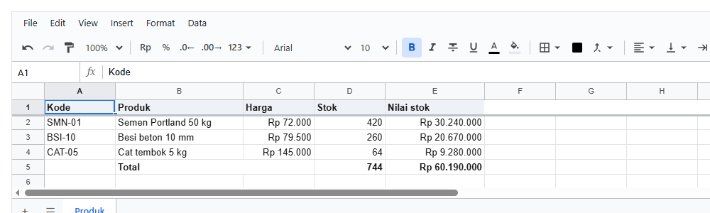

# @kufayeka/sheet

Spreadsheet untuk React yang rasanya seperti Google Sheets. Orang bisa bikin dan merapikan sheet sendiri lewat toolbar dan menu: rumus, format
Rupiah, merge, filter, grup baris, komentar, import dan download Excel. Kode aplikasimu tetap pegang kendali: tiap perubahan bisa diizinkan, diubah,
atau ditolak, dan tiap orang cuma bisa melakukan apa yang dikasih perannya.



Ditulis dalam JavaScript dengan JSDoc. File `.d.ts` untuk TypeScript dibuat dari situ waktu build, jadi editor tetap kasih saran nama fungsi dan
parameter.

**Lihat [Galeri](docs/galeri.md)**: satu proyek konstruksi lengkap (RAB, AHSP, kurva S, opname, termin, CCO, laporan harian, cash flow,
NCR, dan overview dari banyak file) yang saling terhubung lewat rumus, dibuat dengan library ini.

## Pasang

```bash
npm install @kufayeka/sheet
```

Butuh `react` dan `react-dom` versi 18 ke atas.

## Contoh terkecil

<!-- contoh: 01-05-kosong.page.tsx -->
```tsx
import { Sheet } from '@kufayeka/sheet';
import '@kufayeka/sheet/style.css';

// 1.5 Sheet pertama: satu komponen, satu tinggi. Belum ada isi.
export default function Halaman() {
    return (
        <div style={{ height: 420 }}>
            <Sheet />
        </div>
    );
}
```
<!-- /contoh -->

## Tiga pintu masuk

| Import | Isinya | Jalan di |
|---|---|---|
| `@kufayeka/sheet` | komponen `<Sheet>`: grid, toolbar, menu, panel | browser (sudah bertanda `"use client"` untuk Next.js) |
| `@kufayeka/sheet/core` | workbook, rumus, format, Excel, access control, tanpa React | browser dan server Node, kodenya sama |
| `@kufayeka/sheet/style.css` | tampilan; semua warna dan ukuran berupa variabel CSS | |

Server (misalnya Nexa API Maker) pakai `@kufayeka/sheet/core` untuk memeriksa tiap simpanan dengan aturan yang sama dengan di browser.

## Daftar isi

1. [Mulai dalam 5 menit](docs/01-mulai-cepat.md): pasang, sheet pertama, isi dari kode, dirapikan, disimpan, Next.js
2. [Konsep dasar](docs/02-konsep.md): workbook, sheet, alamat sel, id baris dan kolom, perubahan (op), undo, menyimpan
3. [Komponen `<Sheet>`](docs/03-komponen-sheet.md): semua props, event, handle (`ref`), keyboard, tema
- [Galeri: satu proyek konstruksi](docs/galeri.md)
4. [API workbook](docs/04-api-workbook.md): mengisi dan membaca sel, gaya, baris dan kolom, sheet, undo, op
5. [Rumus](docs/05-rumus.md): referensi, laporan dengan rumus, named range, SUBTOTAL, error, 124 fungsi, termasuk TERBILANG
6. [Format, locale, dan conditional formatting](docs/06-format.md)
7. [Data](docs/07-data.md): sort, filter, grup, validasi, cari dan ganti
8. [Pivot table](docs/08-pivot.md): di sheet, dan tanpa sheet untuk server
9. [Mengisi sheet dari data](docs/09-populate.md): populate dari API atau database
10. [Aturan dan tipe kolom](docs/10-aturan.md)
11. [Memakai di React](docs/11-react.md): langkah demi langkah, useWorkbook, memuat, menyimpan, Next.js
12. [Menyimpan ke server](docs/12-server.md): dari sheet ke tabel database, patch, viewFor
13. [Hak akses](docs/13-hak-akses.md)
14. [Komentar](docs/14-komentar.md)
15. [Excel dan CSV](docs/15-excel.md)
16. [Panduan layar](docs/16-layar.md): menu, toolbar, panel
17. [Performa](docs/17-performa.md)
18. [Referensi](docs/18-referensi.md): semua nama, satu baris masing-masing

## Soal dokumentasi ini

Semua contoh kode di sini adalah file di [`docs/examples/`](docs/examples/). Kode dan hasil cetaknya dimasukkan ke halaman oleh `npm run docs`, dan
gambarnya diambil dari contoh yang sama di Chrome oleh `npm run docs:shots`. `test/docs.test.js` gagal kalau ada contoh yang sudah tidak jalan atau
halaman yang beda dengan hasil terbaru.
