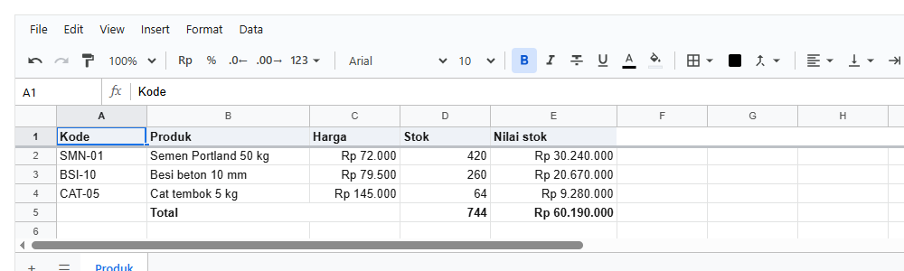

# @kufayeka/sheet

Spreadsheet engine dan komponen UI modern untuk React. Dirancang untuk menghadirkan pengalaman interaktif spreadsheet tingkat lanjut (seperti Google Sheets atau Microsoft Excel) langsung ke dalam aplikasi web, dengan kendali penuh terhadap validasi data, hak akses (ACL/RBAC), rumus reaktif, serta siklus hidup penyimpanan state.



Library ini ditulis dalam JavaScript modern dengan JSDoc komprehensif dan menghasilkan file deklarasi TypeScript (`.d.ts`) otomatis saat proses build, memberikan dukungan auto-completion dan type safety penuh pada IDE.

**Studi Kasus Lengkap: [Galeri Konstruksi](docs/galeri.md)** — Implementasi sistem spreadsheet multi-sheet terintegrasi untuk proyek konstruksi (RAB, AHSP, Kurva S, Opname, Termin, CCO, Laporan Harian, Cash Flow, dan NCR).

---

## Fitur Utama

- **Headless Core & React UI**: Pemisahan tegas antara engine kalkulasi (`@kufayeka/sheet/core`) yang dapat berjalan di browser maupun server (Node.js) dan layer presentasi UI (`@kufayeka/sheet`).
- **Formula Engine Reaktif**: Mendukung lebih dari 180 fungsi formula standar Excel (finansial, statistik, logika, manipulasi teks, hingga fungsi lokal seperti `TERBILANG`).
- **Formatting & Locale Terintegrasi**: Konfigurasi otomatis pemisah ribuan/desimal, parsing tanggal, dan konvensi mata uang (termasuk Rupiah `id-ID`).
- **Data Operations**: Multi-column sorting, filter berbasis kondisi, grouping baris bertingkat, dan pivot table interaktif.
- **Data Validation & Protection**: Validasi dropdown, batasan numerik, sel terkunci (read-only), serta interceptor perubahan transaksional via `beforeOp`.
- **Granular Access Control (ACL)**: Konfigurasi hak akses berbasis role dan user hingga ke level sel, baris, maupun kolom (`viewFor` dan `checkPatch`).
- **Excel Interoperability & Threaded Comments**: Import/export native format `.xlsx` dan CSV, serta fitur komentar terstruktur pada sel.
- **Embedded Visualizations**: Dukungan pembuatan chart interaktif (Bar, Line, Dual-axis, Pie, Bullet, Waterfall, Kurva S) dan in-cell sparklines.

---

## Instalasi

```bash
npm install @kufayeka/sheet
```

> **Requirement**: Membutuhkan `react` dan `react-dom` versi 18 ke atas (peer dependencies).

---

## Quickstart

<!-- contoh: 01-05-kosong.page.tsx -->
```tsx
import { Sheet } from '@kufayeka/sheet';
import '@kufayeka/sheet/style.css';

// 1.5 Sheet pertama: satu komponen, satu tinggi. Belum ada isi.
export default function Halaman() {
    return (
        <div style={{ height: 420 }}>
            <Sheet />
        </div>
    );
}
```
<!-- /contoh -->

---

## Struktur Paket & Entry Points

Library menyediakan tiga entry point modular:

| Import | Konten | Lingkungan Eksekusi |
|---|---|---|
| `@kufayeka/sheet` | Komponen `<Sheet>`, UI Toolbar, Menu Bar, Formula Bar, Dialog, dan React hooks (`useWorkbook`). | Browser (sudah bertanda `"use client"` untuk Next.js App Router). |
| `@kufayeka/sheet/core` | Core Workbook engine, formula evaluator, format engine, permission checker, tanpa dependensi React. | Isomorfik (Browser & Node.js backend). |
| `@kufayeka/sheet/style.css` | Stylesheet tema spreadsheet berbasis CSS Custom Properties. | Browser / Bundler CSS. |

---

## Dokumentasi Lengkap

1. [01. Mulai Cepat & Setup](docs/01-mulai-cepat.md): Instalasi, rendering pertama, inisialisasi data, format tampilan, auto-save, dan panduan Next.js.
2. [02. Konsep Arsitektur & Mental Model](docs/02-konsep.md): Workbook headless, koordinat sel, lifecycle nilai (`value`/`input`/`display`), identitas baris (`rowId`), transactional ops, dan reactive listener.
3. [03. Komponen `<Sheet>` & Kustomisasi UI](docs/03-komponen-sheet.md): Props interface, event listener, interaksi imperatif via `ref`, visibilitas modul UI, theming CSS, dan kontrol keyboard.
4. [04. Manipulasi Data Programatis](docs/04-api-workbook.md): Menulis nilai (`setValues`), ekstraksi data (`tableOf`), pemetaan API (`populate`), styling, manipulasi baris/kolom, dan multi-sheet.
5. [05. Formula Calculation Engine](docs/05-rumus.md): Sintaks formula, referensi relatif/absolut (`$`), formula lintas sheet, named ranges, dan katalog 180+ fungsi bawaan.
6. [06. Format Sel & Internasionalisasi](docs/06-format.md): Number formatting (mata uang, persen, desimal), format pattern kustom, locale `id-ID`, dan conditional formatting.
7. [07. Operasi Data](docs/07-data.md): Sorting multi-level, filtering data, hierarki baris bertingkat (folding/grup), pivot table, serta find & replace.
8. [08. Validasi Data & Proteksi Sel](docs/08-menjaga-isi.md): Dropdown list, validasi rentang angka, enforcement tipe kolom, sel terkunci, dan interceptor `beforeOp`.
9. [09. Persistensi State & Sinkronisasi Server](docs/09-menyimpan.md): Lifecycle integrasi backend, auto-save debounce, serialisasi dokumen, incremental patch, dan integrasi database.
10. [10. Kontrol Akses & Perizinan (ACL/RBAC)](docs/10-hak-akses.md): Proteksi granular berbasis role/akun, masking tampilan (`viewFor`), validasi mutation server (`checkPatch`), dan mode perancang akses.
11. [11. Komentar Sel & Interoperabilitas Excel](docs/11-komentar-excel.md): Threaded comments pada sel, import dan export file `.xlsx`, serta pemrosesan CSV.
12. [12. Visualisasi Data & Dashboard](docs/12-dashboard.md): Floating charts (Bar, Line, Pie, Bullet, Waterfall, Kurva S), in-cell sparklines, dan arsitektur dashboard analitik.
13. [13. Optimasi Performa & Referensi API](docs/13-referensi.md): Virtualization untuk dataset besar (>100.000 baris), katalog lengkap fungsi API, dan tipe TypeScript.

- [Galeri: Studi Kasus Sistem Konstruksi](docs/galeri.md): Implementasi dunia nyata yang menggabungkan seluruh fitur spreadsheet ke dalam alur kerja manajemen proyek.

---

## Integritas Dokumentasi & Pengujian

Semua contoh kode di dalam dokumentasi bersumber langsung dari file executable di [`docs/examples/`](docs/examples/). Cuplikan kode dan hasil evaluasinya diinjeksikan otomatis melalui `npm run docs`, dan tangkapan layar dihasilkan secara otomatis via headless browser melalui `npm run docs:shots`.

Integritas contoh kode, SSR, dan link referensi divalidasi secara berkelanjutan melalui `test/docs.test.js`.
