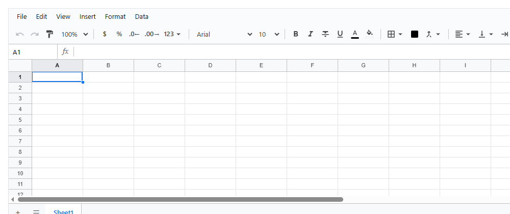
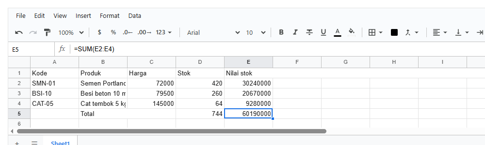
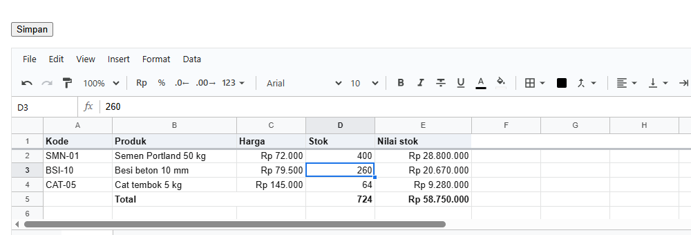

# 1. Mulai dalam 5 menit

[Daftar isi](../README.md#daftar-isi) · Berikutnya: [2. Konsep dasar](02-konsep.md)

Bab ini membawamu dari nol sampai punya halaman React berisi spreadsheet yang bisa diketik, dihitung, dan disimpan. Setiap langkah hanya
menambah **satu hal baru**, dengan foto hasilnya.

**Bagian A. Pengenalan (tanpa kode)**
- [1.1 Apa yang kamu dapat](#11-apa-yang-kamu-dapat)
- [1.2 Dua bagian: isi dan tampilan](#12-dua-bagian-isi-dan-tampilan)
- [1.3 Bagian-bagian layar](#13-bagian-bagian-layar)

**Bagian B. Langkah demi langkah**
- [1.4 Pasang](#14-pasang)
- [1.5 Sheet pertama](#15-sheet-pertama)
- [1.6 Isi dari kode](#16-isi-dari-kode)
- [1.7 Dirapikan](#17-dirapikan)
- [1.8 Menyimpan](#18-menyimpan)
- [1.9 Di Next.js](#19-di-nextjs)

**Bagian C. Kalau ada masalah**
- [1.10 Yang sering kelewat](#110-yang-sering-kelewat)
- [1.11 Setelah bab ini](#111-setelah-bab-ini)

---

# Bagian A. Pengenalan

## 1.1 Apa yang kamu dapat

Sebuah komponen React yang menampilkan spreadsheet lengkap di dalam aplikasimu sendiri:


Orang bisa mengetik, memakai rumus (`=SUM`, `=VLOOKUP`, dan 120 lebih lainnya), memformat, mengurutkan, memfilter, dan mengunduh ke Excel.
Isinya bisa kamu isi dari kode, kamu baca kembali, dan kamu simpan ke database. Contoh di seluruh dokumentasi ini memakai satu cerita yang sama:
**sebuah toko bangunan** dengan daftar produk, harga, dan stok.

## 1.2 Dua bagian: isi dan tampilan

Library ini terdiri dari dua bagian yang terpisah:

| Bagian | Apa itu | Dibuat dengan |
|---|---|---|
| **Workbook** | isinya: sheet, sel, nilai, rumus, gaya. Data biasa, tanpa layar | `createWorkbook()` dari `@kufayeka/sheet/core` |
| **`<Sheet>`** | tampilannya: grid, menu, toolbar. Menampilkan sebuah workbook dan mengubahnya saat orang mengetik | komponen dari `@kufayeka/sheet` |

Yang perlu diingat dari bab ini: **kamu mengisi dan membaca workbook, `<Sheet>` menampilkannya.** Workbook juga bisa dipakai tanpa layar sama
sekali, misalnya di server. Itu dibahas di bab 2.

Ada tiga hal yang di-import:

| Import | Isinya |
|---|---|
| `import { Sheet } from '@kufayeka/sheet'` | komponen `<Sheet>`, dan pembantu React (`useWorkbook`) |
| `import { createWorkbook } from '@kufayeka/sheet/core'` | workbook: membuat, mengisi, membaca. Jalan di browser dan di server |
| `import '@kufayeka/sheet/style.css'` | tampilannya. Cukup sekali di aplikasi |

## 1.3 Bagian-bagian layar


| Bagian | Isinya |
|---|---|
| **Menu bar** | File, Edit, View, Insert, Format, Data |
| **Toolbar** | undo/redo, zoom, format angka (Rp, %, desimal), font, tebal/miring, warna, border, merge, rata, dan lainnya |
| **Formula bar** | kotak nama di kiri (alamat sel aktif; ketik alamat lalu Enter untuk loncat), lalu isi sel aktif |
| **Grid** | huruf kolom, nomor baris, dan sel |
| **Tab sheet** | `+` untuk sheet baru, `☰` daftar semua sheet, lalu satu tab per sheet |

Setiap bagian bisa disembunyikan, untuk semua orang atau untuk orang tertentu saja (bab 3 dan bab 10).

---

# Bagian B. Langkah demi langkah

## 1.4 Pasang

```bash
npm install @kufayeka/sheet
```

Aplikasimu harus sudah memakai **React 18 atau lebih baru** (`react` dan `react-dom`). Library ini tidak membawa React sendiri, jadi tidak akan ada
dua React di satu halaman.

## 1.5 Sheet pertama

**Tujuan:** spreadsheet kosong tampil di halaman.

<!-- contoh: 01-05-kosong.page.tsx -->
```tsx
import { Sheet } from '@kufayeka/sheet';
import '@kufayeka/sheet/style.css';

// 1.5 Sheet pertama: satu komponen, satu tinggi. Belum ada isi.
export default function Halaman() {
    return (
        <div style={{ height: 420 }}>
            <Sheet />
        </div>
    );
}
```
<!-- /contoh -->



**Penjelasan:**

- `<Sheet />` tanpa apa pun menampilkan spreadsheet kosong. Orang sudah bisa mengetik di dalamnya.
- `import '@kufayeka/sheet/style.css'` memasang tampilannya. Tanpa baris ini, grid tampil berantakan.
- **Pembungkusnya harus punya tinggi** (`height: 420`). Sheet mengisi penuh kotak pembungkusnya, jadi kotak tanpa tinggi membuat sheet tidak
  terlihat. Tinggi bisa juga `100vh`, atau `flex: 1` di dalam kolom flex yang punya tinggi.

## 1.6 Isi dari kode

**Tujuan:** sheet tampil dengan isi daftar produk, termasuk rumus.

<!-- contoh: 01-06-isi.page.tsx -->
```tsx
import { useState } from 'react';
import { Sheet } from '@kufayeka/sheet';
import { createWorkbook } from '@kufayeka/sheet/core';
import '@kufayeka/sheet/style.css';

// 1.6 Isi dari kode: workbook dibuat sekali, diisi, lalu diberikan ke <Sheet>.
function buatProduk() {                                                  // baru
    const wb = createWorkbook();
    const s = wb.sheet('Sheet1');
    s.setValues('A1', [
        ['Kode', 'Produk', 'Harga', 'Stok', 'Nilai stok'],
        ['SMN-01', 'Semen Portland 50 kg', 72000, 420, '=C2*D2'],
        ['BSI-10', 'Besi beton 10 mm', 79500, 260, '=C3*D3'],
        ['CAT-05', 'Cat tembok 5 kg', 145000, 64, '=C4*D4'],
        ['', 'Total', '', '=SUM(D2:D4)', '=SUM(E2:E4)']
    ]);
    return wb;
}

export default function Halaman() {
    const [wb] = useState(buatProduk);                                  // baru: dibuat sekali saja
    return (
        <div style={{ height: 300 }}>
            <Sheet workbook={wb} />                                     {/* baru */}
        </div>
    );
}
```
<!-- /contoh -->

E5 dipilih, sehingga formula bar memperlihatkan rumusnya:



**Penjelasan:**

- `createWorkbook()` membuat workbook kosong dengan satu sheet bernama `Sheet1`.
- `wb.sheet('Sheet1').setValues('A1', [...])` mengisi sel mulai dari A1. Array di dalam array: setiap array dalam adalah satu baris.
- Teks yang diawali `=` adalah **rumus**: `=C2*D2` (harga kali stok), `=SUM(E2:E4)` (jumlah). Sheet menghitungnya sendiri, dan menghitung ulang
  saat isinya berubah.
- `useState(buatProduk)` membuat workbook **sekali saja**. Tulis nama fungsinya tanpa tanda kurung: kalau ditulis `useState(buatProduk())`,
  workbook baru dibuat di setiap render dan isi yang diketik orang hilang.
- `<Sheet workbook={wb} />` menampilkan workbook itu. Apa pun yang diketik orang langsung masuk ke `wb`.

## 1.7 Dirapikan

**Tujuan:** angka dengan titik ribuan dan Rupiah, judul tebal, kolom nama lebih lebar, judul tetap di atas saat digulir.

<!-- contoh: 01-07-rapi.page.tsx -->
```tsx
import { useState } from 'react';
import { Sheet } from '@kufayeka/sheet';
import { createWorkbook } from '@kufayeka/sheet/core';
import '@kufayeka/sheet/style.css';

// 1.7 Dirapikan: angka Indonesia dan Rupiah, judul tebal, kolom lebih lebar, judul dibekukan.
function buatProduk() {
    const wb = createWorkbook();
    wb.setSettings({ locale: 'id-ID', currency: 'IDR' });               // baru: 1.250,5 dan Rp
    const s = wb.sheet('Sheet1');
    s.setSheetProps({ name: 'Produk', freezeRows: 1 });                 // baru: nama sheet, judul tetap di atas
    s.setValues('A1', [
        ['Kode', 'Produk', 'Harga', 'Stok', 'Nilai stok'],
        ['SMN-01', 'Semen Portland 50 kg', 72000, 420, '=C2*D2'],
        ['BSI-10', 'Besi beton 10 mm', 79500, 260, '=C3*D3'],
        ['CAT-05', 'Cat tembok 5 kg', 145000, 64, '=C4*D4'],
        ['', 'Total', '', '=SUM(D2:D4)', '=SUM(E2:E4)']
    ]);
    s.setStyle('A1:E1', { bold: true, fill: '#eef2f7' });              // baru: judul
    s.setStyle('A5:E5', { bold: true });                               // baru: baris total
    s.setColProps('C', { format: { type: 'money', decimals: 0 } });    // baru: Rupiah
    s.setColProps('E', { format: { type: 'money', decimals: 0 } });
    s.setColProps('B', { width: 180 });                                // baru: kolom nama lebih lebar
    s.setColProps('E', { width: 140 });
    return wb;
}

export default function Halaman() {
    const [wb] = useState(buatProduk);
    return (
        <div style={{ height: 300 }}>
            <Sheet workbook={wb} fileName="Stok toko" />                 {/* baru: nama file saat diunduh */}
        </div>
    );
}
```
<!-- /contoh -->


**Penjelasan:**

| Baris baru | Hasilnya |
|---|---|
| `wb.setSettings({ locale: 'id-ID', currency: 'IDR' })` | angka memakai cara Indonesia (1.250,5) dan mata uang Rupiah |
| `s.setSheetProps({ name: 'Produk', freezeRows: 1 })` | tab bernama Produk, baris 1 tetap di atas saat digulir (garis tebal di bawahnya) |
| `s.setStyle('A1:E1', { bold: true, fill: '#eef2f7' })` | judul tebal dengan latar abu-abu muda |
| `s.setColProps('C', { format: { type: 'money', decimals: 0 } })` | kolom C tampil sebagai Rupiah tanpa desimal |
| `s.setColProps('B', { width: 180 })` | kolom B selebar 180 piksel |
| `fileName="Stok toko"` | nama file saat orang memilih File → Download |

Nilai di sel tidak berubah: E2 tetap berisi angka 30240000. Format hanya mengubah cara angka itu ditampilkan. Semua pilihan format ada di bab 6.

## 1.8 Menyimpan

**Tujuan:** tombol Simpan yang aktif hanya saat ada perubahan, lalu isi sheet disimpan sebagai JSON.

<!-- contoh: 01-08-simpan.page.tsx -->
```tsx
import { useEffect, useState } from 'react';
import { Sheet, useWorkbook } from '@kufayeka/sheet';
import { createWorkbook } from '@kufayeka/sheet/core';
import type { Workbook, WorkbookDoc } from '@kufayeka/sheet/core';
import '@kufayeka/sheet/style.css';

// 1.8 Menyimpan: tahu kapan ada perubahan, lalu ambil isinya sebagai JSON. Di sini disimpan di browser (localStorage);
// menyimpan ke server dibahas di bab 9.
const KUNCI = 'stok-toko';

function buatProduk() {
    const wb = createWorkbook();
    wb.setSettings({ locale: 'id-ID', currency: 'IDR' });
    const s = wb.sheet('Sheet1');
    s.setSheetProps({ name: 'Produk', freezeRows: 1 });
    s.setValues('A1', [
        ['Kode', 'Produk', 'Harga', 'Stok', 'Nilai stok'],
        ['SMN-01', 'Semen Portland 50 kg', 72000, 420, '=C2*D2'],
        ['BSI-10', 'Besi beton 10 mm', 79500, 260, '=C3*D3'],
        ['CAT-05', 'Cat tembok 5 kg', 145000, 64, '=C4*D4'],
        ['', 'Total', '', '=SUM(D2:D4)', '=SUM(E2:E4)']
    ]);
    s.setStyle('A1:E1', { bold: true, fill: '#eef2f7' });
    s.setStyle('A5:E5', { bold: true });
    s.setColProps('C', { format: { type: 'money', decimals: 0 } });
    s.setColProps('E', { format: { type: 'money', decimals: 0 }, width: 140 });
    s.setColProps('B', { width: 180 });
    return wb;
}

export default function Halaman() {
    // baru: workbook dibuat di useEffect, yaitu di browser saja (localStorage hanya ada di browser)
    const [wb, setWb] = useState<Workbook | null>(null);
    useEffect(() => {
        const tersimpan = localStorage.getItem(KUNCI);
        setWb(tersimpan ? createWorkbook(JSON.parse(tersimpan) as WorkbookDoc) : buatProduk());
    }, []);

    const adaPerubahan = useWorkbook(wb, (w) => w.unsaved());                            // baru: true setelah orang mengubah sesuatu

    function simpan() {                                                                 // baru
        if (!wb) return;
        localStorage.setItem(KUNCI, JSON.stringify(wb.toJSON()));                       // isi workbook sebagai JSON
        wb.saved();                                                                     // tandai: semua sudah tersimpan
    }

    if (!wb) return <p>Memuat…</p>;
    return (
        <div>
            <p>
                <button className="simpan" onClick={simpan} disabled={!adaPerubahan}>{adaPerubahan ? 'Simpan' : 'Tersimpan'}</button>
            </p>
            <div style={{ height: 300 }}>
                <Sheet workbook={wb} fileName="Stok toko" />
            </div>
        </div>
    );
}
```
<!-- /contoh -->

Setelah stok Semen diubah dari 420 menjadi 400, tombolnya menjadi **Simpan**, dan totalnya ikut berubah:



**Penjelasan:**

- `useWorkbook(wb, (w) => w.unsaved())` membaca sesuatu dari workbook, dan membuat komponenmu dirender ulang setiap kali nilai itu berubah.
  Di sini nilainya `true` begitu orang mengubah sesuatu.
- `wb.toJSON()` mengambil seluruh isi workbook sebagai objek JSON biasa: sel, rumus, gaya, ukuran kolom, semuanya.
- `wb.saved()` menandai bahwa semua sudah tersimpan, sehingga `unsaved()` kembali `false` dan tombolnya kembali menjadi Tersimpan.
- `createWorkbook(json)` membuka kembali JSON yang tersimpan. Saat halaman dimuat ulang, isinya kembali seperti terakhir disimpan.
- Workbook sekarang dibuat di **`useEffect`**, bukan di `useState`, karena `localStorage` hanya ada di browser. Selama belum siap, halaman
  menampilkan "Memuat…".

Di contoh ini isinya disimpan di browser. Menyimpan ke server, termasuk hanya mengirim bagian yang berubah, dibahas di bab 9.

## 1.9 Di Next.js

`<Sheet>` adalah client component. File `@kufayeka/sheet` sudah diawali `"use client"`, jadi bisa dipakai langsung di App Router.

Satu hal yang wajib diperhatikan: Next.js merender halaman **dua kali**, sekali di server lalu sekali lagi di browser. Workbook berisi id acak,
jadi kalau dibuat di kedua tempat, isinya berbeda dan React memberi peringatan *hydration mismatch*. Karena itu, di Next.js workbook dibuat di
`useEffect`, seperti di 1.8:

<!-- contoh: 01-09-next.page.tsx -->
```tsx
'use client';
// app/stok/page.tsx  (Next.js App Router)
// 'use client' di baris pertama: halaman ini membuat workbook dan memakai state.
import { useEffect, useState } from 'react';
import { Sheet } from '@kufayeka/sheet';
import { createWorkbook } from '@kufayeka/sheet/core';
import type { Workbook } from '@kufayeka/sheet/core';
import '@kufayeka/sheet/style.css';

function buatProduk(): Workbook {
    const wb = createWorkbook();
    wb.sheet('Sheet1').setValues('A1', [['Kode', 'Produk', 'Stok'], ['SMN-01', 'Semen Portland 50 kg', 420]]);
    return wb;
}

export default function Page() {
    // Next.js merender halaman sekali di server, lalu sekali lagi di browser. Workbook dibuat di useEffect (hanya di browser),
    // supaya id acak di dalamnya tidak berbeda antara keduanya (pesan "hydration mismatch").
    const [wb, setWb] = useState<Workbook | null>(null);
    useEffect(() => { setWb(buatProduk()); }, []);

    if (!wb) return <p>Memuat…</p>;
    return (
        <main style={{ height: '100vh' }}>
            <Sheet workbook={wb} />
        </main>
    );
}
```
<!-- /contoh -->

**Penjelasan:**

- `'use client'` di baris pertama, karena halaman ini memakai state.
- `useState<Workbook | null>(null)` lalu `useEffect(() => setWb(buatProduk()), [])`: workbook dibuat setelah halaman tampil di browser.
- Selama `wb` masih `null`, tampilkan teks memuat.

Vite, Create React App, atau React tanpa server rendering: `useState(buatProduk)` seperti di 1.6 sudah cukup.

---

# Bagian C. Kalau ada masalah

## 1.10 Yang sering kelewat

| Gejala | Penyebab | Solusi |
|---|---|---|
| Sheet tidak terlihat | pembungkusnya tidak punya tinggi | beri tinggi: `height: 420`, `100vh`, atau `flex: 1` di dalam kolom flex yang punya tinggi |
| Tampilan berantakan, tanpa garis | CSS belum di-import | `import '@kufayeka/sheet/style.css'` sekali di aplikasi |
| Isi yang diketik hilang saat komponen dirender ulang | `createWorkbook()` dipanggil langsung di badan komponen | `useState(buatProduk)`, tanpa tanda kurung |
| Peringatan *hydration mismatch* di Next.js | workbook dibuat di server dan di browser | buat workbook di `useEffect` (1.9) |
| `localStorage is not defined` | kode browser dijalankan saat server rendering | pindahkan ke `useEffect` (1.8) |
| Angka tampil `1250.5`, bukan `1.250,5` | locale bawaan `en-US` | `wb.setSettings({ locale: 'id-ID', currency: 'IDR' })` |

## 1.11 Setelah bab ini

Kamu sudah bisa menampilkan, mengisi, merapikan, dan menyimpan sebuah spreadsheet. Bab berikutnya:

| Kalau kamu perlu | Baca |
|---|---|
| memahami workbook, sel, dan perubahan dengan benar | [bab 2. Konsep dasar](02-konsep.md) |
| mengatur `<Sheet>`: event, ukuran, bagian layar, tema | bab 3 |
| mengisi sheet dari data API | bab 4 |
| menyimpan ke server dengan benar | bab 9 |

[Daftar isi](../README.md#daftar-isi) · Berikutnya: [2. Konsep dasar](02-konsep.md)
