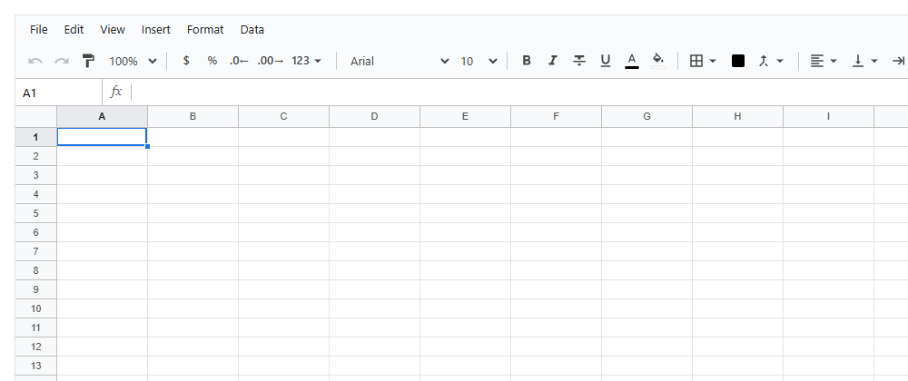
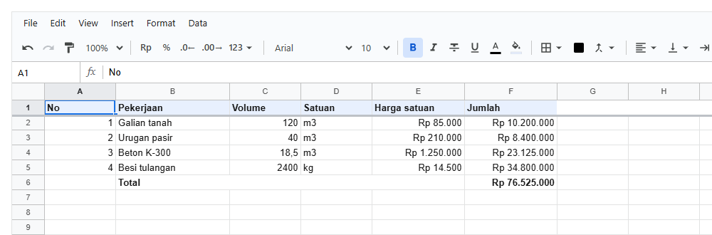

# 1. Mulai cepat

[Daftar isi](../README.md#daftar-isi) · Berikutnya: [2. Konsep dasar](02-konsep.md)

Dari nol sampai punya halaman dengan sheet BOQ: pasang paket, taruh komponen, isi sheet dari kode, pakai di Next.js.

- [1.1 Pasang](#11-pasang)
- [1.2 Halaman pertama](#12-halaman-pertama)
- [1.3 Bagian-bagian layar](#13-bagian-bagian-layar)
- [1.4 Workbook dari kode](#14-workbook-dari-kode)
- [1.5 Next.js](#15-nextjs)
- [1.6 Yang sering kelewat](#16-yang-sering-kelewat)

## 1.1 Pasang

```bash
npm install @kufayeka/sheet
```

Butuh **React 18 ke atas** (`react` dan `react-dom`) yang sudah ada di aplikasimu. Library ini tidak bawa React sendiri, jadi tidak ada dua React di
satu halaman.

| Import | Buat apa |
|---|---|
| `import { Sheet } from '@kufayeka/sheet'` | menampilkan spreadsheet |
| `import { createWorkbook, ... } from '@kufayeka/sheet/core'` | bikin dan ubah isi workbook dari kode, di browser atau di server |
| `import '@kufayeka/sheet/style.css'` | tampilan; cukup sekali di aplikasi |

## 1.2 Halaman pertama

<!-- contoh: 01-halaman.page.js -->
```jsx
import { Sheet } from '@kufayeka/sheet';
import '@kufayeka/sheet/style.css';

// Halaman paling sederhana: sheet kosong seperti Google Sheets.
// Sheet mengisi tinggi pembungkusnya, jadi pembungkus harus punya tinggi.
export default function Halaman() {
    return (
        <div style={{ height: 600 }}>
            <Sheet />
        </div>
    );
}
```
<!-- /contoh -->



Tanpa props, `<Sheet>` bikin workbook kosong sendiri: satu sheet, 1000 baris, kolom A sampai Z. Orang langsung bisa ngetik, nulis rumus, format, nambah
sheet. Isinya hilang begitu halaman ditutup karena belum ada yang menyimpan. Cara menyimpan ada di [2.6](02-konsep.md#26-menyimpan).

## 1.3 Bagian-bagian layar


| Bagian | Isinya |
|---|---|
| **Menu bar** | File, Edit, View, Insert, Format, Data, mirip Google Sheets |
| **Toolbar** | undo/redo, paint format, zoom, format angka (Rp, %, desimal), font, tebal/miring/coret/garis bawah, warna, border, merge, rata, wrap, rotasi, link, fungsi, hapus format |
| **Formula bar** | kotak nama di kiri (alamat sel atau nama range; ketik alamat lalu Enter untuk loncat), lalu isi sel aktif |
| **Grid** | huruf kolom, nomor baris, sel. Baris dan kolom bisa dibekukan, diubah ukurannya, dikelompokkan |
| **Tab sheet** | `+` untuk sheet baru, `☰` daftar semua sheet, lalu satu tab per sheet (klik kanan: ganti nama, duplikat, sembunyikan, geser, hapus; tab juga bisa diseret) |

Tiap bagian bisa disembunyikan per orang lewat access control ([bab 13](13-hak-akses.md)). Misalnya mandor di lapangan cuma isi kolom realisasi, tanpa menu dan toolbar.

## 1.4 Workbook dari kode

Biasanya isi sheet datang dari aplikasimu: database, template, data proyek. Bikin **workbook** pakai `createWorkbook()`, isi lewat kode, lalu kasih
ke `<Sheet workbook={...}>`:

<!-- contoh: 01-boq.page.js -->
```jsx
import { useState } from 'react';
import { Sheet } from '@kufayeka/sheet';
import { createWorkbook } from '@kufayeka/sheet/core';
import '@kufayeka/sheet/style.css';

// Isi workbook disiapkan oleh kode, lalu workbook-nya dikasih ke <Sheet>.
function buatBoq() {
    const wb = createWorkbook();
    wb.setSettings({ locale: 'id-ID', currency: 'IDR' });

    const boq = wb.sheet('Sheet1');
    boq.setSheetProps({ name: 'BOQ', freezeRows: 1 });
    boq.setValues('A1', [
        ['No', 'Pekerjaan', 'Volume', 'Satuan', 'Harga satuan', 'Jumlah'],
        [1, 'Galian tanah', 120, 'm3', 85000, '=C2*E2'],
        [2, 'Urugan pasir', 40, 'm3', 210000, '=C3*E3'],
        [3, 'Beton K-300', 18.5, 'm3', 1250000, '=C4*E4'],
        [4, 'Besi tulangan', 2400, 'kg', 14500, '=C5*E5'],
        ['', 'Total', '', '', '', '=SUM(F2:F5)']
    ]);
    boq.setStyle('A1:F1', { bold: true, fill: '#e8f0fe' });
    boq.setStyle('E2:F6', { format: { type: 'money', decimals: 0 } });
    boq.setStyle('A6:F6', { bold: true });
    boq.setColProps('B', { width: 160 });
    boq.setColProps('E:F', { width: 130 });
    return wb;
}

export default function HalamanBoq() {
    // useState dengan fungsi: workbook dibuat sekali, bukan tiap render
    const [wb] = useState(buatBoq);
    return (
        <div style={{ height: 600 }}>
            <Sheet workbook={wb} fileName="BOQ Gedung A" />
        </div>
    );
}
```
<!-- /contoh -->



| Kode | Artinya |
|---|---|
| `createWorkbook()` | workbook baru dengan satu sheet kosong bernama `Sheet1` |
| `setSettings({ locale: 'id-ID', currency: 'IDR' })` | angka ditulis `1.250,5`, uang `Rp 1.250`, tanggal `26/10/2026` |
| `wb.sheet('Sheet1')` | ambil satu sheet (pakai nama atau id). Hasilnya punya fungsi yang sama dengan workbook, tapi tanpa perlu nyebut sheet lagi |
| `setSheetProps({ name: 'BOQ', freezeRows: 1 })` | nama tab, dan baris pertama dibekukan (tetap kelihatan waktu scroll) |
| `setValues('A1', [...])` | tulis mulai dari A1, satu array per baris. Teks yang diawali `=` jadi rumus |
| `setStyle('A1:F1', {...})` | kasih gaya ke range. Beberapa range sekaligus juga bisa: `'A1:F1, A6:F6'` |
| `setColProps('E:F', { width: 130 })` | lebar kolom E sampai F, dalam piksel |
| `useState(buatBoq)` | workbook menyimpan semua isi dan riwayat undo. Bikin sekali, simpan di state atau ref, jangan dibikin ulang tiap render |
| `fileName="BOQ Gedung A"` | nama file waktu orang pilih File → Download |

Semua fungsi juga bisa dipanggil dengan nomor baris dan kolom (mulai dari 0) kalau lebih enak, misalnya waktu looping. Penjelasannya di
[2.2](02-konsep.md#22-alamat-sel).

## 1.5 Next.js

`<Sheet>` itu **client component**: pakai state, event mouse dan keyboard, dan DOM. File `@kufayeka/sheet` sudah diawali `"use client"`, jadi di App
Router bisa langsung dipakai di halaman, tidak perlu `dynamic(..., { ssr: false })`:

<!-- contoh: 01-next-page.js -->
```js
// app/boq/page.js  (Next.js App Router)
// <Sheet> sudah bertanda "use client", jadi boleh langsung dipakai di halaman ini.
import { Sheet } from '@kufayeka/sheet';
import '@kufayeka/sheet/style.css';

export default function Page() {
    return (
        <main style={{ height: '100vh' }}>
            <Sheet fileName="BOQ" />
        </main>
    );
}
```
<!-- /contoh -->

Next.js tetap merender client component sekali di server buat HTML awal. Sheet aman di tahap itu karena tidak menyentuh `window` atau `document` waktu
render (dicek oleh `ssr.test.js` dan `docs.test.js`). Ukuran layar baru diukur setelah halaman tampil di browser.

Kalau workbook dibikin di dalam komponen (seperti contoh BOQ), komponen itu juga harus client component: tambahkan `'use client';` di baris pertama
filenya.

Vite, Create React App, atau React biasa: tidak ada yang perlu diatur.

## 1.6 Yang sering kelewat

| Gejala | Sebab | Solusi |
|---|---|---|
| Sheet tidak kelihatan, tingginya 0 | pembungkusnya tidak punya tinggi | kasih tinggi: `style={{ height: 600 }}`, `100vh`, atau `flex: 1` di kolom flex yang punya tinggi |
| Tampilan berantakan, tanpa garis | CSS belum di-import | `import '@kufayeka/sheet/style.css'` sekali di aplikasi |
| Isi balik kosong / undo hilang tiap render | `createWorkbook()` dipanggil langsung di badan komponen | `const [wb] = useState(createWorkbook)` atau `useState(buatBoq)` |
| Angka tampil `1250.5`, bukan `1.250,5` | locale bawaan `en-US` | `wb.setSettings({ locale: 'id-ID', currency: 'IDR' })` |

[Daftar isi](../README.md#daftar-isi) · Berikutnya: [2. Konsep dasar](02-konsep.md)
