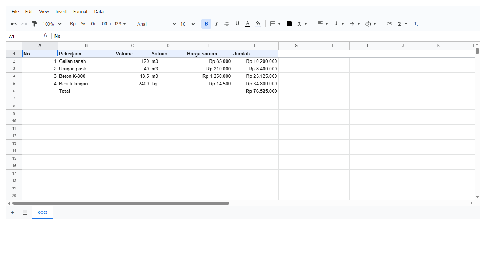
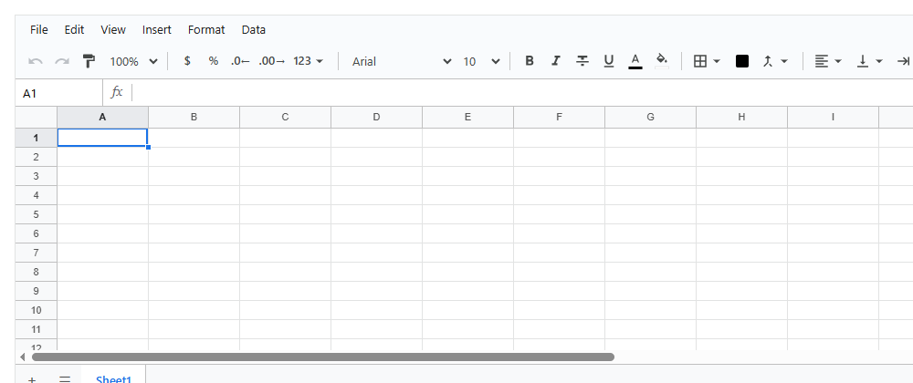
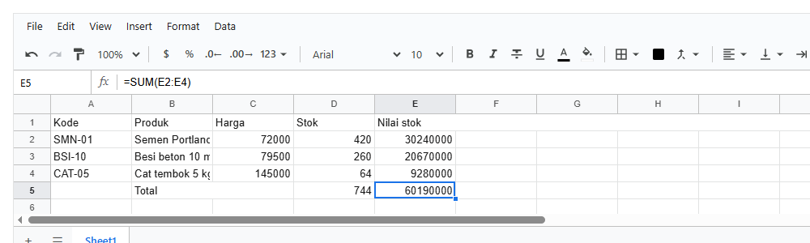
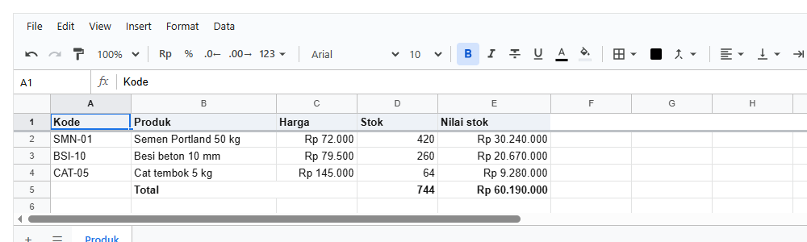
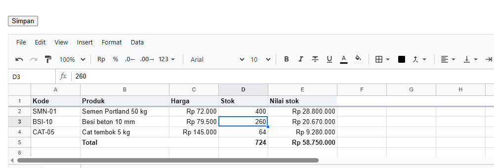

# 01. Mulai Cepat & Setup

[Daftar isi](../README.md#daftar-isi) · Bab berikutnya: [02. Konsep Arsitektur & Mental Model](02-konsep.md)

Bab ini memandu Anda mulai dari instalasi paket, konfigurasi rendering pertama komponen `<Sheet />`, inisialisasi data programatis dan formula, pemformatan visual dan locale, hingga penanganan state persistence dan integrasi di lingkungan Next.js App Router.

---

## 1. Arsitektur Dasar: Core vs Presentasi

Paket `@kufayeka/sheet` memisahkan layer data (state & kalkulasi) dari layer presentasi (antarmuka pengguna):

| Lapisan | Deskripsi | Modul & Entry Point |
|---|---|---|
| **Headless Workbook Engine** | Mengelola sheet, sel, kalkulasi formula, styling, history (undo/redo), dan rule keamanan. Berjalan secara isomorfik di browser maupun Node.js runtime tanpa dependensi DOM. | `createWorkbook` dari `@kufayeka/sheet/core` |
| **Komponen Presentasi `<Sheet>`** | Antarmuka visual spreadsheet lengkap (virtualized grid, formula bar, toolbar, dialog konfigurasi, sheet tabs). Merender state workbook dan menangani interaksi pengguna. | `Sheet` dari `@kufayeka/sheet` |
| **Stylesheet Global** | Menyediakan styling, layout grid, font, dan icon berbasis CSS Custom Properties (variabel CSS). | `@kufayeka/sheet/style.css` |

---

## 2. Anatomi Antarmuka Pengguna

Komponen `<Sheet />` hadir dengan antarmuka spreadsheet siap pakai yang modular:



- **Menu Bar**: Akses menu kontekstual standar (*File, Edit, View, Insert, Format, Data*).
- **Toolbar**: Kontrol cepat untuk undo/redo, zoom level, format angka/mata uang, styling tipografi, alignment, border, merge cell, dan filter.
- **Formula Bar**: Name Box di sisi kiri (menampilkan dan mengontrol koordinat sel aktif) dan input formula multiline reaktif.
- **Virtualized Grid**: Area tabel performa tinggi dengan header kolom alfabet, header baris numerik, dan sel virtualized.
- **Sheet Tabs**: Tab navigasi sheet aktif, tombol penambahan sheet (`+`), dan menu dropdown daftar seluruh sheet.

> Seluruh elemen antarmuka di atas dapat disembunyikan atau dikustomisasi secara selektif melalui props komponen (lihat [Bab 03](03-komponen-sheet.md)) maupun dikontrol berbasis hak akses user (lihat [Bab 10](10-hak-akses.md)).

---

## 3. Instalasi

Pasang paket `@kufayeka/sheet` ke dalam project React Anda:

```bash
npm install @kufayeka/sheet
```

Pastikan project Anda telah menginstal `react` dan `react-dom` versi **>= 18.0.0**.

---

## 4. Implementasi Dasar (Blank Spreadsheet)

Untuk merender spreadsheet kosong, impor komponen `Sheet` dan file CSS-nya. Pastikan container pembungkus memiliki dimensi tinggi (`height`) yang terdefinisi secara eksplisit.

<!-- contoh: 01-05-kosong.page.tsx -->
```tsx
import { Sheet } from '@kufayeka/sheet';
import '@kufayeka/sheet/style.css';

// 1.5 Sheet pertama: satu komponen, satu tinggi. Belum ada isi.
export default function Halaman() {
    return (
        <div style={{ height: 420 }}>
            <Sheet />
        </div>
    );
}
```
<!-- /contoh -->



### Catatan Teknis Layout

Komponen `<Sheet />` menerapkan layout fleksibel yang mengisi 100% dimensi parent container (`width: 100%`, `height: 100%`). Jika container tidak memiliki nilai tinggi yang terdefinisi (misalnya `height: auto` default pada elemen `<div>`), spreadsheet akan terender dengan tinggi 0 piksel. Gunakan nilai tinggi absolut (seperti `height: 420px`), viewport unit (`height: 100vh`), atau CSS Flexbox/Grid (`flex: 1`).

---

## 5. Inisialisasi Data & Formula dari Kode

Workbook dapat dibuat secara terprogram menggunakan `createWorkbook()`, diisi dengan matriks data serta rumus kalkulasi, kemudian di-passing ke `<Sheet workbook={wb} />`.

<!-- contoh: 01-06-isi.page.tsx -->
```tsx
import { useState } from 'react';
import { Sheet } from '@kufayeka/sheet';
import { createWorkbook } from '@kufayeka/sheet/core';
import '@kufayeka/sheet/style.css';

// 1.6 Isi dari kode: workbook dibuat sekali, diisi, lalu diberikan ke <Sheet>.
function buatProduk() {                                                  // baru
    const wb = createWorkbook();
    const s = wb.sheet('Sheet1');
    s.setValues('A1', [
        ['Kode', 'Produk', 'Harga', 'Stok', 'Nilai stok'],
        ['SMN-01', 'Semen Portland 50 kg', 72000, 420, '=C2*D2'],
        ['BSI-10', 'Besi beton 10 mm', 79500, 260, '=C3*D3'],
        ['CAT-05', 'Cat tembok 5 kg', 145000, 64, '=C4*D4'],
        ['', 'Total', '', '=SUM(D2:D4)', '=SUM(E2:E4)']
    ]);
    return wb;
}

export default function Halaman() {
    const [wb] = useState(buatProduk);                                  // baru: dibuat sekali saja
    return (
        <div style={{ height: 300 }}>
            <Sheet workbook={wb} />                                     {/* baru */}
        </div>
    );
}
```
<!-- /contoh -->



### Detail Mekanisme

1. **Inisialisasi Workbook**: `createWorkbook()` menghasilkan instance workbook baru dengan sheet default bernama `'Sheet1'`.
2. **Batch Data Insertion**: Metode `sheet.setValues(koordinat, dataMatrix)` menyisipkan data mulai dari koordinat awal yang ditentukan (`'A1'`). Format matriks `Array<Array<any>>` memetakan array luar sebagai baris dan array dalam sebagai kolom.
3. **Formula Parsing**: String yang diawali dengan karakter sama dengan (`=`) otomatis dievaluasi oleh formula engine internal (misalnya `=C2*D2` dan `=SUM(D2:D4)`). Hasil kalkulasi diperbarui secara reaktif setiap kali nilai dependensi selnya berubah.
4. **Stable State Instantiation**: Bungkus inisialisasi instance workbook dengan lazy initializer pada React State (`useState(buatProduk)`). Jangan panggil `useState(buatProduk())` secara langsung agar instance workbook tidak terbuat ulang pada setiap siklus re-render.

---

## 6. Formatting, Styling, & Pengaturan Kolom

Tampilan sel, lebar kolom, pembekuan baris (freeze pane), dan locale mata uang dapat dikonfigurasi secara deklaratif melalui API workbook:

<!-- contoh: 01-07-rapi.page.tsx -->
```tsx
import { useState } from 'react';
import { Sheet } from '@kufayeka/sheet';
import { createWorkbook } from '@kufayeka/sheet/core';
import '@kufayeka/sheet/style.css';

// 1.7 Dirapikan: angka Indonesia dan Rupiah, judul tebal, kolom lebih lebar, judul dibekukan.
function buatProduk() {
    const wb = createWorkbook();
    wb.setSettings({ locale: 'id-ID', currency: 'IDR' });               // baru: 1.250,5 dan Rp
    const s = wb.sheet('Sheet1');
    s.setSheetProps({ name: 'Produk', freezeRows: 1 });                 // baru: nama sheet, judul tetap di atas
    s.setValues('A1', [
        ['Kode', 'Produk', 'Harga', 'Stok', 'Nilai stok'],
        ['SMN-01', 'Semen Portland 50 kg', 72000, 420, '=C2*D2'],
        ['BSI-10', 'Besi beton 10 mm', 79500, 260, '=C3*D3'],
        ['CAT-05', 'Cat tembok 5 kg', 145000, 64, '=C4*D4'],
        ['', 'Total', '', '=SUM(D2:D4)', '=SUM(E2:E4)']
    ]);
    s.setStyle('A1:E1', { bold: true, fill: '#eef2f7' });              // baru: judul
    s.setStyle('A5:E5', { bold: true });                               // baru: baris total
    s.setColProps('C', { format: { type: 'money', decimals: 0 } });    // baru: Rupiah
    s.setColProps('E', { format: { type: 'money', decimals: 0 } });
    s.setColProps('B', { width: 180 });                                // baru: kolom nama lebih lebar
    s.setColProps('E', { width: 140 });
    return wb;
}

export default function Halaman() {
    const [wb] = useState(buatProduk);
    return (
        <div style={{ height: 300 }}>
            <Sheet workbook={wb} fileName="Stok toko" />                 {/* baru: nama file saat diunduh */}
        </div>
    );
}
```
<!-- /contoh -->



### Rangkuman Konfigurasi API

| Pemanggilan API | Fungsi |
|---|---|
| `wb.setSettings({ locale: 'id-ID', currency: 'IDR' })` | Menetapkan locale formatting angka ke standar Indonesia (`1.250,50`) dan simbol mata uang default `IDR`. |
| `s.setSheetProps({ name: 'Produk', freezeRows: 1 })` | Mengubah label tab sheet menjadi `'Produk'` dan membekukan baris ke-1 (header tetap terlihat saat scroll vertikal). |
| `s.setStyle('A1:E1', { bold: true, fill: '#eef2f7' })` | Menerapkan visual styling (font tebal dan background fill warna abu-abu muda). |
| `s.setColProps('C', { format: { type: 'money', decimals: 0 } })` | Menetapkan formatter numerik kolom C sebagai mata uang tanpa angka desimal di belakang koma. |
| `s.setColProps('B', { width: 180 })` | Menentukan lebar tetap kolom B menjadi 180 piksel. |
| `fileName="Stok toko"` | Menentukan nama file default saat pengguna mengekspor dokumen via menu *File → Download*. |

---

## 7. Persistensi State & Reactive Change Detection

Untuk menghubungkan spreadsheet dengan siklus hidup persistensi (misalnya penyimpanan ke `localStorage` atau API backend), gunakan hook `useWorkbook` untuk mendeteksi perubahan transaksional:

<!-- contoh: 01-08-simpan.page.tsx -->
```tsx
import { useEffect, useState } from 'react';
import { Sheet, useWorkbook } from '@kufayeka/sheet';
import { createWorkbook } from '@kufayeka/sheet/core';
import type { Workbook, WorkbookDoc } from '@kufayeka/sheet/core';
import '@kufayeka/sheet/style.css';

// 1.8 Menyimpan: tahu kapan ada perubahan, lalu ambil isinya sebagai JSON. Di sini disimpan di browser (localStorage);
// menyimpan ke server dibahas di bab 9.
const KUNCI = 'stok-toko';

function buatProduk() {
    const wb = createWorkbook();
    wb.setSettings({ locale: 'id-ID', currency: 'IDR' });
    const s = wb.sheet('Sheet1');
    s.setSheetProps({ name: 'Produk', freezeRows: 1 });
    s.setValues('A1', [
        ['Kode', 'Produk', 'Harga', 'Stok', 'Nilai stok'],
        ['SMN-01', 'Semen Portland 50 kg', 72000, 420, '=C2*D2'],
        ['BSI-10', 'Besi beton 10 mm', 79500, 260, '=C3*D3'],
        ['CAT-05', 'Cat tembok 5 kg', 145000, 64, '=C4*D4'],
        ['', 'Total', '', '=SUM(D2:D4)', '=SUM(E2:E4)']
    ]);
    s.setStyle('A1:E1', { bold: true, fill: '#eef2f7' });
    s.setStyle('A5:E5', { bold: true });
    s.setColProps('C', { format: { type: 'money', decimals: 0 } });
    s.setColProps('E', { format: { type: 'money', decimals: 0 }, width: 140 });
    s.setColProps('B', { width: 180 });
    return wb;
}

export default function Halaman() {
    // baru: workbook dibuat di useEffect, yaitu di browser saja (localStorage hanya ada di browser)
    const [wb, setWb] = useState<Workbook | null>(null);
    useEffect(() => {
        const tersimpan = localStorage.getItem(KUNCI);
        setWb(tersimpan ? createWorkbook(JSON.parse(tersimpan) as WorkbookDoc) : buatProduk());
    }, []);

    const adaPerubahan = useWorkbook(wb, (w) => w.unsaved());                            // baru: true setelah orang mengubah sesuatu

    function simpan() {                                                                 // baru
        if (!wb) return;
        localStorage.setItem(KUNCI, JSON.stringify(wb.toJSON()));                       // isi workbook sebagai JSON
        wb.saved();                                                                     // tandai: semua sudah tersimpan
    }

    if (!wb) return <p>Memuat…</p>;
    return (
        <div>
            <p>
                <button className="simpan" onClick={simpan} disabled={!adaPerubahan}>{adaPerubahan ? 'Simpan' : 'Tersimpan'}</button>
            </p>
            <div style={{ height: 300 }}>
                <Sheet workbook={wb} fileName="Stok toko" />
            </div>
        </div>
    );
}
```
<!-- /contoh -->



### Mekanisme Lifecycle Penyimpanan

- **`useWorkbook(wb, selector)`**: Hook optimasi reaktif yang berlangganan pada stream event workbook. Selector `(w) => w.unsaved()` hanya memicu re-render komponen induk saat status modifikasi dokumen berubah antara `true` dan `false`.
- **`wb.toJSON()`**: Melakukan serialisasi komprehensif seluruh dokumen workbook (data, styling, konfigurasi kolom, rule validasi, dan formula) menjadi payload JSON murni yang portabel.
- **`wb.saved()`**: Mereset dirty flag pada workbook engine, menyelaraskan status internal bahwa seluruh mutasi telah tersimpan.
- **`createWorkbook(jsonDoc)`**: Melakukan deserialisasi payload JSON kembali ke instance workbook hidup dengan mempertahankan seluruh struktur dan kalkulasi.

---

## 8. Panduan Integrasi Next.js (App Router & SSR)

Modul `@kufayeka/sheet` telah dilengkapi direktif `"use client"` secara internal. Namun, karena instance workbook menghasilkan identifier acak internal untuk manajemen entitas baris/kolom, inisialisasi data harus dilakukan pada sisi browser guna mencegah terjadinya **Hydration Mismatch**:

<!-- contoh: 01-09-next.page.tsx -->
```tsx
'use client';
// app/stok/page.tsx  (Next.js App Router)
// 'use client' di baris pertama: halaman ini membuat workbook dan memakai state.
import { useEffect, useState } from 'react';
import { Sheet } from '@kufayeka/sheet';
import { createWorkbook } from '@kufayeka/sheet/core';
import type { Workbook } from '@kufayeka/sheet/core';
import '@kufayeka/sheet/style.css';

function buatProduk(): Workbook {
    const wb = createWorkbook();
    wb.sheet('Sheet1').setValues('A1', [['Kode', 'Produk', 'Stok'], ['SMN-01', 'Semen Portland 50 kg', 420]]);
    return wb;
}

export default function Page() {
    // Next.js merender halaman sekali di server, lalu sekali lagi di browser. Workbook dibuat di useEffect (hanya di browser),
    // supaya id acak di dalamnya tidak berbeda antara keduanya (pesan "hydration mismatch").
    const [wb, setWb] = useState<Workbook | null>(null);
    useEffect(() => { setWb(buatProduk()); }, []);

    if (!wb) return <p>Memuat…</p>;
    return (
        <main style={{ height: '100vh' }}>
            <Sheet workbook={wb} />
        </main>
    );
}
```
<!-- /contoh -->

> **Pola Rekomendasi**:
> 1. Tandai file halaman atau komponen wrapper dengan `'use client'`.
> 2. Tetapkan initial state `const [wb, setWb] = useState<Workbook | null>(null)`.
> 3. Instansiasi workbook di dalam hook `useEffect(() => { setWb(buatProduk()); }, [])`.
> 4. Tampilkan fallback skeleton atau indikator loading sederhana sampai workbook terpasang di browser.
> Pada lingkungan Single Page Application tanpa SSR (seperti Vite atau Create React App), inisialisasi langsung via `useState(buatProduk)` dapat digunakan tanpa `useEffect`.

---

## 9. Troubleshooting & Gotchas

| Isu / Gejala | Penyebab Utama | Solusi |
|---|---|---|
| **Spreadsheet tidak tampil (tinggi 0px)** | Parent container tidak memiliki nilai `height` eksplisit. | Tetapkan properti tinggi pada container: `height: 500px`, `height: 100vh`, atau `flex: 1` dalam flex container dengan dimensi pasti. |
| **Grid tampil tanpa layout atau border sel rusak** | Stylesheet paket belum diimpor ke bundler. | Tambahkan `import '@kufayeka/sheet/style.css';` pada root layout atau entry point komponen aplikasi Anda. |
| **Input pengguna hilang saat re-render komponen** | `createWorkbook()` dipanggil langsung di badan render fungsi React. | Gunakan lazy state initializer: `useState(initFn)` (berikan referensi fungsi tanpa tanda kurung pemanggilan `()`). |
| **Hydration Mismatch error pada Next.js** | Workbook diinisialisasi secara sinkron pada fase SSR server. | Tunda pembuatan instance ke browser runtime menggunakan `useEffect` (lihat bagian [Integrasi Next.js](#8-panduan-integrasi-nextjs-app-router--ssr)). |
| **Pemisah desimal tidak sesuai (`.` alih-alih `,`)** | Locale default engine menggunakan `en-US`. | Panggil `wb.setSettings({ locale: 'id-ID', currency: 'IDR' })` setelah inisialisasi workbook. |

---

## 10. Navigasi Dokumentasi Lanjutan

- Untuk memahami struktur internal data, siklus evaluasi sel, dan model mutasi transaksional, lanjutkan ke **[02. Konsep Arsitektur & Mental Model](02-konsep.md)**.
- Untuk mengontrol toolbar, events, pergerakan kursor, dan manipulasi imperatif lewat React Ref, pelajari **[03. Komponen `<Sheet>` & Kustomisasi UI](03-komponen-sheet.md)**.
- Untuk manipulasi data batch dan integrasi API REST/GraphQL, baca **[04. Manipulasi Data Programatis](04-api-workbook.md)**.
- Untuk arsitektur persistensi data multi-user ke PostgreSQL / MySQL, pelajari **[09. Persistensi State & Sinkronisasi Server](09-menyimpan.md)**.
