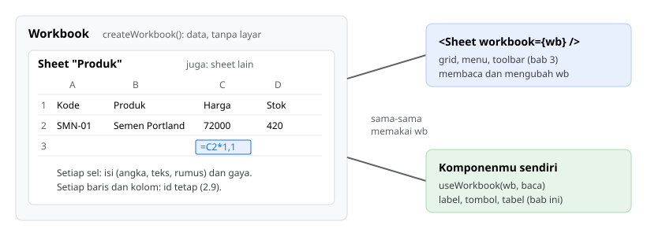
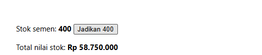
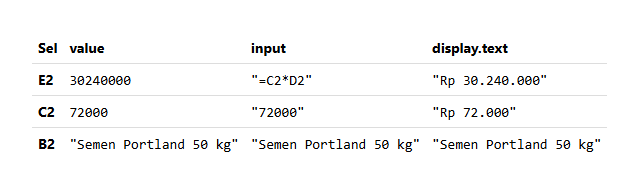
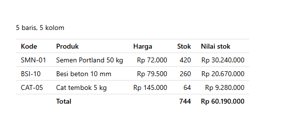
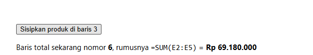
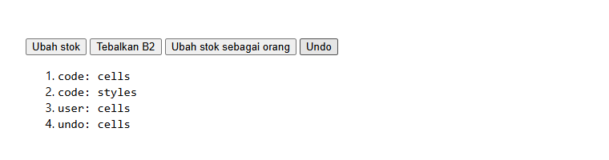
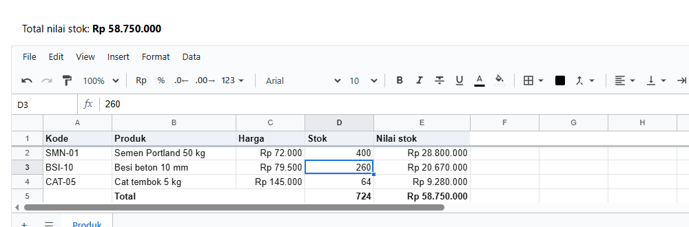

# 2. Konsep dasar

[Daftar isi](../README.md#daftar-isi) · Sebelumnya: [1. Mulai dalam 5 menit](01-mulai-cepat.md) · Berikutnya: [3. Komponen `<Sheet>`](03-komponen-sheet.md)

Bab ini menjelaskan **workbook**: apa isinya, bagaimana membaca dan mengubahnya, dan bagaimana perubahannya bisa diikuti. Sengaja **tanpa
`<Sheet>`** sampai langkah terakhir: semua contoh adalah komponen React biasa (label, tombol, tabel) yang membaca workbook. Dengan begitu
terlihat jelas bahwa workbook adalah data, dan `<Sheet>` hanyalah salah satu cara menampilkannya.

**Bagian A. Pengenalan (tanpa kode)**
- [2.1 Workbook adalah data](#21-workbook-adalah-data)
- [2.2 Alamat sel](#22-alamat-sel)
- [2.3 Isi sel: value, input, display](#23-isi-sel-value-input-display)
- [2.4 Perubahan dan undo](#24-perubahan-dan-undo)

**Bagian B. Langkah demi langkah**
- [2.5 Membaca satu nilai](#25-membaca-satu-nilai)
- [2.6 Mengubah dari kode](#26-mengubah-dari-kode)
- [2.7 Tiga sisi isi sel](#27-tiga-sisi-isi-sel)
- [2.8 Seluruh sheet sebagai tabel](#28-seluruh-sheet-sebagai-tabel)
- [2.9 Nomor bergeser, id tetap](#29-nomor-bergeser-id-tetap)
- [2.10 Mendengar perubahan](#210-mendengar-perubahan)
- [2.11 Undo dan redo](#211-undo-dan-redo)
- [2.12 Sekarang dengan `<Sheet>`](#212-sekarang-dengan-sheet)

**Bagian C. Yang sering keliru, dan referensi**
- [2.13 Yang sering keliru](#213-yang-sering-keliru)
- [2.14 Referensi](#214-referensi)

---

# Bagian A. Pengenalan

## 2.1 Workbook adalah data



Sebuah **workbook** berisi satu atau beberapa **sheet**. Setiap sheet berisi sel, dan setiap sel berisi angka, teks, atau rumus, ditambah
gayanya. Workbook tidak punya layar sama sekali. Ia hanya data, dibuat dengan `createWorkbook()`.

Ada dua pihak yang bisa memakai workbook yang sama:

- **`<Sheet>`** menampilkannya sebagai grid, dan mengubahnya saat orang mengetik.
- **Komponenmu sendiri** membaca nilai darinya (total di header, tombol yang aktif atau tidak) dan mengubahnya (tombol "isi dari API").

Keduanya selalu melihat isi yang sama, karena hanya ada satu workbook. Ketik di sheet, dan label totalmu ikut berubah (2.12).

Workbook juga bisa dipakai tanpa React sama sekali, misalnya di server, dengan kode yang persis sama.

## 2.2 Alamat sel

Ada dua cara menyebut sel, dan semua fungsi menerima keduanya.

**Dengan alamat**, seperti yang terlihat di layar. Ini cara yang paling mudah dibaca:

| Ditulis | Artinya |
|---|---|
| `'C2'` | satu sel |
| `'A1:E1'` | sebuah range |
| `'A1:E1, A5:E5'` | beberapa range sekaligus (untuk memberi gaya, menghapus, dan sejenisnya) |
| `'B'`, `'B:D'` | kolom (untuk lebar kolom, menyisipkan kolom) |
| `'2'`, `'2:5'` | baris, dengan nomor seperti di layar (untuk tinggi baris, menyisipkan baris) |

**Dengan nomor**, mulai dari **0** seperti indeks array. Cocok untuk looping:

| Di layar | Nomor |
|---|---|
| A1 | baris `0`, kolom `0` |
| C2 | baris `1`, kolom `2` |
| E5 | baris `4`, kolom `4` |

Hampir semua fungsi workbook menerima nama sheet sebagai parameter pertama: `wb.value('Produk', 'C2')`. Supaya tidak menulis nama sheet terus,
ambil sheet-nya sekali dengan `wb.sheet('Produk')`, lalu pakai fungsinya tanpa parameter sheet: `wb.sheet('Produk').value('C2')`.

## 2.3 Isi sel: value, input, display

Satu sel bisa dilihat dari tiga sisi. Contohnya sel E2 di daftar produk, yang berisi rumus `=C2*D2` dengan format Rupiah:

| Sisi | Fungsi | Hasil untuk E2 | Dipakai untuk |
|---|---|---|---|
| **value** | `value('E2')` | `30240000` | logika aplikasi: menghitung, membandingkan, mengirim ke server. Rumus sudah dihitung |
| **input** | `input('E2')` | `'=C2*D2'` | yang muncul saat sel diedit: rumus apa adanya |
| **display** | `display('E2')` | `{ text: 'Rp 30.240.000', align: 'right', ... }` | yang tampil di layar, sudah diformat |

Sel kosong memberi value `null`. Rumus yang gagal memberi error, misalnya `{ code: '#DIV/0!' }`.

## 2.4 Perubahan dan undo

Setiap perubahan pada workbook dicatat sebagai sebuah **op** (operasi): "sel D2 dari 420 menjadi 400", "B2 jadi tebal", "satu baris disisipkan".
Setiap op membawa **sumbernya**, yaitu siapa yang mengubah:

| Sumber (`source`) | Artinya |
|---|---|
| `'code'` | kodemu. Ini bawaan setiap fungsi yang mengubah workbook |
| `'user'` | orang di layar. Semua yang diketik lewat `<Sheet>` memakai ini |
| `'undo'`, `'redo'` | dari tombol atau tombol keyboard undo dan redo |
| `'remote'` | dari komputer lain atau server, misalnya saat mengedit bersama |

Karena semua perubahan tercatat, workbook bisa **undo** dan **redo**, dan aplikasimu bisa **mendengar** setiap perubahan, misalnya untuk menandai
"belum disimpan" atau mencatat riwayat.

Sumber `'user'` juga yang diperiksa oleh aturan dan hak akses (bab 8 dan bab 10). Kodemu sendiri dianggap dipercaya.

---

# Bagian B. Langkah demi langkah

Semua contoh di bagian ini memakai daftar produk dari bab 1, dibuat oleh satu fungsi bersama:

<!-- contoh: data/produk.js -->
```js
import { createWorkbook } from '@kufayeka/sheet/core';

// Bahan bersama bab 2 sampai 4: daftar produk toko bangunan dari bab 1, dengan rumus nilai stok dan total.
//
//       A        B                      C        D      E
//   1   Kode     Produk                 Harga    Stok   Nilai stok
//   2   SMN-01   Semen Portland 50 kg   72000    420    =C2*D2
//   3   BSI-10   Besi beton 10 mm       79500    260    =C3*D3
//   4   CAT-05   Cat tembok 5 kg        145000   64     =C4*D4
//   5            Total                           =SUM   =SUM

export function buatProduk() {
    const wb = createWorkbook();
    wb.setSettings({ locale: 'id-ID', currency: 'IDR' });
    const s = wb.sheet('Sheet1');
    s.setSheetProps({ name: 'Produk', freezeRows: 1 });
    s.setValues('A1', [
        ['Kode', 'Produk', 'Harga', 'Stok', 'Nilai stok'],
        ['SMN-01', 'Semen Portland 50 kg', 72000, 420, '=C2*D2'],
        ['BSI-10', 'Besi beton 10 mm', 79500, 260, '=C3*D3'],
        ['CAT-05', 'Cat tembok 5 kg', 145000, 64, '=C4*D4'],
        ['', 'Total', '', '=SUM(D2:D4)', '=SUM(E2:E4)']
    ]);
    s.setStyle('A1:E1', { bold: true, fill: '#eef2f7' });
    s.setStyle('A5:E5', { bold: true });
    s.setColProps('C', { format: { type: 'money', decimals: 0 } });
    s.setColProps('E', { format: { type: 'money', decimals: 0 }, width: 140 });
    s.setColProps('B', { width: 180 });
    return wb;
}
```
<!-- /contoh -->

Di setiap contoh, baris yang **baru** dibanding langkah sebelumnya ditandai `// baru`.

## 2.5 Membaca satu nilai

**Tujuan:** menampilkan total nilai stok di sebuah label biasa.

<!-- contoh: 02-05-baca.page.tsx -->
```tsx
import { useState } from 'react';
import { useWorkbook } from '@kufayeka/sheet';
import { buatProduk } from './data/produk.js';

// 2.5 Membaca satu nilai dari workbook ke komponen React. Belum ada <Sheet>.
export default function Halaman() {
    const [wb] = useState(buatProduk);
    // E5 berisi =SUM(E2:E4); display memberi teks yang sudah diformat
    const total = useWorkbook(wb, (w) => w.display('Produk', 'E5').text);
    return (
        <div data-siap style={{ font: '15px system-ui', padding: 16 }}>
            <p>Total nilai stok: <b>{total}</b></p>
        </div>
    );
}
```
<!-- /contoh -->


**Penjelasan:**

- `useState(buatProduk)` membuat workbook sekali, sama seperti di bab 1. Tidak ada `<Sheet>`.
- `useWorkbook(wb, (w) => ...)` membaca sesuatu dari workbook. Fungsi kedua menerima workbook dan mengembalikan yang ingin ditampilkan.
- `w.display('Produk', 'E5').text` adalah teks sel E5 seperti di layar, yaitu `Rp 60.190.000`. E5 berisi rumus `=SUM(E2:E4)`, yang sudah dihitung.
- `data-siap` hanya penanda untuk pengambilan foto dokumentasi ini. Tidak perlu ditulis di aplikasimu.

## 2.6 Mengubah dari kode

**Tujuan:** sebuah tombol mengubah stok semen, dan total di label ikut berubah sendiri.

<!-- contoh: 02-06-ubah.page.tsx -->
```tsx
import { useState } from 'react';
import { useWorkbook } from '@kufayeka/sheet';
import { buatProduk } from './data/produk.js';

// 2.6 Mengubah dari tombol: stok semen diubah dari kode, dan total yang dibaca di 2.5 ikut berubah sendiri.
export default function Halaman() {
    const [wb] = useState(buatProduk);
    const total = useWorkbook(wb, (w) => w.display('Produk', 'E5').text);
    const stokSemen = useWorkbook(wb, (w) => w.value('Produk', 'D2'));          // baru

    const ubah = () => wb.sheet('Produk').setValues('D2', 400);                 // baru

    return (
        <div data-siap style={{ font: '15px system-ui', padding: 16 }}>
            <p>Stok semen: <b>{String(stokSemen)}</b> <button className="ubah" onClick={ubah}>Jadikan 400</button></p>
            <p>Total nilai stok: <b>{total}</b></p>
        </div>
    );
}
```
<!-- /contoh -->

Setelah tombol diklik:



**Penjelasan:**

- `wb.sheet('Produk').setValues('D2', 400)` mengubah sel D2 menjadi 400.
- Rumus `=C2*D2` di E2 dan `=SUM(E2:E4)` di E5 dihitung ulang. Hanya rumus yang terkena yang dihitung, bukan seluruh sheet.
- `useWorkbook` melihat bahwa nilai yang dibacanya berubah, lalu merender ulang komponen. Kamu tidak perlu `setState` sendiri.
- `w.value('Produk', 'D2')` memberi angka `400`, bukan teks. Gunakan `value` untuk logika, `display` untuk ditampilkan.

## 2.7 Tiga sisi isi sel

**Tujuan:** melihat value, input, dan display dari beberapa sel sekaligus.

<!-- contoh: 02-07-isi-sel.page.tsx -->
```tsx
import { useState } from 'react';
import { useWorkbook } from '@kufayeka/sheet';
import { buatProduk } from './data/produk.js';

// 2.7 Tiga sisi isi sebuah sel: value (nilai sebenarnya), input (yang diketik), display (yang tampil).
const SEL = ['E2', 'C2', 'B2'];

export default function Halaman() {
    const [wb] = useState(buatProduk);
    const w = useWorkbook(wb);                                     // tanpa fungsi baca: komponen dirender ulang di setiap perubahan
    return (
        <div data-siap style={{ font: '14px system-ui', padding: 16 }}>
            <table cellPadding={6} style={{ borderCollapse: 'collapse' }}>
                <thead><tr><th align="left">Sel</th><th align="left">value</th><th align="left">input</th><th align="left">display.text</th></tr></thead>
                <tbody>
                    {SEL.map((a) => (
                        <tr key={a} style={{ borderTop: '1px solid #ddd' }}>
                            <td><b>{a}</b></td>
                            <td><code>{JSON.stringify(w.value('Produk', a))}</code></td>
                            <td><code>{JSON.stringify(w.input('Produk', a))}</code></td>
                            <td><code>{JSON.stringify(w.display('Produk', a).text)}</code></td>
                        </tr>
                    ))}
                </tbody>
            </table>
        </div>
    );
}
```
<!-- /contoh -->



**Penjelasan:**

| Sel | Yang terlihat di foto |
|---|---|
| E2 (rumus) | value adalah hasil hitungannya, input adalah rumusnya, display adalah hasilnya dalam Rupiah |
| C2 (angka) | value adalah angka, input adalah angka itu sebagai teks, display dalam Rupiah |
| B2 (teks) | ketiganya sama |

- `useWorkbook(wb)` **tanpa fungsi baca** mengembalikan workbook-nya sendiri, dan merender ulang komponen di setiap perubahan apa pun. Cocok untuk
  komponen yang membaca banyak sel sekaligus.

## 2.8 Seluruh sheet sebagai tabel

**Tujuan:** menampilkan seluruh daftar produk sebagai tabel HTML biasa, dengan looping baris dan kolom.

<!-- contoh: 02-08-tabel.page.tsx -->
```tsx
import { useState } from 'react';
import { useWorkbook } from '@kufayeka/sheet';
import { buatProduk } from './data/produk.js';

// 2.8 Seluruh sheet sebagai tabel HTML biasa: workbook adalah data, tampilannya boleh apa saja.
export default function Halaman() {
    const [wb] = useState(buatProduk);
    const w = useWorkbook(wb);
    const akhir = w.sheet('Produk').lastFilled();                  // baru: baris dan kolom terakhir yang berisi (mulai dari 0)
    const rows = akhir.r + 1, cols = akhir.c + 1;

    const baris = [];
    for (let r = 0; r < rows; r++) {                               // baru: nomor baris dan kolom mulai dari 0
        const sel = [];
        for (let c = 0; c < cols; c++) {
            const d = w.display('Produk', r, c);                   // baru: sel ditunjuk dengan nomor, bukan alamat
            sel.push(<td key={c} align={d.align} style={{ padding: '4px 10px', fontWeight: r === 0 || r === rows - 1 ? 600 : 400 }}>{d.text}</td>);
        }
        baris.push(<tr key={r} style={{ borderTop: '1px solid #ddd' }}>{sel}</tr>);
    }

    return (
        <div data-siap style={{ font: '14px system-ui', padding: 16 }}>
            <p>{rows} baris, {cols} kolom</p>
            <table style={{ borderCollapse: 'collapse' }}><tbody>{baris}</tbody></table>
        </div>
    );
}
```
<!-- /contoh -->



**Penjelasan:**

- `lastFilled()` memberi baris dan kolom terakhir yang berisi, dengan nomor mulai dari 0: di sini `{ r: 4, c: 4 }`. Jumlah barisnya `r + 1`.
- `w.display('Produk', r, c)` menunjuk sel dengan **nomor**, bukan alamat (2.2). `display(0, 0)` adalah A1.
- `d.align` memberi perataan yang dipakai sheet: angka rata kanan, teks rata kiri.
- Ini menunjukkan bahwa workbook bisa ditampilkan dengan cara apa pun: tabel laporan, kartu, grafik. `<Sheet>` hanya satu pilihan.

## 2.9 Nomor bergeser, id tetap

**Tujuan:** memahami kenapa sebuah baris sebaiknya disimpan dengan id-nya, bukan dengan nomornya.

<!-- contoh: 02-09-id.page.tsx -->
```tsx
import { useState } from 'react';
import { useWorkbook } from '@kufayeka/sheet';
import { buatProduk } from './data/produk.js';

// 2.9 Nomor baris bisa bergeser, id baris tidak. Baris total dicari lewat id-nya, jadi tetap ketemu walaupun baris baru disisipkan.
export default function Halaman() {
    const [wb] = useState(buatProduk);
    // baru: id baris total (baris 5), diambil sekali; id ini tidak pernah berubah
    const [idTotal] = useState(() => wb.sheet('Produk').rowId(4));

    // setiap render, cari lagi nomor baris dari id-nya
    const nomor = useWorkbook(wb, (w) => w.sheet('Produk').rowIndex(idTotal));
    const rumus = useWorkbook(wb, (w) => w.sheet('Produk').input(nomor, 4));
    const total = useWorkbook(wb, (w) => w.sheet('Produk').display(nomor, 4).text);

    function sisipkan() {                                                    // baru
        const s = wb.sheet('Produk');
        s.insertRows('3');                                                   // baris kosong di atas baris 3
        s.setValues('A3', [['PSR-01', 'Pasir beton', 290000, 31, '=C3*D3']]);
    }

    return (
        <div data-siap style={{ font: '15px system-ui', padding: 16 }}>
            <p><button className="sisipkan" onClick={sisipkan}>Sisipkan produk di baris 3</button></p>
            <p>Baris total sekarang nomor <b>{nomor + 1}</b>, rumusnya <code>{rumus}</code> = <b>{total}</b></p>
        </div>
    );
}
```
<!-- /contoh -->

Setelah tombol diklik, produk baru masuk di baris 3:



**Penjelasan:**

- Setiap baris dan kolom punya **id tetap**, sebuah teks acak yang tidak pernah berubah. Nomornya bisa berubah, misalnya saat baris
  disisipkan di atasnya.
- `rowId(4)` mengambil id baris ke-5 (total) sekali saja. Setelah satu baris disisipkan, `rowIndex(idTotal)` memberi nomor barunya: 5, yaitu
  baris ke-6 di layar.
- Rumus totalnya juga ikut menyesuaikan sendiri: dari `=SUM(E2:E4)` menjadi `=SUM(E2:E5)`, karena rumus menyimpan referensinya sebagai id.
- Hal yang sama berlaku untuk penyimpanan ke server, komentar, aturan, dan validasi: semuanya menempel ke baris lewat id, jadi ikut pindah.

Kapan memakai id: setiap kali kamu perlu mengingat sebuah baris **lebih lama dari satu kali render**, misalnya baris yang sedang dipilih, atau
baris yang menunggu jawaban dari server.

## 2.10 Mendengar perubahan

**Tujuan:** mencatat setiap perubahan, dengan sumbernya.

<!-- contoh: 02-10-event.page.tsx -->
```tsx
import { useEffect, useState } from 'react';
import { buatProduk } from './data/produk.js';

// 2.10 Mendengar perubahan: setiap perubahan adalah sebuah op, dengan sumbernya (siapa yang mengubah).
export default function Halaman() {
    const [wb] = useState(buatProduk);
    const [catatan, setCatatan] = useState<string[]>([]);

    useEffect(() => {
        // baru: wb.on mengembalikan fungsi untuk berhenti mendengar; dipanggil saat komponen dilepas
        return wb.on('op', (e) => {
            const jenis = e.ops.map((op) => op.t).join(', ');
            setCatatan((c) => [...c, e.source + ': ' + jenis]);
        });
    }, [wb]);

    const s = wb.sheet('Produk');
    return (
        <div data-siap style={{ font: '15px system-ui', padding: 16 }}>
            <p>
                <button className="isi" onClick={() => s.setValues('D2', 400)}>Ubah stok</button>{' '}
                <button className="tebal" onClick={() => s.setStyle('B2', { bold: true })}>Tebalkan B2</button>{' '}
                <button className="orang" onClick={() => s.setValues('D3', 250, { source: 'user' })}>Ubah stok sebagai orang</button>{' '}
                <button className="undo" onClick={() => wb.undo()}>Undo</button>
            </p>
            <ol className="catatan">{catatan.map((c, i) => <li key={i}><code>{c}</code></li>)}</ol>
        </div>
    );
}
```
<!-- /contoh -->

Setelah keempat tombol diklik berurutan:



**Penjelasan:**

- `wb.on('op', fn)` memanggil `fn` setiap kali workbook berubah. `e.source` adalah sumbernya (2.4), `e.ops` daftar perubahannya.
- `wb.on` **mengembalikan fungsi untuk berhenti mendengar**. Mengembalikannya dari `useEffect` membuat pendengarnya dilepas saat komponen hilang.
- Baris di foto, satu per tombol:
  1. `code: cells`: isi sel diubah oleh kode.
  2. `code: styles`: gaya diubah oleh kode.
  3. `user: cells`: isi sel diubah dengan `{ source: 'user' }`, seolah-olah oleh orang di layar.
  4. `undo: cells`: perubahan terakhir dibatalkan.

Event lain yang bisa didengar ada di 2.14. Untuk hal yang lebih sederhana, seperti "ada perubahan atau tidak", `useWorkbook` sudah cukup (1.8).

## 2.11 Undo dan redo

**Tujuan:** tombol Undo dan Redo milik aplikasimu sendiri, yang hanya aktif saat bisa dipakai.

<!-- contoh: 02-11-undo.page.tsx -->
```tsx
import { useState } from 'react';
import { useWorkbook } from '@kufayeka/sheet';
import { buatProduk } from './data/produk.js';

// 2.11 Undo dan redo dari tombol sendiri, yang tahu kapan bisa dipakai.
export default function Halaman() {
    const [wb] = useState(buatProduk);
    const stok = useWorkbook(wb, (w) => w.value('Produk', 'D2'));
    const bisaUndo = useWorkbook(wb, (w) => w.canUndo());                    // baru
    const bisaRedo = useWorkbook(wb, (w) => w.canRedo());                    // baru

    return (
        <div data-siap style={{ font: '15px system-ui', padding: 16 }}>
            <p>Stok semen: <b>{String(stok)}</b></p>
            <p>
                <button className="kurang" onClick={() => wb.sheet('Produk').setValues('D2', Number(stok) - 10)}>Kurangi 10</button>{' '}
                <button className="undo" onClick={() => wb.undo()} disabled={!bisaUndo}>Undo</button>{' '}
                <button className="redo" onClick={() => wb.redo()} disabled={!bisaRedo}>Redo</button>
            </p>
        </div>
    );
}
```
<!-- /contoh -->

Setelah "Kurangi 10" diklik dua kali, lalu Undo sekali:


**Penjelasan:**

- `wb.undo()` dan `wb.redo()` membatalkan dan mengulang perubahan, sama seperti Ctrl+Z dan Ctrl+Y di sheet.
- `canUndo()` dan `canRedo()` dibaca dengan `useWorkbook`, sehingga tombolnya aktif dan nonaktif sendiri.
- Di foto, stok 420 dikurangi dua kali menjadi 400, lalu undo mengembalikannya ke 410. Masih ada yang bisa di-undo dan di-redo, jadi kedua tombol
  aktif.

## 2.12 Sekarang dengan `<Sheet>`

**Tujuan:** workbook yang sama ditampilkan oleh `<Sheet>`, dan label total di luar sheet ikut berubah saat orang mengetik.

<!-- contoh: 02-12-sheet.page.tsx -->
```tsx
import { useState } from 'react';
import { Sheet, useWorkbook } from '@kufayeka/sheet';
import '@kufayeka/sheet/style.css';
import { buatProduk } from './data/produk.js';

// 2.12 Workbook yang sama, sekarang juga dengan <Sheet>. Yang diketik di sheet langsung terbaca oleh komponen lain.
export default function Halaman() {
    const [wb] = useState(buatProduk);
    const total = useWorkbook(wb, (w) => w.display('Produk', 'E5').text);
    return (
        <div data-siap style={{ font: '15px system-ui' }}>
            <p style={{ padding: '0 16px' }}>Total nilai stok: <b>{total}</b></p>
            <div style={{ height: 280 }}>
                <Sheet workbook={wb} />                                              {/* baru */}
            </div>
        </div>
    );
}
```
<!-- /contoh -->

Stok semen diketik 400 di sheet, lalu Enter:



**Penjelasan:**

- Satu tambahan dari 2.5: `<Sheet workbook={wb} />`.
- Orang mengetik di sheet, sheet mengubah `wb`, lalu `useWorkbook` di label total melihat perubahan itu. Total di atas sheet berubah dari
  Rp 60.190.000 menjadi Rp 58.750.000.
- Semua yang dipelajari di bab ini berlaku apa adanya saat ada `<Sheet>`. Bab berikutnya membahas `<Sheet>` itu sendiri.

---

# Bagian C. Yang sering keliru, dan referensi

## 2.13 Yang sering keliru

| Keliru | Benar |
|---|---|
| Menghitung dengan `display(...).text` | `display` adalah teks (`'Rp 72.000'`). Untuk menghitung, pakai `value` |
| Nomor baris dimulai dari 1 | nomor di kode dimulai dari **0**: A1 adalah `(0, 0)`. Alamat teks (`'A1'`) tetap seperti di layar |
| Menyimpan nomor baris untuk dipakai nanti | nomornya bisa bergeser. Simpan id-nya (`rowId`), lalu cari nomornya saat dibutuhkan (`rowIndex`) |
| `useWorkbook(wb, (w) => [w.value('A1'), w.value('A2')])` di komponen yang berat | array baru di setiap pembacaan membuat komponen dirender di setiap perubahan workbook. Pakai dua `useWorkbook` yang masing-masing memberi satu nilai |
| Lupa melepas `wb.on(...)` | kembalikan fungsi dari `wb.on` di `useEffect` (2.10) |
| Mengira perubahan dari kode diperiksa aturan | sumber `'code'` tidak diperiksa (2.4). Tambahkan `{ source: 'user' }` kalau perubahan itu mewakili orang |

## 2.14 Referensi

### Membaca

| Fungsi | Hasilnya |
|---|---|
| `wb.value(sheet, sel)` | nilai sebenarnya: angka, teks, `true`/`false`, `null`, atau error |
| `wb.input(sheet, sel)` | yang muncul saat sel diedit: rumus atau angka sebagai teks |
| `wb.display(sheet, sel)` | yang tampil: `{ text, align, kind }` |
| `wb.sheet(nama).lastFilled()` | `{ r, c }`: baris dan kolom terakhir yang berisi, mulai dari 0; `{ r: -1, c: -1 }` kalau kosong |
| `wb.sheet(nama).rowId(r)`, `colId(c)` | id tetap baris atau kolom nomor `r` / `c` |
| `wb.sheet(nama).rowIndex(id)`, `colIndex(id)` | nomor sekarang dari sebuah id; `-1` kalau sudah dihapus |

`sel` boleh berupa alamat (`'C2'`) atau dua nomor (`1, 2`).

### Mengubah

| Fungsi | Artinya |
|---|---|
| `wb.sheet(nama).setValues(sel, nilai)` | mengisi satu sel, atau banyak sel dengan array di dalam array |
| `wb.sheet(nama).setStyle(range, gaya)` | memberi gaya |
| `wb.sheet(nama).insertRows(baris)` | menyisipkan baris |
| `wb.undo()`, `wb.redo()` | membatalkan dan mengulang |
| `wb.canUndo()`, `wb.canRedo()` | bisa di-undo / di-redo atau tidak |

Setiap fungsi yang mengubah menerima parameter terakhir `{ source: 'user' }` untuk menandai perubahan itu sebagai perubahan orang (2.4). Semua
fungsi untuk mengisi dan mengubah dibahas di bab 4.

### React

| Pembantu | Artinya |
|---|---|
| `useWorkbook(wb, (w) => ...)` | membaca sesuatu, dan merender ulang komponen saat nilai itu berubah |
| `useWorkbook(wb)` | workbook-nya sendiri; merender ulang di setiap perubahan |

### Event (`wb.on(nama, fn)`)

| Event | Isinya | Kapan |
|---|---|---|
| `op` | `{ ops, source }` | setiap perubahan yang diterapkan |
| `reject` | `{ reason, op, source }` | perubahan ditolak oleh aturan, validasi, atau hak akses (bab 8, bab 10) |
| `saved` | `{ version }` | setelah `wb.saved()` (1.8, bab 9) |
| `cellError` | `{ address, field, value, expected }` | nilai tidak cocok dengan tipe kolomnya (bab 8) |
| `access` | `{ owner, roles, ui, message }` | aturan akses diganti (bab 10) |
| `layout` | | ukuran baris atau kolom berubah |

`wb.on` mengembalikan fungsi untuk berhenti mendengar.

### Pilihan `createWorkbook(isi, pilihan)`

`isi` adalah JSON yang pernah disimpan (`wb.toJSON()`), atau `null` untuk workbook kosong. `pilihan` boleh dikosongkan:

| Pilihan | Isinya | Artinya |
|---|---|---|
| `user` | `{ id, name }` | siapa yang sedang bekerja: dicatat di setiap op, dan menjadi nama penulis komentar |
| `beforeOp` | fungsi | memeriksa setiap op sebelum diterapkan, dan bisa mengubah, membuang, atau menolaknya ([10.3](10-aturan.md#103-beforeop-memeriksa-setiap-perubahan)) |
| `now` | `() => Date` | jam untuk `NOW()` dan `TODAY()`; berguna untuk tes |
| `undoLimit` | angka | berapa perubahan yang diingat undo (bawaan 200) |

[Daftar isi](../README.md#daftar-isi) · Sebelumnya: [1. Mulai dalam 5 menit](01-mulai-cepat.md) · Berikutnya: [3. Komponen `<Sheet>`](03-komponen-sheet.md)
