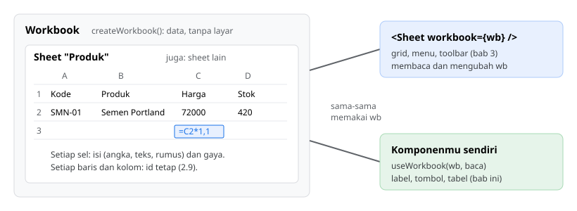
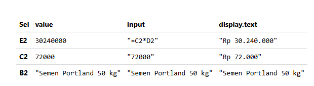
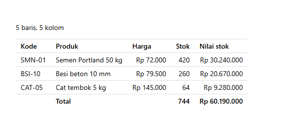
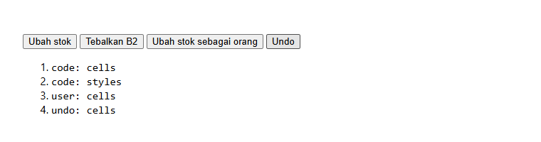
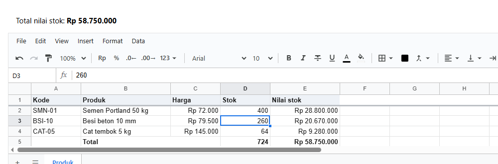

# 02. Konsep Arsitektur & Mental Model

[Daftar isi](../README.md#daftar-isi) · Sebelumnya: [01. Mulai Cepat & Setup](01-mulai-cepat.md) · Berikutnya: [03. Komponen `<Sheet>` & Kustomisasi UI](03-komponen-sheet.md)

Bab ini membedah arsitektur internal **Workbook Engine**: struktur representasi data, sistem koordinat sel, siklus nilai sel (*value*, *input*, *display*), identitas entitas baris/kolom yang stabil (*rowId* vs *rowIndex*), mutasi berbasis operasi transaksional (*ops*), serta integrasi reaktif dengan React.

Semua contoh awal dalam bab ini sengaja dibangun menggunakan elemen antarmuka React standar (tombol, label, tabel HTML biasa) tanpa merender komponen grid `<Sheet />`, guna menggarisbawahi bahwa **Workbook adalah entitas data mandiri (Headless Engine)** yang dapat diakses, dimanipulasi, dan diproses tanpa ketergantungan pada layer visual.

---

## 1. Arsitektur Headless Workbook



Secara arsitektural, sebuah **Workbook** adalah struktur data komposit yang menaungi satu atau beberapa **Sheet**. Setiap sheet menyimpan matriks sel yang merepresentasikan nilai primitif, formula kalkulasi, styling, metadata validasi, dan riwayat revisi.

Workbook tidak memiliki dependensi terhadap DOM maupun React. Instance workbook dibuat melalui factory function `createWorkbook()` dari `@kufayeka/sheet/core` dan dapat berjalan secara isomorfik di client browser maupun server Node.js.

Pada aplikasi frontend, terdapat dua konsumer utama dari instance workbook yang sama:
- **Komponen `<Sheet />`**: Merender spreadsheet virtualized dan menyalurkan interaksi keyboard/mouse pengguna ke dalam mutasi workbook.
- **Komponen Kustom Aplikasi**: Membaca agregasi nilai (misal: widget KPI di dashboard, total harga pada header modal) dan menjalankan mutasi terprogram (misal: tombol aksi sinkronisasi API).

Keduanya selalu sinkron secara deterministik karena mengacu pada *single source of truth* yang sama.

### Pemisahan State Dokumen vs Otoritas Host (`access`, `rules`, `types`)

Saat merancang sistem template terhubung backend, pahami batas tegas di dalam engine (`src/core/workbook.js`):
- **State Dokumen (`wb.toJSON()`)**: Menyimpan `id`, `version`, `settings`, seluruh `sheets` (`columns`, `rows`, sel, nilai, rumus `{ f, refs, v }`, `style`, `merges`, `names`, `validations`, `conditionals`, `filters`, `pivots`, `charts`, dan `comments`).
- **Otoritas Host (TIDAK disimpan di `toJSON()`)**: `access` (`setAccess`), `rules` (`setRules`), dan `types` (`setTypes`). Ketiganya sengaja dipisahkan agar tidak pernah bisa dimanipulasi atau terbawa dari payload client; host/backend wajib menyimpannya di kolom/tabel terpisah lalu meng-inject ulang setiap kali workbook dibuka dan memvalidasinya ulang saat save via `viewFor()` serta `checkPatch()`.

---

## 2. Sistem Koordinat Sel (Addressing System)

Engine mendukung dua paradigma pengalamatan sel secara seragam di seluruh pemanggilan API:

### A. Format Notasi String (Human-Readable Coordinate)
Format standar yang lazim digunakan pada formula spreadsheet:

| Notasi | Target Elemen | Kegunaan Umum |
|---|---|---|
| `'C2'` | Sel tunggal pada kolom C baris 2 | Akses nilai atau input individual |
| `'A1:E1'` | Range sel kontinu berbentuk persegi | Styling header baris atau kalkulasi agregasi |
| `'A1:E1, A5:E5'` | Range komposit diskontinu | Styling multi-rentang sekaligus |
| `'B'`, `'B:D'` | Kolom utuh | Mengatur lebar kolom, format kolom, atau insert/delete kolom |
| `'2'`, `'2:5'` | Baris utuh (indeks 1-based di layar) | Mengatur tinggi baris, hidden status, atau insert/delete baris |

### B. Format Indeks Numerik Nol-Dasar (0-Indexed Coordinate)
Format berbasis integer yang optimal untuk iterasi loop programatis:

| Koordinat Layar | Indeks Baris (`r`) | Indeks Kolom (`c`) | Representasi Programatis |
|---|---|---|---|
| `A1` | `0` | `0` | `sheet.value(0, 0)` |
| `C2` | `1` | `2` | `sheet.value(1, 2)` |
| `E5` | `4` | `4` | `sheet.value(4, 4)` |

### Scope Sheet
Seluruh fungsi workbook menerima nama sheet sebagai parameter pertama (`wb.value('Produk', 'C2')`). Untuk menghindari repetisi nama sheet pada blok kode yang berfokus pada satu sheet, dapatkan sheet handle melalui `wb.sheet('Produk')`:
```ts
const s = wb.sheet('Produk');
const val = s.value('C2');
```

---

## 3. Siklus & Aspek Nilai Sel: Value, Input, Display

Setiap sel di dalam sheet dievaluasi melalui tiga dimensi data yang berbeda sesuai konteks penggunaannya:

| Dimensi | API Getter | Contoh Nilai Sel `E2` | Konteks Penggunaan |
|---|---|---|---|
| **Value** | `sheet.value('E2')` | `30240000` (Number) | **Logika komputasi aplikasi**: evaluasi agregat, komparasi logika, pengiriman payload ke database. Formula telah dievaluasi tuntas ke nilai primitifnya. |
| **Input** | `sheet.input('E2')` | `'=C2*D2'` (String) | **Formula bar & in-place cell editor**: representasi raw string yang diketik oleh pengguna sebelum diproses formula parser. |
| **Display** | `sheet.display('E2')` | `{ text: 'Rp 30.240.000', align: 'right', kind: 'number' }` | **Render visual**: teks terformat akhir yang mematuhi konvensi locale, alignment bawaan tipe data, dan rule styling. |

> - Sel kosong selalu menghasilkan `value: null`.
> - Formula yang mengalami kesalahan kalkulasi menghasilkan objek error terstruktur, misalnya `{ code: '#DIV/0!' }` atau `{ code: '#REF!' }`.

---

## 4. Mutasi Transaksional & Sistem Operasi (Ops)

Setiap modifikasi terhadap workbook dicatat sebagai **Operation Unit (`op`)** atomik—misalnya `setCellValue`, `setCellStyle`, atau `insertRow`. Setiap op membawa atribut **`source`** yang mengidentifikasi asal mutasi:

| Nilai `source` | Asal Mutasi | Perilaku Keamanan & Validasi |
|---|---|---|
| `'code'` | Mutasi programatis dari aplikasi via API workbook. | Bypass validasi user secara default, dicatat ke riwayat undo. |
| `'user'` | Input interaktif pengguna melalui antarmuka visual `<Sheet />`. | Melewati interceptor validasi, aturan hak akses (ACL), dan skema proteksi sel. |
| `'undo'`, `'redo'` | Navigasi riwayat aksi pengguna via shortcut keyboard atau toolbar. | Diterapkan secara simetris dari stack histori perubahan. |
| `'remote'` | Sinkronisasi mutasi eksternal (kolaborasi realtime via WebSocket atau sync engine). | Diaplikasikan ke state lokal tanpa memicu duplikasi event loop. |

Berkat model pencatatan op ini, engine workbook mampu mengelola tumpukan **Undo/Redo** secara deterministik, menghasilkan patch perbedaan data (delta diffing) untuk pengiriman ke server, serta memancarkan event reaktif ke UI aplikasi.

---

## 5. Implementasi & Pola Integrasi Step-by-Step

Semua contoh di bawah menggunakan dataset produk yang diekspor dari helper berikut:

<!-- contoh: data/produk.js -->
```js
import { createWorkbook } from '@kufayeka/sheet/core';

// Bahan bersama bab 2 sampai 4: daftar produk toko bangunan dari bab 1, dengan rumus nilai stok dan total.
//
//       A        B                      C        D      E
//   1   Kode     Produk                 Harga    Stok   Nilai stok
//   2   SMN-01   Semen Portland 50 kg   72000    420    =C2*D2
//   3   BSI-10   Besi beton 10 mm       79500    260    =C3*D3
//   4   CAT-05   Cat tembok 5 kg        145000   64     =C4*D4
//   5            Total                           =SUM   =SUM

export function buatProduk() {
    const wb = createWorkbook();
    wb.setSettings({ locale: 'id-ID', currency: 'IDR' });
    const s = wb.sheet('Sheet1');
    s.setSheetProps({ name: 'Produk', freezeRows: 1 });
    s.setValues('A1', [
        ['Kode', 'Produk', 'Harga', 'Stok', 'Nilai stok'],
        ['SMN-01', 'Semen Portland 50 kg', 72000, 420, '=C2*D2'],
        ['BSI-10', 'Besi beton 10 mm', 79500, 260, '=C3*D3'],
        ['CAT-05', 'Cat tembok 5 kg', 145000, 64, '=C4*D4'],
        ['', 'Total', '', '=SUM(D2:D4)', '=SUM(E2:E4)']
    ]);
    s.setStyle('A1:E1', { bold: true, fill: '#eef2f7' });
    s.setStyle('A5:E5', { bold: true });
    s.setColProps('C', { format: { type: 'money', decimals: 0 } });
    s.setColProps('E', { format: { type: 'money', decimals: 0 }, width: 140 });
    s.setColProps('B', { width: 180 });
    return wb;
}
```
<!-- /contoh -->

---

### 5.1 Membaca Nilai secara Reaktif (`useWorkbook`)

Komponen React di luar spreadsheet dapat membaca nilai tertentu dari workbook secara reaktif menggunakan hook `useWorkbook`:

<!-- contoh: 02-05-baca.page.tsx -->
```tsx
import { useState } from 'react';
import { useWorkbook } from '@kufayeka/sheet';
import { buatProduk } from './data/produk.js';

// 2.5 Membaca satu nilai dari workbook ke komponen React. Belum ada <Sheet>.
export default function Halaman() {
    const [wb] = useState(buatProduk);
    // E5 berisi =SUM(E2:E4); display memberi teks yang sudah diformat
    const total = useWorkbook(wb, (w) => w.display('Produk', 'E5').text);
    return (
        <div data-siap style={{ font: '15px system-ui', padding: 16 }}>
            <p>Total nilai stok: <b>{total}</b></p>
        </div>
    );
}
```
<!-- /contoh -->


---

### 5.2 Mengubah Data dari Kode Eksternal

Mutasi terprogram dapat dipicu melalui tombol atau event handler React biasa menggunakan metode `sheet.setValues()`:

<!-- contoh: 02-06-ubah.page.tsx -->
```tsx
import { useState } from 'react';
import { useWorkbook } from '@kufayeka/sheet';
import { buatProduk } from './data/produk.js';

// 2.6 Mengubah dari tombol: stok semen diubah dari kode, dan total yang dibaca di 2.5 ikut berubah sendiri.
export default function Halaman() {
    const [wb] = useState(buatProduk);
    const total = useWorkbook(wb, (w) => w.display('Produk', 'E5').text);
    const stokSemen = useWorkbook(wb, (w) => w.value('Produk', 'D2'));          // baru

    const ubah = () => wb.sheet('Produk').setValues('D2', 400);                 // baru

    return (
        <div data-siap style={{ font: '15px system-ui', padding: 16 }}>
            <p>Stok semen: <b>{String(stokSemen)}</b> <button className="ubah" onClick={ubah}>Jadikan 400</button></p>
            <p>Total nilai stok: <b>{total}</b></p>
        </div>
    );
}
```
<!-- /contoh -->


---

### 5.3 Perbandingan Value, Input, dan Display

Contoh berikut mendemonstrasikan perbedaan nyata ketiga aspek data pada sel formula berformat mata uang:

<!-- contoh: 02-07-isi-sel.page.tsx -->
```tsx
import { useState } from 'react';
import { useWorkbook } from '@kufayeka/sheet';
import { buatProduk } from './data/produk.js';

// 2.7 Tiga sisi isi sebuah sel: value (nilai sebenarnya), input (yang diketik), display (yang tampil).
const SEL = ['E2', 'C2', 'B2'];

export default function Halaman() {
    const [wb] = useState(buatProduk);
    const w = useWorkbook(wb);                                     // tanpa fungsi baca: komponen dirender ulang di setiap perubahan
    return (
        <div data-siap style={{ font: '14px system-ui', padding: 16 }}>
            <table cellPadding={6} style={{ borderCollapse: 'collapse' }}>
                <thead><tr><th align="left">Sel</th><th align="left">value</th><th align="left">input</th><th align="left">display.text</th></tr></thead>
                <tbody>
                    {SEL.map((a) => (
                        <tr key={a} style={{ borderTop: '1px solid #ddd' }}>
                            <td><b>{a}</b></td>
                            <td><code>{JSON.stringify(w.value('Produk', a))}</code></td>
                            <td><code>{JSON.stringify(w.input('Produk', a))}</code></td>
                            <td><code>{JSON.stringify(w.display('Produk', a).text)}</code></td>
                        </tr>
                    ))}
                </tbody>
            </table>
        </div>
    );
}
```
<!-- /contoh -->



---

### 5.4 Ekstraksi Seluruh Sheet ke Tabel HTML

Data workbook dapat diiterasi secara langsung ke elemen HTML kustom menggunakan helper batas sel `sheet.lastFilled()`:

<!-- contoh: 02-08-tabel.page.tsx -->
```tsx
import { useState } from 'react';
import { useWorkbook } from '@kufayeka/sheet';
import { buatProduk } from './data/produk.js';

// 2.8 Seluruh sheet sebagai tabel HTML biasa: workbook adalah data, tampilannya boleh apa saja.
export default function Halaman() {
    const [wb] = useState(buatProduk);
    const w = useWorkbook(wb);
    const akhir = w.sheet('Produk').lastFilled();                  // baru: baris dan kolom terakhir yang berisi (mulai dari 0)
    const rows = akhir.r + 1, cols = akhir.c + 1;

    const baris = [];
    for (let r = 0; r < rows; r++) {                               // baru: nomor baris dan kolom mulai dari 0
        const sel = [];
        for (let c = 0; c < cols; c++) {
            const d = w.display('Produk', r, c);                   // baru: sel ditunjuk dengan nomor, bukan alamat
            sel.push(<td key={c} align={d.align} style={{ padding: '4px 10px', fontWeight: r === 0 || r === rows - 1 ? 600 : 400 }}>{d.text}</td>);
        }
        baris.push(<tr key={r} style={{ borderTop: '1px solid #ddd' }}>{sel}</tr>);
    }

    return (
        <div data-siap style={{ font: '14px system-ui', padding: 16 }}>
            <p>{rows} baris, {cols} kolom</p>
            <table style={{ borderCollapse: 'collapse' }}><tbody>{baris}</tbody></table>
        </div>
    );
}
```
<!-- /contoh -->



---

### 5.5 Stabilitas Identitas: Row ID vs Row Index

Dalam spreadsheet dinamis, baris dapat disisipkan, dihapus, atau diurutkan (*sorted*). Mengandalkan nomor indeks baris (`rowIndex`) untuk mereferensikan entitas data adalah antipattern yang rentan bug. Engine menyediakan identifier permanen yang stabil (`rowId`):

<!-- contoh: 02-09-id.page.tsx -->
```tsx
import { useState } from 'react';
import { useWorkbook } from '@kufayeka/sheet';
import { buatProduk } from './data/produk.js';

// 2.9 Nomor baris bisa bergeser, id baris tidak. Baris total dicari lewat id-nya, jadi tetap ketemu walaupun baris baru disisipkan.
export default function Halaman() {
    const [wb] = useState(buatProduk);
    // baru: id baris total (baris 5), diambil sekali; id ini tidak pernah berubah
    const [idTotal] = useState(() => wb.sheet('Produk').rowId(4));

    // setiap render, cari lagi nomor baris dari id-nya
    const nomor = useWorkbook(wb, (w) => w.sheet('Produk').rowIndex(idTotal));
    const rumus = useWorkbook(wb, (w) => w.sheet('Produk').input(nomor, 4));
    const total = useWorkbook(wb, (w) => w.sheet('Produk').display(nomor, 4).text);

    function sisipkan() {                                                    // baru
        const s = wb.sheet('Produk');
        s.insertRows('3');                                                   // baris kosong di atas baris 3
        s.setValues('A3', [['PSR-01', 'Pasir beton', 290000, 31, '=C3*D3']]);
    }

    return (
        <div data-siap style={{ font: '15px system-ui', padding: 16 }}>
            <p><button className="sisipkan" onClick={sisipkan}>Sisipkan produk di baris 3</button></p>
            <p>Baris total sekarang nomor <b>{nomor + 1}</b>, rumusnya <code>{rumus}</code> = <b>{total}</b></p>
        </div>
    );
}
```
<!-- /contoh -->


---

### 5.6 Berlangganan Event Transaksional (`wb.on`)

Anda dapat menangkap seluruh aliran mutasi internal melalui event dispatcher `wb.on('op', handler)`. Ini sangat berguna untuk audit trail, sinkronisasi realtime, atau auto-save:

<!-- contoh: 02-10-event.page.tsx -->
```tsx
import { useEffect, useState } from 'react';
import { buatProduk } from './data/produk.js';

// 2.10 Mendengar perubahan: setiap perubahan adalah sebuah op, dengan sumbernya (siapa yang mengubah).
export default function Halaman() {
    const [wb] = useState(buatProduk);
    const [catatan, setCatatan] = useState<string[]>([]);

    useEffect(() => {
        // baru: wb.on mengembalikan fungsi untuk berhenti mendengar; dipanggil saat komponen dilepas
        return wb.on('op', (e) => {
            const jenis = e.ops.map((op) => op.t).join(', ');
            setCatatan((c) => [...c, e.source + ': ' + jenis]);
        });
    }, [wb]);

    const s = wb.sheet('Produk');
    return (
        <div data-siap style={{ font: '15px system-ui', padding: 16 }}>
            <p>
                <button className="isi" onClick={() => s.setValues('D2', 400)}>Ubah stok</button>{' '}
                <button className="tebal" onClick={() => s.setStyle('B2', { bold: true })}>Tebalkan B2</button>{' '}
                <button className="orang" onClick={() => s.setValues('D3', 250, { source: 'user' })}>Ubah stok sebagai orang</button>{' '}
                <button className="undo" onClick={() => wb.undo()}>Undo</button>
            </p>
            <ol className="catatan">{catatan.map((c, i) => <li key={i}><code>{c}</code></li>)}</ol>
        </div>
    );
}
```
<!-- /contoh -->



---

### 5.7 Manajemen Riwayat: Undo & Redo API

Workbook mengelola state snapshot internal yang memungkinkan eksekusi undo dan redo programatis dengan integritas data penuh:

<!-- contoh: 02-11-undo.page.tsx -->
```tsx
import { useState } from 'react';
import { useWorkbook } from '@kufayeka/sheet';
import { buatProduk } from './data/produk.js';

// 2.11 Undo dan redo dari tombol sendiri, yang tahu kapan bisa dipakai.
export default function Halaman() {
    const [wb] = useState(buatProduk);
    const stok = useWorkbook(wb, (w) => w.value('Produk', 'D2'));
    const bisaUndo = useWorkbook(wb, (w) => w.canUndo());                    // baru
    const bisaRedo = useWorkbook(wb, (w) => w.canRedo());                    // baru

    return (
        <div data-siap style={{ font: '15px system-ui', padding: 16 }}>
            <p>Stok semen: <b>{String(stok)}</b></p>
            <p>
                <button className="kurang" onClick={() => wb.sheet('Produk').setValues('D2', Number(stok) - 10)}>Kurangi 10</button>{' '}
                <button className="undo" onClick={() => wb.undo()} disabled={!bisaUndo}>Undo</button>{' '}
                <button className="redo" onClick={() => wb.redo()} disabled={!bisaRedo}>Redo</button>
            </p>
        </div>
    );
}
```
<!-- /contoh -->


---

### 5.8 Mengintegrasikan Workbook ke Komponen Grid `<Sheet />`

Setelah memahami bahwa workbook adalah data terstruktur murni, merender antarmuka visual spreadsheet hanyalah masalah memasangkan workbook instance tersebut ke prop `<Sheet workbook={wb} />`:

<!-- contoh: 02-12-sheet.page.tsx -->
```tsx
import { useState } from 'react';
import { Sheet, useWorkbook } from '@kufayeka/sheet';
import '@kufayeka/sheet/style.css';
import { buatProduk } from './data/produk.js';

// 2.12 Workbook yang sama, sekarang juga dengan <Sheet>. Yang diketik di sheet langsung terbaca oleh komponen lain.
export default function Halaman() {
    const [wb] = useState(buatProduk);
    const total = useWorkbook(wb, (w) => w.display('Produk', 'E5').text);
    return (
        <div data-siap style={{ font: '15px system-ui' }}>
            <p style={{ padding: '0 16px' }}>Total nilai stok: <b>{total}</b></p>
            <div style={{ height: 280 }}>
                <Sheet workbook={wb} />                                              {/* baru */}
            </div>
        </div>
    );
}
```
<!-- /contoh -->



---

## 6. Antipattern & Panduan Best Practices

| Praktik Keliru | Solusi yang Benar | Alasan Teknis |
|---|---|---|
| **Menjalankan komputasi numerik memakai `display(...).text`** | Gunakan `sheet.value(sel)` | `display` menghasilkan string terformat (misal `'Rp 72.000'`), sedangkan `value` memberikan nilai primitif numerik (`72000`) atau boolean yang valid untuk kalkulasi. |
| **Mengasumsikan indeks koordinat numerik dimulai dari 1** | Indeks numerik berbasis 0: koordinat `A1` adalah `(r: 0, c: 0)` | Pengalamatan teks (`'A1'`) menggunakan standar 1-based, namun API numerik `(r, c)` mengikuti konvensi indeks array JavaScript (0-based). |
| **Menyimpan indeks baris `r` di dalam state eksternal untuk jangka panjang** | Simpan `rowId`, lalu lookup posisinya via `s.rowIndex(id)` | Indeks baris dapat bergeser sewaktu-waktu akibat sorting, filter, atau penyisipan baris oleh pengguna. |
| **Mengembalikan objek/array baru pada selector `useWorkbook`** (misal: `useWorkbook(wb, w => [w.value('A1'), w.value('A2')])`) | Pisahkan menjadi selector primitif mandiri atau bungkus perbandingan kesetaraan kustom | `useWorkbook` memeriksa referensi kesetaraan (`Object.is`). Mengembalikan array baru selalu memicu re-render yang tidak perlu pada setiap event op. |
| **Lupa melepaskan listener `wb.on`** | Return fungsi cleanup yang dihasilkan oleh `wb.on` di dalam `useEffect` | Mencegah memory leak dan eksekusi callback pada komponen yang telah di-unmount. |
| **Mengasumsikan mutasi dari kode diperiksa oleh aturan validasi pengguna** | Tambahkan `{ source: 'user' }` jika mutasi programatis harus tunduk pada validasi user | Secara default mutasi dengan `source: 'code'` memiliki privilese sistem dan melewati interceptor validasi pengguna. |

---

## 7. Referensi Lengkap API

### Metode Pembacaan Data
| Metode | Signature Return | Deskripsi |
|---|---|---|
| `wb.value(sheet, cell)` | `any` (Number, String, Boolean, null, Error) | Mengembalikan nilai primitif terhitung. |
| `wb.input(sheet, cell)` | `string` | Mengembalikan representasi raw input (rumus teks atau string masukan). |
| `wb.display(sheet, cell)` | `{ text: string, align: 'left' \| 'right' \| 'center', kind: string }` | Mengembalikan representasi visual sel terformat. |
| `sheet.lastFilled()` | `{ r: number, c: number }` | Mengembalikan koordinat baris dan kolom terjauh yang terisi data (0-based). Menghasilkan `{ r: -1, c: -1 }` jika kosong. |
| `sheet.rowId(r)` / `colId(c)` | `string` | Mendapatkan identifier unik permanen untuk baris `r` atau kolom `c`. |
| `sheet.rowIndex(id)` / `colIndex(id)` | `number` | Mencari indeks numerik terkini dari sebuah `rowId` / `colId`. Mengembalikan `-1` jika baris/kolom telah dihapus. |

### Metode Mutasi & Transaksi
| Metode | Argumen Utama | Deskripsi |
|---|---|---|
| `sheet.setValues(cell, data, options?)` | `cell: string \| [r, c]`, `data: any`, `options?: { source?: OpSource }` | Menulis data satu sel atau matriks batch ke sheet. |
| `sheet.setStyle(range, styleObject, options?)` | `range: string`, `style: CellStyle` | Mengaplikasikan visual styling (bold, fill, color, border, alignment). |
| `sheet.insertRows(atRow, count?, options?)` | `atRow: number`, `count?: number` | Menyisipkan sejumlah baris baru pada indeks tertentu. |
| `wb.undo()` / `wb.redo()` | - | Menavigasikan tumpukan riwayat aksi mundur atau maju. |
| `wb.canUndo()` / `wb.canRedo()` | - | Boolean flag ketersediaan stack undo/redo. |

### React Integration Hooks
| Hook | Kegunaan |
|---|---|
| `useWorkbook(wb, selector)` | Berlangganan reaktif pada nilai spesifik dari workbook. Komponen hanya me-render ulang saat output selector berubah. |
| `useWorkbook(wb)` | Berlangganan secara menyeluruh pada instance workbook; me-render ulang pada setiap mutasi op. |

### Event Lifecycle Listener (`wb.on(eventName, callback)`)
| Nama Event | Tipe Payload | Waktu Emisi |
|---|---|---|
| `'op'` | `{ ops: Op[], source: OpSource }` | Terpancar setiap kali satu atau sekumpulan op berhasil diaplikasikan ke workbook. |
| `'reject'` | `{ reason: string, op: Op, source: OpSource }` | Terpancar saat suatu op ditolak oleh interceptor validasi atau aturan hak akses (ACL). |
| `'saved'` | `{ version: number }` | Terpancar setelah pemanggilan `wb.saved()`. |
| `'cellError'` | `{ address: string, field: string, value: any, expected: string }` | Terpancar saat nilai sel melanggar konstrain skema kolom. |
| `'access'` | `{ owner: string, roles: Record<string, any>, ui: any, message: string }` | Terpancar saat konfigurasi izin akses dokumen diperbarui. |
| `'layout'` | `{ sheet: string }` | Terpancar saat dimensi baris atau kolom mengalami perubahan ukuran. |

### Opsi Konfigurasi Factory `createWorkbook(doc?, options?)`
| Opsi | Tipe Data | Deskripsi |
|---|---|---|
| `user` | `{ id: string, name: string }` | Identitas pengguna aktif. Disematkan pada metadata setiap op dan authorship komentar sel. |
| `beforeOp` | `(op: Op, wb: Workbook) => boolean \| Op \| Op[]` | Interceptor mutasi sebelum diaplikasikan. Dapat mengizinkan, memodifikasi, atau menolak op (lihat [Bab 08](08-menjaga-isi.md#87-aturan-yang-membaca-sel-lain-beforeop)). |
| `now` | `() => Date` | Factory function penentu waktu sistem untuk formula waktu dinamis (`NOW()`, `TODAY()`); esensial untuk deterministic testing. |
| `undoLimit` | `number` | Batas maksimum tumpukan riwayat undo yang disimpan di memori (default: `200`). |
