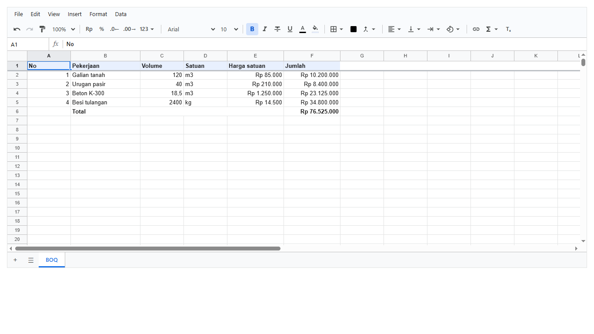
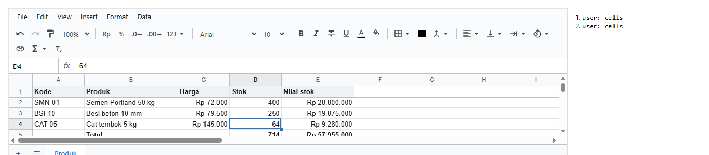
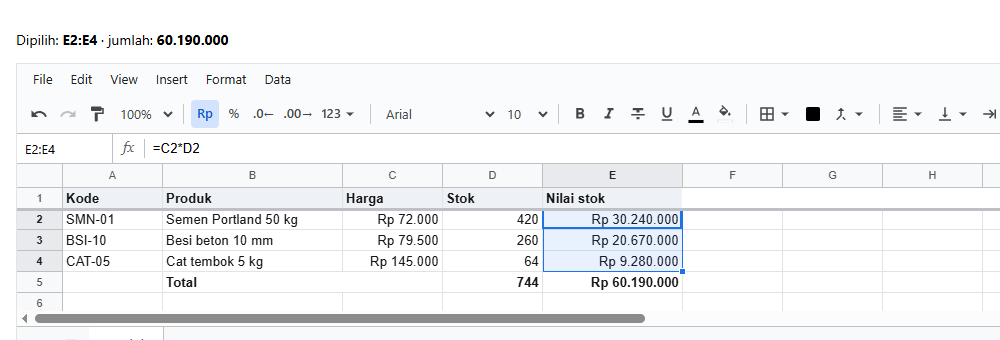
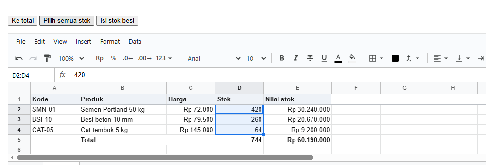
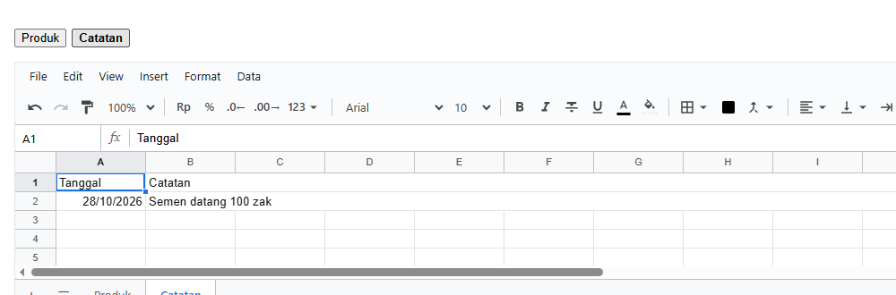
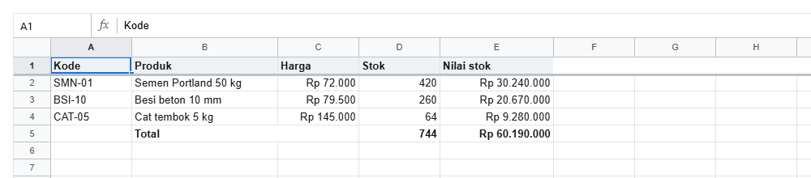
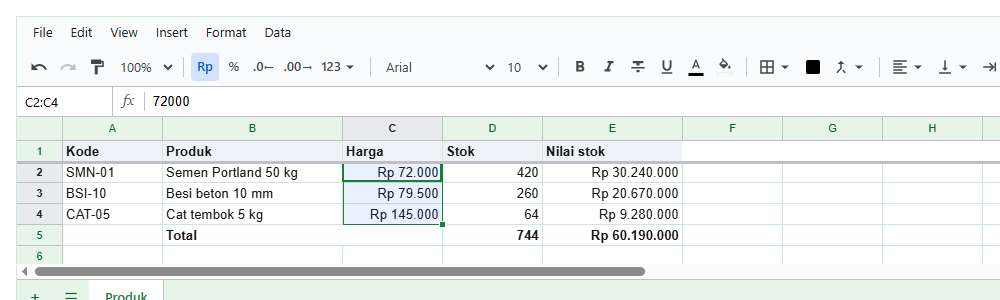
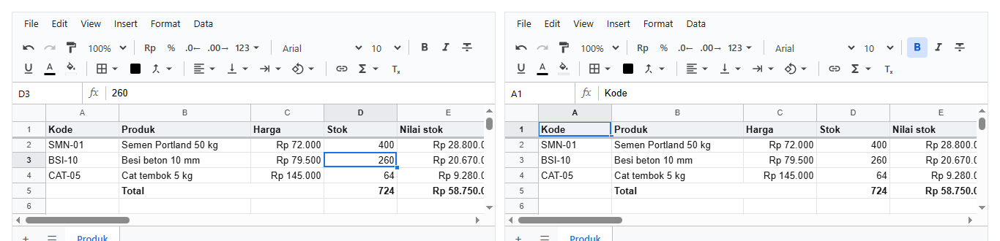

# 3. Komponen `<Sheet>`

[Daftar isi](../README.md#daftar-isi) · Sebelumnya: [2. Konsep dasar](02-konsep.md) · Berikutnya: [4. Mengisi dan membaca dari kode](04-api-workbook.md)

Bab ini membahas `<Sheet>` itu sendiri: cara aplikasimu mendengar apa yang dilakukan orang di sheet, memberi perintah ke sheet, mengatur sheet
mana yang tampil, menyederhanakan layarnya, dan mengganti warnanya. Setiap langkah adalah satu halaman React dengan foto hasilnya.

**Bagian A. Pengenalan (tanpa kode)**
- [3.1 Bagian-bagian `<Sheet>`](#31-bagian-bagian-sheet)
- [3.2 Tiga arah bicara dengan sheet](#32-tiga-arah-bicara-dengan-sheet)
- [3.3 Ukuran sheet](#33-ukuran-sheet)

**Bagian B. Langkah demi langkah**
- [3.4 Mendengar perubahan](#34-mendengar-perubahan)
- [3.5 Membaca seleksi](#35-membaca-seleksi)
- [3.6 Memberi perintah lewat `ref`](#36-memberi-perintah-lewat-ref)
- [3.7 Sheet mana yang tampil](#37-sheet-mana-yang-tampil)
- [3.8 Layar yang lebih sederhana](#38-layar-yang-lebih-sederhana)
- [3.9 Warna sendiri](#39-warna-sendiri)
- [3.10 Dua sheet, satu workbook](#310-dua-sheet-satu-workbook)

**Bagian C. Yang sering keliru, dan referensi**
- [3.11 Yang sering keliru](#311-yang-sering-keliru)
- [3.12 Referensi](#312-referensi)

---

# Bagian A. Pengenalan

## 3.1 Bagian-bagian `<Sheet>`



| Bagian | Isinya |
|---|---|
| **Menu bar** | File, Edit, View, Insert, Format, Data |
| **Toolbar** | undo/redo, zoom, format angka (Rp, %, desimal), font, tebal/miring, warna, border, merge, rata, dan lainnya |
| **Formula bar** | kotak nama di kiri (alamat sel aktif; ketik alamat lalu Enter untuk loncat), lalu isi sel aktif |
| **Grid** | huruf kolom, nomor baris, dan sel |
| **Tab sheet** | `+` untuk sheet baru, `☰` daftar semua sheet, lalu satu tab per sheet |

Isi setiap menu, tombol toolbar, dan panel ada di 3.12.

## 3.2 Tiga arah bicara dengan sheet

| Arah | Caranya | Contoh |
|---|---|---|
| **Aplikasimu → sheet** (data) | props | `workbook`, `sheet` (sheet yang tampil), `fileName`, `style` |
| **Sheet → aplikasimu** (kabar) | event, berupa prop `on...` | `onOp` (isi berubah), `onSelectionChange` (seleksi berubah), `onSheetChange` |
| **Aplikasimu → sheet** (perintah) | `ref` | `select('E5')`, `startEdit('300')`, `focus()` |

Isi workbook sendiri dibaca dan diubah lewat workbook-nya, seperti di bab 2. Props, event, dan `ref` hanya untuk hal yang dimiliki **layar**:
seleksi, sheet yang tampil, editor yang terbuka, tampilan.

## 3.3 Ukuran sheet

`<Sheet>` selalu **mengisi penuh kotak pembungkusnya**. Ukurannya diatur oleh pembungkus itu, dengan salah satu cara berikut:

| Cara | Contoh |
|---|---|
| tinggi tetap | `<div style={{ height: 420 }}><Sheet /></div>` |
| setinggi layar | `<main style={{ height: '100vh' }}><Sheet /></main>` |
| sisa ruang di kolom flex | pembungkus `display: flex; flex-direction: column` yang punya tinggi, lalu `<Sheet style={{ flex: 1 }} />` |
| berdampingan | pembungkus `display: flex`, lalu `<Sheet style={{ flex: 1 }} />` di samping panelmu |

Sheet mengukur ulang dirinya saat ukuran pembungkusnya berubah, misalnya saat panel di sampingnya dibuka atau jendela diubah ukurannya.

---

# Bagian B. Langkah demi langkah

Semua contoh memakai daftar produk dari bab 2 (`buatProduk`). Baris yang baru ditandai `// baru`.

## 3.4 Mendengar perubahan

**Tujuan:** mencatat setiap perubahan yang dilakukan orang di sheet, di panel samping.

<!-- contoh: 03-04-perubahan.page.tsx -->
```tsx
import { useState } from 'react';
import { Sheet } from '@kufayeka/sheet';
import type { WorkbookEvents } from '@kufayeka/sheet/core';
import '@kufayeka/sheet/style.css';
import { buatProduk } from './data/produk.js';

// 3.4 Mendengar perubahan dari sheet: onOp dipanggil setiap kali isi berubah, dengan sumbernya.
export default function Halaman() {
    const [wb] = useState(buatProduk);
    const [catatan, setCatatan] = useState<string[]>([]);

    // baru: satu baris catatan per perubahan
    function padaPerubahan(e: WorkbookEvents['op']) {
        setCatatan((c) => [...c, e.source + ': ' + e.ops.map((op) => op.t).join(', ')]);
    }

    return (
        <div style={{ display: 'flex', height: 300 }}>
            <Sheet workbook={wb} style={{ flex: 1 }} onOp={padaPerubahan} />          {/* baru */}
            <ol style={{ width: 220, margin: 0, padding: '8px 8px 8px 28px', font: '13px system-ui', borderLeft: '1px solid #dadce0' }}>
                {catatan.map((c, i) => <li key={i}><code>{c}</code></li>)}
            </ol>
        </div>
    );
}
```
<!-- /contoh -->

Orang mengetik 400 di D2 dan 250 di D3:



**Penjelasan:**

- `onOp` dipanggil setiap kali isi workbook berubah, sama seperti `wb.on('op', ...)` di 2.10, tapi tanpa perlu `useEffect`.
- Perubahan dari sheet bersumber `user`. Perubahan dari kodemu bersumber `code`, dan juga ikut tercatat di sini.
- Untuk hal yang lebih sederhana, misalnya "ada perubahan yang belum disimpan", `useWorkbook(wb, (w) => w.unsaved())` sudah cukup (1.8).

## 3.5 Membaca seleksi

**Tujuan:** menampilkan range yang dipilih orang, dan jumlah angkanya, di luar sheet.

<!-- contoh: 03-05-seleksi.page.tsx -->
```tsx
import { useState } from 'react';
import { Sheet } from '@kufayeka/sheet';
import type { SheetSelection } from '@kufayeka/sheet';
import '@kufayeka/sheet/style.css';
import { buatProduk } from './data/produk.js';

// 3.5 Seleksi: range yang dipilih orang, dan jumlah angkanya, ditampilkan di luar sheet.
export default function Halaman() {
    const [wb] = useState(buatProduk);
    const [pilihan, setPilihan] = useState<SheetSelection | null>(null);       // baru

    // baru: jumlahkan angka di semua range yang dipilih
    let jumlah = 0;
    for (const r of pilihan?.ranges ?? []) {
        for (let baris = r.r1; baris <= r.r2; baris++) {
            for (let kolom = r.c1; kolom <= r.c2; kolom++) {
                const v = wb.value(pilihan!.sheet.id, baris, kolom);
                if (typeof v === 'number') jumlah += v;
            }
        }
    }

    return (
        <div>
            <p style={{ font: '14px system-ui' }}>
                Dipilih: <b className="dipilih">{pilihan ? pilihan.address : '-'}</b> · jumlah: <b>{jumlah.toLocaleString('id-ID')}</b>
            </p>
            <div style={{ height: 300 }}>
                <Sheet workbook={wb} onSelectionChange={setPilihan} />              {/* baru */}
            </div>
        </div>
    );
}
```
<!-- /contoh -->

Orang men-drag E2 sampai E4:



**Penjelasan:**

- `onSelectionChange` memberi seleksi baru. Saat orang men-drag, event ini muncul **sekali, setelah mouse dilepas**, bukan di setiap sel yang
  dilewati. Klik dan tombol panah langsung memicunya.
- Isinya:

  | Kolom | Contoh | Artinya |
  |---|---|---|
  | `address` | `'E2:E4'` | alamat seleksi, siap ditampilkan |
  | `ranges` | `[{ r1: 1, c1: 4, r2: 3, c2: 4, address: 'E2:E4' }]` | setiap range, dengan nomor mulai dari 0. Lebih dari satu kalau orang memakai Ctrl |
  | `active` | `{ r: 1, c: 4, address: 'E2' }` | sel aktif |
  | `sheet` | `{ id, name }` | sheet tempat seleksi itu |

- Jumlahnya dihitung dengan `wb.value` di setiap sel range, memakai nomor baris dan kolom.

## 3.6 Memberi perintah lewat `ref`

**Tujuan:** tombol di luar sheet yang memilih sel dan membuka editor.

<!-- contoh: 03-06-perintah.page.tsx -->
```tsx
import { useRef, useState } from 'react';
import { Sheet } from '@kufayeka/sheet';
import type { SheetHandle } from '@kufayeka/sheet';
import '@kufayeka/sheet/style.css';
import { buatProduk } from './data/produk.js';

// 3.6 Memberi perintah ke sheet dari tombolmu sendiri, lewat ref.
export default function Halaman() {
    const [wb] = useState(buatProduk);
    const sheet = useRef<SheetHandle>(null);                                      // baru

    return (
        <div>
            <p>
                <button className="ke-total" onClick={() => sheet.current?.select('E5')}>Ke total</button>{' '}
                <button className="pilih-stok" onClick={() => sheet.current?.select('D2:D4')}>Pilih semua stok</button>{' '}
                <button className="isi-stok" onClick={() => { sheet.current?.select('D3'); sheet.current?.startEdit('300'); }}>Isi stok besi</button>
            </p>
            <div style={{ height: 300 }}>
                <Sheet ref={sheet} workbook={wb} />                                  {/* baru: ref */}
            </div>
        </div>
    );
}
```
<!-- /contoh -->

Setelah tombol "Pilih semua stok" diklik:



**Penjelasan:**

- `useRef<SheetHandle>(null)` dan `<Sheet ref={sheet}>` memberi akses ke perintah sheet.
- `select('D2:D4')` memilih range dan menggulir ke sana. `select('E5')` memilih satu sel.
- `startEdit('300')` membuka editor di sel aktif, berisi `300`, seperti orang mulai mengetik. Orang tinggal menekan Enter untuk menyimpannya.
- Perintah lainnya (`focus`, `showSheet`, `getSelection`) ada di 3.12.

## 3.7 Sheet mana yang tampil

**Tujuan:** tombol sendiri untuk berpindah sheet, yang tetap sinkron saat orang mengklik tab di sheet.

<!-- contoh: 03-07-sheet-aktif.page.tsx -->
```tsx
import { useState } from 'react';
import { Sheet, useWorkbook } from '@kufayeka/sheet';
import '@kufayeka/sheet/style.css';
import { buatProduk } from './data/produk.js';

// 3.7 Sheet yang tampil diatur oleh aplikasimu: tombol sendiri di luar sheet, dan tetap ikut kalau tab di sheet diklik.
function buatDuaSheet() {
    const wb = buatProduk();
    const catatan = wb.sheet(wb.addSheet('Catatan'));
    catatan.setValues('A1', [['Tanggal', 'Catatan'], ['2026-10-28', 'Semen datang 100 zak']]);
    return wb;
}

export default function Halaman() {
    const [wb] = useState(buatDuaSheet);
    const [aktif, setAktif] = useState<string>(() => wb.sheetIds()[0]);          // baru: id sheet yang tampil
    const ids = useWorkbook(wb, (w) => w.sheetIds().join(','));                  // daftar sheet, ikut kalau sheet ditambah

    return (
        <div>
            <p>
                {ids.split(',').map((id) => (
                    <button key={id} className={'ke-' + wb.sheetProps(id).name} onClick={() => setAktif(id)}
                        style={{ fontWeight: id === aktif ? 700 : 400, marginRight: 6 }}>{wb.sheetProps(id).name}</button>
                ))}
            </p>
            <div style={{ height: 280 }}>
                <Sheet workbook={wb} sheet={aktif} onSheetChange={setAktif} />       {/* baru */}
            </div>
        </div>
    );
}
```
<!-- /contoh -->

Setelah tombol "Catatan" diklik:



**Penjelasan:**

- `sheet={aktif}` menentukan sheet yang tampil, berupa id sheet.
- `onSheetChange={setAktif}` memberi tahu saat orang mengklik tab, menambah sheet, atau loncat ke sheet lain. Dengan meneruskannya ke state yang
  sama, tombolmu dan tab di sheet selalu sepakat.
- Tanpa prop `sheet`, sheet sendiri yang mengatur tab aktifnya, dan aplikasimu tidak perlu ikut campur.
- `wb.addSheet('Catatan')` menambah sheet baru dan memberi id-nya. `wb.sheetProps(id).name` memberi namanya.

## 3.8 Layar yang lebih sederhana

**Tujuan:** sheet tanpa menu bar, toolbar, dan tab, misalnya untuk form input yang ringkas.

<!-- contoh: 03-08-bagian-layar.page.tsx -->
```tsx
import { useState } from 'react';
import { Sheet } from '@kufayeka/sheet';
import type { AccessRow } from '@kufayeka/sheet/core';
import '@kufayeka/sheet/style.css';
import { buatProduk } from './data/produk.js';

// 3.8 Sheet yang lebih sederhana: tanpa menu, toolbar, dan tab. Bagian layar diatur dengan baris aturan (bab 10).
const LAYAR: AccessRow[] = [
    { who: '*', effect: 'allow', action: '*' },                  // semua orang boleh semuanya...
    { who: '*', effect: 'deny', action: 'ui.menubar' },          // ...tanpa menu bar
    { who: '*', effect: 'deny', action: 'ui.toolbar' },          // ...tanpa toolbar
    { who: '*', effect: 'deny', action: 'ui.tabs' }              // ...tanpa tab sheet
];

export default function Halaman() {
    const [wb] = useState(buatProduk);
    return (
        <div style={{ height: 220 }}>
            <Sheet workbook={wb} access={{ rows: LAYAR, who: 'siapa saja' }} />     {/* baru */}
        </div>
    );
}
```
<!-- /contoh -->



**Penjelasan:**

- Bagian layar diatur dengan **baris aturan** yang sama dengan hak akses. Satu aturan per bagian yang disembunyikan: `ui.menubar`, `ui.toolbar`,
  `ui.tabs`, `ui.formulaBar`, `ui.headers`, `ui.gridlines`.
- Baris pertama, `* allow *`, membuat semua orang tetap boleh melakukan semuanya. Tanpa baris itu, sheet menjadi tidak bisa dipakai, karena
  aturan akses memakai prinsip "yang tidak diizinkan, tidak didapat".
- Menu, tombol, atau panel satu per satu juga bisa disembunyikan (`ui.menu.Insert`, `ui.tool.paint`, ...), dan bisa berbeda per orang. Semua itu
  dibahas di [bab 10](13-hak-akses.md#1322-bagian-layar).

## 3.9 Warna sendiri

**Tujuan:** sheet dengan warna aplikasimu.

<!-- contoh: 03-09-tema.page.tsx -->
```tsx
import { useState } from 'react';
import type { CSSProperties } from 'react';
import { Sheet } from '@kufayeka/sheet';
import '@kufayeka/sheet/style.css';
import { buatProduk } from './data/produk.js';

// 3.9 Warna sendiri: semua warna dan huruf sheet adalah variabel CSS (--ks-...).
const temaHijau = {
    '--ks-accent': '#188038',                  // sel aktif, seleksi, tab aktif
    '--ks-head-bg': '#e6f4ea',                 // latar huruf kolom dan nomor baris
    '--ks-head-fg': '#0d652d',
    '--ks-grid': '#cfe8d6'                     // garis grid
} as CSSProperties;

export default function Halaman() {
    const [wb] = useState(buatProduk);
    return (
        <div style={{ height: 300 }}>
            <Sheet workbook={wb} style={temaHijau} />                            {/* baru */}
        </div>
    );
}
```
<!-- /contoh -->

Harga dipilih, supaya warna seleksinya terlihat:



**Penjelasan:**

- Semua warna dan huruf sheet adalah **variabel CSS** yang diawali `--ks-`. Ganti lewat prop `style`, seperti di contoh, atau lewat CSS-mu
  sendiri: `.ks-sheet { --ks-accent: #188038; }`.
- `as CSSProperties` diperlukan di TypeScript, karena tipe `style` React belum mengenal variabel CSS buatan sendiri.
- Daftar semua variabel ada di 3.12.

## 3.10 Dua sheet, satu workbook

**Tujuan:** dua `<Sheet>` berdampingan yang menampilkan workbook yang sama.

<!-- contoh: 03-10-dua-sheet.page.tsx -->
```tsx
import { useState } from 'react';
import { Sheet } from '@kufayeka/sheet';
import '@kufayeka/sheet/style.css';
import { buatProduk } from './data/produk.js';

// 3.10 Dua <Sheet> untuk workbook yang sama: yang diketik di satu sheet langsung terlihat di sheet lainnya.
export default function Halaman() {
    const [wb] = useState(buatProduk);
    return (
        <div style={{ display: 'flex', gap: 12, height: 330 }}>
            <Sheet workbook={wb} style={{ flex: 1 }} />
            <Sheet workbook={wb} style={{ flex: 1 }} />                          {/* baru: workbook yang sama */}
        </div>
    );
}
```
<!-- /contoh -->

Orang mengetik 400 di D2 pada sheet kiri:



**Penjelasan:**

- Keduanya menerima `workbook={wb}` yang sama. Yang diketik di kiri langsung terlihat di kanan, beserta hasil rumusnya.
- Setiap sheet punya seleksi, gulirannya, dan sheet aktifnya sendiri. Yang sama hanya isinya.
- Kegunaannya: data di kiri dengan ringkasan di kanan, atau dua bagian sheet yang berjauhan dibuka berdampingan.

---

# Bagian C. Yang sering keliru, dan referensi

## 3.11 Yang sering keliru

| Keliru | Benar |
|---|---|
| Sheet tidak terlihat | pembungkusnya harus punya tinggi (3.3) |
| Mengubah isi lewat `ref` | `ref` untuk perintah layar. Isi diubah lewat workbook: `wb.sheet('Produk').setValues(...)` (bab 2) |
| `getSelection()` tepat setelah `select()` masih memberi seleksi lama | seleksi baru berlaku di render berikutnya. Dengarkan `onSelectionChange` |
| Memberi `sheet={...}` tanpa `onSheetChange` | tab di sheet tidak bisa berpindah, karena aplikasimu terus memaksa sheet yang sama. Selalu pasangkan keduanya (3.7) |
| Menyembunyikan toolbar dengan CSS | pakai baris aturan `ui.*` (3.8), supaya Ctrl+B dan tombol keyboard lain ikut dibatasi kalau perlu |
| Variabel tema ditolak TypeScript | tambahkan `as CSSProperties` (3.9) |

## 3.12 Referensi

### Props

| Prop | Tipe | Bawaan | Artinya |
|---|---|---|---|
| `workbook` | `Workbook` | workbook kosong baru | workbook yang ditampilkan dan diubah (bab 2) |
| `sheet` | id sheet | (diatur tab) | sheet yang tampil; pasangkan dengan `onSheetChange` (3.7) |
| `onSheetChange` | `(sheetId) => void` | | sheet yang tampil berganti (3.7) |
| `onOp` | `({ ops, source }) => void` | | setiap perubahan yang diterapkan (3.4) |
| `onSelectionChange` | `(sel: SheetSelection) => void` | | seleksi berubah; saat men-drag, sekali setelah mouse dilepas (3.5) |
| `onReject` | `({ reason, op, source }) => void` | | sebuah perubahan ditolak oleh aturan atau validasi (bab 8) |
| `onNotice` | `(n: SheetNotice) => string \| null \| undefined` | | setiap pesan sheet sebelum tampil: diganti, dimatikan, atau ditampilkan sendiri ([10](13-hak-akses.md#1326-pesan-penolakan)) |
| `onCellError` | `({ address, field, value, expected }) => void` | | nilai tidak cocok dengan tipe kolomnya (bab 8) |
| `fileName` | string | `'Spreadsheet'` | nama file, tanpa ekstensi, saat orang memilih File → Download |
| `access` | `{ rows, who, view?, ... }` | tanpa batasan | aturan akses dan bagian layar (3.8, [bab 10](13-hak-akses.md)) |
| `marks` | `false \| { lock, hidden, tint, stripes }` | `{ lock: true, hidden: true }` | tanda di sel yang tidak boleh diubah ([10](13-hak-akses.md#1325-variasi-tanda)) |
| `user` | `{ id, name }` | | orang yang membuka sheet; namanya tercatat di komentar |
| `className` | string | | class tambahan di elemen terluar |
| `style` | objek style | | style elemen terluar, termasuk ukuran dan variabel tema (3.3, 3.9) |
| `ref` | `Ref<SheetHandle>` | | perintah untuk sheet (3.6) |

### Perintah lewat `ref` (`SheetHandle`)

| Perintah | Artinya |
|---|---|
| `select(target)` | memilih sel atau range, lalu menggulir ke sana. `target` berupa teks (`'B2'`, `'B2:C4'`) atau `{ r1, c1, r2, c2 }` |
| `scrollTo(alamat)` | memilih satu sel dan menggulir ke sana |
| `startEdit(teks?)` | membuka editor di sel aktif, berisi `teks` (tanpa `teks`: isi sel sekarang) |
| `focus()` | mengembalikan keyboard ke grid, misalnya setelah dialogmu ditutup |
| `showSheet(id)` | menampilkan sheet lain |
| `getSelection()` | seleksi sekarang, bentuknya sama dengan `onSelectionChange` |
| `workbook` | workbook yang sedang ditampilkan |

### Keyboard

| Tombol | Fungsi |
|---|---|
| Panah | pindah sel; dengan `Shift` memperluas seleksi; dengan `Ctrl` melompat ke ujung data |
| `Tab` / `Shift+Tab` | sel kanan / kiri |
| `Enter` / `F2` | mulai mengedit sel; `Enter` saat mengedit menyimpan dan turun satu baris |
| `Shift+Enter` | naik satu baris |
| `Alt+Enter` / `Ctrl+Enter` | baris baru di dalam sel saat mengedit |
| `Escape` | batal mengedit |
| `F4` | saat mengetik rumus: alamat di kursor berganti `A1` → `$A$1` → `A$1` → `$A1` (bab 5) |
| `Delete` / `Backspace` | mengosongkan sel yang dipilih |
| `Home` / `End` | kolom A / kolom terakhir yang berisi data, di baris itu; dengan `Ctrl`: sel A1 / sel terakhir yang berisi data |
| `PageUp` / `PageDown` | satu layar ke atas / bawah |
| `Ctrl+A` | memilih semua |
| `Ctrl+Z` / `Ctrl+Y` (`Ctrl+Shift+Z`) | undo / redo |
| `Ctrl+C` / `Ctrl+X` / `Ctrl+V` | copy / cut / paste (dari dan ke Excel juga) |
| `Ctrl+Shift+V` | paste nilai saja |
| `Ctrl+B` / `Ctrl+I` / `Ctrl+U` | tebal / miring / garis bawah |
| `Alt+Shift+5` | coret |
| `Ctrl+\` | hapus format |
| `Ctrl+K` | sisipkan link |
| `Ctrl+Shift+1` … `5` | format angka / jam / tanggal / uang / persen |
| `Ctrl+F` / `Ctrl+H` | cari / cari dan ganti |
| `Alt+↓` | membuka dropdown sel (data validation) |
| `Space` | mencentang checkbox sel |
| `Alt+Shift+→` / `Alt+Shift+←` | grup / lepas grup baris (kolom kalau seluruh kolom dipilih) |
| `Ctrl+Alt+M` | membuka panel komentar untuk sel aktif |

### Variabel tema

| Variabel | Bawaan | Dipakai untuk |
|---|---|---|
| `--ks-accent` | `#1a73e8` | sel aktif, seleksi, tombol utama, tab aktif |
| `--ks-bg` | `#ffffff` | latar sheet dan panel |
| `--ks-fg` | `#161616` | teks |
| `--ks-grid` | `#e2e3e3` | garis grid dan bingkai luar |
| `--ks-head-bg` | `#f8f9fa` | latar huruf kolom dan nomor baris |
| `--ks-head-fg` | `#575757` | teks huruf kolom dan nomor baris |
| `--ks-head-line` | `#c0c0c0` | garis di sekitar header |
| `--ks-freeze` | `#bdc1c6` | garis tebal baris/kolom yang dibekukan |
| `--ks-error` | `#d93025` | pesan salah dan tanda nilai tidak valid |
| `--ks-font` | `10pt/1.25 Arial, …` | huruf di dalam sel (bawaan; sel bisa punya huruf sendiri) |
| `--ks-ui-font` | `13px/1.4 "IBM Plex Sans", system-ui, sans-serif` | huruf menu, toolbar, panel, dialog |

### Menu

| Menu | Isi | Di kode |
|---|---|---|
| **File** | Import… (`.xlsx`, `.csv`) · Download → Microsoft Excel (`.xlsx`) atau CSV sheet ini · Spreadsheet settings… (locale, mata uang) | `importXlsxInto`, `exportXlsx`, `exportCsv`, `setSettings` |
| **Edit** | Undo, Redo · Cut, Copy, Paste · Paste special → Values only, Format only · Find and replace · Delete → Values, baris, kolom | `undo`, `copyBlock`, `pasteClip`, `findAll`, `replaceIn`, `clear`, `deleteRows` |
| **View** | Freeze → baris dan kolom · Group → grup baris dan kolom, lipat dan buka semua · Comments · Show → Gridlines · Zoom | `setSheetProps`, `groupRows`, `showRowLevel`, `hideGridlines` |
| **Insert** | Rows (di atas, di bawah) · Columns (kiri, kanan) · Sheet · Checkbox · Dropdown · Function · Link · Comment · Pivot table | `insertRows`, `insertCols`, `addSheet`, `addValidation`, `addComment`, `addPivot` |
| **Format** | Number · Text (tebal, miring, garis bawah, coret) · Alignment · Wrapping · Rotation · Font size · Merge cells · Conditional formatting · Clear formatting | `setStyle`, `mergeCells`, `addConditional` |
| **Data** | Sort sheet · Sort range · Create a filter · Data validation · Named ranges | `sortRange`, `createFilter`, `setValidation`, `addName` |

**Klik kanan** pada sel, nomor baris, atau judul kolom membuka menu konteks: Cut, Copy, Paste, Paste values only, Insert dan Delete baris atau kolom,
Clear contents, Hide dan Unhide, Merge dan Unmerge, serta Sort.

### Toolbar

| Tombol | Artinya |
|---|---|
| ↶ ↷ | undo, redo |
| kuas | salin format: pilih sel sumber, klik kuas, lalu klik sel tujuan |
| 100% | zoom |
| `Rp` `%` | format uang (mata uang workbook) dan persen |
| `.0←` `.00→` | kurangi atau tambah desimal |
| `123` | daftar format: angka, tanggal, jam, durasi, teks, dan pola sendiri |
| font, ukuran | jenis dan ukuran huruf |
| **B** *I* ~~S~~ U | tebal, miring, coret, garis bawah |
| A, ember | warna huruf, warna latar |
| kotak | border: semua, luar, dalam, atas, bawah, kiri, kanan, hapus |
| gabung | merge sel |
| perataan | kiri, tengah, kanan, dan atas, tengah, bawah |
| bungkus | Overflow (meluber ke sel kosong), Wrap (turun ke baris berikut), Clip (dipotong) |
| putar | kemiringan teks |
| rantai | link |
| Σ | fungsi cepat: SUM, AVERAGE, COUNT, MAX, MIN untuk seleksi |
| T× | hapus format |

Tombol yang tidak boleh dipakai seseorang tampil abu-abu, atau hilang kalau ada aturan `deny ui.disallowed`.

### Panel samping

Panel muncul di kanan grid, satu panel pada satu waktu:

| Panel | Dibuka dari | Bab |
|---|---|---|
| Comments | View → Comments, Insert → Comment, Ctrl+Alt+M | [14](14-komentar.md) |
| Pivot table editor | memilih sel pivot, Insert → Pivot table | [7.6](07-data.md#76-pivot-table) |
| Conditional formatting | Format → Conditional formatting | [6.6](06-format.md#66-conditional-formatting) |
| Data validation | Data → Data validation, Insert → Dropdown | [10.4](10-aturan.md#104-validasi-data) |
| Named ranges | Data → Named ranges | [5.11](05-rumus.md#511-named-range) |
| Find and replace | Ctrl+F, Ctrl+H | [7.7](07-data.md#77-mencari-dan-mengganti) |

### Di dalam grid

- **Fill handle**: kotak kecil di pojok kanan bawah seleksi. Tarik untuk melanjutkan deret (1, 2, 3 · Senin, Selasa · Item 1, Item 2) atau menyalin
  rumus. Tahan Ctrl untuk menyalin apa adanya.
- **Mengubah ukuran**: tarik garis di antara judul kolom atau nomor baris. Klik dua kali untuk menyesuaikan dengan isi.
- **Filter**: tombol di judul kolom membuka urut dan saring ([7.4](07-data.md#74-menyaring)).
- **Dropdown dan checkbox** dari validasi data: klik panahnya, atau tekan Alt+↓.
- **Tanda di pojok sel**: oranye berarti ada komentar terbuka, merah berarti nilainya melanggar validasi yang hanya menandai.
- **Grup**: tombol `[-]` dan `[+]` di samping nomor baris dan di atas judul kolom, dan tombol level di pojok kiri atas.
- **Tab sheet**: klik kanan untuk Rename, Duplicate, Delete, Hide, serta Move left dan Move right. Tombol `+` menambah sheet, dan tombol ☰ menampilkan semua sheet
  termasuk yang tersembunyi.

[Daftar isi](../README.md#daftar-isi) · Sebelumnya: [2. Konsep dasar](02-konsep.md) · Berikutnya: [4. Mengisi dan membaca dari kode](04-api-workbook.md)
