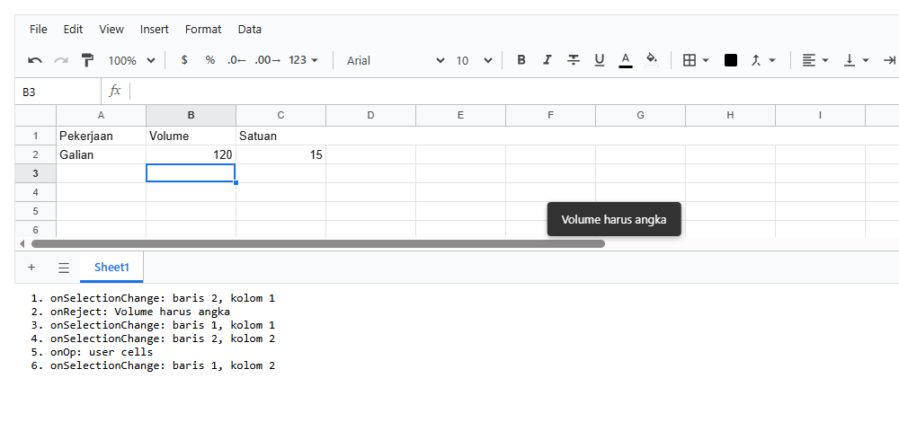
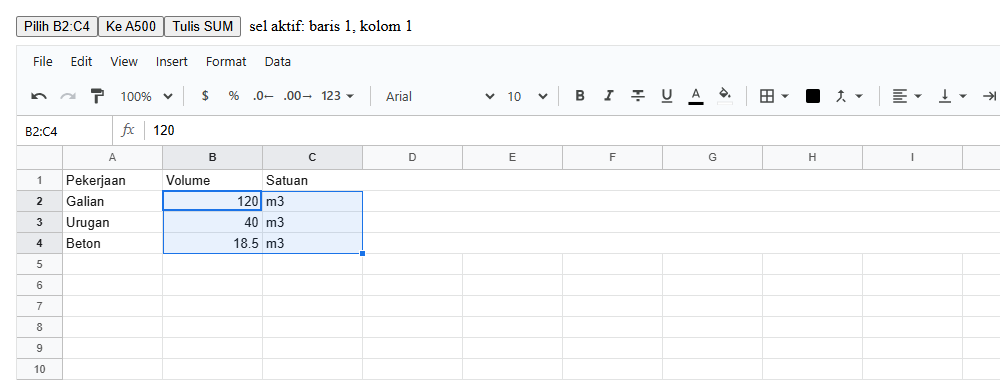
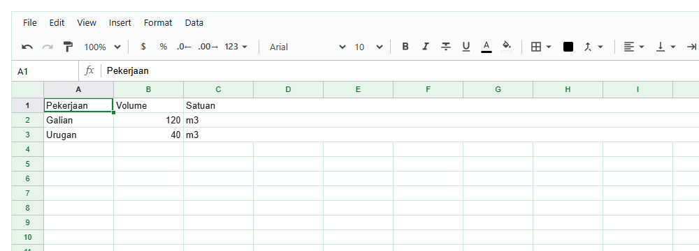

# 3. Komponen `<Sheet>`

[Daftar isi](../README.md#daftar-isi) · Sebelumnya: [2. Konsep dasar](02-konsep.md)

`<Sheet>` adalah satu-satunya komponen React di library ini. Bab ini menjelaskan semua props-nya, event-nya, apa yang bisa diminta kode Anda lewat
`ref`, tombol keyboard, dan cara mengubah tampilannya.

- [3.1 Props](#31-props)
- [3.2 Event](#32-event)
- [3.3 Handle (`ref`)](#33-handle-ref)
- [3.4 Keyboard](#34-keyboard)
- [3.5 Tema dan CSS](#35-tema-dan-css)

## 3.1 Props

Semua props boleh dikosongkan.

| Prop | Tipe | Bawaan | Artinya |
|---|---|---|---|
| `workbook` | workbook dari `createWorkbook()` | workbook kosong baru | workbook yang ditampilkan dan diubah. Dengan prop ini kode Anda memegang isinya: membaca, mengubah, mendengarkan, menyimpan (bab 2) |
| `sheet` | id sheet | (diatur tab) | sheet yang ditampilkan. Kalau diisi, Anda yang mengatur sheet aktif: ubah prop ini dari `onSheetChange` |
| `onSheetChange` | `(sheetId) => void` | | sheet aktif berganti: tab diklik, sheet ditambah atau diduplikat, hasil pencarian di sheet lain |
| `onOp` | `({ ops, source }) => void` | | setiap perubahan yang diterapkan (dari orang, kode, atau undo). Sama dengan `wb.on('op', ...)` |
| `onReject` | `({ reason, op, source }) => void` | | sebuah perubahan ditolak. Sheet sudah menampilkan `reason` sebagai pemberitahuan; prop ini untuk log atau tampilan Anda sendiri |
| `onCellError` | `({ address, field, value, expected }) => void` | | nilai tidak sesuai tipe kolomnya (bab 10) |
| `onSelectionChange` | `(sel) => void` | | seleksi berubah. `sel.active` adalah sel aktif `{ r, c }`, `sel.ranges` daftar kotak yang dipilih |
| `fileName` | string | `'Spreadsheet'` | nama file (tanpa ekstensi) saat orang memilih File → Download |
| `access` | `{ policy, who }` | tanpa batasan | access policy dan orang yang membuka sheet (bab 11). Sheet menerapkannya; kebijakannya tetap milik aplikasi Anda |
| `user` | `{ id, name }` | | orang yang membuka sheet: namanya tercatat di komentarnya (bab 12) |
| `showProtected` | boolean | `false` | sel yang dilindungi aturan digambar bergaris-garis (berguna saat membuat aturan) |
| `className` | string | | class tambahan di elemen terluar |
| `style` | objek style | | style elemen terluar. Tinggi bisa diatur di sini; variabel tema juga (3.5) |
| `ref` | ref React | | handle untuk kode Anda (3.3) |

> **Workbook milik Anda, bukan milik `<Sheet>`.** Mengganti prop `workbook` dengan workbook lain menampilkan workbook itu. Mengubah isi workbook lewat
> kode (`wb.setValues(...)`) langsung terlihat di layar, tanpa perlu `setState`. Sheet mendengarkan perubahan workbook sendiri.

## 3.2 Event

Contoh berikut mencatat tiga event, dan menolak teks di kolom Volume lewat `beforeOp` (2.5):

<!-- contoh: 03-events.page.js -->
```jsx
import { useState } from 'react';
import { Sheet } from '@kufayeka/sheet';
import { createWorkbook } from '@kufayeka/sheet/core';
import '@kufayeka/sheet/style.css';

function buat() {
    // kolom Volume (B) hanya menerima angka: aturan Anda sendiri, lewat beforeOp
    const wb = createWorkbook(null, {
        beforeOp(op, ctx) {
            if (op.t !== 'cells' || ctx.source !== 'user') return op;
            const salah = op.changes.some((ch) => ctx.workbook.colIndex(op.sheet, ch.col) === 1 && ch.after !== null && typeof ch.after !== 'number');
            return salah ? { reject: 'Volume harus angka' } : op;
        }
    });
    const [s] = wb.sheetIds();
    wb.setValues(s, 0, 0, [['Pekerjaan', 'Volume', 'Satuan'], ['Galian', 120, 'm3']]);
    return wb;
}

export default function HalamanEvent() {
    const [wb] = useState(buat);
    const [log, setLog] = useState([]);
    const tulis = (teks) => setLog((l) => [teks, ...l].slice(0, 6));
    return (
        <div style={{ height: 600, display: 'flex', flexDirection: 'column', gap: 8 }}>
            <div style={{ height: 300 }}>
                <Sheet workbook={wb}
                    onOp={(e) => tulis('onOp: ' + e.source + ' ' + e.ops.map((o) => o.t).join(', '))}
                    onReject={(e) => tulis('onReject: ' + e.reason)}
                    onSelectionChange={(sel) => tulis('onSelectionChange: baris ' + sel.active.r + ', kolom ' + sel.active.c)} />
            </div>
            <ol id="log" style={{ margin: 0, fontFamily: 'monospace' }}>{log.map((t, i) => <li key={i}>{t}</li>)}</ol>
        </div>
    );
}
```
<!-- /contoh -->

Di screenshot di bawah, orang mengetik `15` di C2 (diterima), lalu mengetik `Besi` di B2 (ditolak). Catatan terbaru ada di paling atas. Sheet
sendiri menampilkan alasan penolakan sebagai pemberitahuan di bawah grid:



Untuk perubahan dari layar, `op.changes` berisi `{ row, col, before, after }`, dengan `row` dan `col` berupa **id**. `ctx.workbook.colIndex(...)`
mengubahnya menjadi nomor kolom. Daftar lengkap jenis op ada di bab 4.

## 3.3 Handle (`ref`)

Dengan `ref`, kode Anda bisa meminta sheet melakukan sesuatu, misalnya dari tombol di luar sheet:

<!-- contoh: 03-handle.page.js -->
```jsx
import { useRef, useState } from 'react';
import { Sheet } from '@kufayeka/sheet';
import { createWorkbook } from '@kufayeka/sheet/core';
import '@kufayeka/sheet/style.css';

function buat() {
    const wb = createWorkbook();
    const [s] = wb.sheetIds();
    wb.setValues(s, 0, 0, [['Pekerjaan', 'Volume', 'Satuan'], ['Galian', 120, 'm3'], ['Urugan', 40, 'm3'], ['Beton', 18.5, 'm3']]);
    return wb;
}

// ref memberi "handle": hal yang bisa diminta kode Anda dari sheet
export default function HalamanHandle() {
    const [wb] = useState(buat);
    const sheet = useRef(null);
    const [pilihan, setPilihan] = useState('');
    return (
        <div style={{ height: 600, display: 'flex', flexDirection: 'column', gap: 8 }}>
            <div>
                <button id="pilih" onClick={() => sheet.current.select('B2:C4')}>
                    Pilih B2:C4
                </button>
                <button onClick={() => sheet.current.scrollTo('A500')}>Ke A500</button>
                <button onClick={() => sheet.current.startEdit('=SUM(B2:B4)')}>Tulis SUM</button>
                <span style={{ marginLeft: 8 }}>{pilihan}</span>
            </div>
            <div style={{ flex: 1 }}>
                <Sheet ref={sheet} workbook={wb}
                    onSelectionChange={(sel) => setPilihan('sel aktif: baris ' + sel.active.r + ', kolom ' + sel.active.c)} />
            </div>
        </div>
    );
}
```
<!-- /contoh -->

Setelah tombol **Pilih B2:C4** diklik:



| Handle | Artinya |
|---|---|
| `select(target)` | memilih sel atau range lalu menggulir ke sana. `target` berupa teks (`'B2'`, `'B2:C4'`) atau kotak `{ r1, c1, r2, c2 }` (`r2`/`c2` boleh kosong untuk satu sel). Melempar error kalau teksnya bukan alamat |
| `scrollTo(address)` | memilih satu sel dan menggulir ke sana |
| `startEdit(text?)` | membuka editor di sel aktif berisi `text` (tanpa `text`: isi sel sekarang), seperti orang mulai mengetik |
| `focus()` | mengembalikan keyboard ke grid (misalnya setelah dialog Anda ditutup) |
| `showSheet(id)` | menampilkan sheet lain |
| `getSelection()` | seleksi sekarang: `{ ranges, active }` |
| `workbook` | workbook yang sedang ditampilkan |

> **Seleksi berubah di render berikutnya.** `select()` mengubah state React, jadi `getSelection()` yang dipanggil tepat sesudahnya pada baris yang
> sama masih memberikan seleksi lama. Untuk tahu seleksi yang baru, dengarkan `onSelectionChange` seperti contoh di atas.

## 3.4 Keyboard

Sama seperti Google Sheets. Di Mac, `Ctrl` adalah `⌘`.

| Tombol | Fungsi |
|---|---|
| Panah | pindah sel; dengan `Shift` memperluas seleksi; dengan `Ctrl` melompat ke ujung data |
| `Tab` / `Shift+Tab` | sel kanan / kiri |
| `Enter` / `F2` | mulai mengedit sel; `Enter` saat mengedit menyimpan dan turun satu baris |
| `Shift+Enter` | naik satu baris |
| `Alt+Enter` / `Ctrl+Enter` | baris baru di dalam sel saat mengedit |
| `Escape` | batal mengedit |
| `Delete` / `Backspace` | mengosongkan sel yang dipilih |
| `Home` / `End` | kolom A / kolom terakhir yang berisi data, di baris itu; dengan `Ctrl`: sel A1 / sel terakhir yang berisi data |
| `PageUp` / `PageDown` | satu layar ke atas / bawah |
| `Ctrl+A` | memilih semua |
| `Ctrl+Z` / `Ctrl+Y` (`Ctrl+Shift+Z`) | undo / redo |
| `Ctrl+C` / `Ctrl+X` / `Ctrl+V` | copy / cut / paste (dari dan ke Excel atau Google Sheets juga) |
| `Ctrl+Shift+V` | paste nilai saja |
| `Ctrl+B` / `Ctrl+I` / `Ctrl+U` | tebal / miring / garis bawah |
| `Alt+Shift+5` | coret |
| `Ctrl+\` | hapus format |
| `Ctrl+K` | sisipkan link |
| `Ctrl+Shift+1` … `5` | format angka / jam / tanggal / uang / persen |
| `Ctrl+F` / `Ctrl+H` | cari / cari dan ganti |
| `Alt+↓` | membuka dropdown sel (data validation) |
| `Space` | mencentang checkbox sel |
| `Alt+Shift+→` / `Alt+Shift+←` | grup / lepas grup baris (kolom kalau seluruh kolom dipilih) |
| `Ctrl+Alt+M` | membuka panel komentar untuk sel aktif |

## 3.5 Tema dan CSS

Semua warna dan huruf adalah **variabel CSS** di elemen `.ks-sheet`. Ganti lewat prop `style` atau lewat CSS Anda sendiri
(`.ks-sheet { --ks-accent: ... }`):

<!-- contoh: 03-tema.page.js -->
```jsx
import { useState } from 'react';
import { Sheet } from '@kufayeka/sheet';
import { createWorkbook } from '@kufayeka/sheet/core';
import '@kufayeka/sheet/style.css';

// semua warna dan huruf adalah variabel CSS (--ks-...): ganti lewat style atau CSS Anda sendiri
const temaHijau = {
    '--ks-accent': '#188038',
    '--ks-head-bg': '#e6f4ea',
    '--ks-head-fg': '#0d652d',
    '--ks-grid': '#cfe8d6',
    '--ks-ui-font': '13px/1.4 "Segoe UI", system-ui, sans-serif'
};

function buat() {
    const wb = createWorkbook();
    const [s] = wb.sheetIds();
    wb.setValues(s, 0, 0, [['Pekerjaan', 'Volume', 'Satuan'], ['Galian', 120, 'm3'], ['Urugan', 40, 'm3']]);
    return wb;
}

export default function HalamanTema() {
    const [wb] = useState(buat);
    return (
        <div style={{ height: 600 }}>
            <Sheet workbook={wb} style={{ ...temaHijau, height: '100%' }} />
        </div>
    );
}
```
<!-- /contoh -->



| Variabel | Bawaan | Dipakai untuk |
|---|---|---|
| `--ks-accent` | `#1a73e8` | sel aktif, seleksi, tombol utama, tab aktif |
| `--ks-bg` | `#ffffff` | latar sheet dan panel |
| `--ks-fg` | `#161616` | teks |
| `--ks-grid` | `#e2e3e3` | garis grid dan bingkai luar |
| `--ks-head-bg` | `#f8f9fa` | latar huruf kolom dan nomor baris |
| `--ks-head-fg` | `#575757` | teks huruf kolom dan nomor baris |
| `--ks-head-line` | `#c0c0c0` | garis di sekitar header |
| `--ks-freeze` | `#bdc1c6` | garis tebal baris/kolom yang dibekukan |
| `--ks-error` | `#d93025` | pesan salah dan tanda nilai tidak valid |
| `--ks-font` | `10pt/1.25 Arial, …` | huruf di dalam sel (bawaan; sel bisa punya huruf sendiri) |
| `--ks-ui-font` | `13px/1.4 "IBM Plex Sans", system-ui, sans-serif` | huruf menu, toolbar, panel, dialog |

Semua class library diawali `ks-`, jadi tidak bertabrakan dengan CSS aplikasi Anda.

[Daftar isi](../README.md#daftar-isi) · Sebelumnya: [2. Konsep dasar](02-konsep.md)
