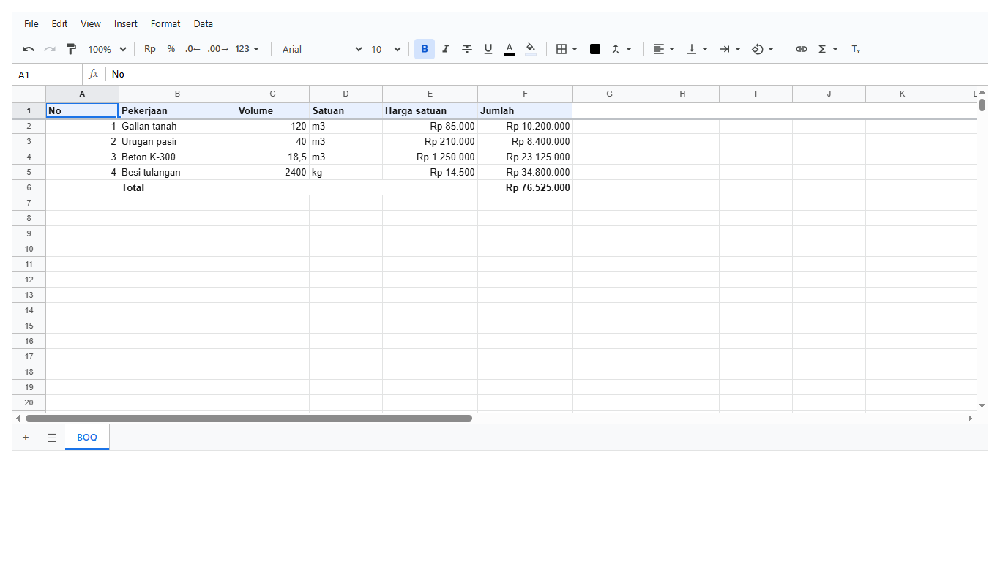
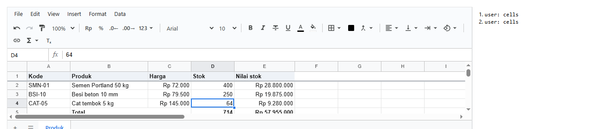
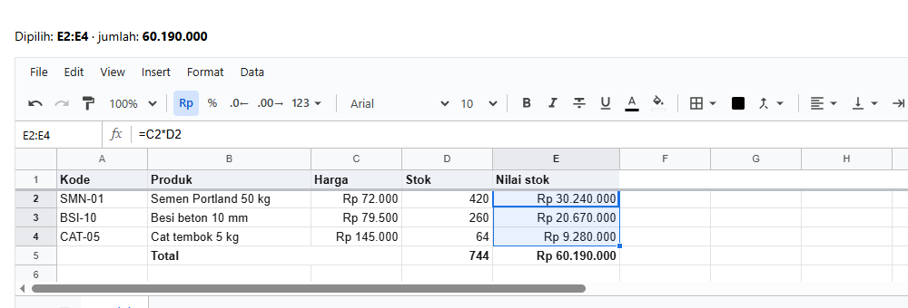
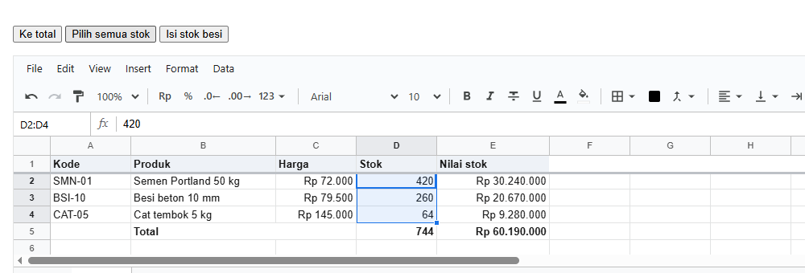
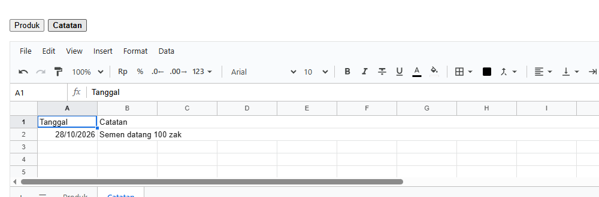
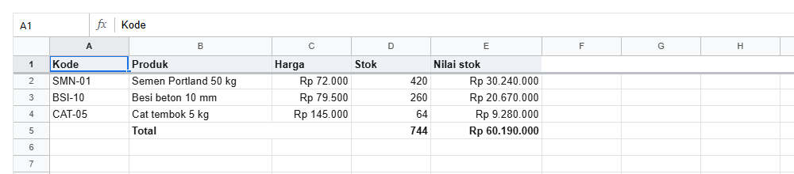
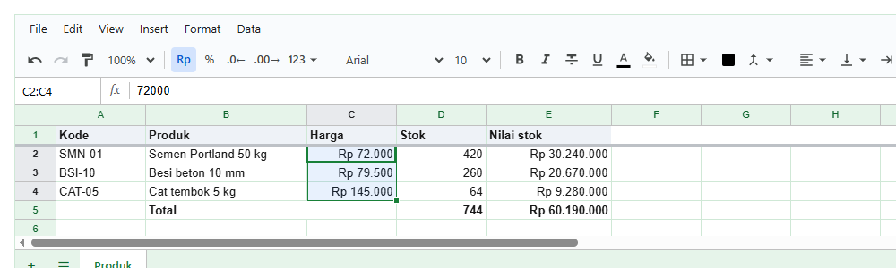
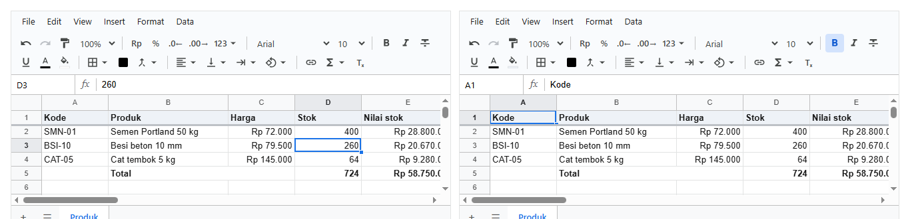

# 03. Komponen `<Sheet>` & Kustomisasi UI

[Daftar isi](../README.md#daftar-isi) · Sebelumnya: [02. Konsep Arsitektur & Mental Model](02-konsep.md) · Berikutnya: [04. Manipulasi Data Programatis](04-api-workbook.md)

Bab ini mengulas tuntas arsitektur komponen visual `<Sheet />`: pola komunikasi bidirectional (Props, Event Listener, dan Imperative Handle via `ref`), kontrol navigasi sheet aktif, kustomisasi modular elemen antarmuka (Menu bar, Toolbar, Formula bar, Sheet tabs), theming berbasis CSS Variables, serta skenario rendering multi-view (split-screen).

---

## 1. Anatomi & Struktur Visual Komponen

Komponen `<Sheet />` merender seluruh antarmuka spreadsheet interaktif yang terorganisir ke dalam lima modul utama:



1. **Menu Bar**: Menyediakan menu navigasi tingkat atas (*File, Edit, View, Insert, Format, Data*) untuk operasi dokumen, import/export, dan konfigurasi global.
2. **Toolbar**: Kontrol cepat untuk aksi umum seperti Undo/Redo, Zooming, Number Formatting (Currency, Percent, Decimals), Font Styling, Cell Alignment, Borders, Merge Cells, dan Filter.
3. **Formula Bar**: Terdiri dari *Name Box* (menampilkan dan mengarahkan koordinat kursor sel aktif) serta editor multiline input formula reaktif.
4. **Virtualized Grid**: Area kerja tabel spreadsheet dengan header baris/kolom virtualized untuk performa tinggi pada dataset masif.
5. **Sheet Tab Bar**: Kontrol navigasi sheet, penambahan sheet baru (`+`), dan menu dropdown untuk melihat daftar seluruh sheet dalam workbook.

Setiap modul di atas dapat dikonfigurasi, disembunyikan, atau dibatasi aksesnya secara selektif.

---

## 2. Pola Komunikasi Komponen (Data Flow & Control)

Komunikasi antara aplikasi React dan komponen `<Sheet />` berjalan melalui tiga saluran terstruktur:

```text
┌────────────────────────────────────────────────────────┐
│                 Aplikasi React (Host)                  │
└───────┬───────────────────────▲────────────────▲───────┘
        │                       │                │
1. Props (Top-Down)     2. Events (Reaktif)   3. Ref (Imperatif)
   • workbook              • onOp                • select()
   • sheet                 • onSelectionChange   • scrollTo()
   • access                • onSheetChange       • focus()
   • fileName              • onReject            • startEdit()
        │                       │                │
        ▼                       │                │
┌───────────────────────────────┴────────────────┴───────┐
│                 Komponen <Sheet /> (UI)                │
└───────────────────────────────┬────────────────────────┘
                                │ sinkronisasi state & canvas
                                ▼
┌────────────────────────────────────────────────────────┐
│        Workbook Core Instance (@kufayeka/sheet/core)   │
└────────────────────────────────────────────────────────┘
```

1. **Props (Top-Down)**: Mengalirkan data workbook, sheet target yang aktif, aturan hak akses (ACL), dan styling dokumen.
2. **Events (Bottom-Up)**: Mengirimkan callback ke aplikasi induk saat terjadi mutasi data (`onOp`), perubahan area seleksi kursor (`onSelectionChange`), pergantian sheet (`onSheetChange`), atau penolakan aksi validasi (`onReject`).
3. **Imperative Handle (`ref`)**: Mengontrol fokus kursor, seleksi range, inisiasi mode edit, dan navigasi scroll secara langsung dari kode aplikasi.

---

## 3. Ukuran & Constraint Layout

Komponen `<Sheet />` secara default mengisi 100% lebar dan tinggi elemen container pembungkusnya (`width: 100%`, `height: 100%`). Pastikan parent container memiliki batasan tinggi yang eksplisit:

```tsx
// Menggunakan tinggi tetap (fixed height)
<div style={{ height: 500 }}>
    <Sheet workbook={wb} />
</div>

// Mengisi seluruh viewport layar (full screen)
<div style={{ height: '100vh' }}>
    <Sheet workbook={wb} />
</div>

// Mengisi fleksibel di dalam flex container
<div style={{ display: 'flex', flexDirection: 'column', height: '100vh' }}>
    <header style={{ height: 60 }}>Header Aplikasi</header>
    <main style={{ flex: 1, minHeight: 0 }}>
        <Sheet workbook={wb} />
    </main>
</div>
```

> **Perhatian**: Hindari pembungkus dengan `height: auto` tanpa batas tinggi, karena spreadsheet akan terender dengan dimensi tinggi 0 piksel.

---

## 4. Implementasi Panduan Langkah demi Langkah

Semua contoh berikut menggunakan dataset produk toko bangunan dari `data/produk.js`.

---

### 4.1 Menangkap Mutasi Pengguna via `onOp`

Gunakan event handler `onOp` untuk mendeteksi setiap perubahan data yang dilakukan oleh pengguna secara langsung di layar:

<!-- contoh: 03-04-perubahan.page.tsx -->
```tsx
import { useState } from 'react';
import { Sheet } from '@kufayeka/sheet';
import type { WorkbookEvents } from '@kufayeka/sheet/core';
import '@kufayeka/sheet/style.css';
import { buatProduk } from './data/produk.js';

// 3.4 Mendengar perubahan dari sheet: onOp dipanggil setiap kali isi berubah, dengan sumbernya.
export default function Halaman() {
    const [wb] = useState(buatProduk);
    const [catatan, setCatatan] = useState<string[]>([]);

    // baru: satu baris catatan per perubahan
    function padaPerubahan(e: WorkbookEvents['op']) {
        setCatatan((c) => [...c, e.source + ': ' + e.ops.map((op) => op.t).join(', ')]);
    }

    return (
        <div style={{ display: 'flex', height: 300 }}>
            <Sheet workbook={wb} style={{ flex: 1 }} onOp={padaPerubahan} />          {/* baru */}
            <ol style={{ width: 220, margin: 0, padding: '8px 8px 8px 28px', font: '13px system-ui', borderLeft: '1px solid #dadce0' }}>
                {catatan.map((c, i) => <li key={i}><code>{c}</code></li>)}
            </ol>
        </div>
    );
}
```
<!-- /contoh -->



Payload `onOp` mengembalikan:
- `ops`: Sekumpulan operasi atomik (`Op[]`) yang diaplikasikan.
- `source`: Asal mutasi (`'user'` saat diedit langsung di grid, `'undo'`/`'redo'`, dsb).

---

### 4.2 Membaca Area Seleksi Kursor (`onSelectionChange`)

Event `onSelectionChange` dipancarkan setiap kali kursor berpindah sel atau pengguna memilih rentang area (range):

<!-- contoh: 03-05-seleksi.page.tsx -->
```tsx
import { useState } from 'react';
import { Sheet } from '@kufayeka/sheet';
import type { SheetSelection } from '@kufayeka/sheet';
import '@kufayeka/sheet/style.css';
import { buatProduk } from './data/produk.js';

// 3.5 Seleksi: range yang dipilih orang, dan jumlah angkanya, ditampilkan di luar sheet.
export default function Halaman() {
    const [wb] = useState(buatProduk);
    const [pilihan, setPilihan] = useState<SheetSelection | null>(null);       // baru

    // baru: jumlahkan angka di semua range yang dipilih
    let jumlah = 0;
    for (const r of pilihan?.ranges ?? []) {
        for (let baris = r.r1; baris <= r.r2; baris++) {
            for (let kolom = r.c1; kolom <= r.c2; kolom++) {
                const v = wb.value(pilihan!.sheet.id, baris, kolom);
                if (typeof v === 'number') jumlah += v;
            }
        }
    }

    return (
        <div>
            <p style={{ font: '14px system-ui' }}>
                Dipilih: <b className="dipilih">{pilihan ? pilihan.address : '-'}</b> · jumlah: <b>{jumlah.toLocaleString('id-ID')}</b>
            </p>
            <div style={{ height: 300 }}>
                <Sheet workbook={wb} onSelectionChange={setPilihan} />              {/* baru */}
            </div>
        </div>
    );
}
```
<!-- /contoh -->



Objek `SheetSelection` memuat atribut:
- `sheet`: Nama sheet aktif tempat seleksi berada.
- `address`: Alamat range string yang mudah dibaca (misal `'D2:D4'` atau `'B2'`).
- `r1`, `c1`, `r2`, `c2`: Batas koordinat numerik 0-based yang siap diiterasi loop.

---

### 4.3 Menjalankan Perintah Imperatif via `ref` (`SheetHandle`)

Gunakan React `ref` untuk mengeksekusi kontrol navigasi viewport dan kursor secara imperatif:

<!-- contoh: 03-06-perintah.page.tsx -->
```tsx
import { useRef, useState } from 'react';
import { Sheet } from '@kufayeka/sheet';
import type { SheetHandle } from '@kufayeka/sheet';
import '@kufayeka/sheet/style.css';
import { buatProduk } from './data/produk.js';

// 3.6 Memberi perintah ke sheet dari tombolmu sendiri, lewat ref.
export default function Halaman() {
    const [wb] = useState(buatProduk);
    const sheet = useRef<SheetHandle>(null);                                      // baru

    return (
        <div>
            <p>
                <button className="ke-total" onClick={() => sheet.current?.select('E5')}>Ke total</button>{' '}
                <button className="pilih-stok" onClick={() => sheet.current?.select('D2:D4')}>Pilih semua stok</button>{' '}
                <button className="isi-stok" onClick={() => { sheet.current?.select('D3'); sheet.current?.startEdit('300'); }}>Isi stok besi</button>
            </p>
            <div style={{ height: 300 }}>
                <Sheet ref={sheet} workbook={wb} />                                  {/* baru: ref */}
            </div>
        </div>
    );
}
```
<!-- /contoh -->



---

### 4.4 Mengontrol Navigasi Sheet Aktif (Controlled Active Sheet)

Secara default, navigasi tab sheet dikelola internal oleh komponen. Anda dapat mengontrol sheet mana yang sedang aktif melalui perpaduan prop `sheet` dan `onSheetChange`:

<!-- contoh: 03-07-sheet-aktif.page.tsx -->
```tsx
import { useState } from 'react';
import { Sheet, useWorkbook } from '@kufayeka/sheet';
import '@kufayeka/sheet/style.css';
import { buatProduk } from './data/produk.js';

// 3.7 Sheet yang tampil diatur oleh aplikasimu: tombol sendiri di luar sheet, dan tetap ikut kalau tab di sheet diklik.
function buatDuaSheet() {
    const wb = buatProduk();
    const catatan = wb.sheet(wb.addSheet('Catatan'));
    catatan.setValues('A1', [['Tanggal', 'Catatan'], ['2026-10-28', 'Semen datang 100 zak']]);
    return wb;
}

export default function Halaman() {
    const [wb] = useState(buatDuaSheet);
    const [aktif, setAktif] = useState<string>(() => wb.sheetIds()[0]);          // baru: id sheet yang tampil
    const ids = useWorkbook(wb, (w) => w.sheetIds().join(','));                  // daftar sheet, ikut kalau sheet ditambah

    return (
        <div>
            <p>
                {ids.split(',').map((id) => (
                    <button key={id} className={'ke-' + wb.sheetProps(id).name} onClick={() => setAktif(id)}
                        style={{ fontWeight: id === aktif ? 700 : 400, marginRight: 6 }}>{wb.sheetProps(id).name}</button>
                ))}
            </p>
            <div style={{ height: 280 }}>
                <Sheet workbook={wb} sheet={aktif} onSheetChange={setAktif} />       {/* baru */}
            </div>
        </div>
    );
}
```
<!-- /contoh -->



> **Penting**: Selalu pasangkan prop `sheet={aktif}` dengan handler `onSheetChange={setAktif}` agar interaksi klik tab langsung di dalam spreadsheet tetap dapat memperbarui state aplikasi Anda.

---

### 4.5 Kustomisasi Visibilitas Modul UI (Minimalist / Embedded View)

Untuk skenario embedding seperti form input sederhana, widget dashboard, atau review mode, modul antarmuka dapat disembunyikan menggunakan prop `access.ui`:

<!-- contoh: 03-08-bagian-layar.page.tsx -->
```tsx
import { useState } from 'react';
import { Sheet } from '@kufayeka/sheet';
import type { AccessRow } from '@kufayeka/sheet/core';
import '@kufayeka/sheet/style.css';
import { buatProduk } from './data/produk.js';

// 3.8 Sheet yang lebih sederhana: tanpa menu, toolbar, dan tab. Bagian layar diatur dengan baris aturan (bab 10).
const LAYAR: AccessRow[] = [
    { who: '*', effect: 'allow', action: '*' },                  // semua orang boleh semuanya...
    { who: '*', effect: 'deny', action: 'ui.menubar' },          // ...tanpa menu bar
    { who: '*', effect: 'deny', action: 'ui.toolbar' },          // ...tanpa toolbar
    { who: '*', effect: 'deny', action: 'ui.tabs' }              // ...tanpa tab sheet
];

export default function Halaman() {
    const [wb] = useState(buatProduk);
    return (
        <div style={{ height: 220 }}>
            <Sheet workbook={wb} access={{ rows: LAYAR, who: 'siapa saja' }} />     {/* baru */}
        </div>
    );
}
```
<!-- /contoh -->



Menonaktifkan modul UI melalui prop `access.ui` juga secara otomatis menonaktifkan shortcut keyboard terkait (misalnya `Ctrl+B` tidak akan mengeksekusi styling jika tombol toolbar/menu terkait dibatasi).

---

### 4.6 Theming & Desain Visual via CSS Custom Properties

Seluruh palet warna, tipografi, dan dimensi garis grid dikontrol melalui variabel CSS. Anda dapat menyesuaikan tampilan spreadsheet agar menyatu sempurna dengan *design system* aplikasi Anda:

<!-- contoh: 03-09-tema.page.tsx -->
```tsx
import { useState } from 'react';
import type { CSSProperties } from 'react';
import { Sheet } from '@kufayeka/sheet';
import '@kufayeka/sheet/style.css';
import { buatProduk } from './data/produk.js';

// 3.9 Warna sendiri: semua warna dan huruf sheet adalah variabel CSS (--ks-...).
const temaHijau = {
    '--ks-accent': '#188038',                  // sel aktif, seleksi, tab aktif
    '--ks-head-bg': '#e6f4ea',                 // latar huruf kolom dan nomor baris
    '--ks-head-fg': '#0d652d',
    '--ks-grid': '#cfe8d6'                     // garis grid
} as CSSProperties;

export default function Halaman() {
    const [wb] = useState(buatProduk);
    return (
        <div style={{ height: 300 }}>
            <Sheet workbook={wb} style={temaHijau} />                            {/* baru */}
        </div>
    );
}
```
<!-- /contoh -->



---

### 4.7 Multi-View Spreadsheet (Split-Screen / Two Grids, One Workbook)

Dua komponen `<Sheet />` dapat di-binding ke satu instance workbook yang sama secara berdampingan. Setiap view memiliki state kursor, viewport scrolling, dan sheet aktif yang independen, tetapi berbagi state data yang identik secara instan:

<!-- contoh: 03-10-dua-sheet.page.tsx -->
```tsx
import { useState } from 'react';
import { Sheet } from '@kufayeka/sheet';
import '@kufayeka/sheet/style.css';
import { buatProduk } from './data/produk.js';

// 3.10 Dua <Sheet> untuk workbook yang sama: yang diketik di satu sheet langsung terlihat di sheet lainnya.
export default function Halaman() {
    const [wb] = useState(buatProduk);
    return (
        <div style={{ display: 'flex', gap: 12, height: 330 }}>
            <Sheet workbook={wb} style={{ flex: 1 }} />
            <Sheet workbook={wb} style={{ flex: 1 }} />                          {/* baru: workbook yang sama */}
        </div>
    );
}
```
<!-- /contoh -->



---

## 5. Gotchas & Kesalahan Umum

| Permasalahan | Akar Masalah | Solusi Rekomendasi |
|---|---|---|
| **Spreadsheet terpotong / hilang** | Parent wrapper tidak memiliki batas `height` yang jelas. | Berikan tinggi eksplisit (misal `style={{ height: '500px' }}` atau `100vh`). |
| **Mencoba memodifikasi data sel via `sheetRef`** | Ref hanya didesain untuk manipulasi viewport UI dan kursor kustom. | Lakukan perubahan data langsung pada instance workbook: `wb.sheet('Sheet1').setValues(...)`. |
| **Nilai `getSelection()` tidak terbarui tepat setelah `select()`** | Seleksi baru diaplikasikan pada siklus rendering berikutnya. | Pantau seleksi terkini melalui callback `onSelectionChange`. |
| **Tab sheet tidak merespons klik saat berpindah sheet** | Mengirimkan prop `sheet={aktif}` tanpa menyertakan handler `onSheetChange`. | Pasangkan kedua prop secara bersamaan untuk skenario controlled component. |
| **Menyembunyikan menu/toolbar via CSS display none biasa** | Shortcut keyboard bawaan tetap dapat dipicu oleh pengguna. | Konfigurasikan prop `access={{ ui: { menu: false, toolbar: false } }}` agar proteksi menyeluruh diaplikasikan. |
| **TypeScript error saat menyetel variabel CSS kustom pada objek style** | Tipe `CSSProperties` default React menolak custom property string bebas. | Lakukan type-casting: `{ '--ks-accent': '#1b7340' } as CSSProperties`. |

---

## 6. Referensi Lengkap API

### Props Interface (`<Sheet />`)

| Prop | Tipe Data | Nilai Default | Penjelasan |
|---|---|---|---|
| `workbook` | `Workbook` | Instance kosong baru | Instance workbook yang ditampilkan dan dimutasi. |
| `sheet` | `string` | Sheet pertama | Identifier atau nama sheet yang sedang aktif ditampilkan. |
| `onSheetChange` | `(sheetId: string) => void` | `undefined` | Callback saat pengguna berpindah tab sheet. |
| `onOp` | `(payload: { ops: Op[], source: OpSource }) => void` | `undefined` | Callback setiap kali mutasi data berhasil diaplikasikan ke workbook. |
| `onSelectionChange` | `(selection: SheetSelection) => void` | `undefined` | Callback saat area seleksi sel/range kursor berubah. |
| `onReject` | `(payload: { reason: string, op: Op, source: OpSource }) => void` | `undefined` | Callback saat aksi pengguna ditolak oleh aturan validasi atau hak akses. |
| `onNotice` | `(notice: SheetNotice) => string \| null \| undefined` | `undefined` | Interceptor pesan feedback sebelum ditampilkan ke layar (dapat dimodifikasi atau diredam). |
| `onCellError` | `(payload: { address: string, field: string, value: any, expected: string }) => void` | `undefined` | Callback saat nilai masukan melanggar tipe skema kolom. |
| `fileName` | `string` | `'Spreadsheet'` | Nama file default saat dokumen diunduh melalui menu *File → Download*. |
| `access` | `SheetAccessConfig` | `{}` | Konfigurasi granular kontrol modul UI dan pembatasan hak akses sel/baris. |
| `marks` | `boolean \| CellMarksConfig` | `{ lock: true, hidden: true }` | Indikator visual tanda gembok (terkunci) atau masking (tersembunyi) pada sel. |
| `user` | `{ id: string, name: string }` | `undefined` | Identitas pengguna aktif saat ini (disematkan pada riwayat author komentar). |
| `className` | `string` | `undefined` | Class CSS tambahan pada elemen kontainer spreadsheet terluar. |
| `style` | `CSSProperties` | `undefined` | Objek inline style, termasuk injeksi variabel tema CSS. |
| `ref` | `Ref<SheetHandle>` | `undefined` | Ref imperatif untuk interaksi kendali antarmuka. |

### Imperative Handle Methods (`SheetHandle`)

| Metode | Parameter | Deskripsi |
|---|---|---|
| `select(target)` | `target: string \| { r1: number, c1: number, r2: number, c2: number }` | Memilih sel atau range koordinat, lalu menggulirkan viewport ke target. |
| `scrollTo(cellAddress)` | `cellAddress: string` | Memilih satu sel dan menggulirkan viewport secara langsung. |
| `startEdit(initialText?)` | `initialText?: string` | Membuka editor in-place pada sel aktif dengan opsi isi teks awal. |
| `focus()` | - | Mengembalikan fokus keyboard ke area grid spreadsheet (misal setelah dialog ditutup). |
| `showSheet(sheetId)` | `sheetId: string` | Mengarahkan viewport untuk menampilkan sheet tertentu. |
| `getSelection()` | - | Mengambil snapshot objek seleksi kursor saat ini. |
| `workbook` | - | Mengambil referensi instance workbook aktif. |

### Shortcut Keyboard Bawaan

| Shortcut | Aksi |
|---|---|
| `Arrow Keys` | Navigasi kursor antar sel; `Shift + Arrow` memperluas range seleksi; `Ctrl + Arrow` melompat ke tepi dataset. |
| `Tab` / `Shift + Tab` | Berpindah ke sel kanan / kiri. |
| `Enter` / `F2` | Mengaktifkan in-place cell editor; `Enter` saat mode edit menyimpan nilai dan berpindah ke baris bawah. |
| `Shift + Enter` | Berpindah satu sel ke atas. |
| `Alt + Enter` / `Ctrl + Enter` | Menyisipkan baris baru (newline) di dalam sel saat mode pengeditan teks. |
| `Escape` | Membatalkan pengeditan yang sedang berlangsung tanpa menyimpan perubahan. |
| `F4` | Mengubah siklus referensi koordinat formula di kursor (`A1` → `$A$1` → `A$1` → `$A1`). |
| `Delete` / `Backspace` | Menghapus konten pada sel yang sedang terpilih. |
| `Home` / `End` | Bergerak ke kolom pertama / terakhir yang terisi data pada baris aktif. |
| `Ctrl + A` | Memilih seluruh sel dalam sheet aktif. |
| `Ctrl + Z` / `Ctrl + Y` | Undo / Redo operasi data. |
| `Ctrl + C` / `Ctrl + X` / `Ctrl + V` | Copy / Cut / Paste (terintegrasi penuh dengan clipboard sistem OS dan Excel). |
| `Ctrl + Shift + V` | Paste nilai saja (tanpa formula atau gaya pemformatan). |
| `Ctrl + B` / `Ctrl + I` / `Ctrl + U` | Mengubah format teks menjadi Tebal / Miring / Garis Bawah. |
| `Alt + Shift + 5` | Menerapkan format coret (*strikethrough*). |
| `Ctrl + \` | Menghapus seluruh format gaya pada sel yang dipilih. |
| `Ctrl + K` | Membuka dialog penyisipan hyperlink. |
| `Ctrl + F` / `Ctrl + H` | Membuka dialog Cari / Cari dan Ganti (*Find & Replace*). |
| `Alt + ↓` | Membuka popup menu dropdown validasi data pada sel aktif. |
| `Space` | Mengubah status centang pada sel bertipe checkbox. |
| `Alt + Shift + →` / `Alt + Shift + ←` | Membuat grup / membubarkan grup baris bertingkat. |
| `Ctrl + Alt + M` | Membuka thread panel komentar pada sel yang dipilih. |

### Katalog Variabel Tema CSS

| Variabel CSS | Nilai Bawaan | Area Penggunaan |
|---|---|---|
| `--ks-accent` | `#1a73e8` | Indikator sel aktif, outline seleksi kursor, tombol aksi utama, dan highlight tab aktif. |
| `--ks-bg` | `#ffffff` | Warna latar utama grid spreadsheet, modal dialog, dan panel flyout. |
| `--ks-fg` | `#161616` | Warna teks utama konten sel dan antarmuka. |
| `--ks-grid` | `#e2e3e3` | Garis batas antar sel (*gridlines*) dan bingkai kontainer luar. |
| `--ks-head-bg` | `#f8f9fa` | Warna latar header kolom (huruf) dan header baris (nomor). |
| `--ks-head-fg` | `#575757` | Warna teks label pada header kolom dan baris. |
| `--ks-head-line` | `#c0c0c0` | Garis pembatas antara header dengan area sel grid. |
| `--ks-freeze` | `#bdc1c6` | Garis pembatas tebal pemisah baris/kolom yang dibekukan (*frozen panes*). |
| `--ks-error` | `#d93025` | Indikator segitiga error validasi sel dan pesan kegagalan. |
| `--ks-font` | `10pt/1.25 Arial, sans-serif` | Tipografi default untuk konten sel spreadsheet. |
| `--ks-ui-font` | `13px/1.4 "IBM Plex Sans", system-ui, sans-serif` | Tipografi antarmuka kontrol (menu bar, toolbar, panel, dan dialog). |
