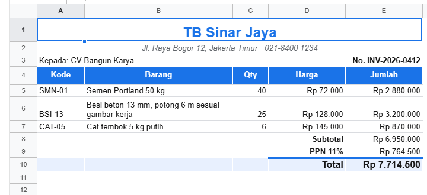

# 4. API workbook

[Daftar isi](../README.md#daftar-isi) · Sebelumnya: [3. Komponen `<Sheet>`](03-komponen-sheet.md) · Berikutnya: [5. Rumus](05-rumus.md)

Panduan untuk developer frontend: semua yang bisa dilakukan kodemu ke isi spreadsheet. Bab ini dimulai dari tiga baris kode, lalu bertambah sedikit demi
sedikit sampai event, `beforeOp`, undo, editor hak akses buatan sendiri, dan tipe TypeScript. Setiap contoh bisa dijalankan, dan hasilnya tertulis di
bawahnya.

Semua fungsi di bab ini milik **workbook** (`createWorkbook()` dari `@kufayeka/sheet/core`). Workbook bisa dipakai tanpa layar: di Node.js, di server,
atau di test. `<Sheet>` hanya menampilkannya ([bab 3](03-komponen-sheet.md), [bab 11](11-react.md)).

**Dasar**

- [4.1 Langkah pertama](#41-langkah-pertama)
- [4.2 Alamat sel](#42-alamat-sel)
- [4.3 Menulis isi](#43-menulis-isi)
- [4.4 Membaca isi](#44-membaca-isi)

**Mengatur tampilan dan struktur**

- [4.5 Gaya dan merge](#45-gaya-dan-merge)
- [4.6 Baris dan kolom](#46-baris-dan-kolom)
- [4.7 Sheet](#47-sheet)
- [4.8 Pengaturan workbook](#48-pengaturan-workbook)

**Mendengarkan dan mengendalikan perubahan**

- [4.9 Event](#49-event)
- [4.10 `beforeOp`: memeriksa setiap perubahan](#410-beforeop-memeriksa-setiap-perubahan)
- [4.11 Undo, redo, `source`, dan `apply`](#411-undo-redo-source-dan-apply)
- [4.12 Jenis op](#412-jenis-op)

**Studi kasus dan tipe**

- [4.13 Editor hak akses di luar sheet](#413-editor-hak-akses-di-luar-sheet)
- [4.14 TypeScript](#414-typescript)

## 4.1 Langkah pertama

<!-- contoh: 04-mulai.js -->
```js
import { createWorkbook } from '@kufayeka/sheet/core';

// Paling sederhana: buat workbook, tulis ke sel, baca kembali.
const wb = createWorkbook();                  // workbook baru: satu sheet bernama "Sheet1", 1000 baris, 26 kolom
const s = wb.sheet('Sheet1');                 // pegangan untuk sheet itu

s.setValues('A1', 'Semen');                   // satu sel
s.setValues('B1', 72000);
s.setValues('C1', '=B1*10');                  // diawali "=": rumus

console.log(s.value('A1'));                   // isi sel
console.log(s.value('C1'));                   // hasil rumus
console.log(s.input('C1'));                   // rumusnya, seperti di formula bar
```
<!-- /contoh -->

<!-- hasil: 04-mulai.js -->
```text
Semen
720000
=B1*10
```
<!-- /hasil -->

Tiga hal yang perlu diingat dari contoh ini:

1. `createWorkbook()` membuat workbook baru dengan satu sheet bernama `Sheet1`.
2. `wb.sheet('Sheet1')` memberi **pegangan** untuk sheet itu. Semua fungsi di bab ini dipanggil lewat pegangan ini.
3. Menulis dengan `setValues`, membaca dengan `value` (hasil) atau `input` (yang diketik).

## 4.2 Alamat sel

Sel bisa ditunjuk dengan tiga cara. Ketiganya setara:

| Cara | Contoh | Kapan dipakai |
|---|---|---|
| teks lewat pegangan sheet | `s.value('B2')` | paling sering: mudah dibaca |
| teks lewat workbook, sheet di depan | `wb.value('Produk', 'B2')` | kalau tidak menyimpan pegangan sheet |
| nomor baris dan kolom, dihitung dari 0 | `s.value(1, 1)` (B2) | di dalam loop |

Bentuk teks yang diterima:

| Teks | Artinya |
|---|---|
| `'B2'` | satu sel |
| `'A1:C9'` | range: kotak dari A1 sampai C9 |
| `'2:5'` | baris 2 sampai 5, semua kolom |
| `'B:D'` | kolom B sampai D, semua baris |
| `'A1:E1, A3:E3'` | beberapa range sekaligus (untuk gaya, merge, clear) |

Sheet ditunjuk dengan **nama** (`'Produk'`) atau **id**. Nama lebih mudah dibaca, tetapi bisa diganti orang. Id tidak pernah berubah, jadi simpan id
kalau kodemu perlu mengingat sebuah sheet dalam waktu lama.

## 4.3 Menulis isi

Daftar stok 12 produk dengan rumus per baris dan ringkasan di bawahnya:

<!-- contoh: 04-isi.js -->
```js
import { createWorkbook } from '@kufayeka/sheet/core';
import { PRODUK, KOLOM_PRODUK } from './data/toko.js';

// Daftar stok toko bangunan: isi sel, rumus per baris, membaca kembali.
const wb = createWorkbook();
wb.setSettings({ locale: 'id-ID', currency: 'IDR' });
const stok = wb.sheet('Sheet1');
stok.setSheetProps({ name: 'Stok' });

// judul kolom + satu baris per produk; kolom I dan J dihitung
stok.setValues('A1', [[...KOLOM_PRODUK, 'Nilai stok', 'Margin']]);
stok.setValues('A2', PRODUK.map((p, i) => [...p, `=E${i + 2}*G${i + 2}`, `=(F${i + 2}-E${i + 2})/F${i + 2}`]));
const akhir = PRODUK.length + 1;
stok.setColProps('E:F', { format: { type: 'money', decimals: 0 } });   // harga beli dan jual
stok.setColProps('I', { format: { type: 'money', decimals: 0 } });     // nilai stok
stok.setColProps('J', { format: { type: 'percent', decimals: 1 } });   // margin

// banyak sel sekaligus, isi dan gaya, sebagai satu perubahan
stok.setBlock([
    { at: `H${akhir + 2}`, value: 'Total nilai stok', style: { bold: true } },
    { at: `I${akhir + 2}`, value: `=SUM(I2:I${akhir})`, style: { bold: true, format: { type: 'money', decimals: 0 } } },
    { at: `H${akhir + 3}`, value: 'Produk habis', style: { bold: true } },
    { at: `I${akhir + 3}`, value: `=COUNTIF(G2:G${akhir}, 0)`, style: { bold: true } }
]);

console.log('nilai stok semen :', stok.value('I2'), '| tampil:', stok.display('I2').text);
console.log('total nilai stok :', stok.display(`I${akhir + 2}`).text);
console.log('produk habis     :', stok.value(`I${akhir + 3}`));
console.log('isi I2 (rumus)   :', stok.input('I2'), '| margin:', stok.display('J2').text);
console.log('terisi sampai    :', stok.lastFilled(), '=', wb.address(stok.lastFilled().r, stok.lastFilled().c));

// membaca baris demi baris: produk yang stoknya di bawah minimum
const kurang = [];
stok.forEachFilledRow((r) => {
    if (r === 0 || r >= akhir) return;
    if (stok.value(r, 6) < stok.value(r, 7)) kurang.push(stok.value(r, 1) + ' (' + stok.value(r, 6) + '/' + stok.value(r, 7) + ')');
});
console.log('perlu dipesan    :', kurang.join(', '));

// mengosongkan isi (gaya tetap), lalu undo
stok.clear('G9');
console.log('setelah clear G9 :', stok.value('G9'), '| produk habis:', stok.value(`I${akhir + 3}`));
wb.undo();
console.log('setelah undo     :', stok.value('G9'), '| produk habis:', stok.value(`I${akhir + 3}`));
```
<!-- /contoh -->

<!-- hasil: 04-isi.js -->
```text
nilai stok semen : 26880000 | tampil: Rp 26.880.000
total nilai stok : Rp 146.701.000
produk habis     : 1
isi I2 (rumus)   : =E2*G2 | margin: 11,1%
terisi sampai    : { r: 15, c: 9 } = J16
perlu dipesan    : Semen putih 40 kg (35/40), Cat tembok 25 kg putih (12/15), Keramik 40x40 putih (0/50)
setelah clear G9 : null | produk habis: 0
setelah undo     : 0 | produk habis: 1
```
<!-- /hasil -->

**`setValues(alamat, isi)`** menulis mulai dari alamat itu, ke kanan dan ke bawah:

| `isi` | Ditulis ke |
|---|---|
| `'Semen'`, `72000`, `true` | satu sel |
| `'=B2*C2'` | rumus (teks yang diawali `=`) |
| `"'=B2"` | teks apa adanya: tanda kutip satu di depan mencegahnya jadi rumus |
| `null` | mengosongkan sel |
| `[['a', 'b', 'c']]` | satu **baris**: ke kanan |
| `[['a'], ['b'], ['c']]` | satu **kolom**: ke bawah |
| `['a', 'b', 'c']` | array biasa juga ditulis **ke bawah**, satu nilai per baris |
| `[['a', 'b'], ['c', 'd']]` | tabel: setiap array di dalamnya adalah satu baris |
| `(r, c, sebelum) => isi` | dengan range sebagai alamat (`'A2:A9'`): isi setiap sel dari fungsi. `undefined` berarti sel itu tidak diubah |

Jadi `setValues('B2', ['Hello World', 'Ini baris kedua'])` menulis `Hello World` di B2 dan `Ini baris kedua` di B3. Untuk menulis ke kanan (B2 dan C2),
bungkus dengan satu array lagi: `setValues('B2', [['Hello World', 'Ini kolom kedua']])`.

**`setBlock([{ at, value, style }])`** menulis sel-sel yang letaknya terpisah, masing-masing dengan isi dan gayanya, sebagai **satu** perubahan. Satu
kali undo membatalkan semuanya. Cocok untuk baris total atau kepala laporan.

**`clear(range)`** mengosongkan isi tetapi membiarkan gaya, seperti tombol Delete.

Setiap fungsi yang mengubah isi menerima parameter terakhir `{ source }`. Tanpa itu, perubahan dianggap datang dari kode aplikasimu. Dengan
`{ source: 'user' }`, perubahan diperlakukan seperti diketik orang: validasi, tipe kolom, dan hak akses ikut memeriksanya (4.11).

## 4.4 Membaca isi

Satu sel bisa dibaca dengan beberapa cara, dan masing-masing menjawab pertanyaan yang berbeda:

<!-- contoh: 04-baca.js -->
```js
import { createWorkbook } from '@kufayeka/sheet/core';
import { penjualan, KOLOM_PENJUALAN, barisPenjualan } from './data/toko.js';

// Penjualan seminggu: semua cara membaca satu sel, dan mencari tabel di sekitar sebuah sel.
const wb = createWorkbook();
wb.setSettings({ locale: 'id-ID', currency: 'IDR' });
const jual = wb.sheet('Sheet1');
jual.setSheetProps({ name: 'Penjualan' });
jual.setValues('A1', [KOLOM_PENJUALAN]);
jual.setValues('A2', barisPenjualan(penjualan(20), 2));
jual.setColProps('B', { format: { type: 'date' } });
jual.setColProps('I', { format: { type: 'money', decimals: 0 } });
jual.setColProps('J', { format: { type: 'percent', decimals: 0 } });
jual.setColProps('K', { format: { type: 'money', decimals: 0 } });

// satu sel, lima cara membacanya
const disimpan = jual.raw('K2');                         // { f, refs }: referensinya disimpan sebagai id baris dan kolom
console.log('raw K2     :', disimpan.f, '+', disimpan.refs.length, 'referensi', disimpan.refs.map((x) => x.k).join(', '));
console.log('input K2   :', jual.input('K2'));
console.log('value K2   :', jual.value('K2'));
console.log('display K2 :', JSON.stringify(jual.display('K2')));
console.log('format K2  :', JSON.stringify(jual.cellFormat('K2')), '(dari kolom K)');
console.log('tanggal B2 :', jual.value('B2'), '->', jual.display('B2').text);

// ukuran sheet dan tabel yang berisi data
console.log('ukuran     :', JSON.stringify(jual.size()), '| terisi sampai', wb.address(jual.lastFilled().r, jual.lastFilled().c));
const t = jual.dataRegion(5, 3);                         // tabel yang memuat sel D6, seperti Ctrl+A di Excel
console.log('tabel D6   :', wb.address(t.r1, t.c1) + ':' + wb.address(t.r2, t.c2));

// nomor dan id: nomor berubah saat baris disisipkan, id tidak
const id = jual.rowId(4);
jual.insertRows('2', 3);
console.log('baris 5 kini nomor', jual.rowIndex(id) + 1, '| kolom Qty nomor', jual.colIndex(jual.colId(7)) + 1);
```
<!-- /contoh -->

<!-- hasil: 04-baca.js -->
```text
raw K2     : =⟦0⟧*⟦1⟧*(1-⟦2⟧) + 3 referensi cell, cell, cell
input K2   : =H2*I2*(1-J2)
value K2   : 752400
display K2 : {"text":"Rp 752.400","align":"right","kind":"number"}
format K2  : {"type":"money","decimals":0} (dari kolom K)
tanggal B2 : 46296 -> 01/10/2026
ukuran     : {"rows":1000,"cols":26} | terisi sampai K21
tabel D6   : A1:K21
baris 5 kini nomor 8 | kolom Qty nomor 8
```
<!-- /hasil -->

| Fungsi | Hasilnya | Dipakai untuk |
|---|---|---|
| `value(alamat)` | nilai jadi: hasil rumus, atau isi apa adanya. Kosong: `null`. Error: `{ code: '#DIV/0!' }`, cek dengan `isError` | menghitung, mengirim ke API |
| `input(alamat)` | teks yang diketik: rumus (`'=H2*I2*(1-J2)'`) atau nilai sebagai teks | formula bar, ekspor teks |
| `display(alamat)` | `{ text, align, kind, color }`: yang tampil di layar setelah format dan locale | laporan, email, PDF |
| `raw(alamat)` | yang disimpan: nilai, atau rumus `{ f, refs, v }` | menyalin apa adanya |
| `cellFormat(alamat)` | format sel, atau format kolomnya. `null` kalau tidak ada | tahu sebuah angka itu uang atau tanggal |
| `style(alamat)` | gaya yang disimpan di sel (tanpa conditional formatting) | menyalin gaya |
| `shownStyle(alamat)` | gaya yang digambar, termasuk conditional formatting | menggambar sendiri |
| `size()` | `{ rows, cols }` | |
| `lastFilled()` | `{ r, c }`: baris dan kolom terakhir yang berisi. `{ r: -1, c: -1 }` kalau kosong | mencari ujung data |
| `dataRegion(r, c)` | kotak tabel yang memuat sel itu, seperti Ctrl+A di Excel | menemukan tabel tanpa tahu ukurannya |
| `forEachFilledRow((r, cells, styles) => …)` | dipanggil untuk setiap baris yang berisi, urut. Baris kosong dilewati | membaca seluruh data, cepat |
| `rowContent(r)` | `{ cells, style }` satu baris, per id kolom | |
| `wb.address(r, c)` | `'K21'` dari nomor | |

`cells` dan `styles` dari `forEachFilledRow` dan `rowContent` adalah objek milik workbook, tidak disalin supaya cepat. Bacalah saja, jangan diubah.

**Nomor berubah, id tetap.** Nomor baris bergeser saat baris disisipkan di atasnya, sedangkan id baris tidak pernah berubah. Kalau kodemu perlu mengingat
"baris pesanan ini" (misalnya di state React), simpan id-nya:

| Fungsi | Artinya |
|---|---|
| `rowId(r)`, `colId(c)` | id baris atau kolom di nomor itu |
| `rowIndex(id)`, `colIndex(id)` | nomor sekarang dari id itu, atau `-1` kalau sudah dihapus |

## 4.5 Gaya dan merge

<!-- contoh: 04-gaya.js -->
```js
import { createWorkbook } from '@kufayeka/sheet/core';

// Kepala invoice: merge, gaya yang digabung, menghapus satu bagian gaya, gaya per sel lewat fungsi.
const wb = createWorkbook();
const inv = wb.sheet('Sheet1');
inv.setValues('A1', [['TB Sinar Jaya'], ['Jl. Raya Bogor 12, Jakarta Timur'], [], ['Kode', 'Barang', 'Qty', 'Harga', 'Total']]);

inv.mergeCells('A1:E1, A2:E2');                         // dua merge sekaligus
inv.setStyle('A1', { bold: true, fontSize: 16, align: 'center', color: '#1a73e8' });
inv.setStyle('A2', { italic: true, align: 'center', color: '#5f6368' });
inv.setStyle('A4:E4', { bold: true, fill: '#e8f0fe', align: 'center' });
inv.setStyle('A4:E4', { underline: true });              // digabung: yang tadi tetap
console.log('A4                 :', JSON.stringify(inv.style('A4')));

inv.setStyle('A4:E4', { underline: null });              // null menghapus satu bagian
console.log('A4 tanpa underline :', JSON.stringify(inv.style('A4')));

// border luar saja: tiap sel dapat sisi yang ada di pinggir kotak
const garis = { style: 'solid', width: 2, color: '#1a73e8' };
inv.setStyle('A4:E8', (r, c) => ({ borders: {
    ...(r === 3 ? { top: garis } : {}), ...(r === 7 ? { bottom: garis } : {}),
    ...(c === 0 ? { left: garis } : {}), ...(c === 4 ? { right: garis } : {})
} }));
console.log('pojok A4           :', JSON.stringify(inv.style('A4').borders));
console.log('tengah C6          :', inv.style('C6') || 'tanpa gaya (fungsi memberi {} untuk sel tengah)');

// border digabung per sisi: garis bawah tipis di judul kolom, garis atas dan kiri A4 tetap ada
inv.setStyle('A4:E4', { borders: { bottom: { style: 'solid', width: 1, color: '#9aa0a6' } } });
console.log('A4 tambah bawah    :', Object.keys(inv.style('A4').borders).join(', '));
inv.setStyle('A4', { borders: { left: null } });          // satu sisi saja yang dibuang
console.log('A4 tanpa kiri      :', Object.keys(inv.style('A4').borders).join(', '));
console.log('merge              :', JSON.stringify(inv.merges()));
inv.unmergeCells('A2');
console.log('setelah unmerge A2 :', JSON.stringify(inv.merges()));
```
<!-- /contoh -->

<!-- hasil: 04-gaya.js -->
```text
A4                 : {"bold":true,"fill":"#e8f0fe","align":"center","underline":true}
A4 tanpa underline : {"bold":true,"fill":"#e8f0fe","align":"center"}
pojok A4           : {"top":{"style":"solid","width":2,"color":"#1a73e8"},"left":{"style":"solid","width":2,"color":"#1a73e8"}}
tengah C6          : tanpa gaya (fungsi memberi {} untuk sel tengah)
A4 tambah bawah    : top, left, bottom
A4 tanpa kiri      : top, bottom
merge              : [{"r1":0,"c1":0,"r2":0,"c2":4},{"r1":1,"c1":0,"r2":1,"c2":4}]
setelah unmerge A2 : [{"r1":0,"c1":0,"r2":0,"c2":4}]
```
<!-- /hasil -->

Cara kerja `setStyle(range, gaya)`:

- **Digabung, bukan diganti.** `{ underline: true }` menambahkan garis bawah; tebal dan warna yang sudah ada tetap.
- **`null` membuang satu bagian.** `{ underline: null }` hanya membuang garis bawah.
- **Border digabung per sisi.** `{ borders: { bottom } }` menambah sisi bawah tanpa membuang sisi lain. `{ borders: null }` membuang semuanya.
- **Fungsi per sel.** `setStyle(range, (r, c, sebelum) => gaya)` untuk gaya yang berbeda di setiap sel, misalnya garis luar sebuah tabel.

Invoice lengkap sebagai halaman React:

<!-- contoh: 04-gaya.page.js -->
```jsx
import { useState } from 'react';
import { Sheet } from '@kufayeka/sheet';
import { createWorkbook } from '@kufayeka/sheet/core';
import '@kufayeka/sheet/style.css';

// Invoice toko: merge, warna, border, format uang dan persen, teks yang turun, lebar kolom, tanpa garis sel.
function buatInvoice() {
    const wb = createWorkbook();
    wb.setSettings({ locale: 'id-ID', currency: 'IDR' });
    const inv = wb.sheet('Sheet1');
    inv.setSheetProps({ name: 'INV-2026-0412', hideGridlines: true });
    inv.setValues('A1', [
        ['TB Sinar Jaya'],
        ['Jl. Raya Bogor 12, Jakarta Timur · 021-8400 1234'],
        ['Kepada: CV Bangun Karya', null, null, 'No. INV-2026-0412'],
        ['Kode', 'Barang', 'Qty', 'Harga', 'Jumlah'],
        ['SMN-01', 'Semen Portland 50 kg', 40, 72000, '=C5*D5'],
        ['BSI-13', 'Besi beton 13 mm, potong 6 m sesuai gambar kerja', 25, 128000, '=C6*D6'],
        ['CAT-05', 'Cat tembok 5 kg putih', 6, 145000, '=C7*D7'],
        [null, null, null, 'Subtotal', '=SUM(E5:E7)'],
        [null, null, null, 'PPN 11%', '=E8*0.11'],
        [null, null, null, 'Total', '=E8+E9']
    ]);
    inv.mergeCells('A1:E1, A2:E2, A3:C3, D3:E3');
    inv.setStyle('A1', { bold: true, fontSize: 18, align: 'center', color: '#1a73e8' });
    inv.setStyle('A2', { italic: true, align: 'center', color: '#5f6368' });
    inv.setStyle('D3', { align: 'right', bold: true });
    inv.setStyle('A4:E4', { bold: true, fill: '#1a73e8', color: '#ffffff', align: 'center', valign: 'middle' });
    inv.setStyle('B6', { wrap: 'wrap' });
    inv.setStyle('D5:E10', { format: { type: 'money', decimals: 0 } });
    inv.setStyle('D8:D10', { align: 'right', bold: true });
    inv.setStyle('A10:E10', { fill: '#e8f0fe', bold: true, fontSize: 12 });
    const tipis = { style: 'solid', width: 1, color: '#dadce0' };
    inv.setStyle('A4:E7', { borders: { bottom: tipis } });
    inv.setStyle('D10:E10', { borders: { top: { style: 'double', width: 3, color: '#1a73e8' } } });
    inv.setRowProps('1', { height: 40 });
    inv.setRowProps('4', { height: 30 });
    inv.setRowProps('6', { height: 40 });
    inv.setColProps('A', { width: 80 });
    inv.setColProps('B', { width: 250 });
    inv.setColProps('C', { width: 60 });
    inv.setColProps('D:E', { width: 130 });
    return wb;
}

export default function Invoice() {
    const [wb] = useState(buatInvoice);
    return <div style={{ height: 480 }}><Sheet workbook={wb} fileName="INV-2026-0412" /></div>;
}
```
<!-- /contoh -->



| Kunci gaya | Nilai |
|---|---|
| `bold`, `italic`, `underline`, `strike` | `true` |
| `color`, `fill` | warna CSS (`'#1a73e8'`): huruf, latar |
| `fontSize` | angka (pt) |
| `font` | nama font |
| `align` | `'left'`, `'center'`, `'right'` |
| `valign` | `'top'`, `'middle'`, `'bottom'` |
| `wrap` | `'wrap'` turun baris, `'clip'` dipotong, tidak diisi: meluber ke sel kosong di sebelahnya |
| `rotate` | derajat (-90 sampai 90), atau `'vertical'` |
| `borders` | `{ top, right, bottom, left }`, setiap sisi `{ style: 'solid' \| 'dashed' \| 'dotted' \| 'double', width, color }` |
| `format` | format angka ([bab 6](06-format.md)) |
| `link` | URL: sel menjadi tautan |

| Fungsi | Artinya |
|---|---|
| `setStyle(range, gaya)` | gabungkan gaya ke setiap sel di range |
| `mergeCells(range)` | gabung setiap range menjadi satu sel. Isinya dari sel kiri atas |
| `unmergeCells(alamat)` | lepas merge yang memuat sel itu |
| `merges()` | `[{ r1, c1, r2, c2 }]` |

## 4.6 Baris dan kolom

<!-- contoh: 04-baris-kolom.js -->
```js
import { createWorkbook } from '@kufayeka/sheet/core';
import { PRODUK } from './data/toko.js';

// Daftar harga: menyisipkan, menghapus, memindahkan, menyembunyikan, mengatur lebar, membekukan.
const wb = createWorkbook();
wb.setSettings({ locale: 'id-ID', currency: 'IDR' });
const sh = wb.sheet('Sheet1');
sh.setValues('A1', [['Kode', 'Nama produk', 'Harga jual']]);
sh.setValues('A2', PRODUK.slice(0, 5).map((p) => [p[0], p[1], p[5]]));
sh.setValues('A8', [['Jumlah produk', '=COUNTA(A2:A6)']]);
const kode = () => [1, 2, 3, 4, 5, 6].map((r) => sh.value(r, 0)).filter(Boolean).join(', ');

sh.insertRows('4', 1);                                  // baris baru di baris 4
sh.setValues('A4', [['CAT-01', 'Cat kayu 1 kg', 65000]]);
console.log('disisipkan    :', kode(), '| COUNTA:', sh.value('B9'), sh.input('B9'));

sh.deleteRows('2');                                     // hapus satu baris
console.log('dihapus       :', kode(), '| COUNTA:', sh.value('B8'));

sh.moveRows(3, 1, 1);                                   // 1 baris dari nomor 3 (baris 4) pindah ke depan nomor 1 (baris 2)
console.log('dipindah      :', kode());

sh.insertCols('C');                                     // kolom baru untuk kategori
sh.setValues('C1', 'Kategori');
console.log('kolom harga   :', sh.value('D1'));

sh.setColProps('B', { width: 200 });
sh.setColProps('D', { format: { type: 'money', decimals: 0 }, width: 120 });
sh.setColProps('C', { hidden: true });
sh.setRowProps('1', { height: 32 });
sh.setSheetProps({ freezeRows: 1, freezeCols: 1, hideGridlines: true });
console.log('kolom B, C, D :', JSON.stringify(sh.colProps(1)), JSON.stringify(sh.colProps(2)), JSON.stringify(sh.colProps(3)));
console.log('harga baris 2 :', sh.display('D2').text);
console.log('sheet         :', JSON.stringify(sh.sheetProps()));
console.log('lebar kolom   :', sh.colAxis().size(1), 'px, kolom C', sh.colAxis().size(2), 'px (tersembunyi)');
```
<!-- /contoh -->

<!-- hasil: 04-baris-kolom.js -->
```text
disisipkan    : SMN-01, SMN-02, CAT-01, BSI-10, BSI-13, CAT-05 | COUNTA: 6 =COUNTA(A2:A7)
dihapus       : SMN-02, CAT-01, BSI-10, BSI-13, CAT-05 | COUNTA: 5
dipindah      : BSI-10, SMN-02, CAT-01, BSI-13, CAT-05
kolom harga   : Harga jual
kolom B, C, D : {"width":200} {"hidden":true} {"format":{"type":"money","decimals":0},"width":120}
harga baris 2 : Rp 79.500
sheet         : {"name":"Sheet1","freezeRows":1,"freezeCols":1,"hideGridlines":true}
lebar kolom   : 200 px, kolom C 0 px (tersembunyi)
```
<!-- /hasil -->

- Baris disisipkan di dalam sebuah range, range itu ikut membesar (`A2:A7`).
- Baris di ujung range dihapus, range menyusut, sama seperti Excel. `#REF!` hanya muncul kalau sel yang dibaca benar-benar hilang semuanya.
- Rumus, nama, aturan, dan komentar ikut barisnya, karena semuanya menyimpan id baris.

| Fungsi | Artinya |
|---|---|
| `insertRows(di, jumlah = 1)` | sisipkan baris kosong: `'4'` atau nomor `3` |
| `deleteRows(baris)` | hapus: `'2'`, `'2:5'`, atau `(nomor, jumlah)` |
| `moveRows(dari, jumlah, ke)` | pindahkan baris supaya berdiri sebelum nomor `ke` |
| `insertCols`, `deleteCols`, `moveCols` | sama untuk kolom: `'C'`, `'B:D'` |
| `setRowProps(baris, props)`, `setColProps(kolom, props)` | props digabung seperti gaya |
| `rowProps(r)`, `colProps(c)` | props baris atau kolom |
| `rowAxis()`, `colAxis()` | ukuran dalam piksel: `count`, `total`, `size(i)`, `start(i)`, `indexAt(px)`. Yang tersembunyi berukuran 0 |
| `setAutoHeights(tinggi)` | tinggi baris otomatis dari teks yang turun. Dipakai grid |

| Props | Artinya |
|---|---|
| `height` (baris), `width` (kolom) | piksel |
| `hidden` | disembunyikan, tetap dihitung rumus |
| `format` (kolom) | format untuk setiap sel di kolom itu yang tidak punya format sendiri |

## 4.7 Sheet

<!-- contoh: 04-sheet.js -->
```js
import { createWorkbook } from '@kufayeka/sheet/core';

// Satu workbook per bulan, satu sheet per cabang, plus rekap yang membaca semua cabang.
const wb = createWorkbook();
const nama = () => wb.sheetIds().map((s) => wb.sheetProps(s).name + (wb.sheetProps(s).hidden ? ' (tersembunyi)' : '')).join(', ');

wb.setSheetProps('Sheet1', { name: 'Jakarta' });
wb.setValues('Jakarta', 'A1', [['Omzet'], [125000000]]);
const bandung = wb.duplicateSheet('Jakarta');          // salinan: "Copy of Jakarta"
wb.setSheetProps(bandung, { name: 'Bandung' });
wb.setValues('Bandung', 'A2', 98000000);
const rekap = wb.addSheet('Rekap');
wb.setValues(rekap, 'A1', [['Total omzet', '=Jakarta!A2+Bandung!A2']]);
wb.moveSheet(rekap, 0);                                 // rekap di depan
console.log('sheet         :', nama());
console.log('total omzet   :', wb.value('Rekap', 'B1'));

wb.setSheetProps('Bandung', { name: 'Bandung Kota' }); // ganti nama: rumus ikut
console.log('rumus rekap   :', wb.input('Rekap', 'B1'));

wb.hideSheet('Jakarta', true);                          // disembunyikan, tetap dihitung
console.log('sembunyikan   :', nama(), '| total masih', wb.value('Rekap', 'B1'));

wb.removeSheet('Bandung Kota');                         // dihapus: rumus yang membacanya #REF!
console.log('hapus Bandung :', nama(), '| rumus', wb.input('Rekap', 'B1'), '=', wb.value('Rekap', 'B1').code);
wb.undo();
console.log('undo          :', nama(), '| total', wb.value('Rekap', 'B1'));
console.log('id dari nama  :', wb.sheetIdByName('rekap') === rekap);
```
<!-- /contoh -->

<!-- hasil: 04-sheet.js -->
```text
sheet         : Rekap, Jakarta, Bandung
total omzet   : 223000000
rumus rekap   : =Jakarta!A2+'Bandung Kota'!A2
sembunyikan   : Rekap, Jakarta (tersembunyi), Bandung Kota | total masih 223000000
hapus Bandung : Rekap, Jakarta (tersembunyi) | rumus =Jakarta!A2+#REF! = #REF!
undo          : Rekap, Jakarta (tersembunyi), Bandung Kota | total 223000000
id dari nama  : true
```
<!-- /hasil -->

| Fungsi | Artinya |
|---|---|
| `wb.sheet(nama atau id)` | pegangan sheet: semua fungsi bab ini tanpa parameter sheet, ditambah `id` dan `name` |
| `wb.sheetIds()` | id semua sheet, urut seperti tab |
| `wb.sheetIdByName(nama)` | id dari nama (huruf besar dan kecil tidak dibedakan), atau `null` |
| `wb.addSheet(nama?)` | sheet baru di belakang. Mengembalikan id |
| `wb.duplicateSheet(sheet)` | salinan yang berdiri sendiri. Mengembalikan id |
| `wb.removeSheet(sheet)` | hapus. Rumus yang membacanya jadi `#REF!`, undo mengembalikannya |
| `wb.hideSheet(sheet, true/false)` | sembunyikan tab. Tetap dihitung |
| `wb.moveSheet(sheet, ke)` | pindahkan urutan tab |
| `setSheetProps(props)`, `sheetProps()` | `name`, `hidden`, `freezeRows`, `freezeCols`, `hideGridlines` |
| `wb.sheetShown(sheet)` | apakah sheet ini terlihat oleh orang yang membuka, menurut hak akses ([bab 13](13-hak-akses.md)) |

Mengganti nama sheet tidak merusak rumus: rumus menyimpan id sheet, jadi yang berubah hanya cara rumus itu ditulis.

## 4.8 Pengaturan workbook

`wb.settings()` membaca, `wb.setSettings(patch)` mengubah (digabung, bisa di-undo):

| Kunci | Artinya | Bawaan |
|---|---|---|
| `locale` | cara angka dan tanggal ditulis dan dibaca: `'id-ID'` menulis `Rp 1.250.000` dan `27/10/2026` | `'en-US'` |
| `currency` | mata uang format uang: `'IDR'`, `'USD'`, ... | `'USD'` |
| `names` | named range, diisi lewat `addName` ([5.11](05-rumus.md#511-named-range-dan-subtotal)) | |

## 4.9 Event

Workbook memberi tahu setiap kali sesuatu terjadi. `wb.on(nama, fungsi)` mendaftarkan pendengar dan **mengembalikan fungsi untuk berhenti
mendengarkan**:

<!-- contoh: 04-event.js -->
```js
import { createWorkbook } from '@kufayeka/sheet/core';

// Semua event workbook, dan isi data yang dibawa masing-masing.
const wb = createWorkbook(null, { user: { id: 'user:rina', name: 'Rina' } });
const s = wb.sheet('Sheet1');
s.setValues('A1', [['Produk', 'Qty'], ['Semen', 10]]);
s.addValidation('B2:B50', { kind: 'number', op: 'gte', a: 0, reject: true, message: 'Qty di {cell} tidak boleh minus' });
s.setTypes({ columns: { C: { kind: 'int' } } });

// wb.on(nama, fungsi) mengembalikan fungsi untuk berhenti mendengarkan
const off = [
    wb.on('op', (e) => console.log('op       :', e.source, '|', e.ops.map((o) => o.t).join('+'), '| oleh', e.ops[0].user && e.ops[0].user.name)),
    wb.on('reject', (e) => console.log('reject   :', e.source, '|', e.reason)),
    wb.on('cellError', (e) => console.log('cellError:', e.address, JSON.stringify(e.value), 'bukan', e.expected)),
    wb.on('saved', (e) => console.log('saved    : versi', e.version)),
    wb.on('layout', (e) => console.log('layout   : ukuran baris atau kolom berubah', e.sheet ? '(satu sheet)' : '(semua sheet)')),
    wb.on('access', (e) => console.log('access   : peran', JSON.stringify(e.roles), '| pemilik', e.owner))
];

const orang = { source: 'user' };
s.setValues('B2', 12, orang);                            // op
s.setValues('B2', -3, orang);                            // reject (validasi)
s.setValues('C2', 2.5, orang);                           // cellError + reject (tipe kolom)
s.setRowProps('2', { height: 40 });                      // op (props baris juga perubahan biasa)
wb.undo();                                               // op dengan source undo
wb.saved(wb.pendingPatch(), { version: 7 });             // saved
wb.setAccess({ default: 'kasir', roles: { kasir: { can: ['sort'] } } }, 'user:rina');   // access, lalu layout
s.setValues('A2', 'Besi', orang);                        // reject (kasir hanya boleh sort)

off.forEach((f) => f());                                 // berhenti mendengarkan
s.setValues('A3', 'Cat');
console.log('setelah off: tidak ada yang tercetak untuk A3');
```
<!-- /contoh -->

<!-- hasil: 04-event.js -->
```text
op       : user | cells | oleh Rina
reject   : user | Qty di B2 tidak boleh minus
cellError: C2 2.5 bukan a whole number
reject   : user | Expected a whole number in C2 (C)
op       : code | rowProps | oleh Rina
op       : undo | rowProps | oleh Rina
saved    : versi 7
access   : peran ["kasir"] | pemilik false
layout   : ukuran baris atau kolom berubah (semua sheet)
reject   : user | You can only view this sheet
setelah off: tidak ada yang tercetak untuk A3
```
<!-- /hasil -->

| Event | Kapan | Isi datanya |
|---|---|---|
| `op` | setiap perubahan yang **diterapkan**: diketik, dari kode, undo, redo, dari komputer lain | `{ ops, source }`. `ops` adalah daftar op (4.12), masing-masing dengan `user` dan `at` (waktu). `source`: `'user'`, `'code'`, `'undo'`, `'redo'`, `'remote'` |
| `reject` | perubahan **ditolak**: validasi, tipe kolom, hak akses, aturan, atau `beforeOp` | `{ op, reason, source }`. `reason` adalah pesan yang tampil di layar |
| `cellError` | nilai tidak sesuai tipe kolomnya (selalu diikuti `reject`) | `{ address, field, value, expected }` |
| `saved` | `wb.saved()` dipanggil | `{ version }` |
| `access` | `wb.setAccess(...)` dipanggil | `{ owner, roles, ui, message }`: hasil hak akses untuk orang itu |
| `layout` | ukuran baris atau kolom berubah tanpa op: tinggi otomatis, atau hak akses yang menyembunyikan sesuatu | `{ sheet }` atau `{}` |

Pola di React:

```jsx
// cara paling mudah: useWorkbook membaca ulang setiap kali ada event
const total = useWorkbook(wb, (w) => w.value('Nota', 'D7'));

// kalau perlu bereaksi langsung pada event: daftarkan di useEffect, dan berhenti di cleanup
useEffect(() => {
    if (!wb) return;
    const off = wb.on('reject', (e) => toast.error(e.reason));
    return off;                      // React memanggilnya saat komponen dilepas
}, [wb]);
```

Fungsi yang diberikan ke `useWorkbook` dijalankan setiap kali ada perubahan, jadi buat seringan mungkin: membaca beberapa sel, bukan `toJSON()` atau
loop seluruh sheet. Prop `onOp`, `onReject`, dan `onCellError` di `<Sheet>` adalah event yang sama ([3.2](03-komponen-sheet.md#32-event)).

## 4.10 `beforeOp`: memeriksa setiap perubahan

`beforeOp` adalah pintu yang dilewati **setiap** op sebelum diterapkan. Dipasang sekali saat membuat workbook:

<!-- contoh: 04-beforeop.js -->
```js
import { createWorkbook } from '@kufayeka/sheet/core';

// beforeOp: pintu yang dilewati setiap perubahan sebelum diterapkan. Aplikasimu bisa meloloskan, mengubah, membuang diam-diam, atau menolak.
const wb = createWorkbook(null, {
    beforeOp(op, ctx) {
        // hanya perubahan isi sel dari orang yang diperiksa; kode aplikasi sendiri dibiarkan
        if (op.t !== 'cells' || ctx.source !== 'user') return op;
        const kolom = (ch) => ctx.workbook.colIndex(op.sheet, ch.col);
        // menolak: Qty (kolom B) lebih dari stok di D1
        const stok = ctx.workbook.value(op.sheet, 0, 3);
        if (op.changes.some((ch) => kolom(ch) === 1 && typeof ch.after === 'number' && ch.after > stok)) return { reject: 'Qty melebihi stok (' + stok + ')' };
        // mengubah: kode produk (kolom A) selalu huruf besar
        return { ...op, changes: op.changes.map((ch) => (kolom(ch) === 0 && typeof ch.after === 'string' ? { ...ch, after: ch.after.toUpperCase() } : ch)) };
    }
});
const s = wb.sheet('Sheet1');
s.setValues('C1', [['Stok', 50]]);
const ditolak = [];
wb.on('reject', (e) => ditolak.push(e.reason));

const orang = { source: 'user' };
s.setValues('A2', 'smn-01', orang);
s.setValues('B2', 40, orang);
s.setValues('B2', 80, orang);
console.log('A2 (diubah jadi huruf besar):', s.value('A2'));
console.log('B2 (80 ditolak, 40 tetap)   :', s.value('B2'));
console.log('ditolak                     :', ditolak.join(' / '));

s.setValues('B2', 999);                                  // kode aplikasi: source 'code', tidak diperiksa
console.log('dari kode                   :', s.value('B2'));
```
<!-- /contoh -->

<!-- hasil: 04-beforeop.js -->
```text
A2 (diubah jadi huruf besar): SMN-01
B2 (80 ditolak, 40 tetap)   : 40
ditolak                     : Qty melebihi stok (50)
dari kode                   : 999
```
<!-- /hasil -->

`beforeOp(op, ctx)` menerima op (4.12) dan `ctx` berisi `{ source, user, workbook }`. Kembalikan salah satu dari empat:

| Dikembalikan | Akibatnya |
|---|---|
| `op` | diloloskan apa adanya |
| salinan op yang diubah | yang diterapkan adalah salinan itu (contoh: kode produk jadi huruf besar) |
| `null` atau `false` | op itu dibuang diam-diam, op lain di perubahan yang sama tetap jalan |
| `{ reject: 'alasan' }` | **seluruh** perubahan ditolak, event `reject` membawa alasannya, dan alasannya tampil di layar |

Kapan memakai `beforeOp` dan kapan memakai fitur bawaan:

| Kebutuhan | Pakai |
|---|---|
| angka harus di antara 1 dan 500, daftar pilihan | validasi data ([7.4](07-data.md#74-validasi-data)) |
| kolom harus bilangan bulat, tanggal | tipe kolom ([10.2](10-aturan.md#102-tipe-kolom)) |
| kolom tertentu hanya boleh dibaca, per orang | aturan dan hak akses ([bab 10](10-aturan.md), [bab 13](13-hak-akses.md)) |
| syarat yang membaca sel lain ("qty tidak boleh melebihi stok"), atau mengubah isi | `beforeOp` |

`beforeOp` hanya berjalan di browser itu. Pemeriksaan yang harus aman dari orang yang mengakali browser tetap dilakukan di server ([bab 12](12-server.md)).

## 4.11 Undo, redo, `source`, dan `apply`

Setiap perubahan adalah daftar op. Daftar itu bisa dicatat, dikirim, dan diterapkan di workbook lain:

<!-- contoh: 04-undo.js -->
```js
import { createWorkbook } from '@kufayeka/sheet/core';

// Undo, redo, dan apply: perubahan sebagai daftar op yang bisa disimpan, dikirim, dan diterapkan lagi di workbook lain.
const kasir = createWorkbook(null, { user: { id: 'k1', name: 'Kasir 1' } });
const log = [];
kasir.on('op', (e) => log.push(e));
kasir.setValues('Sheet1', 'A1', [['Barang', 'Qty'], ['Semen', 10]]);
kasir.setStyle('Sheet1', 'A1:B1', { bold: true });
kasir.insertRows('Sheet1', '2');
console.log('perubahan     :', log.map((e) => e.ops.map((o) => o.t).join('+')).join(', '));
console.log('bisa undo     :', kasir.canUndo(), '| bisa redo:', kasir.canRedo());

kasir.undo();
kasir.undo();
console.log('dua kali undo :', kasir.value('Sheet1', 'A1'), '| gaya A1:', kasir.style('Sheet1', 'A1') || 'tidak ada', '| bisa redo:', kasir.canRedo());
kasir.redo();
console.log('redo          :', JSON.stringify(kasir.style('Sheet1', 'A1')));

// op yang sama diterapkan di workbook lain yang isinya sama (misalnya di server, atau di komputer lain)
const server = createWorkbook(kasir.toJSON());
const sebelum = server.revision;
server.apply([{ t: 'cells', sheet: server.sheetIds()[0], changes: [{ row: server.rowId('Sheet1', 1), col: server.colId('Sheet1', 1), before: 10, after: 25 }] }], { source: 'remote' });
console.log('apply di server:', server.value('Sheet1', 'B2'), '| revision naik:', server.revision > sebelum, '| masuk undo:', server.canUndo());
console.log('op dicatat siapa:', log[0].ops[0].user.name, 'pada', typeof log[0].ops[0].at);
```
<!-- /contoh -->

<!-- hasil: 04-undo.js -->
```text
perubahan     : cells, styles, insertRows
bisa undo     : true | bisa redo: false
dua kali undo : Barang | gaya A1: tidak ada | bisa redo: true
redo          : {"bold":true}
apply di server: 25 | revision naik: true | masuk undo: false
op dicatat siapa: Kasir 1 pada string
```
<!-- /hasil -->

**`source`** mengatakan dari mana sebuah perubahan datang. Ini menentukan apa yang memeriksanya dan apakah perubahan itu masuk undo:

| `source` | Artinya | Diperiksa validasi, tipe, hak akses | `beforeOp` | Masuk undo |
|---|---|---|---|---|
| `'user'` | orang mengetik, paste, fill, atau kodemu menulis atas nama orang | ya | ya | ya |
| `'code'` (bawaan) | kode aplikasimu | tidak | ya | ya |
| `'undo'`, `'redo'` | undo dan redo | tidak | ya | (pindah tumpukan) |
| `'remote'` | perubahan dari komputer lain atau server | tidak | tidak | tidak |

| Fungsi | Artinya |
|---|---|
| `wb.undo()`, `wb.redo()` | mundur atau maju satu perubahan. `false` kalau tidak ada |
| `wb.canUndo()`, `wb.canRedo()` | apakah ada yang bisa di-undo atau di-redo |
| `wb.apply(ops, { source })` | terapkan daftar op sebagai satu perubahan. Mengembalikan op yang diterapkan, atau `null` kalau ditolak. Semua fungsi bab ini akhirnya memanggil ini |
| `wb.revision` | angka yang naik setiap ada perubahan |
| `wb.tick()` | hitung ulang `NOW()` dan `TODAY()` |

Opsi `createWorkbook(doc, opsi)`:

| Opsi | Artinya |
|---|---|
| `user` | `{ id, name }` orang yang sedang bekerja. Tercatat di setiap op dan di komentar |
| `beforeOp` | 4.10 |
| `now` | jam workbook: `() => new Date(...)`. Untuk `TODAY()`, `NOW()`, waktu op dan komentar. Berguna untuk test |
| `undoLimit` | berapa langkah undo diingat. Bawaan 200 |

## 4.12 Jenis op

Isi `ops` di event `op` dan yang dilihat `beforeOp`. `sheet` adalah id sheet; baris dan kolom selalu id, jadi op yang sama tetap benar walaupun
diterapkan di workbook yang barisnya sudah bergeser.

| `op.t` | Isinya |
|---|---|
| `cells` | `changes: [{ row, col, before, after }]`: isi sel. Rumus berbentuk `{ f, refs }` |
| `styles` | `changes: [{ row, col, before, after }]`: gaya sel |
| `insertRows`, `deleteRows` | `rows: [{ id, key, cells, style, props }]`. `key` menentukan urutan |
| `insertCols`, `deleteCols` | `cols: [{ id, key, props }]` |
| `moveRows`, `moveCols` | `moves: [{ id, before, after }]`: key lama dan baru |
| `rowProps`, `colProps` | `changes: [{ id, before, after }]` |
| `sheetProps` | `before`, `after`: props sheet |
| `addSheet`, `removeSheet` | `sheet`: isi sheet lengkap |
| `moveSheet` | `before`, `after`: key urutan sheet |
| `settings` | `before`, `after`: pengaturan workbook |

Setiap op juga membawa `user` (dari opsi `user`) dan `at` (waktu ISO). Menghapus baris di ujung sebuah range menghasilkan dua op dalam satu perubahan:
`cells` (rumus yang range-nya menyusut) lalu `deleteRows`.

## 4.13 Editor hak akses di luar sheet

Contoh yang menggabungkan isi bab ini dengan `<Sheet>`. Aplikasimu punya panel sendiri di samping sheet:

1. Orang **memilih range** di sheet. `onSelectionChange` memberi `{ sheet, active, ranges, address }`, dengan `address` seperti `'C2:C5'`.
2. Di panel, orang memilih **peran** dan **mode** (boleh diubah, hanya baca, tersembunyi, tidak terlihat), lalu menekan Tambah.
3. Aturan itu masuk ke **policy**, objek JSON milik aplikasimu yang nanti disimpan ke database.
4. `wb.setAccess(policy, siapa)` langsung menerapkannya. Dengan "Lihat sebagai", orang bisa mencoba hasilnya sebagai akun lain.


<!-- contoh: 04-editor-akses.page.js -->
```jsx
import { useEffect, useState } from 'react';
import { Sheet } from '@kufayeka/sheet';
import { createWorkbook, validatePolicy } from '@kufayeka/sheet/core';
import '@kufayeka/sheet/style.css';

// Editor hak akses buatan aplikasimu sendiri, di luar sheet:
// 1. pilih range di sheet  2. pilih peran dan mode  3. Tambah  4. "Lihat sebagai" untuk mencoba  5. policy (JSON) disimpan ke database.

function buatStok() {
    const wb = createWorkbook();
    wb.setSettings({ locale: 'id-ID', currency: 'IDR' });
    const s = wb.sheet('Sheet1');
    s.setSheetProps({ name: 'Produk', freezeRows: 1 });
    s.setValues('A1', [
        ['Kode', 'Produk', 'Harga beli', 'Harga jual', 'Stok'],
        ['SMN-01', 'Semen 50 kg', 64000, 72000, 420],
        ['BSI-10', 'Besi 10 mm', 68000, 79500, 260],
        ['CAT-05', 'Cat 5 kg', 118000, 145000, 64],
        ['PSR-01', 'Pasir m3', 245000, 290000, 31]
    ]);
    s.setStyle('A1:E1', { bold: true, fill: '#e8f0fe' });
    s.setColProps('C:D', { format: { type: 'money', decimals: 0 } });
    s.setColProps('B', { width: 130 });
    return wb;
}

// policy awal: tiga peran, akun-akunnya, belum ada aturan per range
const POLICY_AWAL = {
    owners: ['user:yeka'],
    members: { 'user:rina': 'kasir', 'user:joko': 'gudang', 'user:dewi': 'manajer' },
    default: 'kasir',
    roles: {
        manajer: { can: ['edit', 'format', 'rows', 'sort', 'filter'], ranges: [] },
        kasir: { can: ['sort', 'filter'], ranges: [] },
        gudang: { can: ['filter'], ranges: [] }
    }
};
const AKUN = { 'user:yeka': 'Yeka (pemilik)', 'user:dewi': 'Dewi (manajer)', 'user:rina': 'Rina (kasir)', 'user:joko': 'Joko (gudang)' };
const MODE = { edit: 'boleh diubah', readonly: 'hanya baca', hidden: 'tersembunyi (•••)', invisible: 'tidak terlihat' };

export default function EditorAkses() {
    const [wb] = useState(buatStok);
    const [policy, setPolicy] = useState(POLICY_AWAL);
    const [pilihan, setPilihan] = useState(null);          // seleksi terakhir di sheet
    const [peran, setPeran] = useState('kasir');
    const [mode, setMode] = useState('readonly');
    const [sebagai, setSebagai] = useState('user:yeka');    // "lihat sebagai": pemilik melihat semuanya

    // setiap kali policy atau "lihat sebagai" berubah, sheet langsung menerapkannya
    useEffect(() => { wb.setAccess(policy, sebagai); }, [wb, policy, sebagai]);

    function tambah() {
        if (!pilihan) return;
        const aturan = { sheet: pilihan.sheet.name, range: pilihan.address, mode };
        setPolicy((p) => ({ ...p, roles: { ...p.roles, [peran]: { ...p.roles[peran], ranges: [...p.roles[peran].ranges, aturan] } } }));
    }
    function hapus(namaPeran, i) {
        setPolicy((p) => ({ ...p, roles: { ...p.roles, [namaPeran]: { ...p.roles[namaPeran], ranges: p.roles[namaPeran].ranges.filter((_, j) => j !== i) } } }));
    }
    const masalah = validatePolicy(policy);

    return (
        <div style={{ display: 'flex', height: 520, font: '13px system-ui' }}>
            <Sheet workbook={wb} style={{ flex: 1 }} onSelectionChange={setPilihan} />
            <aside className="editor-akses" style={{ width: 300, padding: 12, borderLeft: '1px solid #dadce0', overflow: 'auto' }}>
                <h3 style={{ margin: '0 0 8px' }}>Aturan akses</h3>
                <p>Range terpilih: <b className="range-terpilih">{pilihan ? pilihan.sheet.name + '!' + pilihan.address : '-'}</b></p>
                <p>
                    Untuk <select className="pilih-peran" value={peran} onChange={(e) => setPeran(e.target.value)}>
                        {Object.keys(policy.roles).map((r) => <option key={r} value={r}>{r}</option>)}
                    </select>{' '}
                    <select className="pilih-mode" value={mode} onChange={(e) => setMode(e.target.value)}>
                        {Object.entries(MODE).map(([m, label]) => <option key={m} value={m}>{label}</option>)}
                    </select>{' '}
                    <button className="tambah-aturan" onClick={tambah} disabled={!pilihan}>Tambah</button>
                </p>
                {Object.entries(policy.roles).map(([namaPeran, r]) => (
                    <div key={namaPeran}>
                        <b>{namaPeran}</b>
                        <ul style={{ margin: '4px 0 8px', paddingLeft: 18 }}>
                            {r.ranges.length ? r.ranges.map((a, i) => (
                                <li key={i}>{a.sheet}!{a.range}: {MODE[a.mode]} <button onClick={() => hapus(namaPeran, i)}>✕</button></li>
                            )) : <li style={{ color: '#5f6368' }}>belum ada aturan</li>}
                        </ul>
                    </div>
                ))}
                <p>
                    Lihat sebagai <select className="lihat-sebagai" value={sebagai} onChange={(e) => setSebagai(e.target.value)}>
                        {Object.entries(AKUN).map(([id, nama]) => <option key={id} value={id}>{nama}</option>)}
                    </select>
                </p>
                <p style={{ color: masalah.length ? '#d93025' : '#188038' }}>{masalah.length ? masalah.map((m) => m.problem).join('; ') : 'Policy sah, siap disimpan'}</p>
                <details>
                    <summary>Policy (JSON yang disimpan)</summary>
                    <pre style={{ fontSize: 11 }}>{JSON.stringify(policy.roles, null, 1)}</pre>
                </details>
            </aside>
        </div>
    );
}
```
<!-- /contoh -->

Isi seleksi yang diberikan `onSelectionChange` dan `ref.getSelection()`:

| Kunci | Contoh | Artinya |
|---|---|---|
| `sheet` | `{ id: '…', name: 'Produk' }` | sheet yang sedang tampil |
| `active` | `{ r: 1, c: 2, address: 'C2' }` | sel aktif |
| `ranges` | `[{ r1: 1, c1: 2, r2: 4, c2: 2, address: 'C2:C5' }]` | setiap kotak yang dipilih. Dengan Ctrl bisa lebih dari satu |
| `address` | `'C2:C5'` atau `'C2:C5, E2'` | semua kotak sebagai satu teks: langsung bisa dipakai sebagai `range` sebuah aturan |

Bentuk policy, mode-mode aturan, dan cara server memakai policy yang sama dijelaskan di [bab 13](13-hak-akses.md). Semua yang ada di contoh ini, dari
memilih range sampai "Lihat sebagai", diuji di Chrome dengan input mouse sungguhan (`test/grid-access-editor.test.js`).

## 4.14 TypeScript

Paket ini membawa tipe TypeScript untuk semua yang ada di bab ini. Import tipenya dengan `import type`:

```tsx
import { Sheet, useWorkbook } from '@kufayeka/sheet';
import type { Workbook, SheetApi, SheetSelection, SheetHandle, Policy, Style } from '@kufayeka/sheet';
import { createWorkbook } from '@kufayeka/sheet/core';

const [wb, setWb] = useState<Workbook | null>(null);
const ref = useRef<SheetHandle>(null);
const onSelect = (sel: SheetSelection) => setRange(sel.address);    // "C2:C5"
```

| Tipe | Isinya |
|---|---|
| `Workbook` | hasil `createWorkbook()`: semua fungsi bab ini |
| `SheetApi` | hasil `wb.sheet('Produk')` |
| `SheetSelection` | isi `onSelectionChange` dan `ref.getSelection()` (4.13) |
| `SheetHandle` | yang bisa diminta lewat `ref` ([3.3](03-komponen-sheet.md#33-handle-ref)) |
| `SheetProps` | props `<Sheet>` |
| `CellValue`, `CellResult`, `CellError` | isi sel, hasil `value()`, dan error rumus |
| `Style`, `Format`, `Borders` | gaya dan format (4.5, [bab 6](06-format.md)) |
| `Op`, `Source`, `WorkbookEvents`, `WorkbookOptions` | op, `source`, isi data setiap event, opsi `createWorkbook` |
| `WorkbookDoc`, `Patch` | yang disimpan (`toJSON()`) dan yang berubah (`pendingPatch()`) |
| `Policy`, `Role`, `Rule`, `Who`, `AccessInfo` | hak akses ([bab 13](13-hak-akses.md)) |
| `ValidationSpec`, `ConditionalSpec`, `PivotSpec`, `TypesSpec` | aturan validasi, conditional formatting, pivot, tipe kolom |

Tipe ini ditulis tangan dan diuji: `test/types.test.js` mengompilasi kode host contoh dengan `strict`, termasuk kesalahan yang **harus** ditolak
(salah ketik nama gaya, `source` yang tidak ada, nama event yang salah, prop yang salah ketik). Kalau tipe menjadi terlalu longgar, test itu gagal.

[Daftar isi](../README.md#daftar-isi) · Sebelumnya: [3. Komponen `<Sheet>`](03-komponen-sheet.md) · Berikutnya: [5. Rumus](05-rumus.md)
