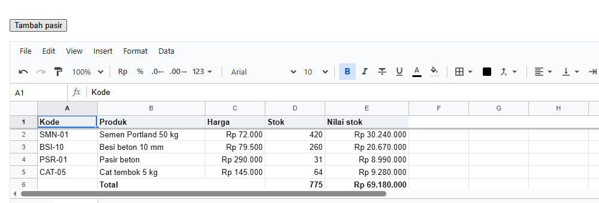
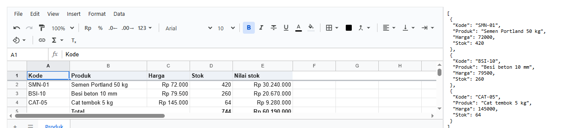
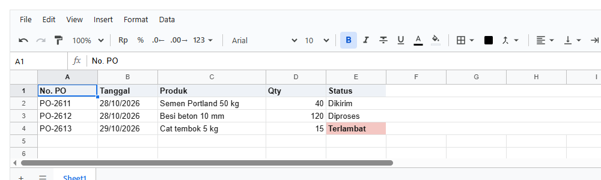
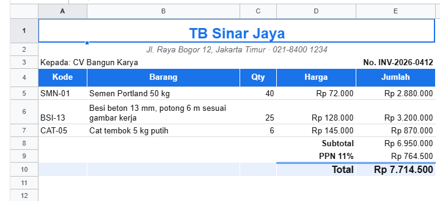
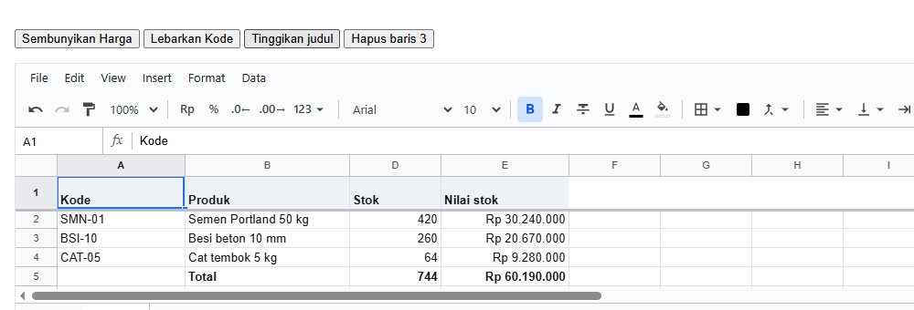
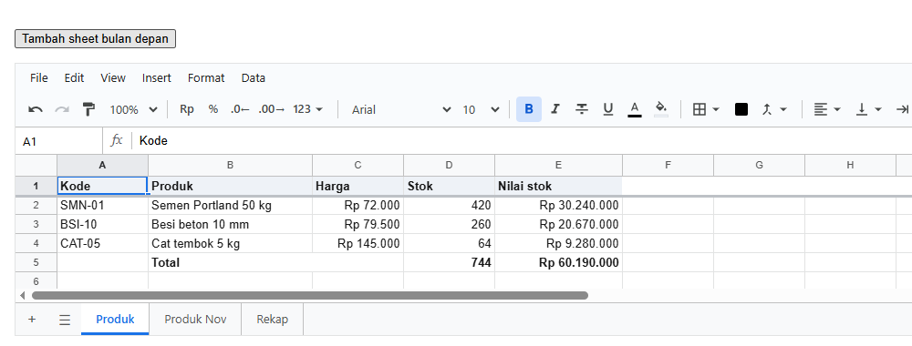

# 04. Manipulasi Data Programatis & API Workbook

[Daftar isi](../README.md#daftar-isi) · Sebelumnya: [03. Komponen `<Sheet>` & Kustomisasi UI](03-komponen-sheet.md) · Berikutnya: [05. Formula Calculation Engine](05-rumus.md)

Bab ini membedah teknik manipulasi data programatis tingkat lanjut menggunakan API Workbook: penyisipan data tabular secara batch, ekstraksi data terstruktur ke format JSON (`tableOf`), pemetaan payload REST API (`populate`), pemformatan visual dan merge sel (studi kasus faktur/invoice), operasi dinamis baris dan kolom, serta manajemen siklus hidup multi-sheet.

---

## 1. Pemilihan Pola Manipulasi Data

Pilihlah API mutasi data yang sesuai dengan kebutuhan fungsional aplikasi Anda:

| Skenario Kebutuhan | API Rekomendasi | Karakteristik Utama |
|---|---|---|
| Menambah baris baru, inisialisasi template dengan formula | `sheet.setValues(alamat, matriks)` | Mendukung string formula (`'=SUM(...)'`), evaluasi locale otomatis, cepat untuk matriks dimensi kecil-menengah. |
| Mengekstraksi konten tabel sheet menjadi array objek JSON | `tableOf(wb, sheet, range)` | Memetakan baris header menjadi property keys objek secara instan. |
| Ingesti data array objek dari REST/GraphQL API | `populate(wb, sheet, spec, data)` | Menulis data raw tanpa risiko formula injection, mendukung formatting per cell, auto-header generation. |
| Menerapkan format visual, warna latar, borders, merge | `sheet.setStyle()`, `sheet.mergeCells()` | Menggabungkan styling modular pada range spesifik. |
| Modifikasi layout baris/kolom (resize, hide, freeze) | `setRowProps()`, `setColProps()` | Mengatur dimensi piksel, visibilitas kolom tanpa merusak keterikatan formula. |
| Manajemen multi-sheet (tambah, duplikasi, hapus sheet) | `wb.addSheet()`, `wb.duplicateSheet()` | Mengelola relasi data antar sheet dan formula lintas sheet. |

> **Catatan Keamanan & Transaksi**: Semua mutasi yang dieksekusi secara programatis melalui kode menggunakan identitas `source: 'code'` secara default. Operasi ini diperlakukan sebagai aksi sistem berprivilese tinggi yang melewati interceptor validasi antarmuka pengguna, dapat dibatalkan melalui single undo, dan memancarkan event `onOp`.

---

## 2. Format Masukan Data `setValues`

Metode `sheet.setValues(koordinat, payload)` menerima berbagai struktur data:

| Struktur Payload | Penafsiran oleh Engine |
|---|---|
| `'Semen'`, `72000`, `true` | Nilai primitif tunggal pada satu sel target. |
| `'=B2*C2'` | Formula kalkulasi (setiap string dengan prefix `=`). |
| `"'=B2"` | Raw literal string (tanda kutip tunggal `'` di awal mencegah evaluasi formula). |
| `null` | Menghapus konten sel (clear value). |
| `[['A', 'B', 'C']]` | Array 2D 1 baris: ditulis **horizontal ke kanan**. |
| `[['A'], ['B'], ['C']]` | Array 2D 1 kolom: ditulis **vertikal ke bawah**. |
| `['A', 'B', 'C']` | Array 1D sederhana: ditulis **vertikal ke bawah** (satu nilai per baris). |
| `[['A', 'B'], ['C', 'D']]` | Matriks tabel: setiap elemen array dalam merepresentasikan satu baris data. |
| `(r, c, currentValue) => nextValue` | Callback mapper dinamis untuk range koordinat (misal `'A2:A10'`). Mengembalikan `undefined` membiarkan sel tidak berubah. |

---

## 3. Implementasi Panduan Langkah demi Langkah

---

### 3.1 Menyisipkan Baris Data Terhitung Secara Programatis

Saat menambahkan entri baris baru ke dalam tabel yang memiliki total kumulatif di bawahnya, sisipkan baris di dalam batas range formula agar fungsi agregasi (`SUM`) secara otomatis memperluas cakupan perhitungannya:

<!-- contoh: 04-03-tambah.page.tsx -->
```tsx
import { useState } from 'react';
import { Sheet } from '@kufayeka/sheet';
import '@kufayeka/sheet/style.css';
import { buatProduk } from './data/produk.js';

// 4.3 Menulis dari kode: satu produk baru disisipkan di dalam tabel, lengkap dengan rumusnya, dan total ikut menghitungnya.
export default function Halaman() {
    const [wb] = useState(buatProduk);

    function tambah() {
        const s = wb.sheet('Produk');
        const produkTerakhir = s.lastFilled().r;                     // nomor baris produk terakhir, seperti di layar (4)
        s.insertRows(String(produkTerakhir));                        // baru: baris kosong DI DALAM range total (di atas baris 4)
        s.setValues('A' + produkTerakhir, [['PSR-01', 'Pasir beton', 290000, 31, '=C' + produkTerakhir + '*D' + produkTerakhir]]);   // baru
    }

    return (
        <div>
            <p><button className="tambah" onClick={tambah}>Tambah pasir</button></p>
            <div style={{ height: 300 }}>
                <Sheet workbook={wb} />
            </div>
        </div>
    );
}
```
<!-- /contoh -->



---

### 3.2 Ekstraksi Data Sheet ke Format Objek JSON (`tableOf`)

Gunakan utility function `tableOf(wb, sheetName, range)` untuk mengekspor data spreadsheet menjadi array of objects JSON yang siap dikirimkan ke backend:

<!-- contoh: 04-04-baca-data.page.tsx -->
```tsx
import { useState } from 'react';
import { Sheet, useWorkbook } from '@kufayeka/sheet';
import { tableOf } from '@kufayeka/sheet/core';
import '@kufayeka/sheet/style.css';
import { buatProduk } from './data/produk.js';

// 4.4 Membaca kembali sebagai data: baris produk menjadi daftar objek, siap dikirim ke API.
export default function Halaman() {
    const [wb] = useState(buatProduk);
    // baru: judul di baris 1 menjadi nama field, baris 2-4 menjadi objek
    const produk = useWorkbook(wb, (w) => JSON.stringify(tableOf(w, 'Produk', 'A1:D4').records, null, 1));

    return (
        <div style={{ display: 'flex', height: 300 }}>
            <Sheet workbook={wb} style={{ flex: 1 }} />
            <pre style={{ width: 300, margin: 0, padding: 8, font: '12px Consolas, monospace', borderLeft: '1px solid #dadce0', overflow: 'auto' }}>{produk}</pre>
        </div>
    );
}
```
<!-- /contoh -->



`tableOf` mengembalikan objek terstruktur:
- `fields`: Array nama kolom yang diekstraksi dari baris pertama (`['Kode', 'Produk', 'Harga', 'Stok', 'Nilai stok']`).
- `records`: Array objek JavaScript dengan nilai terhitung primitif (`value`), bukan string tampilan teks.

---

### 3.3 Mengisi Data dari REST API secara Aman (`populate`)

Helper `populate(wb, sheet, spec, data)` dirancang khusus untuk memetakan data array objek eksternal ke dalam grid spreadsheet tanpa risiko eksekusi formula yang tidak disengaja:

<!-- contoh: 04-05-populate.page.tsx -->
```tsx
import { useState } from 'react';
import { Sheet } from '@kufayeka/sheet';
import { createWorkbook, populate } from '@kufayeka/sheet/core';
import '@kufayeka/sheet/style.css';

// 4.5 Mengisi dari data API: daftar objek ditulis sebagai tabel, satu baris per objek, dengan judul kolom sendiri.
// Di aplikasimu, PESANAN datang dari fetch('/api/pesanan').
const PESANAN = [
    { id: 'PO-2611', tanggal: '28/10/2026', produk: 'Semen Portland 50 kg', qty: 40, status: 'Dikirim' },
    { id: 'PO-2612', tanggal: '28/10/2026', produk: 'Besi beton 10 mm', qty: 120, status: 'Diproses' },
    { id: 'PO-2613', tanggal: '29/10/2026', produk: 'Cat tembok 5 kg', qty: 15, status: { value: 'Terlambat', fill: '#f4c7c3', bold: true } }
];

function buat() {
    const wb = createWorkbook();
    wb.setSettings({ locale: 'id-ID', currency: 'IDR' });
    // baru: populate menulis daftar objek mulai dari A1
    populate(wb, 'Sheet1', {
        at: 'A1',
        fields: ['id', 'tanggal', 'produk', 'qty', 'status'],                          // kolom yang diambil, dan urutannya
        header: { id: 'No. PO', tanggal: 'Tanggal', produk: 'Produk', qty: 'Qty', status: 'Status' }
    }, PESANAN);
    wb.sheet('Sheet1').setStyle('A1:E1', { bold: true, fill: '#eef2f7' });
    wb.sheet('Sheet1').setColProps('C', { width: 180 });
    return wb;
}

export default function Halaman() {
    const [wb] = useState(buat);
    return (
        <div style={{ height: 300 }}>
            <Sheet workbook={wb} />
        </div>
    );
}
```
<!-- /contoh -->



---

### 3.4 Desain Dokumen Kompleks, Styling & Cell Merging (Studi Kasus: Faktur/Invoice)

Spreadsheet dapat diformat menjadi dokumen faktur profesional dengan menggabungkan styling tipografi, border kustom, format perataan teks, dan penggabungan sel (*cell merging*):

<!-- contoh: 04-05-invoice.page.tsx -->
```tsx
import { useState } from 'react';
import { Sheet } from '@kufayeka/sheet';
import { createWorkbook } from '@kufayeka/sheet/core';
import type { Workbook, BorderSide } from '@kufayeka/sheet/core';
import '@kufayeka/sheet/style.css';

// Invoice toko: merge, warna, border, format uang dan persen, teks yang turun, lebar kolom, tanpa garis sel.
function buatInvoice(): Workbook {
    const wb = createWorkbook();
    wb.setSettings({ locale: 'id-ID', currency: 'IDR' });
    const inv = wb.sheet('Sheet1');
    inv.setSheetProps({ name: 'INV-2026-0412', hideGridlines: true });
    inv.setValues('A1', [
        ['TB Sinar Jaya'],
        ['Jl. Raya Bogor 12, Jakarta Timur · 021-8400 1234'],
        ['Kepada: CV Bangun Karya', null, null, 'No. INV-2026-0412'],
        ['Kode', 'Barang', 'Qty', 'Harga', 'Jumlah'],
        ['SMN-01', 'Semen Portland 50 kg', 40, 72000, '=C5*D5'],
        ['BSI-13', 'Besi beton 13 mm, potong 6 m sesuai gambar kerja', 25, 128000, '=C6*D6'],
        ['CAT-05', 'Cat tembok 5 kg putih', 6, 145000, '=C7*D7'],
        [null, null, null, 'Subtotal', '=SUM(E5:E7)'],
        [null, null, null, 'PPN 11%', '=E8*0.11'],
        [null, null, null, 'Total', '=E8+E9']
    ]);
    inv.mergeCells('A1:E1, A2:E2, A3:C3, D3:E3');
    inv.setStyle('A1', { bold: true, fontSize: 18, align: 'center', color: '#1a73e8' });
    inv.setStyle('A2', { italic: true, align: 'center', color: '#5f6368' });
    inv.setStyle('D3', { align: 'right', bold: true });
    inv.setStyle('A4:E4', { bold: true, fill: '#1a73e8', color: '#ffffff', align: 'center', valign: 'middle' });
    inv.setStyle('B6', { wrap: 'wrap' });
    inv.setStyle('D5:E10', { format: { type: 'money', decimals: 0 } });
    inv.setStyle('D8:D10', { align: 'right', bold: true });
    inv.setStyle('A10:E10', { fill: '#e8f0fe', bold: true, fontSize: 12 });
    const tipis: BorderSide = { style: 'solid', width: 1, color: '#dadce0' };
    inv.setStyle('A4:E7', { borders: { bottom: tipis } });
    inv.setStyle('D10:E10', { borders: { top: { style: 'double', width: 3, color: '#1a73e8' } } });
    inv.setRowProps('1', { height: 40 });
    inv.setRowProps('4', { height: 30 });
    inv.setRowProps('6', { height: 40 });
    inv.setColProps('A', { width: 80 });
    inv.setColProps('B', { width: 250 });
    inv.setColProps('C', { width: 60 });
    inv.setColProps('D:E', { width: 130 });
    return wb;
}

export default function Invoice() {
    const [wb] = useState(buatInvoice);
    return <div style={{ height: 480 }}><Sheet workbook={wb} fileName="INV-2026-0412" /></div>;
}
```
<!-- /contoh -->



---

### 3.5 Operasi Kolom & Baris (Dimensi, Sembunyikan, dan Pembekuan)

Atur layout dimensi baris dan kolom serta sembunyikan kolom kalkulasi sensitif tanpa memutus integritas rantai formula:

<!-- contoh: 04-07-baris-kolom.page.tsx -->
```tsx
import { useState } from 'react';
import { Sheet } from '@kufayeka/sheet';
import '@kufayeka/sheet/style.css';
import { buatProduk } from './data/produk.js';

// 4.7 Baris dan kolom dari kode: menyembunyikan, mengubah ukuran, menghapus.
export default function Halaman() {
    const [wb] = useState(buatProduk);
    const s = wb.sheet('Produk');
    return (
        <div>
            <p>
                <button className="sembunyikan" onClick={() => s.setColProps('C', { hidden: true })}>Sembunyikan Harga</button>{' '}
                <button className="lebarkan" onClick={() => s.setColProps('A', { width: 140 })}>Lebarkan Kode</button>{' '}
                <button className="tinggikan" onClick={() => s.setRowProps('1', { height: 36 })}>Tinggikan judul</button>{' '}
                <button className="hapus" onClick={() => s.deleteRows('3')}>Hapus baris 3</button>
            </p>
            <div style={{ height: 300 }}>
                <Sheet workbook={wb} />
            </div>
        </div>
    );
}
```
<!-- /contoh -->



> **Integritas Formula pada Kolom Tersembunyi**: Menyembunyikan kolom dengan `hidden: true` tidak memengaruhi komputasi formula. Formula pada kolom E (`=C2*D2`) tetap mengevaluasi nilai sel C2 meskipun kolom C tidak tampak pada antarmuka visual.

---

### 3.6 Siklus Hidup Multi-Sheet & Formula Lintas Sheet

Engine mendukung pembuatan multi-sheet, duplikasi sheet independen, serta referensi formula antar sheet:

<!-- contoh: 04-08-sheet.page.tsx -->
```tsx
import { useState } from 'react';
import { Sheet } from '@kufayeka/sheet';
import '@kufayeka/sheet/style.css';
import { buatProduk } from './data/produk.js';

// 4.8 Sheet dari kode: menambah, menyalin, mengganti nama.
export default function Halaman() {
    const [wb] = useState(buatProduk);

    function tambahBulan() {
        const id = wb.duplicateSheet('Produk');                       // baru: salinan yang berdiri sendiri
        wb.sheet(id).setSheetProps({ name: 'Produk Nov' });           // baru: ganti nama
        const rekap = wb.addSheet('Rekap');                           // baru: sheet kosong di belakang
        wb.sheet(rekap).setValues('A1', [['Total Okt', "=SUM(Produk!E2:E4)"], ['Total Nov', "='Produk Nov'!E5"]]);
    }

    return (
        <div>
            <p><button className="tambah-sheet" onClick={tambahBulan}>Tambah sheet bulan depan</button></p>
            <div style={{ height: 300 }}>
                <Sheet workbook={wb} />
            </div>
        </div>
    );
}
```
<!-- /contoh -->



### Kaidah Penulisan Formula Lintas Sheet
- Format standar: `=NamaSheet!KoordinatSel` (contoh: `=Produk!E5`).
- Nama sheet yang memuat spasi atau karakter khusus wajib dibungkus dengan tanda kutip tunggal: `='Produk Nov'!E5`.

---

### 3.7 Pola Template API: Pre-Rumus, `populate()`, & Relasi Antar Workbook

Untuk sistem template Excel yang terhubung ke REST API / database:
1. **Template + Pre-Rumus + `populate()`**: Siapkan styling, header, dan rumus total/baris di template. Saat data masuk dari API, tulis hanya ke kolom input dengan `populate(wb, sheet, { at, fields, header: false }, apiData)` — `populate()` menulis data mentah secara aman (string berawalan `=` tidak dieksekusi sebagai formula) tanpa menimpa rumus yang sudah terpasang di kolom sebelahnya.
2. **Ekstraksi & Relasi Antar Workbook (`tableOf` + `populate`)**: Karena formula `=SheetLain!A1` hanya bekerja di dalam **satu** workbook, pertukaran data antar file/workbook dilakukan lewat kontrak **Named Range** + `tableOf()` (baca sebagai array of objects) lalu didistribusikan ke workbook target dengan `populate()`:
   - **Many-to-One (Summary)**: Kumpulkan `tableOf(wbCabang, null, 'NamaRange').records` dari banyak file, lalu olah dengan `pivot()` atau tulis ke workbook Rekap.
   - **One-to-Many (Master → Cabang)**: Ekstrak `tableOf(wbMaster, null, 'HargaResmi').records`, lalu `populate()` ke tiap workbook cabang (dan kunci kolom hasilnya dengan `rules` `readonly`).

<!-- contoh: 04-15-template-populate.js -->
```js
import { createWorkbook, populate, tableOf } from '@kufayeka/sheet/core';

// Pola 1: Template (styling + pre-rumus) diisi data dari API via populate()
const template = createWorkbook();
template.setSettings({ locale: 'id-ID', currency: 'IDR' });
const sh = template.sheet('Sheet1');
sh.setSheetProps({ name: 'Order' });
sh.setValues('A1', [['Kode', 'Barang', 'Qty', 'Harga', 'Subtotal']]);
sh.setStyle('A1:E1', { bold: true, fill: '#1a73e8', color: '#ffffff' });
// Pre-rumus di baris 2..4 dan baris total di baris 6
sh.setValues('E2', [['=C2*D2'], ['=C3*D3'], ['=C4*D4']]);
sh.setValues('D6', [['Total', '=SUM(E2:E4)']]);
sh.setStyle('D6:E6', { bold: true, fill: '#f1f3f4' });
sh.setStyle('D2:E6', { format: { type: 'money', decimals: 0 } });
template.addName('ItemsOrder', 'Order', 'A1:E4');

// Simulasi payload REST API dari backend: ditulis hanya ke kolom A:D tanpa menimpa rumus di kolom E
const apiItems = [
    { Kode: 'SMN-01', Barang: 'Semen 50kg', Qty: 10, Harga: 72000 },
    { Kode: 'BSI-10', Barang: 'Besi 10mm', Qty: 5, Harga: 79500 },
    { Kode: 'CAT-05', Barang: 'Cat 5kg', Qty: 2, Harga: 145000 },
];
populate(template, 'Order', { at: 'A2', fields: ['Kode', 'Barang', 'Qty', 'Harga'], header: false }, apiItems);
console.log('Total Order setelah populate:', template.value('Order', 'E6'));
console.log('Isi tabel (tableOf):', JSON.stringify(tableOf(template, null, 'ItemsOrder').records));

// Pola 2: One-to-Many (1 Master Harga disebar ke banyak workbook cabang)
const master = createWorkbook();
master.sheet('Sheet1').setSheetProps({ name: 'Katalog' });
master.sheet('Katalog').setValues('A1', [
    ['Kode', 'Harga'],
    ['SMN-01', 75000],
    ['BSI-10', 82000],
]);
master.addName('HargaResmi', 'Katalog', 'A1:B3');

const katalogRecords = tableOf(master, null, 'HargaResmi').records;
const cabangA = createWorkbook();
cabangA.sheet('Sheet1').setSheetProps({ name: 'ReferensiHarga' });
populate(cabangA, 'ReferensiHarga', { at: 'A1', header: true }, katalogRecords);
console.log('Cabang A menerima SMN-01:', cabangA.value('ReferensiHarga', 'B2'));
```
<!-- /contoh -->

<!-- hasil: 04-15-template-populate.js -->
```text
Total Order setelah populate: 1407500
Isi tabel (tableOf): [{"Kode":"SMN-01","Barang":"Semen 50kg","Qty":10,"Harga":72000,"Subtotal":720000},{"Kode":"BSI-10","Barang":"Besi 10mm","Qty":5,"Harga":79500,"Subtotal":397500},{"Kode":"CAT-05","Barang":"Cat 5kg","Qty":2,"Harga":145000,"Subtotal":290000}]
Cabang A menerima SMN-01: 75000
```
<!-- /hasil -->

---

## 4. Gotchas & Kesalahan Umum

| Kesalahan Umum | Konsekuensi | Praktik Rekomendasi |
|---|---|---|
| **Menambahkan baris baru di luar batas range agregasi `SUM`** | Baris baru tidak ikut terhitung ke dalam total. | Gunakan `insertRows` di dalam batas range data sebelum baris total, atau formulasikan range dengan buffer dinamis. |
| **Menulis array 1 dimensi dan mengharapkan tersusun ke kanan** | Data tertulis memanjang ke bawah (vertikal). | Untuk menulis 1 baris ke kanan, bungkus dalam array 2 dimensi: `[['Kolom1', 'Kolom2', 'Kolom3']]`. |
| **Memasukkan data eksternal mentah via `setValues`** | String yang diawali karakter `=` dievaluasi sebagai formula (*formula injection*). | Gunakan helper `populate()` untuk data API luar, atau awali string dengan kutip tunggal (`"'=Data"`). |
| **Nilai kode leading zero (misal `'007'`) berubah menjadi numerik `7`** | Kehilangan format identifier kode unik. | Berikan prefix kutip tunggal (`"'007"`) atau gunakan tipe data string via `populate`. |

---

## 5. Referensi Lengkap API

### Pembacaan Data & Metadata Sheet

| Metode | Output | Kegunaan |
|---|---|---|
| `sheet.value(address)` | `any` (Number, String, Boolean, null, Error) | Nilai evaluasi primitif final. |
| `sheet.input(address)` | `string` | Formula mentah atau teks masukan asli pengguna. |
| `sheet.display(address)` | `{ text, align, kind, color }` | String terformat siap render visual sesuai locale. |
| `sheet.raw(address)` | Objek internal sel | Struktur data serialisasi sel. |
| `sheet.cellFormat(address)` | FormatConfig \| null | Aturan formatting sel atau warisan dari kolomnya. |
| `sheet.style(address)` | CellStyle | Properti styling tersimpan pada sel. |
| `sheet.shownStyle(address)` | CellStyle | Styling aktif gabungan (termasuk evaluasi conditional formatting). |
| `sheet.lastFilled()` | `{ r: number, c: number }` | Indeks baris dan kolom terjauh yang memiliki isi data. |
| `sheet.dataRegion(r, c)` | `{ r1, c1, r2, c2 }` | Menemukan batas blok data kontinu di sekitar sel target (seperti `Ctrl+A`). |
| `sheet.forEachFilledRow(callback)` | `void` | Iterator performa tinggi yang melompati baris-baris kosong. |

### Styling & Merge Cells

| Atribut Style | Tipe Nilai | Deskripsi |
|---|---|---|
| `bold`, `italic`, `underline`, `strike` | `boolean` | Gaya tipografi teks. |
| `color`, `fill` | `string` (Hex CSS) | Warna teks dan warna latar sel. |
| `fontSize`, `font` | `number`, `string` | Ukuran font (pt) dan jenis tipografi font family. |
| `align`, `valign` | `'left' \| 'center' \| 'right'`, `'top' \| 'middle' \| 'bottom'` | Perataan horizontal dan vertikal. |
| `wrap` | `'wrap' \| 'clip' \| 'overflow'` | Penanganan teks panjang (turun baris, potong, atau meluber). |
| `borders` | `{ top?, right?, bottom?, left? }` | Konfigurasi garis batas per sisi (`style`, `width`, `color`). |
| `mergeCells(range)` | - | Menggabungkan blok sel kontinu menjadi satu kesatuan. |
| `unmergeCells(address)` | - | Memisahkan kembali sel yang telah di-merge. |

### Operasi Baris & Kolom

| Metode | Parameter Utama | Deskripsi |
|---|---|---|
| `insertRows(at, count?)` | `at: number \| string`, `count?: number` | Menyisipkan baris kosong baru. |
| `deleteRows(rows)` | `rows: string \| number` | Menghapus baris tertentu beserta penyesuaian dependensi formula. |
| `moveRows(from, count, to)` | `from: number`, `count: number`, `to: number` | Memindahkan posisi baris secara teratur. |
| `insertCols`, `deleteCols`, `moveCols` | Sesuai varian kolom | Operasi penyesuaian kolom paralel. |
| `setRowProps(row, props)` | `props: { height?, hidden? }` | Mengatur tinggi dan visibilitas baris. |
| `setColProps(col, props)` | `props: { width?, hidden?, format? }` | Mengatur lebar, visibilitas, dan default format kolom. |

### Spesifikasi Opsi `populate(wb, sheet, spec, data)`

```ts
interface PopulateSpec {
    at: string | { r: number, c: number };       // Koordinat sel awal penulisan (wajib)
    direction?: 'down' | 'right';                 // Arah penyusunan data (default: 'down')
    fields?: string[];                            // Urutan key properti objek yang diekstraksi
    header?: boolean | string[] | Record<string, string>; // Konfigurasi pembuatan baris label header
    limit?: number;                               // Batas jumlah baris maksimum yang ditulis
}
```
