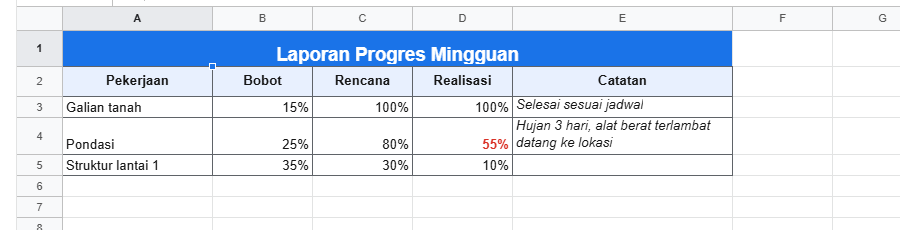

# 4. API workbook

[Daftar isi](../README.md#daftar-isi) · Sebelumnya: [3. Komponen `<Sheet>`](03-komponen-sheet.md) · Berikutnya: [5. Rumus](05-rumus.md)

Semua yang bisa dilakukan ke isi workbook lewat kode. Contoh di bab ini pakai `wb.sheet('Sheet1')` (lihat [2.2](02-konsep.md#22-alamat-sel)), jadi
parameter sheet tidak ditulis. Kalau pakai `wb` langsung, tambahkan sheet (id atau nama) sebagai parameter pertama: `wb.setValues('BOQ', 'A1', ...)`.

Semua fungsi yang mengubah isi menerima `how` di paling belakang (`{ source: 'user' }` dan seterusnya, lihat [2.5](02-konsep.md#siapa-yang-mengubah-source)),
dan tiap pemanggilan adalah **satu perubahan**: satu kali undo membatalkannya.

- [4.1 Menulis dan membaca isi](#41-menulis-dan-membaca-isi)
- [4.2 Gaya sel](#42-gaya-sel)
- [4.3 Baris dan kolom](#43-baris-dan-kolom)
- [4.4 Sheet](#44-sheet)
- [4.5 Pengaturan workbook](#45-pengaturan-workbook)
- [4.6 Undo, redo, apply](#46-undo-redo-apply)
- [4.7 Jenis op](#47-jenis-op)

## 4.1 Menulis dan membaca isi

<!-- contoh: 04-tulis.js -->
```js
import { createWorkbook } from '@kufayeka/sheet/core';

const wb = createWorkbook();
const sh = wb.sheet('Sheet1');

sh.setValues('A1', 'Rekap pekerjaan');                  // satu sel
sh.setValues('A2', [['Galian', 120], ['Urugan', 40]]);   // blok: satu array per baris
sh.setValues('D1', [[1], [2], [3]]);                     // satu kolom ke bawah

// banyak sel sekaligus, isi dan gaya, sebagai satu perubahan (satu undo)
sh.setBlock([
    { at: 'A4', value: 'Total', style: { bold: true } },
    { at: 'B4', value: '=SUM(B2:B3)', style: { bold: true } }
]);

console.log('B4            :', sh.value('B4'));
console.log('gaya A4       :', sh.style('A4'));
console.log('terisi sampai :', sh.lastFilled());

let berisi = 0;
sh.forEachFilledRow(() => { berisi++; });
console.log('baris berisi  :', berisi);

sh.clear('A2:B3'); // isinya hilang, gayanya tetap (seperti tombol Delete)
console.log('setelah clear :', sh.value('A2'), sh.value('B4'));
wb.undo();
console.log('setelah undo  :', sh.value('A2'), sh.value('B4'));
```
<!-- /contoh -->

<!-- hasil: 04-tulis.js -->
```text
B4            : 160
gaya A4       : { bold: true }
terisi sampai : { r: 3, c: 3 }
baris berisi  : 4
setelah clear : null 0
setelah undo  : Galian 160
```
<!-- /hasil -->

| Fungsi | Artinya |
|---|---|
| `setValues(at, values)` | tulis mulai dari sel `at`. `values` bisa satu nilai, atau array of array (satu array per baris). Teks dibaca seperti diketik ([2.3](02-konsep.md#23-isi-sel-value-input-display-raw)) |
| `setBlock(entries)` | banyak sel sekaligus, isi dan gaya. Tiap entri `{ at: 'A4', value, style }` (atau `{ r, c, ... }`). `value` tidak ada = isinya dibiarkan; `style` mengganti seluruh gaya sel (`null` = hapus gaya); entri belakang menang kalau selnya sama |
| `clear(range)` | kosongkan isi sel; gayanya tetap, seperti tombol Delete |
| `value(at)`, `input(at)`, `display(at)`, `raw(at)` | empat sisi isi sel ([2.3](02-konsep.md#23-isi-sel-value-input-display-raw)) |
| `style(at)` | gaya yang tersimpan di sel itu, atau `undefined` |
| `cellFormat(at)` | format angka yang berlaku untuk sel: miliknya sendiri, atau milik kolomnya |
| `lastFilled()` | `{ r, c }` baris dan kolom terakhir yang ada isinya (`-1` kalau sheet kosong) |
| `forEachFilledRow(fn)` | panggil `fn(r, cells, styles)` untuk tiap baris yang ada isi atau gayanya, urut. `cells` dan `styles` adalah objek milik workbook (kunci: id kolom), jangan diubah |
| `wb.address(r, c)` | nomor ke alamat: `wb.address(1, 2)` = `'C2'` |

## 4.2 Gaya sel

<!-- contoh: 04-gaya.js -->
```js
import { createWorkbook } from '@kufayeka/sheet/core';

const wb = createWorkbook();
const sh = wb.sheet('Sheet1');
sh.setValues('A1', [['Pekerjaan', 'Jumlah'], ['Galian', 10200000], ['Urugan', 8400000]]);

// patch: hanya kunci yang ditulis yang berubah, sisanya tetap
sh.setStyle('A1:B1', { bold: true, fill: '#e8f0fe', align: 'center' });
sh.setStyle('A1:B1', { italic: true });
console.log('A1             :', sh.style('A1'));

// null menghapus satu bagian gaya
sh.setStyle('A1:B1', { fill: null });
console.log('tanpa fill     :', sh.style('A1'));

// fungsi: tiap sel dapat gayanya sendiri (r, c, gaya sekarang); null = biarkan sel itu
const garis = { style: 'solid', width: 1, color: '#000000' };
sh.setStyle('A1:B3', (r, c) => (r === 2 ? { borders: { bottom: garis } } : null));
console.log('B3 border      :', sh.style('B3').borders);
console.log('B2 tidak kena  :', sh.style('B2'));

// merge
sh.setValues('A5', 'Catatan lapangan');
sh.mergeCells('A5:B5');
console.log('merge          :', sh.merges());
```
<!-- /contoh -->

<!-- hasil: 04-gaya.js -->
```text
A1             : { bold: true, fill: '#e8f0fe', align: 'center', italic: true }
tanpa fill     : { bold: true, align: 'center', italic: true }
B3 border      : { bottom: { style: 'solid', width: 1, color: '#000000' } }
B2 tidak kena  : undefined
merge          : [ { r1: 4, c1: 0, r2: 4, c2: 1 } ]
```
<!-- /hasil -->

`setStyle(range, patch)` **menggabungkan**: kunci yang ditulis berubah, yang lain tetap. Kunci bernilai `null` menghapus bagian itu. `patch` juga bisa
fungsi `(r, c, gayaSekarang) => patch` untuk memberi tiap sel gaya berbeda (misalnya garis luar saja), dan kembalikan `null` untuk sel yang tidak
perlu diubah.

Isi objek gaya:

| Kunci | Nilai | Contoh |
|---|---|---|
| `bold`, `italic`, `underline`, `strike` | `true` | `{ bold: true }` |
| `color` | warna teks | `'#a50e0e'` |
| `fill` | warna latar | `'#e8f0fe'` |
| `font` | nama font | `'Roboto'` |
| `fontSize` | ukuran dalam pt (bawaan 10) | `14` |
| `align` | `'left'`, `'center'`, `'right'` | |
| `valign` | `'top'`, `'middle'`, `'bottom'` (bawaan) | |
| `wrap` | `'wrap'` (turun baris), `'clip'` (dipotong); tanpa kunci ini teks meluber ke sel kosong di kanannya | |
| `rotate` | sudut `-90` sampai `90`, atau `'vertical'` (huruf ditumpuk) | `45` |
| `borders` | `{ top, right, bottom, left }`, masing-masing `{ style: 'solid'\|'dashed'\|'dotted'\|'double', width: 1\|2\|3, color }` | lihat contoh |
| `format` | format angka (bab 6) | `{ type: 'money', decimals: 0 }` |
| `link` | URL; teks sel jadi tautan | `'https://...'` |

Merge:

| Fungsi | Artinya |
|---|---|
| `mergeCells(range)` | gabungkan range jadi satu sel. Beberapa range sekaligus = masing-masing jadi satu. Isi sel di bawahnya tetap tersimpan (tidak terlihat), supaya undo bisa mengembalikan |
| `unmergeCells(range)` | lepas semua merge yang kena range itu |
| `merges()` | daftar merge di sheet: `[{ r1, c1, r2, c2 }]` |

Hasil gaya yang lebih lengkap di layar:

<!-- contoh: 04-gaya.page.js -->
```jsx
import { useState } from 'react';
import { Sheet } from '@kufayeka/sheet';
import { createWorkbook } from '@kufayeka/sheet/core';
import '@kufayeka/sheet/style.css';

function buat() {
    const wb = createWorkbook();
    wb.setSettings({ locale: 'id-ID', currency: 'IDR' });
    const sh = wb.sheet('Sheet1');
    sh.setValues('A1', [
        ['Laporan Progres Mingguan'],
        ['Pekerjaan', 'Bobot', 'Rencana', 'Realisasi', 'Catatan'],
        ['Galian tanah', 0.15, 1, 1, 'Selesai sesuai jadwal'],
        ['Pondasi', 0.25, 0.8, 0.55, 'Hujan 3 hari, alat berat terlambat datang ke lokasi'],
        ['Struktur lantai 1', 0.35, 0.3, 0.1, '']
    ]);
    sh.mergeCells('A1:E1');
    sh.setStyle('A1', { bold: true, fontSize: 14, align: 'center', fill: '#1a73e8', color: '#ffffff' });
    sh.setStyle('A2:E2', { bold: true, fill: '#e8f0fe', align: 'center', valign: 'middle' });
    sh.setStyle('B3:D5', { format: { type: 'percent', decimals: 0 } });
    sh.setStyle('D4', { color: '#d93025', bold: true });
    sh.setStyle('E3:E5', { wrap: 'wrap', valign: 'top', italic: true });
    const garis = { style: 'solid', width: 1, color: '#5f6368' };
    sh.setStyle('A2:E5', { borders: { top: garis, right: garis, bottom: garis, left: garis } });
    sh.setRowProps('1', { height: 36 });
    sh.setRowProps('2', { height: 30 });
    sh.setColProps('A', { width: 150 });
    sh.setColProps('E', { width: 220 });
    return wb;
}

export default function HalamanGaya() {
    const [wb] = useState(buat);
    return <div style={{ height: 600 }}><Sheet workbook={wb} /></div>;
}
```
<!-- /contoh -->



## 4.3 Baris dan kolom

<!-- contoh: 04-baris-kolom.js -->
```js
import { createWorkbook } from '@kufayeka/sheet/core';

const wb = createWorkbook();
const sh = wb.sheet('Sheet1');
sh.setValues('A1', [['No', 'Pekerjaan', 'Volume'], [1, 'Galian', 120], [2, 'Urugan', 40], [3, 'Beton', 18.5]]);

sh.insertRows('3', 2);        // 2 baris baru mulai baris 3
sh.deleteRows('3:4');         // hapus baris 3 sampai 4 lagi
sh.insertCols('C');           // kolom baru di C, Volume geser ke D
console.log('D1             :', sh.value('D1'));
sh.deleteCols('C');

sh.moveRows(3, 1, 1);         // pindah 1 baris dari baris ke-4 (nomor 3) ke posisi nomor 1
console.log('urutan         :', [1, 2, 3].map((r) => sh.value(r, 1)).join(', '));

sh.setColProps('B', { width: 200 });
sh.setColProps('C', { hidden: true });
sh.setRowProps('1', { height: 32 });
sh.setSheetProps({ freezeRows: 1, freezeCols: 1 });
console.log('kolom B        :', sh.colProps(1));
console.log('kolom C        :', sh.colProps(2));
console.log('baris 1        :', sh.rowProps(0));
console.log('beku           :', sh.sheetProps().freezeRows, 'baris,', sh.sheetProps().freezeCols, 'kolom');
console.log('ukuran         :', sh.size());
```
<!-- /contoh -->

<!-- hasil: 04-baris-kolom.js -->
```text
D1             : Volume
urutan         : Beton, Galian, Urugan
kolom B        : { width: 200 }
kolom C        : { hidden: true }
baris 1        : { height: 32 }
beku           : 1 baris, 1 kolom
ukuran         : { rows: 1000, cols: 26 }
```
<!-- /hasil -->

| Fungsi | Artinya |
|---|---|
| `insertRows(at, count = 1)` | sisipkan `count` baris mulai baris `at` (`'3'` atau nomor dari 0). Baris yang disisipkan di tengah grup ikut masuk grup |
| `deleteRows(at, count)` | hapus baris; `'3:5'` sekaligus menyebut jumlahnya |
| `insertCols(at, count = 1)`, `deleteCols(at, count)` | sama, untuk kolom (`'C'`, `'C:D'`) |
| `moveRows(from, count, to)`, `moveCols(...)` | pindahkan baris/kolom (nomor dari 0); rumus dan semua yang menempel ikut |
| `setRowProps(rows, patch)` | props baris: `height` (piksel), `hidden`. `rows` = `'2'`, `'2:5'`, atau array nomor. `patch` boleh fungsi `(r) => patch` |
| `setColProps(cols, patch)` | props kolom: `width`, `hidden`, `format` (format bawaan kolom, bab 6). `cols` = `'B'`, `'B:D'`, atau array nomor |
| `rowProps(r)`, `colProps(c)` | props satu baris/kolom (nomor dari 0) |
| `size()` | `{ rows, cols }` |
| `rowAxis()`, `colAxis()` | posisi dan ukuran tiap baris/kolom dalam piksel (`size(i)`, `start(i)`, `total`). Baris tersembunyi, terfilter, atau di grup yang dilipat ukurannya 0 |

Grup baris dan kolom ada di [7.3](07-data.md#73-grup-baris-dan-kolom).

## 4.4 Sheet

<!-- contoh: 04-sheet.js -->
```js
import { createWorkbook } from '@kufayeka/sheet/core';

const wb = createWorkbook();
const nama = () => wb.sheetIds().map((s) => wb.sheetProps(s).name + (wb.sheetProps(s).hidden ? ' (tersembunyi)' : '')).join(', ');

wb.setSheetProps('Sheet1', { name: 'BOQ' });
const harga = wb.addSheet('Harga');         // id sheet baru
const salinan = wb.duplicateSheet(harga);   // "Copy of Harga"
wb.moveSheet(salinan, 0);                   // pindah ke paling depan
wb.hideSheet(harga, true);
console.log('sheet  :', nama());

wb.removeSheet(salinan);
wb.removeSheet('Harga');
console.log('sisa   :', nama());
try { wb.removeSheet('BOQ'); } catch (err) { console.log('error  :', err.message); }
```
<!-- /contoh -->

<!-- hasil: 04-sheet.js -->
```text
sheet  : Copy of Harga, BOQ, Harga (tersembunyi)
sisa   : BOQ
error  : the last sheet cannot be removed
```
<!-- /hasil -->

| Fungsi | Artinya |
|---|---|
| `wb.sheetIds()` | id semua sheet, urut seperti tab |
| `wb.sheetIdByName(nama)` | id dari nama (huruf besar-kecil tidak dibedakan), atau `null` |
| `wb.addSheet(nama?)` | sheet baru di paling belakang (1000 × 26), mengembalikan id. Tanpa nama: `Sheet2`, `Sheet3`, ... |
| `wb.duplicateSheet(s)` | salinan tepat di belakangnya, nama `Copy of ...`. Rumus di dalamnya menunjuk ke salinan sendiri |
| `wb.moveSheet(s, ke)` | pindahkan ke posisi `ke` (dari 0) |
| `wb.hideSheet(s, true/false)` | sembunyikan / tampilkan. Isinya tetap dihitung di rumus. Sheet terakhir yang tampil tidak bisa disembunyikan |
| `wb.removeSheet(s)` | hapus. Sheet terakhir tidak bisa dihapus |
| `wb.sheetProps(s)`, `wb.setSheetProps(s, patch)` | props sheet (lihat tabel) |

Props sheet:

| Kunci | Artinya |
|---|---|
| `name` | nama tab |
| `hidden` | tersembunyi |
| `freezeRows`, `freezeCols` | jumlah baris/kolom yang dibekukan |
| `hideGridlines` | sembunyikan garis grid |
| `colWidth`, `rowHeight` | lebar kolom dan tinggi baris bawaan sheet ini (piksel) |
| `merges`, `filter`, `validations`, `conditionals`, `comments` | diisi oleh fungsinya masing-masing; jangan ditulis langsung |

## 4.5 Pengaturan workbook

`wb.settings()` dan `wb.setSettings(patch)`:

| Kunci | Artinya | Bawaan |
|---|---|---|
| `locale` | cara menulis dan membaca angka dan tanggal (`'id-ID'`, `'en-US'`, ...) | `'en-US'` |
| `currency` | mata uang untuk format uang (`'IDR'`, `'USD'`, ...) | `'USD'` |
| `names` | named range, diisi lewat `addName` (bab 5) | |

## 4.6 Undo, redo, apply

| Fungsi | Artinya |
|---|---|
| `wb.undo()`, `wb.redo()` | mundur/maju satu perubahan. Mengembalikan `false` kalau tidak ada |
| `wb.canUndo()`, `wb.canRedo()` | ada yang bisa di-undo/redo? |
| `wb.apply(ops, how)` | terapkan daftar op sendiri, sebagai satu perubahan. Mengembalikan op yang diterapkan, atau `null` kalau ditolak. Semua fungsi di atas akhirnya memanggil ini |
| `wb.revision` | angka yang naik tiap ada perubahan (dipakai tampilan untuk tahu kapan menggambar ulang) |
| `wb.tick()` | hitung ulang `NOW()` dan `TODAY()`; panggil pakai timer kalau butuh jam yang jalan |

## 4.7 Jenis op

Yang dilihat `beforeOp` dan `onOp` ([2.5](02-konsep.md#25-perubahan-event-dan-undo)). `sheet` adalah id sheet; baris dan kolom selalu id.

| `op.t` | Isinya |
|---|---|
| `cells` | `changes: [{ row, col, before, after }]`: isi sel |
| `styles` | `changes: [{ row, col, before, after }]`: gaya sel |
| `insertRows`, `deleteRows` | `rows: [{ id, key, cells, style, props }]` |
| `insertCols`, `deleteCols` | `cols: [{ id, key, props }]` |
| `moveRows`, `moveCols` | baris/kolom yang dipindah dan kunci urutan barunya |
| `rowProps`, `colProps` | `changes: [{ id, before, after }]` |
| `sheetProps` | `before`, `after`: props sheet |
| `addSheet`, `removeSheet` | `sheet`: isi sheet lengkap |
| `moveSheet` | sheet dan kunci urutan barunya |
| `settings` | `before`, `after`: pengaturan workbook |

[Daftar isi](../README.md#daftar-isi) · Sebelumnya: [3. Komponen `<Sheet>`](03-komponen-sheet.md) · Berikutnya: [5. Rumus](05-rumus.md)
