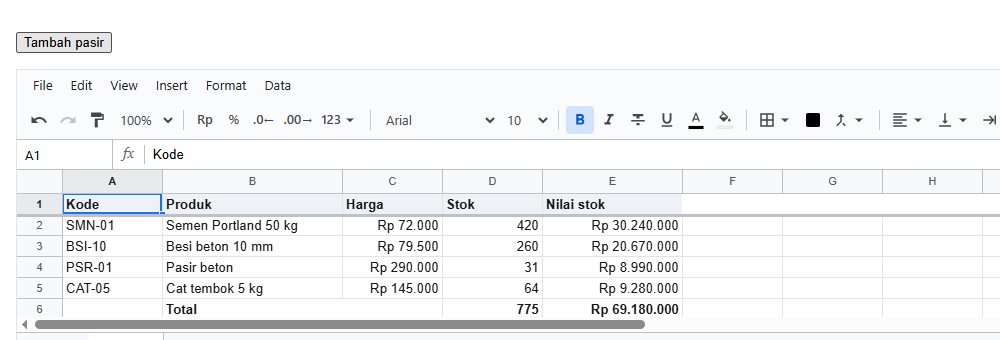
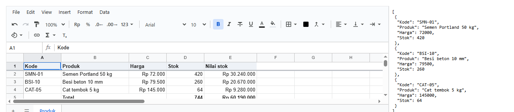
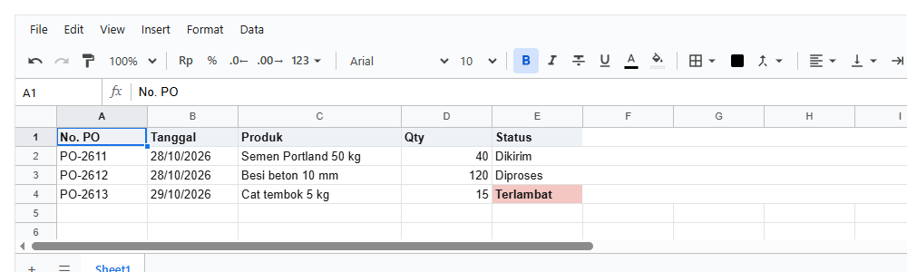
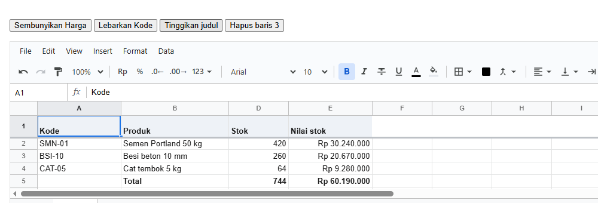
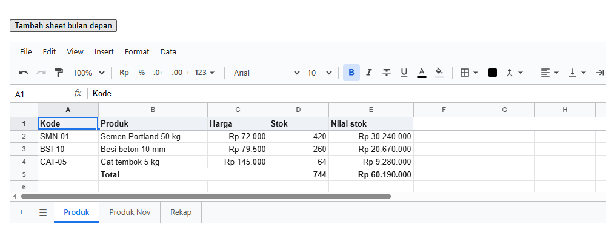

# 4. Mengisi dan membaca dari kode

[Daftar isi](../README.md#daftar-isi) · Sebelumnya: [3. Komponen `<Sheet>`](03-komponen-sheet.md) · Berikutnya: [5. Rumus](05-rumus.md)

Bab ini membahas pekerjaan sehari-hari FE dev: menulis ke sheet dari kode, membaca kembali sebagai data, mengisi dari data API, merapikan
tampilan, serta mengatur baris, kolom, dan sheet. Setiap langkah adalah satu halaman React dengan foto hasilnya.

**Bagian A. Pengenalan (tanpa kode)**
- [4.1 Kapan mengisi dari kode](#41-kapan-mengisi-dari-kode)
- [4.2 Bentuk isi yang diterima](#42-bentuk-isi-yang-diterima)

**Bagian B. Langkah demi langkah**
- [4.3 Menulis satu baris](#43-menulis-satu-baris)
- [4.4 Membaca kembali sebagai data](#44-membaca-kembali-sebagai-data)
- [4.5 Mengisi dari data API](#45-mengisi-dari-data-api)
- [4.6 Gaya dan merge](#46-gaya-dan-merge)
- [4.7 Baris dan kolom](#47-baris-dan-kolom)
- [4.8 Sheet](#48-sheet)

**Bagian C. Yang sering keliru, dan referensi**
- [4.9 Yang sering keliru](#49-yang-sering-keliru)
- [4.10 Referensi](#410-referensi)

---

# Bagian A. Pengenalan

## 4.1 Kapan mengisi dari kode

| Situasi | Yang dipakai | Langkah |
|---|---|---|
| tombol "Tambah baris", templat awal, hasil hitungan aplikasimu | `setValues` | 4.3 |
| mengirim isi sheet ke API sebagai daftar objek | `tableOf` | 4.4 |
| menampilkan data dari API (daftar objek) sebagai tabel | `populate` | 4.5 |
| judul tebal, angka Rupiah, sel digabung | `setStyle`, `setColProps`, `mergeCells` | 4.6 |
| menyisipkan, menghapus, menyembunyikan, mengubah ukuran baris dan kolom | `insertRows`, `setColProps`, ... | 4.7 |
| sheet per bulan, sheet rekap | `addSheet`, `duplicateSheet` | 4.8 |

Semua perubahan dari kode bersumber `'code'` (2.4): tidak diperiksa aturan, masuk undo, dan bisa didengar lewat `onOp`.

## 4.2 Bentuk isi yang diterima

`setValues(alamat, isi)` menerima isi seperti yang diketik orang: angka tetap angka, teks yang diawali `=` menjadi rumus, dan teks seperti
`'1.250,5'` atau `'28/10/2026'` dibaca menurut locale workbook.

| `isi` | Ditulis ke |
|---|---|
| `'Semen'`, `72000`, `true` | satu sel |
| `'=B2*C2'` | rumus (teks yang diawali `=`) |
| `"'=B2"` | teks apa adanya: tanda kutip satu di depan mencegahnya jadi rumus |
| `null` | mengosongkan sel |
| `[['a', 'b', 'c']]` | satu **baris**: ke kanan |
| `[['a'], ['b'], ['c']]` | satu **kolom**: ke bawah |
| `['a', 'b', 'c']` | array biasa juga ditulis **ke bawah**, satu nilai per baris |
| `[['a', 'b'], ['c', 'd']]` | tabel: setiap array di dalamnya adalah satu baris |
| `(r, c, sebelum) => isi` | dengan range sebagai alamat (`'A2:A9'`): isi setiap sel dari fungsi. `undefined` berarti sel itu tidak diubah |

---

# Bagian B. Langkah demi langkah

Semua contoh memakai daftar produk dari bab 2 (`buatProduk`). Baris yang baru ditandai `// baru`.

## 4.3 Menulis satu baris

**Tujuan:** tombol yang menambah satu produk, lengkap dengan rumusnya, dan total ikut menghitungnya.

<!-- contoh: 04-03-tambah.page.tsx -->
```tsx
import { useState } from 'react';
import { Sheet } from '@kufayeka/sheet';
import '@kufayeka/sheet/style.css';
import { buatProduk } from './data/produk.js';

// 4.3 Menulis dari kode: satu produk baru disisipkan di dalam tabel, lengkap dengan rumusnya, dan total ikut menghitungnya.
export default function Halaman() {
    const [wb] = useState(buatProduk);

    function tambah() {
        const s = wb.sheet('Produk');
        const produkTerakhir = s.lastFilled().r;                     // nomor baris produk terakhir, seperti di layar (4)
        s.insertRows(String(produkTerakhir));                        // baru: baris kosong DI DALAM range total (di atas baris 4)
        s.setValues('A' + produkTerakhir, [['PSR-01', 'Pasir beton', 290000, 31, '=C' + produkTerakhir + '*D' + produkTerakhir]]);   // baru
    }

    return (
        <div>
            <p><button className="tambah" onClick={tambah}>Tambah pasir</button></p>
            <div style={{ height: 300 }}>
                <Sheet workbook={wb} />
            </div>
        </div>
    );
}
```
<!-- /contoh -->

Setelah tombol diklik:



**Penjelasan:**

- `lastFilled().r` memberi nomor baris terakhir yang berisi, dimulai dari 0. Di sini 4, yaitu baris total. Sebagai nomor di layar, itu
  baris produk terakhir.
- `insertRows('4')` menyisipkan baris kosong **di atas** baris 4. Isi di bawahnya turun satu, dan rumus yang membacanya ikut menyesuaikan.
- `setValues('A4', [[...]])` mengisi satu baris: array di dalam array, satu array dalam per baris. Rumusnya ditulis sebagai teks `=C4*D4`.

**Kenapa disisipkan di atas produk terakhir, bukan di atas total?** Total berisi `=SUM(E2:E4)`. Range **melebar** kalau baris disisipkan
**di dalam** range itu (di atas baris 4), tapi **tidak** kalau disisipkan tepat di bawahnya (di atas baris 5). Excel berperilaku sama. Di foto,
total menjadi `=SUM(E2:E5)` dan ikut menghitung pasir.

## 4.4 Membaca kembali sebagai data

**Tujuan:** daftar produk di sheet menjadi daftar objek, siap dikirim ke API, dan selalu sesuai dengan isi sheet.

<!-- contoh: 04-04-baca-data.page.tsx -->
```tsx
import { useState } from 'react';
import { Sheet, useWorkbook } from '@kufayeka/sheet';
import { tableOf } from '@kufayeka/sheet/core';
import '@kufayeka/sheet/style.css';
import { buatProduk } from './data/produk.js';

// 4.4 Membaca kembali sebagai data: baris produk menjadi daftar objek, siap dikirim ke API.
export default function Halaman() {
    const [wb] = useState(buatProduk);
    // baru: judul di baris 1 menjadi nama field, baris 2-4 menjadi objek
    const produk = useWorkbook(wb, (w) => JSON.stringify(tableOf(w, 'Produk', 'A1:D4').records, null, 1));

    return (
        <div style={{ display: 'flex', height: 300 }}>
            <Sheet workbook={wb} style={{ flex: 1 }} />
            <pre style={{ width: 300, margin: 0, padding: 8, font: '12px Consolas, monospace', borderLeft: '1px solid #dadce0', overflow: 'auto' }}>{produk}</pre>
        </div>
    );
}
```
<!-- /contoh -->



**Penjelasan:**

- `tableOf(wb, 'Produk', 'A1:D4')` membaca sebuah range sebagai tabel: baris pertamanya (judul) menjadi nama field, dan setiap baris
  berikutnya menjadi satu objek.
- Nilainya adalah **value** (2.3): `72000`, bukan `'Rp 72.000'`. Itu yang biasanya dibutuhkan API.
- Dibaca lewat `useWorkbook`, jadi JSON di samping ikut berubah setiap kali sheet diedit. `JSON.stringify` mengubah hasilnya menjadi teks,
  supaya komponen hanya dirender ulang saat isinya benar-benar berubah.

## 4.5 Mengisi dari data API

**Tujuan:** daftar pesanan dari API ditampilkan sebagai tabel, dengan judul kolom sendiri dan satu sel yang diberi warna.

<!-- contoh: 04-05-populate.page.tsx -->
```tsx
import { useState } from 'react';
import { Sheet } from '@kufayeka/sheet';
import { createWorkbook, populate } from '@kufayeka/sheet/core';
import '@kufayeka/sheet/style.css';

// 4.5 Mengisi dari data API: daftar objek ditulis sebagai tabel, satu baris per objek, dengan judul kolom sendiri.
// Di aplikasimu, PESANAN datang dari fetch('/api/pesanan').
const PESANAN = [
    { id: 'PO-2611', tanggal: '28/10/2026', produk: 'Semen Portland 50 kg', qty: 40, status: 'Dikirim' },
    { id: 'PO-2612', tanggal: '28/10/2026', produk: 'Besi beton 10 mm', qty: 120, status: 'Diproses' },
    { id: 'PO-2613', tanggal: '29/10/2026', produk: 'Cat tembok 5 kg', qty: 15, status: { value: 'Terlambat', fill: '#f4c7c3', bold: true } }
];

function buat() {
    const wb = createWorkbook();
    wb.setSettings({ locale: 'id-ID', currency: 'IDR' });
    // baru: populate menulis daftar objek mulai dari A1
    populate(wb, 'Sheet1', {
        at: 'A1',
        fields: ['id', 'tanggal', 'produk', 'qty', 'status'],                          // kolom yang diambil, dan urutannya
        header: { id: 'No. PO', tanggal: 'Tanggal', produk: 'Produk', qty: 'Qty', status: 'Status' }
    }, PESANAN);
    wb.sheet('Sheet1').setStyle('A1:E1', { bold: true, fill: '#eef2f7' });
    wb.sheet('Sheet1').setColProps('C', { width: 180 });
    return wb;
}

export default function Halaman() {
    const [wb] = useState(buat);
    return (
        <div style={{ height: 300 }}>
            <Sheet workbook={wb} />
        </div>
    );
}
```
<!-- /contoh -->



**Penjelasan:**

- `populate(wb, sheet, spec, data)` menulis data mulai dari sel `at`. Untuk daftar objek: satu baris per objek, satu kolom per field.
- `fields` memilih field yang ditulis, dan urutannya. Field lain diabaikan.
- `header` memberi baris judul di atasnya. Objek `{ id: 'No. PO', ... }` memberi judul per field; `true` memakai nama field apa adanya.
- Sebuah nilai boleh berupa **cell object**: `{ value: 'Terlambat', fill: '#f4c7c3', bold: true }`. Nilainya ditulis beserta gayanya.
- Beda dengan `setValues`: `populate` menulis data **apa adanya**. Teks `'=1+1'` tetap teks, tidak menjadi rumus, jadi aman untuk data dari
  luar.

Semua pilihan `populate` ada di 4.10.

## 4.6 Gaya dan merge

**Tujuan:** sebuah nota yang rapi: judul digabung di tengah, warna, garis, angka Rupiah, dan total tebal.

<!-- contoh: 04-05-invoice.page.tsx -->
```tsx
import { useState } from 'react';
import { Sheet } from '@kufayeka/sheet';
import { createWorkbook } from '@kufayeka/sheet/core';
import type { Workbook, BorderSide } from '@kufayeka/sheet/core';
import '@kufayeka/sheet/style.css';

// Invoice toko: merge, warna, border, format uang dan persen, teks yang turun, lebar kolom, tanpa garis sel.
function buatInvoice(): Workbook {
    const wb = createWorkbook();
    wb.setSettings({ locale: 'id-ID', currency: 'IDR' });
    const inv = wb.sheet('Sheet1');
    inv.setSheetProps({ name: 'INV-2026-0412', hideGridlines: true });
    inv.setValues('A1', [
        ['TB Sinar Jaya'],
        ['Jl. Raya Bogor 12, Jakarta Timur · 021-8400 1234'],
        ['Kepada: CV Bangun Karya', null, null, 'No. INV-2026-0412'],
        ['Kode', 'Barang', 'Qty', 'Harga', 'Jumlah'],
        ['SMN-01', 'Semen Portland 50 kg', 40, 72000, '=C5*D5'],
        ['BSI-13', 'Besi beton 13 mm, potong 6 m sesuai gambar kerja', 25, 128000, '=C6*D6'],
        ['CAT-05', 'Cat tembok 5 kg putih', 6, 145000, '=C7*D7'],
        [null, null, null, 'Subtotal', '=SUM(E5:E7)'],
        [null, null, null, 'PPN 11%', '=E8*0.11'],
        [null, null, null, 'Total', '=E8+E9']
    ]);
    inv.mergeCells('A1:E1, A2:E2, A3:C3, D3:E3');
    inv.setStyle('A1', { bold: true, fontSize: 18, align: 'center', color: '#1a73e8' });
    inv.setStyle('A2', { italic: true, align: 'center', color: '#5f6368' });
    inv.setStyle('D3', { align: 'right', bold: true });
    inv.setStyle('A4:E4', { bold: true, fill: '#1a73e8', color: '#ffffff', align: 'center', valign: 'middle' });
    inv.setStyle('B6', { wrap: 'wrap' });
    inv.setStyle('D5:E10', { format: { type: 'money', decimals: 0 } });
    inv.setStyle('D8:D10', { align: 'right', bold: true });
    inv.setStyle('A10:E10', { fill: '#e8f0fe', bold: true, fontSize: 12 });
    const tipis: BorderSide = { style: 'solid', width: 1, color: '#dadce0' };
    inv.setStyle('A4:E7', { borders: { bottom: tipis } });
    inv.setStyle('D10:E10', { borders: { top: { style: 'double', width: 3, color: '#1a73e8' } } });
    inv.setRowProps('1', { height: 40 });
    inv.setRowProps('4', { height: 30 });
    inv.setRowProps('6', { height: 40 });
    inv.setColProps('A', { width: 80 });
    inv.setColProps('B', { width: 250 });
    inv.setColProps('C', { width: 60 });
    inv.setColProps('D:E', { width: 130 });
    return wb;
}

export default function Invoice() {
    const [wb] = useState(buatInvoice);
    return <div style={{ height: 480 }}><Sheet workbook={wb} fileName="INV-2026-0412" /></div>;
}
```
<!-- /contoh -->


**Penjelasan:**

- `setStyle(range, gaya)` menggabungkan gaya ke setiap sel di range. Gaya yang sudah ada dan tidak disebut tetap ada.
- `mergeCells('A1:E1, A2:E2, ...')` menggabungkan setiap range menjadi satu sel. Isinya diambil dari sel kiri atas. Beberapa range sekaligus
  dipisah koma.
- `borders` memberi garis per sisi: `{ top, right, bottom, left }`, masing-masing `{ style, width, color }`. Di nota, garis tipis di bawah setiap
  baris barang, dan garis ganda di atas total.
- `format: { type: 'money', decimals: 0 }` di dalam `setStyle` memberi format Rupiah ke range itu saja (bab 6).
- `wrap: 'wrap'` membuat teks panjang turun ke baris berikutnya di dalam sel, dan tinggi barisnya menyesuaikan.
- Semua kunci gaya ada di 4.10.

## 4.7 Baris dan kolom

**Tujuan:** menyembunyikan kolom, mengubah lebar dan tinggi, dan menghapus baris dari tombol.

<!-- contoh: 04-07-baris-kolom.page.tsx -->
```tsx
import { useState } from 'react';
import { Sheet } from '@kufayeka/sheet';
import '@kufayeka/sheet/style.css';
import { buatProduk } from './data/produk.js';

// 4.7 Baris dan kolom dari kode: menyembunyikan, mengubah ukuran, menghapus.
export default function Halaman() {
    const [wb] = useState(buatProduk);
    const s = wb.sheet('Produk');
    return (
        <div>
            <p>
                <button className="sembunyikan" onClick={() => s.setColProps('C', { hidden: true })}>Sembunyikan Harga</button>{' '}
                <button className="lebarkan" onClick={() => s.setColProps('A', { width: 140 })}>Lebarkan Kode</button>{' '}
                <button className="tinggikan" onClick={() => s.setRowProps('1', { height: 36 })}>Tinggikan judul</button>{' '}
                <button className="hapus" onClick={() => s.deleteRows('3')}>Hapus baris 3</button>
            </p>
            <div style={{ height: 300 }}>
                <Sheet workbook={wb} />
            </div>
        </div>
    );
}
```
<!-- /contoh -->

Setelah tiga tombol pertama diklik:



**Penjelasan:**

- `setColProps('C', { hidden: true })` menyembunyikan kolom C. Kolom itu tetap dihitung rumus: Nilai stok tetap benar.
- `setColProps('A', { width: 140 })` dan `setRowProps('1', { height: 36 })` mengatur ukuran dalam piksel.
- `deleteRows('3')` menghapus baris 3. Rumus yang membaca baris itu ikut menyesuaikan; range yang memuatnya menyusut.
- Baris dan kolom ditulis seperti di layar: `'3'`, `'2:5'`, `'C'`, `'B:D'` (2.2).

## 4.8 Sheet

**Tujuan:** menyalin sheet untuk bulan berikutnya, dan menambah sheet rekap yang membaca keduanya.

<!-- contoh: 04-08-sheet.page.tsx -->
```tsx
import { useState } from 'react';
import { Sheet } from '@kufayeka/sheet';
import '@kufayeka/sheet/style.css';
import { buatProduk } from './data/produk.js';

// 4.8 Sheet dari kode: menambah, menyalin, mengganti nama.
export default function Halaman() {
    const [wb] = useState(buatProduk);

    function tambahBulan() {
        const id = wb.duplicateSheet('Produk');                       // baru: salinan yang berdiri sendiri
        wb.sheet(id).setSheetProps({ name: 'Produk Nov' });           // baru: ganti nama
        const rekap = wb.addSheet('Rekap');                           // baru: sheet kosong di belakang
        wb.sheet(rekap).setValues('A1', [['Total Okt', "=SUM(Produk!E2:E4)"], ['Total Nov', "='Produk Nov'!E5"]]);
    }

    return (
        <div>
            <p><button className="tambah-sheet" onClick={tambahBulan}>Tambah sheet bulan depan</button></p>
            <div style={{ height: 300 }}>
                <Sheet workbook={wb} />
            </div>
        </div>
    );
}
```
<!-- /contoh -->

Setelah tombol diklik, ada tiga tab:



**Penjelasan:**

- `wb.duplicateSheet('Produk')` membuat salinan yang berdiri sendiri, dan mengembalikan id-nya. `setSheetProps({ name })` mengganti namanya.
- `wb.addSheet('Rekap')` menambah sheet kosong di belakang, dan mengembalikan id-nya.
- Rumus bisa membaca sheet lain: `=SUM(Produk!E2:E4)`. Nama sheet yang mengandung spasi ditulis di antara tanda kutip satu:
  `='Produk Nov'!E5`.

---

# Bagian C. Yang sering keliru, dan referensi

## 4.9 Yang sering keliru

| Keliru | Benar |
|---|---|
| Baris baru di bawah tabel tidak ikut dijumlah | sisipkan di **dalam** range yang dijumlah (4.3) |
| `setValues('A1', ['a', 'b', 'c'])` diharapkan ke kanan | array biasa ditulis **ke bawah**. Untuk ke kanan: `[['a', 'b', 'c']]` |
| Data dari API berisi teks `'=...'` lalu menjadi rumus | pakai `populate` untuk data dari luar: ditulis apa adanya (4.5) |
| Kode `'007'` menjadi angka `7` | tulis `"'007"` (diawali tanda kutip satu), atau pakai `populate` |
| Menyembunyikan kolom membuat rumus salah | tidak: kolom tersembunyi tetap dihitung (4.7) |
| Nama sheet berspasi di rumus | tulis di antara tanda kutip satu: `='Produk Nov'!E5` (4.8) |

## 4.10 Referensi

Semua fungsi di bawah ini ada di pegangan sheet (`wb.sheet('Produk')`), dan juga di workbook dengan nama sheet sebagai parameter pertama.

### Membaca

| Fungsi | Hasilnya | Dipakai untuk |
|---|---|---|
| `value(alamat)` | nilai jadi: hasil rumus, atau isi apa adanya. Kosong: `null`. Error: `{ code: '#DIV/0!' }`, cek dengan `isError` | menghitung, mengirim ke API |
| `input(alamat)` | teks yang diketik: rumus (`'=H2*I2*(1-J2)'`) atau nilai sebagai teks | formula bar, ekspor teks |
| `display(alamat)` | `{ text, align, kind, color }`: yang tampil di layar setelah format dan locale | laporan, email, PDF |
| `raw(alamat)` | yang disimpan: nilai, atau rumus `{ f, refs, v }` | menyalin apa adanya |
| `cellFormat(alamat)` | format sel, atau format kolomnya. `null` kalau tidak ada | tahu sebuah angka itu uang atau tanggal |
| `style(alamat)` | gaya yang disimpan di sel (tanpa conditional formatting) | menyalin gaya |
| `shownStyle(alamat)` | gaya yang digambar, termasuk conditional formatting | menggambar sendiri |
| `size()` | `{ rows, cols }` | |
| `lastFilled()` | `{ r, c }`: baris dan kolom terakhir yang berisi. `{ r: -1, c: -1 }` kalau kosong | mencari ujung data |
| `dataRegion(r, c)` | kotak tabel yang memuat sel itu, seperti Ctrl+A di Excel | menemukan tabel tanpa tahu ukurannya |
| `forEachFilledRow((r, cells, styles) => …)` | dipanggil untuk setiap baris yang berisi, urut. Baris kosong dilewati | membaca seluruh data, cepat |
| `rowContent(r)` | `{ cells, style }` satu baris, per id kolom | |
| `wb.address(r, c)` | `'K21'` dari nomor | |

| Fungsi | Artinya |
|---|---|
| `rowId(r)`, `colId(c)` | id baris atau kolom di nomor itu |
| `rowIndex(id)`, `colIndex(id)` | nomor sekarang dari id itu, atau `-1` kalau sudah dihapus |

`tableOf(wb, sheet, range)` memberi `{ fields, records }`: baris pertama range menjadi nama field, baris lainnya menjadi objek (4.4).

### Gaya

| Kunci gaya | Nilai |
|---|---|
| `bold`, `italic`, `underline`, `strike` | `true` |
| `color`, `fill` | warna CSS (`'#1a73e8'`): huruf, latar |
| `fontSize` | angka (pt) |
| `font` | nama font |
| `align` | `'left'`, `'center'`, `'right'` |
| `valign` | `'top'`, `'middle'`, `'bottom'` |
| `wrap` | `'wrap'` turun baris, `'clip'` dipotong, tidak diisi: meluber ke sel kosong di sebelahnya |
| `rotate` | derajat (-90 sampai 90), atau `'vertical'` |
| `borders` | `{ top, right, bottom, left }`, setiap sisi `{ style: 'solid' \| 'dashed' \| 'dotted' \| 'double', width, color }` |
| `format` | format angka (bab 6) |
| `link` | URL: sel menjadi tautan |

| Fungsi | Artinya |
|---|---|
| `setStyle(range, gaya)` | gabungkan gaya ke setiap sel di range |
| `mergeCells(range)` | gabung setiap range menjadi satu sel. Isinya dari sel kiri atas |
| `unmergeCells(alamat)` | lepas merge yang memuat sel itu |
| `merges()` | `[{ r1, c1, r2, c2 }]` |

### Baris dan kolom

| Fungsi | Artinya |
|---|---|
| `insertRows(di, jumlah = 1)` | sisipkan baris kosong: `'4'` atau nomor `3` |
| `deleteRows(baris)` | hapus: `'2'`, `'2:5'`, atau `(nomor, jumlah)` |
| `moveRows(dari, jumlah, ke)` | pindahkan baris supaya berdiri sebelum nomor `ke` |
| `insertCols`, `deleteCols`, `moveCols` | sama untuk kolom: `'C'`, `'B:D'` |
| `setRowProps(baris, props)`, `setColProps(kolom, props)` | props digabung seperti gaya |
| `rowProps(r)`, `colProps(c)` | props baris atau kolom |
| `rowAxis()`, `colAxis()` | ukuran dalam piksel: `count`, `total`, `size(i)`, `start(i)`, `indexAt(px)`. Yang tersembunyi berukuran 0 |
| `setAutoHeights(tinggi)` | tinggi baris otomatis dari teks yang turun. Dipakai grid |

| Props | Artinya |
|---|---|
| `height` (baris), `width` (kolom) | piksel |
| `hidden` | disembunyikan, tetap dihitung rumus |
| `format` (kolom) | format untuk setiap sel di kolom itu yang tidak punya format sendiri |

### Sheet

| Fungsi | Artinya |
|---|---|
| `wb.sheet(nama atau id)` | pegangan sheet: semua fungsi bab ini tanpa parameter sheet, ditambah `id` dan `name` |
| `wb.sheetIds()` | id semua sheet, urut seperti tab |
| `wb.sheetIdByName(nama)` | id dari nama (huruf besar dan kecil tidak dibedakan), atau `null` |
| `wb.addSheet(nama?)` | sheet baru di belakang. Mengembalikan id |
| `wb.duplicateSheet(sheet)` | salinan yang berdiri sendiri. Mengembalikan id |
| `wb.removeSheet(sheet)` | hapus. Rumus yang membacanya jadi `#REF!`, undo mengembalikannya |
| `wb.hideSheet(sheet, true/false)` | sembunyikan tab. Tetap dihitung |
| `wb.moveSheet(sheet, ke)` | pindahkan urutan tab |
| `setSheetProps(props)`, `sheetProps()` | `name`, `hidden`, `freezeRows`, `freezeCols`, `hideGridlines` |
| `wb.sheetShown(sheet)` | apakah sheet ini terlihat oleh orang yang membuka, menurut hak akses ([bab 10](10-hak-akses.md)) |

### Pengaturan workbook (`wb.setSettings`)

| Kunci | Artinya | Bawaan |
|---|---|---|
| `locale` | cara angka dan tanggal ditulis dan dibaca: `'id-ID'` menulis `Rp 1.250.000` dan `27/10/2026` | `'en-US'` |
| `currency` | mata uang format uang: `'IDR'`, `'USD'`, ... | `'USD'` |
| `names` | named range, diisi lewat `addName` (bab 5) | |

### `populate(wb, sheet, spec, data)`

Mengembalikan range yang ditulis (`{ r1, c1, r2, c2 }`, dalam nomor), atau `null` kalau tidak ada yang ditulis. Satu panggilan adalah satu perubahan
dengan source `'code'`, jadi aturan untuk orang di layar (validasi, hak akses) tidak menghalanginya. Satu undo membatalkannya.

| `spec` | Artinya | Bawaan |
|---|---|---|
| `at` | sel awal: `'A3'` atau `{ r, c }` | wajib |
| `direction` | daftar ditulis ke `'down'` (bawah) atau `'right'` (kanan) | `'down'` |
| `fields` | untuk tabel objek: field yang diambil dan urutannya | semua field, urut kemunculan |
| `header` | untuk tabel objek: baris judul di atas data. `true` memakai nama field, array memberi judul urut seperti `fields`, objek memberi judul per field (`{ id: 'No. PO' }`) | tanpa baris judul |
| `limit` | paling banyak berapa baris (atau kolom ke kanan) | sampai ujung sheet |

Bentuk `data` yang diterima:

| Data | Ditulis sebagai |
|---|---|
| `12` | satu sel |
| `['Sen', 'Sel', 'Rab']` | tiga sel ke bawah, atau ke kanan dengan `direction: 'right'` |
| `[[12, 9], [15, 11]]` | blok. Setiap array di dalamnya adalah satu baris, atau satu kolom kalau `direction: 'right'` |
| `[{ id: 'PO-2611', qty: 40 }, ...]` | tabel: satu baris per objek, satu kolom per field |
| `{ value: 'Terlambat', fill: '#f4c7c3', bold: true }` | **cell object**: nilai beserta gayanya. Bisa diletakkan di mana pun nilai bisa diletakkan: di daftar, di blok, atau sebagai field tabel. Kunci gayanya sama dengan 4.10 (Gaya) |

Daftar objek yang semuanya punya `value` dianggap daftar cell object. Kalau tidak, daftar itu dianggap tabel.

Kalau datanya memang harus menjadi rumus atau dibaca menurut locale, misalnya template yang ditulis kodemu sendiri, pakai `setValues` atau `setBlock`.

[Daftar isi](../README.md#daftar-isi) · Sebelumnya: [3. Komponen `<Sheet>`](03-komponen-sheet.md) · Berikutnya: [5. Rumus](05-rumus.md)
