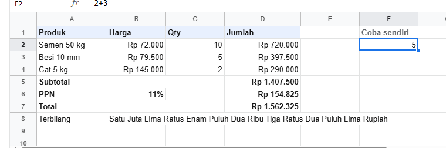
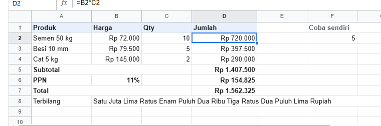
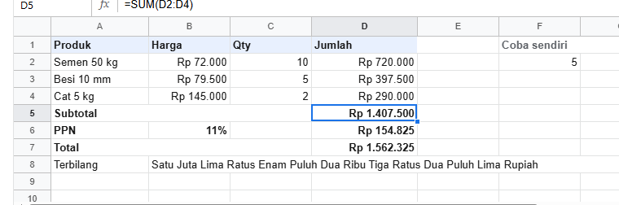
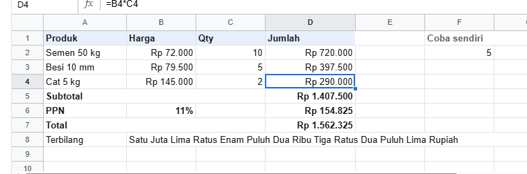
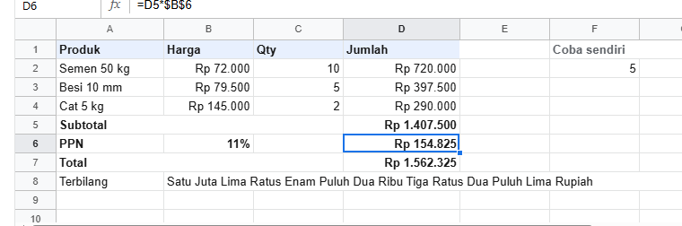
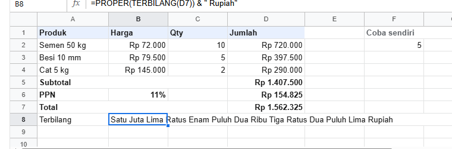
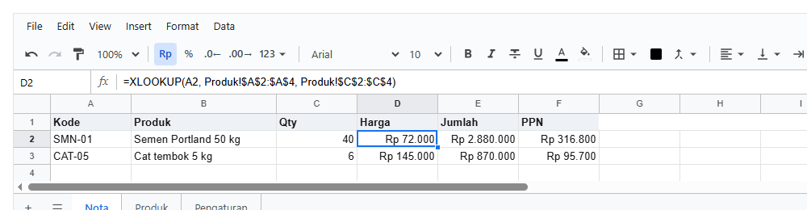
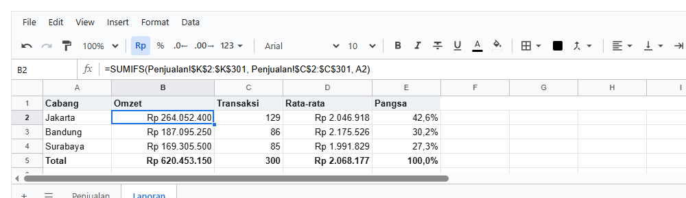
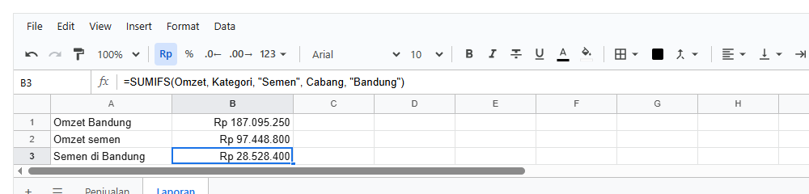

# 5. Rumus

[Daftar isi](../README.md#daftar-isi) · Sebelumnya: [4. Mengisi dan membaca dari kode](04-api-workbook.md) · Berikutnya: [6. Format](06-format.md)

Bab ini mulai dari nol. Bagian A memakai satu nota belanja yang dibangun pelan-pelan, tanpa kode: setiap gambar adalah sheet sungguhan, sel yang
dipilih diberi kotak biru, dan rumusnya terlihat di baris atas (formula bar). Bagian B menulis rumus dari kode, dengan halaman React dan fotonya.

**Bagian A. Rumus di layar (tanpa kode)**
- [5.1 Rumus itu apa](#51-rumus-itu-apa)
- [5.2 Membaca sel lain](#52-membaca-sel-lain)
- [5.3 Range dan SUM](#53-range-dan-sum)
- [5.4 Menyalin rumus ke bawah](#54-menyalin-rumus-ke-bawah)
- [5.5 Tanda `$`: sel yang tidak ikut bergeser](#55-tanda--sel-yang-tidak-ikut-bergeser)
- [5.6 Teks dan tanggal di rumus](#56-teks-dan-tanggal-di-rumus)
- [5.7 Error dan artinya](#57-error-dan-artinya)

**Bagian B. Rumus dari kode**
- [5.8 Menulis rumus dari kode](#58-menulis-rumus-dari-kode)
- [5.9 Membaca sheet lain](#59-membaca-sheet-lain)
- [5.10 Laporan dengan rumus](#510-laporan-dengan-rumus)
- [5.11 Named range](#511-named-range)

**Bagian C. Contoh lengkap, semua fungsi, dan yang sering keliru**
- [5.12 Contoh lengkap](#512-contoh-lengkap)
- [5.13 Semua fungsi: buat apa, cara pakai, hasilnya](#513-semua-fungsi-buat-apa-cara-pakai-hasilnya)
- [5.14 Yang sering keliru](#514-yang-sering-keliru)

---

# Bagian A. Rumus di layar (tanpa kode)

## 5.1 Rumus itu apa

Rumus adalah isi sel yang diawali tanda `=`. Sel tidak menampilkan rumusnya, tetapi **hasilnya**. Ketik `=2+3` di sebuah sel, tekan Enter, dan sel itu
menampilkan `5`. Rumusnya tetap bisa dilihat di formula bar saat sel itu dipilih:



Tanda hitung yang bisa dipakai: `+` tambah, `-` kurang, `*` kali, `/` bagi, `^` pangkat, `%` persen (`=20%` sama dengan 0,2). Urutannya seperti
matematika: kali dan bagi dulu, baru tambah dan kurang. Pakai kurung untuk mengubah urutan: `=(2+3)*4` hasilnya 20.

Di dalam rumus, desimal selalu ditulis dengan **titik**: `=72000*1.5`, bukan `=72000*1,5`. Koma dipakai untuk memisahkan isi fungsi (5.3).

## 5.2 Membaca sel lain

Rumus bisa membaca isi sel lain lewat alamatnya. Di nota ini, Jumlah di D2 adalah Harga × Qty:



`=B2*C2` artinya "isi B2 dikali isi C2". Kalau Qty di C2 diubah dari 10 menjadi 12, Jumlah di D2 langsung menjadi Rp 864.000, begitu juga Subtotal,
PPN, dan Total di bawahnya. Rumus selalu memakai isi terbaru dari sel yang dibacanya.

Sel di sheet lain ditulis dengan nama sheet dan tanda seru: `=Produk!B2`. Kalau nama sheet-nya ada spasi, beri tanda kutip satu: `='Daftar Harga'!B2`.

## 5.3 Range dan SUM

Dua alamat yang disambung titik dua adalah **range**, yaitu kotak berisi beberapa sel. `D2:D4` berarti D2, D3, dan D4. Subtotal menjumlahkan range itu
dengan **fungsi** `SUM`:



Fungsi adalah rumus siap pakai yang punya nama. Bentuknya selalu `NAMA(isi)`. Isinya bisa range, sel, angka, atau teks, dipisahkan koma:
`=SUM(D2:D4, 50000)` menjumlahkan D2 sampai D4, lalu ditambah 50.000. Ada 189 fungsi; semuanya ada di [5.13](#513-semua-fungsi-buat-apa-cara-pakai-hasilnya).

Bentuk range lain: `D:D` (seluruh kolom D), `2:2` (seluruh baris 2), dan `A1:D4` (kotak empat kolom kali empat baris).

## 5.4 Menyalin rumus ke bawah

Rumus Jumlah di D3 dan D4 tidak diketik satu per satu. D2 dipilih, lalu **fill handle** (kotak kecil di pojok kanan bawah sel) ditarik ke bawah. Rumusnya
ikut menyesuaikan barisnya sendiri:



| Sel | Rumus |
|---|---|
| D2 | `=B2*C2` |
| D3 | `=B3*C3` |
| D4 | `=B4*C4` |

Alamat di rumus bergeser sejauh rumus itu dipindah: satu baris ke bawah, `B2` menjadi `B3`. Hal yang sama terjadi saat rumus di-copy lalu di-paste.

## 5.5 Tanda `$`: sel yang tidak ikut bergeser

Tarif PPN ada di **satu** sel saja, B6. Rumus PPN harus selalu membaca B6, ke mana pun rumusnya disalin. Untuk itu B6 ditulis `$B$6`:



| Ditulis | Disalin satu baris ke bawah | Artinya |
|---|---|---|
| `=D5*B6` | `=D6*B7` | dua-duanya ikut bergeser: tarif PPN ikut pindah, salah |
| `=D5*$B$6` | `=D6*$B$6` | `$` di depan kolom dan baris: B6 tidak bergeser, benar |
| `=D5*B$6` | `=D6*B$6` | hanya baris yang dikunci |
| `=D5*$B6` | `=D6*$B7` | hanya kolom yang dikunci |

Tekan **F4** saat mengetik alamat di rumus untuk berganti di antara keempat bentuk itu.

## 5.6 Teks dan tanggal di rumus

**Teks** ditulis di antara tanda kutip dua: `="Total: " & D7`. Tanda `&` menyambung teks dengan teks atau angka. Baris Terbilang di nota memakai fungsi
`TERBILANG` untuk mengubah angka Total menjadi kata-kata, seperti di kwitansi:



`=PROPER(TERBILANG(D7)) & " Rupiah"` dibaca dari dalam ke luar: `TERBILANG(D7)` mengubah angka di D7 menjadi kata-kata, `PROPER` membuat huruf pertama
setiap kata menjadi besar, lalu `& " Rupiah"` menambahkan kata Rupiah di belakangnya.

**Tanggal** di sheet sebenarnya angka, yaitu jumlah hari sejak 30 Desember 1899 (sama dengan Excel). 1 Oktober 2026 adalah 46296. Format tanggal yang
membuatnya tampil sebagai `01/10/2026` ([bab 6](06-format.md)). Karena tanggal adalah angka, tanggal bisa dihitung:

| Rumus | Hasil |
|---|---|
| `=A2+14` | 14 hari setelah tanggal di A2 (jatuh tempo) |
| `=B2-A2` | selisih hari antara dua tanggal |
| `=TODAY()` | tanggal hari ini, berubah setiap hari |
| `=WORKDAY(A2, 10)` | 10 hari kerja setelah A2, tanpa Sabtu dan Minggu |

## 5.7 Error dan artinya

Kalau rumus tidak bisa dihitung, sel menampilkan kode error. Error bukan berarti sheet rusak, tetapi tanda ada yang perlu dibetulkan:

<!-- contoh: 05-error.js -->
```js
import { createWorkbook, isError } from '@kufayeka/sheet/core';

// Semua error rumus, dari mana datangnya, dan cara menangkapnya.
const wb = createWorkbook();
const s = wb.sheet('Sheet1');
s.setValues('A1', [
    ['Omzet', 0, 'Transaksi', 0],
    ['Rata-rata', '=B1/D1', '', '=IFERROR(B1/D1, 0)'],
    ['Kode', '=VLOOKUP("ZZZ-00", A1:B1, 2, FALSE)', '', '=IFNA(VLOOKUP("ZZZ-00", A1:B1, 2, FALSE), "tidak dijual")'],
    ['Teks x angka', '="dua" * 3', '', '=IF(ISNUMBER(A4), A4 * 3, "bukan angka")'],
    ['Akar negatif', '=SQRT(-4)'],
    ['Nama salah', '=SUMM(B1:B2)'],
    ['Melingkar', '=C7 + 1', '=B7 * 2'],
    ['Membaca B7', '=B7']
]);
for (let r = 2; r <= 8; r++) {
    const v = s.value('B' + r);
    console.log(String(s.value('A' + r)).padEnd(13), s.input('B' + r).padEnd(36), isError(v) ? v.code : v, s.value('D' + r) !== null ? '| tertangkap: ' + s.value('D' + r) : '');
}

// error menjalar ke rumus yang membacanya, dan hilang sendiri begitu sebabnya hilang
s.setValues('B10', '=B2 + 100');
console.log('menjalar      :', s.value('B10').code);
s.setValues('D1', 4);
console.log('sebab hilang  :', s.value('B2'), '|', s.value('B10'));

// #REF!: sel yang dibaca dihapus
s.setValues('F1', [[5, '=F1*2']]);
s.deleteCols('F');
console.log('kolom dihapus :', s.input('F1'), '=', s.value('F1').code);
```
<!-- /contoh -->

<!-- hasil: 05-error.js -->
```text
Rata-rata     =B1/D1                               #DIV/0! | tertangkap: 0
Kode          =VLOOKUP("ZZZ-00", A1:B1, 2, FALSE)  #N/A | tertangkap: tidak dijual
Teks x angka  ="dua" * 3                           #VALUE! | tertangkap: bukan angka
Akar negatif  =SQRT(-4)                            #NUM! 
Nama salah    =SUMM(B1:B2)                         #NAME? 
Melingkar     =C7 + 1                              #CYCLE! 
Membaca B7    =B7                                  #CYCLE! 
menjalar      : #DIV/0!
sebab hilang  : 0 | 100
kolom dihapus : =#REF!*2 = #REF!
```
<!-- /hasil -->

| Tampil | Artinya | Biasanya karena | Cara membetulkan |
|---|---|---|---|
| `#DIV/0!` | dibagi nol | pembaginya kosong atau 0 | isi pembaginya, atau `=IFERROR(B1/D1, 0)` |
| `#N/A` | tidak ketemu | yang dicari `VLOOKUP`/`XLOOKUP`/`MATCH` tidak ada | cek ejaannya, atau `=IFNA(..., "tidak ada")` |
| `#VALUE!` | jenis isi salah | teks dikali angka, atau range yang panjangnya beda | pastikan selnya berisi angka |
| `#NAME?` | nama tidak dikenal | salah ketik nama fungsi (`SUMM`) | betulkan ejaannya |
| `#REF!` | sel yang dibaca sudah dihapus | baris, kolom, atau sheet yang dibaca dihapus | undo, atau tulis ulang rumusnya |
| `#NUM!` | angka tidak mungkin | `SQRT(-4)` | cek angkanya |
| `#CYCLE!` | rumus membaca dirinya sendiri | A1 membaca B1, B1 membaca A1 | putus lingkarannya |

Error menjalar: rumus yang membaca sel error ikut error. Begitu penyebabnya dibetulkan, semua yang ikut error pulih sendiri.

---

# Bagian B. Rumus dari kode

## 5.8 Menulis rumus dari kode

**Tujuan:** nota di bagian A, dibuat dari kode.

<!-- contoh: 05-nota.page.js -->
```jsx
import { useState } from 'react';
import { Sheet } from '@kufayeka/sheet';
import { createWorkbook } from '@kufayeka/sheet/core';
import '@kufayeka/sheet/style.css';

// Nota belanja: semua yang dibahas di bagian dasar bab rumus ada di sini.
export function buatNota() {
    const wb = createWorkbook();
    wb.setSettings({ locale: 'id-ID', currency: 'IDR' });
    const s = wb.sheet('Sheet1');
    s.setSheetProps({ name: 'Nota' });
    s.setValues('A1', [
        ['Produk', 'Harga', 'Qty', 'Jumlah'],
        ['Semen 50 kg', 72000, 10, '=B2*C2'],
        ['Besi 10 mm', 79500, 5, '=B3*C3'],
        ['Cat 5 kg', 145000, 2, '=B4*C4'],
        ['Subtotal', null, null, '=SUM(D2:D4)'],
        ['PPN', 0.11, null, '=D5*$B$6'],
        ['Total', null, null, '=D5+D6'],
        ['Terbilang', '=PROPER(TERBILANG(D7)) & " Rupiah"']
    ]);
    s.setValues('F1', [['Coba sendiri'], ['=2+3']]);
    s.setStyle('A1:D1', { bold: true, fill: '#e8f0fe' });
    s.setStyle('A5:D7', { bold: true });
    s.setStyle('B6', { format: { type: 'percent', decimals: 0 } });
    s.setStyle('F1', { bold: true, color: '#5f6368' });
    s.setColProps('B', { format: { type: 'money', decimals: 0 } });
    s.setColProps('D', { format: { type: 'money', decimals: 0 }, width: 130 });
    s.setColProps('A', { width: 120 });
    return wb;
}

export default function Nota() {
    const [wb] = useState(buatNota);
    return <div style={{ height: 380 }}><Sheet workbook={wb} /></div>;
}
```
<!-- /contoh -->

Dari kode, rumus ditulis dengan `setValues` seperti mengetik di sel: teks yang diawali `=` menjadi rumus. Hasilnya dibaca dengan `value`, dan rumusnya
dengan `input` (bab 2).

| Fungsi | Artinya |
|---|---|
| `setValues(alamat, '=…')` | tulis rumus |
| `value(alamat)` | hasilnya. Error berupa `{ code }`, cek dengan `isError` |
| `input(alamat)` | rumusnya sebagai teks, seperti di formula bar |
| `fillBlock(wb, sheet, sumber, tujuan, arah)` | fill handle dari kode |
| `FUNCTION_NAMES` | nama semua fungsi |

Hanya rumus yang terkena sebuah perubahan yang dihitung ulang, jadi mengubah satu sel di sheet 100.000 baris tetap cepat. `TODAY()` dan `NOW()` dihitung
ulang setiap ada perubahan, atau saat `wb.tick()` dipanggil. Opsi `now` di `createWorkbook` mengganti jamnya, misalnya untuk test. Rumus di sel yang
formatnya uang dibulatkan ke desimal formatnya, supaya total tidak meleset sepeser pun dari yang tampil.

## 5.9 Membaca sheet lain

**Tujuan:** nota yang mengambil nama dan harga dari sheet Produk, dan tarif PPN dari sheet Pengaturan.

<!-- contoh: 05-09-antar-sheet.page.tsx -->
```tsx
import { useState } from 'react';
import { Sheet } from '@kufayeka/sheet';
import { createWorkbook } from '@kufayeka/sheet/core';
import '@kufayeka/sheet/style.css';

// 5.9 Rumus yang membaca sheet lain: nama dan harga diambil dari sheet Produk, tarif PPN dari sheet Pengaturan.
function buat() {
    const wb = createWorkbook();
    wb.setSettings({ locale: 'id-ID', currency: 'IDR' });
    const produk = wb.sheet(wb.addSheet('Produk'));
    produk.setValues('A1', [['Kode', 'Produk', 'Harga'], ['SMN-01', 'Semen Portland 50 kg', 72000], ['BSI-10', 'Besi beton 10 mm', 79500], ['CAT-05', 'Cat tembok 5 kg', 145000]]);
    const atur = wb.sheet(wb.addSheet('Pengaturan'));
    atur.setValues('A1', [['PPN', 0.11]]);

    const nota = wb.sheet('Sheet1');
    nota.setSheetProps({ name: 'Nota' });
    nota.setValues('A1', [
        ['Kode', 'Produk', 'Qty', 'Harga', 'Jumlah', 'PPN'],
        // baru: XLOOKUP mencari kode di kolom A sheet Produk, lalu memberi nilai dari kolom B atau C
        ['SMN-01', '=XLOOKUP(A2, Produk!$A$2:$A$4, Produk!$B$2:$B$4)', 40, '=XLOOKUP(A2, Produk!$A$2:$A$4, Produk!$C$2:$C$4)', '=C2*D2', '=E2*Pengaturan!$B$1'],
        ['CAT-05', '=XLOOKUP(A3, Produk!$A$2:$A$4, Produk!$B$2:$B$4)', 6, '=XLOOKUP(A3, Produk!$A$2:$A$4, Produk!$C$2:$C$4)', '=C3*D3', '=E3*Pengaturan!$B$1']
    ]);
    nota.setStyle('A1:F1', { bold: true, fill: '#eef2f7' });
    nota.setStyle('D2:F3', { format: { type: 'money', decimals: 0 } });
    nota.setColProps('B', { width: 180 });
    return wb;
}

export default function Halaman() {
    const [wb] = useState(buat);
    return (
        <div style={{ height: 260 }}>
            <Sheet workbook={wb} sheet={wb.sheetIdByName('Nota') ?? undefined} />
        </div>
    );
}
```
<!-- /contoh -->

D2 dipilih:



**Penjelasan:**

- `Produk!$A$2:$A$4` adalah range di sheet Produk. Nama sheet ditulis sebelum `!`. Nama yang mengandung spasi ditulis di antara tanda kutip
  satu: `'Daftar Harga'!A2`.
- `XLOOKUP(A2, kolom_kode, kolom_harga)` mencari kode di A2 di kolom kode, lalu memberi nilai di baris yang sama dari kolom harga.
- `$` menahan range supaya tidak ikut bergeser saat rumusnya disalin ke baris berikutnya (5.5).
- Kalau tarif PPN di sheet Pengaturan diubah, semua PPN di nota ikut berubah. Kalau sheet-nya diganti nama, rumusnya ikut menulis nama baru.

## 5.10 Laporan dengan rumus

**Tujuan:** 300 transaksi di sheet Penjualan, diringkas per cabang di sheet Laporan.

<!-- contoh: 05-10-laporan.page.tsx -->
```tsx
import { useState } from 'react';
import { Sheet } from '@kufayeka/sheet';
import { createWorkbook } from '@kufayeka/sheet/core';
import '@kufayeka/sheet/style.css';
import { penjualan, KOLOM_PENJUALAN, barisPenjualan, CABANG } from './data/toko.js';

// 5.10 Laporan dengan rumus: 300 transaksi di sheet Penjualan, diringkas per cabang di sheet Laporan.
function buat() {
    const wb = createWorkbook();
    wb.setSettings({ locale: 'id-ID', currency: 'IDR' });
    const jual = wb.sheet('Sheet1');
    jual.setSheetProps({ name: 'Penjualan' });
    jual.setValues('A1', [KOLOM_PENJUALAN]);
    jual.setValues('A2', barisPenjualan(penjualan(300), 2));     // A2:K301; kolom C cabang, kolom K nilai transaksi

    const lap = wb.sheet(wb.addSheet('Laporan'));
    lap.setValues('A1', [['Cabang', 'Omzet', 'Transaksi', 'Rata-rata', 'Pangsa']]);
    // baru: satu baris rumus per cabang
    lap.setValues('A2', CABANG.map((cabang, i) => {
        const r = i + 2;
        return [cabang,
            `=SUMIFS(Penjualan!$K$2:$K$301, Penjualan!$C$2:$C$301, A${r})`,       // jumlah nilai, hanya baris cabang ini
            `=COUNTIFS(Penjualan!$C$2:$C$301, A${r})`,                             // jumlah transaksi
            `=ROUND(B${r}/C${r}, 0)`,                                              // rata-rata per transaksi
            `=B${r}/SUM($B$2:$B$4)`];                                              // bagian dari total
    }));
    lap.setValues('A5', [['Total', '=SUM(B2:B4)', '=SUM(C2:C4)', '=ROUND(B5/C5, 0)', '=SUM(E2:E4)']]);
    lap.setStyle('A1:E1, A5:E5', { bold: true });
    lap.setStyle('A1:E1', { fill: '#eef2f7' });
    lap.setColProps('B', { format: { type: 'money', decimals: 0 }, width: 150 });
    lap.setColProps('D', { format: { type: 'money', decimals: 0 }, width: 130 });
    lap.setColProps('E', { format: { type: 'percent', decimals: 1 } });
    return wb;
}

export default function Halaman() {
    const [wb] = useState(buat);
    return (
        <div style={{ height: 290 }}>
            <Sheet workbook={wb} sheet={wb.sheetIdByName('Laporan') ?? undefined} />
        </div>
    );
}
```
<!-- /contoh -->

B2 dipilih:



**Penjelasan:**

- `SUMIFS(yang_dijumlah, range_syarat, syarat)` menjumlah hanya baris yang memenuhi syarat: di sini baris yang cabangnya sama dengan A2.
- `COUNTIFS` menghitung barisnya. Rata-rata dan pangsa dihitung dari keduanya.
- Rumusnya dibuat dengan template string di dalam `map`, satu baris rumus per cabang. `A${r}` menjadi `A2`, `A3`, `A4`.
- Kalau ada transaksi baru di sheet Penjualan (di dalam range), laporannya ikut berubah sendiri.

Yang dipakai: `SUMIFS`, `COUNTIFS`, `AVERAGEIFS`, dan `MAXIFS` untuk total dengan syarat, `$` di penyebut pangsa, `INDEX` + `MATCH` dan `XLOOKUP` +
`LARGE` untuk "siapa yang terbesar", dan `">=" & tanggal` untuk menjumlah per periode. Semua range di satu `SUMIFS` harus sama panjang.

## 5.11 Named range

**Tujuan:** memberi nama pada range, supaya rumus laporan terbaca seperti kalimat.

<!-- contoh: 05-11-nama.page.tsx -->
```tsx
import { useState } from 'react';
import { Sheet } from '@kufayeka/sheet';
import { createWorkbook } from '@kufayeka/sheet/core';
import '@kufayeka/sheet/style.css';
import { penjualan, KOLOM_PENJUALAN, barisPenjualan } from './data/toko.js';

// 5.11 Named range: range diberi nama, sehingga rumus laporan terbaca seperti kalimat.
function buat() {
    const wb = createWorkbook();
    wb.setSettings({ locale: 'id-ID', currency: 'IDR' });
    const jual = wb.sheet('Sheet1');
    jual.setSheetProps({ name: 'Penjualan' });
    jual.setValues('A1', [KOLOM_PENJUALAN]);
    jual.setValues('A2', barisPenjualan(penjualan(300), 2));

    // baru: tiga nama untuk tiga kolom data
    wb.addName('Cabang', 'Penjualan', 'C2:C301');
    wb.addName('Kategori', 'Penjualan', 'G2:G301');
    wb.addName('Omzet', 'Penjualan', 'K2:K301');

    const lap = wb.sheet(wb.addSheet('Laporan'));
    lap.setValues('A1', [
        ['Omzet Bandung', '=SUMIFS(Omzet, Cabang, "Bandung")'],              // baru: nama, bukan Penjualan!$K$2:$K$301
        ['Omzet semen', '=SUMIFS(Omzet, Kategori, "Semen")'],
        ['Semen di Bandung', '=SUMIFS(Omzet, Kategori, "Semen", Cabang, "Bandung")']
    ]);
    lap.setColProps('A', { width: 150 });
    lap.setColProps('B', { format: { type: 'money', decimals: 0 }, width: 150 });
    return wb;
}

export default function Halaman() {
    const [wb] = useState(buat);
    return (
        <div style={{ height: 240 }}>
            <Sheet workbook={wb} sheet={wb.sheetIdByName('Laporan') ?? undefined} />
        </div>
    );
}
```
<!-- /contoh -->

B3 dipilih:



**Penjelasan:**

- `wb.addName('Omzet', 'Penjualan', 'K2:K301')` memberi nama `Omzet` pada range itu.
- `=SUMIFS(Omzet, Cabang, "Bandung")` sama dengan `=SUMIFS(Penjualan!$K$2:$K$301, Penjualan!$C$2:$C$301, "Bandung")`, tapi jauh lebih mudah
  dibaca.
- Kalau range sebuah nama diperluas, semua rumus yang memakainya ikut menghitung baris baru. Kalau namanya diganti, rumusnya ikut menulis nama
  baru (5.12).
- Nama juga bisa dibuat orang di layar, lewat Data → Named ranges, atau dengan mengetik nama di kotak nama.

| Fungsi | Artinya |
|---|---|
| `wb.addName(nama, sheet, range)` | buat nama |
| `wb.setName(id, { name, sheetId, range })` | ganti nama atau range-nya |
| `wb.removeName(id)` | hapus nama |
| `wb.names()` | `[{ id, name, sheetId, range, ref }]` |
| `wb.nameRange(nama)`, `wb.nameProblem(nama)` | range sebuah nama, dan alasan sebuah nama tidak boleh dipakai |

---

# Bagian C. Contoh lengkap, semua fungsi, dan yang sering keliru

## 5.12 Contoh lengkap

Contoh-contoh di bawah ini lebih panjang. Hasilnya dicetak sebagai teks, supaya setiap langkahnya terlihat.

### Nota dengan sheet lain, fill dari kode, dan sheet yang diganti nama

<!-- contoh: 05-rumus.js -->
```js
import { createWorkbook, fillBlock } from '@kufayeka/sheet/core';
import { PRODUK, KOLOM_PRODUK } from './data/toko.js';

// Nota penjualan yang mengambil harga dari sheet Produk dan tarif PPN dari sheet Pengaturan.
// now: jam untuk TODAY() dan NOW(), dipatok supaya hasil contoh ini selalu sama
const wb = createWorkbook(null, { now: () => new Date(2026, 9, 27, 9, 30) });
wb.setSettings({ locale: 'id-ID', currency: 'IDR' });

const produk = wb.sheet(wb.addSheet('Produk'));
produk.setValues('A1', [KOLOM_PRODUK, ...PRODUK]);
const atur = wb.sheet(wb.addSheet('Pengaturan'));
atur.setValues('A1', [['PPN', 0.11], ['Jatuh tempo (hari)', 14]]);

const nota = wb.sheet('Sheet1');
nota.setSheetProps({ name: 'Nota' });
nota.setValues('A1', [
    ['Kode', 'Produk', 'Qty', 'Harga', 'Jumlah', 'PPN'],
    ['SMN-01', '=XLOOKUP(A2, Produk!$A$2:$A$13, Produk!$B$2:$B$13, "?")', 40, '=XLOOKUP(A2, Produk!$A:$A, Produk!$F:$F)', '=C2*D2', '=E2*Pengaturan!$B$1']
]);
nota.setValues('A3', [['BSI-13', null, 25], ['CAT-05', null, 6], ['XXX-99', null, 1]]);

// fill handle dari kode: rumus diulang ke bawah. Bagian tanpa $ ikut bergeser, yang ber-$ tetap. Kolom Qty (C) tidak ikut, karena angka
// yang di-fill menjadi deret (40, 41, 42), sama seperti menarik fill handle di layar
fillBlock(wb, 'Nota', 'B2', 'B3:B5', 'down');
fillBlock(wb, 'Nota', 'D2:F2', 'D3:F5', 'down');
console.log('rumus B3      :', nota.input('B3'));
console.log('rumus F4      :', nota.input('F4'));
console.log('produk        :', [2, 3, 4, 5].map((r) => nota.value('B' + r)).join(' | '));
console.log('jumlah        :', [2, 3, 4, 5].map((r) => { const v = nota.value('E' + r); return v.code || v; }).join(' | '));

nota.setValues('A7', [
    ['Subtotal', null, null, null, '=SUMIF(A2:A5, "<>XXX-99", E2:E5)'],
    ['PPN', null, null, null, '=ROUND(E7*Pengaturan!B1, 0)'],
    ['Total', null, null, null, '=E7+E8'],
    ['Ringkas', '="Total " & ROUND(E9/1000000, 1) & " juta, " & COUNTIF(D2:D5, ">0") & " barang"'],
    ['Tanggal', '=TODAY()', 'Jatuh tempo', '=B11+Pengaturan!B2', 'Sisa hari', '=D11-TODAY()']
]);
console.log('subtotal      :', nota.value('E7'), '| PPN', nota.value('E8'), '| total', nota.value('E9'));
console.log('teks          :', nota.value('B10'));
console.log('tanggal       :', nota.value('B11'), '(27 Okt 2026) | jatuh tempo', nota.value('D11'), '| sisa', nota.value('F11'), 'hari');

// sheet diganti nama, tarif PPN diubah: semua rumus ikut
wb.setSheetProps('Pengaturan', { name: 'Atur Toko' });
atur.setValues('B1', 0.12);
console.log('setelah ubah  :', nota.input('E8'), '=', nota.value('E8'));
```
<!-- /contoh -->

<!-- hasil: 05-rumus.js -->
```text
rumus B3      : =XLOOKUP(A3, Produk!$A$2:$A$13, Produk!$B$2:$B$13, "?")
rumus F4      : =E4*Pengaturan!$B$1
produk        : Semen Portland 50 kg | Besi beton 13 mm | Cat tembok 5 kg putih | ?
jumlah        : 2880000 | 3200000 | 870000 | #N/A
subtotal      : 6950000 | PPN 764500 | total 7714500
teks          : Total 7.7 juta, 3 barang
tanggal       : 46322 (27 Okt 2026) | jatuh tempo 46336 | sisa 14 hari
setelah ubah  : =ROUND(E7*'Atur Toko'!B1, 0) = 834000
```
<!-- /hasil -->

### Laporan bulanan lengkap

<!-- contoh: 05-laporan.js -->
```js
import { createWorkbook } from '@kufayeka/sheet/core';
import { penjualan, KOLOM_PENJUALAN, barisPenjualan, CABANG } from './data/toko.js';

// Laporan bulanan dari 300 transaksi: ringkasan per cabang, per kategori, dan per minggu, hanya dengan rumus.
const wb = createWorkbook();
wb.setSettings({ locale: 'id-ID', currency: 'IDR' });
const jual = wb.sheet('Sheet1');
jual.setSheetProps({ name: 'Penjualan' });
jual.setValues('A1', [KOLOM_PENJUALAN]);
jual.setValues('A2', barisPenjualan(penjualan(300), 2));      // A2:K301, kolom K = Qty x Harga x (1 - Diskon)

const lap = wb.sheet(wb.addSheet('Laporan'));
// ---- per cabang: omzet, transaksi, rata-rata, transaksi terbesar, pangsa, peringkat
lap.setValues('A1', [['Cabang', 'Omzet', 'Transaksi', 'Rata-rata', 'Terbesar', 'Pangsa', 'Peringkat', 'Nilai']]);
lap.setValues('A2', CABANG.map((c, i) => {
    const r = i + 2;
    return [c,
        `=SUMIFS(Penjualan!$K$2:$K$301, Penjualan!$C$2:$C$301, A${r})`,
        `=COUNTIFS(Penjualan!$C$2:$C$301, A${r})`,
        `=ROUND(AVERAGEIFS(Penjualan!$K$2:$K$301, Penjualan!$C$2:$C$301, A${r}), 0)`,
        `=MAXIFS(Penjualan!$K$2:$K$301, Penjualan!$C$2:$C$301, A${r})`,
        `=B${r}/SUM($B$2:$B$4)`,
        `=RANK(B${r}, $B$2:$B$4)`,
        `=IFS(F${r}>=0.4, "A", F${r}>=0.25, "B", TRUE, "C")`];
}));
lap.setValues('A5', [['Total', '=SUM(B2:B4)', '=SUM(C2:C4)', '=ROUND(B5/C5, 0)', '=MAX(E2:E4)', '=SUM(F2:F4)']]);
for (let r = 2; r <= 5; r++) {
    const v = (c) => lap.value(c + r);
    console.log(String(v('A')).padEnd(9), 'omzet', String(v('B')).padStart(9), '| trx', v('C'), '| rata2', v('D'), '| max', v('E'),
        '| pangsa', (v('F') * 100).toFixed(1) + '%', r < 5 ? '| #' + v('G') + ' ' + v('H') : '');
}

// ---- jawaban satu sel: INDEX + MATCH, XLOOKUP + LARGE, teks yang digabung
lap.setValues('A7', [
    ['Cabang terbaik', '=INDEX(A2:A4, MATCH(MAX(B2:B4), B2:B4, 0))'],
    ['Omzet kedua', '=XLOOKUP(LARGE(B2:B4, 2), B2:B4, A2:A4)'],
    ['Diskon diberikan', '=COUNTIF(Penjualan!J2:J301, ">0") & " transaksi"'],
    ['Qty terbanyak', '=MAX(Penjualan!H2:H301) & " x " & INDEX(Penjualan!F2:F301, MATCH(MAX(Penjualan!H2:H301), Penjualan!H2:H301, 0))'],
    ['Semua cabang', '=TEXTJOIN(", ", TRUE, A2:A4)']
]);
for (let r = 7; r <= 11; r++) console.log(String(lap.value('A' + r)).padEnd(17), ':', lap.value('B' + r).code || lap.value('B' + r));

// ---- per minggu: tanggal dihitung dari nomor hari, WEEKDAY dan selisih tanggal
lap.setValues('D7', [['Minggu', 'Dari', 'Sampai', 'Omzet']]);
lap.setValues('D8', [1, 2, 3, 4, 5].map((w, i) => [w, `=DATE(2026, 10, 1) + ${i * 7}`, `=MIN(E${i + 8} + 6, DATE(2026, 10, 31))`,
    `=SUMIFS(Penjualan!$K$2:$K$301, Penjualan!$B$2:$B$301, ">=" & E${i + 8}, Penjualan!$B$2:$B$301, "<=" & F${i + 8})`]));
lap.setColProps('E:F', { format: { type: 'date' } });
lap.setValues('D13', [['Cek', '=SUM(G8:G12)=B5', 'Hari pertama', '=WEEKDAY(E8, 2)']]);
for (let r = 8; r <= 12; r++) console.log('minggu', lap.value('D' + r), lap.display('E' + r).text, '-', lap.display('F' + r).text, ':', lap.value('G' + r));
console.log('jumlah 5 minggu = total omzet:', lap.value('E13'), '| 1 Oktober 2026 hari ke', lap.value('G13'), '(Senin = 1, jadi Kamis)');
```
<!-- /contoh -->

<!-- hasil: 05-laporan.js -->
```text
Jakarta   omzet 264052400 | trx 129 | rata2 2046918 | max 12495000 | pangsa 42.6% | #1 A
Bandung   omzet 187095250 | trx 86 | rata2 2175526 | max 12495000 | pangsa 30.2% | #2 B
Surabaya  omzet 169305500 | trx 85 | rata2 1991829 | max 11760000 | pangsa 27.3% | #3 B
Total     omzet 620453150 | trx 300 | rata2 2068177 | max 12495000 | pangsa 100.0% 
Cabang terbaik    : Jakarta
Omzet kedua       : Bandung
Diskon diberikan  : 46 transaksi
Qty terbanyak     : 27 x Semen Portland 50 kg
Semua cabang      : Jakarta, Bandung, Surabaya
minggu 1 01/10/2026 - 07/10/2026 : 143905350
minggu 2 08/10/2026 - 14/10/2026 : 138327500
minggu 3 15/10/2026 - 21/10/2026 : 142789900
minggu 4 22/10/2026 - 28/10/2026 : 151715250
minggu 5 29/10/2026 - 31/10/2026 : 43715150
jumlah 5 minggu = total omzet: true | 1 Oktober 2026 hari ke 4 (Senin = 1, jadi Kamis)
```
<!-- /hasil -->

### Named range dan SUBTOTAL

**Named range** adalah nama untuk sebuah range. `=SUMIFS(Omzet, Cabang, "Bandung")` lebih mudah dibaca daripada
`=SUMIFS(Penjualan!$K$2:$K$301, Penjualan!$C$2:$C$301, "Bandung")`. **SUBTOTAL** menjumlah tanpa menghitung subtotal lain di dalam range-nya, dan bisa
melewati baris yang disembunyikan:

<!-- contoh: 05-nama-subtotal.js -->
```js
import { createWorkbook } from '@kufayeka/sheet/core';
import { penjualan, KOLOM_PENJUALAN, barisPenjualan } from './data/toko.js';

// Named range: rumus laporan yang terbaca seperti kalimat. SUBTOTAL: total yang menghormati filter dan tidak terhitung dua kali.
const wb = createWorkbook();
const jual = wb.sheet('Sheet1');
jual.setSheetProps({ name: 'Penjualan' });
jual.setValues('A1', [KOLOM_PENJUALAN]);
jual.setValues('A2', barisPenjualan(penjualan(300), 2));

// ---- nama untuk kolom data, dan untuk satu sel tarif
wb.addName('Cabang', 'Penjualan', 'C2:C301');
wb.addName('Kategori', 'Penjualan', 'G2:G301');
wb.addName('Omzet', 'Penjualan', 'K2:K301');
const lap = wb.sheet(wb.addSheet('Laporan'));
lap.setValues('A1', [
    ['Omzet Bandung', '=SUMIFS(Omzet, Cabang, "Bandung")'],
    ['Omzet semen', '=SUMIFS(Omzet, Kategori, "Semen")'],
    ['Komisi sales', '=ROUND(B1 * Komisi, 0)']
]);
console.log('rumus             :', lap.input('B1'));
console.log('omzet Bandung     :', lap.value('B1'), '| semen', lap.value('B2'));
console.log('komisi (belum ada):', lap.value('B3').code, '<- nama Komisi belum dibuat');
lap.setValues('D1', [['Tarif komisi', 0.015]]);
wb.addName('Komisi', 'Laporan', 'E1');
console.log('komisi            :', lap.value('B3'), '<- rumus jalan begitu namanya ada');

// ---- nama diganti: semua rumus ikut menulis nama baru. Range-nya diperluas: semua rumus ikut menghitung baris baru
const id = wb.names().find((n) => n.name === 'Omzet').id;
wb.setName(id, { name: 'Total' });
console.log('ganti nama        :', lap.input('B1'));
jual.setValues('A302', barisPenjualan([{ No: 301, Tanggal: 46325, Cabang: 'Bandung', Sales: 'Asep', Kode: 'PSR-01', Produk: 'Pasir beton', Kategori: 'Pasir', Qty: 10, Harga: 290000, Diskon: 0 }], 302));
wb.setName(id, { range: 'K2:K302' });
wb.setName(wb.names().find((n) => n.name === 'Cabang').id, { range: 'C2:C302' });
wb.setName(wb.names().find((n) => n.name === 'Kategori').id, { range: 'G2:G302' });   // range yang dipakai bersama di SUMIFS harus sama panjang
console.log('baris baru masuk  :', lap.value('B1'), '(+2.900.000)');
console.log('semua nama        :', wb.names().map((n) => n.name + ' = ' + n.ref).join(', '));
console.log('nama tidak boleh  :', JSON.stringify(wb.nameProblem('A1')), '|', JSON.stringify(wb.nameProblem('Total')));

// ---- SUBTOTAL: kelompok kategori di sheet Rekap, total per kelompok, total akhir yang tidak menghitung subtotal
const rekap = wb.sheet(wb.addSheet('Rekap'));
rekap.setValues('A1', [
    ['Kategori / cabang', 'Omzet'],
    ['Semen', '=SUBTOTAL(9, B3:B5)'],
    ['  Jakarta', '=SUMIFS(Total, Kategori, "Semen", Cabang, "Jakarta")'],
    ['  Bandung', '=SUMIFS(Total, Kategori, "Semen", Cabang, "Bandung")'],
    ['  Surabaya', '=SUMIFS(Total, Kategori, "Semen", Cabang, "Surabaya")'],
    ['Besi', '=SUBTOTAL(9, B7:B9)'],
    ['  Jakarta', '=SUMIFS(Total, Kategori, "Besi", Cabang, "Jakarta")'],
    ['  Bandung', '=SUMIFS(Total, Kategori, "Besi", Cabang, "Bandung")'],
    ['  Surabaya', '=SUMIFS(Total, Kategori, "Besi", Cabang, "Surabaya")'],
    ['Semen + besi', '=SUBTOTAL(9, B2:B9)'],
    ['SUM biasa', '=SUM(B2:B9)']
]);
console.log('SUBTOTAL vs SUM   :', rekap.value('B10'), 'vs', rekap.value('B11'), '<- SUM menghitung subtotal dua kali');

// baris yang disembunyikan: 9 tetap menghitungnya, 109 tidak. Baris yang disaring filter tidak dihitung keduanya
rekap.setRowProps('4', { hidden: true });
rekap.setValues('C10', [['=SUBTOTAL(109, B2:B9)']]);
console.log('Bandung semen disembunyikan :', rekap.value('B10'), '(9) |', rekap.value('C10'), '(109)');
rekap.setRowProps('4', { hidden: null });
rekap.createFilter('A1:B9');
rekap.setFilterColumn('A', { hidden: ['  Surabaya'] });
console.log('filter tanpa Surabaya       :', rekap.value('B10'), '(9) |', rekap.value('C10'), '(109)');
```
<!-- /contoh -->

<!-- hasil: 05-nama-subtotal.js -->
```text
rumus             : =SUMIFS(Omzet, Cabang, "Bandung")
omzet Bandung     : 187095250 | semen 97448800
komisi (belum ada): #NAME? <- nama Komisi belum dibuat
komisi            : 2806429 <- rumus jalan begitu namanya ada
ganti nama        : =SUMIFS(Total, Cabang, "Bandung")
baris baru masuk  : 189995250 (+2.900.000)
semua nama        : Cabang = Penjualan!C2:C302, Kategori = Penjualan!G2:G302, Total = Penjualan!K2:K302, Komisi = Laporan!E1
nama tidak boleh  : "\"A1\" is the address of a cell, not a name" | "there is a named range \"Total\" already"
SUBTOTAL vs SUM   : 140157500 vs 280315000 <- SUM menghitung subtotal dua kali
Bandung semen disembunyikan : 140157500 (9) | 111629100 (109)
filter tanpa Surabaya       : 104075000 (9) | 104075000 (109)
```
<!-- /hasil -->

- Rumus boleh ditulis sebelum namanya dibuat: hasilnya `#NAME?` sampai nama itu ada.
- Mengganti nama membuat semua rumus menulis nama baru. Memperluas range sebuah nama membuat semua rumus ikut menghitung range baru.
- Nama tidak boleh berupa alamat sel. `PPN2026` adalah alamat (kolom PPN, baris 2026), jadi pakai `Tarif_PPN`.
- Di layar: Data → Named ranges.

Angka pertama `SUBTOTAL` memilih fungsinya: 1 `AVERAGE`, 2 `COUNT`, 3 `COUNTA`, 4 `MAX`, 5 `MIN`, 6 `PRODUCT`, 7 `STDEV`, 8 `STDEVP`, 9 `SUM`, 10 `VAR`,
11 `VARP`. Ditambah 100 (`SUBTOTAL(109, ...)`), baris yang disembunyikan dengan tangan atau grup yang dilipat juga dilewati. Baris yang disaring filter
selalu dilewati.

### Rumus untuk proyek dan keuangan

AHSP, jadwal hari kerja, kwitansi termin, cicilan alat, dan rekap dinamis:

<!-- contoh: 05-konstruksi.js -->
```js
import { createWorkbook } from '@kufayeka/sheet/core';

// Rumus yang sering dipakai di RAB, jadwal, dan pembayaran proyek.
const wb = createWorkbook(null, { now: () => new Date(2026, 9, 27) });
wb.setSettings({ locale: 'id-ID', currency: 'IDR' });

// ---- AHSP: harga satuan = jumlah (koefisien x harga dasar)
const ahsp = wb.sheet('Sheet1');
ahsp.setSheetProps({ name: 'AHSP' });
ahsp.setValues('A1', [
    ['1 m3 beton K-225', 'Koefisien', 'Satuan', 'Harga dasar'],
    ['Semen 50 kg', 7.4, 'zak', 72000],
    ['Pasir beton', 0.499, 'm3', 290000],
    ['Kerikil', 0.776, 'm3', 310000],
    ['Pekerja', 1.65, 'OH', 120000],
    ['Tukang batu', 0.275, 'OH', 150000],
    ['Harga satuan', '=SUMPRODUCT(B2:B6, D2:D6)'],
    ['Dibulatkan ke 1.000', '=MROUND(B7, 1000)'],
    ['Bahan saja', '=SUMPRODUCT((C2:C6<>"OH")*B2:B6*D2:D6)']
]);
console.log('harga satuan   :', ahsp.value('B7'), '-> dibulatkan', ahsp.value('B8'), '| bahan saja', ahsp.value('B9'));

// ---- jadwal: hari kerja (tanpa Sabtu, Minggu, dan tanggal merah)
const jadwal = wb.sheet(wb.addSheet('Jadwal'));
jadwal.setValues('A1', [
    ['Libur', '=DATE(2026,10,28)'],
    ['Mulai', '=DATE(2026,10,1)', 'Durasi (hari kerja)', 20],
    ['Selesai', '=WORKDAY(B2, D2 - 1, B1)'],
    ['Hari kerja Oktober', '=NETWORKDAYS(DATE(2026,10,1), EOMONTH(B2, 0), B1)'],
    ['Akhir bulan termin', '=EOMONTH(B2, 1)'],
    ['Minggu ke (ISO)', '=ISOWEEKNUM(TODAY())'],
    ['Sisa hari kalender', '=DAYS(B3, TODAY())']
]);
jadwal.setColProps('B', { format: { type: 'date', pattern: 'dddd, d MMM yyyy' } });
jadwal.setStyle('B4, B6:B7', { format: { type: 'number', decimals: 0 } });
for (let r = 3; r <= 7; r++) console.log(String(jadwal.value('A' + r)).padEnd(19), ':', jadwal.display('B' + r).text);

// ---- kwitansi termin: nominal dan terbilang
const kw = wb.sheet(wb.addSheet('Kwitansi'));
kw.setValues('A1', [
    ['Nilai kontrak', 1250000000],
    ['Progres termin 2', 0.35],
    ['Dibayar', '=ROUND(B1*B2, 0)'],
    ['Terbilang', '=PROPER(TERBILANG(B3)) & " Rupiah"']
]);
console.log('dibayar        :', kw.value('B3'));
console.log('terbilang      :', kw.value('B4'));

// ---- pembiayaan: cicilan alat berat dan kelayakan proyek
const uang = wb.sheet(wb.addSheet('Keuangan'));
uang.setValues('A1', [
    ['Harga excavator', 1500000000], ['Bunga per bulan', 0.009], ['Tenor (bulan)', 36], ['Cicilan', '=PMT(B2, B3, -B1)'],
    ['Arus kas proyek', -500000000], [null, 180000000], [null, 220000000], [null, 260000000],
    ['IRR', '=IRR(B5:B8)'], ['NPV 10%', '=NPV(10%, B6:B8) + B5']
]);
console.log('cicilan/bulan  :', Math.round(uang.value('B4')), '| IRR', (uang.value('B9') * 100).toFixed(2) + '%', '| NPV', Math.round(uang.value('B10')));

// ---- rekap dinamis: OFFSET dan INDIRECT
uang.setValues('D1', [['Bulan ke', 3], ['Arus kas bulan itu', '=OFFSET(B5, E1 - 1, 0)'], ['Dari sheet lain', '=INDIRECT("AHSP!B7")']]);
console.log('OFFSET         :', uang.value('E2'), '| INDIRECT', uang.value('E3'));
```
<!-- /contoh -->

<!-- hasil: 05-konstruksi.js -->
```text
harga satuan   : 1157320 -> dibulatkan 1157000 | bahan saja 918070
Selesai             : Kamis, 29 Okt 2026
Hari kerja Oktober  : 21
Akhir bulan termin  : Senin, 30 Nov 2026
Minggu ke (ISO)     : 44
Sisa hari kalender  : 2
dibayar        : 437500000
terbilang      : Empat Ratus Tiga Puluh Tujuh Juta Lima Ratus Ribu Rupiah
cicilan/bulan  : 48966129 | IRR 14.30% | NPV 40796394
OFFSET         : 220000000 | INDIRECT 1157320
```
<!-- /hasil -->

**Range di dalam hitungan.** `=SUM(B2:B6*D2:D6)` mengalikan kedua range baris demi baris, lalu menjumlahkannya. Ini berlaku untuk semua tanda hitung
dan perbandingan. Perbandingan menghasilkan `TRUE`/`FALSE` per baris, yang dihitung 1 dan 0 kalau dikali, jadi syarat bisa ditulis langsung:
`=SUMPRODUCT((C2:C6<>"OH")*B2:B6*D2:D6)` hanya menjumlahkan baris yang satuannya bukan OH. Range yang ukurannya berbeda menghasilkan `#N/A`. Hasil
seperti ini yang ditulis sendirian di satu sel (`=A2:A9*2`) menampilkan nilai pertamanya saja.

`OFFSET` dan `INDIRECT` dihitung ulang setiap ada perubahan, karena sel yang dibacanya baru diketahui saat dihitung. Excel juga begitu. Pakai secukupnya
di sheet yang sangat besar.

`TERBILANG` tidak ada di Excel. Di file `.xlsx` hasilnya ikut tersimpan, jadi teksnya tampil saat dibuka di Excel, tetapi kalau Excel menghitung ulang
sel itu, hasilnya `#NAME?`.

## 5.13 Semua fungsi: buat apa, cara pakai, hasilnya

Setiap fungsi dengan satu contoh. Hasilnya dihitung oleh library ini dari tabel contoh di bawah, jadi yang tertulis di sini adalah hasil sungguhan.
Daftar ini diperiksa otomatis: kalau ada fungsi yang belum tercantum, test dokumentasi gagal.

<!-- tabel: 05-fungsi.js -->
**Tabel contoh.** Semua contoh di bawah membaca sheet `Data` ini:

| | A | B | C | D | E | F | G |
|---|---|---|---|---|---|---|---|
| 1 | Produk | Harga | Qty | Kategori | Tanggal | Catatan | Arus kas |
| 2 | Semen 50 kg | 72.000 | 10 | Bahan | 01/10/2026 | `"  semen portland  "` | -1.000.000 |
| 3 | Besi 10 mm | 79.500 | 5 | Bahan | 05/10/2026 | PO-2611 | 300.000 |
| 4 | Cat 5 kg | 145.000 | 2 | Finishing | 15/10/2026 |  | 400.000 |
| 5 | Pasir m3 | 290.000 | 3 | Bahan | 22/10/2026 |  | 500.000 |

**Menjumlah dan menghitung**

| Fungsi | Buat apa | Contoh | Hasil |
|---|---|---|---|
| `SUM` | menjumlahkan angka | `=SUM(B2:B5)` | 586.500 |
| `SUMPRODUCT` | mengalikan baris demi baris lalu menjumlahkan (harga × qty) | `=SUMPRODUCT(B2:B5, C2:C5)` | 2.277.500 |
| `PRODUCT` | mengalikan semua angka | `=PRODUCT(C2:C3)` | 50 |
| `AVERAGE` | rata-rata | `=AVERAGE(B2:B5)` | 146.625 |
| `MEDIAN` | nilai tengah | `=MEDIAN(B2:B5)` | 112.250 |
| `MAX` | angka terbesar | `=MAX(B2:B5)` | 290.000 |
| `MIN` | angka terkecil | `=MIN(B2:B5)` | 72.000 |
| `LARGE` | terbesar ke-n | `=LARGE(B2:B5, 2)` | 145.000 |
| `SMALL` | terkecil ke-n | `=SMALL(B2:B5, 2)` | 79.500 |
| `RANK` | peringkat sebuah angka (terbesar = 1) | `=RANK(B3, B2:B5)` | 3 |
| `RANK.EQ` | sama dengan RANK | `=RANK.EQ(B5, B2:B5)` | 1 |
| `COUNT` | banyaknya sel berisi angka | `=COUNT(A2:C5)` | 8 |
| `COUNTA` | banyaknya sel yang tidak kosong | `=COUNTA(F2:F5)` | 2 |
| `COUNTBLANK` | banyaknya sel kosong | `=COUNTBLANK(F2:F5)` | 2 |
| `SUBTOTAL` | total yang melewati baris tersembunyi dan subtotal lain (9 = SUM) | `=SUBTOTAL(9, B2:B5)` | 586.500 |

**Dengan syarat**

| Fungsi | Buat apa | Contoh | Hasil |
|---|---|---|---|
| `SUMIF` | menjumlahkan yang memenuhi satu syarat | `=SUMIF(D2:D5, "Bahan", B2:B5)` | 441.500 |
| `SUMIFS` | menjumlahkan dengan beberapa syarat | `=SUMIFS(B2:B5, D2:D5, "Bahan", C2:C5, ">3")` | 151.500 |
| `COUNTIF` | menghitung yang memenuhi syarat | `=COUNTIF(D2:D5, "Bahan")` | 3 |
| `COUNTIFS` | menghitung dengan beberapa syarat | `=COUNTIFS(D2:D5, "Bahan", B2:B5, ">75000")` | 2 |
| `AVERAGEIF` | rata-rata yang memenuhi syarat | `=ROUND(AVERAGEIF(D2:D5, "Bahan", B2:B5), 0)` | 147.167 |
| `AVERAGEIFS` | rata-rata dengan beberapa syarat | `=AVERAGEIFS(B2:B5, D2:D5, "Bahan", C2:C5, "<10")` | 184.750 |
| `MAXIFS` | terbesar yang memenuhi syarat | `=MAXIFS(B2:B5, D2:D5, "Bahan")` | 290.000 |
| `MINIFS` | terkecil yang memenuhi syarat | `=MINIFS(B2:B5, D2:D5, "Bahan")` | 72.000 |

**Pembulatan**

| Fungsi | Buat apa | Contoh | Hasil |
|---|---|---|---|
| `ROUND` | membulatkan ke sekian desimal | `=ROUND(1234.567, 2)` | 1.234,57 |
| `ROUNDUP` | membulatkan ke atas (7,2 zak jadi 8 zak) | `=ROUNDUP(7.2, 0)` | 8 |
| `ROUNDDOWN` | membulatkan ke bawah | `=ROUNDDOWN(7.8, 0)` | 7 |
| `MROUND` | membulatkan ke kelipatan terdekat | `=MROUND(1157320, 1000)` | 1.157.000 |
| `CEILING` | membulatkan ke atas ke kelipatan | `=CEILING(1157320, 5000)` | 1.160.000 |
| `FLOOR` | membulatkan ke bawah ke kelipatan | `=FLOOR(1157320, 5000)` | 1.155.000 |
| `INT` | bilangan bulat ke bawah | `=INT(7.9)` | 7 |
| `TRUNC` | membuang desimal | `=TRUNC(-7.9)` | -7 |
| `QUOTIENT` | hasil bagi tanpa sisa: berapa batang besi 12 m utuh dari 100 m | `=QUOTIENT(100, 12)` | 8 |
| `EVEN` | ke atas ke bilangan genap (bahan yang dijual berpasangan) | `=EVEN(7.2)` | 8 |
| `ODD` | ke atas ke bilangan ganjil | `=ODD(6)` | 7 |
| `CEILING.MATH` | ke atas ke kelipatan; angka negatif menuju nol | `=CEILING.MATH(-8.1, 2)` | -8 |
| `FLOOR.MATH` | ke bawah ke kelipatan; angka negatif menjauhi nol | `=FLOOR.MATH(-8.1, 2)` | -10 |

**Matematika**

| Fungsi | Buat apa | Contoh | Hasil |
|---|---|---|---|
| `ABS` | nilai tanpa tanda minus | `=ABS(-1500)` | 1.500 |
| `SIGN` | tanda: 1 positif, -1 negatif, 0 nol | `=SIGN(-1500)` | -1 |
| `MOD` | sisa bagi | `=MOD(17, 5)` | 2 |
| `POWER` | pangkat | `=POWER(1.1, 2)` | 1,21 |
| `SQRT` | akar kuadrat | `=SQRT(144)` | 12 |
| `EXP` | e pangkat angka | `=ROUND(EXP(1), 4)` | 2,7183 |
| `LN` | logaritma natural | `=ROUND(LN(10), 4)` | 2,3026 |
| `LOG` | logaritma dengan basis tertentu | `=LOG(1000, 10)` | 3 |
| `LOG10` | logaritma basis 10 | `=LOG10(1000)` | 3 |
| `PI` | bilangan π | `=ROUND(PI(), 4)` | 3,1416 |
| `SUMSQ` | jumlah kuadrat (3² + 4²) | `=SUMSQ(3, 4)` | 25 |
| `RADIANS` | derajat menjadi radian (fungsi sudut memakai radian) | `=ROUND(RADIANS(30), 6)` | 0,523599 |
| `DEGREES` | radian menjadi derajat | `=DEGREES(PI())` | 180 |
| `SIN` | sinus: tinggi kuda-kuda atap 30° dengan sisi miring 4 m | `=ROUND(4 * SIN(RADIANS(30)), 2)` | 2 |
| `COS` | kosinus: jarak datar sisi miring 4 m pada 30° | `=ROUND(4 * COS(RADIANS(30)), 2)` | 3,46 |
| `TAN` | tangen: kenaikan per meter pada kemiringan 30° | `=ROUND(TAN(RADIANS(30)), 4)` | 0,5774 |
| `ASIN` | sudut dari sinus | `=DEGREES(ASIN(0.5))` | 30 |
| `ACOS` | sudut dari kosinus | `=DEGREES(ACOS(0.5))` | 60 |
| `ATAN` | sudut tangga: naik 3, maju 4 | `=ROUND(DEGREES(ATAN(3/4)), 2)` | 36,87 |
| `ATAN2` | sudut titik (x, y), x dulu | `=DEGREES(ATAN2(1, 1))` | 45 |
| `CONVERT` | mengubah satuan: kaki persegi ke meter persegi | `=ROUND(CONVERT(1000, "ft2", "m2"), 2)` | 92,9 |

**Logika**

| Fungsi | Buat apa | Contoh | Hasil |
|---|---|---|---|
| `IF` | satu nilai kalau syarat benar, nilai lain kalau salah | `=IF(C2>5, "Banyak", "Sedikit")` | Banyak |
| `IFS` | beberapa syarat berurutan, yang pertama benar dipakai | `=IFS(B4>200000, "Mahal", B4>100000, "Sedang", TRUE, "Murah")` | Sedang |
| `SWITCH` | memilih hasil menurut nilai | `=SWITCH(D4, "Bahan", "B", "Finishing", "F", "-")` | F |
| `AND` | benar kalau semua syarat benar | `=AND(C2>5, B2<100000)` | TRUE |
| `OR` | benar kalau salah satu syarat benar | `=OR(C2>20, B2<100000)` | TRUE |
| `NOT` | membalik benar dan salah | `=NOT(C2>5)` | FALSE |
| `XOR` | benar kalau jumlah syarat yang benar ganjil | `=XOR(TRUE, FALSE)` | TRUE |
| `TRUE` | nilai benar | `=TRUE()` | TRUE |
| `FALSE` | nilai salah | `=FALSE()` | FALSE |
| `IFERROR` | nilai cadangan kalau rumus error | `=IFERROR(B2/0, 0)` | 0 |
| `IFNA` | nilai cadangan kalau tidak ketemu (#N/A) | `=IFNA(VLOOKUP("Kayu", A2:B5, 2, FALSE), "tidak ada")` | tidak ada |

**Mencari dan mengambil**

| Fungsi | Buat apa | Contoh | Hasil |
|---|---|---|---|
| `VLOOKUP` | mencari di kolom pertama, mengambil dari kolom ke-n | `=VLOOKUP("Cat 5 kg", A2:C5, 2, FALSE)` | 145.000 |
| `HLOOKUP` | mencari di baris pertama, mengambil dari baris ke-n | `=HLOOKUP("Qty", A1:G5, 3, FALSE)` | 5 |
| `XLOOKUP` | mencari di satu range, mengambil dari range lain | `=XLOOKUP("Besi 10 mm", A2:A5, B2:B5)` | 79.500 |
| `LOOKUP` | nilai terakhir yang tidak lebih dari yang dicari (range terurut) | `=LOOKUP(100000, B2:B5, A2:A5)` | Besi 10 mm |
| `INDEX` | isi sel ke-n dari sebuah range | `=INDEX(A2:A5, 3)` | Cat 5 kg |
| `MATCH` | posisi sebuah nilai di range | `=MATCH("Cat 5 kg", A2:A5, 0)` | 3 |
| `CHOOSE` | memilih dari daftar menurut nomor | `=CHOOSE(2, "Senin", "Selasa", "Rabu")` | Selasa |
| `OFFSET` | sel yang bergeser sekian baris dan kolom | `=OFFSET(A1, 2, 1)` | 79.500 |
| `INDIRECT` | sel dari teks alamat | `=INDIRECT("B" & 4)` | 145.000 |
| `TRANSPOSE` | baris jadi kolom | `=INDEX(TRANSPOSE(A2:A5), 1, 2)` | Besi 10 mm |
| `ROW` | nomor baris sebuah sel | `=ROW(B4)` | 4 |
| `ROWS` | banyaknya baris range | `=ROWS(A2:A5)` | 4 |
| `COLUMN` | nomor kolom sebuah sel | `=COLUMN(D1)` | 4 |
| `COLUMNS` | banyaknya kolom range | `=COLUMNS(A1:G1)` | 7 |

**Teks**

| Fungsi | Buat apa | Contoh | Hasil |
|---|---|---|---|
| `CONCAT` | menyambung teks | `=CONCAT(A2, " x ", C2)` | Semen 50 kg x 10 |
| `CONCATENATE` | sama dengan CONCAT | `=CONCATENATE(A3, " (", D3, ")")` | Besi 10 mm (Bahan) |
| `TEXTJOIN` | menyambung banyak teks dengan pemisah | `=TEXTJOIN(", ", TRUE, A2:A5)` | Semen 50 kg, Besi 10 mm, Cat 5 kg, Pasir m3 |
| `TEXT` | angka atau tanggal jadi teks dengan pola | `=TEXT(E2, "dd/mm/yyyy")` | 01/10/2026 |
| `TERBILANG` | angka dalam kata-kata (kwitansi, BAP) | `=TERBILANG(B2, "rupiah")` | tujuh puluh dua ribu rupiah |
| `LEFT` | beberapa huruf dari kiri | `=LEFT(A2, 5)` | Semen |
| `RIGHT` | beberapa huruf dari kanan | `=RIGHT(F3, 4)` | 2611 |
| `MID` | beberapa huruf dari tengah | `=MID(F3, 4, 4)` | 2611 |
| `LEN` | panjang teks | `=LEN(A2)` | 11 |
| `FIND` | posisi teks (huruf besar-kecil dibedakan) | `=FIND("-", F3)` | 3 |
| `SEARCH` | posisi teks (tidak dibedakan) | `=SEARCH("SEMEN", A2)` | 1 |
| `REPLACE` | mengganti bagian teks menurut posisi | `=REPLACE(F3, 1, 2, "SO")` | SO-2611 |
| `SUBSTITUTE` | mengganti teks tertentu | `=SUBSTITUTE(A2, "50 kg", "40 kg")` | Semen 40 kg |
| `UPPER` | huruf besar semua | `=UPPER(D2)` | BAHAN |
| `LOWER` | huruf kecil semua | `=LOWER(A3)` | besi 10 mm |
| `PROPER` | huruf besar di awal kata | `=PROPER(TRIM(F2))` | Semen Portland |
| `TRIM` | membuang spasi berlebih | `=TRIM(F2)` | semen portland |
| `REPT` | mengulang teks | `=REPT("★", 3)` | ★★★ |
| `VALUE` | teks angka jadi angka | `=VALUE("1250") + 1` | 1.251 |
| `EXACT` | apakah dua teks sama persis | `=EXACT("Semen", "semen")` | FALSE |
| `N` | nilai jadi angka (TRUE = 1, teks = 0) | `=N(TRUE)` | 1 |
| `HYPERLINK` | teks yang menunjuk alamat web | `=HYPERLINK("https://contoh.id", "buka")` | buka |
| `TEXTBEFORE` | teks sebelum pemisah: awalan nomor PO | `=TEXTBEFORE(F3, "-")` | PO |
| `TEXTAFTER` | teks sesudah pemisah: nomor di belakang | `=TEXTAFTER(F3, "-")` | 2611 |
| `NUMBERVALUE` | angka tulisan Indonesia ("1.250,50") menjadi angka | `=NUMBERVALUE("1.250,50", ",", ".")` | 1.250,5 |
| `FIXED` | angka dibulatkan lalu ditulis sebagai teks | `=FIXED(1234.567, 1)` | 1,234.6 |
| `CHAR` | huruf dari kodenya (10 = ganti baris) | `=CHAR(65)` | A |
| `CODE` | kode huruf pertama | `=CODE("A")` | 65 |
| `CLEAN` | membuang karakter tak terlihat dari teks tempelan | `=LEN(CLEAN("PO" & CHAR(10) & "2611"))` | 6 |

**Memeriksa isi**

| Fungsi | Buat apa | Contoh | Hasil |
|---|---|---|---|
| `ISBLANK` | apakah sel kosong | `=ISBLANK(F4)` | TRUE |
| `ISNUMBER` | apakah angka | `=ISNUMBER(B2)` | TRUE |
| `ISTEXT` | apakah teks | `=ISTEXT(B2)` | FALSE |
| `ISLOGICAL` | apakah TRUE atau FALSE | `=ISLOGICAL(C2>5)` | TRUE |
| `ISERROR` | apakah error | `=ISERROR(B2/0)` | TRUE |
| `ISNA` | apakah #N/A | `=ISNA(MATCH("Kayu", A2:A5, 0))` | TRUE |
| `ISERR` | apakah error selain #N/A | `=ISERR(MATCH("Kayu", A2:A5, 0))` | FALSE |
| `ISEVEN` | apakah genap | `=ISEVEN(C2)` | TRUE |
| `ISODD` | apakah ganjil | `=ISODD(C3)` | TRUE |
| `ISFORMULA` | apakah sel berisi rumus | `=ISFORMULA(B2)` | FALSE |
| `NA` | menulis #N/A dengan sengaja ("belum ada data") | `=NA()` | #N/A |
| `ERROR.TYPE` | nomor jenis error (2 = #DIV/0!) | `=ERROR.TYPE(B2/0)` | 2 |

**Tanggal dan jam**

| Fungsi | Buat apa | Contoh | Hasil |
|---|---|---|---|
| `TODAY` | tanggal hari ini | `=TODAY()` | 27/10/2026 |
| `NOW` | tanggal dan jam sekarang | `=NOW()` | 27/10/2026 09:30 |
| `DATE` | tanggal dari tahun, bulan, hari | `=DATE(2026, 12, 31)` | 31/12/2026 |
| `TIME` | jam dari jam, menit, detik | `=TIME(8, 30, 0)` | 08:30 |
| `YEAR` | tahun sebuah tanggal | `=YEAR(E2)` | 2.026 |
| `MONTH` | bulan | `=MONTH(E2)` | 10 |
| `DAY` | tanggal (hari ke berapa dalam bulan) | `=DAY(E3)` | 5 |
| `HOUR` | jam | `=HOUR(NOW())` | 9 |
| `MINUTE` | menit | `=MINUTE(NOW())` | 30 |
| `SECOND` | detik | `=SECOND(TIME(8, 30, 15))` | 15 |
| `WEEKDAY` | hari ke berapa dalam minggu (1 = Minggu) | `=WEEKDAY(E2)` | 5 |
| `WEEKNUM` | minggu ke berapa dalam tahun | `=WEEKNUM(E2)` | 40 |
| `ISOWEEKNUM` | minggu ISO (minggu dimulai Senin) | `=ISOWEEKNUM(E2)` | 40 |
| `EDATE` | tanggal sekian bulan kemudian | `=EDATE(E2, 3)` | 01/01/2027 |
| `EOMONTH` | tanggal terakhir bulan itu | `=EOMONTH(E2, 0)` | 31/10/2026 |
| `DAYS` | selisih hari | `=DAYS(E5, E2)` | 21 |
| `DATEDIF` | selisih dalam hari ("d"), bulan ("m"), atau tahun ("y") | `=DATEDIF(E2, TODAY(), "d")` | 26 |
| `WORKDAY` | tanggal setelah sekian hari kerja (tanpa Sabtu-Minggu) | `=WORKDAY(E2, 10)` | 15/10/2026 |
| `NETWORKDAYS` | banyaknya hari kerja di antara dua tanggal | `=NETWORKDAYS(E2, E5)` | 16 |
| `WORKDAY.INTL` | seperti WORKDAY, dengan libur pilihan: "0000001" = hanya Minggu libur (proyek 6 hari) | `=WORKDAY.INTL(E2, 10, "0000001")` | 13/10/2026 |
| `NETWORKDAYS.INTL` | hari kerja dengan libur pilihan (11 = hanya Minggu) | `=NETWORKDAYS.INTL(E2, E5, 11)` | 19 |
| `DAYS360` | selisih hari dengan tahun 360 hari (bunga, sewa) | `=DAYS360(E2, E5)` | 21 |
| `YEARFRAC` | bagian tahun di antara dua tanggal (3 = hari sebenarnya / 365) | `=ROUND(YEARFRAC(E2, E5, 3), 4)` | 0,0575 |
| `DATEVALUE` | tanggal yang tertulis sebagai teks menjadi tanggal | `=DATEVALUE("27/10/2026")` | 27/10/2026 |
| `TIMEVALUE` | jam yang tertulis sebagai teks menjadi jam | `=TIMEVALUE("13:45")` | 13:45 |

**Keuangan**

| Fungsi | Buat apa | Contoh | Hasil |
|---|---|---|---|
| `PMT` | cicilan per bulan (pokok ditulis negatif) | `=ROUND(PMT(1%, 12, -12000000), 0)` | 1.066.185 |
| `FV` | nilai akhir tabungan rutin | `=ROUND(FV(1%, 12, -1000000), 0)` | 12.682.503 |
| `PV` | nilai sekarang dari cicilan rutin | `=ROUND(PV(1%, 12, -1000000), 0)` | 11.255.077 |
| `NPV` | nilai sekarang arus kas (mulai periode 1) | `=ROUND(NPV(10%, G3:G5) + G2, 0)` | -21.037 |
| `IRR` | tingkat pengembalian arus kas | `=ROUND(IRR(G2:G5), 4)` | 0,089 |
| `NPER` | berapa bulan sampai lunas: utang 12 juta, cicilan 1,1 juta, bunga 1% | `=ROUND(NPER(1%, -1100000, 12000000), 2)` | 11,61 |
| `RATE` | bunga per bulan sebenarnya: pinjam 12 juta, cicil 1,1 juta × 12 | `=ROUND(RATE(12, -1100000, 12000000), 4)` | 0,015 |
| `IPMT` | bagian bunga di cicilan ke-1 | `=ROUND(IPMT(1%, 1, 12, -12000000), 0)` | 120.000 |
| `PPMT` | bagian pokok di cicilan ke-1 | `=ROUND(PPMT(1%, 1, 12, -12000000), 0)` | 946.185 |
| `CUMIPMT` | total bunga cicilan ke-1 sampai ke-6 | `=ROUND(CUMIPMT(1%, 12, 12000000, 1, 6, 0), 0)` | -576.166 |
| `CUMPRINC` | total pokok cicilan ke-1 sampai ke-6 | `=ROUND(CUMPRINC(1%, 12, 12000000, 1, 6, 0), 0)` | -5.820.947 |
| `XNPV` | nilai sekarang arus kas dengan tanggalnya sendiri (termin proyek) | `=ROUND(XNPV(10%, G2:G5, E2:E5), 0)` | 195.493 |
| `XIRR` | tingkat pengembalian per tahun dari arus kas bertanggal. Di tabel contoh uangnya kembali dalam 3 minggu, jadi setahunnya sangat besar (110 = 11.000%) | `=ROUND(XIRR(G2:G5, E2:E5), 4)` | 110,3748 |
| `MIRR` | IRR dengan bunga pinjaman 10% dan bunga simpanan 6% | `=ROUND(MIRR(G2:G5, 10%, 6%), 4)` | 0,0804 |
| `EFFECT` | bunga efektif setahun dari bunga 12% yang dihitung bulanan | `=ROUND(EFFECT(12%, 12), 4)` | 0,1268 |
| `NOMINAL` | bunga nominal dari bunga efektif | `=ROUND(NOMINAL(12.68%, 12), 4)` | 0,12 |
| `SLN` | penyusutan garis lurus per tahun: excavator 900 juta, sisa 100 juta, 8 tahun | `=SLN(900000000, 100000000, 8)` | 100.000.000 |
| `SYD` | penyusutan jumlah angka tahun, tahun ke-1 | `=ROUND(SYD(900000000, 100000000, 8, 1), 0)` | 177.777.778 |
| `DDB` | penyusutan saldo menurun ganda, tahun ke-1 | `=DDB(900000000, 100000000, 8, 1)` | 225.000.000 |
| `DB` | penyusutan saldo menurun tetap, tahun ke-1 | `=DB(900000000, 100000000, 8, 1)` | 216.000.000 |

**Statistik**

| Fungsi | Buat apa | Contoh | Hasil |
|---|---|---|---|
| `STDEV` | simpangan baku sampel | `=ROUND(STDEV(C2:C5), 2)` | 3,56 |
| `STDEV.S` | sama dengan STDEV | `=ROUND(STDEV.S(C2:C5), 2)` | 3,56 |
| `STDEV.P` | simpangan baku populasi | `=ROUND(STDEV.P(C2:C5), 2)` | 3,08 |
| `VAR` | varians sampel | `=ROUND(VAR(C2:C5), 2)` | 12,67 |
| `VAR.S` | sama dengan VAR | `=ROUND(VAR.S(C2:C5), 2)` | 12,67 |
| `VAR.P` | varians populasi | `=ROUND(VAR.P(C2:C5), 2)` | 9,5 |
| `MODE` | angka yang paling sering muncul | `=MODE(3, 5, 5, 2)` | 5 |
| `MODE.SNGL` | sama dengan MODE | `=MODE.SNGL(3, 5, 5, 2)` | 5 |
| `PERCENTILE` | persentil: 90% harga ada di bawah angka ini | `=PERCENTILE(B2:B5, 0.9)` | 246.500 |
| `PERCENTILE.INC` | sama dengan PERCENTILE | `=PERCENTILE.INC(B2:B5, 0.5)` | 112.250 |
| `PERCENTILE.EXC` | persentil tanpa ujung 0 dan 1 | `=PERCENTILE.EXC(B2:B5, 0.4)` | 79.500 |
| `QUARTILE` | kuartil (1 = 25%, 2 = tengah, 3 = 75%) | `=QUARTILE(B2:B5, 1)` | 77.625 |
| `QUARTILE.INC` | sama dengan QUARTILE | `=QUARTILE.INC(B2:B5, 3)` | 181.250 |
| `QUARTILE.EXC` | kuartil tanpa ujung | `=QUARTILE.EXC(B2:B5, 1)` | 73.875 |
| `SLOPE` | kemiringan garis: harga naik berapa per qty | `=ROUND(SLOPE(B2:B5, C2:C5), 2)` | -17.236,84 |
| `INTERCEPT` | titik potong garis di x = 0 | `=ROUND(INTERCEPT(B2:B5, C2:C5), 2)` | 232.809,21 |
| `FORECAST` | perkiraan y pada x tertentu dari garis lurus data lama | `=ROUND(FORECAST(4, B2:B5, C2:C5), 0)` | 163.862 |
| `FORECAST.LINEAR` | sama dengan FORECAST | `=ROUND(FORECAST.LINEAR(4, B2:B5, C2:C5), 0)` | 163.862 |
| `TREND` | nilai garis lurus di x baru (satu sel: nilai pertama) | `=ROUND(TREND(B2:B5, C2:C5, 4), 0)` | 163.862 |
| `CORREL` | seberapa searah dua deret (1 = searah, -1 = berlawanan) | `=ROUND(CORREL(B2:B5, C2:C5), 4)` | -0,6071 |
| `AGGREGATE` | total yang bisa melewati error dan baris tersembunyi (9 = SUM, 6 = lewati error) | `=AGGREGATE(9, 6, B2:B5, B2/0)` | 586.500 |
<!-- /tabel -->

Fungsi yang belum tersedia antara lain `NA`, `WORKDAY.INTL`, `FILTER`, `SORT`, `UNIQUE` (fungsi yang hasilnya tumpah ke banyak sel), konstanta array
seperti `{1,2,3}`, dan `IMPORTRANGE`. Rumus dengan nama yang tidak ada menampilkan `#NAME?`.

## 5.14 Yang sering keliru

| Keliru | Benar |
|---|---|
| Rumus disalin ke bawah, tapi range-nya ikut bergeser | tahan dengan `$`: `$B$6`, `Produk!$A$2:$A$4` (5.5) |
| Baris baru tidak ikut dijumlah | sisipkan di **dalam** range, bukan di bawahnya ([4.3](04-api-workbook.md#43-menulis-satu-baris)) |
| `SUMIFS` memberi `#VALUE!` | semua range di satu `SUMIFS` harus sama panjang |
| Total di sheet beda sepeser dengan yang tampil | sel bertipe uang dibulatkan ke desimal formatnya; pakai `ROUND` kalau perlu pembulatan lain |
| Nama sheet berspasi di rumus | tulis di antara tanda kutip satu: `='Produk Nov'!E5` |
| Menghitung dengan teks hasil `display` | pakai `value` (bab 2) |
| `TODAY()` di tes selalu berubah | beri jam tetap lewat pilihan `now` di `createWorkbook` (bab 2) |

[Daftar isi](../README.md#daftar-isi) · Sebelumnya: [4. Mengisi dan membaca dari kode](04-api-workbook.md) · Berikutnya: [6. Format](06-format.md)
