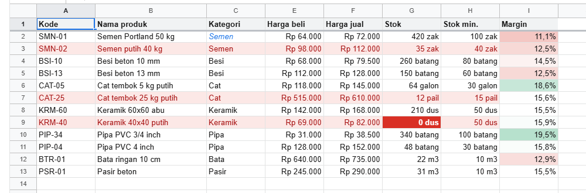

# 6. Format, locale, dan conditional formatting

[Daftar isi](../README.md#daftar-isi) · Sebelumnya: [5. Rumus](05-rumus.md) · Berikutnya: [7. Data](07-data.md)

Format mengatur **cara angka ditampilkan**, bukan nilainya. Sel berisi 72000 dengan format uang tampil `Rp 72.000`, tetapi rumus yang membacanya tetap
mendapat 72000. Conditional formatting mengatur **warna** menurut isi: stok habis merah, margin tebal hijau. Isi selnya juga tidak berubah.

- [6.1 Jenis format](#61-jenis-format)
- [6.2 Format kolom dan satuan dari kolom lain](#62-format-kolom-dan-satuan-dari-kolom-lain)
- [6.3 Locale](#63-locale)
- [6.4 Conditional formatting](#64-conditional-formatting)

## 6.1 Jenis format

Format adalah bagian dari gaya sel (`setStyle(range, { format })`) atau props kolom (`setColProps(kolom, { format })`, 6.2). Semua jenisnya dengan angka
yang biasa ada di toko:

<!-- contoh: 06-format.js -->
```js
import { createWorkbook } from '@kufayeka/sheet/core';

// Setiap jenis format, dengan angka yang biasa ada di toko: harga, margin, tanggal transaksi, jam buka, lama antar barang, kode barang.
const wb = createWorkbook();
wb.setSettings({ locale: 'id-ID', currency: 'IDR' });
const sh = wb.sheet('Sheet1');

const contoh = [
    ['tanpa format', 1234567.891, { type: 'general' }],
    ['angka', 1234567.891, { type: 'number', decimals: 2 }],
    ['angka tanpa ribuan', 2026, { type: 'number', decimals: 0, thousands: false }],
    ['harga', 72000, { type: 'money', decimals: 0 }],
    ['harga dolar', 4.75, { type: 'money', currency: 'USD', decimals: 2 }],
    ['rugi dalam kurung', -1250000, { type: 'money', decimals: 0, negative: 'parens' }],
    ['margin', 0.1111, { type: 'percent', decimals: 1 }],
    ['ilmiah', 123456789, { type: 'scientific', decimals: 2 }],
    ['tanggal', 46322, { type: 'date' }],
    ['tanggal panjang', 46322, { type: 'date', pattern: 'dddd, d MMMM yyyy' }],
    ['tanggal dan jam', 46322.6875, { type: 'datetime' }],
    ['jam', 0.333333, { type: 'time', pattern: 'HH:mm' }],
    ['lama (hari)', 1.25, { type: 'duration' }],
    ['dengan akhiran', 40, { type: 'number', decimals: 0, suffix: ' zak' }],
    ['dengan awalan', 12, { type: 'number', decimals: 0, prefix: 'Rak ' }],
    ['pola sendiri', -42500, { type: 'custom', pattern: '#,##0;[Red](#,##0);"-"' }],
    ['pola sendiri, nol', 0, { type: 'custom', pattern: '#,##0;[Red](#,##0);"-"' }],
    ['teks', '0081234', { type: 'text' }]
];
contoh.forEach(([nama, nilai, format], i) => {
    // format dulu, baru isi: dengan format teks, "0081234" tetap teks dan nol di depannya tidak hilang
    sh.setStyle({ r1: i, c1: 1, r2: i, c2: 1 }, { format });
    sh.setValues(i, 0, [[nama, nilai]]);
    const d = sh.display(i, 1);
    console.log(nama.padEnd(19), JSON.stringify(format).padEnd(58), '->', d.text + (d.color ? '  (warna ' + d.color + ')' : ''));
});
```
<!-- /contoh -->

<!-- hasil: 06-format.js -->
```text
tanpa format        {"type":"general"}                                         -> 1234567,891
angka               {"type":"number","decimals":2}                             -> 1.234.567,89
angka tanpa ribuan  {"type":"number","decimals":0,"thousands":false}           -> 2026
harga               {"type":"money","decimals":0}                              -> Rp 72.000
harga dolar         {"type":"money","currency":"USD","decimals":2}             -> $4,75
rugi dalam kurung   {"type":"money","decimals":0,"negative":"parens"}          -> (Rp 1.250.000)
margin              {"type":"percent","decimals":1}                            -> 11,1%
ilmiah              {"type":"scientific","decimals":2}                         -> 1,23E+08
tanggal             {"type":"date"}                                            -> 27/10/2026
tanggal panjang     {"type":"date","pattern":"dddd, d MMMM yyyy"}              -> Selasa, 27 Oktober 2026
tanggal dan jam     {"type":"datetime"}                                        -> 27/10/2026 16:30:00
jam                 {"type":"time","pattern":"HH:mm"}                          -> 08:00
lama (hari)         {"type":"duration"}                                        -> 30:00:00
dengan akhiran      {"type":"number","decimals":0,"suffix":" zak"}             -> 40 zak
dengan awalan       {"type":"number","decimals":0,"prefix":"Rak "}             -> Rak 12
pola sendiri        {"type":"custom","pattern":"#,##0;[Red](#,##0);\"-\""}     -> (42.500)  (warna red)
pola sendiri, nol   {"type":"custom","pattern":"#,##0;[Red](#,##0);\"-\""}     -> -
teks                {"type":"text"}                                            -> 0081234
```
<!-- /hasil -->

| `type` | Pilihan | Keterangan |
|---|---|---|
| `general` | | seperti diketik, sampai 15 digit |
| `number` | `decimals` (bawaan 2), `thousands` (pemisah ribuan, bawaan `true`) | |
| `money` | `decimals` (bawaan 2), `currency` (bawaan: mata uang workbook), `symbol` (simbol sendiri, misalnya `'IDR'`), `symbolSpace: false` | rumus di sel uang dibulatkan ke `decimals`. Simbol diletakkan di sisi yang dipakai locale |
| `percent` | `decimals` | 0,1111 tampil `11,1%` |
| `scientific` | `decimals` | |
| `date`, `time`, `datetime` | `pattern` (bawaan: pola locale) | lihat huruf pola di bawah |
| `duration` | | jam bisa lebih dari 24: `1.25` hari tampil `30:00:00` |
| `text` | | yang diketik disimpan sebagai teks: kode `0081234` tetap dengan nol di depannya. Pasang formatnya **sebelum** isinya ditulis |
| `custom` | `pattern` | kode format seperti Excel, lihat di bawah |

Pilihan untuk format angka (`number`, `money`, `percent`, `scientific`, `general`):

| Kunci | Artinya | Contoh |
|---|---|---|
| `prefix` | teks di depan angka | `'Rak '` → `Rak 12` |
| `suffix` | teks di belakang angka | `' zak'` → `40 zak` |
| `suffixFrom` | id kolom yang teksnya di baris yang sama menjadi akhiran (6.2) | `stok.colId(3)` |
| `negative` | angka negatif: `'minus'` (bawaan) → `-1.250`, `'parens'` → `(1.250)`, `'red'` → merah | |

Awalan dan akhiran hanya menempel ke angka. Judul kolom yang berupa teks tetap tampil apa adanya.

**Huruf pola tanggal dan jam.** Huruf besar dan kecil dibedakan: `M` bulan, `m` menit.

| Huruf | Artinya | Huruf | Artinya |
|---|---|---|---|
| `d`, `dd` | tanggal: `7`, `07` | `H`, `HH` | jam 0-23: `9`, `09` |
| `ddd`, `dddd` | nama hari menurut locale: `Sel`, `Selasa` | `h`, `hh` | jam 1-12, dipakai dengan `a` |
| `M`, `MM` | bulan: `3`, `03` | `m`, `mm` | menit |
| `MMM`, `MMMM` | nama bulan: `Okt`, `Oktober` | `s`, `ss` | detik |
| `yy`, `yyyy` | tahun: `26`, `2026` | `a` | `AM` atau `PM` |

Teks di dalam pola ditulis dengan tanda kutip: `'"Jam" HH:mm'`. Jam dibulatkan ke detik sebelum ditampilkan, sama seperti Excel, jadi 8:00 yang
tersimpan sebagai 0,333333 tetap tampil `08:00`.

**Kode format `custom`.** Sama dengan kode format Excel, dengan sampai empat bagian dipisah `;` (positif; negatif; nol; teks):

| Kode | Artinya |
|---|---|
| `0` | satu digit, selalu tampil (`000` → `007`) |
| `#` | satu digit, tampil kalau ada |
| `,` di bagian bulat | pemisah ribuan (tampil menurut locale: titik di Indonesia) |
| `.` | tanda desimal (tampil menurut locale: koma di Indonesia) |
| `%` | dikali 100 dan diberi `%` |
| `E+00` | ilmiah |
| `"teks"` atau `\x` | teks apa adanya |
| `@` | isi teks sel itu sendiri |
| `[Red]`, `[Blue]`, `[Green]`, ... | warna untuk bagian itu |

Contoh: `#,##0;[Red](#,##0);"-"` menampilkan positif biasa, negatif merah dalam kurung, dan nol sebagai tanda strip, sesuai yang biasa dipakai di
laporan keuangan.

Di layar, format dipilih lewat toolbar (`Rp`, `%`, `.0←`, `.00→`, `123`) dan menu Format → Number. `FORMAT_PRESETS` dari `@kufayeka/sheet/core` berisi
format siap pakai yang sama dengan menu itu, dan `formatValue(nilai, format, { locale, currency })` menampilkan sebuah nilai tanpa workbook (misalnya untuk
email atau PDF buatanmu sendiri).

## 6.2 Format kolom dan satuan dari kolom lain

<!-- contoh: 06-kolom.js -->
```js
import { createWorkbook } from '@kufayeka/sheet/core';
import { PRODUK, KOLOM_PRODUK } from './data/toko.js';

// Format di kolom, dan jumlah stok yang tampil dengan satuannya sendiri (zak, batang, dus) dari kolom Satuan di baris yang sama.
const wb = createWorkbook();
wb.setSettings({ locale: 'id-ID', currency: 'IDR' });
const stok = wb.sheet('Sheet1');
stok.setValues('A1', [KOLOM_PRODUK, ...PRODUK.slice(0, 6)]);

// format di kolom: berlaku untuk semua sel kolom itu, termasuk baris yang ditambah nanti
stok.setColProps('E:F', { format: { type: 'money', decimals: 0 } });
// akhiran diambil dari kolom D (Satuan) di baris yang sama. Disimpan sebagai id kolom, jadi tetap benar walau kolom dipindah
stok.setColProps('G:H', { format: { type: 'number', decimals: 0, suffixFrom: stok.colId(3) } });
stok.setColProps('D', { hidden: true });                 // satuan sudah tampil di stok: kolomnya boleh disembunyikan

for (let r = 2; r <= 7; r++) console.log(stok.value('B' + r).padEnd(24), stok.display('F' + r).text.padStart(11), '| stok', stok.display('G' + r).text.padEnd(12), '| min', stok.display('H' + r).text);
stok.setValues('G9', '=SUM(G2:G7)');
console.log('nilai G2 tetap angka:', stok.value('G2'), '| jumlah G2:G7 =', stok.value('G9'));

// sel yang punya format sendiri memakai formatnya sendiri, bukan format kolom
stok.setValues('A8', [['PRM-01', 'Promo semen (paket)', 'Semen', 'paket', 0, 0.15, 5, 0]]);
stok.setStyle('F8', { format: { type: 'percent', decimals: 0 } });
console.log('baris baru          :', stok.display('E8').text, '|', stok.display('F8').text, '(format sendiri) |', stok.display('G8').text);
```
<!-- /contoh -->

<!-- hasil: 06-kolom.js -->
```text
Semen Portland 50 kg       Rp 72.000 | stok 420 zak      | min 100 zak
Semen putih 40 kg         Rp 112.000 | stok 35 zak       | min 40 zak
Besi beton 10 mm           Rp 79.500 | stok 260 batang   | min 80 batang
Besi beton 13 mm          Rp 128.000 | stok 150 batang   | min 60 batang
Cat tembok 5 kg putih     Rp 145.000 | stok 64 galon     | min 30 galon
Cat tembok 25 kg putih    Rp 610.000 | stok 12 pail      | min 15 pail
nilai G2 tetap angka: 420 | jumlah G2:G7 = 941
baris baru          : Rp 0 | 15% (format sendiri) | 5 paket
```
<!-- /hasil -->

- `setColProps(kolom, { format })` memberi format bawaan untuk seluruh kolom, termasuk baris yang ditambah nanti. Sel yang punya format sendiri
  (`setStyle`) tetap memakai formatnya sendiri, seperti F8 di contoh.
- `suffixFrom: idKolom` menempelkan isi kolom lain di baris yang sama sebagai akhiran: stok semen tampil `420 zak`, stok besi `260 batang`. Nilainya tetap
  angka, jadi tetap bisa dijumlahkan. Kolom asalnya disimpan sebagai id, jadi tetap benar walaupun kolom dipindah atau disisipi kolom lain. Kolom asalnya
  boleh disembunyikan.

## 6.3 Locale

Locale mengatur pemisah desimal dan ribuan, urutan hari-bulan-tahun, nama bulan dan hari, serta letak simbol uang. Locale berlaku untuk tampilan **dan**
untuk membaca yang diketik orang:

<!-- contoh: 06-locale.js -->
```js
import { createWorkbook } from '@kufayeka/sheet/core';

// Nota yang sama untuk cabang di negara lain: tampilan dan cara membaca ketikan ikut locale workbook.
const negara = [
    { locale: 'id-ID', currency: 'IDR', ketikHarga: '72.000', ketikTanggal: '27/10/2026', ketikDiskon: '1,5%' },
    { locale: 'en-US', currency: 'USD', ketikHarga: '72,000', ketikTanggal: '10/27/2026', ketikDiskon: '1.5%' },
    { locale: 'de-DE', currency: 'EUR', ketikHarga: '72.000', ketikTanggal: '27.10.2026', ketikDiskon: '1,5%' },
    { locale: 'ja-JP', currency: 'JPY', ketikHarga: '72,000', ketikTanggal: '2026/10/27', ketikDiskon: '1.5%' }
];
for (const { locale, currency, ketikHarga, ketikTanggal, ketikDiskon } of negara) {
    const wb = createWorkbook();
    wb.setSettings({ locale, currency });
    const nota = wb.sheet('Sheet1');
    nota.setColProps('B', { format: { type: 'money', decimals: 2 } });
    // seperti orang mengetik di sel: teks dibaca menurut locale (source 'user' sama dengan mengetik di layar)
    nota.setValues('A1', [[ketikTanggal, ketikHarga, ketikDiskon]], { source: 'user' });
    nota.setValues('B2', '=B1*40');
    console.log(locale, '| ketik', ketikTanggal.padEnd(10), '->', nota.value('A1'), nota.display('A1').text.padEnd(10),
        '| ketik', ketikHarga, '->', String(nota.value('B1')).padEnd(5), '| x 40 =', nota.display('B2').text.padEnd(16), '| diskon', nota.value('C1'), nota.display('C1').text);
}
```
<!-- /contoh -->

<!-- hasil: 06-locale.js -->
```text
id-ID | ketik 27/10/2026 -> 46322 27/10/2026 | ketik 72.000 -> 72000 | x 40 = Rp 2.880.000,00  | diskon 0.015 1,5%
en-US | ketik 10/27/2026 -> 46322 10/27/2026 | ketik 72,000 -> 72000 | x 40 = $2,880,000.00    | diskon 0.015 1.5%
de-DE | ketik 27.10.2026 -> 46322 27.10.2026 | ketik 72.000 -> 72000 | x 40 = 2.880.000,00 €   | diskon 0.015 1,5%
ja-JP | ketik 2026/10/27 -> 46322 2026/10/27 | ketik 72,000 -> 72000 | x 40 = ￥2,880,000.00    | diskon 0.015 1.5%
```
<!-- /hasil -->

- Diatur lewat `wb.setSettings({ locale, currency })`, atau di layar lewat File → Spreadsheet settings. Kodenya adalah kode BCP 47 yang dikenal browser
  dan Node: `id-ID`, `en-US`, `en-GB`, `de-DE`, `fr-FR`, `ja-JP`, dan seterusnya. Semuanya dibaca dari `Intl` milik browser, jadi locale apa pun yang
  dikenal browser bisa dipakai tanpa tambahan data.
- Ketikan dibaca menurut locale kalau datang dari orang: diketik di sel, di-paste, atau ditulis kode dengan `{ source: 'user' }`. Dengan `id-ID`,
  `72.000` adalah tujuh puluh dua ribu, dan `27/10/2026` adalah tanggal. Tanggal yang diawali tahun empat digit (`2026-10-27`, `2026/10/27`) dibaca di
  locale mana pun.
- Rumus **tidak** ikut locale: angka di dalam rumus selalu memakai titik desimal, dan argumennya selalu dipisah koma ([5.1](05-rumus.md#51-rumus-itu-apa)).
- Mengganti locale tidak mengubah satu nilai pun. Hanya tampilannya yang berubah.

## 6.4 Conditional formatting

Daftar stok yang menandai dirinya sendiri: stok habis merah tua, stok di bawah minimum merah muda sebaris penuh, margin dari tipis ke tebal dengan skala
merah-putih-hijau, dan kategori Semen dimiringkan:

<!-- contoh: 06-kondisional.js -->
```js
import { createWorkbook } from '@kufayeka/sheet/core';
import { PRODUK, KOLOM_PRODUK } from './data/toko.js';

// Daftar stok yang memberi tanda sendiri: stok habis, stok di bawah minimum, margin tipis sampai tebal, kategori tertentu.
// Aturannya disimpan di sheet. Isi sel tidak diubah, warnanya dihitung saat sel digambar.
export function buatStok() {
    const wb = createWorkbook();
    wb.setSettings({ locale: 'id-ID', currency: 'IDR' });
    const stok = wb.sheet('Sheet1');
    stok.setSheetProps({ name: 'Stok', freezeRows: 1 });
    stok.setValues('A1', [[...KOLOM_PRODUK, 'Margin']]);
    stok.setValues('A2', PRODUK.map((p, i) => [...p, `=(F${i + 2}-E${i + 2})/F${i + 2}`]));
    stok.setColProps('E:F', { format: { type: 'money', decimals: 0 } });
    stok.setColProps('G:H', { format: { type: 'number', decimals: 0, suffixFrom: stok.colId(3) } });
    stok.setColProps('I', { format: { type: 'percent', decimals: 1 } });
    stok.setStyle('A1:I1', { bold: true, fill: '#f1f3f4' });
    stok.setColProps('B', { width: 190 });
    stok.setColProps('D', { hidden: true });             // satuan sudah tampil di kolom stok

    // urutan penting: aturan pertama yang cocok yang dipakai. Stok habis diperiksa sebelum stok kurang
    stok.addConditional('G2:G13', { op: 'eq', a: 0, style: { fill: '#d93025', color: '#ffffff', bold: true } });
    // rumus untuk sel kiri atas range (A2). Bagian tanpa $ bergeser untuk sel lain: baris 3 memeriksa $G3 < $H3
    stok.addConditional('A2:H13', { op: 'formula', formula: '=$G2<$H2', style: { fill: '#fce8e6', color: '#a50e0e' } });
    // skala warna: margin terkecil merah muda, tengah putih, terbesar hijau
    stok.addConditional('I2:I13', { kind: 'scale',
        min: { type: 'min', color: '#f4c7c3' }, mid: { type: 'percentile', value: 50, color: '#ffffff' }, max: { type: 'max', color: '#b7e1cd' } });
    stok.addConditional('C2:C13', { op: 'textIs', a: 'Semen', style: { italic: true, color: '#1a73e8' } });
    return wb;
}

const wb = buatStok();
const stok = wb.sheet('Stok');
const tanda = (a) => { const s = stok.shownStyle(a); return s ? JSON.stringify(s) : '-'; };
console.log('aturan        :', stok.conditionals().map((r) => r.kind === 'scale' ? 'skala' : r.op).join(', '));
console.log('G9  stok 0    :', tanda('G9'));
console.log('B3  kurang    :', tanda('B3'), '(stok', stok.value('G3'), '< min', stok.value('H3') + ')');
console.log('B2  aman      :', tanda('B2'));
console.log('I   margin    :', ['I2', 'I9', 'I6'].map((a) => stok.display(a).text + ' ' + (stok.shownStyle(a) || {}).fill).join(' | '));
console.log('isi G9 tetap  :', stok.value('G9'), '| gaya tersimpan:', stok.style('G9') || 'tidak ada');

// stok datang: tandanya hilang sendiri
stok.setValues('G3', 120);
console.log('stok datang   :', tanda('B3'));

// aturan diubah dan diurutkan ulang
const habis = stok.conditionals()[0].id;
stok.setConditional(habis, 'G2:G13', { op: 'lte', a: 5, style: { fill: '#d93025', color: '#ffffff', bold: true } });
stok.moveConditional(habis, 3);
console.log('urutan baru   :', stok.conditionals().map((r) => r.kind === 'scale' ? 'skala' : r.op).join(', '));
stok.removeConditional(habis);
console.log('setelah hapus :', stok.conditionals().length, 'aturan | G9:', tanda('G9'));
```
<!-- /contoh -->

<!-- hasil: 06-kondisional.js -->
```text
aturan        : eq, formula, skala, textIs
G9  stok 0    : {"bold":true,"color":"#ffffff","fill":"#d93025"}
B3  kurang    : {"color":"#a50e0e","fill":"#fce8e6"} (stok 35 < min 40)
B2  aman      : -
I   margin    : 11,1% #f4c7c3 | 15,9% #f9fcfb | 18,6% #c7e7d8
isi G9 tetap  : 0 | gaya tersimpan: tidak ada
stok datang   : -
urutan baru   : formula, skala, textIs, lte
setelah hapus : 3 aturan | G9: {"color":"#a50e0e","fill":"#fce8e6"}
```
<!-- /hasil -->

Ditampilkan di `<Sheet>`:

<!-- contoh: 06-kondisional.page.js -->
```jsx
import { useState } from 'react';
import { Sheet } from '@kufayeka/sheet';
import '@kufayeka/sheet/style.css';
import { buatStok } from './06-kondisional.js';

export default function HalamanStok() {
    const [wb] = useState(buatStok);
    return <div style={{ height: 480 }}><Sheet workbook={wb} /></div>;
}
```
<!-- /contoh -->



Cara kerjanya:

- **Aturan disimpan di sheet, isi sel tidak diubah.** `style('G9')` tetap kosong, sedangkan `shownStyle('G9')` memberi warna yang digambar. Begitu stok
  datang, tandanya hilang sendiri.
- **Aturan pertama yang cocok yang dipakai.** Itu sebabnya "Semen" di baris SMN-02 berwarna merah, bukan biru miring: aturan stok kurang ada di urutan
  sebelum aturan kategori. Urutannya diubah dengan `moveConditional`.
- **Range aturan mengikuti barisnya.** Baris disisipkan di tengah, aturan ikut melebar. Baris di ujung dihapus, aturan menyusut.
- **Ikut ke Excel.** Aturan-aturan ini diekspor ke `.xlsx` sebagai conditional formatting Excel dan dibaca kembali saat impor ([bab 15](15-excel.md)).
- Di layar, aturan dibuat lewat Format → Conditional formatting, dengan panel di sebelah kanan.

**Jenis aturan.** Aturan satu warna (`op`) memberi gaya kalau syaratnya terpenuhi:

| `op` | Syarat | `a`, `b` |
|---|---|---|
| `empty`, `notEmpty` | sel kosong, sel berisi | |
| `textContains`, `textNotContains`, `textStarts`, `textEnds`, `textIs` | teks memuat, tidak memuat, diawali, diakhiri, sama dengan | teks (huruf besar dan kecil tidak dibedakan) |
| `gt`, `gte`, `lt`, `lte`, `eq`, `ne` | lebih dari, lebih dari atau sama, kurang dari, kurang dari atau sama, sama, tidak sama | angka |
| `between`, `notBetween` | di antara `a` dan `b` (termasuk ujungnya), di luarnya | angka |
| `dateIs`, `dateBefore`, `dateAfter` | tanggal pada, sebelum, sesudah | nomor hari, atau `'today'`, `'yesterday'`, `'tomorrow'`, `'pastWeek'`, `'pastMonth'`, `'pastYear'` |
| `formula` | rumus menghasilkan `TRUE` | `formula: '=$G2<$H2'`, ditulis untuk sel kiri atas range |

`style` aturan satu warna boleh berisi `bold`, `italic`, `underline`, `strike`, `color`, dan `fill`.

Aturan `formula` adalah yang paling kuat. Rumusnya ditulis untuk sel kiri atas range, lalu bergeser untuk sel lain seperti rumus yang di-fill. `$G2`
mengunci kolom G, jadi setiap sel di baris 3 memeriksa `$G3<$H3`, dan seluruh baris ikut berwarna.

**Skala warna** (`kind: 'scale'`) mewarnai latar menurut angka, dari warna `min` ke `max`, dengan `mid` yang boleh tidak diisi. Setiap titik punya
`type`: `'min'` atau `'max'` (nilai terkecil atau terbesar di range), `'number'` (angka `value`), `'percent'` (`value` persen dari rentang), atau
`'percentile'` (persentil `value`).

| Fungsi | Artinya |
|---|---|
| `addConditional(range, aturan)` | tambah aturan di urutan paling belakang. `range` boleh beberapa: `'A2:A20, C2:C20'`. Mengembalikan id |
| `setConditional(id, range, aturan)` | ganti aturan dan range-nya |
| `moveConditional(id, ke)` | pindahkan ke urutan `ke` (0 = paling depan) |
| `removeConditional(id)` | hapus aturan |
| `conditionals()` | daftar aturan sheet, urut |
| `shownStyle(alamat)` | gaya yang digambar: gaya sel ditambah hasil aturan |
| `conditionalStyleAt(alamat)` | hanya bagian dari aturan, atau `null` |

[Daftar isi](../README.md#daftar-isi) · Sebelumnya: [5. Rumus](05-rumus.md) · Berikutnya: [7. Data](07-data.md)
