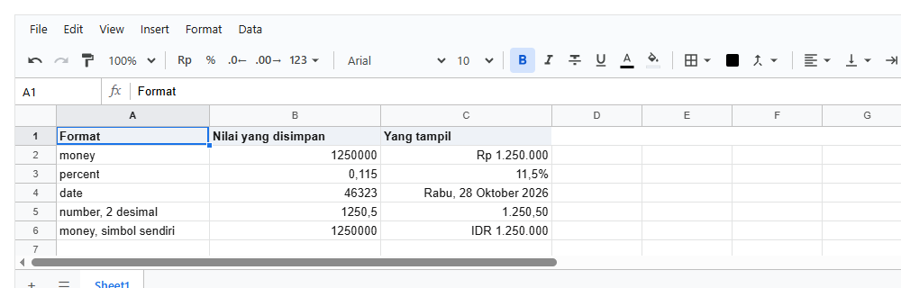
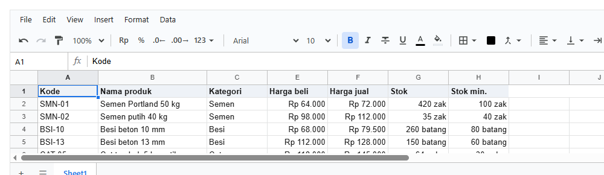
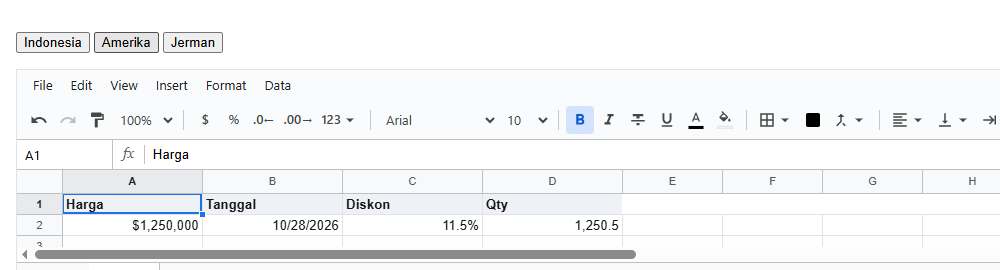
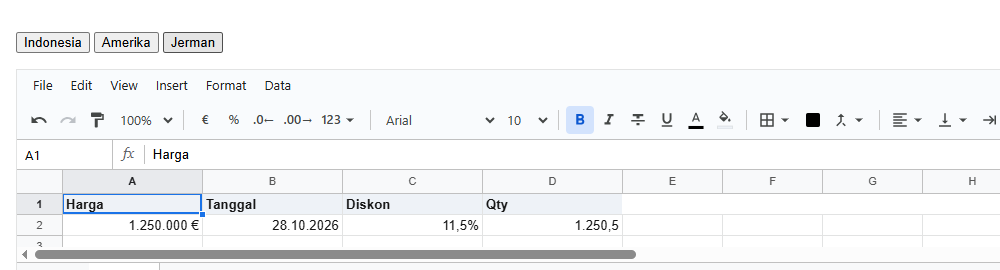
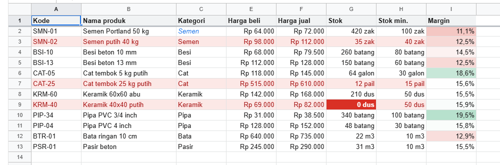

# 06. Format Sel, Locale & Conditional Formatting

[Daftar isi](../README.md#daftar-isi) · Sebelumnya: [05. Formula Calculation Engine](05-rumus.md) · Berikutnya: [07. Operasi Data](07-data.md)

Bab ini mengulas engine pemformatan data `@kufayeka/sheet`: pemisahan tegas antara representasi nilai asli (*raw value*) dan tampilan terformat (*display*), hierarki format sel vs kolom, lokalisasi internasional (`id-ID`, `en-US`, `de-DE`), custom number pattern, format tanggal/waktu, serta aturan pewarnaan berbasis kondisi (**Conditional Formatting**).

---

## 1. Prinsip Utama: Format Mengubah Tampilan, Bukan Nilai

Dalam arsitektur spreadsheet, **format tidak pernah memodifikasi nilai komputasi asli (*underlying value*)**:

- Sel `E2` menyimpan angka numerik murni `30240000`.
- Format mata uang (`money`) menampilkannya sebagai teks `Rp 30.240.000`.
- Formula lain yang mereferensikan sel `E2` tetap menerima angka `30240000` untuk komputasi matematika presisi.

```text
                             ┌───────────────────────────────┐
                     ──────► │ Komputasi Formula (=E2 * 1.1) │
                     │       │ (menerima angka numerik murni)│
┌────────────────────┴─────┐ └───────────────────────────────┘
│ Nilai Mentah (Raw Value) │
│ 30240000 (tipe number)   │ ┌───────────────────────────────┐
└────────────────────┬─────┘ │ Format Engine (IDR, id-ID)    │
                     └─────► │ Tampilan Visual (Display)     │
                             │ 'Rp 30.240.000' (hanya teks)  │
                             └───────────────────────────────┘
```

> **Aturan Penting**: Jangan menyimpan nilai nominal sebagai string manual (misal: `'Rp 72.000'`). Selalu simpan sebagai angka numerik (`72000`) lalu terapkan format `money`.

---

## 2. Hierarki Format: Sel vs Kolom

Format dapat diterapkan pada dua tingkatan:

1. **Format Tingkat Kolom (`sheet.setColProps`)**: Berlaku sebagai format default untuk seluruh sel di kolom tersebut. Sangat efisien karena menghemat alokasi memori metadata sel.
2. **Format Tingkat Sel (`sheet.setStyle`)**: Diterapkan spesifik pada sel atau range tertentu. Format sel memiliki prioritas lebih tinggi dan menimpa (*override*) format kolom.

---

## 3. Implementasi Langkah demi Langkah

---

### 3.1 Format Angka Dasar: Uang, Persentase, Tanggal, dan Desimal

Format angka dapat diterapkan secara deklaratif pada sel:

<!-- contoh: 06-03-angka.page.tsx -->
```tsx
import { useState } from 'react';
import { Sheet } from '@kufayeka/sheet';
import { createWorkbook } from '@kufayeka/sheet/core';
import '@kufayeka/sheet/style.css';

// 6.3 Format angka: nilai yang sama, ditampilkan sebagai uang, persen, tanggal, dan angka dengan desimal.
function buat() {
    const wb = createWorkbook();
    wb.setSettings({ locale: 'id-ID', currency: 'IDR' });
    const s = wb.sheet('Sheet1');
    s.setValues('A1', [
        ['Format', 'Nilai yang disimpan', 'Yang tampil'],
        ['money', 1250000, 1250000],
        ['percent', 0.115, 0.115],
        ['date', 46323, 46323],
        ['number, 2 desimal', 1250.5, 1250.5],
        ['money, simbol sendiri', 1250000, 1250000]
    ]);
    s.setStyle('A1:C1', { bold: true, fill: '#eef2f7' });
    // baru: satu format per sel di kolom C; kolom B dibiarkan tanpa format, supaya terlihat nilai aslinya
    s.setStyle('C2', { format: { type: 'money', decimals: 0 } });
    s.setStyle('C3', { format: { type: 'percent', decimals: 1 } });
    s.setStyle('C4', { format: { type: 'date', pattern: 'dddd, d MMMM yyyy' } });
    s.setStyle('C5', { format: { type: 'number', decimals: 2 } });
    s.setStyle('C6', { format: { type: 'money', decimals: 0, symbol: 'IDR' } });
    s.setColProps('A', { width: 170 });
    s.setColProps('B:C', { width: 190 });
    return wb;
}

export default function Halaman() {
    const [wb] = useState(buat);
    return <div style={{ height: 320 }}><Sheet workbook={wb} /></div>;
}
```
<!-- /contoh -->



---

### 3.2 Format Kolom Penuh & Custom Suffix Satuan

Menerapkan format pada seluruh kolom dan menambahkan unit satuan fisik tanpa mengubah tipe data numeriknya:

<!-- contoh: 06-04-kolom.page.tsx -->
```tsx
import { useState } from 'react';
import { Sheet } from '@kufayeka/sheet';
import { createWorkbook } from '@kufayeka/sheet/core';
import '@kufayeka/sheet/style.css';
import { PRODUK, KOLOM_PRODUK } from './data/toko.js';

// 6.4 Format satu kolom, dan stok yang tampil dengan satuannya sendiri (zak, batang, dus) dari kolom Satuan di baris yang sama.
function buat() {
    const wb = createWorkbook();
    wb.setSettings({ locale: 'id-ID', currency: 'IDR' });
    const s = wb.sheet('Sheet1');
    s.setValues('A1', [KOLOM_PRODUK, ...PRODUK.slice(0, 6)]);
    s.setStyle('A1:H1', { bold: true, fill: '#eef2f7' });
    // baru: format di kolom berlaku untuk semua selnya, termasuk baris yang ditambah nanti
    s.setColProps('E:F', { format: { type: 'money', decimals: 0 } });
    // baru: akhiran diambil dari kolom D (Satuan) di baris yang sama
    s.setColProps('G:H', { format: { type: 'number', decimals: 0, suffixFrom: s.colId(3) } });
    s.setColProps('D', { hidden: true });                   // satuannya sudah tampil di stok
    s.setColProps('B', { width: 180 });
    return wb;
}

export default function Halaman() {
    const [wb] = useState(buat);
    return <div style={{ height: 290 }}><Sheet workbook={wb} /></div>;
}
```
<!-- /contoh -->



> **Mekanisme `suffixFrom`**: `suffixFrom: s.colId(colIndex)` menautkan akhiran teks pada baris yang sama secara dinamis. Nilai sel tetap berupa angka murni sehingga operasi formula perkalian `=D2*E2` berjalan normal tanpa error parsing.

---

### 3.3 Konfigurasi Locale & Multilingual

Pengaturan locale mengontrol pemisah ribuan, desimal, format tanggal default, dan simbol mata uang:

<!-- contoh: 06-05-locale.page.tsx -->
```tsx
import { useState } from 'react';
import { Sheet } from '@kufayeka/sheet';
import { createWorkbook } from '@kufayeka/sheet/core';
import '@kufayeka/sheet/style.css';

// 6.5 Locale: isi yang sama, ditulis menurut kebiasaan negara lain. Tombol mengganti locale dan mata uang workbook.
function buat() {
    const wb = createWorkbook();
    wb.setSettings({ locale: 'id-ID', currency: 'IDR' });
    const s = wb.sheet('Sheet1');
    s.setValues('A1', [['Harga', 'Tanggal', 'Diskon', 'Qty'], [1250000, 46323, 0.115, 1250.5]]);
    s.setStyle('A1:D1', { bold: true, fill: '#eef2f7' });
    s.setStyle('A2', { format: { type: 'money', decimals: 0 } });
    s.setStyle('B2', { format: { type: 'date' } });
    s.setStyle('C2', { format: { type: 'percent', decimals: 1 } });
    s.setStyle('D2', { format: { type: 'number', decimals: 1 } });
    s.setColProps('A:D', { width: 140 });
    return wb;
}

export default function Halaman() {
    const [wb] = useState(buat);
    return (
        <div>
            <p>
                {/* baru: setSettings mengganti locale dan mata uang; semua sel ikut ditampilkan ulang */}
                <button className="id" onClick={() => wb.setSettings({ locale: 'id-ID', currency: 'IDR' })}>Indonesia</button>{' '}
                <button className="us" onClick={() => wb.setSettings({ locale: 'en-US', currency: 'USD' })}>Amerika</button>{' '}
                <button className="de" onClick={() => wb.setSettings({ locale: 'de-DE', currency: 'EUR' })}>Jerman</button>
            </p>
            <div style={{ height: 230 }}><Sheet workbook={wb} /></div>
        </div>
    );
}
```
<!-- /contoh -->





---

### 3.4 Pewarnaan Bersyarat (Conditional Formatting)

Conditional Formatting mengevaluasi aturan secara dinamis dan menerapkan styling visual jika kriteria terpenuhi:

<!-- contoh: 06-kondisional.page.js -->
```jsx
import { useState } from 'react';
import { Sheet } from '@kufayeka/sheet';
import '@kufayeka/sheet/style.css';
import { buatStok } from './06-kondisional.js';

export default function HalamanStok() {
    const [wb] = useState(buatStok);
    return <div style={{ height: 480 }}><Sheet workbook={wb} /></div>;
}
```
<!-- /contoh -->



---

## 4. Evaluasi Programatis via Core Engine

Di bawah ini adalah pengujian langsung terhadap engine format dan conditional formatting pada runtime Node.js:

### Format Standar & Custom Number Pattern

<!-- contoh: 06-format.js -->
```js
import { createWorkbook } from '@kufayeka/sheet/core';

// Setiap jenis format, dengan angka yang biasa ada di toko: harga, margin, tanggal transaksi, jam buka, lama antar barang, kode barang.
const wb = createWorkbook();
wb.setSettings({ locale: 'id-ID', currency: 'IDR' });
const sh = wb.sheet('Sheet1');

const contoh = [
    ['tanpa format', 1234567.891, { type: 'general' }],
    ['angka', 1234567.891, { type: 'number', decimals: 2 }],
    ['angka tanpa ribuan', 2026, { type: 'number', decimals: 0, thousands: false }],
    ['harga', 72000, { type: 'money', decimals: 0 }],
    ['harga dolar', 4.75, { type: 'money', currency: 'USD', decimals: 2 }],
    ['rugi dalam kurung', -1250000, { type: 'money', decimals: 0, negative: 'parens' }],
    ['margin', 0.1111, { type: 'percent', decimals: 1 }],
    ['ilmiah', 123456789, { type: 'scientific', decimals: 2 }],
    ['tanggal', 46322, { type: 'date' }],
    ['tanggal panjang', 46322, { type: 'date', pattern: 'dddd, d MMMM yyyy' }],
    ['tanggal dan jam', 46322.6875, { type: 'datetime' }],
    ['jam', 0.333333, { type: 'time', pattern: 'HH:mm' }],
    ['lama (hari)', 1.25, { type: 'duration' }],
    ['dengan akhiran', 40, { type: 'number', decimals: 0, suffix: ' zak' }],
    ['dengan awalan', 12, { type: 'number', decimals: 0, prefix: 'Rak ' }],
    ['pola sendiri', -42500, { type: 'custom', pattern: '#,##0;[Red](#,##0);"-"' }],
    ['pola sendiri, nol', 0, { type: 'custom', pattern: '#,##0;[Red](#,##0);"-"' }],
    ['teks', '0081234', { type: 'text' }]
];
contoh.forEach(([nama, nilai, format], i) => {
    // format dulu, baru isi: dengan format teks, "0081234" tetap teks dan nol di depannya tidak hilang
    sh.setStyle({ r1: i, c1: 1, r2: i, c2: 1 }, { format });
    sh.setValues(i, 0, [[nama, nilai]]);
    const d = sh.display(i, 1);
    console.log(nama.padEnd(19), JSON.stringify(format).padEnd(58), '->', d.text + (d.color ? '  (warna ' + d.color + ')' : ''));
});
```
<!-- /contoh -->

<!-- hasil: 06-format.js -->
```text
tanpa format        {"type":"general"}                                         -> 1234567,891
angka               {"type":"number","decimals":2}                             -> 1.234.567,89
angka tanpa ribuan  {"type":"number","decimals":0,"thousands":false}           -> 2026
harga               {"type":"money","decimals":0}                              -> Rp 72.000
harga dolar         {"type":"money","currency":"USD","decimals":2}             -> $4,75
rugi dalam kurung   {"type":"money","decimals":0,"negative":"parens"}          -> (Rp 1.250.000)
margin              {"type":"percent","decimals":1}                            -> 11,1%
ilmiah              {"type":"scientific","decimals":2}                         -> 1,23E+08
tanggal             {"type":"date"}                                            -> 27/10/2026
tanggal panjang     {"type":"date","pattern":"dddd, d MMMM yyyy"}              -> Selasa, 27 Oktober 2026
tanggal dan jam     {"type":"datetime"}                                        -> 27/10/2026 16:30:00
jam                 {"type":"time","pattern":"HH:mm"}                          -> 08:00
lama (hari)         {"type":"duration"}                                        -> 30:00:00
dengan akhiran      {"type":"number","decimals":0,"suffix":" zak"}             -> 40 zak
dengan awalan       {"type":"number","decimals":0,"prefix":"Rak "}             -> Rak 12
pola sendiri        {"type":"custom","pattern":"#,##0;[Red](#,##0);\"-\""}     -> (42.500)  (warna red)
pola sendiri, nol   {"type":"custom","pattern":"#,##0;[Red](#,##0);\"-\""}     -> -
teks                {"type":"text"}                                            -> 0081234
```
<!-- /hasil -->

---

### Format Kolom, Awalan & Akhiran Satuan

<!-- contoh: 06-kolom.js -->
```js
import { createWorkbook } from '@kufayeka/sheet/core';
import { PRODUK, KOLOM_PRODUK } from './data/toko.js';

// Format di kolom, dan jumlah stok yang tampil dengan satuannya sendiri (zak, batang, dus) dari kolom Satuan di baris yang sama.
const wb = createWorkbook();
wb.setSettings({ locale: 'id-ID', currency: 'IDR' });
const stok = wb.sheet('Sheet1');
stok.setValues('A1', [KOLOM_PRODUK, ...PRODUK.slice(0, 6)]);

// format di kolom: berlaku untuk semua sel kolom itu, termasuk baris yang ditambah nanti
stok.setColProps('E:F', { format: { type: 'money', decimals: 0 } });
// akhiran diambil dari kolom D (Satuan) di baris yang sama. Disimpan sebagai id kolom, jadi tetap benar walau kolom dipindah
stok.setColProps('G:H', { format: { type: 'number', decimals: 0, suffixFrom: stok.colId(3) } });
stok.setColProps('D', { hidden: true });                 // satuan sudah tampil di stok: kolomnya boleh disembunyikan

for (let r = 2; r <= 7; r++) console.log(stok.value('B' + r).padEnd(24), stok.display('F' + r).text.padStart(11), '| stok', stok.display('G' + r).text.padEnd(12), '| min', stok.display('H' + r).text);
stok.setValues('G9', '=SUM(G2:G7)');
console.log('nilai G2 tetap angka:', stok.value('G2'), '| jumlah G2:G7 =', stok.value('G9'));

// sel yang punya format sendiri memakai formatnya sendiri, bukan format kolom
stok.setValues('A8', [['PRM-01', 'Promo semen (paket)', 'Semen', 'paket', 0, 0.15, 5, 0]]);
stok.setStyle('F8', { format: { type: 'percent', decimals: 0 } });
console.log('baris baru          :', stok.display('E8').text, '|', stok.display('F8').text, '(format sendiri) |', stok.display('G8').text);
```
<!-- /contoh -->

<!-- hasil: 06-kolom.js -->
```text
Semen Portland 50 kg       Rp 72.000 | stok 420 zak      | min 100 zak
Semen putih 40 kg         Rp 112.000 | stok 35 zak       | min 40 zak
Besi beton 10 mm           Rp 79.500 | stok 260 batang   | min 80 batang
Besi beton 13 mm          Rp 128.000 | stok 150 batang   | min 60 batang
Cat tembok 5 kg putih     Rp 145.000 | stok 64 galon     | min 30 galon
Cat tembok 25 kg putih    Rp 610.000 | stok 12 pail      | min 15 pail
nilai G2 tetap angka: 420 | jumlah G2:G7 = 941
baris baru          : Rp 0 | 15% (format sendiri) | 5 paket
```
<!-- /hasil -->

---

### Internasionalisasi (Locale Parsing & Rendering)

<!-- contoh: 06-locale.js -->
```js
import { createWorkbook } from '@kufayeka/sheet/core';

// Nota yang sama untuk cabang di negara lain: tampilan dan cara membaca ketikan ikut locale workbook.
const negara = [
    { locale: 'id-ID', currency: 'IDR', ketikHarga: '72.000', ketikTanggal: '27/10/2026', ketikDiskon: '1,5%' },
    { locale: 'en-US', currency: 'USD', ketikHarga: '72,000', ketikTanggal: '10/27/2026', ketikDiskon: '1.5%' },
    { locale: 'de-DE', currency: 'EUR', ketikHarga: '72.000', ketikTanggal: '27.10.2026', ketikDiskon: '1,5%' },
    { locale: 'ja-JP', currency: 'JPY', ketikHarga: '72,000', ketikTanggal: '2026/10/27', ketikDiskon: '1.5%' }
];
for (const { locale, currency, ketikHarga, ketikTanggal, ketikDiskon } of negara) {
    const wb = createWorkbook();
    wb.setSettings({ locale, currency });
    const nota = wb.sheet('Sheet1');
    nota.setColProps('B', { format: { type: 'money', decimals: 2 } });
    // seperti orang mengetik di sel: teks dibaca menurut locale (source 'user' sama dengan mengetik di layar)
    nota.setValues('A1', [[ketikTanggal, ketikHarga, ketikDiskon]], { source: 'user' });
    nota.setValues('B2', '=B1*40');
    console.log(locale, '| ketik', ketikTanggal.padEnd(10), '->', nota.value('A1'), nota.display('A1').text.padEnd(10),
        '| ketik', ketikHarga, '->', String(nota.value('B1')).padEnd(5), '| x 40 =', nota.display('B2').text.padEnd(16), '| diskon', nota.value('C1'), nota.display('C1').text);
}
```
<!-- /contoh -->

<!-- hasil: 06-locale.js -->
```text
id-ID | ketik 27/10/2026 -> 46322 27/10/2026 | ketik 72.000 -> 72000 | x 40 = Rp 2.880.000,00  | diskon 0.015 1,5%
en-US | ketik 10/27/2026 -> 46322 10/27/2026 | ketik 72,000 -> 72000 | x 40 = $2,880,000.00    | diskon 0.015 1.5%
de-DE | ketik 27.10.2026 -> 46322 27.10.2026 | ketik 72.000 -> 72000 | x 40 = 2.880.000,00 €   | diskon 0.015 1,5%
ja-JP | ketik 2026/10/27 -> 46322 2026/10/27 | ketik 72,000 -> 72000 | x 40 = ￥2,880,000.00    | diskon 0.015 1.5%
```
<!-- /hasil -->

---

### Manajemen Aturan Conditional Formatting

<!-- contoh: 06-kondisional.js -->
```js
import { createWorkbook } from '@kufayeka/sheet/core';
import { PRODUK, KOLOM_PRODUK } from './data/toko.js';

// Daftar stok yang memberi tanda sendiri: stok habis, stok di bawah minimum, margin tipis sampai tebal, kategori tertentu.
// Aturannya disimpan di sheet. Isi sel tidak diubah, warnanya dihitung saat sel digambar.
export function buatStok() {
    const wb = createWorkbook();
    wb.setSettings({ locale: 'id-ID', currency: 'IDR' });
    const stok = wb.sheet('Sheet1');
    stok.setSheetProps({ name: 'Stok', freezeRows: 1 });
    stok.setValues('A1', [[...KOLOM_PRODUK, 'Margin']]);
    stok.setValues('A2', PRODUK.map((p, i) => [...p, `=(F${i + 2}-E${i + 2})/F${i + 2}`]));
    stok.setColProps('E:F', { format: { type: 'money', decimals: 0 } });
    stok.setColProps('G:H', { format: { type: 'number', decimals: 0, suffixFrom: stok.colId(3) } });
    stok.setColProps('I', { format: { type: 'percent', decimals: 1 } });
    stok.setStyle('A1:I1', { bold: true, fill: '#f1f3f4' });
    stok.setColProps('B', { width: 190 });
    stok.setColProps('D', { hidden: true });             // satuan sudah tampil di kolom stok

    // urutan penting: aturan pertama yang cocok yang dipakai. Stok habis diperiksa sebelum stok kurang
    stok.addConditional('G2:G13', { op: 'eq', a: 0, style: { fill: '#d93025', color: '#ffffff', bold: true } });
    // rumus untuk sel kiri atas range (A2). Bagian tanpa $ bergeser untuk sel lain: baris 3 memeriksa $G3 < $H3
    stok.addConditional('A2:H13', { op: 'formula', formula: '=$G2<$H2', style: { fill: '#fce8e6', color: '#a50e0e' } });
    // skala warna: margin terkecil merah muda, tengah putih, terbesar hijau
    stok.addConditional('I2:I13', { kind: 'scale',
        min: { type: 'min', color: '#f4c7c3' }, mid: { type: 'percentile', value: 50, color: '#ffffff' }, max: { type: 'max', color: '#b7e1cd' } });
    stok.addConditional('C2:C13', { op: 'textIs', a: 'Semen', style: { italic: true, color: '#1a73e8' } });
    return wb;
}

const wb = buatStok();
const stok = wb.sheet('Stok');
const tanda = (a) => { const s = stok.shownStyle(a); return s ? JSON.stringify(s) : '-'; };
console.log('aturan        :', stok.conditionals().map((r) => r.kind === 'scale' ? 'skala' : r.op).join(', '));
console.log('G9  stok 0    :', tanda('G9'));
console.log('B3  kurang    :', tanda('B3'), '(stok', stok.value('G3'), '< min', stok.value('H3') + ')');
console.log('B2  aman      :', tanda('B2'));
console.log('I   margin    :', ['I2', 'I9', 'I6'].map((a) => stok.display(a).text + ' ' + (stok.shownStyle(a) || {}).fill).join(' | '));
console.log('isi G9 tetap  :', stok.value('G9'), '| gaya tersimpan:', stok.style('G9') || 'tidak ada');

// stok datang: tandanya hilang sendiri
stok.setValues('G3', 120);
console.log('stok datang   :', tanda('B3'));

// aturan diubah dan diurutkan ulang
const habis = stok.conditionals()[0].id;
stok.setConditional(habis, 'G2:G13', { op: 'lte', a: 5, style: { fill: '#d93025', color: '#ffffff', bold: true } });
stok.moveConditional(habis, 3);
console.log('urutan baru   :', stok.conditionals().map((r) => r.kind === 'scale' ? 'skala' : r.op).join(', '));
stok.removeConditional(habis);
console.log('setelah hapus :', stok.conditionals().length, 'aturan | G9:', tanda('G9'));
```
<!-- /contoh -->

<!-- hasil: 06-kondisional.js -->
```text
aturan        : eq, formula, skala, textIs
G9  stok 0    : {"bold":true,"color":"#ffffff","fill":"#d93025"}
B3  kurang    : {"color":"#a50e0e","fill":"#fce8e6"} (stok 35 < min 40)
B2  aman      : -
I   margin    : 11,1% #f4c7c3 | 15,9% #f9fcfb | 18,6% #c7e7d8
isi G9 tetap  : 0 | gaya tersimpan: tidak ada
stok datang   : -
urutan baru   : formula, skala, textIs, lte
setelah hapus : 3 aturan | G9: {"color":"#a50e0e","fill":"#fce8e6"}
```
<!-- /hasil -->

---

## 5. Referensi Lengkap Format

### Tipe Format (`FormatConfig`)

| Nilai `type` | Parameter Opsi | Deskripsi |
|---|---|---|
| `'general'` | - | Format default; menampilkan angka persis seperti masukan (hingga 15 digit presisi). |
| `'number'` | `decimals?: number`, `thousands?: boolean` | Angka desimal standar dengan pemisah ribuan. |
| `'money'` | `decimals?: number`, `currency?: string`, `symbol?: string`, `symbolSpace?: boolean` | Mata uang. Formula pada sel uang otomatis dibulatkan ke jumlah `decimals`. |
| `'percent'` | `decimals?: number` | Persentase (nilai dikalikan 100 dengan simbol `%`). |
| `'date'`, `'time'`, `'datetime'` | `pattern?: string` | Format tanggal/waktu sesuai token pola locale. |
| `'duration'` | - | Menampilkan durasi jam kumulatif melebihi 24 jam (`1.25` hari → `30:00:00`). |
| `'text'` | - | Menjamin data tersimpan sebagai string literal (menjaga leading zero seperti `'0081234'`). |
| `'custom'` | `pattern: string` | Pola custom 4 segmen format kode Excel standar (`pos;neg;nol;teks`). |

### Parameter Tambahan Pemformatan Numerik

| Properti | Tipe Data | Kegunaan | Contoh |
|---|---|---|---|
| `prefix` | `string` | Teks statis di depan angka | `prefix: 'Rak '` → `"Rak 12"` |
| `suffix` | `string` | Teks statis di belakang angka | `suffix: ' zak'` → `"40 zak"` |
| `suffixFrom` | `string` (colId) | Mengambil akhiran secara dinamis dari kolom lain pada baris yang sama | `suffixFrom: s.colId(2)` |
| `negative` | `'minus' \| 'parens' \| 'red'` | Format tampilan nilai negatif (`-1.250`, `(1.250)`, atau teks merah) | `negative: 'parens'` |

### Operator Conditional Formatting

| Nilai `op` | Kondisi Evaluasi | Parameter Argumen |
|---|---|---|
| `'empty'`, `'notEmpty'` | Memeriksa apakah sel kosong atau terisi | - |
| `'textContains'`, `'textNotContains'` | Teks memuat / tidak memuat substring | `text: string` (case-insensitive) |
| `'textStarts'`, `'textEnds'`, `'textIs'` | Prefiks, sufiks, atau kesetaraan teks penuh | `text: string` |
| `'gt'`, `'gte'`, `'lt'`, `'lte'`, `'eq'`, `'ne'` | Komparasi numerik (>, >=, <, <=, ==, !=) | `a: number` |
| `'between'`, `'notBetween'` | Nilai berada di dalam / luar rentang | `a: number`, `b: number` |
| `'dateIs'`, `'dateBefore'`, `'dateAfter'` | Komparasi tanggal kalender | Serial day, atau token (`'today'`, `'pastWeek'`) |
| `'formula'` | Ekspresi formula bernilai `TRUE` | `formula: string` (misal `'=$G2<$H2'`) |

---

[Daftar isi](../README.md#daftar-isi) · Sebelumnya: [05. Formula Calculation Engine](05-rumus.md) · Berikutnya: [07. Operasi Data](07-data.md)
