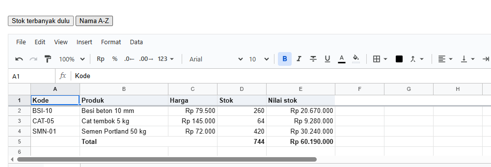
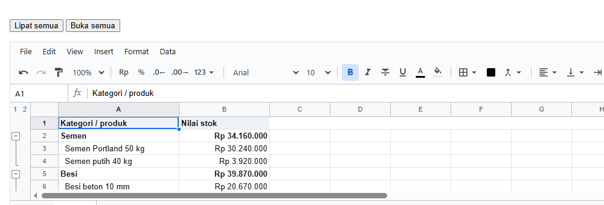
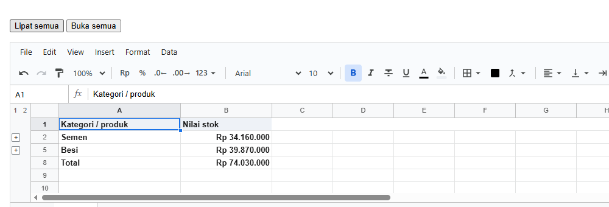
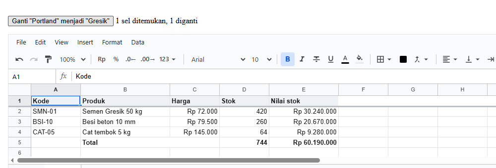

# 7. Data

[Daftar isi](../README.md#daftar-isi) · Sebelumnya: [6. Format](06-format.md) · Berikutnya: [10. Aturan dan tipe kolom](10-aturan.md)

Bab ini membahas cara mengolah tabel data: mengurutkan, menyaring, melipat kelompok baris, meringkas dengan pivot table, dan mencari serta
mengganti. Semua yang ada di menu Data di layar juga bisa dilakukan dari kode, dan semuanya bisa di-undo. Setiap langkah adalah satu halaman
React dengan foto hasilnya.

**Bagian A. Pengenalan (tanpa kode)**
- [7.1 Tabel data di sheet](#71-tabel-data-di-sheet)
- [7.2 Alat-alatnya](#72-alat-alatnya)

**Bagian B. Langkah demi langkah**
- [7.3 Mengurutkan](#73-mengurutkan)
- [7.4 Menyaring](#74-menyaring)
- [7.5 Melipat kelompok baris](#75-melipat-kelompok-baris)
- [7.6 Pivot table](#76-pivot-table)
- [7.7 Mencari dan mengganti](#77-mencari-dan-mengganti)

**Bagian C. Contoh lengkap, yang sering keliru, dan referensi**
- [7.8 Contoh lengkap](#78-contoh-lengkap)
- [7.9 Yang sering keliru](#79-yang-sering-keliru)
- [7.10 Referensi](#710-referensi)

---

# Bagian A. Pengenalan

## 7.1 Tabel data di sheet

Semua alat di bab ini bekerja paling baik pada **tabel data**: baris pertama berisi judul kolom, lalu setiap baris di bawahnya adalah satu catatan
(satu transaksi, satu produk), tanpa baris kosong di tengahnya.

| Kode | Produk | Harga | Stok |
|---|---|---|---|
| SMN-01 | Semen Portland 50 kg | 72000 | 420 |
| BSI-10 | Besi beton 10 mm | 79500 | 260 |

Baris total sebaiknya dipisah dari data, atau dibiarkan di luar range yang diurutkan dan disaring.

## 7.2 Alat-alatnya

| Alat | Hasilnya | Isi data berubah? | Langkah |
|---|---|---|---|
| **Sort** | baris diurutkan menurut satu kolom | urutannya, ya; isinya tidak | 7.3 |
| **Filter** | baris yang tidak memenuhi syarat disembunyikan | tidak | 7.4 |
| **Grup** | baris rincian bisa dilipat dan dibuka | tidak | 7.5 |
| **Pivot table** | ringkasan per kelompok, ditulis di tempat lain | data asli tidak; ringkasannya ditulis ke sheet | 7.6 |
| **Cari dan ganti** | teks yang dicari diganti di semua sel | ya | 7.7 |

---

# Bagian B. Langkah demi langkah

## 7.3 Mengurutkan

**Tujuan:** tombol yang mengurutkan produk menurut nama, tanpa mengikutkan baris judul dan baris total.

<!-- contoh: 07-03-sort.page.tsx -->
```tsx
import { useState } from 'react';
import { Sheet } from '@kufayeka/sheet';
import { sortRange } from '@kufayeka/sheet/core';
import '@kufayeka/sheet/style.css';
import { buatProduk } from './data/produk.js';

// 7.3 Mengurutkan dari tombol: produk diurutkan menurut stok, dari yang terbanyak. Baris judul dan baris total tidak ikut.
export default function Halaman() {
    const [wb] = useState(buatProduk);
    return (
        <div>
            <p>
                <button className="stok" onClick={() => sortRange(wb, 'Produk', 'A2:E4', 'D', 'desc')}>Stok terbanyak dulu</button>{' '}
                <button className="nama" onClick={() => sortRange(wb, 'Produk', 'A2:E4', 'B', 'asc')}>Nama A-Z</button>
            </p>
            <div style={{ height: 300 }}><Sheet workbook={wb} /></div>
        </div>
    );
}
```
<!-- /contoh -->

Setelah "Nama A-Z" diklik:



**Penjelasan:**

- `sortRange(wb, sheet, range, kolom, arah)`: range `A2:E4` adalah baris produk saja, jadi judul (baris 1) dan total (baris 5) tidak ikut.
- `kolom` boleh huruf (`'B'`) atau nomor. `arah` adalah `'asc'` (kecil ke besar, A ke Z) atau `'desc'`.
- Rumus di setiap baris ikut pindah bersama barisnya, dan total tetap benar.

- **Baris dipindah utuh, rumus ikut.** Sort memindahkan baris, bukan menyalin isinya, jadi `=H2*I2*(1-J2)` tetap menghitung baris transaksinya sendiri.
  Rumus di tempat lain yang membaca baris itu juga tetap benar.
- **Sel kosong selalu di bawah**, apa pun arahnya. Nilai yang sama mempertahankan urutan lamanya.
- **Sort bertahap.** Karena nilai yang sama tetap pada urutannya, urutkan dari kunci terakhir ke kunci pertama. Contohnya total dulu, baru cabang, maka
  hasilnya diurutkan per cabang dan di dalam cabang menurut total.
- Satu sort adalah satu perubahan.

Di layar: Data → Sort range, atau menu di tombol filter.

## 7.4 Menyaring

**Tujuan:** tombol filter di setiap judul kolom, untuk menyaring dan mengurutkan dari layar.

<!-- contoh: 07-filter.page.js -->
```jsx
import { useState } from 'react';
import { Sheet } from '@kufayeka/sheet';
import { createWorkbook } from '@kufayeka/sheet/core';
import '@kufayeka/sheet/style.css';
import { penjualan, KOLOM_PENJUALAN, barisPenjualan } from './data/toko.js';

// 60 transaksi dengan filter terpasang: tombol di setiap judul kolom membuka menu urut dan saring.
function buat() {
    const wb = createWorkbook();
    wb.setSettings({ locale: 'id-ID', currency: 'IDR' });
    const jual = wb.sheet('Sheet1');
    jual.setSheetProps({ name: 'Penjualan', freezeRows: 1 });
    jual.setValues('A1', [KOLOM_PENJUALAN]);
    jual.setValues('A2', barisPenjualan(penjualan(60), 2));
    jual.setStyle('A1:K1', { bold: true, fill: '#e8f0fe' });
    jual.setColProps('A', { width: 50 });
    jual.setColProps('B', { format: { type: 'date' }, width: 95 });
    jual.setColProps('F', { width: 170 });
    jual.setColProps('I', { format: { type: 'money', decimals: 0 } });
    jual.setColProps('J', { format: { type: 'percent', decimals: 0 }, width: 70 });
    jual.setColProps('K', { format: { type: 'money', decimals: 0 }, width: 120 });
    jual.createFilter('A1:K61');
    jual.setFilterColumn('C', { hidden: ['Surabaya'] });
    return wb;
}

export default function HalamanFilter() {
    const [wb] = useState(buat);
    return <div style={{ height: 600 }}><Sheet workbook={wb} /></div>;
}
```
<!-- /contoh -->

| Fungsi | Artinya |
|---|---|
| `createFilter(range)` | pasang filter. Baris pertama range adalah judul kolom, dan setiap judul mendapat tombol filter |
| `setFilterColumn(kolom, syarat)` | syarat untuk satu kolom (`'C'` atau nomor). `null` membuang syaratnya |
| `removeFilter()` | lepas filter. Semua baris tampil lagi |
| `filterOf()` | filter sheet: `{ r1, c1, r2, c2, columns }` dengan kolom sebagai id, atau `null` |
| `filterValues(kolom)` | `[{ text, count }]`: nilai di kolom itu, untuk daftar centang |
| `filteredOut(r)` | apakah baris nomor `r` sedang disembunyikan filter |


Lanjutan contoh di atas. Filter menyembunyikan baris yang tidak memenuhi syarat, dan `SUBTOTAL(103, ...)` dan `SUBTOTAL(109, ...)` di kolom N langsung
menghitung yang tampil saja:

- **Menurut nilai**: `{ hidden: ['Bandung', 'Surabaya'] }`, yaitu nilai yang disembunyikan, sama seperti mencentang daftar di menu filter. `''` berarti
  sel kosong. `filterValues(kolom)` memberi daftar nilai beserta jumlahnya, untuk menu buatanmu sendiri.
- **Menurut kondisi**: syarat yang sama dengan conditional formatting ([6.6](06-format.md#66-conditional-formatting)), misalnya `{ op: 'gt', a: 5000000 }`,
  `{ op: 'textContains', a: 'semen' }`, atau `{ op: 'between', a: 1, b: 10 }`.
- **Menurut rumus**: `{ op: 'formula', formula: '=AND(J2>0, OR(G2="Semen", G2="Besi"))' }`, ditulis untuk baris pertama di bawah judul dan bergeser
  untuk baris lain. Dengan rumus, syarat boleh membaca kolom mana saja.

Satu baris tampil kalau lolos **semua** kolom yang disaring. Satu sheet hanya punya satu filter, dan filter baru menggantikan yang lama.

Baris disaring **saat filter diubah**, bukan saat nilai berubah. Baris yang diedit sampai tidak lagi memenuhi syarat tetap
tampil sampai filter diubah atau diterapkan ulang. Dengan begitu baris yang sedang diedit orang tidak tiba-tiba hilang dari layar.

## 7.5 Melipat kelompok baris

**Tujuan:** rincian per kategori yang bisa dilipat, sehingga yang tampil hanya ringkasannya.

<!-- contoh: 07-05-grup.page.tsx -->
```tsx
import { useState } from 'react';
import { Sheet } from '@kufayeka/sheet';
import { createWorkbook } from '@kufayeka/sheet/core';
import '@kufayeka/sheet/style.css';

// 7.5 Grup baris: rincian per kategori bisa dilipat, sehingga yang tampil hanya baris ringkasannya.
function buat() {
    const wb = createWorkbook();
    wb.setSettings({ locale: 'id-ID', currency: 'IDR' });
    const s = wb.sheet('Sheet1');
    s.setValues('A1', [
        ['Kategori / produk', 'Nilai stok'],
        ['Semen', '=SUM(B3:B4)'],
        ['  Semen Portland 50 kg', 30240000],
        ['  Semen putih 40 kg', 3920000],
        ['Besi', '=SUM(B6:B7)'],
        ['  Besi beton 10 mm', 20670000],
        ['  Besi beton 13 mm', 19200000],
        ['Total', '=B2+B5']
    ]);
    s.setStyle('A1:B1', { bold: true, fill: '#eef2f7' });
    s.setStyle('A2:B2, A5:B5, A8:B8', { bold: true });
    s.setColProps('A', { width: 200 });
    s.setColProps('B', { format: { type: 'money', decimals: 0 }, width: 150 });
    s.groupRows('3:4');                                       // baru: rincian semen jadi satu grup
    s.groupRows('6:7');                                       // baru: rincian besi
    return wb;
}

export default function Halaman() {
    const [wb] = useState(buat);
    return (
        <div>
            <p>
                <button className="lipat" onClick={() => wb.sheet('Sheet1').showRowLevel(0)}>Lipat semua</button>{' '}
                <button className="buka" onClick={() => wb.sheet('Sheet1').showRowLevel(99)}>Buka semua</button>
            </p>
            <div style={{ height: 300 }}><Sheet workbook={wb} /></div>
        </div>
    );
}
```
<!-- /contoh -->

Terbuka:



Setelah "Lipat semua" diklik:



**Penjelasan:**

- `groupRows('3:4')` membuat baris 3 dan 4 satu level lebih dalam. Tombol `[-]` tampil di baris di atasnya, yaitu baris judul kategori. Grup di dalam
  grup dibuat dengan menggrup range yang lebih besar, sampai 7 level.
- `foldRowGroup(nomor, level, true)` melipat satu grup, ditunjuk dengan nomor baris pertamanya (dihitung dari 0) dan levelnya. `false` membukanya.
- `showRowLevel(n)` sama dengan tombol angka di pojok kiri atas: semua grup yang lebih dalam dari `n` dilipat. `0` melipat semuanya, angka besar
  membuka semuanya.
- Baris yang dilipat tetap dihitung `SUM`, tetapi dilewati `SUBTOTAL(10x, ...)` ([5.11](05-rumus.md#511-named-range)).
- Fungsi kolom sama persis: `groupCols`, `ungroupCols`, `foldColGroup`, `showColLevel`, `colGroups`.

| Fungsi | Artinya |
|---|---|
| `groupRows(baris)`, `groupCols(kolom)` | satu level lebih dalam |
| `ungroupRows(baris)`, `ungroupCols(kolom)` | satu level lebih dangkal |
| `foldRowGroup(nomor, level, lipat)`, `foldColGroup(...)` | lipat atau buka satu grup |
| `showRowLevel(n)`, `showColLevel(n)` | tampilkan sampai level `n` |
| `rowGroups()`, `colGroups()` | `{ groups: [{ level, from, to, folded }], maxLevel }` |
- Tombol `[+]` dan `[-]` di sebelah kiri nomor baris, dan tombol angka `1 2` di pojok kiri atas, adalah cara orang melipat dan membuka grup di
  layar.

## 7.6 Pivot table

Pivot table meringkas tabel data per kelompok: omzet per kategori dan cabang, transaksi per minggu, penjualan per sales. Cara kerjanya sama dengan pivot
table di Excel. Pivot disimpan di sheet, ditulis sebagai nilai biasa, dan dihitung ulang setiap kali datanya berubah. Fungsi yang sama
juga bisa dipakai tanpa sheet, misalnya di server, untuk meringkas data dari database.

<!-- contoh: 08-pivot.page.js -->
```jsx
import { useState } from 'react';
import { Sheet } from '@kufayeka/sheet';
import '@kufayeka/sheet/style.css';
import { buatAnalisa } from './08-pivot.js';

function buat() {
    const wb = buatAnalisa();
    wb.moveSheet('Analisa', 0);                            // sheet Analisa tampil pertama
    return wb;
}

export default function HalamanAnalisa() {
    const [wb] = useState(buat);
    return <div style={{ height: 560 }}><Sheet workbook={wb} /></div>;
}
```
<!-- /contoh -->


Di layar, memilih satu sel pivot membuka editornya di kanan. Di sana ada sumber data, field untuk baris dan kolom (dengan urutan, urut menurut nilai,
dan pengelompokan tanggal), value dengan fungsinya, dan filter:

Yang perlu diketahui:

- **Sumbernya range atau named range** yang baris pertamanya berisi nama field, misalnya `'Penjualan!A1:K301'`, `'A1:K301'` di sheet yang sama, atau
  nama seperti `'Transaksi'`. Baris kosong dilewati. Dengan named range ([5.11](05-rumus.md#511-named-range)), pivot mengikuti nama itu ke mana pun range-nya
  dipindah atau diperluas.
- **Ditulis sebagai nilai.** Isi pivot adalah nilai biasa, bukan rumus, jadi rumus lain bisa membacanya (`=A2`, `=E2/E9`), dan ikut tersimpan serta
  ikut ke Excel sebagai nilai.
- **Dihitung ulang setelah setiap perubahan** pada datanya. Ukuran pivot boleh berubah: sel yang tidak lagi terpakai dikosongkan.
- **Dikunci untuk orang.** Mengetik di sel pivot ditolak dengan pesan. Pivot diubah lewat editornya atau lewat `setPivot`.
- **Tidak boleh di dalam datanya sendiri.** `addPivot` menolak tempat yang menimpa range sumbernya.
- Pivot baru di layar dibuat lewat Insert → Pivot table.

## 7.7 Mencari dan mengganti

**Tujuan:** mengganti sebuah teks di seluruh sheet dari tombol, dan tahu berapa yang diganti.

<!-- contoh: 07-07-cari.page.tsx -->
```tsx
import { useState } from 'react';
import { Sheet } from '@kufayeka/sheet';
import { findAll, replaceIn } from '@kufayeka/sheet/core';
import '@kufayeka/sheet/style.css';
import { buatProduk } from './data/produk.js';

// 7.7 Cari dan ganti dari kode: merek "Portland" diganti "Gresik" di seluruh sheet, dan jumlah yang diganti ditampilkan.
export default function Halaman() {
    const [wb] = useState(buatProduk);
    const [pesan, setPesan] = useState('');

    function ganti() {
        const ketemu = findAll(wb, 'Produk', 'Portland');                      // baru: semua sel yang memuat "Portland"
        const jumlah = replaceIn(wb, 'Produk', ketemu, 'Portland', 'Gresik');  // baru: ganti di sel-sel itu
        setPesan(ketemu.length + ' sel ditemukan, ' + jumlah + ' diganti');
    }

    return (
        <div>
            <p><button className="ganti" onClick={ganti}>Ganti "Portland" menjadi "Gresik"</button> {pesan}</p>
            <div style={{ height: 300 }}><Sheet workbook={wb} /></div>
        </div>
    );
}
```
<!-- /contoh -->

Setelah tombol diklik:



**Penjelasan:**

- `findAll(wb, sheet, teks)` memberi semua sel yang memuat teks itu, sebagai `[{ r, c }]`.
- `replaceIn(wb, sheet, sel, cari, ganti)` mengganti teks itu di sel-sel tersebut, dan mengembalikan jumlah yang diganti. Satu panggilan adalah
  satu perubahan, jadi satu undo membatalkan semuanya.
- Pilihan pencarian (huruf besar-kecil, seluruh sel, di dalam rumus, regex) ada di 7.10.

---

# Bagian C. Contoh lengkap, yang sering keliru, dan referensi

## 7.8 Contoh lengkap

### Sort bertahap dan filter, dengan hasilnya

<!-- contoh: 07-sort-filter.js -->
```js
import { createWorkbook, sortRange } from '@kufayeka/sheet/core';
import { penjualan, KOLOM_PENJUALAN, barisPenjualan } from './data/toko.js';

// 300 transaksi Oktober: diurutkan, lalu disaring dengan beberapa cara.
const wb = createWorkbook();
const jual = wb.sheet('Sheet1');
jual.setSheetProps({ name: 'Penjualan', freezeRows: 1 });
jual.setValues('A1', [KOLOM_PENJUALAN]);
jual.setValues('A2', barisPenjualan(penjualan(300), 2));
jual.setValues('M1', [['Ditampilkan', '=SUBTOTAL(103, A2:A301)'], ['Omzet tampil', '=SUBTOTAL(109, K2:K301)']]);
const lima = () => [2, 3, 4, 5, 6].map((r) => jual.value('A' + r) + ':' + jual.value('C' + r).slice(0, 3) + ':' + jual.value('K' + r)).join('  ');

// ---- sort: range tanpa judul kolom, kolom acuan, arah. Rumus Total ikut barisnya
sortRange(wb, 'Penjualan', 'A2:K301', 'K', 'desc');
console.log('total terbesar  :', lima());
console.log('rumus K2        :', jual.input('K2'), '(baris transaksi', jual.value('A2') + ')');
// sort bertahap: urutan yang sama dipertahankan, jadi urutkan dari kunci terakhir ke kunci pertama
sortRange(wb, 'Penjualan', 'A2:K301', 'C', 'asc');
console.log('cabang, lalu total:', lima());
wb.undo(); wb.undo();
console.log('dua kali undo   :', lima());

// ---- filter: range dengan judul kolom di baris pertamanya. Satu sheet punya satu filter
jual.createFilter('A1:K301');
console.log('pilihan cabang  :', JSON.stringify(jual.filterValues('C')));
// menurut nilai: yang disebut di hidden disembunyikan
jual.setFilterColumn('C', { hidden: ['Bandung', 'Surabaya'] });
console.log('hanya Jakarta   :', jual.value('N1'), 'baris | omzet', jual.value('N2'));
// menurut kondisi, digabung dengan kolom lain: baris harus lolos semua kolom
jual.setFilterColumn('K', { op: 'gt', a: 5000000 });
console.log('+ total > 5 jt  :', jual.value('N1'), 'baris | omzet', jual.value('N2'));
// menurut rumus, ditulis untuk baris pertama di bawah judul: transaksi dengan diskon, kategori semen atau besi
jual.setFilterColumn('C', null);
jual.setFilterColumn('K', null);
jual.setFilterColumn('J', { op: 'formula', formula: '=AND(J2>0, OR(G2="Semen", G2="Besi"))' });
console.log('diskon semen/besi:', jual.value('N1'), 'baris | omzet', jual.value('N2'));
const tampil = [];
for (let r = 1; r <= 300 && tampil.length < 4; r++) if (!jual.filteredOut(r)) tampil.push(jual.value(r, 0) + ' ' + jual.value(r, 6) + ' ' + jual.value(r, 9));
console.log('contoh baris    :', tampil.join(' | '));
console.log('filter disimpan :', Object.keys(jual.filterOf().columns).length, 'kolom, di props sheet');

jual.removeFilter();
console.log('filter dihapus  :', jual.value('N1'), 'baris');
```
<!-- /contoh -->

<!-- hasil: 07-sort-filter.js -->
```text
total terbesar  : 48:Ban:12495000  218:Jak:12495000  112:Sur:11760000  282:Ban:11760000  176:Jak:11025000
rumus K2        : =H2*I2*(1-J2) (baris transaksi 48)
cabang, lalu total: 48:Ban:12495000  282:Ban:11760000  240:Ban:10290000  27:Ban:9760000  181:Ban:8379000
dua kali undo   : 1:Jak:752400  2:Ban:1148000  3:Jak:795000  4:Sur:912000  5:Jak:290000
pilihan cabang  : [{"text":"Bandung","count":86},{"text":"Jakarta","count":129},{"text":"Surabaya","count":85}]
hanya Jakarta   : 129 baris | omzet 264052400
+ total > 5 jt  : 11 baris | omzet 93665000
diskon semen/besi: 16 baris | omzet 21010000
contoh baris    : 1 Semen 0.05 | 28 Semen 0.05 | 47 Besi 0.1 | 55 Semen 0.05
filter disimpan : 1 kolom, di props sheet
filter dihapus  : 300 baris
```
<!-- /hasil -->

`sortRange(wb, sheet, range, kolom, arah)` dari `@kufayeka/sheet/core` mengurutkan baris di dalam range menurut satu kolom, `'asc'` (A ke Z, kecil ke
besar) atau `'desc'`. Range-nya tanpa baris judul. Yang perlu diketahui:

### Grup baris dan kolom

<!-- contoh: 07-grup.js -->
```js
import { createWorkbook } from '@kufayeka/sheet/core';
import { PRODUK } from './data/toko.js';

// Daftar harga per kategori yang bisa dilipat: kategori sebagai judul, produknya di bawah, harga per cabang sebagai kolom yang bisa dilipat.
const wb = createWorkbook();
const harga = wb.sheet('Sheet1');
const kategori = [...new Set(PRODUK.map((p) => p[2]))];   // Semen, Besi, Cat, Keramik, Pipa, Bata, Pasir
const baris = [['Kategori / produk', 'Harga jual', 'Jakarta', 'Bandung', 'Surabaya', 'Produk']];
for (const k of kategori) {
    baris.push([k]);
    for (const p of PRODUK.filter((x) => x[2] === k)) baris.push(['  ' + p[1], p[5], p[5], Math.round(p[5] * 0.97), Math.round(p[5] * 1.02)]);
}
harga.setValues('A1', baris);

// grup baris: produk di bawah judul kategorinya. Tombol [-] tampil di baris judul
let r = 2;
for (const k of kategori) {
    const n = PRODUK.filter((x) => x[2] === k).length;
    harga.setValues(r - 1, 5, `=COUNTA(A${r + 1}:A${r + n})`);
    harga.groupRows(`${r + 1}:${r + n}`);
    r += n + 1;
}
// grup kolom: harga per cabang bisa dilipat, tinggal harga jual
harga.groupCols('C:E');
// grup di dalam grup: seluruh daftar di bawah judul kolom digrup sekali lagi. Daftar jadi level 1, produk per kategori jadi level 2
harga.groupRows(`2:${baris.length}`);

const terlihat = () => baris.map((_, i) => i).filter((i) => i > 0 && harga.rowAxis().size(i) > 0).map((i) => String(harga.value(i, 0)).trim()).join(', ');
const g = harga.rowGroups();
console.log('grup baris     :', g.groups.map((x) => `L${x.level} ${x.from + 1}-${x.to + 1}`).join(', '), '| level terdalam', g.maxLevel);
console.log('kolom          :', JSON.stringify(harga.colGroups().groups.map((x) => [x.level, x.from, x.to])));

harga.foldRowGroup(2, 2, true);                      // lipat produk Semen: grup level 2 yang mulai di nomor 2 (baris 3)
console.log('semen dilipat  :', terlihat());
harga.showRowLevel(1);                               // tombol level "2": isi level 1 terlihat, level 2 dilipat
console.log('tombol 2       :', terlihat());
harga.showRowLevel(0);                               // tombol level "1": semua grup dilipat
console.log('tombol 1       :', terlihat() || '(hanya judul kolom)');
harga.showRowLevel(9);                               // semua terbuka
harga.foldColGroup(2, 1, true);
console.log('kolom dilipat  :', [0, 1, 2, 3, 4, 5].map((c) => harga.colAxis().size(c) > 0 ? harga.value(0, c) : '-').join(' | '));

// yang dilipat tetap dihitung oleh rumus biasa, dan dilewati oleh SUBTOTAL 10x
harga.setValues('H1', [['SUM', '=SUM(B3:B4)', 'SUBTOTAL 109', '=SUBTOTAL(109, B3:B4)']]);
harga.foldRowGroup(2, 2, true);
console.log('rumus          :', 'SUM', harga.value('I1'), '| SUBTOTAL(109)', harga.value('K1'), '(baris semen sedang dilipat)');
harga.ungroupRows(`2:${baris.length}`);
console.log('lepas satu level:', harga.rowGroups().groups.length, 'grup tersisa, level terdalam', harga.rowGroups().maxLevel);
```
<!-- /contoh -->

<!-- hasil: 07-grup.js -->
```text
grup baris     : L1 2-20, L2 3-4, L2 6-7, L2 9-10, L2 12-13, L2 15-16, L2 18-18, L2 20-20 | level terdalam 2
kolom          : [[1,2,4]]
semen dilipat  : Semen, Besi, Besi beton 10 mm, Besi beton 13 mm, Cat, Cat tembok 5 kg putih, Cat tembok 25 kg putih, Keramik, Keramik 60x60 abu, Keramik 40x40 putih, Pipa, Pipa PVC 3/4 inch, Pipa PVC 4 inch, Bata, Bata ringan 10 cm, Pasir, Pasir beton
tombol 2       : Semen, Besi, Cat, Keramik, Pipa, Bata, Pasir
tombol 1       : (hanya judul kolom)
kolom dilipat  : Kategori / produk | Harga jual | - | - | - | Produk
rumus          : SUM 184000 | SUBTOTAL(109) 0 (baris semen sedang dilipat)
lepas satu level: 7 grup tersisa, level terdalam 1
```
<!-- /hasil -->

### Pivot di sheet

<!-- contoh: 08-pivot.js -->
```js
import { createWorkbook } from '@kufayeka/sheet/core';
import { penjualan, KOLOM_PENJUALAN, barisPenjualan } from './data/toko.js';

// Tiga pivot table dari 300 transaksi Oktober, di sheet Analisa. Data berubah, pivot ikut.
export function buatAnalisa() {
    const wb = createWorkbook();
    wb.setSettings({ locale: 'id-ID', currency: 'IDR' });
    const jual = wb.sheet('Sheet1');
    jual.setSheetProps({ name: 'Penjualan' });
    jual.setValues('A1', [KOLOM_PENJUALAN]);
    jual.setValues('A2', barisPenjualan(penjualan(300), 2));
    jual.setColProps('B', { format: { type: 'date' } });

    const an = wb.sheet(wb.addSheet('Analisa'));
    // 1. omzet per kategori dan cabang, kategori dengan omzet terbesar di atas
    an.addPivot('A1', 'Penjualan!A1:K301', {
        rows: ['Kategori'], columns: ['Cabang'],
        values: [{ field: 'Total', fn: 'SUM', as: 'Omzet' }],
        sort: { Kategori: { by: 'Omzet', dir: 'desc' } }
    });
    // 2. per minggu: omzet, jumlah transaksi, rata-rata per transaksi
    an.addPivot('G1', 'Penjualan!A1:K301', {
        rows: ['Tanggal'], group: { Tanggal: 'week' },
        values: [{ field: 'Total', as: 'Omzet' }, { field: 'No', fn: 'COUNT', as: 'Transaksi' }, { field: 'Total', fn: 'AVERAGE', as: 'Rata-rata' }]
    });
    // 3. sales per cabang, tanpa Surabaya, sales terbaik di atas dalam cabangnya
    an.addPivot('L1', 'Penjualan!A1:K301', {
        rows: ['Cabang', 'Sales'], values: [{ field: 'Total', as: 'Omzet' }, { field: 'Produk', fn: 'COUNTUNIQUE', as: 'Jenis produk' }],
        filters: { Cabang: { hidden: ['Surabaya'] } }, sort: { Sales: { by: 'Omzet', dir: 'desc' } }
    });
    an.setColProps('B:E', { format: { type: 'money', decimals: 0 }, width: 120 });
    an.setColProps('H', { format: { type: 'money', decimals: 0 }, width: 120 });
    an.setColProps('J', { format: { type: 'money', decimals: 0 }, width: 120 });
    an.setColProps('N', { format: { type: 'money', decimals: 0 }, width: 120 });
    an.setColProps('A', { width: 110 });
    return wb;
}

const wb = buatAnalisa();
const an = wb.sheet('Analisa');
const tabel = (a1, a2) => {
    const [c1, r1] = [a1.charCodeAt(0) - 65, Number(a1.slice(1)) - 1], [c2, r2] = [a2.charCodeAt(0) - 65, Number(a2.slice(1)) - 1];
    for (let r = r1; r <= r2; r++) {
        const row = [];
        for (let c = c1; c <= c2; c++) { const d = an.display(r, c).text; row.push(c === c1 ? d.padEnd(14) : d.padStart(16)); }
        console.log('  ' + row.join(''));
    }
};
console.log('1. kategori x cabang:'); tabel('A1', 'E9');
console.log('2. per minggu:'); tabel('G1', 'J7');
console.log('3. sales:'); tabel('L1', 'O7');

// pivot ditulis sebagai nilai biasa: rumus bisa membacanya
an.setValues('A12', [['Kategori teratas', '=A2'], ['Pangsa', '=E2/E9']]);
an.setStyle('B13', { format: { type: 'percent', decimals: 1 } });
console.log('rumus membaca pivot :', an.value('B12'), an.display('B13').text);

// data berubah: pivot dihitung ulang setelah perubahan itu
wb.setValues('Penjualan', 'H2', 2000);                   // transaksi 1: semen, 2000 zak
console.log('Qty semen jadi 2000 :', [2, 3, 4].map((r) => an.value('A' + r)).join(', '), '| teratas', an.value('B12'), an.display('B13').text);
// sel pivot dikunci untuk orang: diubah lewat editornya, bukan diketik
const ditolak = [];
wb.on('reject', (e) => ditolak.push(e.reason));
an.setValues('B3', 1, { source: 'user' });
console.log('diketik di pivot    :', ditolak[0]);

// spesifikasi bisa diubah dari kode: per bulan, bukan per minggu
const kedua = an.pivots()[1].id;
an.setPivot(kedua, { spec: { ...an.pivots()[1].spec, group: { Tanggal: 'month' } } });
console.log('per bulan           :', an.value('G2'), an.display('H2').text, '| pivot di sheet ini:', an.pivots().length);
an.removePivot(kedua);
console.log('pivot dihapus       :', an.pivots().length, 'tersisa, G3 sekarang', JSON.stringify(an.value('G3')));
```
<!-- /contoh -->

<!-- hasil: 08-pivot.js -->
```text
1. kategori x cabang:
  Kategori               Bandung         Jakarta        Surabaya     Grand total
  Bata             Rp 65.709.000   Rp 64.459.500   Rp 48.326.250  Rp 178.494.750
  Cat              Rp 35.163.000   Rp 68.790.000   Rp 39.440.750  Rp 143.393.750
  Semen            Rp 28.528.400   Rp 43.821.200   Rp 25.099.200   Rp 97.448.800
  Keramik          Rp 19.232.800   Rp 26.563.500   Rp 16.444.900   Rp 62.241.200
  Pasir            Rp 11.890.000   Rp 21.010.500   Rp 16.457.500   Rp 49.358.000
  Pipa             Rp 13.187.700   Rp 21.066.650   Rp 12.553.600   Rp 46.807.950
  Besi             Rp 13.384.350   Rp 18.341.050   Rp 10.983.300   Rp 42.708.700
  Grand total     Rp 187.095.250  Rp 264.052.400  Rp 169.305.500  Rp 620.453.150
2. per minggu:
  Tanggal                  Omzet       Transaksi       Rata-rata
  2026-W40         Rp 72.138.550              40    Rp 1.803.464
  2026-W41        Rp 139.414.100              70    Rp 1.991.630
  2026-W42        Rp 152.094.450              70    Rp 2.172.778
  2026-W43        Rp 162.981.550              70    Rp 2.328.308
  2026-W44         Rp 93.824.500              50    Rp 1.876.490
  Grand total     Rp 620.453.150             300    Rp 2.068.177
3. sales:
  Cabang                   Sales           Omzet    Jenis produk
  Bandung                   Asep  Rp 109.042.850              12
                           Wulan   Rp 78.052.400              12
  Bandung total                   Rp 187.095.250              12
  Jakarta                   Dodi  Rp 148.066.750              12
                            Rina  Rp 115.985.650              12
  Jakarta total                   Rp 264.052.400              12
rumus membaca pivot : Bata 28,8%
Qty semen jadi 2000 : Semen, Bata, Cat | teratas Semen 30,9%
diketik di pivot    : This is a pivot table: change it in its editor
per bulan           : 2026-10 Rp 756.500.750 | pivot di sheet ini: 3
pivot dihapus       : 2 tersisa, G3 sekarang null
```
<!-- /hasil -->

### Pivot tanpa sheet: `pivot` dan `tableOf`

<!-- contoh: 08-pivot-data.js -->
```js
import { createWorkbook, tableOf, pivot, PIVOT_FUNCTIONS } from '@kufayeka/sheet/core';
import { penjualan, KOLOM_PENJUALAN, barisPenjualan } from './data/toko.js';

// pivot() tanpa sheet: data dari database atau API langsung diringkas, misalnya di server untuk laporan harian yang dikirim lewat email.
const dariDatabase = penjualan(300).map((r) => ({ ...r, Total: r.Qty * r.Harga * (1 - r.Diskon) }));
const p = pivot(dariDatabase, {
    rows: ['Kategori'], columns: ['Tanggal'], group: { Tanggal: 'month' },
    values: [{ field: 'Total', as: 'Omzet' }, { field: 'Qty', fn: 'SUM', as: 'Qty' }],
    sort: { Kategori: { by: 'Omzet', dir: 'desc' } }
});
console.log('tabel jadi (cells), baris judul', p.header + ':');
for (const row of p.cells.slice(0, 4)) console.log('  ' + row.map((x) => String(x ?? '').padStart(12)).join(''));
console.log('  ...', p.cells.length, 'baris');

// atau dibaca per angka: value(baris, kolom, nomor value)
console.log('omzet semen Oktober :', p.value(['Semen'], ['2026-10'], 0));
console.log('qty semua           :', p.value([], [], 1));
console.log('grup baris          :', p.rowKeys.map((k) => k[0]).join(', '));

// tableOf: sheet dibaca sebagai daftar record (baris pertama = nama field), lalu diringkas dengan pivot yang sama
const wb = createWorkbook();
wb.setValues('Sheet1', 'A1', [KOLOM_PENJUALAN]);
wb.setValues('Sheet1', 'A2', barisPenjualan(penjualan(300), 2));
const { fields, records } = tableOf(wb, 'Sheet1', 'A1:K301');
console.log('field               :', fields.join(', '));
console.log('record pertama      :', JSON.stringify(records[0]));
const perSales = pivot(records, { rows: ['Sales'], values: [{ field: 'Total', fn: 'MEDIAN', as: 'Median' }], sort: { Sales: { by: 'Median', dir: 'desc' } }, totals: false });
console.log('median per sales    :', perSales.cells.slice(1).map((r) => r[0] + ' ' + r[1]).join(' | '));
console.log('fungsi              :', Object.keys(PIVOT_FUNCTIONS).join(', '));
```
<!-- /contoh -->

<!-- hasil: 08-pivot-data.js -->
```text
tabel jadi (cells), baris judul 2:
       Tanggal     2026-10     2026-10 Grand total Grand total
      Kategori       Omzet         Qty       Omzet         Qty
          Bata   178494750         244   178494750         244
           Cat   143393750         428   143393750         428
  ... 10 baris
omzet semen Oktober : 97448800
qty semua           : 3258
grup baris          : Bata, Cat, Semen, Keramik, Pasir, Pipa, Besi
field               : No, Tanggal, Cabang, Sales, Kode, Produk, Kategori, Qty, Harga, Diskon, Total
record pertama      : {"No":1,"Tanggal":46296,"Cabang":"Jakarta","Sales":"Rina","Kode":"SMN-01","Produk":"Semen Portland 50 kg","Kategori":"Semen","Qty":11,"Harga":72000,"Diskon":0.05,"Total":752400}
median per sales    : Dodi 1512000 | Bayu 1450000 | Asep 1417000 | Wulan 1336750 | Rina 1328000 | Sari 1168000
fungsi              : SUM, COUNT, COUNTA, COUNTUNIQUE, AVERAGE, MAX, MIN, MEDIAN, PRODUCT
```
<!-- /hasil -->

`pivot(records, spesifikasi)` dari `@kufayeka/sheet/core` menerima array objek dari mana saja (database, API, file) dan memakai spesifikasi yang sama
dengan 8.2. Fungsi ini murni dan tidak butuh browser, jadi bisa dipakai di server untuk laporan yang dikirim lewat email, di API yang mengembalikan
ringkasan, atau untuk menggabungkan banyak file menjadi satu ringkasan ([Galeri](galeri.md)). Hasilnya:

| Kunci | Isinya |
|---|---|
| `cells` | tabel jadi sebagai array baris, siap ditulis ke sheet dengan `setValues` |
| `header` | jumlah baris judul di awal `cells` |
| `value(baris, kolom, i)` | satu angka: kelompok baris dan kolom sebagai array kunci, `i` nomor value. `[]` berarti semua |
| `rowKeys`, `colKeys` | kunci kelompok baris dan kolom, urut seperti di tabel |
| `rows` | baris badan tabel: `[{ cells, kind: 'row' \| 'subtotal' \| 'total', key }]` |

`tableOf(wb, sheet, range)` membaca range sheet menjadi `{ fields, records }`. Baris pertama menjadi nama field, nilainya adalah hasil rumus, dan baris
kosong dilewati. Range boleh berupa kolom utuh (`'A:K'`, sampai baris terakhir yang berisi), atau named range dengan `sheet` diisi `null`.

`PIVOT_FUNCTIONS` berisi fungsi-fungsi value, misalnya untuk mengisi pilihan di form buatanmu sendiri.

### Cari dan ganti

<!-- contoh: 07-cari.js -->
```js
import { createWorkbook, findAll, replaceIn } from '@kufayeka/sheet/core';
import { PRODUK, KOLOM_PRODUK } from './data/toko.js';

// Mencari di daftar produk, dan mengganti nama merek dagang sekaligus di semua sel.
const wb = createWorkbook();
const p = wb.sheet('Sheet1');
p.setSheetProps({ name: 'Produk' });
p.setValues('A1', [[...KOLOM_PRODUK, 'Nilai stok'], ...PRODUK.map((x, i) => [...x, `=E${i + 2}*G${i + 2}`])]);
const alamat = (list) => list.map((x) => wb.address(x.r, x.c)).join(', ') || '(tidak ada)';

console.log('"semen"               :', alamat(findAll(wb, 'Produk', 'semen')));
console.log('huruf besar-kecil     :', alamat(findAll(wb, 'Produk', 'semen', { matchCase: true })));
console.log('seluruh isi sel       :', alamat(findAll(wb, 'Produk', 'semen', { wholeCell: true })));
console.log('regex kode ...-0x     :', alamat(findAll(wb, 'Produk', '^[A-Z]{3}-0\\d$', { regex: true })));
console.log('di dalam rumus        :', findAll(wb, 'Produk', '*G', { inFormulas: true }).length, 'sel rumusnya memuat "*G" (dikali stok) | tanpa inFormulas:', findAll(wb, 'Produk', '*G').length);
console.log('angka seperti tampil  :', alamat(findAll(wb, 'Produk', '64000', { wholeCell: true })));

// ganti: "Cat tembok" menjadi "Cat dinding" di semua sel yang cocok, satu perubahan (satu undo)
const ketemu = findAll(wb, 'Produk', 'Cat tembok');
const diganti = replaceIn(wb, 'Produk', ketemu, 'Cat tembok', 'Cat dinding');
console.log('diganti               :', diganti, 'sel ->', p.value('B6'), '|', p.value('B7'));
// ganti dengan regex dan grup: "Pipa PVC 3/4 inch" -> "Pipa PVC 3/4\""
const inch = findAll(wb, 'Produk', '(\\S+) inch$', { regex: true });
replaceIn(wb, 'Produk', inch, '(\\S+) inch$', '$1"', { regex: true });
console.log('regex                 :', p.value('B10'), '|', p.value('B11'));
wb.undo();
console.log('undo                  :', p.value('B10'));
```
<!-- /contoh -->

<!-- hasil: 07-cari.js -->
```text
"semen"               : B2, C2, B3, C3
huruf besar-kecil     : (tidak ada)
seluruh isi sel       : C2, C3
regex kode ...-0x     : A2, A3, A6, A11, A12, A13
di dalam rumus        : 12 sel rumusnya memuat "*G" (dikali stok) | tanpa inFormulas: 0
angka seperti tampil  : E2
diganti               : 2 sel -> Cat dinding 5 kg putih | Cat dinding 25 kg putih
regex                 : Pipa PVC 3/4" | Pipa PVC 4"
undo                  : Pipa PVC 3/4 inch
```
<!-- /hasil -->

`findAll(wb, sheet, cari, pilihan)` memberi semua sel yang cocok, urut dari kiri ke kanan dan dari atas ke bawah, sebagai `[{ r, c }]`. Yang dicari
adalah teks seperti tampil di sel (`64000` cocok dengan sel berisi angka 64000), kecuali dengan `inFormulas`.

## 7.9 Yang sering keliru

| Keliru | Benar |
|---|---|
| Baris judul ikut terurut | urutkan range data saja, mulai dari baris 2 (7.3) |
| Baris total ikut terurut | biarkan total di luar range yang diurutkan (7.3) |
| Baris yang baru diedit tidak hilang dari filter | baris disaring saat filter diubah, bukan saat nilainya berubah (7.4) |
| `SUM` menghitung baris yang disaring | pakai `SUBTOTAL(109, ...)` untuk menjumlah yang tampil saja |
| Pivot tidak berubah setelah data diubah | pivot dihitung ulang sendiri; pastikan data baru ada di dalam range sumbernya |

## 7.10 Referensi

### Pivot table

| Fungsi | Artinya |
|---|---|
| `addPivot(di, sumber, spesifikasi)` | buat pivot dengan sel kiri atas di `di` (`'A1'`). Mengembalikan id |
| `setPivot(id, { source, spec, at })` | ganti sumber, spesifikasi, atau tempatnya. Boleh salah satu saja |
| `removePivot(id)` | hapus pivot dan kosongkan selnya |
| `pivots()` | pivot di sheet ini: `[{ id, source, spec, area }]`, dengan `area` adalah kotak yang ditempatinya sekarang |
| `pivotAt(alamat)` | pivot yang menempati sel itu, atau `null` |

| Kunci | Artinya | Contoh |
|---|---|---|
| `rows` | field untuk kelompok ke bawah, dari luar ke dalam. Dengan dua field atau lebih, setiap kelompok luar mendapat baris subtotal | `['Cabang', 'Sales']` |
| `columns` | field untuk kelompok ke samping | `['Cabang']` |
| `values` | yang dihitung di setiap kelompok: `field`, `fn` (bawaan `'SUM'`), dan `as` (nama kolomnya) | `[{ field: 'Total', as: 'Omzet' }]` |
| `filters` | record yang tidak diikutkan, menurut nilai field | `{ Cabang: { hidden: ['Surabaya'] } }` |
| `sort` | urutan kelompok sebuah field: menurut nama (`'asc'`, `'desc'`), atau menurut nilai (`{ by, dir }`) | `{ Kategori: { by: 'Omzet', dir: 'desc' } }` |
| `group` | tanggal dikelompokkan: `'year'`, `'quarter'`, `'month'`, `'week'` | `{ Tanggal: 'month' }` |
| `totals` | baris dan kolom Grand total, serta subtotal. Bawaan `true` | `false` |

**Fungsi value:**

| `fn` | Hasil | | `fn` | Hasil |
|---|---|---|---|---|
| `SUM` | jumlah | | `MAX`, `MIN` | terbesar, terkecil |
| `COUNT` | banyaknya angka | | `MEDIAN` | nilai tengah |
| `COUNTA` | banyaknya yang tidak kosong | | `PRODUCT` | hasil kali |
| `COUNTUNIQUE` | banyaknya nilai berbeda | | `AVERAGE` | rata-rata |

Total dan subtotal dihitung dari record aslinya, bukan dari angka-angka di atasnya. Rata-rata di baris Grand total adalah rata-rata semua transaksi,
bukan rata-rata dari rata-rata per minggu.

**Urut menurut nilai.** `by` adalah nama value (`as`), atau nama field-nya kalau `as` tidak diisi. Dengan dua field baris, urutan menurut nilai berlaku di
dalam setiap kelompok luar, seperti sales terbaik di setiap cabang pada pivot ketiga. Kelompok dengan nilai yang sama diurutkan menurut namanya.

**Kelompok tanggal.** Field berisi tanggal (nomor hari, seperti sel tanggal) dikelompokkan menjadi `2026` (`year`), `2026-Q4` (`quarter`), `2026-10`
(`month`), atau `2026-W43` (`week`, minggu ISO yang dimulai hari Senin). Teks-teks ini terurut sesuai waktu. Nilai yang bukan tanggal dikelompokkan apa
adanya.

**Sel kosong** dikelompokkan sebagai `(blank)`. Kombinasi baris dan kolom yang tidak punya record dibiarkan kosong, seperti Bata di Bandung pada pivot
pertama.

### Cari dan ganti

| Pilihan | Artinya |
|---|---|
| `matchCase` | huruf besar dan kecil dibedakan |
| `wholeCell` | seluruh isi sel harus sama, bukan sebagian |
| `inFormulas` | cari di rumus (`=E2*G2`), bukan di hasilnya |
| `regex` | yang dicari adalah regular expression JavaScript |

`replaceIn(wb, sheet, sel, cari, ganti, pilihan)` mengganti bagian yang cocok di sel-sel hasil `findAll`, lalu menulis sel itu lagi seperti diketik.
Dengan `regex`, `$1`, `$2`, dan seterusnya di teks pengganti adalah grup tangkapan. Semua penggantian adalah satu perubahan, jadi satu undo membatalkan
semuanya. Fungsi ini mengembalikan jumlah sel yang berubah.

Di layar: Ctrl+F untuk mencari, Ctrl+H untuk mencari dan mengganti.

[Daftar isi](../README.md#daftar-isi) · Sebelumnya: [6. Format](06-format.md) · Berikutnya: [10. Aturan dan tipe kolom](10-aturan.md)
