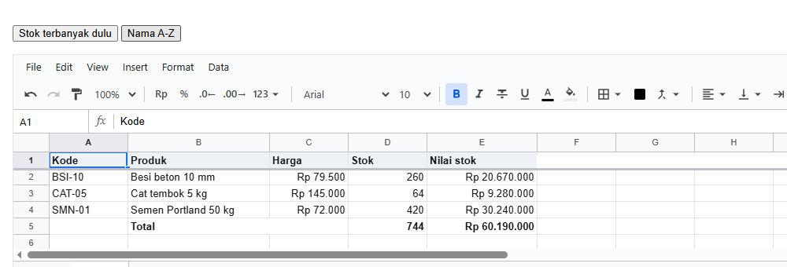
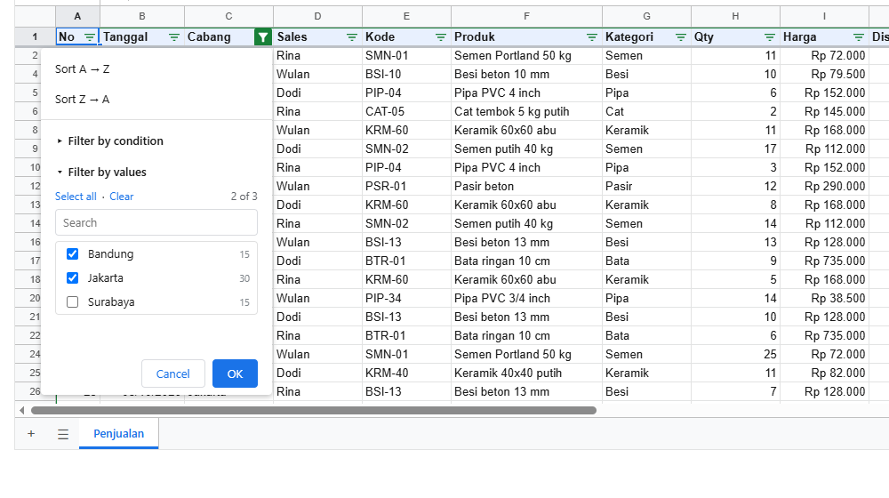
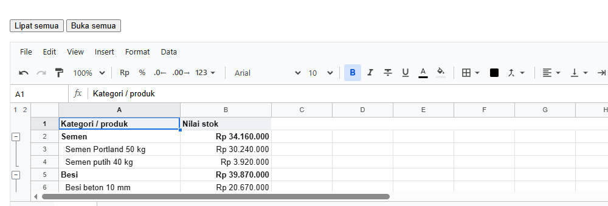
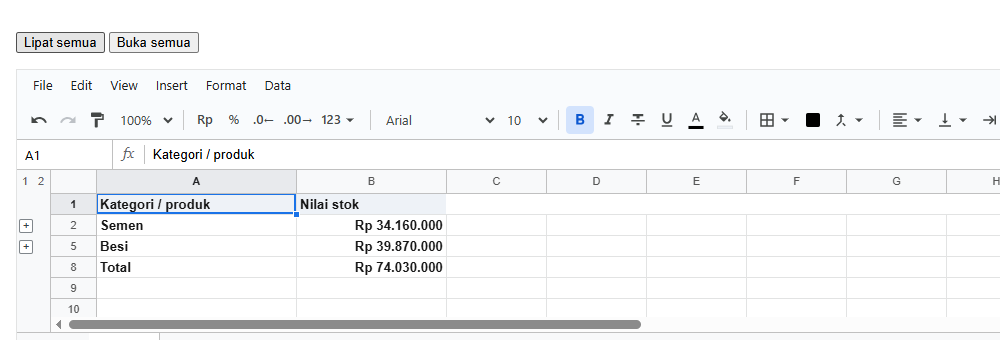
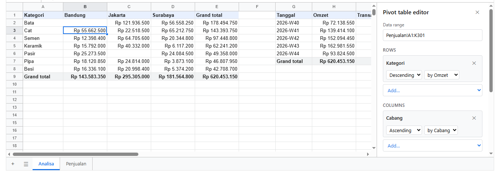
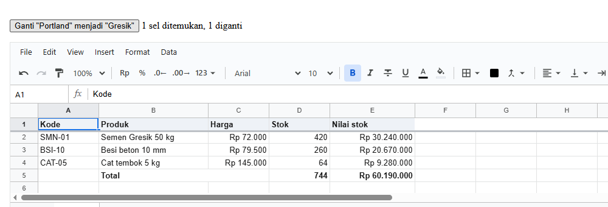

# 07. Operasi Data: Sorting, Filtering, Grouping & Pivot Table

[Daftar isi](../README.md#daftar-isi) · Sebelumnya: [06. Format](06-format.md) · Berikutnya: [08. Validasi Data & Proteksi Sel](08-menjaga-isi.md)

Bab ini membedah fitur-fitur manipulasi data tingkat lanjut pada `@kufayeka/sheet`: pengurutan multi-kolom (*multi-column sorting*), penyaringan data interaktif (*conditional filtering*), outline hierarkis baris (*row grouping & folding*), engine **Pivot Table** dinamis, serta mesin pencarian dan penggantian teks/rumus berbasis Regex (*Find & Replace*).

---

## 1. Ikhtisar Kapabilitas Manipulasi Data

Spreadsheet menyediakan serangkaian alat terintegrasi untuk eksplorasi dan analisis dataset besar:

| Fitur | Deskripsi | API Programatis | Interaksi Pengguna (UI) |
|---|---|---|---|
| **Sorting** | Mengurutkan baris data berdasarkan satu atau beberapa kriteria kolom (A-Z, Z-A, angka, tanggal). | `sheet.sortRange(range, specs)` | Menu *Data → Sort range*, klik kanan header. |
| **Filter View** | Menyaring baris secara kondisional tanpa menghapus data; mendukung exclusion list dan kondisi nilai. | `sheet.createFilter(range)`, `setFilterColumn()` | Tombol toolbar Filter, menu *Data → Create a filter*. |
| **Row Grouping** | Mengelompokkan baris ke dalam hierarki bertingkat yang dapat dilipat/dibuka (folding/accordion). | `sheet.groupRows(from, to)`, `toggleGroup()` | Tombol garis margin kiri `[+]` / `[-]`, shortcut `Alt+Shift+Right`. |
| **Pivot Table** | Mengagregasi data multidimensi (baris, kolom, nilai, filter, grup tanggal) secara otomatis. | `sheet.addPivot(at, source, spec)` | Menu *Insert → Pivot table*. |
| **Find & Replace** | Pencarian cepat teks/nilai/formula dengan pencocokan kata utuh, case-sensitive, atau JavaScript Regex. | `findAll()`, `replaceIn()` | Dialog shortcut `Ctrl+F` dan `Ctrl+H`. |

---

## 2. Implementasi Panduan Langkah demi Langkah

---

### 2.1 Pengurutan Data (Sorting)

Pengurutan data dapat dilakukan pada rentang data tertentu (`sortRange`) agar tidak mengacak baris header dan baris total di bawahnya:

<!-- contoh: 07-03-sort.page.tsx -->
```tsx
import { useState } from 'react';
import { Sheet } from '@kufayeka/sheet';
import { sortRange } from '@kufayeka/sheet/core';
import '@kufayeka/sheet/style.css';
import { buatProduk } from './data/produk.js';

// 7.3 Mengurutkan dari tombol: produk diurutkan menurut stok, dari yang terbanyak. Baris judul dan baris total tidak ikut.
export default function Halaman() {
    const [wb] = useState(buatProduk);
    return (
        <div>
            <p>
                <button className="stok" onClick={() => sortRange(wb, 'Produk', 'A2:E4', 'D', 'desc')}>Stok terbanyak dulu</button>{' '}
                <button className="nama" onClick={() => sortRange(wb, 'Produk', 'A2:E4', 'B', 'asc')}>Nama A-Z</button>
            </p>
            <div style={{ height: 300 }}><Sheet workbook={wb} /></div>
        </div>
    );
}
```
<!-- /contoh -->



> **Integritas Formula saat Sorting**: Formula yang mereferensikan sel di baris yang sama (`=C2*D2`) akan otomatis menyesuaikan referensinya ke baris baru setelah posisi baris dipindahkan oleh algoritma sorting.

---

### 2.2 Penyaringan Data (Filtering)

Filter menyembunyikan baris-baris yang tidak memenuhi kriteria tanpa menghapus baris tersebut dari memori atau memutus formula:

<!-- contoh: 07-filter.page.js -->
```jsx
import { useState } from 'react';
import { Sheet } from '@kufayeka/sheet';
import { createWorkbook } from '@kufayeka/sheet/core';
import '@kufayeka/sheet/style.css';
import { penjualan, KOLOM_PENJUALAN, barisPenjualan } from './data/toko.js';

// 60 transaksi dengan filter terpasang: tombol di setiap judul kolom membuka menu urut dan saring.
function buat() {
    const wb = createWorkbook();
    wb.setSettings({ locale: 'id-ID', currency: 'IDR' });
    const jual = wb.sheet('Sheet1');
    jual.setSheetProps({ name: 'Penjualan', freezeRows: 1 });
    jual.setValues('A1', [KOLOM_PENJUALAN]);
    jual.setValues('A2', barisPenjualan(penjualan(60), 2));
    jual.setStyle('A1:K1', { bold: true, fill: '#e8f0fe' });
    jual.setColProps('A', { width: 50 });
    jual.setColProps('B', { format: { type: 'date' }, width: 95 });
    jual.setColProps('F', { width: 170 });
    jual.setColProps('I', { format: { type: 'money', decimals: 0 } });
    jual.setColProps('J', { format: { type: 'percent', decimals: 0 }, width: 70 });
    jual.setColProps('K', { format: { type: 'money', decimals: 0 }, width: 120 });
    jual.createFilter('A1:K61');
    jual.setFilterColumn('C', { hidden: ['Surabaya'] });
    return wb;
}

export default function HalamanFilter() {
    const [wb] = useState(buat);
    return <div style={{ height: 600 }}><Sheet workbook={wb} /></div>;
}
```
<!-- /contoh -->



---

### 2.3 Hierarki Baris Bertingkat (Row Grouping & Folding)

Fitur Grouping memungkinkan pembuatan hierarki baris (outline levels). Baris detail dapat dilipat (*collapse*) untuk hanya memperlihatkan baris ringkasan/subtotal:

<!-- contoh: 07-05-grup.page.tsx -->
```tsx
import { useState } from 'react';
import { Sheet } from '@kufayeka/sheet';
import { createWorkbook } from '@kufayeka/sheet/core';
import '@kufayeka/sheet/style.css';

// 7.5 Grup baris: rincian per kategori bisa dilipat, sehingga yang tampil hanya baris ringkasannya.
function buat() {
    const wb = createWorkbook();
    wb.setSettings({ locale: 'id-ID', currency: 'IDR' });
    const s = wb.sheet('Sheet1');
    s.setValues('A1', [
        ['Kategori / produk', 'Nilai stok'],
        ['Semen', '=SUM(B3:B4)'],
        ['  Semen Portland 50 kg', 30240000],
        ['  Semen putih 40 kg', 3920000],
        ['Besi', '=SUM(B6:B7)'],
        ['  Besi beton 10 mm', 20670000],
        ['  Besi beton 13 mm', 19200000],
        ['Total', '=B2+B5']
    ]);
    s.setStyle('A1:B1', { bold: true, fill: '#eef2f7' });
    s.setStyle('A2:B2, A5:B5, A8:B8', { bold: true });
    s.setColProps('A', { width: 200 });
    s.setColProps('B', { format: { type: 'money', decimals: 0 }, width: 150 });
    s.groupRows('3:4');                                       // baru: rincian semen jadi satu grup
    s.groupRows('6:7');                                       // baru: rincian besi
    return wb;
}

export default function Halaman() {
    const [wb] = useState(buat);
    return (
        <div>
            <p>
                <button className="lipat" onClick={() => wb.sheet('Sheet1').showRowLevel(0)}>Lipat semua</button>{' '}
                <button className="buka" onClick={() => wb.sheet('Sheet1').showRowLevel(99)}>Buka semua</button>
            </p>
            <div style={{ height: 300 }}><Sheet workbook={wb} /></div>
        </div>
    );
}
```
<!-- /contoh -->




---

### 2.4 Analisis Data Multidimensi (Pivot Table)

Engine Pivot Table mengagregasikan ratusan baris data mentah secara dinamis tanpa perlu menulis rumus manual:

<!-- contoh: 08-pivot.page.js -->
```jsx
import { useState } from 'react';
import { Sheet } from '@kufayeka/sheet';
import '@kufayeka/sheet/style.css';
import { buatAnalisa } from './08-pivot.js';

function buat() {
    const wb = buatAnalisa();
    wb.moveSheet('Analisa', 0);                            // sheet Analisa tampil pertama
    return wb;
}

export default function HalamanAnalisa() {
    const [wb] = useState(buat);
    return <div style={{ height: 560 }}><Sheet workbook={wb} /></div>;
}
```
<!-- /contoh -->



---

### 2.5 Pencarian dan Penggantian Teks / Formula (Find & Replace)

Fungsi `findAll` dan `replaceIn` mendukung pencarian presisi berbasis substring, case-sensitivity, formula internal, dan regular expression:

<!-- contoh: 07-07-cari.page.tsx -->
```tsx
import { useState } from 'react';
import { Sheet } from '@kufayeka/sheet';
import { findAll, replaceIn } from '@kufayeka/sheet/core';
import '@kufayeka/sheet/style.css';
import { buatProduk } from './data/produk.js';

// 7.7 Cari dan ganti dari kode: merek "Portland" diganti "Gresik" di seluruh sheet, dan jumlah yang diganti ditampilkan.
export default function Halaman() {
    const [wb] = useState(buatProduk);
    const [pesan, setPesan] = useState('');

    function ganti() {
        const ketemu = findAll(wb, 'Produk', 'Portland');                      // baru: semua sel yang memuat "Portland"
        const jumlah = replaceIn(wb, 'Produk', ketemu, 'Portland', 'Gresik');  // baru: ganti di sel-sel itu
        setPesan(ketemu.length + ' sel ditemukan, ' + jumlah + ' diganti');
    }

    return (
        <div>
            <p><button className="ganti" onClick={ganti}>Ganti "Portland" menjadi "Gresik"</button> {pesan}</p>
            <div style={{ height: 300 }}><Sheet workbook={wb} /></div>
        </div>
    );
}
```
<!-- /contoh -->



---

## 3. Eksekusi Programatis via Core Engine

Berikut adalah demonstrasi programatis terhadap operasi pengurutan, penyaringan, grouping, pivot table, dan regex replacement:

### Sorting & Filtering Programatis

<!-- contoh: 07-sort-filter.js -->
```js
import { createWorkbook, sortRange } from '@kufayeka/sheet/core';
import { penjualan, KOLOM_PENJUALAN, barisPenjualan } from './data/toko.js';

// 300 transaksi Oktober: diurutkan, lalu disaring dengan beberapa cara.
const wb = createWorkbook();
const jual = wb.sheet('Sheet1');
jual.setSheetProps({ name: 'Penjualan', freezeRows: 1 });
jual.setValues('A1', [KOLOM_PENJUALAN]);
jual.setValues('A2', barisPenjualan(penjualan(300), 2));
jual.setValues('M1', [['Ditampilkan', '=SUBTOTAL(103, A2:A301)'], ['Omzet tampil', '=SUBTOTAL(109, K2:K301)']]);
const lima = () => [2, 3, 4, 5, 6].map((r) => jual.value('A' + r) + ':' + jual.value('C' + r).slice(0, 3) + ':' + jual.value('K' + r)).join('  ');

// ---- sort: range tanpa judul kolom, kolom acuan, arah. Rumus Total ikut barisnya
sortRange(wb, 'Penjualan', 'A2:K301', 'K', 'desc');
console.log('total terbesar  :', lima());
console.log('rumus K2        :', jual.input('K2'), '(baris transaksi', jual.value('A2') + ')');
// sort bertahap: urutan yang sama dipertahankan, jadi urutkan dari kunci terakhir ke kunci pertama
sortRange(wb, 'Penjualan', 'A2:K301', 'C', 'asc');
console.log('cabang, lalu total:', lima());
wb.undo(); wb.undo();
console.log('dua kali undo   :', lima());

// ---- filter: range dengan judul kolom di baris pertamanya. Satu sheet punya satu filter
jual.createFilter('A1:K301');
console.log('pilihan cabang  :', JSON.stringify(jual.filterValues('C')));
// menurut nilai: yang disebut di hidden disembunyikan
jual.setFilterColumn('C', { hidden: ['Bandung', 'Surabaya'] });
console.log('hanya Jakarta   :', jual.value('N1'), 'baris | omzet', jual.value('N2'));
// menurut kondisi, digabung dengan kolom lain: baris harus lolos semua kolom
jual.setFilterColumn('K', { op: 'gt', a: 5000000 });
console.log('+ total > 5 jt  :', jual.value('N1'), 'baris | omzet', jual.value('N2'));
// menurut rumus, ditulis untuk baris pertama di bawah judul: transaksi dengan diskon, kategori semen atau besi
jual.setFilterColumn('C', null);
jual.setFilterColumn('K', null);
jual.setFilterColumn('J', { op: 'formula', formula: '=AND(J2>0, OR(G2="Semen", G2="Besi"))' });
console.log('diskon semen/besi:', jual.value('N1'), 'baris | omzet', jual.value('N2'));
const tampil = [];
for (let r = 1; r <= 300 && tampil.length < 4; r++) if (!jual.filteredOut(r)) tampil.push(jual.value(r, 0) + ' ' + jual.value(r, 6) + ' ' + jual.value(r, 9));
console.log('contoh baris    :', tampil.join(' | '));
console.log('filter disimpan :', Object.keys(jual.filterOf().columns).length, 'kolom, di props sheet');

jual.removeFilter();
console.log('filter dihapus  :', jual.value('N1'), 'baris');
```
<!-- /contoh -->

<!-- hasil: 07-sort-filter.js -->
```text
total terbesar  : 48:Ban:12495000  218:Jak:12495000  112:Sur:11760000  282:Ban:11760000  176:Jak:11025000
rumus K2        : =H2*I2*(1-J2) (baris transaksi 48)
cabang, lalu total: 48:Ban:12495000  282:Ban:11760000  240:Ban:10290000  27:Ban:9760000  181:Ban:8379000
dua kali undo   : 1:Jak:752400  2:Ban:1148000  3:Jak:795000  4:Sur:912000  5:Jak:290000
pilihan cabang  : [{"text":"Bandung","count":86},{"text":"Jakarta","count":129},{"text":"Surabaya","count":85}]
hanya Jakarta   : 129 baris | omzet 264052400
+ total > 5 jt  : 11 baris | omzet 93665000
diskon semen/besi: 16 baris | omzet 21010000
contoh baris    : 1 Semen 0.05 | 28 Semen 0.05 | 47 Besi 0.1 | 55 Semen 0.05
filter disimpan : 1 kolom, di props sheet
filter dihapus  : 300 baris
```
<!-- /hasil -->

---

### Grouping Baris & Outline Levels

<!-- contoh: 07-grup.js -->
```js
import { createWorkbook } from '@kufayeka/sheet/core';
import { PRODUK } from './data/toko.js';

// Daftar harga per kategori yang bisa dilipat: kategori sebagai judul, produknya di bawah, harga per cabang sebagai kolom yang bisa dilipat.
const wb = createWorkbook();
const harga = wb.sheet('Sheet1');
const kategori = [...new Set(PRODUK.map((p) => p[2]))];   // Semen, Besi, Cat, Keramik, Pipa, Bata, Pasir
const baris = [['Kategori / produk', 'Harga jual', 'Jakarta', 'Bandung', 'Surabaya', 'Produk']];
for (const k of kategori) {
    baris.push([k]);
    for (const p of PRODUK.filter((x) => x[2] === k)) baris.push(['  ' + p[1], p[5], p[5], Math.round(p[5] * 0.97), Math.round(p[5] * 1.02)]);
}
harga.setValues('A1', baris);

// grup baris: produk di bawah judul kategorinya. Tombol [-] tampil di baris judul
let r = 2;
for (const k of kategori) {
    const n = PRODUK.filter((x) => x[2] === k).length;
    harga.setValues(r - 1, 5, `=COUNTA(A${r + 1}:A${r + n})`);
    harga.groupRows(`${r + 1}:${r + n}`);
    r += n + 1;
}
// grup kolom: harga per cabang bisa dilipat, tinggal harga jual
harga.groupCols('C:E');
// grup di dalam grup: seluruh daftar di bawah judul kolom digrup sekali lagi. Daftar jadi level 1, produk per kategori jadi level 2
harga.groupRows(`2:${baris.length}`);

const terlihat = () => baris.map((_, i) => i).filter((i) => i > 0 && harga.rowAxis().size(i) > 0).map((i) => String(harga.value(i, 0)).trim()).join(', ');
const g = harga.rowGroups();
console.log('grup baris     :', g.groups.map((x) => `L${x.level} ${x.from + 1}-${x.to + 1}`).join(', '), '| level terdalam', g.maxLevel);
console.log('kolom          :', JSON.stringify(harga.colGroups().groups.map((x) => [x.level, x.from, x.to])));

harga.foldRowGroup(2, 2, true);                      // lipat produk Semen: grup level 2 yang mulai di nomor 2 (baris 3)
console.log('semen dilipat  :', terlihat());
harga.showRowLevel(1);                               // tombol level "2": isi level 1 terlihat, level 2 dilipat
console.log('tombol 2       :', terlihat());
harga.showRowLevel(0);                               // tombol level "1": semua grup dilipat
console.log('tombol 1       :', terlihat() || '(hanya judul kolom)');
harga.showRowLevel(9);                               // semua terbuka
harga.foldColGroup(2, 1, true);
console.log('kolom dilipat  :', [0, 1, 2, 3, 4, 5].map((c) => harga.colAxis().size(c) > 0 ? harga.value(0, c) : '-').join(' | '));

// yang dilipat tetap dihitung oleh rumus biasa, dan dilewati oleh SUBTOTAL 10x
harga.setValues('H1', [['SUM', '=SUM(B3:B4)', 'SUBTOTAL 109', '=SUBTOTAL(109, B3:B4)']]);
harga.foldRowGroup(2, 2, true);
console.log('rumus          :', 'SUM', harga.value('I1'), '| SUBTOTAL(109)', harga.value('K1'), '(baris semen sedang dilipat)');
harga.ungroupRows(`2:${baris.length}`);
console.log('lepas satu level:', harga.rowGroups().groups.length, 'grup tersisa, level terdalam', harga.rowGroups().maxLevel);
```
<!-- /contoh -->

<!-- hasil: 07-grup.js -->
```text
grup baris     : L1 2-20, L2 3-4, L2 6-7, L2 9-10, L2 12-13, L2 15-16, L2 18-18, L2 20-20 | level terdalam 2
kolom          : [[1,2,4]]
semen dilipat  : Semen, Besi, Besi beton 10 mm, Besi beton 13 mm, Cat, Cat tembok 5 kg putih, Cat tembok 25 kg putih, Keramik, Keramik 60x60 abu, Keramik 40x40 putih, Pipa, Pipa PVC 3/4 inch, Pipa PVC 4 inch, Bata, Bata ringan 10 cm, Pasir, Pasir beton
tombol 2       : Semen, Besi, Cat, Keramik, Pipa, Bata, Pasir
tombol 1       : (hanya judul kolom)
kolom dilipat  : Kategori / produk | Harga jual | - | - | - | Produk
rumus          : SUM 184000 | SUBTOTAL(109) 0 (baris semen sedang dilipat)
lepas satu level: 7 grup tersisa, level terdalam 1
```
<!-- /hasil -->

---

### Evaluasi Komprehensif Pivot Table

<!-- contoh: 08-pivot.js -->
```js
import { createWorkbook } from '@kufayeka/sheet/core';
import { penjualan, KOLOM_PENJUALAN, barisPenjualan } from './data/toko.js';

// Tiga pivot table dari 300 transaksi Oktober, di sheet Analisa. Data berubah, pivot ikut.
export function buatAnalisa() {
    const wb = createWorkbook();
    wb.setSettings({ locale: 'id-ID', currency: 'IDR' });
    const jual = wb.sheet('Sheet1');
    jual.setSheetProps({ name: 'Penjualan' });
    jual.setValues('A1', [KOLOM_PENJUALAN]);
    jual.setValues('A2', barisPenjualan(penjualan(300), 2));
    jual.setColProps('B', { format: { type: 'date' } });

    const an = wb.sheet(wb.addSheet('Analisa'));
    // 1. omzet per kategori dan cabang, kategori dengan omzet terbesar di atas
    an.addPivot('A1', 'Penjualan!A1:K301', {
        rows: ['Kategori'], columns: ['Cabang'],
        values: [{ field: 'Total', fn: 'SUM', as: 'Omzet' }],
        sort: { Kategori: { by: 'Omzet', dir: 'desc' } }
    });
    // 2. per minggu: omzet, jumlah transaksi, rata-rata per transaksi
    an.addPivot('G1', 'Penjualan!A1:K301', {
        rows: ['Tanggal'], group: { Tanggal: 'week' },
        values: [{ field: 'Total', as: 'Omzet' }, { field: 'No', fn: 'COUNT', as: 'Transaksi' }, { field: 'Total', fn: 'AVERAGE', as: 'Rata-rata' }]
    });
    // 3. sales per cabang, tanpa Surabaya, sales terbaik di atas dalam cabangnya
    an.addPivot('L1', 'Penjualan!A1:K301', {
        rows: ['Cabang', 'Sales'], values: [{ field: 'Total', as: 'Omzet' }, { field: 'Produk', fn: 'COUNTUNIQUE', as: 'Jenis produk' }],
        filters: { Cabang: { hidden: ['Surabaya'] } }, sort: { Sales: { by: 'Omzet', dir: 'desc' } }
    });
    an.setColProps('B:E', { format: { type: 'money', decimals: 0 }, width: 120 });
    an.setColProps('H', { format: { type: 'money', decimals: 0 }, width: 120 });
    an.setColProps('J', { format: { type: 'money', decimals: 0 }, width: 120 });
    an.setColProps('N', { format: { type: 'money', decimals: 0 }, width: 120 });
    an.setColProps('A', { width: 110 });
    return wb;
}

const wb = buatAnalisa();
const an = wb.sheet('Analisa');
const tabel = (a1, a2) => {
    const [c1, r1] = [a1.charCodeAt(0) - 65, Number(a1.slice(1)) - 1], [c2, r2] = [a2.charCodeAt(0) - 65, Number(a2.slice(1)) - 1];
    for (let r = r1; r <= r2; r++) {
        const row = [];
        for (let c = c1; c <= c2; c++) { const d = an.display(r, c).text; row.push(c === c1 ? d.padEnd(14) : d.padStart(16)); }
        console.log('  ' + row.join(''));
    }
};
console.log('1. kategori x cabang:'); tabel('A1', 'E9');
console.log('2. per minggu:'); tabel('G1', 'J7');
console.log('3. sales:'); tabel('L1', 'O7');

// pivot ditulis sebagai nilai biasa: rumus bisa membacanya
an.setValues('A12', [['Kategori teratas', '=A2'], ['Pangsa', '=E2/E9']]);
an.setStyle('B13', { format: { type: 'percent', decimals: 1 } });
console.log('rumus membaca pivot :', an.value('B12'), an.display('B13').text);

// data berubah: pivot dihitung ulang setelah perubahan itu
wb.setValues('Penjualan', 'H2', 2000);                   // transaksi 1: semen, 2000 zak
console.log('Qty semen jadi 2000 :', [2, 3, 4].map((r) => an.value('A' + r)).join(', '), '| teratas', an.value('B12'), an.display('B13').text);
// sel pivot dikunci untuk orang: diubah lewat editornya, bukan diketik
const ditolak = [];
wb.on('reject', (e) => ditolak.push(e.reason));
an.setValues('B3', 1, { source: 'user' });
console.log('diketik di pivot    :', ditolak[0]);

// spesifikasi bisa diubah dari kode: per bulan, bukan per minggu
const kedua = an.pivots()[1].id;
an.setPivot(kedua, { spec: { ...an.pivots()[1].spec, group: { Tanggal: 'month' } } });
console.log('per bulan           :', an.value('G2'), an.display('H2').text, '| pivot di sheet ini:', an.pivots().length);
an.removePivot(kedua);
console.log('pivot dihapus       :', an.pivots().length, 'tersisa, G3 sekarang', JSON.stringify(an.value('G3')));
```
<!-- /contoh -->

<!-- hasil: 08-pivot.js -->
```text
1. kategori x cabang:
  Kategori               Bandung         Jakarta        Surabaya     Grand total
  Bata             Rp 65.709.000   Rp 64.459.500   Rp 48.326.250  Rp 178.494.750
  Cat              Rp 35.163.000   Rp 68.790.000   Rp 39.440.750  Rp 143.393.750
  Semen            Rp 28.528.400   Rp 43.821.200   Rp 25.099.200   Rp 97.448.800
  Keramik          Rp 19.232.800   Rp 26.563.500   Rp 16.444.900   Rp 62.241.200
  Pasir            Rp 11.890.000   Rp 21.010.500   Rp 16.457.500   Rp 49.358.000
  Pipa             Rp 13.187.700   Rp 21.066.650   Rp 12.553.600   Rp 46.807.950
  Besi             Rp 13.384.350   Rp 18.341.050   Rp 10.983.300   Rp 42.708.700
  Grand total     Rp 187.095.250  Rp 264.052.400  Rp 169.305.500  Rp 620.453.150
2. per minggu:
  Tanggal                  Omzet       Transaksi       Rata-rata
  2026-W40         Rp 72.138.550              40    Rp 1.803.464
  2026-W41        Rp 139.414.100              70    Rp 1.991.630
  2026-W42        Rp 152.094.450              70    Rp 2.172.778
  2026-W43        Rp 162.981.550              70    Rp 2.328.308
  2026-W44         Rp 93.824.500              50    Rp 1.876.490
  Grand total     Rp 620.453.150             300    Rp 2.068.177
3. sales:
  Cabang                   Sales           Omzet    Jenis produk
  Bandung                   Asep  Rp 109.042.850              12
                           Wulan   Rp 78.052.400              12
  Bandung total                   Rp 187.095.250              12
  Jakarta                   Dodi  Rp 148.066.750              12
                            Rina  Rp 115.985.650              12
  Jakarta total                   Rp 264.052.400              12
rumus membaca pivot : Bata 28,8%
Qty semen jadi 2000 : Semen, Bata, Cat | teratas Semen 30,9%
diketik di pivot    : This is a pivot table: change it in its editor
per bulan           : 2026-10 Rp 756.500.750 | pivot di sheet ini: 3
pivot dihapus       : 2 tersisa, G3 sekarang null
```
<!-- /hasil -->

---

### Reaktivitas Pivot Table & Interaksi dengan Formula

<!-- contoh: 08-pivot-data.js -->
```js
import { createWorkbook, tableOf, pivot, PIVOT_FUNCTIONS } from '@kufayeka/sheet/core';
import { penjualan, KOLOM_PENJUALAN, barisPenjualan } from './data/toko.js';

// pivot() tanpa sheet: data dari database atau API langsung diringkas, misalnya di server untuk laporan harian yang dikirim lewat email.
const dariDatabase = penjualan(300).map((r) => ({ ...r, Total: r.Qty * r.Harga * (1 - r.Diskon) }));
const p = pivot(dariDatabase, {
    rows: ['Kategori'], columns: ['Tanggal'], group: { Tanggal: 'month' },
    values: [{ field: 'Total', as: 'Omzet' }, { field: 'Qty', fn: 'SUM', as: 'Qty' }],
    sort: { Kategori: { by: 'Omzet', dir: 'desc' } }
});
console.log('tabel jadi (cells), baris judul', p.header + ':');
for (const row of p.cells.slice(0, 4)) console.log('  ' + row.map((x) => String(x ?? '').padStart(12)).join(''));
console.log('  ...', p.cells.length, 'baris');

// atau dibaca per angka: value(baris, kolom, nomor value)
console.log('omzet semen Oktober :', p.value(['Semen'], ['2026-10'], 0));
console.log('qty semua           :', p.value([], [], 1));
console.log('grup baris          :', p.rowKeys.map((k) => k[0]).join(', '));

// tableOf: sheet dibaca sebagai daftar record (baris pertama = nama field), lalu diringkas dengan pivot yang sama
const wb = createWorkbook();
wb.setValues('Sheet1', 'A1', [KOLOM_PENJUALAN]);
wb.setValues('Sheet1', 'A2', barisPenjualan(penjualan(300), 2));
const { fields, records } = tableOf(wb, 'Sheet1', 'A1:K301');
console.log('field               :', fields.join(', '));
console.log('record pertama      :', JSON.stringify(records[0]));
const perSales = pivot(records, { rows: ['Sales'], values: [{ field: 'Total', fn: 'MEDIAN', as: 'Median' }], sort: { Sales: { by: 'Median', dir: 'desc' } }, totals: false });
console.log('median per sales    :', perSales.cells.slice(1).map((r) => r[0] + ' ' + r[1]).join(' | '));
console.log('fungsi              :', Object.keys(PIVOT_FUNCTIONS).join(', '));
```
<!-- /contoh -->

<!-- hasil: 08-pivot-data.js -->
```text
tabel jadi (cells), baris judul 2:
       Tanggal     2026-10     2026-10 Grand total Grand total
      Kategori       Omzet         Qty       Omzet         Qty
          Bata   178494750         244   178494750         244
           Cat   143393750         428   143393750         428
  ... 10 baris
omzet semen Oktober : 97448800
qty semua           : 3258
grup baris          : Bata, Cat, Semen, Keramik, Pasir, Pipa, Besi
field               : No, Tanggal, Cabang, Sales, Kode, Produk, Kategori, Qty, Harga, Diskon, Total
record pertama      : {"No":1,"Tanggal":46296,"Cabang":"Jakarta","Sales":"Rina","Kode":"SMN-01","Produk":"Semen Portland 50 kg","Kategori":"Semen","Qty":11,"Harga":72000,"Diskon":0.05,"Total":752400}
median per sales    : Dodi 1512000 | Bayu 1450000 | Asep 1417000 | Wulan 1336750 | Rina 1328000 | Sari 1168000
fungsi              : SUM, COUNT, COUNTA, COUNTUNIQUE, AVERAGE, MAX, MIN, MEDIAN, PRODUCT
```
<!-- /hasil -->

### Pivot Table dalam Template + Data API & Agregasi Multi-File

Untuk membangun laporan template yang sumber datanya diisi belakangan dari REST API via `populate()`:
- **`addPivot()` membutuhkan range eksplisit (misal `'Transaksi!A1:C100'`) atau Named Range** — jangan gunakan notasi kolom penuh `A:C` di `addPivot` (berbeda dengan `tableOf` yang mendukung `A:C`). Siapkan range ber-buffer atau Named Range di template agar baris baru hasil `populate()` otomatis masuk ke perhitungan pivot.
- Spesifikasi pivot tersimpan di `sheet.props.pivots` dan otomatis ikut `wb.toJSON()`, sehingga saat template/dokumen dibuka kembali, pivot langsung aktif.
- Untuk konsolidasi **multi-file** di backend, gunakan `tableOf()` untuk mengekstrak records dari tiap workbook lalu gabungkan ke `pivot(gabungan, spec)`:

<!-- contoh: 07-08-pivot-template.js -->
```js
import { createWorkbook, populate, tableOf, pivot } from '@kufayeka/sheet/core';

// Template laporan dengan sumber data dinamis dari API + Pivot Table di sheet terpisah
const wb = createWorkbook();
wb.setSettings({ locale: 'id-ID', currency: 'IDR' });

const data = wb.sheet('Sheet1');
data.setSheetProps({ name: 'Transaksi' });
data.setValues('A1', [['Cabang', 'Kategori', 'Total']]);
data.setStyle('A1:C1', { bold: true, fill: '#eef2f7' });

const ringkasan = wb.sheet(wb.addSheet('Ringkasan'));
// Gunakan range ber-buffer (misal 'Transaksi!A1:C100') atau Named Range agar baris baru dari populate() otomatis masuk ke pivot
ringkasan.addPivot('A1', 'Transaksi!A1:C100', {
    rows: ['Cabang'],
    columns: ['Kategori'],
    values: [{ field: 'Total', fn: 'SUM', as: 'Omzet' }],
    totals: true,
});

// Simulasi data masuk dari REST API setelah template dibuka
populate(wb, 'Transaksi', { at: 'A2', fields: ['Cabang', 'Kategori', 'Total'], header: false }, [
    { Cabang: 'Jakarta', Kategori: 'Semen', Total: 720000 },
    { Cabang: 'Bandung', Kategori: 'Semen', Total: 360000 },
    { Cabang: 'Jakarta', Kategori: 'Cat', Total: 290000 },
]);

// Pivot ikut tersimpan di JSON template/dokumen (di dalam sheet.props.pivots)
const saved = wb.toJSON();
const reopened = createWorkbook(saved);
const r = reopened.sheet('Ringkasan');
console.log('Pivot tersimpan di JSON:', saved.sheets[1].props.pivots.length, 'pivot');
console.log('Grand Total Jakarta:', r.value('D3'), '| Total Semua:', r.value('D4'));

// Agregasi multi-file di server: gabungkan records dari banyak workbook lewat tableOf() + pivot()
const gabungan = [
    ...tableOf(wb, 'Transaksi', 'A:C').records,
    { Cabang: 'Surabaya', Kategori: 'Semen', Total: 500000 },
];
const hasilServer = pivot(gabungan, { rows: ['Cabang'], values: [{ field: 'Total', fn: 'SUM' }] });
console.log('Agregasi server:', hasilServer.rows.map((row) => row.cells.join(':')).join(', '));
```
<!-- /contoh -->

<!-- hasil: 07-08-pivot-template.js -->
```text
Pivot tersimpan di JSON: 1 pivot
Grand Total Jakarta: 1010000 | Total Semua: 1370000
Agregasi server: Bandung:360000, Jakarta:1010000, Surabaya:500000, Grand total:1870000
```
<!-- /hasil -->

---

### Find & Replace dengan Regular Expression

<!-- contoh: 07-cari.js -->
```js
import { createWorkbook, findAll, replaceIn } from '@kufayeka/sheet/core';
import { PRODUK, KOLOM_PRODUK } from './data/toko.js';

// Mencari di daftar produk, dan mengganti nama merek dagang sekaligus di semua sel.
const wb = createWorkbook();
const p = wb.sheet('Sheet1');
p.setSheetProps({ name: 'Produk' });
p.setValues('A1', [[...KOLOM_PRODUK, 'Nilai stok'], ...PRODUK.map((x, i) => [...x, `=E${i + 2}*G${i + 2}`])]);
const alamat = (list) => list.map((x) => wb.address(x.r, x.c)).join(', ') || '(tidak ada)';

console.log('"semen"               :', alamat(findAll(wb, 'Produk', 'semen')));
console.log('huruf besar-kecil     :', alamat(findAll(wb, 'Produk', 'semen', { matchCase: true })));
console.log('seluruh isi sel       :', alamat(findAll(wb, 'Produk', 'semen', { wholeCell: true })));
console.log('regex kode ...-0x     :', alamat(findAll(wb, 'Produk', '^[A-Z]{3}-0\\d$', { regex: true })));
console.log('di dalam rumus        :', findAll(wb, 'Produk', '*G', { inFormulas: true }).length, 'sel rumusnya memuat "*G" (dikali stok) | tanpa inFormulas:', findAll(wb, 'Produk', '*G').length);
console.log('angka seperti tampil  :', alamat(findAll(wb, 'Produk', '64000', { wholeCell: true })));

// ganti: "Cat tembok" menjadi "Cat dinding" di semua sel yang cocok, satu perubahan (satu undo)
const ketemu = findAll(wb, 'Produk', 'Cat tembok');
const diganti = replaceIn(wb, 'Produk', ketemu, 'Cat tembok', 'Cat dinding');
console.log('diganti               :', diganti, 'sel ->', p.value('B6'), '|', p.value('B7'));
// ganti dengan regex dan grup: "Pipa PVC 3/4 inch" -> "Pipa PVC 3/4\""
const inch = findAll(wb, 'Produk', '(\\S+) inch$', { regex: true });
replaceIn(wb, 'Produk', inch, '(\\S+) inch$', '$1"', { regex: true });
console.log('regex                 :', p.value('B10'), '|', p.value('B11'));
wb.undo();
console.log('undo                  :', p.value('B10'));
```
<!-- /contoh -->

<!-- hasil: 07-cari.js -->
```text
"semen"               : B2, C2, B3, C3
huruf besar-kecil     : (tidak ada)
seluruh isi sel       : C2, C3
regex kode ...-0x     : A2, A3, A6, A11, A12, A13
di dalam rumus        : 12 sel rumusnya memuat "*G" (dikali stok) | tanpa inFormulas: 0
angka seperti tampil  : E2
diganti               : 2 sel -> Cat dinding 5 kg putih | Cat dinding 25 kg putih
regex                 : Pipa PVC 3/4" | Pipa PVC 4"
undo                  : Pipa PVC 3/4 inch
```
<!-- /hasil -->

---

## 4. Referensi Lengkap API

### Konfigurasi Pivot Table (`PivotSpec`)

```ts
interface PivotSpec {
    rows?: string[];                              // Field dimensi vertikal (grup bertingkat)
    columns?: string[];                           // Field dimensi horizontal
    values: Array<{                               // Agregasi nilai komputasi
        field: string;
        as?: string;                              // Alias label kolom
        fn?: 'SUM' | 'COUNT' | 'COUNTA' | 'COUNTUNIQUE' | 'AVERAGE' | 'MAX' | 'MIN' | 'MEDIAN' | 'PRODUCT';
    }>;
    filters?: Record<string, { hidden: any[] }>;  // Pengecualian nilai record
    sort?: Record<string,                         // Urutan pengurutan grup
        'asc' | 'desc' | { by: string, dir: 'asc' | 'desc' }
    >;
    group?: Record<string, 'year' | 'quarter' | 'month' | 'week'>; // Partisi otomatis kolom tanggal
    totals?: boolean;                             // Tampilkan Grand Total & Subtotal (default: true)
}
```

### Opsi Operasi Find & Replace

| Opsi | Tipe | Kegunaan |
|---|---|---|
| `matchCase` | `boolean` | Pencocokan peka huruf besar/kecil (*case-sensitive*). |
| `wholeCell` | `boolean` | Seluruh isi teks sel harus cocok persis dari awal hingga akhir. |
| `inFormulas` | `boolean` | Mencari di dalam teks formula mentah (`'=B2*C2'`), bukan pada hasil nilainya. |
| `regex` | `boolean` | Mengaktifkan evaluasi JavaScript RegExp (mendukung capturing group `$1`, `$2` pada `replaceIn`). |

---

[Daftar isi](../README.md#daftar-isi) · Sebelumnya: [06. Format](06-format.md) · Berikutnya: [08. Validasi Data & Proteksi Sel](08-menjaga-isi.md)
