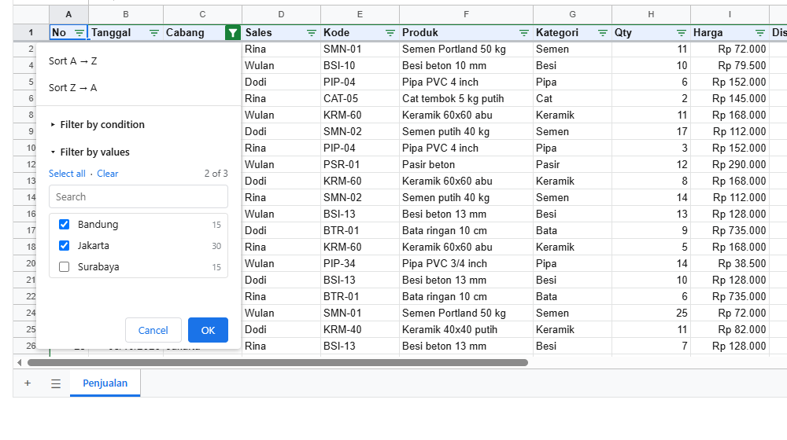
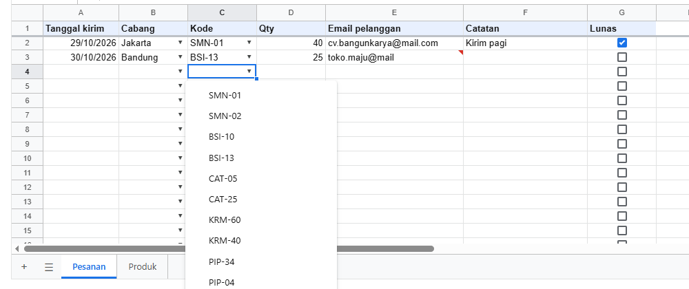

# 7. Data: sort, filter, grup, validasi, cari

[Daftar isi](../README.md#daftar-isi) · Sebelumnya: [6. Format, locale, dan conditional formatting](06-format.md) · Berikutnya: [8. Pivot table](08-pivot.md)

Alat untuk mengolah tabel data: mengurutkan, menyaring, melipat kelompok baris, membatasi isian, dan mencari. Semua yang ada di menu Data di layar juga
bisa dilakukan lewat kode, dan semuanya bisa di-undo.

- [7.1 Sort](#71-sort)
- [7.2 Filter](#72-filter)
- [7.3 Grup baris dan kolom](#73-grup-baris-dan-kolom)
- [7.4 Validasi data](#74-validasi-data)
- [7.5 Cari dan ganti](#75-cari-dan-ganti)

## 7.1 Sort

<!-- contoh: 07-sort-filter.js -->
```js
import { createWorkbook, sortRange } from '@kufayeka/sheet/core';
import { penjualan, KOLOM_PENJUALAN, barisPenjualan } from './data/toko.js';

// 300 transaksi Oktober: diurutkan, lalu disaring dengan beberapa cara.
const wb = createWorkbook();
const jual = wb.sheet('Sheet1');
jual.setSheetProps({ name: 'Penjualan', freezeRows: 1 });
jual.setValues('A1', [KOLOM_PENJUALAN]);
jual.setValues('A2', barisPenjualan(penjualan(300), 2));
jual.setValues('M1', [['Ditampilkan', '=SUBTOTAL(103, A2:A301)'], ['Omzet tampil', '=SUBTOTAL(109, K2:K301)']]);
const lima = () => [2, 3, 4, 5, 6].map((r) => jual.value('A' + r) + ':' + jual.value('C' + r).slice(0, 3) + ':' + jual.value('K' + r)).join('  ');

// ---- sort: range tanpa judul kolom, kolom acuan, arah. Rumus Total ikut barisnya
sortRange(wb, 'Penjualan', 'A2:K301', 'K', 'desc');
console.log('total terbesar  :', lima());
console.log('rumus K2        :', jual.input('K2'), '(baris transaksi', jual.value('A2') + ')');
// sort bertahap: urutan yang sama dipertahankan, jadi urutkan dari kunci terakhir ke kunci pertama
sortRange(wb, 'Penjualan', 'A2:K301', 'C', 'asc');
console.log('cabang, lalu total:', lima());
wb.undo(); wb.undo();
console.log('dua kali undo   :', lima());

// ---- filter: range dengan judul kolom di baris pertamanya. Satu sheet punya satu filter
jual.createFilter('A1:K301');
console.log('pilihan cabang  :', JSON.stringify(jual.filterValues('C')));
// menurut nilai: yang disebut di hidden disembunyikan
jual.setFilterColumn('C', { hidden: ['Bandung', 'Surabaya'] });
console.log('hanya Jakarta   :', jual.value('N1'), 'baris | omzet', jual.value('N2'));
// menurut kondisi, digabung dengan kolom lain: baris harus lolos semua kolom
jual.setFilterColumn('K', { op: 'gt', a: 5000000 });
console.log('+ total > 5 jt  :', jual.value('N1'), 'baris | omzet', jual.value('N2'));
// menurut rumus, ditulis untuk baris pertama di bawah judul: transaksi dengan diskon, kategori semen atau besi
jual.setFilterColumn('C', null);
jual.setFilterColumn('K', null);
jual.setFilterColumn('J', { op: 'formula', formula: '=AND(J2>0, OR(G2="Semen", G2="Besi"))' });
console.log('diskon semen/besi:', jual.value('N1'), 'baris | omzet', jual.value('N2'));
const tampil = [];
for (let r = 1; r <= 300 && tampil.length < 4; r++) if (!jual.filteredOut(r)) tampil.push(jual.value(r, 0) + ' ' + jual.value(r, 6) + ' ' + jual.value(r, 9));
console.log('contoh baris    :', tampil.join(' | '));
console.log('filter disimpan :', Object.keys(jual.filterOf().columns).length, 'kolom, di props sheet');

jual.removeFilter();
console.log('filter dihapus  :', jual.value('N1'), 'baris');
```
<!-- /contoh -->

<!-- hasil: 07-sort-filter.js -->
```text
total terbesar  : 48:Ban:12495000  218:Jak:12495000  112:Sur:11760000  282:Ban:11760000  176:Jak:11025000
rumus K2        : =H2*I2*(1-J2) (baris transaksi 48)
cabang, lalu total: 48:Ban:12495000  282:Ban:11760000  240:Ban:10290000  27:Ban:9760000  181:Ban:8379000
dua kali undo   : 1:Jak:752400  2:Ban:1148000  3:Jak:795000  4:Sur:912000  5:Jak:290000
pilihan cabang  : [{"text":"Bandung","count":86},{"text":"Jakarta","count":129},{"text":"Surabaya","count":85}]
hanya Jakarta   : 129 baris | omzet 264052400
+ total > 5 jt  : 11 baris | omzet 93665000
diskon semen/besi: 16 baris | omzet 21010000
contoh baris    : 1 Semen 0.05 | 28 Semen 0.05 | 47 Besi 0.1 | 55 Semen 0.05
filter disimpan : 1 kolom, di props sheet
filter dihapus  : 300 baris
```
<!-- /hasil -->

`sortRange(wb, sheet, range, kolom, arah)` dari `@kufayeka/sheet/core` mengurutkan baris di dalam range menurut satu kolom, `'asc'` (A ke Z, kecil ke
besar) atau `'desc'`. Range-nya tanpa baris judul. Yang perlu diketahui:

- **Baris dipindah utuh, rumus ikut.** Sort memindahkan baris, bukan menyalin isinya, jadi `=H2*I2*(1-J2)` tetap menghitung baris transaksinya sendiri.
  Rumus di tempat lain yang membaca baris itu juga tetap benar.
- **Sel kosong selalu di bawah**, apa pun arahnya. Nilai yang sama mempertahankan urutan lamanya.
- **Sort bertahap.** Karena nilai yang sama tetap pada urutannya, urutkan dari kunci terakhir ke kunci pertama. Contohnya total dulu, baru cabang, maka
  hasilnya diurutkan per cabang dan di dalam cabang menurut total.
- Satu sort adalah satu perubahan.

Di layar: Data → Sort range, atau menu di tombol filter.

## 7.2 Filter

Lanjutan contoh di atas. Filter menyembunyikan baris yang tidak memenuhi syarat, dan `SUBTOTAL(103, ...)` dan `SUBTOTAL(109, ...)` di kolom N langsung
menghitung yang tampil saja:

- **Menurut nilai**: `{ hidden: ['Bandung', 'Surabaya'] }`, yaitu nilai yang disembunyikan, sama seperti mencentang daftar di menu filter. `''` berarti
  sel kosong. `filterValues(kolom)` memberi daftar nilai beserta jumlahnya, untuk menu buatanmu sendiri.
- **Menurut kondisi**: syarat yang sama dengan conditional formatting ([6.4](06-format.md#64-conditional-formatting)), misalnya `{ op: 'gt', a: 5000000 }`,
  `{ op: 'textContains', a: 'semen' }`, atau `{ op: 'between', a: 1, b: 10 }`.
- **Menurut rumus**: `{ op: 'formula', formula: '=AND(J2>0, OR(G2="Semen", G2="Besi"))' }`, ditulis untuk baris pertama di bawah judul dan bergeser
  untuk baris lain. Dengan rumus, syarat boleh membaca kolom mana saja.

Satu baris tampil kalau lolos **semua** kolom yang disaring. Satu sheet hanya punya satu filter, dan filter baru menggantikan yang lama.

Baris disaring **saat filter diubah**, bukan saat nilai berubah. Baris yang diedit sampai tidak lagi memenuhi syarat tetap
tampil sampai filter diubah atau diterapkan ulang. Dengan begitu baris yang sedang diedit orang tidak tiba-tiba hilang dari layar.



<!-- contoh: 07-filter.page.js -->
```jsx
import { useState } from 'react';
import { Sheet } from '@kufayeka/sheet';
import { createWorkbook } from '@kufayeka/sheet/core';
import '@kufayeka/sheet/style.css';
import { penjualan, KOLOM_PENJUALAN, barisPenjualan } from './data/toko.js';

// 60 transaksi dengan filter terpasang: tombol di setiap judul kolom membuka menu urut dan saring.
function buat() {
    const wb = createWorkbook();
    wb.setSettings({ locale: 'id-ID', currency: 'IDR' });
    const jual = wb.sheet('Sheet1');
    jual.setSheetProps({ name: 'Penjualan', freezeRows: 1 });
    jual.setValues('A1', [KOLOM_PENJUALAN]);
    jual.setValues('A2', barisPenjualan(penjualan(60), 2));
    jual.setStyle('A1:K1', { bold: true, fill: '#e8f0fe' });
    jual.setColProps('A', { width: 50 });
    jual.setColProps('B', { format: { type: 'date' }, width: 95 });
    jual.setColProps('F', { width: 170 });
    jual.setColProps('I', { format: { type: 'money', decimals: 0 } });
    jual.setColProps('J', { format: { type: 'percent', decimals: 0 }, width: 70 });
    jual.setColProps('K', { format: { type: 'money', decimals: 0 }, width: 120 });
    jual.createFilter('A1:K61');
    jual.setFilterColumn('C', { hidden: ['Surabaya'] });
    return wb;
}

export default function HalamanFilter() {
    const [wb] = useState(buat);
    return <div style={{ height: 600 }}><Sheet workbook={wb} /></div>;
}
```
<!-- /contoh -->

| Fungsi | Artinya |
|---|---|
| `createFilter(range)` | pasang filter. Baris pertama range adalah judul kolom, dan setiap judul mendapat tombol filter |
| `setFilterColumn(kolom, syarat)` | syarat untuk satu kolom (`'C'` atau nomor). `null` membuang syaratnya |
| `removeFilter()` | lepas filter. Semua baris tampil lagi |
| `filterOf()` | filter sheet: `{ r1, c1, r2, c2, columns }` dengan kolom sebagai id, atau `null` |
| `filterValues(kolom)` | `[{ text, count }]`: nilai di kolom itu, untuk daftar centang |
| `filteredOut(r)` | apakah baris nomor `r` sedang disembunyikan filter |

## 7.3 Grup baris dan kolom

Daftar harga per kategori. Produk di bawah setiap kategori digrup supaya bisa dilipat, seluruh daftar digrup sekali lagi sebagai level di atasnya, dan
kolom harga per cabang juga bisa dilipat:

<!-- contoh: 07-grup.js -->
```js
import { createWorkbook } from '@kufayeka/sheet/core';
import { PRODUK } from './data/toko.js';

// Daftar harga per kategori yang bisa dilipat: kategori sebagai judul, produknya di bawah, harga per cabang sebagai kolom yang bisa dilipat.
const wb = createWorkbook();
const harga = wb.sheet('Sheet1');
const kategori = [...new Set(PRODUK.map((p) => p[2]))];   // Semen, Besi, Cat, Keramik, Pipa, Bata, Pasir
const baris = [['Kategori / produk', 'Harga jual', 'Jakarta', 'Bandung', 'Surabaya', 'Produk']];
for (const k of kategori) {
    baris.push([k]);
    for (const p of PRODUK.filter((x) => x[2] === k)) baris.push(['  ' + p[1], p[5], p[5], Math.round(p[5] * 0.97), Math.round(p[5] * 1.02)]);
}
harga.setValues('A1', baris);

// grup baris: produk di bawah judul kategorinya. Tombol [-] tampil di baris judul
let r = 2;
for (const k of kategori) {
    const n = PRODUK.filter((x) => x[2] === k).length;
    harga.setValues(r - 1, 5, `=COUNTA(A${r + 1}:A${r + n})`);
    harga.groupRows(`${r + 1}:${r + n}`);
    r += n + 1;
}
// grup kolom: harga per cabang bisa dilipat, tinggal harga jual
harga.groupCols('C:E');
// grup di dalam grup: seluruh daftar di bawah judul kolom digrup sekali lagi. Daftar jadi level 1, produk per kategori jadi level 2
harga.groupRows(`2:${baris.length}`);

const terlihat = () => baris.map((_, i) => i).filter((i) => i > 0 && harga.rowAxis().size(i) > 0).map((i) => String(harga.value(i, 0)).trim()).join(', ');
const g = harga.rowGroups();
console.log('grup baris     :', g.groups.map((x) => `L${x.level} ${x.from + 1}-${x.to + 1}`).join(', '), '| level terdalam', g.maxLevel);
console.log('kolom          :', JSON.stringify(harga.colGroups().groups.map((x) => [x.level, x.from, x.to])));

harga.foldRowGroup(2, 2, true);                      // lipat produk Semen: grup level 2 yang mulai di nomor 2 (baris 3)
console.log('semen dilipat  :', terlihat());
harga.showRowLevel(1);                               // tombol level "2": isi level 1 terlihat, level 2 dilipat
console.log('tombol 2       :', terlihat());
harga.showRowLevel(0);                               // tombol level "1": semua grup dilipat
console.log('tombol 1       :', terlihat() || '(hanya judul kolom)');
harga.showRowLevel(9);                               // semua terbuka
harga.foldColGroup(2, 1, true);
console.log('kolom dilipat  :', [0, 1, 2, 3, 4, 5].map((c) => harga.colAxis().size(c) > 0 ? harga.value(0, c) : '-').join(' | '));

// yang dilipat tetap dihitung oleh rumus biasa, dan dilewati oleh SUBTOTAL 10x
harga.setValues('H1', [['SUM', '=SUM(B3:B4)', 'SUBTOTAL 109', '=SUBTOTAL(109, B3:B4)']]);
harga.foldRowGroup(2, 2, true);
console.log('rumus          :', 'SUM', harga.value('I1'), '| SUBTOTAL(109)', harga.value('K1'), '(baris semen sedang dilipat)');
harga.ungroupRows(`2:${baris.length}`);
console.log('lepas satu level:', harga.rowGroups().groups.length, 'grup tersisa, level terdalam', harga.rowGroups().maxLevel);
```
<!-- /contoh -->

<!-- hasil: 07-grup.js -->
```text
grup baris     : L1 2-20, L2 3-4, L2 6-7, L2 9-10, L2 12-13, L2 15-16, L2 18-18, L2 20-20 | level terdalam 2
kolom          : [[1,2,4]]
semen dilipat  : Semen, Besi, Besi beton 10 mm, Besi beton 13 mm, Cat, Cat tembok 5 kg putih, Cat tembok 25 kg putih, Keramik, Keramik 60x60 abu, Keramik 40x40 putih, Pipa, Pipa PVC 3/4 inch, Pipa PVC 4 inch, Bata, Bata ringan 10 cm, Pasir, Pasir beton
tombol 2       : Semen, Besi, Cat, Keramik, Pipa, Bata, Pasir
tombol 1       : (hanya judul kolom)
kolom dilipat  : Kategori / produk | Harga jual | - | - | - | Produk
rumus          : SUM 184000 | SUBTOTAL(109) 0 (baris semen sedang dilipat)
lepas satu level: 7 grup tersisa, level terdalam 1
```
<!-- /hasil -->

- `groupRows('3:4')` membuat baris 3 dan 4 satu level lebih dalam. Tombol `[-]` tampil di baris di atasnya, yaitu baris judul kategori. Grup di dalam
  grup dibuat dengan menggrup range yang lebih besar, sampai 7 level.
- `foldRowGroup(nomor, level, true)` melipat satu grup, ditunjuk dengan nomor baris pertamanya (dihitung dari 0) dan levelnya. `false` membukanya.
- `showRowLevel(n)` sama dengan tombol angka di pojok kiri atas: semua grup yang lebih dalam dari `n` dilipat. `0` melipat semuanya, angka besar
  membuka semuanya.
- Baris yang dilipat tetap dihitung `SUM`, tetapi dilewati `SUBTOTAL(10x, ...)` ([5.11](05-rumus.md#511-named-range)).
- Fungsi kolom sama persis: `groupCols`, `ungroupCols`, `foldColGroup`, `showColLevel`, `colGroups`.

| Fungsi | Artinya |
|---|---|
| `groupRows(baris)`, `groupCols(kolom)` | satu level lebih dalam |
| `ungroupRows(baris)`, `ungroupCols(kolom)` | satu level lebih dangkal |
| `foldRowGroup(nomor, level, lipat)`, `foldColGroup(...)` | lipat atau buka satu grup |
| `showRowLevel(n)`, `showColLevel(n)` | tampilkan sampai level `n` |
| `rowGroups()`, `colGroups()` | `{ groups: [{ level, from, to, folded }], maxLevel }` |

## 7.4 Validasi data

Lembar pesanan yang setiap kolomnya punya aturan isian. Kode produk diambil dari sheet Produk, jadi produk baru langsung muncul di dropdown:

<!-- contoh: 07-validasi.js -->
```js
import { createWorkbook } from '@kufayeka/sheet/core';
import { PRODUK, KOLOM_PRODUK, CABANG } from './data/toko.js';

// Lembar pesanan pelanggan: setiap kolom punya aturan isian. Pilihan produk diambil dari sheet Produk, jadi produk baru langsung muncul di dropdown.
export function buatPesanan() {
    const wb = createWorkbook(null, { now: () => new Date(2026, 9, 27, 9, 0) });
    wb.setSettings({ locale: 'id-ID', currency: 'IDR' });
    const produk = wb.sheet(wb.addSheet('Produk'));
    produk.setValues('A1', [KOLOM_PRODUK, ...PRODUK]);

    const psn = wb.sheet('Sheet1');
    psn.setSheetProps({ name: 'Pesanan', freezeRows: 1 });
    psn.setValues('A1', [['Tanggal kirim', 'Cabang', 'Kode', 'Qty', 'Email pelanggan', 'Catatan', 'Lunas']]);
    psn.setStyle('A1:G1', { bold: true, fill: '#e8f0fe' });
    psn.setColProps('A', { format: { type: 'date' }, width: 110 });
    psn.setColProps('E', { width: 200 });
    psn.setColProps('F', { width: 180 });

    psn.addValidation('A2:A200', { kind: 'date', op: 'gte', a: 'today', reject: true, help: 'Tanggal kirim tidak boleh lewat' });
    psn.addValidation('B2:B200', { kind: 'list', values: CABANG, help: 'Cabang yang mengirim' });
    psn.addValidation('C2:C200', { kind: 'listFrom', source: 'Produk!A2:A50', reject: true, message: 'Kode di {cell} tidak ada di daftar produk' });
    psn.addValidation('D2:D200', { kind: 'number', op: 'between', a: 1, b: 500, reject: true, help: 'Qty 1 sampai 500',
        message: 'Qty di {cell} harus 1 sampai 500. Pesanan lebih besar lewat bagian proyek.' });
    psn.addValidation('E2:E200', { kind: 'text', op: 'email', reject: false });   // salah ketik diterima tapi ditandai
    psn.addValidation('F2:F200', { kind: 'textLength', op: 'lte', a: 40, reject: true });
    psn.addValidation('G2:G200', { kind: 'checkbox' });
    psn.setValues('A2', [[46324, 'Jakarta', 'SMN-01', 40, 'cv.bangunkarya@mail.com', 'Kirim pagi', true],
        [46325, 'Bandung', 'BSI-13', 25, 'toko.maju@mail', '', false]]);
    return wb;
}

const wb = buatPesanan();
const psn = wb.sheet('Pesanan');
const ditolak = [];
wb.on('reject', (e) => ditolak.push(e.reason));
const orang = { source: 'user' };                          // seperti diketik di layar: aturan diperiksa

psn.setValues('C3', 'XXX-99', orang);                      // bukan kode produk
psn.setValues('D3', 0, orang);                             // di luar 1..500
psn.setValues('A3', 46300, orang);                         // sebelum hari ini
psn.setValues('F3', 'Tolong telepon dulu sebelum truk berangkat ke lokasi proyek', orang);
psn.setValues('B3', 'Medan', orang);                       // list tanpa reject: ditolak juga (bawaannya menolak)
console.log('ditolak:');
for (const alasan of ditolak) console.log('  -', alasan);
console.log('isi tetap    :', psn.value('C3'), psn.value('D3'), psn.value('B3'));

// aturan yang hanya menandai: nilainya disimpan, sel diberi tanda
console.log('E3           :', psn.value('E3'), '-> tidak valid:', psn.invalidAt('E3'));
console.log('E2           :', psn.value('E2'), '-> tidak valid:', psn.invalidAt('E2'));

// pilihan dropdown dibaca dari sheet Produk: produk baru langsung jadi pilihan
console.log('pilihan C    :', psn.choicesAt('C2').length, 'kode, pertama', psn.choicesAt('C2').slice(0, 3).join(', '));
wb.setValues('Produk', 'A14', [['GNT-01', 'Genteng metal', 'Atap', 'lembar', 38000, 45000, 500, 100]]);
console.log('produk baru  :', psn.choicesAt('C2').length, 'kode, terakhir', psn.choicesAt('C2').slice(-1)[0]);
psn.setValues('C3', 'GNT-01', orang);
console.log('C3 sekarang  :', psn.value('C3'), '| bantuan D2:', psn.validationAt('D2').help);

// kode tetap bisa menulis apa saja: aturan hanya untuk yang datang dari orang
psn.setValues('D4', 9999);
console.log('dari kode    :', psn.value('D4'), '| ditandai:', psn.invalidAt('D4'));
```
<!-- /contoh -->

<!-- hasil: 07-validasi.js -->
```text
ditolak:
  - Kode di C3 tidak ada di daftar produk
  - Qty di D3 harus 1 sampai 500. Pesanan lebih besar lewat bagian proyek.
  - The value in A3 must be at least today
  - The value in F3 must be a text whose length is at most 40
  - The value in B3 must be one of: Jakarta, Bandung, Surabaya
isi tetap    : BSI-13 25 Bandung
E3           : toko.maju@mail -> tidak valid: an email address
E2           : cv.bangunkarya@mail.com -> tidak valid: null
pilihan C    : 12 kode, pertama SMN-01, SMN-02, BSI-10
produk baru  : 13 kode, terakhir GNT-01
C3 sekarang  : GNT-01 | bantuan D2: Qty 1 sampai 500
dari kode    : 9999 | ditandai: between 1 and 500
```
<!-- /hasil -->



<!-- contoh: 07-validasi.page.js -->
```jsx
import { useState } from 'react';
import { Sheet } from '@kufayeka/sheet';
import '@kufayeka/sheet/style.css';
import { buatPesanan } from './07-validasi.js';

export default function HalamanPesanan() {
    const [wb] = useState(buatPesanan);
    return <div style={{ height: 500 }}><Sheet workbook={wb} /></div>;
}
```
<!-- /contoh -->

Yang perlu diketahui:

- **Aturan diperiksa untuk yang datang dari orang**: diketik, di-paste, di-fill, atau ditulis kode dengan `{ source: 'user' }`. Kode yang menulis tanpa
  `source` (bawaannya `'code'`) tidak diperiksa. Isi dari kode tetap ditandai kalau melanggar, seperti D4 di contoh.
- **`reject: true`** (bawaan): yang melanggar ditolak. Sel tetap berisi nilai lama, pesannya tampil di layar, dan `wb.on('reject')` menerimanya.
  **`reject: false`**: nilainya disimpan tetapi sel diberi tanda segitiga merah, seperti email di E3.
- **`message`**: pesan penolakanmu sendiri, dalam bahasa aplikasimu. `{cell}` diganti alamat selnya. Tanpa `message`, pesannya dibuat dari aturan, dalam
  bahasa Inggris.
- **`help`**: teks bantuan yang tampil saat sel di range itu dipilih.
- Kalau dua aturan menimpa sel yang sama, aturan yang terakhir dibuat yang berlaku.

| `kind` | Isinya | Pilihan |
|---|---|---|
| `list` | dropdown dari daftar tetap | `values: ['Jakarta', 'Bandung']` |
| `listFrom` | dropdown dari isi range lain, termasuk sheet lain | `source: 'Produk!A2:A50'`. Sel kosong di range dilewati |
| `checkbox` | kotak centang. Isinya `true` atau `false` | |
| `number` | angka dengan syarat | `op`: `between`, `notBetween`, `eq`, `ne`, `gt`, `gte`, `lt`, `lte`, lalu `a`, `b` |
| `date` | tanggal dengan syarat | `op` sama dengan angka. `a` boleh nomor hari atau `'today'` |
| `textLength` | panjang teks dengan syarat | `op` sama dengan angka |
| `text` | teks dengan syarat | `op`: `contains`, `notContains` (dengan `a`), `email`, `url` |

| Fungsi | Artinya |
|---|---|
| `addValidation(range, aturan)` | tambah aturan. Mengembalikan id |
| `setValidation(range, aturan)` | pasang aturan menggantikan aturan yang menimpa range itu (yang dilakukan tombol Done di dialog) |
| `removeValidation(range)` | buang aturan yang menimpa range |
| `validationAt(alamat)` | aturan sebuah sel, atau `null` |
| `choicesAt(alamat)` | pilihan dropdown sebuah sel |
| `invalidAt(alamat)` | apa yang dilanggar nilai sel itu (teks), atau `null` kalau sesuai |

Untuk aturan yang lebih dari ini, misalnya "Qty tidak boleh melebihi stok di sheet Produk", pakai `beforeOp` ([10.3](10-aturan.md#103-beforeop-memeriksa-setiap-perubahan))
atau aturan dan tipe kolom ([bab 10](10-aturan.md)).

## 7.5 Cari dan ganti

<!-- contoh: 07-cari.js -->
```js
import { createWorkbook, findAll, replaceIn } from '@kufayeka/sheet/core';
import { PRODUK, KOLOM_PRODUK } from './data/toko.js';

// Mencari di daftar produk, dan mengganti nama merek dagang sekaligus di semua sel.
const wb = createWorkbook();
const p = wb.sheet('Sheet1');
p.setSheetProps({ name: 'Produk' });
p.setValues('A1', [[...KOLOM_PRODUK, 'Nilai stok'], ...PRODUK.map((x, i) => [...x, `=E${i + 2}*G${i + 2}`])]);
const alamat = (list) => list.map((x) => wb.address(x.r, x.c)).join(', ') || '(tidak ada)';

console.log('"semen"               :', alamat(findAll(wb, 'Produk', 'semen')));
console.log('huruf besar-kecil     :', alamat(findAll(wb, 'Produk', 'semen', { matchCase: true })));
console.log('seluruh isi sel       :', alamat(findAll(wb, 'Produk', 'semen', { wholeCell: true })));
console.log('regex kode ...-0x     :', alamat(findAll(wb, 'Produk', '^[A-Z]{3}-0\\d$', { regex: true })));
console.log('di dalam rumus        :', findAll(wb, 'Produk', '*G', { inFormulas: true }).length, 'sel rumusnya memuat "*G" (dikali stok) | tanpa inFormulas:', findAll(wb, 'Produk', '*G').length);
console.log('angka seperti tampil  :', alamat(findAll(wb, 'Produk', '64000', { wholeCell: true })));

// ganti: "Cat tembok" menjadi "Cat dinding" di semua sel yang cocok, satu perubahan (satu undo)
const ketemu = findAll(wb, 'Produk', 'Cat tembok');
const diganti = replaceIn(wb, 'Produk', ketemu, 'Cat tembok', 'Cat dinding');
console.log('diganti               :', diganti, 'sel ->', p.value('B6'), '|', p.value('B7'));
// ganti dengan regex dan grup: "Pipa PVC 3/4 inch" -> "Pipa PVC 3/4\""
const inch = findAll(wb, 'Produk', '(\\S+) inch$', { regex: true });
replaceIn(wb, 'Produk', inch, '(\\S+) inch$', '$1"', { regex: true });
console.log('regex                 :', p.value('B10'), '|', p.value('B11'));
wb.undo();
console.log('undo                  :', p.value('B10'));
```
<!-- /contoh -->

<!-- hasil: 07-cari.js -->
```text
"semen"               : B2, C2, B3, C3
huruf besar-kecil     : (tidak ada)
seluruh isi sel       : C2, C3
regex kode ...-0x     : A2, A3, A6, A11, A12, A13
di dalam rumus        : 12 sel rumusnya memuat "*G" (dikali stok) | tanpa inFormulas: 0
angka seperti tampil  : E2
diganti               : 2 sel -> Cat dinding 5 kg putih | Cat dinding 25 kg putih
regex                 : Pipa PVC 3/4" | Pipa PVC 4"
undo                  : Pipa PVC 3/4 inch
```
<!-- /hasil -->

`findAll(wb, sheet, cari, pilihan)` memberi semua sel yang cocok, urut dari kiri ke kanan dan dari atas ke bawah, sebagai `[{ r, c }]`. Yang dicari
adalah teks seperti tampil di sel (`64000` cocok dengan sel berisi angka 64000), kecuali dengan `inFormulas`.

| Pilihan | Artinya |
|---|---|
| `matchCase` | huruf besar dan kecil dibedakan |
| `wholeCell` | seluruh isi sel harus sama, bukan sebagian |
| `inFormulas` | cari di rumus (`=E2*G2`), bukan di hasilnya |
| `regex` | yang dicari adalah regular expression JavaScript |

`replaceIn(wb, sheet, sel, cari, ganti, pilihan)` mengganti bagian yang cocok di sel-sel hasil `findAll`, lalu menulis sel itu lagi seperti diketik.
Dengan `regex`, `$1`, `$2`, dan seterusnya di teks pengganti adalah grup tangkapan. Semua penggantian adalah satu perubahan, jadi satu undo membatalkan
semuanya. Fungsi ini mengembalikan jumlah sel yang berubah.

Di layar: Ctrl+F untuk mencari, Ctrl+H untuk mencari dan mengganti.

[Daftar isi](../README.md#daftar-isi) · Sebelumnya: [6. Format, locale, dan conditional formatting](06-format.md) · Berikutnya: [8. Pivot table](08-pivot.md)
