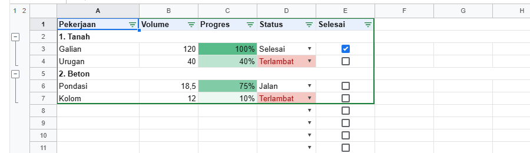
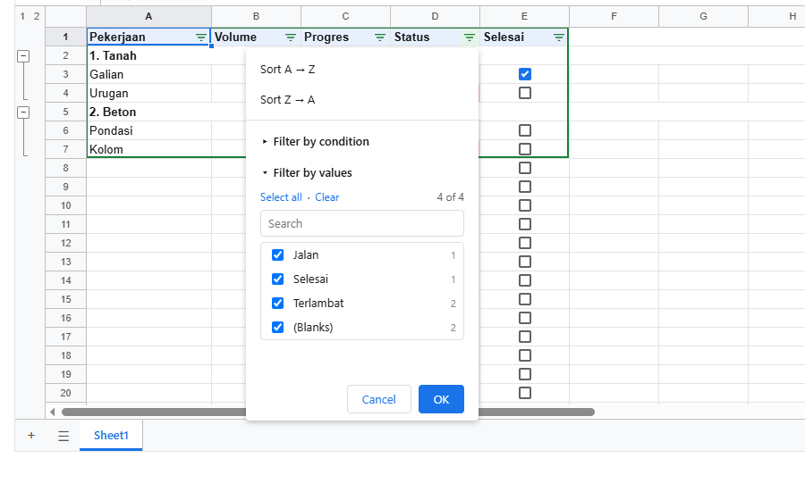

# 7. Data

[Daftar isi](../README.md#daftar-isi) · Sebelumnya: [6. Format dan locale](06-format.md) · Berikutnya: [8. Mengisi sheet dari data](08-populate.md)

Sort, filter, grup, validasi, conditional formatting, cari dan ganti. Semua ada di menu (Data, View, Format, Edit) untuk orang di layar, dan ada
fungsinya untuk kode.



Gambar di atas dibuat oleh kode ini:

<!-- contoh: 07-data.page.js -->
```jsx
import { useState } from 'react';
import { Sheet } from '@kufayeka/sheet';
import { createWorkbook } from '@kufayeka/sheet/core';
import '@kufayeka/sheet/style.css';

function buat() {
    const wb = createWorkbook();
    wb.setSettings({ locale: 'id-ID', currency: 'IDR' });
    const sh = wb.sheet('Sheet1');
    sh.setValues('A1', [
        ['Pekerjaan', 'Volume', 'Progres', 'Status', 'Selesai'],
        ['1. Tanah', '', '', '', ''],
        ['Galian', 120, 1, 'Selesai', true],
        ['Urugan', 40, 0.4, 'Terlambat', false],
        ['2. Beton', '', '', '', ''],
        ['Pondasi', 18.5, 0.75, 'Jalan', false],
        ['Kolom', 12, 0.1, 'Terlambat', false]
    ]);
    sh.setStyle('A1:E1', { bold: true, fill: '#e8f0fe' });
    sh.setStyle('A2, A5', { bold: true });
    sh.setStyle('C2:C7', { format: { type: 'percent', decimals: 0 } });
    sh.setColProps('A', { width: 140 });
    sh.groupRows('3:4');
    sh.groupRows('6:7');
    sh.addValidation('D2:D20', { kind: 'list', values: ['Jalan', 'Selesai', 'Terlambat'] });
    sh.addValidation('E2:E20', { kind: 'checkbox' });
    sh.addConditional('D2:D20', { op: 'textIs', a: 'terlambat', style: { fill: '#f4c7c3', color: '#a50e0e' } });
    sh.addConditional('C2:C20', { kind: 'scale', min: { type: 'number', value: 0, color: '#ffffff' }, max: { type: 'number', value: 1, color: '#57bb8a' } });
    sh.createFilter('A1:E7');
    return wb;
}

export default function HalamanData() {
    const [wb] = useState(buat);
    return <div style={{ height: 600 }}><Sheet workbook={wb} /></div>;
}
```
<!-- /contoh -->

- [7.1 Sort](#71-sort)
- [7.2 Filter](#72-filter)
- [7.3 Grup baris dan kolom](#73-grup-baris-dan-kolom)
- [7.4 Validasi data](#74-validasi-data)
- [7.5 Conditional formatting](#75-conditional-formatting)
- [7.6 Cari dan ganti](#76-cari-dan-ganti)

## 7.1 Sort

`sortRange(wb, sheet, range, kolom, arah)` dari `@kufayeka/sheet/core` mengurutkan baris-baris di range berdasarkan satu kolom. `arah` = `'asc'` atau
`'desc'`. Range-nya **tanpa** baris judul. Isi dan gaya sel pindah ke baris barunya; rumus yang menunjuk ke range itu tetap menunjuk ke tempat yang
sama, seperti di Google Sheets. Contohnya ada di 7.2.

Di layar: Data → Sort sheet / Sort range, atau menu tombol filter.

## 7.2 Filter

<!-- contoh: 07-sort-filter.js -->
```js
import { createWorkbook, sortRange } from '@kufayeka/sheet/core';

const wb = createWorkbook();
const sh = wb.sheet('Sheet1');
sh.setValues('A1', [
    ['Pekerjaan', 'Volume', 'Status'],
    ['Galian', 120, 'Approved'],
    ['Urugan', 40, 'Draft'],
    ['Beton', 18.5, 'Draft'],
    ['Besi', 2400, 'Approved']
]);
const kolomA = () => [1, 2, 3, 4].map((r) => sh.value(r, 0)).join(', ');

// sort: range tanpa header, kolom acuan, arah
sortRange(wb, 'Sheet1', 'A2:C5', 'B', 'desc');
console.log('urut volume turun :', kolomA());

// filter: range dengan header di baris pertamanya
sh.createFilter('A1:C5');
console.log('nilai kolom C     :', JSON.stringify(sh.filterValues('C')));
sh.setFilterColumn('C', { hidden: ['Draft'] });                    // berdasarkan nilai
const tampil = () => [1, 2, 3, 4].filter((r) => !sh.filteredOut(r)).map((r) => sh.value(r, 0)).join(', ');
console.log('hanya Approved    :', tampil());
sh.setFilterColumn('C', null);
sh.setFilterColumn('B', { op: 'between', a: 30, b: 200 });          // berdasarkan kondisi
console.log('volume 30..200    :', tampil());
console.log('filter            :', JSON.stringify(sh.filterOf().columns));
sh.removeFilter();
console.log('filter dihapus    :', tampil());
```
<!-- /contoh -->

<!-- hasil: 07-sort-filter.js -->
```text
urut volume turun : Besi, Galian, Urugan, Beton
nilai kolom C     : [{"text":"Approved","count":2},{"text":"Draft","count":2}]
hanya Approved    : Besi, Galian
volume 30..200    : Galian, Urugan
filter            : {"1":{"op":"between","a":30,"b":200}}
filter dihapus    : Besi, Galian, Urugan, Beton
```
<!-- /hasil -->

Satu sheet punya satu filter. Range filter termasuk baris judulnya; baris di bawahnya yang tidak lolos disembunyikan.

| Fungsi | Artinya |
|---|---|
| `createFilter(range)` | pasang filter (filter lama diganti) |
| `removeFilter()` | lepas filter; semua baris tampil lagi |
| `setFilterColumn(kolom, kriteria)` | kriteria satu kolom (`'C'` atau nomor). `null` = tampilkan semua |
| `filterOf()` | `{ range, columns: { nomorKolom: kriteria } }`, atau `null` |
| `filterValues(kolom)` | daftar nilai kolom itu dengan jumlahnya `[{ text, count }]`, urut; baris yang disembunyikan kolom lain tidak dihitung |
| `filteredOut(baris)` | `true` kalau baris itu disembunyikan filter |
| `dataRegion(at)` | blok data di sekitar sebuah sel (yang dipakai Data → Create a filter kalau cuma satu sel dipilih) |

Kriteria:

| Kunci | Artinya |
|---|---|
| `hidden: ['Draft', '']` | sembunyikan baris yang teksnya salah satu dari ini (`''` = sel kosong) |
| `op`, `a`, `b` | kondisi, sama dengan conditional formatting (7.5): `gt`, `between`, `textContains`, `dateBefore`, ... |
| `op: 'formula', formula` | rumus sendiri, ditulis untuk baris pertama di bawah judul |

Sama seperti Google Sheets, baris disaring **saat kriteria diubah**, bukan tiap kali sel diedit. Baris yang diedit sampai tidak cocok lagi tetap
tampil sampai filternya diterapkan lagi. Waktu workbook dibuka, filter diterapkan ke data saat itu.

Di layar, tiap judul dapat tombol filter:



## 7.3 Grup baris dan kolom

<!-- contoh: 07-grup.js -->
```js
import { createWorkbook } from '@kufayeka/sheet/core';

const wb = createWorkbook();
const sh = wb.sheet('Sheet1');
sh.setValues('A1', [['1. Tanah'], ['Galian'], ['Urugan'], ['2. Beton'], ['Pile'], ['Balok'], ['Kolom']]);
const terlihat = () => [0, 1, 2, 3, 4, 5, 6].filter((r) => sh.rowAxis().size(r) > 0).map((r) => sh.value(r, 0)).join(', ');

// grup: baris di bawah judul bab. Tombol [-] muncul di baris judulnya
sh.groupRows('2:3');
sh.groupRows('5:7');
sh.groupRows('6:7');                       // grup di dalam grup (level 2)
console.log('grup  :', JSON.stringify(sh.rowGroups()));

sh.foldRowGroup(1, 1, true);               // lipat grup yang mulai di baris nomor 1, level 1
console.log('lipat :', terlihat());
sh.showRowLevel(0);                        // tombol level "1": cuma yang di luar grup
console.log('lvl 1 :', terlihat());
sh.showRowLevel(1);                        // tombol level "2"
console.log('lvl 2 :', terlihat());
sh.showRowLevel(9);                        // semua terbuka
sh.ungroupRows('6:7');                     // lepas satu level
console.log('lepas :', JSON.stringify(sh.rowGroups().groups.map((g) => [g.level, g.from + 1, g.to + 1])));
```
<!-- /contoh -->

<!-- hasil: 07-grup.js -->
```text
grup  : {"groups":[{"level":1,"from":1,"to":2,"folded":false},{"level":1,"from":4,"to":6,"folded":false},{"level":2,"from":5,"to":6,"folded":false}],"maxLevel":2}
lipat : 1. Tanah, 2. Beton, Pile, Balok, Kolom
lvl 1 : 1. Tanah, 2. Beton
lvl 2 : 1. Tanah, Galian, Urugan, 2. Beton, Pile
lepas : [[1,2,3],[1,5,7]]
```
<!-- /hasil -->

Grup bisa bertingkat sampai 7 level. Tombol [−]/[+] ada di baris tepat di atas grup (baris judulnya), dan tombol level 1, 2, 3 ada di pojok.

| Fungsi | Artinya |
|---|---|
| `groupRows(range)` | `'2:3'`, atau `(dari, sampai)` nomor dari 0. Tiap baris naik satu level |
| `ungroupRows(range)` | turun satu level |
| `foldRowGroup(dari, level, terlipat)` | lipat/buka grup yang mulai di baris `dari` (nomor dari 0) dengan level itu |
| `showRowLevel(level)` | seperti tombol level: grup yang lebih dalam dari `level` dilipat, sisanya dibuka. `0` = lipat semua |
| `rowGroups()` | `{ groups: [{ level, from, to, folded }], maxLevel }` |
| `groupCols`, `ungroupCols`, `foldColGroup`, `showColLevel`, `colGroups` | sama, untuk kolom |

Baris yang disisipkan di tengah grup ikut masuk grup. Di layar: View → Group, `Alt+Shift+→` / `Alt+Shift+←`.

## 7.4 Validasi data

<!-- contoh: 07-validasi.js -->
```js
import { createWorkbook } from '@kufayeka/sheet/core';

const wb = createWorkbook();
const sh = wb.sheet('Sheet1');
const pesan = [];
wb.on('reject', (e) => pesan.push(e.reason));
sh.setValues('A1', [['Pekerjaan', 'Status', 'Volume', 'Selesai', 'Satuan']]);

sh.addValidation('B2:B50', { kind: 'list', values: ['Draft', 'Approved', 'Rejected'], help: 'Pilih status' });
sh.addValidation('C2:C50', { kind: 'number', op: 'gte', a: 0, reject: true });
sh.addValidation('D2:D50', { kind: 'checkbox' });
sh.setValues('G1', [['m3'], ['kg'], ['bh']]);
sh.addValidation('E2:E50', { kind: 'listFrom', source: 'G1:G3', reject: false }); // nilai lain diterima tapi ditandai

const user = { source: 'user' };
sh.setValues('B2', 'Approved', user);
sh.setValues('B3', 'Selesai', user);   // bukan pilihan: ditolak
sh.setValues('C2', -5, user);          // < 0: ditolak
sh.setValues('D2', true, user);
sh.setValues('E2', 'liter', user);     // diterima, tapi ditandai

console.log('B2, B3   :', sh.value('B2'), sh.value('B3'));
console.log('C2       :', sh.value('C2'));
console.log('ditolak  :', pesan.join(' | '));
console.log('pilihan  :', sh.choicesAt('E2').join(', '));
console.log('E2       :', sh.value('E2'), '-> tidak valid:', sh.invalidAt('E2'));
console.log('aturan D2:', sh.validationAt('D2').kind);
```
<!-- /contoh -->

<!-- hasil: 07-validasi.js -->
```text
B2, B3   : Approved null
C2       : null
ditolak  : The value in B3 must be one of: Draft, Approved, Rejected | The value in C2 must be at least 0
pilihan  : m3, kg, bh
E2       : liter -> tidak valid: one of: m3, kg, bh
aturan D2: checkbox
```
<!-- /hasil -->

Aturan validasi ditempel ke range dan tersimpan bersama sheet. Yang tidak sesuai ditolak (bawaan), atau diterima tapi ditandai (`reject: false`).

| `kind` | Pilihan | Di layar |
|---|---|---|
| `list` | `values: ['Draft', 'Approved']` | dropdown |
| `listFrom` | `source: 'Harga!A2:A20'` | dropdown dari isi range |
| `checkbox` | | kotak centang (`Space` untuk mencentang) |
| `number` | `op`, `a`, `b`: `between`, `notBetween`, `gt`, `gte`, `lt`, `lte`, `eq`, `ne` | |
| `date` | sama dengan `number`, nilainya tanggal | |
| `textLength` | sama dengan `number`, untuk panjang teks | |
| `text` | `op`: `contains`, `notContains` (dengan `a`), `email`, `url` | |

Pilihan untuk semua jenis: `reject` (bawaan `true`), `help` (teks bantuan yang muncul di bawah sel yang dipilih).

| Fungsi | Artinya |
|---|---|
| `addValidation(range, aturan)` | tambah aturan |
| `setValidation(range, aturan)` | pasang aturan, menggantikan aturan lain yang kena range itu (seperti tombol Done di dialog) |
| `removeValidation(range)` | hapus aturan yang kena range itu |
| `validationAt(at)` | aturan sebuah sel, atau `null` |
| `choicesAt(at)` | isi dropdown sel itu |
| `invalidAt(at)` | apa yang dilanggar nilai sel itu (untuk `reject: false`), atau `null` |

Pesan penolakannya dalam bahasa Inggris. Kalau mau bahasa lain, tangkap di `onReject` dan tampilkan pesanmu sendiri.


## 7.5 Conditional formatting

<!-- contoh: 07-conditional.js -->
```js
import { createWorkbook } from '@kufayeka/sheet/core';

const wb = createWorkbook();
const sh = wb.sheet('Sheet1');
sh.setValues('A1', [['Pekerjaan', 'Progres', 'Status'], ['Galian', 1, 'Selesai'], ['Urugan', 0.4, 'Terlambat'], ['Beton', 0.75, 'Jalan']]);

// satu warna: kondisi + gaya
sh.addConditional('C2:C4', { op: 'textIs', a: 'terlambat', style: { fill: '#f4c7c3', color: '#a50e0e', bold: true } });
// rumus sendiri, ditulis untuk sel kiri atas range; $C tetap kolom C, baris ikut geser
sh.addConditional('A2:A4', { op: 'formula', formula: '=$C2="Selesai"', style: { strike: true } });
// skala warna: merah ke hijau
sh.addConditional('B2:B4', { kind: 'scale', min: { type: 'number', value: 0, color: '#e67c73' }, max: { type: 'number', value: 1, color: '#57bb8a' } });

for (const a of ['C3', 'C4', 'A2', 'A3', 'B2', 'B3', 'B4']) console.log(a, JSON.stringify(sh.conditionalStyleAt(a)));

// isi sel berubah: gaya ikut berubah, tanpa menulis apa pun ke sel
sh.setValues('C3', 'Selesai');
console.log('C3 sesudah:', JSON.stringify(sh.conditionalStyleAt('C3')), '| A3 sesudah:', JSON.stringify(sh.conditionalStyleAt('A3')));
console.log('aturan    :', sh.conditionals().map((r) => r.op || r.kind).join(', '));
```
<!-- /contoh -->

<!-- hasil: 07-conditional.js -->
```text
C3 {"bold":true,"color":"#a50e0e","fill":"#f4c7c3"}
C4 null
A2 {"strike":true}
A3 null
B2 {"fill":"#57bb8a"}
B3 {"fill":"#ad957c"}
B4 {"fill":"#7bab84"}
C3 sesudah: null | A3 sesudah: {"strike":true}
aturan    : textIs, formula, scale
```
<!-- /hasil -->

Gaya dari conditional formatting dihitung waktu sel digambar. Tidak ada yang ditulis ke sel, jadi gaya sel sendiri tidak berubah. Aturan dicek
berurutan, dan **yang pertama cocok menang** (seperti Google Sheets).

Aturan satu warna: `{ op, a, b, style }`. Kondisi (`op`):

| `op` | Artinya |
|---|---|
| `empty`, `notEmpty` | kosong / ada isi |
| `textContains`, `textNotContains`, `textStarts`, `textEnds`, `textIs` | teks (huruf besar-kecil sama saja) |
| `dateIs`, `dateBefore`, `dateAfter` | tanggal; `a` = nomor hari, atau `'today'`, `'yesterday'`, `'tomorrow'`, `'pastWeek'`, `'pastMonth'`, `'pastYear'` |
| `gt`, `gte`, `lt`, `lte`, `eq`, `ne`, `between`, `notBetween` | angka (`eq`/`ne` juga untuk teks) |
| `formula` | `formula: '=$C2="Selesai"'`: rumus sendiri untuk sel kiri atas range; `$` mengunci kolom |

`style` boleh berisi `bold`, `italic`, `underline`, `strike`, `color`, `fill`.

Skala warna: `{ kind: 'scale', min, mid?, max }`, tiap titik `{ type, value, color }` dengan `type` = `'min'`, `'max'`, `'number'`, `'percent'`,
`'percentile'`.

| Fungsi | Artinya |
|---|---|
| `addConditional(range, aturan)` | tambah di urutan paling belakang. Range boleh beberapa: `'A2:A20, D2:D20'`. Mengembalikan id |
| `setConditional(id, range \| null, aturan)` | ubah aturan (`null` = range-nya tetap) |
| `removeConditional(id)` | hapus |
| `moveConditional(id, ke)` | ubah urutan |
| `conditionals()` | semua aturan sheet, urut |
| `conditionalStyleAt(at)` | gaya yang diberikan aturan ke sel itu, atau `null` |
| `shownStyle(at)` | gaya sel sendiri ditimpa gaya dari aturan: yang benar-benar digambar |

Di layar: Format → Conditional formatting membuka panel di kanan.

## 7.6 Cari dan ganti

<!-- contoh: 07-cari.js -->
```js
import { createWorkbook, findAll, replaceIn } from '@kufayeka/sheet/core';

const wb = createWorkbook();
const sh = wb.sheet('Sheet1');
sh.setValues('A1', [['Beton K-300', '=B1*2'], ['beton K-250', 5], ['Besi', 'Beton']]);

const alamat = (list) => list.map((p) => wb.address(p.r, p.c)).join(', ');
console.log('"beton"                :', alamat(findAll(wb, 'Sheet1', 'beton')));
console.log('huruf besar-kecil sama :', alamat(findAll(wb, 'Sheet1', 'beton', { matchCase: true })));
console.log('seluruh isi sel        :', alamat(findAll(wb, 'Sheet1', 'beton', { wholeCell: true })));
console.log('regex                  :', alamat(findAll(wb, 'Sheet1', 'K-\\d+', { regex: true })));
console.log('di dalam rumus         :', alamat(findAll(wb, 'Sheet1', 'B1', { inFormulas: true })));

const hasil = findAll(wb, 'Sheet1', 'K-300');
replaceIn(wb, 'Sheet1', hasil, 'K-300', 'K-350');
console.log('setelah ganti          :', sh.value('A1'));
```
<!-- /contoh -->

<!-- hasil: 07-cari.js -->
```text
"beton"                : A1, A2, B3
huruf besar-kecil sama : A2
seluruh isi sel        : B3
regex                  : A1, A2
di dalam rumus         : B1
setelah ganti          : Beton K-350
```
<!-- /hasil -->

| Fungsi | Artinya |
|---|---|
| `findAll(wb, sheet, teks, pilihan)` | semua sel yang cocok, urut baris lalu kolom: `[{ r, c }]` |
| `replaceIn(wb, sheet, sel, teks, pengganti, pilihan)` | ganti di sel-sel itu, satu perubahan. Isi diganti seperti diketik ulang. Rumus tidak disentuh kecuali `inFormulas` |

Pilihan: `matchCase` (huruf besar-kecil dibedakan), `wholeCell` (seluruh isi sel harus sama), `regex` (teksnya regular expression), `inFormulas` (cari
di rumus, bukan di hasilnya). Tanpa `inFormulas`, pencarian melihat teks yang tampil di sel.

Di layar: `Ctrl+F` (cari), `Ctrl+H` (cari dan ganti).

[Daftar isi](../README.md#daftar-isi) · Sebelumnya: [6. Format dan locale](06-format.md) · Berikutnya: [8. Mengisi sheet dari data](08-populate.md)
