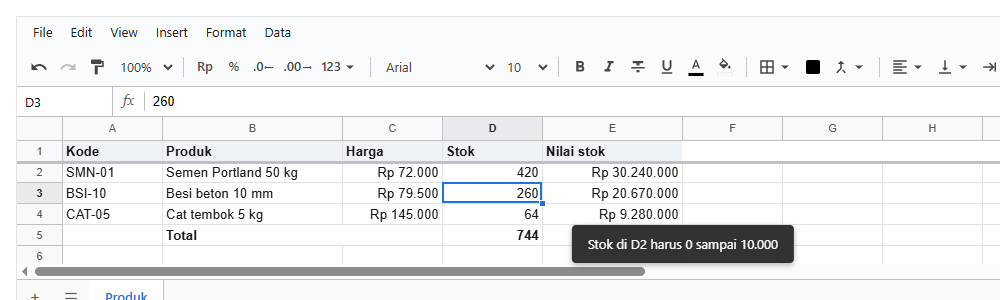
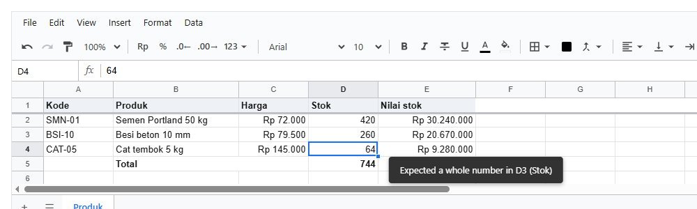
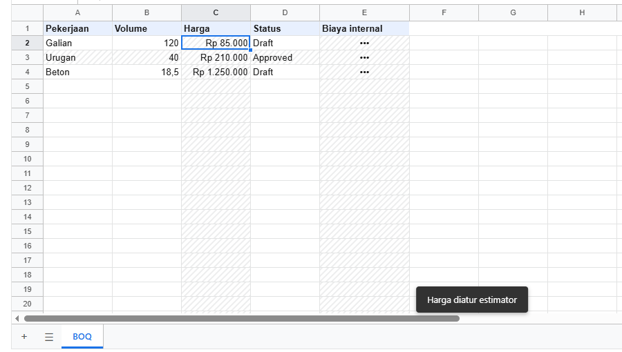
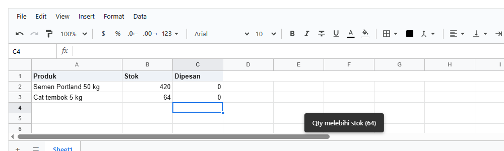

# 8. Menjaga isi yang diketik

[Daftar isi](../README.md#daftar-isi) · Sebelumnya: [7. Data](07-data.md) · Berikutnya: [9. Memuat dan menyimpan](09-menyimpan.md)

Bab ini membahas cara menjaga supaya yang diketik orang masuk akal: pilihan dari daftar, angka dengan batas, kolom yang hanya menerima bilangan
bulat, sel yang tidak boleh diubah, dan aturan bisnis yang membaca sel lain. Setiap langkah adalah satu halaman React dengan foto hasilnya.

**Bagian A. Pengenalan (tanpa kode)**
- [8.1 Empat cara menjaga isi](#81-empat-cara-menjaga-isi)
- [8.2 Kapan diperiksa](#82-kapan-diperiksa)

**Bagian B. Langkah demi langkah**
- [8.3 Pilihan dari daftar (dropdown)](#83-pilihan-dari-daftar-dropdown)
- [8.4 Angka dengan batas](#84-angka-dengan-batas)
- [8.5 Tipe kolom](#85-tipe-kolom)
- [8.6 Sel yang tidak boleh diubah](#86-sel-yang-tidak-boleh-diubah)
- [8.7 Aturan yang membaca sel lain: `beforeOp`](#87-aturan-yang-membaca-sel-lain-beforeop)

**Bagian C. Contoh lengkap, yang sering keliru, dan referensi**
- [8.8 Contoh lengkap](#88-contoh-lengkap)
- [8.9 Yang sering keliru](#89-yang-sering-keliru)
- [8.10 Referensi](#810-referensi)

---

# Bagian A. Pengenalan

## 8.1 Empat cara menjaga isi

| Cara | Untuk | Disimpan di file? | Diperiksa ulang di server? | Langkah |
|---|---|---|---|---|
| **Validasi data** | dropdown, checkbox, angka atau tanggal dengan batas, panjang teks, email | ya, ikut file (dan Excel) | ya | 8.3, 8.4 |
| **Tipe kolom** | jenis nilai satu kolom, seperti kolom tabel database: bilangan bulat, desimal, tanggal, salah satu dari daftar | tidak, dipasang kodemu setiap kali dibuka | ya | 8.5 |
| **Aturan sel** | sel yang hanya boleh dibaca, atau isinya disembunyikan | tidak, dipasang kodemu | ya | 8.6 |
| **`beforeOp`** | aturan bisnis yang membaca sel lain ("qty tidak boleh melebihi stok"), atau mengubah isian (kode jadi huruf besar) | tidak, fungsi di kodemu | tidak, jalankan juga di server kalau perlu | 8.7 |

Mulailah dari atas. Kalau validasi data sudah cukup, tidak perlu yang lain. `beforeOp` adalah pintu terakhir untuk yang tidak bisa ditulis dengan
tiga cara lainnya.

Untuk mengatur **siapa** boleh mengubah apa (kasir, gudang, pemilik), pakai hak akses ([bab 8](10-hak-akses.md)). Aturan sel di 8.6 adalah
bagian per sel dari hak akses itu, tanpa membedakan orang.

## 8.2 Kapan diperiksa

Semua pemeriksaan di bab ini berlaku untuk perubahan dari **orang** (`source: 'user'`, bab 2): yang diketik, di-paste, di-fill, atau di-drag.
Perubahan dari kodemu sendiri tidak diperiksa, karena kodemu dipercaya. Kalau sebuah perubahan dari kode mewakili isian orang, misalnya dari
formulir di luar sheet, tambahkan `{ source: 'user' }`.

Perubahan yang ditolak tidak masuk ke sheet: sel tetap berisi nilai lama, pesannya tampil di layar, dan event `reject` memberi tahu aplikasimu.

---

# Bagian B. Langkah demi langkah

## 8.3 Pilihan dari daftar (dropdown)

**Tujuan:** sel yang isinya dipilih dari daftar, dan tanda di sel yang isinya salah.

<!-- contoh: 07-validasi.page.js -->
```jsx
import { useState } from 'react';
import { Sheet } from '@kufayeka/sheet';
import '@kufayeka/sheet/style.css';
import { buatPesanan } from './07-validasi.js';

export default function HalamanPesanan() {
    const [wb] = useState(buatPesanan);
    return <div style={{ height: 500 }}><Sheet workbook={wb} /></div>;
}
```
<!-- /contoh -->

Sel C4 dipilih, lalu Alt+↓ membuka daftarnya:


Yang perlu diketahui:

- **Aturan diperiksa untuk yang datang dari orang**: diketik, di-paste, di-fill, atau ditulis kode dengan `{ source: 'user' }`. Kode yang menulis tanpa
  `source` (bawaannya `'code'`) tidak diperiksa. Isi dari kode tetap ditandai kalau melanggar, seperti D4 di contoh.
- **`reject: true`** (bawaan): yang melanggar ditolak. Sel tetap berisi nilai lama, pesannya tampil di layar, dan `wb.on('reject')` menerimanya.
  **`reject: false`**: nilainya disimpan tetapi sel diberi tanda segitiga merah, seperti email di E3.
- **`message`**: pesan penolakanmu sendiri, dalam bahasa aplikasimu. `{cell}` diganti alamat selnya. Tanpa `message`, pesannya dibuat dari aturan, dalam
  bahasa Inggris.
- **`help`**: teks bantuan yang tampil saat sel di range itu dipilih.
- Kalau dua aturan menimpa sel yang sama, aturan yang terakhir dibuat yang berlaku.

## 8.4 Angka dengan batas

**Tujuan:** stok harus 0 sampai 10.000. Yang di luar itu ditolak dengan pesan sendiri.

<!-- contoh: 08-04-batas.page.tsx -->
```tsx
import { useState } from 'react';
import { Sheet } from '@kufayeka/sheet';
import '@kufayeka/sheet/style.css';
import { buatProduk } from './data/produk.js';

// 8.4 Angka dengan batas: stok harus 0 sampai 10.000. Yang di luar itu ditolak dengan pesan sendiri.
function buat() {
    const wb = buatProduk();
    wb.sheet('Produk').addValidation('D2:D4', {                       // baru
        kind: 'number', op: 'between', a: 0, b: 10000,
        message: 'Stok di {cell} harus 0 sampai 10.000'
    });
    return wb;
}

export default function Halaman() {
    const [wb] = useState(buat);
    return <div style={{ height: 300 }}><Sheet workbook={wb} /></div>;
}
```
<!-- /contoh -->

Orang mengetik 20000 di D2:



**Penjelasan:**

- `addValidation(range, aturan)` memasang aturan di D2:D4. `kind: 'number'` dengan `op: 'between'` dan batas `a`, `b`.
- `message` adalah pesanmu sendiri. `{cell}` diganti alamat selnya.
- D2 tetap 420. Tanpa `message`, pesannya pesan bawaan.
- Semua jenis aturan (tanggal, panjang teks, email, checkbox) ada di 8.10.

## 8.5 Tipe kolom

**Tujuan:** kolom Stok hanya menerima bilangan bulat, seperti kolom `INTEGER` di tabel database.

<!-- contoh: 08-05-tipe.page.tsx -->
```tsx
import { useState } from 'react';
import { Sheet } from '@kufayeka/sheet';
import '@kufayeka/sheet/style.css';
import { buatProduk } from './data/produk.js';

// 8.5 Tipe kolom: kolom Stok hanya menerima bilangan bulat, seperti kolom INTEGER di tabel database.
function buat() {
    const wb = buatProduk();
    wb.sheet('Produk').setTypes({ headerRow: 1, fields: { Stok: { kind: 'int' } } });   // baru: kolom berjudul Stok
    return wb;
}

export default function Halaman() {
    const [wb] = useState(buat);
    return <div style={{ height: 300 }}><Sheet workbook={wb} /></div>;
}
```
<!-- /contoh -->

Orang mengetik 12,5 di D3:



**Penjelasan:**

- `setTypes({ headerRow: 1, fields: { Stok: { kind: 'int' } } })` memberi tipe ke kolom yang **judulnya** Stok. Kalau kolomnya dipindah, tipenya
  ikut.
- Pesannya menyebut sel dan nama kolomnya: `Expected a whole number in D3 (Stok)`. Event `cellError` juga memberi tahu aplikasimu.
- Tipe kolom cocok kalau isi sheet nantinya masuk ke tabel database: tipenya bisa disamakan dengan tipe kolom database. Semua jenis tipe ada di
  8.10.
- Tipe tidak disimpan di file. Pasang lagi setiap kali workbook dibuka.

## 8.6 Sel yang tidak boleh diubah

**Tujuan:** kasir hanya boleh mengubah stok: harga beli disembunyikan, kolom lain hanya dibaca, dan produk yang dihentikan terkunci seluruhnya.

<!-- contoh: 10-aturan.page.js -->
```jsx
import { useState } from 'react';
import { Sheet } from '@kufayeka/sheet';
import '@kufayeka/sheet/style.css';
import { buatProdukKasir } from './10-aturan.js';

export default function HalamanKasir() {
    const [wb] = useState(buatProdukKasir);
    // sel yang dilindungi aturan diberi gembok kecil di pojok (bawaan); marks={{ stripes: true }} menambah garis-garis
    return <div style={{ height: 520 }}><Sheet workbook={wb} /></div>;
}
```
<!-- /contoh -->

Orang mengetik di kolom yang dilindungi:



**Penjelasan:**

- `wb.setRules([...])` memasang aturan sel untuk orang yang sedang membuka. Setiap aturan berisi `range` atau `columns` (judul kolom), dan `mode`:
  `'readonly'` (hanya baca) atau `'hidden'` (`•••`).
- `when` membuat aturan hanya berlaku di baris yang rumusnya `TRUE`: di sini baris yang statusnya Dihentikan. Rumusnya ditulis untuk baris
  pertama range, lalu bergeser ke setiap baris.
- Sel yang dilindungi diberi gembok kecil di pojok (bawaan). Tandanya bisa diganti dengan prop `marks` ([10.25](10-hak-akses.md#1025-variasi-tanda)).
- Aturan sel sama untuk semua orang. Untuk aturan yang berbeda per orang atau per role, pakai hak akses ([bab 8](10-hak-akses.md)).

## 8.7 Aturan yang membaca sel lain: `beforeOp`

**Tujuan:** qty yang dipesan tidak boleh melebihi stok di baris yang sama.

<!-- contoh: 08-07-beforeop.page.tsx -->
```tsx
import { useState } from 'react';
import { Sheet } from '@kufayeka/sheet';
import { createWorkbook } from '@kufayeka/sheet/core';
import type { Op, OpContext } from '@kufayeka/sheet/core';
import '@kufayeka/sheet/style.css';

// 8.7 beforeOp: aturan yang membaca sel lain. Qty yang dipesan (kolom C) tidak boleh melebihi stok (kolom B) di baris yang sama.
function periksa(op: Op, ctx: OpContext): Op | { reject: string } {
    if (op.t !== 'cells' || ctx.source !== 'user') return op;                  // hanya yang diketik orang
    const sheet = op.sheet ?? '';
    for (const ch of op.changes) {
        if (ctx.workbook.colIndex(sheet, ch.col) !== 2 || typeof ch.after !== 'number') continue;   // hanya kolom C
        const r = ctx.workbook.rowIndex(sheet, ch.row);
        const stok = ctx.workbook.value(sheet, r, 1);
        if (typeof stok === 'number' && ch.after > stok) return { reject: 'Qty melebihi stok (' + stok + ')' };
    }
    return op;
}

function buat() {
    const wb = createWorkbook(null, { beforeOp: periksa });                    // baru
    wb.sheet('Sheet1').setValues('A1', [['Produk', 'Stok', 'Dipesan'], ['Semen Portland 50 kg', 420, 0], ['Cat tembok 5 kg', 64, 0]]);
    wb.sheet('Sheet1').setStyle('A1:C1', { bold: true, fill: '#eef2f7' });
    wb.sheet('Sheet1').setColProps('A', { width: 180 });
    return wb;
}

export default function Halaman() {
    const [wb] = useState(buat);
    return <div style={{ height: 300 }}><Sheet workbook={wb} /></div>;
}
```
<!-- /contoh -->

Orang mengetik 100 di C3, padahal stok cat hanya 64:



**Penjelasan:**

- `createWorkbook(null, { beforeOp })` memasang fungsi yang dipanggil untuk **setiap** perubahan, sebelum diterapkan.
- Fungsinya menerima op (2.4) dan konteks (`source`, `workbook`). Di sini hanya perubahan sel dari orang, di kolom C, yang diperiksa.
- `{ reject: 'alasan' }` menolak seluruh perubahan, dan alasannya tampil di layar.
- `beforeOp` tidak berjalan di server sendirian. Kalau aturan ini penting, jalankan pemeriksaan yang sama di server sebelum menyimpan.

| Dikembalikan | Akibatnya |
|---|---|
| `op` | diloloskan apa adanya |
| salinan op yang diubah | yang diterapkan adalah salinan itu (contoh: kode produk jadi huruf besar) |
| `null` atau `false` | op itu dibuang diam-diam, op lain di perubahan yang sama tetap jalan |
| `{ reject: 'alasan' }` | **seluruh** perubahan ditolak, event `reject` membawa alasannya, dan alasannya tampil di layar |

Kapan memakai `beforeOp` dan kapan memakai fitur bawaan:

---

# Bagian C. Contoh lengkap, yang sering keliru, dan referensi

## 8.8 Contoh lengkap

### Validasi data, dengan hasilnya

<!-- contoh: 07-validasi.js -->
```js
import { createWorkbook } from '@kufayeka/sheet/core';
import { PRODUK, KOLOM_PRODUK, CABANG } from './data/toko.js';

// Lembar pesanan pelanggan: setiap kolom punya aturan isian. Pilihan produk diambil dari sheet Produk, jadi produk baru langsung muncul di dropdown.
export function buatPesanan() {
    const wb = createWorkbook(null, { now: () => new Date(2026, 9, 27, 9, 0) });
    wb.setSettings({ locale: 'id-ID', currency: 'IDR' });
    const produk = wb.sheet(wb.addSheet('Produk'));
    produk.setValues('A1', [KOLOM_PRODUK, ...PRODUK]);

    const psn = wb.sheet('Sheet1');
    psn.setSheetProps({ name: 'Pesanan', freezeRows: 1 });
    psn.setValues('A1', [['Tanggal kirim', 'Cabang', 'Kode', 'Qty', 'Email pelanggan', 'Catatan', 'Lunas']]);
    psn.setStyle('A1:G1', { bold: true, fill: '#e8f0fe' });
    psn.setColProps('A', { format: { type: 'date' }, width: 110 });
    psn.setColProps('E', { width: 200 });
    psn.setColProps('F', { width: 180 });

    psn.addValidation('A2:A200', { kind: 'date', op: 'gte', a: 'today', reject: true, help: 'Tanggal kirim tidak boleh lewat' });
    psn.addValidation('B2:B200', { kind: 'list', values: CABANG, help: 'Cabang yang mengirim' });
    psn.addValidation('C2:C200', { kind: 'listFrom', source: 'Produk!A2:A50', reject: true, message: 'Kode di {cell} tidak ada di daftar produk' });
    psn.addValidation('D2:D200', { kind: 'number', op: 'between', a: 1, b: 500, reject: true, help: 'Qty 1 sampai 500',
        message: 'Qty di {cell} harus 1 sampai 500. Pesanan lebih besar lewat bagian proyek.' });
    psn.addValidation('E2:E200', { kind: 'text', op: 'email', reject: false });   // salah ketik diterima tapi ditandai
    psn.addValidation('F2:F200', { kind: 'textLength', op: 'lte', a: 40, reject: true });
    psn.addValidation('G2:G200', { kind: 'checkbox' });
    psn.setValues('A2', [[46324, 'Jakarta', 'SMN-01', 40, 'cv.bangunkarya@mail.com', 'Kirim pagi', true],
        [46325, 'Bandung', 'BSI-13', 25, 'toko.maju@mail', '', false]]);
    return wb;
}

const wb = buatPesanan();
const psn = wb.sheet('Pesanan');
const ditolak = [];
wb.on('reject', (e) => ditolak.push(e.reason));
const orang = { source: 'user' };                          // seperti diketik di layar: aturan diperiksa

psn.setValues('C3', 'XXX-99', orang);                      // bukan kode produk
psn.setValues('D3', 0, orang);                             // di luar 1..500
psn.setValues('A3', 46300, orang);                         // sebelum hari ini
psn.setValues('F3', 'Tolong telepon dulu sebelum truk berangkat ke lokasi proyek', orang);
psn.setValues('B3', 'Medan', orang);                       // list tanpa reject: ditolak juga (bawaannya menolak)
console.log('ditolak:');
for (const alasan of ditolak) console.log('  -', alasan);
console.log('isi tetap    :', psn.value('C3'), psn.value('D3'), psn.value('B3'));

// aturan yang hanya menandai: nilainya disimpan, sel diberi tanda
console.log('E3           :', psn.value('E3'), '-> tidak valid:', psn.invalidAt('E3'));
console.log('E2           :', psn.value('E2'), '-> tidak valid:', psn.invalidAt('E2'));

// pilihan dropdown dibaca dari sheet Produk: produk baru langsung jadi pilihan
console.log('pilihan C    :', psn.choicesAt('C2').length, 'kode, pertama', psn.choicesAt('C2').slice(0, 3).join(', '));
wb.setValues('Produk', 'A14', [['GNT-01', 'Genteng metal', 'Atap', 'lembar', 38000, 45000, 500, 100]]);
console.log('produk baru  :', psn.choicesAt('C2').length, 'kode, terakhir', psn.choicesAt('C2').slice(-1)[0]);
psn.setValues('C3', 'GNT-01', orang);
console.log('C3 sekarang  :', psn.value('C3'), '| bantuan D2:', psn.validationAt('D2').help);

// kode tetap bisa menulis apa saja: aturan hanya untuk yang datang dari orang
psn.setValues('D4', 9999);
console.log('dari kode    :', psn.value('D4'), '| ditandai:', psn.invalidAt('D4'));
```
<!-- /contoh -->

<!-- hasil: 07-validasi.js -->
```text
ditolak:
  - Kode di C3 tidak ada di daftar produk
  - Qty di D3 harus 1 sampai 500. Pesanan lebih besar lewat bagian proyek.
  - The value in A3 must be at least today
  - The value in F3 must be a text whose length is at most 40
  - The value in B3 must be one of: Jakarta, Bandung, Surabaya
isi tetap    : BSI-13 25 Bandung
E3           : toko.maju@mail -> tidak valid: an email address
E2           : cv.bangunkarya@mail.com -> tidak valid: null
pilihan C    : 12 kode, pertama SMN-01, SMN-02, BSI-10
produk baru  : 13 kode, terakhir GNT-01
C3 sekarang  : GNT-01 | bantuan D2: Qty 1 sampai 500
dari kode    : 9999 | ditandai: between 1 and 500
```
<!-- /hasil -->

### Tipe kolom

<!-- contoh: 10-tipe.js -->
```js
import { createWorkbook, fromApiMakerType, checkValue } from '@kufayeka/sheet/core';

// Master produk yang nanti disimpan ke database: setiap kolom punya tipe, jadi yang masuk ke sheet sudah pasti cocok dengan tabelnya.
// Tipe ditulis seperti Type di Nexa API Maker (types/Produk.type.json), atau langsung dalam bentuk kind.
const Produk = {
    name: 'Produk',
    fields: {
        Kode: { type: 'string' },
        Nama: { type: 'string' },
        Kategori: { type: 'KategoriProduk' },
        Harga: { type: 'decimal', scale: 0 },
        Stok: { type: 'int' },
        Aktif: { type: 'boolean' },
        'Mulai dijual': { type: 'date' }
    }
};
const library = { KategoriProduk: { name: 'KategoriProduk', enum: ['Semen', 'Besi', 'Cat', 'Keramik', 'Pipa'] } };

const wb = createWorkbook();
wb.setSettings({ locale: 'id-ID', currency: 'IDR' });
const p = wb.sheet('Sheet1');
p.setValues('A1', [['Kode', 'Nama', 'Kategori', 'Harga', 'Stok', 'Aktif', 'Mulai dijual']]);
// judul di baris 1 menyebut nama field: kolom dengan judul itu mendapat tipenya
p.setTypes({ headerRow: 1, fields: fromApiMakerType(Produk, library).fields });
console.log('tipe kolom    :', ['A2', 'C2', 'D2', 'E2', 'F2', 'G2'].map((a) => { const t = p.typeAt(a); return a[0] + ' ' + t.kind + (t.enum ? ' (pilihan ' + t.enum.length + ')' : ''); }).join(', '));

const salah = [];
wb.on('cellError', (e) => salah.push(e.address + ' ' + e.field + ': ' + JSON.stringify(e.value) + ' bukan ' + e.expected));
const orang = { source: 'user' };
p.setValues('A2', '0081', orang);                          // string: angka yang diketik tetap teks
p.setValues('B2', 'Semen Portland 50 kg', orang);
p.setValues('C2', 'Semen', orang);
p.setValues('C3', 'Pasir', orang);                         // bukan nilai enum
p.setValues('D2', '72.000', orang);
p.setValues('D3', '72.000,5', orang);                      // decimal dengan scale 0: tidak boleh ada desimal
p.setValues('E2', 420, orang);
p.setValues('E3', 12.5, orang);                            // int
p.setValues('F2', 'TRUE', orang);
p.setValues('F3', 'ya', orang);                            // boolean
p.setValues('G2', '01/10/2026', orang);
p.setValues('G3', 'minggu depan', orang);                  // date

console.log('baris 2       :', ['A2', 'B2', 'C2', 'D2', 'E2', 'F2', 'G2'].map((a) => JSON.stringify(p.value(a))).join(', '));
console.log('ditolak       :');
for (const s of salah) console.log('  -', s);
console.log('baris 3 tetap :', ['C3', 'D3', 'E3', 'F3', 'G3'].map((a) => JSON.stringify(p.value(a))).join(', '));

// tipe per huruf kolom, tanpa judul, untuk sheet lain
const w2 = createWorkbook();
w2.sheet('Sheet1').setTypes({ columns: { B: { kind: 'int' }, C: { kind: 'string', enum: ['Grosir', 'Eceran'] } } });
w2.setValues('Sheet1', 'B1', 3.5, orang);
w2.setValues('Sheet1', 'C1', 'Eceran', orang);
console.log('per huruf     :', JSON.stringify(w2.value('Sheet1', 'B1')), JSON.stringify(w2.value('Sheet1', 'C1')), JSON.stringify(w2.sheet('Sheet1').typeAt('C1')));

// checkValue: pemeriksaan yang sama tanpa sheet, misalnya di server sebelum menyimpan
console.log('checkValue    :', JSON.stringify(checkValue({ kind: 'int' }, 4)), JSON.stringify(checkValue({ kind: 'int' }, 4.5)), JSON.stringify(checkValue({ kind: 'decimal', scale: 2 }, 1.234)));
```
<!-- /contoh -->

<!-- hasil: 10-tipe.js -->
```text
tipe kolom    : A string, C string (pilihan 5), D decimal, E int, F boolean, G date
baris 2       : "0081", "Semen Portland 50 kg", "Semen", 72000, 420, true, 46296
ditolak       :
  - C3 Kategori: "Pasir" bukan one of: Semen, Besi, Cat, Keramik, Pipa
  - D3 Harga: 72000.5 bukan a number with at most 0 digits after the point
  - E3 Stok: 12.5 bukan a whole number
  - F3 Aktif: "ya" bukan TRUE or FALSE
  - G3 Mulai dijual: "minggu depan" bukan a date
baris 3 tetap : null, null, null, null, null
per huruf     : null "Eceran" {"kind":"string","enum":["Grosir","Eceran"],"field":"C"}
checkValue    : null "a whole number" "a number with at most 2 digits after the point"
```
<!-- /hasil -->

Tipe dipasang per sheet dengan salah satu dari dua cara:

- **Menurut judul kolom**: `setTypes({ headerRow: 1, fields: { Stok: { kind: 'int' }, ... } })`. Kolom yang judulnya sama dengan nama field mendapat
  tipe itu, jadi tetap benar walaupun kolomnya dipindah. `fromApiMakerType(Type, library)` membuat `fields` dari sebuah Type Nexa API Maker.
- **Menurut huruf kolom**: `setTypes({ columns: { B: { kind: 'int' } } })`.

`setTypes(null)` membuang tipe sheet itu.

### Aturan sel

<!-- contoh: 10-aturan.js -->
```js
import { createWorkbook } from '@kufayeka/sheet/core';
import { PRODUK, KOLOM_PRODUK } from './data/toko.js';

// Daftar produk yang dibuka kasir: harga beli tidak boleh terlihat, harga jual hanya boleh dibaca, produk yang dihentikan terkunci seluruhnya.
// Kasir hanya boleh mengubah stok dan status.
export function buatProdukKasir() {
    const wb = createWorkbook();
    wb.setSettings({ locale: 'id-ID', currency: 'IDR' });
    const p = wb.sheet('Sheet1');
    p.setSheetProps({ name: 'Produk', freezeRows: 1 });
    p.setValues('A1', [[...KOLOM_PRODUK, 'Status'], ...PRODUK.map((x, i) => [...x, i === 7 ? 'Dihentikan' : 'Aktif'])]);
    p.setStyle('A1:I1', { bold: true, fill: '#e8f0fe' });
    p.setColProps('E:F', { format: { type: 'money', decimals: 0 } });
    p.setColProps('B', { width: 180 });

    // aturan dari backend untuk peran "kasir". Kolom disebut menurut judulnya, jadi tetap benar walau kolom dipindah
    wb.setRules([
        { sheet: 'Produk', columns: ['Harga beli'], mode: 'hidden' },
        { sheet: 'Produk', columns: ['Kode', 'Nama produk', 'Kategori', 'Satuan', 'Harga jual', 'Stok min.'], mode: 'readonly',
            message: 'Data produk diatur bagian pembelian' },
        { sheet: 'Produk', range: 'A2:I1000', when: '=$I2="Dihentikan"', mode: 'readonly', message: 'Produk ini sudah dihentikan' }
    ]);
    return wb;
}

const wb = buatProdukKasir();
const p = wb.sheet('Produk');
const ditolak = [];
wb.on('reject', (e) => ditolak.push(e.reason));
const kasir = { source: 'user' };                            // yang diketik kasir di layar

p.setValues('G2', 400, kasir);                               // stok: boleh
p.setValues('F2', 1, kasir);                                 // harga jual: ditolak
p.setValues('G9', 30, kasir);                                // stok produk yang dihentikan: ditolak
p.setValues('I3', 'Dihentikan', kasir);                      // status: boleh, dan baris itu langsung terkunci
p.setValues('G3', 50, kasir);
console.log('stok G2, G3   :', p.value('G2'), p.value('G3'));
console.log('ditolak       :');
for (const alasan of ditolak) console.log('  -', alasan);

console.log('mode sel      :', ['E2', 'F2', 'G2', 'G9'].map((a) => a + ' ' + ((p.modeAt(a) || {}).mode || 'bebas')).join(' | '));
console.log('harga beli E2 :', p.display('E2').text, '| input', JSON.stringify(p.input('E2')), '| judul E1 tetap:', p.display('E1').text);

// kode aplikasi sendiri tidak dihalangi aturan: misalnya sinkron harga dari sistem pembelian
p.setValues('F2', 75000);
console.log('dari kode     :', p.display('F2').text);

// aturan bukan bagian workbook: tidak disimpan, tidak masuk undo, diganti utuh oleh setRules berikutnya
console.log('isi toJSON    :', Object.keys(wb.toJSON()).join(', '), '(aturan tidak ikut)');
wb.setRules([]);                                             // peran manajer: tanpa aturan
console.log('manajer       :', p.display('E2').text, '| mode F2', p.modeAt('F2'));
```
<!-- /contoh -->

<!-- hasil: 10-aturan.js -->
```text
stok G2, G3   : 400 35
ditolak       :
  - Data produk diatur bagian pembelian
  - Produk ini sudah dihentikan
  - Produk ini sudah dihentikan
mode sel      : E2 hidden | F2 readonly | G2 bebas | G9 readonly
harga beli E2 : ••• | input "" | judul E1 tetap: Harga beli
dari kode     : Rp 75.000
isi toJSON    : id, version, settings, sheets (aturan tidak ikut)
manajer       : Rp 64.000 | mode F2 null
```
<!-- /hasil -->

### `beforeOp`: meloloskan, mengubah, membuang, menolak

<!-- contoh: 04-10-beforeop.ts -->
```ts
import { createWorkbook } from '@kufayeka/sheet/core';
import type { Op, OpContext } from '@kufayeka/sheet/core';

// Pelajaran 10: beforeOp, pintu yang dilewati setiap perubahan. Bisa meloloskan, mengubah, membuang, atau menolak.
function periksa(op: Op, ctx: OpContext): Op | null | { reject: string } {
    // hanya perubahan isi sel dari orang yang diperiksa; kode aplikasi dibiarkan
    if (op.t !== 'cells' || ctx.source !== 'user') return op;
    const kolom = (col: string) => ctx.workbook.colIndex(op.sheet ?? '', col);
    // menolak: Qty (kolom B) lebih dari stok di D1
    const stok = ctx.workbook.value(op.sheet ?? '', 0, 3);
    if (op.changes.some((ch) => kolom(ch.col) === 1 && typeof ch.after === 'number' && typeof stok === 'number' && ch.after > stok)) {
        return { reject: 'Qty melebihi stok (' + stok + ')' };
    }
    // membuang diam-diam: isi kolom E (catatan internal) tidak boleh diubah orang
    const changes = op.changes.filter((ch) => kolom(ch.col) !== 4);
    if (!changes.length) return null;
    // mengubah: kode produk (kolom A) selalu huruf besar
    return { ...op, changes: changes.map((ch) => (kolom(ch.col) === 0 && typeof ch.after === 'string' ? { ...ch, after: ch.after.toUpperCase() } : ch)) };
}

const wb = createWorkbook(null, { beforeOp: periksa });
const s = wb.sheet('Sheet1');
s.setValues('C1', [['Stok', 50]]);
const ditolak: string[] = [];
wb.on('reject', (e) => ditolak.push(e.reason));

const orang = { source: 'user' } as const;
s.setValues('A2', 'smn-01', orang);
s.setValues('B2', 40, orang);
s.setValues('B2', 80, orang);
s.setValues('E2', 'catatan', orang);
console.log('A2 diubah jadi huruf besar :', s.value('A2'));
console.log('B2: 80 ditolak, 40 tetap   :', s.value('B2'));
console.log('E2 dibuang diam-diam       :', s.value('E2'));
console.log('ditolak                    :', ditolak.join(' / '));
s.setValues('B2', 999);                                  // kode aplikasi: source 'code', dibiarkan
console.log('dari kode                  :', s.value('B2'));
```
<!-- /contoh -->

<!-- hasil: 04-10-beforeop.ts -->
```text
A2 diubah jadi huruf besar : SMN-01
B2: 80 ditolak, 40 tetap   : 40
E2 dibuang diam-diam       : null
ditolak                    : Qty melebihi stok (50)
dari kode                  : 999
```
<!-- /hasil -->

`beforeOp(op, ctx)` menerima op (4.12) dan `ctx` berisi `{ source, user, workbook }`. Kembalikan salah satu dari empat:

## 8.9 Yang sering keliru

| Keliru | Benar |
|---|---|
| Isian dari kode tidak diperiksa | memang tidak; tambahkan `{ source: 'user' }` kalau mewakili isian orang (8.2) |
| Tipe kolom hilang setelah dibuka ulang | tipe dan aturan sel tidak disimpan; pasang lagi setiap kali dibuka |
| Memakai `beforeOp` untuk batas angka sederhana | pakai validasi data (8.4): ikut file, ikut Excel, dan diperiksa server |
| Aturan sel diharapkan berbeda per kasir | aturan sel sama untuk semua orang; pakai hak akses (bab 8) |
| `beforeOp` dianggap aman dari browser yang diakali | jalankan pemeriksaan yang sama di server |

## 8.10 Referensi

### Validasi data

| `kind` | Isinya | Pilihan |
|---|---|---|
| `list` | dropdown dari daftar tetap | `values: ['Jakarta', 'Bandung']` |
| `listFrom` | dropdown dari isi range lain, termasuk sheet lain | `source: 'Produk!A2:A50'`. Sel kosong di range dilewati |
| `checkbox` | kotak centang. Isinya `true` atau `false` | |
| `number` | angka dengan syarat | `op`: `between`, `notBetween`, `eq`, `ne`, `gt`, `gte`, `lt`, `lte`, lalu `a`, `b` |
| `date` | tanggal dengan syarat | `op` sama dengan angka. `a` boleh nomor hari atau `'today'` |
| `textLength` | panjang teks dengan syarat | `op` sama dengan angka |
| `text` | teks dengan syarat | `op`: `contains`, `notContains` (dengan `a`), `email`, `url` |

| Fungsi | Artinya |
|---|---|
| `addValidation(range, aturan)` | tambah aturan. Mengembalikan id |
| `setValidation(range, aturan)` | pasang aturan menggantikan aturan yang menimpa range itu (yang dilakukan tombol Done di dialog) |
| `removeValidation(range)` | buang aturan yang menimpa range |
| `validationAt(alamat)` | aturan sebuah sel, atau `null` |
| `choicesAt(alamat)` | pilihan dropdown sebuah sel |
| `invalidAt(alamat)` | apa yang dilanggar nilai sel itu (teks), atau `null` kalau sesuai |

Untuk aturan yang lebih dari ini, misalnya "Qty tidak boleh melebihi stok di sheet Produk", pakai `beforeOp` ([8.7](08-menjaga-isi.md#87-aturan-yang-membaca-sel-lain-beforeop))
atau aturan dan tipe kolom ([bab 8](08-menjaga-isi.md)).

### Tipe kolom

| `kind` | Sel menerima | Contoh salah |
|---|---|---|
| `string` | teks apa saja. Angka yang diketik tetap teks, jadi `0081` tetap `0081` | |
| `string` dengan `enum: [...]` | salah satu nilai di daftar | `Pasir` kalau tidak ada di daftar |
| `int` | bilangan bulat | `12,5` |
| `number` | angka | `banyak` |
| `decimal` dengan `scale` | angka dengan desimal paling banyak `scale` digit | `72.000,5` dengan `scale: 0` |
| `boolean` | `TRUE` atau `FALSE` | `ya` |
| `date` | tanggal (satu hari penuh) | `minggu depan` |
| `datetime` | tanggal dan jam | |
| `json` | apa saja, tidak diperiksa | |

Yang perlu diketahui:

- **Sel kosong selalu boleh.** Apakah sebuah kolom wajib diisi ditentukan saat data disimpan, bukan di sheet.
- **Yang salah ditolak**, nilainya tidak masuk, dan event `cellError` (prop `onCellError` di `<Sheet>`) menerima `{ address, field, value, expected }`
  untuk ditampilkan dengan caramu sendiri. Pesan `expected` dalam bahasa Inggris.
- **Ketikan dibaca menurut locale dulu**, baru diperiksa. Dengan `id-ID`, `72.000` di kolom `decimal` adalah 72000.
- `typeAt(alamat)` memberi tipe sebuah sel, termasuk nama field-nya.
- `checkValue(tipe, nilai)` menjalankan pemeriksaan yang sama tanpa sheet, misalnya di server. Hasilnya `null` kalau cocok, atau teks yang diharapkan.

### Aturan sel (`setRules`)

| Kunci aturan | Artinya | Bawaan |
|---|---|---|
| `sheet` | nama atau id sheet | semua sheet |
| `range` | sel yang diatur, misalnya `'A2:I1000'`. Mengikuti baris yang disisipkan | seluruh sheet |
| `columns` | hanya kolom tertentu, menurut judulnya (`'Harga beli'`) atau hurufnya (`'E'`) | semua kolom |
| `headerRow` | baris tempat judul kolom, dihitung dari 1 | `1` |
| `when` | hanya di baris yang rumusnya `TRUE`. Ditulis untuk baris pertama range (atau baris di bawah judul), lalu bergeser ke baris lain | selalu |
| `mode` | `'readonly'`: boleh dilihat, tidak boleh diubah. `'hidden'`: isinya tampil `•••` dan tidak bisa dibaca, disalin, atau dicari | |
| `message` | pesan untuk orang yang perubahannya ditolak | pesan bawaan dalam bahasa Inggris |

Yang perlu diketahui:

- **Hanya untuk orang.** Perubahan dari orang (diketik, di-paste, di-fill, dihapus, atau ditulis kode dengan `{ source: 'user' }`) diperiksa. Kode
  aplikasimu sendiri tidak dihalangi.
- **`when` dihitung terus.** Begitu status sebuah produk diubah menjadi "Dihentikan", barisnya langsung terkunci, seperti G3 di contoh.
- **`hidden` hanya di layar.** Nilai asli tetap ada di workbook dan rumus tetap menghitungnya. Kalau nilainya sama sekali tidak boleh sampai ke browser,
  jangan kirim nilainya. `viewFor` di server membuang nilai itu sebelum dikirim ([bab 9](09-menyimpan.md)).
- **Judul kolom tetap tampil.** Baris judul (`headerRow`) tidak ikut disembunyikan atau dikunci oleh aturan `columns`.
- **Menghapus baris yang memuat sel terlindung** ditolak, begitu juga menghapus kolomnya.
- `setRules(daftar)` mengganti seluruh aturan. `setRules([])` membuang semuanya.

| Fungsi | Artinya |
|---|---|
| `wb.setRules(daftar)` | pasang aturan untuk orang yang membuka sheet |
| `modeAt(alamat)` | `{ mode, message }` untuk sel itu, atau `null` kalau bebas |

[Daftar isi](../README.md#daftar-isi) · Sebelumnya: [7. Data](07-data.md) · Berikutnya: [9. Memuat dan menyimpan](09-menyimpan.md)
