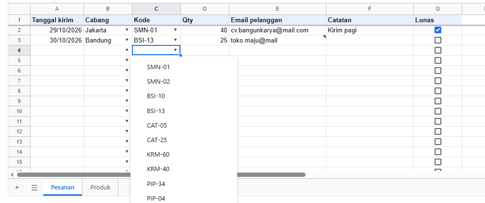
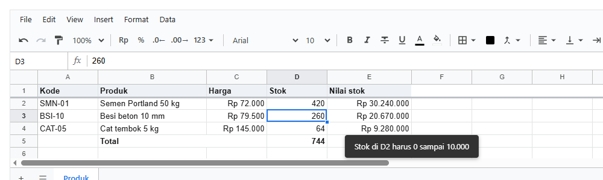
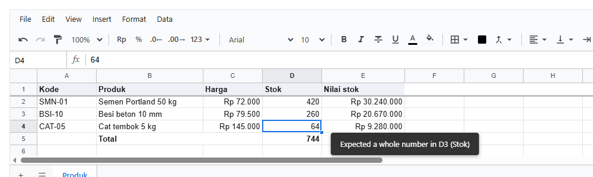
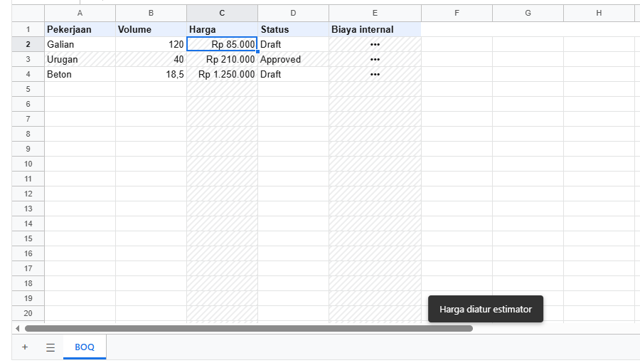
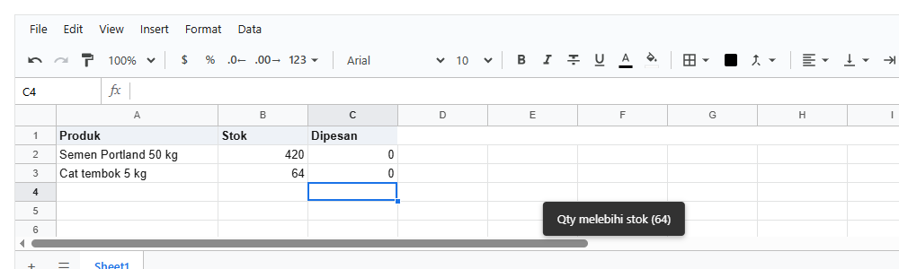

# 08. Validasi Data & Proteksi Sel

[Daftar isi](../README.md#daftar-isi) · Sebelumnya: [07. Operasi Data](07-data.md) · Berikutnya: [09. Persistensi State & Sinkronisasi Server](09-menyimpan.md)

Bab ini mengupas empat lapis sistem pertahanan dan integritas data pada `@kufayeka/sheet`: **Data Validation** (dropdown list, batas rentang nilai, format email/URL, regex), penegakan skema tipe data kolom (**Column Schema Types**), penguncian sel dan proteksi hak akses (**Cell Protection / Read-only Mode**), serta interceptor mutasi transaksional tingkat lanjut (**`beforeOp`**).

---

## 1. Empat Lapisan Pertahanan Data

Sistem proteksi data bekerja dalam hierarki berlapis:

```text
┌────────────────────────────────────────────────────────┐
│           Input Pengguna (Antarmuka Grid / API)        │
└───────────────────────────┬────────────────────────────┘
                            │
                            ▼
┌────────────────────────────────────────────────────────┐
│  Lapis 1: Data Validation (Dropdown List, Min/Max)     │
└───────────────────────────┬────────────────────────────┘
                            │
                            ▼
┌────────────────────────────────────────────────────────┐
│  Lapis 2: Column Schema Types (Int, Date, Scale)       │
└───────────────────────────┬────────────────────────────┘
                            │
                            ▼
┌────────────────────────────────────────────────────────┐
│  Lapis 3: Cell Locking / ACL (Read-only, Hidden)       │
└───────────────────────────┬────────────────────────────┘
                            │
                            ▼
┌────────────────────────────────────────────────────────┐
│  Lapis 4: Transactional Interceptor (Hook beforeOp)    │
└───────────────────────────┬────────────────────────────┘
                            │ lolos validasi
                            ▼
┌────────────────────────────────────────────────────────┐
│             Aplikasi Mutasi State ke Workbook          │
└────────────────────────────────────────────────────────┘
```

| Lapisan Proteksi | Titik Evaluasi | Karakteristik Utama |
|---|---|---|
| **1. Data Validation** | UI & File Ekspor | Menampilkan panduan visual (dropdown popup, checkbox, tanda segitiga invalid). Aturan ini ikut tersimpan saat diekspor ke file Excel `.xlsx`. |
| **2. Column Types** | Parsing Input | Menolak tipe yang tidak kompatibel (misal: desimal pada kolom `int`). Memancarkan event `cellError`. |
| **3. Cell Locking** | Interaksi Pengguna | Menolak edit langsung pada sel tertentu (read-only) atau menyembunyikan rumus/nilai sensitif. |
| **4. `beforeOp` Hook** | Pipeline Mutasi Transaksional | Middleware kustom yang dapat memvalidasi lintas sel, mengubah nilai (auto-uppercase), membuang field terlarang, atau melempar rejection error. |

---

## 2. Implementasi Panduan Langkah demi Langkah

---

### 2.1 Menu Pilihan Dropdown & Validasi Format Teks

Membuat menu pilihan dropdown dari list nilai statis atau referensi range lain, serta validasi pola teks (seperti email):

<!-- contoh: 07-validasi.page.js -->
```jsx
import { useState } from 'react';
import { Sheet } from '@kufayeka/sheet';
import '@kufayeka/sheet/style.css';
import { buatPesanan } from './07-validasi.js';

export default function HalamanPesanan() {
    const [wb] = useState(buatPesanan);
    return <div style={{ height: 500 }}><Sheet workbook={wb} /></div>;
}
```
<!-- /contoh -->



---

### 2.2 Batasan Nilai Numerik & Penolakan Aksi

Membatasi rentang nilai yang diizinkan untuk mencegah anomali data (misal: stok tidak boleh melebihi batas fisik gudang):

<!-- contoh: 08-04-batas.page.tsx -->
```tsx
import { useState } from 'react';
import { Sheet } from '@kufayeka/sheet';
import '@kufayeka/sheet/style.css';
import { buatProduk } from './data/produk.js';

// 8.4 Angka dengan batas: stok harus 0 sampai 10.000. Yang di luar itu ditolak dengan pesan sendiri.
function buat() {
    const wb = buatProduk();
    wb.sheet('Produk').addValidation('D2:D4', {                       // baru
        kind: 'number', op: 'between', a: 0, b: 10000,
        message: 'Stok di {cell} harus 0 sampai 10.000'
    });
    return wb;
}

export default function Halaman() {
    const [wb] = useState(buat);
    return <div style={{ height: 300 }}><Sheet workbook={wb} /></div>;
}
```
<!-- /contoh -->



---

### 2.3 Skema Tipe Kolom (Column Schema Enforcement)

Tipe kolom memastikan konsistensi struktur data dengan memvalidasi dan menolak masukan yang salah tipe:

<!-- contoh: 08-05-tipe.page.tsx -->
```tsx
import { useState } from 'react';
import { Sheet } from '@kufayeka/sheet';
import '@kufayeka/sheet/style.css';
import { buatProduk } from './data/produk.js';

// 8.5 Tipe kolom: kolom Stok hanya menerima bilangan bulat, seperti kolom INTEGER di tabel database.
function buat() {
    const wb = buatProduk();
    wb.sheet('Produk').setTypes({ headerRow: 1, fields: { Stok: { kind: 'int' } } });   // baru: kolom berjudul Stok
    return wb;
}

export default function Halaman() {
    const [wb] = useState(buat);
    return <div style={{ height: 300 }}><Sheet workbook={wb} /></div>;
}
```
<!-- /contoh -->



---

### 2.4 Proteksi Sel & Read-Only Access

Sel kalkulasi atau master data dapat dikunci secara permanen agar tidak dapat dimodifikasi pengguna:

<!-- contoh: 10-aturan.page.js -->
```jsx
import { useState } from 'react';
import { Sheet } from '@kufayeka/sheet';
import '@kufayeka/sheet/style.css';
import { buatProdukKasir } from './10-aturan.js';

export default function HalamanKasir() {
    const [wb] = useState(buatProdukKasir);
    // sel yang dilindungi aturan diberi gembok kecil di pojok (bawaan); marks={{ stripes: true }} menambah garis-garis
    return <div style={{ height: 520 }}><Sheet workbook={wb} /></div>;
}
```
<!-- /contoh -->



---

### 2.5 Interceptor Transaksional via `beforeOp` Hook

Hook `beforeOp` bertindak sebagai middleware penilai di level core engine sebelum suatu mutasi diaplikasikan:

<!-- contoh: 08-07-beforeop.page.tsx -->
```tsx
import { useState } from 'react';
import { Sheet } from '@kufayeka/sheet';
import { createWorkbook } from '@kufayeka/sheet/core';
import type { Op, OpContext } from '@kufayeka/sheet/core';
import '@kufayeka/sheet/style.css';

// 8.7 beforeOp: aturan yang membaca sel lain. Qty yang dipesan (kolom C) tidak boleh melebihi stok (kolom B) di baris yang sama.
function periksa(op: Op, ctx: OpContext): Op | { reject: string } {
    if (op.t !== 'cells' || ctx.source !== 'user') return op;                  // hanya yang diketik orang
    const sheet = op.sheet ?? '';
    for (const ch of op.changes) {
        if (ctx.workbook.colIndex(sheet, ch.col) !== 2 || typeof ch.after !== 'number') continue;   // hanya kolom C
        const r = ctx.workbook.rowIndex(sheet, ch.row);
        const stok = ctx.workbook.value(sheet, r, 1);
        if (typeof stok === 'number' && ch.after > stok) return { reject: 'Qty melebihi stok (' + stok + ')' };
    }
    return op;
}

function buat() {
    const wb = createWorkbook(null, { beforeOp: periksa });                    // baru
    wb.sheet('Sheet1').setValues('A1', [['Produk', 'Stok', 'Dipesan'], ['Semen Portland 50 kg', 420, 0], ['Cat tembok 5 kg', 64, 0]]);
    wb.sheet('Sheet1').setStyle('A1:C1', { bold: true, fill: '#eef2f7' });
    wb.sheet('Sheet1').setColProps('A', { width: 180 });
    return wb;
}

export default function Halaman() {
    const [wb] = useState(buat);
    return <div style={{ height: 300 }}><Sheet workbook={wb} /></div>;
}
```
<!-- /contoh -->



---

## 3. Eksekusi Programatis via Core Engine

Di bawah ini adalah eksekusi pengujian aturan validasi dan interceptor mutasi pada lingkungan Node.js:

### Validasi Data Programatis

<!-- contoh: 07-validasi.js -->
```js
import { createWorkbook } from '@kufayeka/sheet/core';
import { PRODUK, KOLOM_PRODUK, CABANG } from './data/toko.js';

// Lembar pesanan pelanggan: setiap kolom punya aturan isian. Pilihan produk diambil dari sheet Produk, jadi produk baru langsung muncul di dropdown.
export function buatPesanan() {
    const wb = createWorkbook(null, { now: () => new Date(2026, 9, 27, 9, 0) });
    wb.setSettings({ locale: 'id-ID', currency: 'IDR' });
    const produk = wb.sheet(wb.addSheet('Produk'));
    produk.setValues('A1', [KOLOM_PRODUK, ...PRODUK]);

    const psn = wb.sheet('Sheet1');
    psn.setSheetProps({ name: 'Pesanan', freezeRows: 1 });
    psn.setValues('A1', [['Tanggal kirim', 'Cabang', 'Kode', 'Qty', 'Email pelanggan', 'Catatan', 'Lunas']]);
    psn.setStyle('A1:G1', { bold: true, fill: '#e8f0fe' });
    psn.setColProps('A', { format: { type: 'date' }, width: 110 });
    psn.setColProps('E', { width: 200 });
    psn.setColProps('F', { width: 180 });

    psn.addValidation('A2:A200', { kind: 'date', op: 'gte', a: 'today', reject: true, help: 'Tanggal kirim tidak boleh lewat' });
    psn.addValidation('B2:B200', { kind: 'list', values: CABANG, help: 'Cabang yang mengirim' });
    psn.addValidation('C2:C200', { kind: 'listFrom', source: 'Produk!A2:A50', reject: true, message: 'Kode di {cell} tidak ada di daftar produk' });
    psn.addValidation('D2:D200', { kind: 'number', op: 'between', a: 1, b: 500, reject: true, help: 'Qty 1 sampai 500',
        message: 'Qty di {cell} harus 1 sampai 500. Pesanan lebih besar lewat bagian proyek.' });
    psn.addValidation('E2:E200', { kind: 'text', op: 'email', reject: false });   // salah ketik diterima tapi ditandai
    psn.addValidation('F2:F200', { kind: 'textLength', op: 'lte', a: 40, reject: true });
    psn.addValidation('G2:G200', { kind: 'checkbox' });
    psn.setValues('A2', [[46324, 'Jakarta', 'SMN-01', 40, 'cv.bangunkarya@mail.com', 'Kirim pagi', true],
        [46325, 'Bandung', 'BSI-13', 25, 'toko.maju@mail', '', false]]);
    return wb;
}

const wb = buatPesanan();
const psn = wb.sheet('Pesanan');
const ditolak = [];
wb.on('reject', (e) => ditolak.push(e.reason));
const orang = { source: 'user' };                          // seperti diketik di layar: aturan diperiksa

psn.setValues('C3', 'XXX-99', orang);                      // bukan kode produk
psn.setValues('D3', 0, orang);                             // di luar 1..500
psn.setValues('A3', 46300, orang);                         // sebelum hari ini
psn.setValues('F3', 'Tolong telepon dulu sebelum truk berangkat ke lokasi proyek', orang);
psn.setValues('B3', 'Medan', orang);                       // list tanpa reject: ditolak juga (bawaannya menolak)
console.log('ditolak:');
for (const alasan of ditolak) console.log('  -', alasan);
console.log('isi tetap    :', psn.value('C3'), psn.value('D3'), psn.value('B3'));

// aturan yang hanya menandai: nilainya disimpan, sel diberi tanda
console.log('E3           :', psn.value('E3'), '-> tidak valid:', psn.invalidAt('E3'));
console.log('E2           :', psn.value('E2'), '-> tidak valid:', psn.invalidAt('E2'));

// pilihan dropdown dibaca dari sheet Produk: produk baru langsung jadi pilihan
console.log('pilihan C    :', psn.choicesAt('C2').length, 'kode, pertama', psn.choicesAt('C2').slice(0, 3).join(', '));
wb.setValues('Produk', 'A14', [['GNT-01', 'Genteng metal', 'Atap', 'lembar', 38000, 45000, 500, 100]]);
console.log('produk baru  :', psn.choicesAt('C2').length, 'kode, terakhir', psn.choicesAt('C2').slice(-1)[0]);
psn.setValues('C3', 'GNT-01', orang);
console.log('C3 sekarang  :', psn.value('C3'), '| bantuan D2:', psn.validationAt('D2').help);

// kode tetap bisa menulis apa saja: aturan hanya untuk yang datang dari orang
psn.setValues('D4', 9999);
console.log('dari kode    :', psn.value('D4'), '| ditandai:', psn.invalidAt('D4'));
```
<!-- /contoh -->

<!-- hasil: 07-validasi.js -->
```text
ditolak:
  - Kode di C3 tidak ada di daftar produk
  - Qty di D3 harus 1 sampai 500. Pesanan lebih besar lewat bagian proyek.
  - The value in A3 must be at least today
  - The value in F3 must be a text whose length is at most 40
  - The value in B3 must be one of: Jakarta, Bandung, Surabaya
isi tetap    : BSI-13 25 Bandung
E3           : toko.maju@mail -> tidak valid: an email address
E2           : cv.bangunkarya@mail.com -> tidak valid: null
pilihan C    : 12 kode, pertama SMN-01, SMN-02, BSI-10
produk baru  : 13 kode, terakhir GNT-01
C3 sekarang  : GNT-01 | bantuan D2: Qty 1 sampai 500
dari kode    : 9999 | ditandai: between 1 and 500
```
<!-- /hasil -->

---

### Penegakan Tipe Data Kolom

<!-- contoh: 10-tipe.js -->
```js
import { createWorkbook, fromApiMakerType, checkValue } from '@kufayeka/sheet/core';

// Master produk yang nanti disimpan ke database: setiap kolom punya tipe, jadi yang masuk ke sheet sudah pasti cocok dengan tabelnya.
// Tipe ditulis seperti Type di Nexa API Maker (types/Produk.type.json), atau langsung dalam bentuk kind.
const Produk = {
    name: 'Produk',
    fields: {
        Kode: { type: 'string' },
        Nama: { type: 'string' },
        Kategori: { type: 'KategoriProduk' },
        Harga: { type: 'decimal', scale: 0 },
        Stok: { type: 'int' },
        Aktif: { type: 'boolean' },
        'Mulai dijual': { type: 'date' }
    }
};
const library = { KategoriProduk: { name: 'KategoriProduk', enum: ['Semen', 'Besi', 'Cat', 'Keramik', 'Pipa'] } };

const wb = createWorkbook();
wb.setSettings({ locale: 'id-ID', currency: 'IDR' });
const p = wb.sheet('Sheet1');
p.setValues('A1', [['Kode', 'Nama', 'Kategori', 'Harga', 'Stok', 'Aktif', 'Mulai dijual']]);
// judul di baris 1 menyebut nama field: kolom dengan judul itu mendapat tipenya
p.setTypes({ headerRow: 1, fields: fromApiMakerType(Produk, library).fields });
console.log('tipe kolom    :', ['A2', 'C2', 'D2', 'E2', 'F2', 'G2'].map((a) => { const t = p.typeAt(a); return a[0] + ' ' + t.kind + (t.enum ? ' (pilihan ' + t.enum.length + ')' : ''); }).join(', '));

const salah = [];
wb.on('cellError', (e) => salah.push(e.address + ' ' + e.field + ': ' + JSON.stringify(e.value) + ' bukan ' + e.expected));
const orang = { source: 'user' };
p.setValues('A2', '0081', orang);                          // string: angka yang diketik tetap teks
p.setValues('B2', 'Semen Portland 50 kg', orang);
p.setValues('C2', 'Semen', orang);
p.setValues('C3', 'Pasir', orang);                         // bukan nilai enum
p.setValues('D2', '72.000', orang);
p.setValues('D3', '72.000,5', orang);                      // decimal dengan scale 0: tidak boleh ada desimal
p.setValues('E2', 420, orang);
p.setValues('E3', 12.5, orang);                            // int
p.setValues('F2', 'TRUE', orang);
p.setValues('F3', 'ya', orang);                            // boolean
p.setValues('G2', '01/10/2026', orang);
p.setValues('G3', 'minggu depan', orang);                  // date

console.log('baris 2       :', ['A2', 'B2', 'C2', 'D2', 'E2', 'F2', 'G2'].map((a) => JSON.stringify(p.value(a))).join(', '));
console.log('ditolak       :');
for (const s of salah) console.log('  -', s);
console.log('baris 3 tetap :', ['C3', 'D3', 'E3', 'F3', 'G3'].map((a) => JSON.stringify(p.value(a))).join(', '));

// tipe per huruf kolom, tanpa judul, untuk sheet lain
const w2 = createWorkbook();
w2.sheet('Sheet1').setTypes({ columns: { B: { kind: 'int' }, C: { kind: 'string', enum: ['Grosir', 'Eceran'] } } });
w2.setValues('Sheet1', 'B1', 3.5, orang);
w2.setValues('Sheet1', 'C1', 'Eceran', orang);
console.log('per huruf     :', JSON.stringify(w2.value('Sheet1', 'B1')), JSON.stringify(w2.value('Sheet1', 'C1')), JSON.stringify(w2.sheet('Sheet1').typeAt('C1')));

// checkValue: pemeriksaan yang sama tanpa sheet, misalnya di server sebelum menyimpan
console.log('checkValue    :', JSON.stringify(checkValue({ kind: 'int' }, 4)), JSON.stringify(checkValue({ kind: 'int' }, 4.5)), JSON.stringify(checkValue({ kind: 'decimal', scale: 2 }, 1.234)));
```
<!-- /contoh -->

<!-- hasil: 10-tipe.js -->
```text
tipe kolom    : A string, C string (pilihan 5), D decimal, E int, F boolean, G date
baris 2       : "0081", "Semen Portland 50 kg", "Semen", 72000, 420, true, 46296
ditolak       :
  - C3 Kategori: "Pasir" bukan one of: Semen, Besi, Cat, Keramik, Pipa
  - D3 Harga: 72000.5 bukan a number with at most 0 digits after the point
  - E3 Stok: 12.5 bukan a whole number
  - F3 Aktif: "ya" bukan TRUE or FALSE
  - G3 Mulai dijual: "minggu depan" bukan a date
baris 3 tetap : null, null, null, null, null
per huruf     : null "Eceran" {"kind":"string","enum":["Grosir","Eceran"],"field":"C"}
checkValue    : null "a whole number" "a number with at most 2 digits after the point"
```
<!-- /hasil -->

---

### Proteksi Baris, Kolom, & Pesan Akses

<!-- contoh: 10-aturan.js -->
```js
import { createWorkbook } from '@kufayeka/sheet/core';
import { PRODUK, KOLOM_PRODUK } from './data/toko.js';

// Daftar produk yang dibuka kasir: harga beli tidak boleh terlihat, harga jual hanya boleh dibaca, produk yang dihentikan terkunci seluruhnya.
// Kasir hanya boleh mengubah stok dan status.
export function buatProdukKasir() {
    const wb = createWorkbook();
    wb.setSettings({ locale: 'id-ID', currency: 'IDR' });
    const p = wb.sheet('Sheet1');
    p.setSheetProps({ name: 'Produk', freezeRows: 1 });
    p.setValues('A1', [[...KOLOM_PRODUK, 'Status'], ...PRODUK.map((x, i) => [...x, i === 7 ? 'Dihentikan' : 'Aktif'])]);
    p.setStyle('A1:I1', { bold: true, fill: '#e8f0fe' });
    p.setColProps('E:F', { format: { type: 'money', decimals: 0 } });
    p.setColProps('B', { width: 180 });

    // aturan dari backend untuk peran "kasir". Kolom disebut menurut judulnya, jadi tetap benar walau kolom dipindah
    wb.setRules([
        { sheet: 'Produk', columns: ['Harga beli'], mode: 'hidden' },
        { sheet: 'Produk', columns: ['Kode', 'Nama produk', 'Kategori', 'Satuan', 'Harga jual', 'Stok min.'], mode: 'readonly',
            message: 'Data produk diatur bagian pembelian' },
        { sheet: 'Produk', range: 'A2:I1000', when: '=$I2="Dihentikan"', mode: 'readonly', message: 'Produk ini sudah dihentikan' }
    ]);
    return wb;
}

const wb = buatProdukKasir();
const p = wb.sheet('Produk');
const ditolak = [];
wb.on('reject', (e) => ditolak.push(e.reason));
const kasir = { source: 'user' };                            // yang diketik kasir di layar

p.setValues('G2', 400, kasir);                               // stok: boleh
p.setValues('F2', 1, kasir);                                 // harga jual: ditolak
p.setValues('G9', 30, kasir);                                // stok produk yang dihentikan: ditolak
p.setValues('I3', 'Dihentikan', kasir);                      // status: boleh, dan baris itu langsung terkunci
p.setValues('G3', 50, kasir);
console.log('stok G2, G3   :', p.value('G2'), p.value('G3'));
console.log('ditolak       :');
for (const alasan of ditolak) console.log('  -', alasan);

console.log('mode sel      :', ['E2', 'F2', 'G2', 'G9'].map((a) => a + ' ' + ((p.modeAt(a) || {}).mode || 'bebas')).join(' | '));
console.log('harga beli E2 :', p.display('E2').text, '| input', JSON.stringify(p.input('E2')), '| judul E1 tetap:', p.display('E1').text);

// kode aplikasi sendiri tidak dihalangi aturan: misalnya sinkron harga dari sistem pembelian
p.setValues('F2', 75000);
console.log('dari kode     :', p.display('F2').text);

// aturan bukan bagian workbook: tidak disimpan, tidak masuk undo, diganti utuh oleh setRules berikutnya
console.log('isi toJSON    :', Object.keys(wb.toJSON()).join(', '), '(aturan tidak ikut)');
wb.setRules([]);                                             // peran manajer: tanpa aturan
console.log('manajer       :', p.display('E2').text, '| mode F2', p.modeAt('F2'));
```
<!-- /contoh -->

<!-- hasil: 10-aturan.js -->
```text
stok G2, G3   : 400 35
ditolak       :
  - Data produk diatur bagian pembelian
  - Produk ini sudah dihentikan
  - Produk ini sudah dihentikan
mode sel      : E2 hidden | F2 readonly | G2 bebas | G9 readonly
harga beli E2 : ••• | input "" | judul E1 tetap: Harga beli
dari kode     : Rp 75.000
isi toJSON    : id, version, settings, sheets (aturan tidak ikut)
manajer       : Rp 64.000 | mode F2 null
```
<!-- /hasil -->

---

### Middleware Mutasi `beforeOp` Hook

<!-- contoh: 04-10-beforeop.ts -->
```ts
import { createWorkbook } from '@kufayeka/sheet/core';
import type { Op, OpContext } from '@kufayeka/sheet/core';

// Pelajaran 10: beforeOp, pintu yang dilewati setiap perubahan. Bisa meloloskan, mengubah, membuang, atau menolak.
function periksa(op: Op, ctx: OpContext): Op | null | { reject: string } {
    // hanya perubahan isi sel dari orang yang diperiksa; kode aplikasi dibiarkan
    if (op.t !== 'cells' || ctx.source !== 'user') return op;
    const kolom = (col: string) => ctx.workbook.colIndex(op.sheet ?? '', col);
    // menolak: Qty (kolom B) lebih dari stok di D1
    const stok = ctx.workbook.value(op.sheet ?? '', 0, 3);
    if (op.changes.some((ch) => kolom(ch.col) === 1 && typeof ch.after === 'number' && typeof stok === 'number' && ch.after > stok)) {
        return { reject: 'Qty melebihi stok (' + stok + ')' };
    }
    // membuang diam-diam: isi kolom E (catatan internal) tidak boleh diubah orang
    const changes = op.changes.filter((ch) => kolom(ch.col) !== 4);
    if (!changes.length) return null;
    // mengubah: kode produk (kolom A) selalu huruf besar
    return { ...op, changes: changes.map((ch) => (kolom(ch.col) === 0 && typeof ch.after === 'string' ? { ...ch, after: ch.after.toUpperCase() } : ch)) };
}

const wb = createWorkbook(null, { beforeOp: periksa });
const s = wb.sheet('Sheet1');
s.setValues('C1', [['Stok', 50]]);
const ditolak: string[] = [];
wb.on('reject', (e) => ditolak.push(e.reason));

const orang = { source: 'user' } as const;
s.setValues('A2', 'smn-01', orang);
s.setValues('B2', 40, orang);
s.setValues('B2', 80, orang);
s.setValues('E2', 'catatan', orang);
console.log('A2 diubah jadi huruf besar :', s.value('A2'));
console.log('B2: 80 ditolak, 40 tetap   :', s.value('B2'));
console.log('E2 dibuang diam-diam       :', s.value('E2'));
console.log('ditolak                    :', ditolak.join(' / '));
s.setValues('B2', 999);                                  // kode aplikasi: source 'code', dibiarkan
console.log('dari kode                  :', s.value('B2'));
```
<!-- /contoh -->

<!-- hasil: 04-10-beforeop.ts -->
```text
A2 diubah jadi huruf besar : SMN-01
B2: 80 ditolak, 40 tetap   : 40
E2 dibuang diam-diam       : null
ditolak                    : Qty melebihi stok (50)
dari kode                  : 999
```
<!-- /hasil -->

---

## 4. Referensi Lengkap API

### Jenis Aturan Validasi Data (`ValidationRule`)

| `kind` | Kegunaan | Parameter Opsi |
|---|---|---|
| `'list'` | Pilihan dropdown statis | `values: string[]` |
| `'listFrom'` | Pilihan dropdown dinamis dari range | `source: string` (contoh: `'Produk!A2:A50'`) |
| `'checkbox'` | Kotak centang boolean | Nilai tersimpan: `true` atau `false` |
| `'number'` | Rentang angka numerik | `op: 'between' \| 'gt' \| 'gte' \| 'lt' \| 'lte' \| 'eq'`, `a?: number`, `b?: number` |
| `'date'` | Batasan kalender | Sama dengan `number`, parameter `a` dapat berupa serial day atau `'today'` |
| `'textLength'` | Batasan jumlah karakter string | Sama dengan `number` |
| `'text'` | Pola teks spesifik | `op: 'contains' \| 'notContains' \| 'email' \| 'url'`, `a?: string` |

### Tipe Kolom yang Didukung (`ColumnType`)

| Nilai `type` | Aturan Validasi | Contoh Masukan Valid / Invalid |
|---|---|---|
| `'string'` | Menerima string bebas (menjaga leading zero). | Valid: `'0081'` |
| `'string'` (`enum`) | Membatasi nilai hanya pada opsi terdaftar. | Ditolak jika nilai di luar array enum. |
| `'int'` | Hanya menerima bilangan bulat. | Valid: `420`. Ditolak: `12.5` |
| `'decimal'` | Bilangan desimal dengan batas skala digit (`scale`). | `scale: 0` menolak desimal pecahan. |
| `'boolean'` | Hanya menerima nilai boolean. | Valid: `true`, `false`, `'TRUE'`, `'FALSE'` |
| `'date'` | Serial integer kalender atau format string tanggal locale. | Ditolak jika format string bukan tanggal valid. |

### Persistensi dalam Sistem Template & Backend

Perhatikan perbedaan penyimpanan keempat lapis pertahanan ini di database:
- **Lapis 1 (`addValidation`)**: Disimpan di `sheet.props.validations` dan **ikut** ke dalam `wb.toJSON()` serta `wb.pendingPatch()`.
- **Lapis 2 (`setTypes`), Lapis 3 (`setRules`/`setAccess`), & Lapis 4 (`beforeOp`)**: **Tidak ikut** ke `wb.toJSON()`. Untuk sistem template dengan *built-in rules* dan *column types*, simpan objek `types` dan `rules`/`access` di kolom/tabel terpisah pada database, lalu terapkan kembali saat load di client (`wb.setTypes()`, `wb.setRules()`) dan di server (`checkPatch(doc, patch, { rules, types, access, who })`). Lihat contoh lengkapnya di [Bab 09](09-menyimpan.md).

---

[Daftar isi](../README.md#daftar-isi) · Sebelumnya: [07. Operasi Data](07-data.md) · Berikutnya: [09. Persistensi State & Sinkronisasi Server](09-menyimpan.md)
