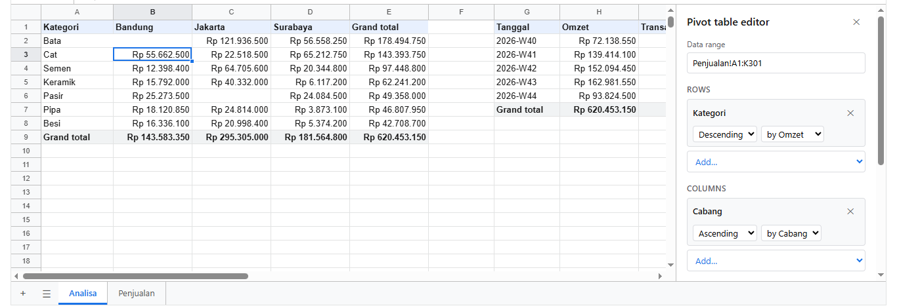

# 8. Pivot table

[Daftar isi](../README.md#daftar-isi) · Sebelumnya: [7. Data](07-data.md) · Berikutnya: [9. Mengisi sheet dari data](09-populate.md)

Pivot table meringkas tabel data per kelompok: omzet per kategori dan cabang, transaksi per minggu, penjualan per sales. Cara kerjanya sama dengan pivot
table di Google Sheets dan Excel. Pivot disimpan di sheet, ditulis sebagai nilai biasa, dan dihitung ulang setiap kali datanya berubah. Fungsi yang sama
juga bisa dipakai tanpa sheet, misalnya di server, untuk meringkas data dari database.

- [8.1 Pivot di sheet](#81-pivot-di-sheet)
- [8.2 Spesifikasi](#82-spesifikasi)
- [8.3 Tanpa sheet: `pivot` dan `tableOf`](#83-tanpa-sheet-pivot-dan-tableof)

## 8.1 Pivot di sheet

Tiga pivot dari 300 transaksi, di sheet Analisa:

<!-- contoh: 08-pivot.js -->
```js
import { createWorkbook } from '@kufayeka/sheet/core';
import { penjualan, KOLOM_PENJUALAN, barisPenjualan } from './data/toko.js';

// Tiga pivot table dari 300 transaksi Oktober, di sheet Analisa. Data berubah, pivot ikut.
export function buatAnalisa() {
    const wb = createWorkbook();
    wb.setSettings({ locale: 'id-ID', currency: 'IDR' });
    const jual = wb.sheet('Sheet1');
    jual.setSheetProps({ name: 'Penjualan' });
    jual.setValues('A1', [KOLOM_PENJUALAN]);
    jual.setValues('A2', barisPenjualan(penjualan(300), 2));
    jual.setColProps('B', { format: { type: 'date' } });

    const an = wb.sheet(wb.addSheet('Analisa'));
    // 1. omzet per kategori dan cabang, kategori dengan omzet terbesar di atas
    an.addPivot('A1', 'Penjualan!A1:K301', {
        rows: ['Kategori'], columns: ['Cabang'],
        values: [{ field: 'Total', fn: 'SUM', as: 'Omzet' }],
        sort: { Kategori: { by: 'Omzet', dir: 'desc' } }
    });
    // 2. per minggu: omzet, jumlah transaksi, rata-rata per transaksi
    an.addPivot('G1', 'Penjualan!A1:K301', {
        rows: ['Tanggal'], group: { Tanggal: 'week' },
        values: [{ field: 'Total', as: 'Omzet' }, { field: 'No', fn: 'COUNT', as: 'Transaksi' }, { field: 'Total', fn: 'AVERAGE', as: 'Rata-rata' }]
    });
    // 3. sales per cabang, tanpa Surabaya, sales terbaik di atas dalam cabangnya
    an.addPivot('L1', 'Penjualan!A1:K301', {
        rows: ['Cabang', 'Sales'], values: [{ field: 'Total', as: 'Omzet' }, { field: 'Produk', fn: 'COUNTUNIQUE', as: 'Jenis produk' }],
        filters: { Cabang: { hidden: ['Surabaya'] } }, sort: { Sales: { by: 'Omzet', dir: 'desc' } }
    });
    an.setColProps('B:E', { format: { type: 'money', decimals: 0 }, width: 120 });
    an.setColProps('H', { format: { type: 'money', decimals: 0 }, width: 120 });
    an.setColProps('J', { format: { type: 'money', decimals: 0 }, width: 120 });
    an.setColProps('N', { format: { type: 'money', decimals: 0 }, width: 120 });
    an.setColProps('A', { width: 110 });
    return wb;
}

const wb = buatAnalisa();
const an = wb.sheet('Analisa');
const tabel = (a1, a2) => {
    const [c1, r1] = [a1.charCodeAt(0) - 65, Number(a1.slice(1)) - 1], [c2, r2] = [a2.charCodeAt(0) - 65, Number(a2.slice(1)) - 1];
    for (let r = r1; r <= r2; r++) {
        const row = [];
        for (let c = c1; c <= c2; c++) { const d = an.display(r, c).text; row.push(c === c1 ? d.padEnd(14) : d.padStart(16)); }
        console.log('  ' + row.join(''));
    }
};
console.log('1. kategori x cabang:'); tabel('A1', 'E9');
console.log('2. per minggu:'); tabel('G1', 'J7');
console.log('3. sales:'); tabel('L1', 'O7');

// pivot ditulis sebagai nilai biasa: rumus bisa membacanya
an.setValues('A12', [['Kategori teratas', '=A2'], ['Pangsa', '=E2/E9']]);
an.setStyle('B13', { format: { type: 'percent', decimals: 1 } });
console.log('rumus membaca pivot :', an.value('B12'), an.display('B13').text);

// data berubah: pivot dihitung ulang setelah perubahan itu
wb.setValues('Penjualan', 'H2', 2000);                   // transaksi 1: semen, 2000 zak
console.log('Qty semen jadi 2000 :', [2, 3, 4].map((r) => an.value('A' + r)).join(', '), '| teratas', an.value('B12'), an.display('B13').text);
// sel pivot dikunci untuk orang: diubah lewat editornya, bukan diketik
const ditolak = [];
wb.on('reject', (e) => ditolak.push(e.reason));
an.setValues('B3', 1, { source: 'user' });
console.log('diketik di pivot    :', ditolak[0]);

// spesifikasi bisa diubah dari kode: per bulan, bukan per minggu
const kedua = an.pivots()[1].id;
an.setPivot(kedua, { spec: { ...an.pivots()[1].spec, group: { Tanggal: 'month' } } });
console.log('per bulan           :', an.value('G2'), an.display('H2').text, '| pivot di sheet ini:', an.pivots().length);
an.removePivot(kedua);
console.log('pivot dihapus       :', an.pivots().length, 'tersisa, G3 sekarang', JSON.stringify(an.value('G3')));
```
<!-- /contoh -->

<!-- hasil: 08-pivot.js -->
```text
1. kategori x cabang:
  Kategori               Bandung         Jakarta        Surabaya     Grand total
  Bata             Rp 65.709.000   Rp 64.459.500   Rp 48.326.250  Rp 178.494.750
  Cat              Rp 35.163.000   Rp 68.790.000   Rp 39.440.750  Rp 143.393.750
  Semen            Rp 28.528.400   Rp 43.821.200   Rp 25.099.200   Rp 97.448.800
  Keramik          Rp 19.232.800   Rp 26.563.500   Rp 16.444.900   Rp 62.241.200
  Pasir            Rp 11.890.000   Rp 21.010.500   Rp 16.457.500   Rp 49.358.000
  Pipa             Rp 13.187.700   Rp 21.066.650   Rp 12.553.600   Rp 46.807.950
  Besi             Rp 13.384.350   Rp 18.341.050   Rp 10.983.300   Rp 42.708.700
  Grand total     Rp 187.095.250  Rp 264.052.400  Rp 169.305.500  Rp 620.453.150
2. per minggu:
  Tanggal                  Omzet       Transaksi       Rata-rata
  2026-W40         Rp 72.138.550              40    Rp 1.803.464
  2026-W41        Rp 139.414.100              70    Rp 1.991.630
  2026-W42        Rp 152.094.450              70    Rp 2.172.778
  2026-W43        Rp 162.981.550              70    Rp 2.328.308
  2026-W44         Rp 93.824.500              50    Rp 1.876.490
  Grand total     Rp 620.453.150             300    Rp 2.068.177
3. sales:
  Cabang                   Sales           Omzet    Jenis produk
  Bandung                   Asep  Rp 109.042.850              12
                           Wulan   Rp 78.052.400              12
  Bandung total                   Rp 187.095.250              12
  Jakarta                   Dodi  Rp 148.066.750              12
                            Rina  Rp 115.985.650              12
  Jakarta total                   Rp 264.052.400              12
rumus membaca pivot : Bata 28,8%
Qty semen jadi 2000 : Semen, Bata, Cat | teratas Semen 30,9%
diketik di pivot    : This is a pivot table: change it in its editor
per bulan           : 2026-10 Rp 756.500.750 | pivot di sheet ini: 3
pivot dihapus       : 2 tersisa, G3 sekarang null
```
<!-- /hasil -->

Di layar, memilih satu sel pivot membuka editornya di kanan. Di sana ada sumber data, field untuk baris dan kolom (dengan urutan, urut menurut nilai,
dan pengelompokan tanggal), value dengan fungsinya, dan filter:



<!-- contoh: 08-pivot.page.js -->
```jsx
import { useState } from 'react';
import { Sheet } from '@kufayeka/sheet';
import '@kufayeka/sheet/style.css';
import { buatAnalisa } from './08-pivot.js';

function buat() {
    const wb = buatAnalisa();
    wb.moveSheet('Analisa', 0);                            // sheet Analisa tampil pertama
    return wb;
}

export default function HalamanAnalisa() {
    const [wb] = useState(buat);
    return <div style={{ height: 560 }}><Sheet workbook={wb} /></div>;
}
```
<!-- /contoh -->

Yang perlu diketahui:

- **Sumbernya range atau named range** yang baris pertamanya berisi nama field, misalnya `'Penjualan!A1:K301'`, `'A1:K301'` di sheet yang sama, atau
  nama seperti `'Transaksi'`. Baris kosong dilewati. Dengan named range ([5.11](05-rumus.md#511-named-range-dan-subtotal)), pivot mengikuti nama itu ke mana pun range-nya
  dipindah atau diperluas.
- **Ditulis sebagai nilai.** Isi pivot adalah nilai biasa, bukan rumus, jadi rumus lain bisa membacanya (`=A2`, `=E2/E9`), dan ikut tersimpan serta
  ikut ke Excel sebagai nilai.
- **Dihitung ulang setelah setiap perubahan** pada datanya. Ukuran pivot boleh berubah: sel yang tidak lagi terpakai dikosongkan.
- **Dikunci untuk orang.** Mengetik di sel pivot ditolak dengan pesan. Pivot diubah lewat editornya atau lewat `setPivot`.
- **Tidak boleh di dalam datanya sendiri.** `addPivot` menolak tempat yang menimpa range sumbernya.
- Pivot baru di layar dibuat lewat Insert → Pivot table.

| Fungsi | Artinya |
|---|---|
| `addPivot(di, sumber, spesifikasi)` | buat pivot dengan sel kiri atas di `di` (`'A1'`). Mengembalikan id |
| `setPivot(id, { source, spec, at })` | ganti sumber, spesifikasi, atau tempatnya. Boleh salah satu saja |
| `removePivot(id)` | hapus pivot dan kosongkan selnya |
| `pivots()` | pivot di sheet ini: `[{ id, source, spec, area }]`, dengan `area` adalah kotak yang ditempatinya sekarang |
| `pivotAt(alamat)` | pivot yang menempati sel itu, atau `null` |

## 8.2 Spesifikasi

| Kunci | Artinya | Contoh |
|---|---|---|
| `rows` | field untuk kelompok ke bawah, dari luar ke dalam. Dengan dua field atau lebih, setiap kelompok luar mendapat baris subtotal | `['Cabang', 'Sales']` |
| `columns` | field untuk kelompok ke samping | `['Cabang']` |
| `values` | yang dihitung di setiap kelompok: `field`, `fn` (bawaan `'SUM'`), dan `as` (nama kolomnya) | `[{ field: 'Total', as: 'Omzet' }]` |
| `filters` | record yang tidak diikutkan, menurut nilai field | `{ Cabang: { hidden: ['Surabaya'] } }` |
| `sort` | urutan kelompok sebuah field: menurut nama (`'asc'`, `'desc'`), atau menurut nilai (`{ by, dir }`) | `{ Kategori: { by: 'Omzet', dir: 'desc' } }` |
| `group` | tanggal dikelompokkan: `'year'`, `'quarter'`, `'month'`, `'week'` | `{ Tanggal: 'month' }` |
| `totals` | baris dan kolom Grand total, serta subtotal. Bawaan `true` | `false` |

**Fungsi value:**

| `fn` | Hasil | | `fn` | Hasil |
|---|---|---|---|---|
| `SUM` | jumlah | | `MAX`, `MIN` | terbesar, terkecil |
| `COUNT` | banyaknya angka | | `MEDIAN` | nilai tengah |
| `COUNTA` | banyaknya yang tidak kosong | | `PRODUCT` | hasil kali |
| `COUNTUNIQUE` | banyaknya nilai berbeda | | `AVERAGE` | rata-rata |

Total dan subtotal dihitung dari record aslinya, bukan dari angka-angka di atasnya. Rata-rata di baris Grand total adalah rata-rata semua transaksi,
bukan rata-rata dari rata-rata per minggu.

**Urut menurut nilai.** `by` adalah nama value (`as`), atau nama field-nya kalau `as` tidak diisi. Dengan dua field baris, urutan menurut nilai berlaku di
dalam setiap kelompok luar, seperti sales terbaik di setiap cabang pada pivot ketiga. Kelompok dengan nilai yang sama diurutkan menurut namanya.

**Kelompok tanggal.** Field berisi tanggal (nomor hari, seperti sel tanggal) dikelompokkan menjadi `2026` (`year`), `2026-Q4` (`quarter`), `2026-10`
(`month`), atau `2026-W43` (`week`, minggu ISO yang dimulai hari Senin). Teks-teks ini terurut sesuai waktu. Nilai yang bukan tanggal dikelompokkan apa
adanya.

**Sel kosong** dikelompokkan sebagai `(blank)`. Kombinasi baris dan kolom yang tidak punya record dibiarkan kosong, seperti Bata di Bandung pada pivot
pertama.

## 8.3 Tanpa sheet: `pivot` dan `tableOf`

<!-- contoh: 08-pivot-data.js -->
```js
import { createWorkbook, tableOf, pivot, PIVOT_FUNCTIONS } from '@kufayeka/sheet/core';
import { penjualan, KOLOM_PENJUALAN, barisPenjualan } from './data/toko.js';

// pivot() tanpa sheet: data dari database atau API langsung diringkas, misalnya di server untuk laporan harian yang dikirim lewat email.
const dariDatabase = penjualan(300).map((r) => ({ ...r, Total: r.Qty * r.Harga * (1 - r.Diskon) }));
const p = pivot(dariDatabase, {
    rows: ['Kategori'], columns: ['Tanggal'], group: { Tanggal: 'month' },
    values: [{ field: 'Total', as: 'Omzet' }, { field: 'Qty', fn: 'SUM', as: 'Qty' }],
    sort: { Kategori: { by: 'Omzet', dir: 'desc' } }
});
console.log('tabel jadi (cells), baris judul', p.header + ':');
for (const row of p.cells.slice(0, 4)) console.log('  ' + row.map((x) => String(x ?? '').padStart(12)).join(''));
console.log('  ...', p.cells.length, 'baris');

// atau dibaca per angka: value(baris, kolom, nomor value)
console.log('omzet semen Oktober :', p.value(['Semen'], ['2026-10'], 0));
console.log('qty semua           :', p.value([], [], 1));
console.log('grup baris          :', p.rowKeys.map((k) => k[0]).join(', '));

// tableOf: sheet dibaca sebagai daftar record (baris pertama = nama field), lalu diringkas dengan pivot yang sama
const wb = createWorkbook();
wb.setValues('Sheet1', 'A1', [KOLOM_PENJUALAN]);
wb.setValues('Sheet1', 'A2', barisPenjualan(penjualan(300), 2));
const { fields, records } = tableOf(wb, 'Sheet1', 'A1:K301');
console.log('field               :', fields.join(', '));
console.log('record pertama      :', JSON.stringify(records[0]));
const perSales = pivot(records, { rows: ['Sales'], values: [{ field: 'Total', fn: 'MEDIAN', as: 'Median' }], sort: { Sales: { by: 'Median', dir: 'desc' } }, totals: false });
console.log('median per sales    :', perSales.cells.slice(1).map((r) => r[0] + ' ' + r[1]).join(' | '));
console.log('fungsi              :', Object.keys(PIVOT_FUNCTIONS).join(', '));
```
<!-- /contoh -->

<!-- hasil: 08-pivot-data.js -->
```text
tabel jadi (cells), baris judul 2:
       Tanggal     2026-10     2026-10 Grand total Grand total
      Kategori       Omzet         Qty       Omzet         Qty
          Bata   178494750         244   178494750         244
           Cat   143393750         428   143393750         428
  ... 10 baris
omzet semen Oktober : 97448800
qty semua           : 3258
grup baris          : Bata, Cat, Semen, Keramik, Pasir, Pipa, Besi
field               : No, Tanggal, Cabang, Sales, Kode, Produk, Kategori, Qty, Harga, Diskon, Total
record pertama      : {"No":1,"Tanggal":46296,"Cabang":"Jakarta","Sales":"Rina","Kode":"SMN-01","Produk":"Semen Portland 50 kg","Kategori":"Semen","Qty":11,"Harga":72000,"Diskon":0.05,"Total":752400}
median per sales    : Dodi 1512000 | Bayu 1450000 | Asep 1417000 | Wulan 1336750 | Rina 1328000 | Sari 1168000
fungsi              : SUM, COUNT, COUNTA, COUNTUNIQUE, AVERAGE, MAX, MIN, MEDIAN, PRODUCT
```
<!-- /hasil -->

`pivot(records, spesifikasi)` dari `@kufayeka/sheet/core` menerima array objek dari mana saja (database, API, file) dan memakai spesifikasi yang sama
dengan 8.2. Fungsi ini murni dan tidak butuh browser, jadi bisa dipakai di server untuk laporan yang dikirim lewat email, di API yang mengembalikan
ringkasan, atau untuk menggabungkan banyak file menjadi satu ringkasan ([Galeri](galeri.md)). Hasilnya:

| Kunci | Isinya |
|---|---|
| `cells` | tabel jadi sebagai array baris, siap ditulis ke sheet dengan `setValues` |
| `header` | jumlah baris judul di awal `cells` |
| `value(baris, kolom, i)` | satu angka: kelompok baris dan kolom sebagai array kunci, `i` nomor value. `[]` berarti semua |
| `rowKeys`, `colKeys` | kunci kelompok baris dan kolom, urut seperti di tabel |
| `rows` | baris badan tabel: `[{ cells, kind: 'row' \| 'subtotal' \| 'total', key }]` |

`tableOf(wb, sheet, range)` membaca range sheet menjadi `{ fields, records }`. Baris pertama menjadi nama field, nilainya adalah hasil rumus, dan baris
kosong dilewati. Range boleh berupa kolom utuh (`'A:K'`, sampai baris terakhir yang berisi), atau named range dengan `sheet` diisi `null`.

`PIVOT_FUNCTIONS` berisi fungsi-fungsi value, misalnya untuk mengisi pilihan di form buatanmu sendiri.

[Daftar isi](../README.md#daftar-isi) · Sebelumnya: [7. Data](07-data.md) · Berikutnya: [9. Mengisi sheet dari data](09-populate.md)
