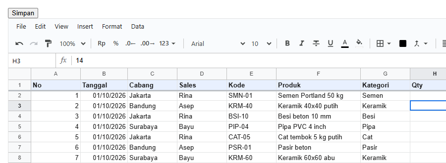
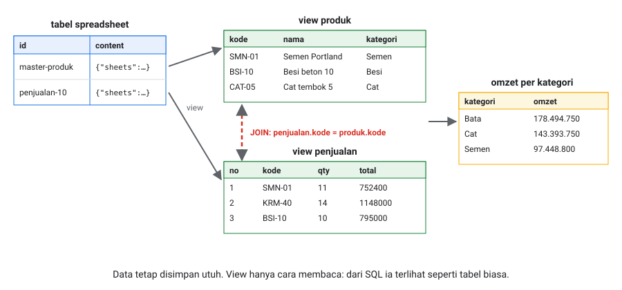
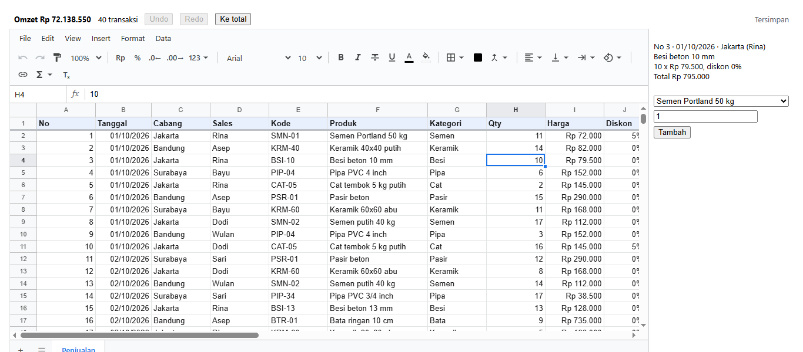

# 09. Persistensi State & Sinkronisasi Server

[Daftar isi](../README.md#daftar-isi) · Sebelumnya: [08. Validasi Data & Proteksi Sel](08-menjaga-isi.md) · Berikutnya: [10. Kontrol Akses & Perizinan (ACL/RBAC)](10-hak-akses.md)

**Tujuan Bab Ini**: Mengantar Anda dari pemahaman dasar cara kerja state internal workbook hingga mampu membangun siklus lengkap **Load → Edit → Save → Validasi Server → Audit History** untuk aplikasi berbasis API/database dan sistem template RBAC.

---

## 1. Mental Model: Mengapa Spreadsheet Tidak Seperti State React & JSON Biasa?

Pada aplikasi React biasa, Anda mungkin terbiasa menyimpan data formulir dalam `useState(obj)` lalu memanggil `setState({...obj})` setiap kali user mengetik. **Untuk spreadsheet, pola itu tidak akan skalabel:** satu sheet bisa memiliki puluhan ribu sel, ratusan rumus berantai (*formula dependency graph*), styling per sel, dan riwayat undo.

Karena itu, `@kufayeka/sheet` memisahkan **mesin kalkulasi** dari **layer tampilan React**:

```text
┌─────────────────────────┐               ┌───────────────────────────────────┐
│  Input Pengguna (Grid)  │ ── Mutasi ──► │   Live Workbook Engine (di RAM)   │
└─────────────────────────┘               │   • Hitung ulang DAG rumus        │
                                          │   • Lacak baris kotor (dirty)     │
                                          │   • Naikkan counter `revision`    │
                                          └───────┬───────────────────┬───────┘
                                                  │                   │
                                    Notifikasi    │                   │ Saat Simpan
                                    (revision++)  ▼                   │ (Manual / Debounce)
                                  ┌───────────────────────────┐       ▼
                                  │ Hook useWorkbook(wb, fn)  │  ┌─────────────────────┐
                                  │ (hanya render komponen yg │  │ API Backend         │
                                  │  nilainya benar2 berubah) │  │ • toJSON() (utuh)   │
                                  └───────────────────────────┘  │ • pendingPatch()    │
                                                                 └──────────┬──────────┘
                                                                            │ SQL / JSONB
                                                                            ▼
                                                                 ┌─────────────────────┐
                                                                 │  Database Server    │
                                                                 └─────────────────────┘
```

### Tiga Pilar Desain yang Wajib Dipahami

1. **Live Mutable Engine + Selektor `useWorkbook()`**:
   Workbook hidup di RAM sebagai mesin mutabel. Setiap perubahan menaikkan counter `revision`. Hook `useWorkbook(wb, selector)` membandingkan hasil `selector(wb)` dengan `Object.is`: jika Anda hanya membaca `w.unsaved()` atau total `w.value('Rekap', 'B3')`, komponen React Anda **tidak akan re-render** saat user mengetik di sel lain.
2. **Dua Jalur Keluar Data (`State` vs `Event Stream`)**:
   - **`toJSON()` / `pendingPatch()`** menjawab: *"Seperti apa kondisi akhir data untuk disimpan ke database?"*
   - **`wb.on('op', ...)`** menjawab: *"Aksi apa yang barusan terjadi, oleh siapa, jam berapa, dari nilai apa ke apa?"* (dipakai untuk **Undo/Redo**, **Audit History**, dan **Live Push**).
3. **Batas Keamanan (*Never Trust the Client*)**:
   Data dokumen (`doc`) dipisahkan dari kebijakan keamanan (`access`, `rules`, `types`). Browser tidak pernah dipercaya memegang aturan proteksi sendiri — server menyensor payload keluar lewat `viewFor()` dan memvalidasi ulang payload masuk lewat `checkPatch()`.

### Peta Jalan 3 Level Integrasi

| Level | Kapan Dipakai | Mekanisme Utama |
|---|---|---|
| **Level 1 — Sederhana (`toJSON`)** | Prototipe, single-user, file kecil. | Load `createWorkbook(doc)`, simpan seluruh `wb.toJSON()`. |
| **Level 2 — Hemat & Anti-Timpa (`Patch`)** | Multi-user, file besar, auto-save. | Kirim `wb.pendingPatch()` (hanya delta), cek `version` di server, gabung dengan `mergePatch()`. |
| **Level 3 — Template + RBAC Produksi** | Sistem template terhubung DB, hak akses per role, kolom bertipe. | Pisahkan `doc`, `access`, `rules`, `types`; sensor dengan `viewFor()`, validasi dengan `checkPatch()`. |

---

## 2. Level 1 — Load & Save Dasar di Frontend (`toJSON`)

Pada tahap paling dasar, frontend mengambil satu JSON utuh dari API saat halaman dibuka, membiarkan user mengedit, lalu mengirim kembali JSON utuh saat disimpan.

### 2.1 Load dari API & Tombol Simpan Manual

Selama data belum datang dari server, `wb` bernilai `null` dan halaman menampilkan indikator loading. Pola ini **aman untuk SSR Next.js** karena `createWorkbook(doc)` baru dipanggil di browser setelah `fetch` selesai:

<!-- contoh: 11-langkah4.page.js -->
```jsx
import { useEffect, useState } from 'react';
import { Sheet } from '@kufayeka/sheet';
import { createWorkbook } from '@kufayeka/sheet/core';
import '@kufayeka/sheet/style.css';
import { ambilWorkbook } from './data/api.js';

// Langkah 4: isinya datang dari server. Selama menunggu tampil "Memuat…", lalu sheet tampil berisi.
export default function Halaman() {
    const [wb, setWb] = useState(null);
    useEffect(() => {
        // di aplikasimu: fetch('/api/workbooks/penjualan').then((r) => r.json())
        ambilWorkbook('penjualan').then((doc) => setWb(createWorkbook(doc)));
    }, []);
    if (!wb) return <p>Memuat…</p>;
    return <div style={{ height: 400 }}><Sheet workbook={wb} /></div>;
}
```
<!-- /contoh -->

Untuk menambahkan tombol **Simpan**, pantau `wb.unsaved()` lewat `useWorkbook`. Setelah `PUT`/`PATCH` ke server berhasil (`200 OK`), panggil `wb.saved()` agar workbook mereset penanda `dirty` dan `unsaved()` kembali menjadi `false`:

<!-- contoh: 11-langkah5.page.js -->
```jsx
import { useEffect, useState } from 'react';
import { Sheet, useWorkbook } from '@kufayeka/sheet';
import { createWorkbook } from '@kufayeka/sheet/core';
import '@kufayeka/sheet/style.css';
import { ambilWorkbook, simpanContent } from './data/api.js';

// Langkah 5: tombol Simpan. Seluruh isi workbook dikirim sebagai satu JSON, dan disimpan sebagai satu baris di database.
export default function Halaman() {
    const [wb, setWb] = useState(null);
    useEffect(() => { ambilWorkbook('penjualan').then((doc) => setWb(createWorkbook(doc))); }, []);
    // true kalau ada yang diubah sejak simpan terakhir
    const adaPerubahan = useWorkbook(wb, (w) => w.unsaved());
    if (!wb) return <p>Memuat…</p>;

    async function simpan() {
        await simpanContent('penjualan', wb.toJSON());   // di aplikasimu: fetch(..., { method: 'PUT', body: JSON.stringify(wb.toJSON()) })
        wb.saved();                                      // workbook mencatat: semua sudah tersimpan
    }
    return (
        <div>
            <button className="simpan" disabled={!adaPerubahan} onClick={simpan}>{adaPerubahan ? 'Simpan' : 'Tersimpan'}</button>
            <div style={{ height: 400 }}><Sheet workbook={wb} /></div>
        </div>
    );
}
```
<!-- /contoh -->



---

### 2.2 Auto-Save (Debounce), Hook Reusable, & Penanganan Error

Pada aplikasi nyata, Anda tidak ingin menulis `useEffect` loading/error berulang di setiap halaman. Bungkus menjadi custom hook `useApiWorkbook` dan `useAutoSave`:

<!-- contoh: 11-hooks.js -->
```js
import { useEffect, useRef, useState } from 'react';
import { useWorkbook } from '@kufayeka/sheet';
import { createWorkbook } from '@kufayeka/sheet/core';
import { ambilWorkbook, simpanPatch } from './data/api.js';

/**
 * Workbook dari API: { wb, error, cobaLagi }. wb null selama memuat.
 * @param {string} id  id workbook di API-mu. Berganti id = workbook lain dimuat.
 */
export function useWorkbookDariApi(id, opsi) {
    const [keadaan, setKeadaan] = useState({ wb: null, error: null });
    const [percobaan, setPercobaan] = useState(0);
    useEffect(() => {
        // AbortController: kalau komponen dilepas atau id berganti sebelum jawaban datang, permintaan lama dibatalkan dan jawabannya diabaikan.
        // Ini juga yang membuat StrictMode (yang menjalankan effect dua kali saat development) aman
        const batal = new AbortController();
        setKeadaan({ wb: null, error: null });
        ambilWorkbook(id, batal.signal)
            // createWorkbook di sini, sekali per isi yang dimuat. Opsinya (user, beforeOp) ikut dari pemanggil
            .then((doc) => setKeadaan({ wb: createWorkbook(doc, opsi), error: null }))
            .catch((err) => { if (err.name !== 'AbortError') setKeadaan({ wb: null, error: err.message }); });
        return () => batal.abort();
        // opsi sengaja tidak ikut: objek opsi yang ditulis langsung di pemanggil berubah setiap render
        // eslint-disable-next-line react-hooks/exhaustive-deps
    }, [id, percobaan]);
    return { ...keadaan, cobaLagi: () => setPercobaan((n) => n + 1) };
}

/**
 * Simpan otomatis `jeda` milidetik setelah orang berhenti mengubah. Hanya yang berubah yang dikirim (patch), bukan seluruh workbook.
 * Mengembalikan 'tersimpan' | 'menunggu' | 'menyimpan' | 'gagal'.
 */
export function useAutosave(wb, id, jeda = 1000) {
    const [status, setStatus] = useState('tersimpan');
    const sibuk = useRef(false);
    const belum = useWorkbook(wb, (w) => w.unsaved());

    useEffect(() => {
        if (!wb) return undefined;
        let timer = null;
        const simpan = async () => {
            // satu penyimpanan pada satu waktu: perubahan yang datang selama menyimpan dikirim berikutnya
            if (sibuk.current) { timer = setTimeout(simpan, jeda); return; }
            if (!wb.unsaved()) { setStatus('tersimpan'); return; }
            const patch = wb.pendingPatch();
            sibuk.current = true;
            setStatus('menyimpan');
            try {
                const jawaban = await simpanPatch(id, patch);
                // saved() hanya melupakan yang ikut di patch ini: yang diubah selama menunggu jawaban tetap tercatat belum tersimpan
                wb.saved(patch, jawaban);
                if (wb.unsaved()) { setStatus('menunggu'); timer = setTimeout(simpan, jeda); } else setStatus('tersimpan');
            } catch {
                // patch tidak hilang: penyimpanan berikutnya mengirimnya lagi bersama perubahan yang lebih baru
                setStatus('gagal');
                timer = setTimeout(simpan, jeda * 5);
            } finally {
                sibuk.current = false;
            }
        };
        // setiap perubahan menunda penyimpanan (debounce): mengetik 20 sel berturut-turut = satu kali simpan
        const off = wb.on('op', () => { setStatus('menunggu'); clearTimeout(timer); timer = setTimeout(simpan, jeda); });
        return () => { off(); clearTimeout(timer); };
    }, [wb, id, jeda]);

    // menutup tab saat masih ada yang belum tersimpan: browser bertanya dulu
    useEffect(() => {
        if (!belum) return undefined;
        const tahan = (e) => { e.preventDefault(); e.returnValue = ''; };
        window.addEventListener('beforeunload', tahan);
        return () => window.removeEventListener('beforeunload', tahan);
    }, [belum]);

    return status;
}
```
<!-- /contoh -->

> **Aturan Emas Auto-Save**: Jangan pernah memanggil `wb.saved()` sebelum server membalas sukses! Jika request gagal karena jaringan terputus, status `unsaved()` tetap `true` sehingga auto-save berikutnya (atau tombol retry) akan mengirim ulang perubahan yang belum tersimpan.

<!-- contoh: 11-memuat.page.js -->
```jsx
import { Sheet } from '@kufayeka/sheet';
import '@kufayeka/sheet/style.css';
import { useWorkbookDariApi } from './11-hooks.js';

// Workbook dimuat dari API saat halaman dibuka. Selama memuat tampil teks, kalau gagal tampil pesan dan tombol coba lagi.
export default function HalamanPenjualan() {
    const { wb, error, cobaLagi } = useWorkbookDariApi('penjualan-oktober');
    if (error) return <p>Gagal memuat: {error} <button onClick={cobaLagi}>Coba lagi</button></p>;
    if (!wb) return <p>Memuat penjualan…</p>;
    return <div style={{ height: 520 }}><Sheet workbook={wb} fileName="Penjualan Oktober" /></div>;
}
```
<!-- /contoh -->

<!-- contoh: 11-autosave.page.js -->
```jsx
import { Sheet } from '@kufayeka/sheet';
import '@kufayeka/sheet/style.css';
import { useWorkbookDariApi, useAutosave } from './11-hooks.js';

const TEKS = { tersimpan: 'Semua perubahan tersimpan', menunggu: 'Belum tersimpan…', menyimpan: 'Menyimpan…', gagal: 'Gagal menyimpan, mencoba lagi' };

export default function HalamanAutosave() {
    const { wb } = useWorkbookDariApi('penjualan-oktober');
    const status = useAutosave(wb, 'penjualan-oktober');
    if (!wb) return <p>Memuat penjualan…</p>;
    return (
        <div style={{ height: 560, display: 'flex', flexDirection: 'column' }}>
            <p className="status-simpan" style={{ margin: '4px 8px', color: status === 'gagal' ? '#d93025' : '#5f6368' }}>{TEKS[status]}</p>
            <Sheet workbook={wb} style={{ flex: 1 }} />
        </div>
    );
}
```
<!-- /contoh -->

---

### 2.3 Sinkronisasi Data dari Props Eksternal

Jika data datang dari komponen induk (misal hasil TanStack Query, Redux, atau props server), gunakan `useEffect` untuk meng-update sheet saat props berubah:

<!-- contoh: 11-props.page.js -->
```jsx
import { useEffect, useState } from 'react';
import { Sheet } from '@kufayeka/sheet';
import { createWorkbook, populate } from '@kufayeka/sheet/core';
import '@kufayeka/sheet/style.css';
import { penjualan, CABANG } from './data/toko.js';

// Laporan per cabang: cabang dipilih di luar sheet, datanya datang lewat props. Workbook dibuat sekali, isinya diganti saat props berubah.
function buatTemplate() {
    const wb = createWorkbook();
    wb.setSettings({ locale: 'id-ID', currency: 'IDR' });
    const lap = wb.sheet('Sheet1');
    lap.setSheetProps({ name: 'Transaksi', freezeRows: 1 });
    lap.setColProps('B', { format: { type: 'date' } });
    lap.setColProps('E:F', { format: { type: 'money', decimals: 0 } });
    lap.setColProps('C', { width: 180 });
    const rekap = wb.sheet(wb.addSheet('Rekap'));
    rekap.setValues('A1', [['Transaksi', '=COUNT(Transaksi!A:A)'], ['Omzet', '=SUM(Transaksi!F:F)']]);
    rekap.setColProps('B', { format: { type: 'money', decimals: 0 }, width: 140 });
    return wb;
}

function LaporanCabang({ data, sheet, onSheetChange }) {
    // useState dengan fungsi: workbook dibuat SEKALI untuk umur komponen ini, tidak setiap render
    const [wb] = useState(buatTemplate);
    // props berubah: isi tabelnya diganti, workbook-nya tetap. Undo, sheet aktif, lebar kolom yang diatur orang, semuanya tetap
    useEffect(() => {
        wb.sheet('Transaksi').clear('A1:F1000', { source: 'remote' });     // remote: tidak masuk undo, ini bukan perubahan orang
        populate(wb, 'Transaksi', { at: 'A1', fields: ['No', 'Tanggal', 'Produk', 'Qty', 'Harga', 'Total'], header: true }, data, { source: 'remote' });
    }, [wb, data]);
    // sheet yang tampil dikontrol dari luar lewat props sheet + onSheetChange
    return <Sheet workbook={wb} sheet={wb.sheetIdByName(sheet)} onSheetChange={(id) => onSheetChange(wb.sheetProps(id).name)} style={{ height: 460 }} />;
}

export default function HalamanCabang() {
    const [cabang, setCabang] = useState('Jakarta');
    const [sheet, setSheet] = useState('Transaksi');
    const [data, setData] = useState([]);
    useEffect(() => {
        // di aplikasi: fetch('/api/penjualan?cabang=' + cabang)
        setData(penjualan(60).filter((x) => x.Cabang === cabang).map((x) => ({ ...x, Total: x.Qty * x.Harga * (1 - x.Diskon) })));
    }, [cabang]);
    return (
        <div>
            <p style={{ display: 'flex', gap: 8, margin: 8 }}>
                <select className="pilih-cabang" value={cabang} onChange={(e) => setCabang(e.target.value)}>{CABANG.map((c) => <option key={c}>{c}</option>)}</select>
                <button onClick={() => setSheet('Transaksi')}>Transaksi</button>
                <button onClick={() => setSheet('Rekap')}>Rekap</button>
                <span>Sheet aktif: {sheet}</span>
            </p>
            <LaporanCabang data={data} sheet={sheet} onSheetChange={setSheet} />
        </div>
    );
}
```
<!-- /contoh -->

---

## 3. Membedah Anatomi JSON & Alasan Desain Database-nya

Sebelum membangun backend Level 2 & Level 3, Anda perlu memahami **mengapa struktur JSON `@kufayeka/sheet` berbentuk seperti itu** — karena desain inilah yang membuat delta patching, SQL query, dan relasi antar fitur bekerja mulus.

### 3.1 Empat Konsep Kunci di Balik `wb.toJSON()`

1. **UUID Stabil + Fractional Key (`"04"`, `"08"`, `"0A"`) — Bukan Index Array `[0, 1, 2]`**:
   Di array biasa, menyisip 1 baris di posisi ke-2 menggeser indeks baris ke-3 s/d ke-1000 — seluruh patch meledak, rumus rusak, dan komentar nyasar. Di `@kufayeka/sheet`, setiap baris & kolom memiliki **UUID permanen** dan **`key` urutan fraksional**. Menyisip baris di tengah cukup menciptakan 1 baris baru dengan `key: "0A"` (di antara `"08"` dan `"0C"`); 1.000 baris lain **0 byte berubah**.
2. **Rumus Menyimpan `{ f, refs, v }`**:
   - `f` memakai placeholder token (`=⟦0⟧*⟦1⟧`) + `refs` berbasis `rowId`/`colId` — sehingga rename sheet, geser kolom, atau sort baris tidak memutus rumus.
   - `v` menyimpan **nilai hasil terakhir** (seperti cache nilai di `.xlsx`). Tujuannya: database SQL (`JSONB`) atau service reporting lain dapat langsung membaca angka totalnya (`cell->>'v'`) tanpa perlu menjalankan JavaScript engine.
3. **Virtual Empty Rows (`rowCount`)**:
   Baris kosong di bagian bawah tidak disimpan di `toJSON()` (menghemat ukuran DB). Namun jika user mengisi baris ke-500, `pendingPatch()` otomatis menyertakan baris kosong di atasnya agar baris ke-500 tidak "naik" ke baris 10 saat dibuka kembali (`src/core/workbook.js:2157-2168`).
4. **Semua Fitur Template Ikut di `sheet.props`**:
   Styling (`columns[].props`, `rows[].style`), `merges`, `names`, `validations`, `conditionals`, `filters`, `pivots`, `charts`, dan `comments` semuanya tersimpan di dalam `wb.toJSON()`, sehingga otomatis ikut ter-clone saat template di-instantiate.

<!-- contoh: 09-01-json-shape.js -->
```js
import { createWorkbook } from '@kufayeka/sheet/core';

// Membedah bentuk JSON mentah dari wb.toJSON() dan wb.pendingPatch()
const wb = createWorkbook();
wb.setSettings({ locale: 'id-ID', currency: 'IDR' });
const sh = wb.sheet('Sheet1');
sh.setSheetProps({ name: 'Order' });
sh.setValues('A1', [
    ['Item', 'Qty', 'Harga', 'Total'],
    ['Semen', 10, 72000, '=B2*C2'],
]);
sh.setStyle('A1:D1', { bold: true, fill: '#eef2f7' });

// 1. Struktur wb.toJSON() (ID diganti pendek agar mudah dibaca)
const doc = wb.toJSON();
const shortMap = new Map();
const sid = (id, p) => { if (!shortMap.has(id)) shortMap.set(id, p + (shortMap.size + 1)); return shortMap.get(id); };
const maskId = (obj) => JSON.parse(JSON.stringify(obj).replace(/[0-9a-f]{8}-[0-9a-f]{4}-[0-9a-f]{4}-[0-9a-f]{4}-[0-9a-f]{12}/g, (m) => sid(m, 'id_')));

console.log('=== 1. STRUKTUR wb.toJSON() ===');
console.log(JSON.stringify(maskId(doc), null, 2));

// 2. Tandai tersimpan, lalu ubah satu sel dan lihat bentuk wb.pendingPatch()
wb.saved();
sh.setValues('B2', 15, { source: 'user' });
const patch = wb.pendingPatch();
console.log('\n=== 2. STRUKTUR wb.pendingPatch() ===');
console.log(JSON.stringify(maskId(patch), null, 2));
```
<!-- /contoh -->

<!-- hasil: 09-01-json-shape.js -->
```text
=== 1. STRUKTUR wb.toJSON() ===
{
  "id": "id_1",
  "version": 0,
  "settings": {
    "locale": "id-ID",
    "currency": "IDR"
  },
  "sheets": [
    {
      "id": "id_2",
      "key": "V",
      "props": {
        "name": "Order"
      },
      "rowCount": 1000,
      "columns": [
        {
          "id": "id_3",
          "key": "2",
          "props": {}
        },
        {
          "id": "id_4",
          "key": "4",
          "props": {}
        },
        {
          "id": "id_5",
          "key": "6",
          "props": {}
        },
        {
          "id": "id_6",
          "key": "8",
          "props": {}
        },
        {
          "id": "id_7",
          "key": "A",
          "props": {}
        },
        {
          "id": "id_8",
          "key": "C",
          "props": {}
        },
        {
          "id": "id_9",
          "key": "G",
          "props": {}
        },
        {
          "id": "id_10",
          "key": "I",
          "props": {}
        },
        {
          "id": "id_11",
          "key": "K",
          "props": {}
        },
        {
          "id": "id_12",
          "key": "M",
          "props": {}
        },
        {
          "id": "id_13",
          "key": "O",
          "props": {}
        },
        {
          "id": "id_14",
          "key": "Q",
          "props": {}
        },
        {
          "id": "id_15",
          "key": "S",
          "props": {}
        },
        {
          "id": "id_16",
          "key": "V",
          "props": {}
        },
        {
          "id": "id_17",
          "key": "X",
          "props": {}
        },
        {
          "id": "id_18",
          "key": "Z",
          "props": {}
        },
        {
          "id": "id_19",
          "key": "b",
          "props": {}
        },
        {
          "id": "id_20",
          "key": "d",
          "props": {}
        },
        {
          "id": "id_21",
          "key": "f",
          "props": {}
        },
        {
          "id": "id_22",
          "key": "h",
          "props": {}
        },
        {
          "id": "id_23",
          "key": "l",
          "props": {}
        },
        {
          "id": "id_24",
          "key": "n",
          "props": {}
        },
        {
          "id": "id_25",
          "key": "p",
          "props": {}
        },
        {
          "id": "id_26",
          "key": "t",
          "props": {}
        },
        {
          "id": "id_27",
          "key": "v",
          "props": {}
        },
        {
          "id": "id_28",
          "key": "x",
          "props": {}
        }
      ],
      "rows": [
        {
          "id": "id_29",
          "key": "04",
          "cells": {
            "id_3": "Item",
            "id_4": "Qty",
            "id_5": "Harga",
            "id_6": "Total"
          },
          "style": {
            "id_3": {
              "bold": true,
              "fill": "#eef2f7"
            },
            "id_4": {
              "bold": true,
              "fill": "#eef2f7"
            },
            "id_5": {
              "bold": true,
              "fill": "#eef2f7"
            },
            "id_6": {
              "bold": true,
              "fill": "#eef2f7"
            }
          },
          "props": {}
        },
        {
          "id": "id_30",
          "key": "08",
          "cells": {
            "id_3": "Semen",
            "id_4": 10,
            "id_5": 72000,
            "id_6": {
              "f": "=⟦0⟧*⟦1⟧",
              "refs": [
                {
                  "k": "cell",
                  "r1": "id_30",
                  "c1": "id_4",
                  "r2": null,
                  "c2": null,
                  "ra1": false,
                  "ca1": false
                },
                {
                  "k": "cell",
                  "r1": "id_30",
                  "c1": "id_5",
                  "r2": null,
                  "c2": null,
                  "ra1": false,
                  "ca1": false
                }
              ],
              "v": 720000
            }
          },
          "style": {},
          "props": {}
        }
      ]
    }
  ]
}

=== 2. STRUKTUR wb.pendingPatch() ===
{
  "workbook": {
    "id": "id_1",
    "version": 0
  },
  "upTo": 6,
  "sheets": {
    "upsert": [],
    "delete": []
  },
  "columns": {
    "upsert": [],
    "delete": []
  },
  "rows": {
    "upsert": [
      {
        "sheetId": "id_2",
        "id": "id_30",
        "key": "08",
        "cells": {
          "id_3": "Semen",
          "id_4": 15,
          "id_5": 72000,
          "id_6": {
            "f": "=⟦0⟧*⟦1⟧",
            "refs": [
              {
                "k": "cell",
                "r1": "id_30",
                "c1": "id_4",
                "r2": null,
                "c2": null,
                "ra1": false,
                "ca1": false
              },
              {
                "k": "cell",
                "r1": "id_30",
                "c1": "id_5",
                "r2": null,
                "c2": null,
                "ra1": false,
                "ca1": false
              }
            ],
            "v": 1080000
          }
        },
        "style": {},
        "props": {}
      }
    ],
    "delete": []
  },
  "isEmpty": false
}
```
<!-- /hasil -->

---

### 3.2 Simulasi Nyata: Efek Edit & Sisip Baris pada JSON

Lihat bagaimana `toJSON()` merespons pengeditan sel dan penyisipan baris di tengah tabel — hanya baris yang disentuh yang berubah atau bertambah:

<!-- contoh: 12-simulasi.js -->
```js
import { createWorkbook } from '@kufayeka/sheet/core';

// Apa isi `content` yang disimpan? Daftar harga tiga produk, dilihat dari tiga sisi: di layar, di dalam content, dan apa yang berubah saat diedit.
// Id aslinya UUID panjang; di sini diganti nama pendek (r1, k1, ...) supaya mudah dibaca.

// ---- alat cetak
const pendek = new Map();
const nama = (id, awalan) => { if (!pendek.has(id)) pendek.set(id, awalan + ([...pendek.values()].filter((x) => x.startsWith(awalan)).length + 1)); return pendek.get(id); };
const isi = (cells) => Object.entries(cells).map(([k, v]) => (pendek.get(k) || k) + ':' + (v && v.f !== undefined ? '[rumus, hasil ' + v.v + ']' : JSON.stringify(v))).join('  ');
function kotak(judul, kolom, baris) {
    const lebar = kolom.map((k, i) => Math.max(k.length, ...baris.map((b) => String(b[i]).length)));
    const garis = '+' + lebar.map((l) => '-'.repeat(l + 2)).join('+') + '+';
    const satu = (b) => '| ' + b.map((x, i) => String(x).padEnd(lebar[i])).join(' | ') + ' |';
    if (judul) console.log(judul);
    console.log([garis, satu(kolom), garis, ...baris.map(satu), garis].join('\n'));
}
function layar(wb) {
    const akhir = wb.lastFilled('Harga');
    const baris = [];
    for (let r = 0; r <= akhir.r; r++) baris.push([r + 1, ...Array.from({ length: akhir.c + 1 }, (_, c) => wb.display('Harga', r, c).text)]);
    kotak('', ['', ...Array.from({ length: akhir.c + 1 }, (_, c) => String.fromCharCode(65 + c))], baris);
}
function barisContent(content) {
    const sh = content.sheets[0];
    sh.columns.slice(0, 5).forEach((c) => nama(c.id, 'k'));
    kotak('', ['id', 'key', 'cells'], sh.rows.map((r) => [nama(r.id, 'r'), r.key, isi(r.cells)]));
}

// ---- 1. di layar
const wb = createWorkbook();
wb.setSheetProps('Sheet1', { name: 'Harga' });
wb.setValues('Harga', 'A1', [['Kode', 'Produk', 'Harga', 'Stok', 'Nilai'], ['SMN-01', 'Semen 50 kg', 72000, 420, '=C2*D2'], ['BSI-10', 'Besi 10 mm', 79500, 260, '=C3*D3'], ['CAT-05', 'Cat 5 kg', 145000, 64, '=C4*D4']]);
console.log('1. DI LAYAR');
layar(wb);

// ---- 2. di dalam content = wb.toJSON()
let content = wb.toJSON();
console.log('\n2. DI DALAM content (yang disimpan di kolom content)');
console.log('content.sheets[0].props   =', JSON.stringify(content.sheets[0].props), '| rowCount', content.sheets[0].rowCount, '(baris kosong di bawah tidak disimpan, hanya dihitung)');
console.log('content.sheets[0].rows    = satu baris layar, satu baris di sini:');
barisContent(content);
console.log('k1..k5 adalah kolom A..E. Rumus disimpan beserta hasilnya, supaya SQL bisa membaca angkanya.');

// ---- 3. stok besi diubah jadi 300
wb.setValues('Harga', 'D3', 300, { source: 'user' });
console.log('\n3. STOK BESI DIUBAH JADI 300: yang berubah di content hanya baris r3 (dan hasil rumusnya)');
content = wb.toJSON();
barisContent(content);

// ---- 4. baris baru disisipkan di baris 3
wb.insertRows('Harga', '3');
wb.setValues('Harga', 'A3', [['SMN-02', 'Semen putih', 112000, 35, '=C3*D3']], { source: 'user' });
console.log('\n4. BARIS BARU DI BARIS 3');
layar(wb);
content = wb.toJSON();
barisContent(content);
const baru = content.sheets[0].rows.find((r) => pendek.get(r.id) === 'r5');
console.log('Baris baru (r5) mendapat key ' + baru.key + ', di antara 08 dan 0C. Urutan baris ditentukan key; besi dan cat tidak ditulis ulang.');

// ---- 5. dibuka lagi dari content
const dibuka = createWorkbook(content);
console.log('\n5. DIBUKA LAGI: createWorkbook(content) -> E3', dibuka.input('Harga', 'E3'), '=', dibuka.value('Harga', 'E3'));
```
<!-- /contoh -->

<!-- hasil: 12-simulasi.js -->
```text
1. DI LAYAR
+---+--------+-------------+--------+------+----------+
|   | A      | B           | C      | D    | E        |
+---+--------+-------------+--------+------+----------+
| 1 | Kode   | Produk      | Harga  | Stok | Nilai    |
| 2 | SMN-01 | Semen 50 kg | 72000  | 420  | 30240000 |
| 3 | BSI-10 | Besi 10 mm  | 79500  | 260  | 20670000 |
| 4 | CAT-05 | Cat 5 kg    | 145000 | 64   | 9280000  |
+---+--------+-------------+--------+------+----------+

2. DI DALAM content (yang disimpan di kolom content)
content.sheets[0].props   = {"name":"Harga"} | rowCount 1000 (baris kosong di bawah tidak disimpan, hanya dihitung)
content.sheets[0].rows    = satu baris layar, satu baris di sini:
+----+-----+-----------------------------------------------------------------------------+
| id | key | cells                                                                       |
+----+-----+-----------------------------------------------------------------------------+
| r1 | 04  | k1:"Kode"  k2:"Produk"  k3:"Harga"  k4:"Stok"  k5:"Nilai"                   |
| r2 | 08  | k1:"SMN-01"  k2:"Semen 50 kg"  k3:72000  k4:420  k5:[rumus, hasil 30240000] |
| r3 | 0C  | k1:"BSI-10"  k2:"Besi 10 mm"  k3:79500  k4:260  k5:[rumus, hasil 20670000]  |
| r4 | 0G  | k1:"CAT-05"  k2:"Cat 5 kg"  k3:145000  k4:64  k5:[rumus, hasil 9280000]     |
+----+-----+-----------------------------------------------------------------------------+
k1..k5 adalah kolom A..E. Rumus disimpan beserta hasilnya, supaya SQL bisa membaca angkanya.

3. STOK BESI DIUBAH JADI 300: yang berubah di content hanya baris r3 (dan hasil rumusnya)
+----+-----+-----------------------------------------------------------------------------+
| id | key | cells                                                                       |
+----+-----+-----------------------------------------------------------------------------+
| r1 | 04  | k1:"Kode"  k2:"Produk"  k3:"Harga"  k4:"Stok"  k5:"Nilai"                   |
| r2 | 08  | k1:"SMN-01"  k2:"Semen 50 kg"  k3:72000  k4:420  k5:[rumus, hasil 30240000] |
| r3 | 0C  | k1:"BSI-10"  k2:"Besi 10 mm"  k3:79500  k4:300  k5:[rumus, hasil 23850000]  |
| r4 | 0G  | k1:"CAT-05"  k2:"Cat 5 kg"  k3:145000  k4:64  k5:[rumus, hasil 9280000]     |
+----+-----+-----------------------------------------------------------------------------+

4. BARIS BARU DI BARIS 3
+---+--------+-------------+--------+------+----------+
|   | A      | B           | C      | D    | E        |
+---+--------+-------------+--------+------+----------+
| 1 | Kode   | Produk      | Harga  | Stok | Nilai    |
| 2 | SMN-01 | Semen 50 kg | 72000  | 420  | 30240000 |
| 3 | SMN-02 | Semen putih | 112000 | 35   | 3920000  |
| 4 | BSI-10 | Besi 10 mm  | 79500  | 300  | 23850000 |
| 5 | CAT-05 | Cat 5 kg    | 145000 | 64   | 9280000  |
+---+--------+-------------+--------+------+----------+
+----+-----+-----------------------------------------------------------------------------+
| id | key | cells                                                                       |
+----+-----+-----------------------------------------------------------------------------+
| r1 | 04  | k1:"Kode"  k2:"Produk"  k3:"Harga"  k4:"Stok"  k5:"Nilai"                   |
| r2 | 08  | k1:"SMN-01"  k2:"Semen 50 kg"  k3:72000  k4:420  k5:[rumus, hasil 30240000] |
| r5 | 0A  | k1:"SMN-02"  k2:"Semen putih"  k3:112000  k4:35  k5:[rumus, hasil 3920000]  |
| r3 | 0C  | k1:"BSI-10"  k2:"Besi 10 mm"  k3:79500  k4:300  k5:[rumus, hasil 23850000]  |
| r4 | 0G  | k1:"CAT-05"  k2:"Cat 5 kg"  k3:145000  k4:64  k5:[rumus, hasil 9280000]     |
+----+-----+-----------------------------------------------------------------------------+
Baris baru (r5) mendapat key 0A, di antara 08 dan 0C. Urutan baris ditentukan key; besi dan cat tidak ditulis ulang.

5. DIBUKA LAGI: createWorkbook(content) -> E3 =C3*D3 = 3920000
```
<!-- /hasil -->

---

### 3.3 Menyimpan ke Database (`JSONB` & SQL View)

Karena `wb.toJSON()` menyimpan nilai hasil `v` pada setiap sel rumus, Anda dapat menyimpannya utuh di satu kolom `JSONB` (PostgreSQL/MySQL) dan tetap bisa membuat **SQL View** layaknya tabel relasional biasa:

<!-- contoh: 12-db.sql -->
```sql
-- Satu tabel untuk semua spreadsheet. content = wb.toJSON(), utuh.
create table spreadsheet (
    id      text primary key,          -- id milik aplikasimu, misalnya 'stok-toko'
    content jsonb not null
);

-- View umum: setiap baris setiap sheet sebagai { "judul kolom": nilai }. Judulnya diambil dari baris pertama sheet.
-- Sel rumus dibaca dari hasilnya (v), yang ikut tersimpan di content.
create view spreadsheet_rows as
with sh as (
    select sp.id as spreadsheet_id, s->'props'->>'name' as sheet, s
    from spreadsheet sp, jsonb_array_elements(sp.content->'sheets') s
), r as (
    select spreadsheet_id, sheet, x.row->>'id' as row_id, x.row->'cells' as cells,
           row_number() over (partition by spreadsheet_id, sheet order by x.row->>'key' collate "C") as nomor
    from sh, jsonb_array_elements(sh.s->'rows') as x(row)
), judul as (
    select spreadsheet_id, sheet, cells from r where nomor = 1
)
select r.spreadsheet_id, r.sheet, r.row_id, r.nomor,
       (select jsonb_object_agg(judul.cells->>c.key,
                                case when jsonb_typeof(c.value) = 'object' and c.value ? 'f' then c.value->'v' else c.value end)
        from jsonb_each(r.cells) c where judul.cells ? c.key) as data
from r join judul using (spreadsheet_id, sheet)
where r.nomor > 1 and r.cells <> '{}'::jsonb;

-- View per "tabel": kolom dengan nama dan tipe, seperti tabel biasa
create view produk as
select spreadsheet_id, row_id, data->>'Kode' as kode, data->>'Nama produk' as nama, data->>'Kategori' as kategori,
       (data->>'Harga jual')::numeric as harga_jual, (data->>'Stok')::int as stok
from spreadsheet_rows where spreadsheet_id = 'master-produk' and sheet = 'Produk';

create view penjualan as
select spreadsheet_id, row_id, (data->>'No')::int as no, data->>'Cabang' as cabang, data->>'Kode' as kode,
       (data->>'Qty')::numeric as qty, (data->>'Total')::numeric as total
from spreadsheet_rows where sheet = 'Penjualan';
```
<!-- /contoh -->

Contoh penulisan ke SQL dari Node.js:

<!-- contoh: 12-db.js -->
```js
import { writeFileSync } from 'node:fs';
import { createWorkbook } from '@kufayeka/sheet/core';
import { PRODUK, KOLOM_PRODUK, penjualan, KOLOM_PENJUALAN, barisPenjualan } from './data/toko.js';

// Dua spreadsheet terpisah, seperti dua file: master produk, dan penjualan Oktober. Masing-masing disimpan sebagai satu baris di tabel spreadsheet.
const produk = createWorkbook();
produk.setSheetProps('Sheet1', { name: 'Produk' });
produk.setValues('Produk', 'A1', [KOLOM_PRODUK, ...PRODUK]);

const jual = createWorkbook();
jual.setSheetProps('Sheet1', { name: 'Penjualan' });
jual.setValues('Penjualan', 'A1', [KOLOM_PENJUALAN]);
jual.setValues('Penjualan', 'A2', barisPenjualan(penjualan(300), 2));        // kolom Total adalah rumus

// yang dikirim ke database: satu INSERT per spreadsheet, content = toJSON() utuh
const insert = (id, wb) => `insert into spreadsheet (id, content) values ('${id}', $json$${JSON.stringify(wb.toJSON())}$json$);`;
const sql = [insert('master-produk', produk), insert('penjualan-2026-10', jual)].join('\n');
if (process.argv[2]) writeFileSync(process.argv[2], sql);
console.log('master-produk     :', Math.round(JSON.stringify(produk.toJSON()).length / 1024), 'KB,', produk.toJSON().sheets[0].rows.length, 'baris tersimpan');
console.log('penjualan-2026-10 :', Math.round(JSON.stringify(jual.toJSON()).length / 1024), 'KB,', jual.toJSON().sheets[0].rows.length, 'baris tersimpan');
```
<!-- /contoh -->

<!-- hasil: 12-db.js -->
```text
master-produk     : 8 KB, 13 baris tersimpan
penjualan-2026-10 : 317 KB, 301 baris tersimpan
```
<!-- /hasil -->

---

## 4. Level 2 — Save Hemat & Anti-Timpa dengan Delta Patch

Mengirim `wb.toJSON()` utuh punya dua risiko di produksi: boros bandwidth (mengubah 1 sel mengirim ulang ribuan baris) dan *lost update* (simpanan terakhir menimpa pekerjaan user lain).

Solusinya adalah **Delta Patching + Optimistic Locking (`version`)**:
1. Client memanggil `const patch = wb.pendingPatch()`.
2. Server mengecek `patch.workbook.version === dbRow.version` (tolak dengan `409 Conflict` jika versi sudah tertinggal).
3. Server memvalidasi isi patch dengan `checkPatch(dbDoc, patch, ...)` lalu menggabungkannya dengan `mergePatch(dbDoc, patch, ...)` dan menaikkan `version = version + 1`.
4. **Kenapa aman jika user masih mengetik saat `PATCH` sedang dikirim?**
   `pendingPatch()` mencatat penanda `upTo` (`changeNo` saat patch diambil). Ketika server membalas sukses, `wb.saved(patch, { version })` **hanya melupakan perubahan dengan nomor `<= patch.upTo`** (`src/core/workbook.js:2196-2201`). Ketikan baru yang terjadi *selama* request berjalan di jaringan tetap aman di `dirty` dan akan terkirim di save berikutnya.



<!-- contoh: 12-alur.js -->
```js
import { createWorkbook, mergePatch, checkPatch } from '@kufayeka/sheet/core';
import { PRODUK, KOLOM_PRODUK } from './data/toko.js';

// Alur simpan dari awal sampai akhir: server punya workbook tersimpan, kasir membukanya, mengubah stok, browser mengirim patch,
// server memeriksa lalu menggabungkan. Kode server dan browser ada di satu file supaya bisa dijalankan; di aplikasi, keduanya terpisah.

// ---- SERVER: workbook yang tersimpan, dan aturan untuk peran kasir (sama dengan yang dipasang di browser, bab 10)
let tersimpan = (() => {
    const wb = createWorkbook();
    wb.setSheetProps('Sheet1', { name: 'Produk' });
    wb.setValues('Produk', 'A1', [KOLOM_PRODUK, ...PRODUK]);
    return { ...wb.toJSON(), version: 1 };
})();
const aturanKasir = [
    { sheet: 'Produk', columns: ['Harga beli'], mode: 'hidden' },
    { sheet: 'Produk', columns: ['Kode', 'Nama produk', 'Kategori', 'Satuan', 'Harga jual', 'Stok min.'], mode: 'readonly' }
];
const tipe = { Produk: { headerRow: 1, fields: { Stok: { kind: 'int' } } } };

// ---- BROWSER: buka, pasang aturan, kasir mengubah dua stok
const wb = createWorkbook(tersimpan);
wb.setRules(aturanKasir);
wb.setValues('Produk', 'G2', 400, { source: 'user' });
wb.setValues('Produk', 'G5', 140, { source: 'user' });
const patch = wb.pendingPatch();
console.log('patch dikirim   :', patch.rows.upsert.length, 'baris diubah,', patch.rows.delete.length, 'dihapus, dari versi', patch.workbook.version);

// ---- SERVER: periksa dengan aturan dan tipe yang sama, lalu gabungkan dan naikkan versinya
const cek = checkPatch(tersimpan, patch, { rules: aturanKasir, types: tipe });
console.log('checkPatch      :', JSON.stringify(cek));
if (cek.ok) {
    tersimpan = { ...mergePatch(tersimpan, patch, { rules: aturanKasir }), version: tersimpan.version + 1 };
}
console.log('tersimpan G2,G5 :', createWorkbook(tersimpan).value('Produk', 'G2'), createWorkbook(tersimpan).value('Produk', 'G5'), '| versi', tersimpan.version);

// ---- BROWSER: server menjawab versi baru. Yang sudah terkirim dilupakan
wb.saved(patch, { version: tersimpan.version });
console.log('belum tersimpan :', wb.unsaved(), '| versi di browser', wb.version);

// ---- patch yang dibuat tanpa lewat sheet (misalnya lewat devtools) untuk mengubah harga jual dan menulis stok pecahan: ditolak
const palsu = JSON.parse(JSON.stringify(wb.pendingPatch()));
const baris2 = tersimpan.sheets[0].rows[1];
const kolom = (judul) => tersimpan.sheets[0].columns[KOLOM_PRODUK.indexOf(judul)].id;
palsu.rows.upsert.push({ ...baris2, sheetId: tersimpan.sheets[0].id, cells: { ...baris2.cells, [kolom('Harga jual')]: 1, [kolom('Stok')]: 2.5 } });
const tolak = checkPatch(tersimpan, palsu, { rules: aturanKasir, types: tipe });
console.log('patch palsu     :', tolak.ok);
for (const p of tolak.problems) console.log('  -', p.address, p.reason);
```
<!-- /contoh -->

<!-- hasil: 12-alur.js -->
```text
patch dikirim   : 2 baris diubah, 0 dihapus, dari versi 1
checkPatch      : {"ok":true,"problems":[]}
tersimpan G2,G5 : 400 140 | versi 2
belum tersimpan : false | versi di browser 2
patch palsu     : false
  - F2 a protected cell was changed
  - G2 expected a whole number (Stok)
```
<!-- /hasil -->

---

## 5. Level 3 — Sistem Template & Keamanan Server (Per Bagian)

Saat membangun **sistem template spreadsheet** (memiliki styling bawaan, pre-rumus, pre-data, validasi kolom, serta hak akses RBAC), ada **4 komponen terpisah** yang harus disimpan dan di-load dengan cara masing-masing karena `access`, `rules`, dan `types` **tidak pernah ikut ke dalam `wb.toJSON()`** (`src/core/workbook.js:625`):

> **Prinsip *Never Trust the Client***: Jika aturan hak akses ikut tersimpan di `doc` yang dikirim dari browser, pengguna teknis bisa memodifikasi JSON di DevTools untuk membuka akses dirinya sendiri. Dengan memisahkannya, `doc` murni berisi data dokumen, sedangkan `access`, `rules`, dan `types` selalu dipegang oleh server.

### 5.1 `doc` (`WorkbookDoc` — Isi, Rumus, Styling, Pivot, Chart, Komentar)
- **Bentuk data**: JSON dari `wb.toJSON()` (`{ id, version, settings, sheets }`).
- **Store**: Simpan sebagai `template.doc` (`JSONB`). Saat *instantiate* dokumen baru dari template, clone `template.doc` dengan `id` baru dan `version: 1`. Update harian memakai `pendingPatch()` + `mergePatch()`.
- **Load**: Sensor dulu di server dengan `viewFor(dbDoc, { access, rules, who })`, lalu buka di client dengan `createWorkbook(safeDoc)`.

### 5.2 `access` (`AccessRow[]` — ACL / RBAC & Izin UI)
- **Bentuk data**: Array of objects (`src/core/policy.js:5-36`):
  ```json
  [
    { "who": "role:estimator", "effect": "allow", "action": "read", "where": "RAB!A1:F100" },
    { "who": "role:estimator", "effect": "allow", "action": "edit", "where": "RAB!col:Qty", "when": "=$G2<>\"Approved\"", "message": "Sudah disetujui" },
    { "who": "role:estimator", "effect": "deny",  "action": "read", "where": "RAB!col:HPP Rahasia" },
    { "who": "role:estimator", "effect": "deny",  "action": "ui.toolbar" }
  ]
  ```
  - `who`: `'*'` | `'role:<nama>'` | `'user:<id>'` (spesifisitas: `user` > `role` > `'*'`; di level sama, `deny` mengalahkan `allow`).
- **Store**: Simpan di kolom `JSONB` `access` atau tabel relasional `workbook_access` (di-copy dari template saat dokumen dibuat).
- **Load & Pasang**:
  - **Server**: Oper ke `viewFor(doc, { access, who })` saat `GET` — `viewFor()` tidak hanya menghapus sel rahasia, tapi juga **membekukan rumus yang membacanya menjadi nilai mati** agar rahasia tidak bisa direkayasa balik! Saat `PATCH`, `mergePatch()` otomatis mempertahankan sel `hidden`/`invisible` di DB agar tidak tertimpa `null` dari client.
  - **Client**: `wb.setAccess(accessRows, who)` (argumen pertama **array** `AccessRow[]` langsung) atau via `<Sheet workbook={wb} access={{ rows: accessRows, who }} />`.

<!-- contoh: 12-viewfor.js -->
```js
import { createWorkbook, viewFor } from '@kufayeka/sheet/core';
import { PRODUK, KOLOM_PRODUK } from './data/toko.js';

// viewFor: workbook seperti yang boleh dimiliki kasir. Harga beli tidak dikirim sama sekali, dan rumus yang membacanya dikirim sebagai hasilnya.
const wb = createWorkbook();
wb.setSheetProps('Sheet1', { name: 'Produk' });
wb.setValues('Produk', 'A1', [[...KOLOM_PRODUK, 'Margin'], ...PRODUK.map((p, i) => [...p, `=(F${i + 2}-E${i + 2})/F${i + 2}`])]);
const tersimpan = wb.toJSON();
const aturanKasir = [{ sheet: 'Produk', columns: ['Harga beli'], mode: 'hidden' }];

const untukKasir = viewFor(tersimpan, { rules: aturanKasir });
const dibuka = createWorkbook(untukKasir);
console.log('harga beli E2   :', JSON.stringify(dibuka.value('Produk', 'E2')), '(tidak ada di JSON yang dikirim)');
console.log('margin I2       :', dibuka.input('Produk', 'I2'), '-> nilai jadi, bukan rumus yang bisa dibongkar');
console.log('harga jual F2   :', dibuka.value('Produk', 'F2'));
console.log('angka 64000 ada di JSON kasir:', JSON.stringify(untukKasir).includes('64000'), '| di JSON asli:', JSON.stringify(tersimpan).includes('64000'));
```
<!-- /contoh -->

<!-- hasil: 12-viewfor.js -->
```text
harga beli E2   : null (tidak ada di JSON yang dikirim)
margin I2       : 0.111111111111111 -> nilai jadi, bukan rumus yang bisa dibongkar
harga jual F2   : 72000
angka 64000 ada di JSON kasir: false | di JSON asli: true
```
<!-- /hasil -->

### 5.3 `rules` (Aturan Proteksi Sel Dinamis dari Backend)
- **Bentuk data**: Array of objects tanpa `who` — berisi aturan sel yang sudah di-resolve server khusus untuk sesi/status saat itu (`src/core/access.js:5-15`):
  ```json
  [
    {
      "sheet": "RAB",
      "range": "A2:F1000",
      "columns": ["Harga Satuan", "E"],
      "headerRow": 1,
      "when": "=$G2=\"Approved\"",
      "mode": "readonly",
      "message": "Baris yang sudah disetujui terkunci"
    },
    { "sheet": "RAB", "columns": ["HPP Rahasia"], "mode": "hidden" }
  ]
  ```
- **Store**: Simpan di kolom `JSONB` `rules` milik template/dokumen, atau hasilkan dinamis di backend (misal mengunci seluruh sheet saat `status === 'APPROVED'`).
- **Load & Pasang**: Oper ke `viewFor()` & `checkPatch()` di server, serta `wb.setRules(rulesList)` di client.

### 5.4 `types` (Skema Tipe Data Kolom)
- **Bentuk data**: Object per nama/id sheet (`src/core/access.js:17-18`, `src/core/types.js:17-57`):
  ```json
  {
    "RAB": {
      "headerRow": 1,
      "fields": {
        "Kode": { "kind": "string" },
        "Qty": { "kind": "int" },
        "Harga Satuan": { "kind": "decimal", "scale": 2 },
        "Status": { "kind": "string", "enum": ["Draft", "Approved"] },
        "Tanggal": { "kind": "date" }
      }
    }
  }
  ```
  *(Alternatif by-huruf kolom: `{ "RAB": { "columns": { "C": { "kind": "int" } } } }`, atau konversi dari JSON API Maker lewat `fromApiMakerType()`).*
- **Store**: Simpan di kolom `JSONB` `types` milik template/dokumen.
- **Load & Pasang**: Oper ke `checkPatch(doc, patch, { types })` di server (memvalidasi ulang tipe nilai termasuk hasil evaluasi rumus); di client panggil `wb.setTypes(sheetName, spec)` per sheet.

### 5.5 Skema SQL Produksi & Siklus End-to-End Template

```sql
create table workbook_templates (
    id      text primary key,
    doc     jsonb not null,            -- hasil wb.toJSON()
    access  jsonb not null default '[]',
    rules   jsonb not null default '[]',
    types   jsonb not null default '{}'
);

create table workbooks (
    id          text primary key,
    template_id text references workbook_templates(id),
    version     int not null default 1,
    doc         jsonb not null,        -- clone dari template.doc (diupdate via mergePatch)
    access      jsonb not null default '[]',
    rules       jsonb not null default '[]',
    types       jsonb not null default '{}'
);
```

<!-- contoh: 09-02-template-api-db.js -->
```js
import { createWorkbook, viewFor, checkPatch, mergePatch } from '@kufayeka/sheet/core';

// Simulasi lengkap: Template (styling + pre-rumus + ACL/rules/types terpisah) -> Instantiate -> Load -> Edit -> Save
// 1. MASTER TEMPLATE DI DATABASE (disimpan sebagai paket: doc + access + types)
function buatPaketTemplate() {
    const wb = createWorkbook();
    wb.setSettings({ locale: 'id-ID', currency: 'IDR' });
    const sh = wb.sheet('Sheet1');
    sh.setSheetProps({ name: 'RAB', freezeRows: 1 });
    sh.setValues('A1', [
        ['Kode', 'Uraian', 'Qty', 'Harga Satuan', 'Total', 'HPP Rahasia'],
        ['P01', 'Pekerjaan Pondasi', 10, 500000, '=C2*D2', 400000],
        ['', 'Grand Total', '', '', '=SUM(E2:E2)', ''],
    ]);
    sh.setStyle('A1:F1', { bold: true, fill: '#1a73e8', color: '#ffffff' });
    sh.setStyle('D2:F3', { format: { type: 'money', decimals: 0 } });

    return {
        templateId: 'tpl-rab-v1',
        doc: wb.toJSON(),
        // access, rules, dan types TIDAK masuk ke wb.toJSON() -> disimpan di kolom/tabel terpisah
        access: [
            { who: 'role:estimator', effect: 'allow', action: 'read', where: 'RAB!A1:F3' },
            { who: 'role:estimator', effect: 'allow', action: 'edit', where: 'RAB!C2:D2' },
            { who: 'role:estimator', effect: 'deny', action: 'read', where: 'RAB!col:HPP Rahasia' },
        ],
        types: { RAB: { headerRow: 1, fields: { Qty: { kind: 'int' } } } },
    };
}

// 2. INSTANTIATE DOKUMEN BARU DARI TEMPLATE (di backend saat proyek baru dibuat)
const paket = buatPaketTemplate();
let dbRow = {
    id: 'rab-proyek-42',
    version: 1,
    doc: { ...structuredClone(paket.doc), id: 'rab-proyek-42', version: 1 },
    access: paket.access,
    types: paket.types,
};

// 3. LOAD DARI API (GET /api/workbooks/rab-proyek-42) -> sensor kolom rahasia via viewFor()
const user = { user: 'andi', roles: ['estimator'] };
const payloadUntukClient = viewFor(dbRow.doc, { access: dbRow.access, who: user });

// Client membuka workbook + memasang access & types yang dikirim API
const clientWb = createWorkbook(payloadUntukClient);
clientWb.setAccess(dbRow.access, user);
clientWb.setTypes('RAB', dbRow.types.RAB);
console.log('Client melihat HPP Rahasia (F2):', JSON.stringify(clientWb.value('RAB', 'F2')));

// 4. EDIT DI CLIENT & KIRIM PATCH (PATCH /api/workbooks/rab-proyek-42)
clientWb.sheet('RAB').setValues('C2', 12, { source: 'user' });
const patch = clientWb.pendingPatch();

// 5. VALIDASI & SIMPAN DI SERVER (Optimistic Locking dengan version)
if (patch.workbook.version !== dbRow.version) throw new Error('Conflict: versi usang');
const cek = checkPatch(dbRow.doc, patch, { access: dbRow.access, who: user, types: dbRow.types });
if (!cek.ok) throw new Error('Ditolak server: ' + cek.problems.map((p) => p.reason).join('; '));

dbRow.doc = { ...mergePatch(dbRow.doc, patch, { access: dbRow.access, who: user }), version: dbRow.version + 1 };
dbRow.version = dbRow.doc.version;
clientWb.saved(patch, { version: dbRow.version });

console.log('Total baru di DB (E2):', createWorkbook(dbRow.doc).value('RAB', 'E2'), '| versi:', dbRow.version);
console.log('HPP Rahasia di DB tetap aman (F2):', createWorkbook(dbRow.doc).value('RAB', 'F2'));
```
<!-- /contoh -->

<!-- hasil: 09-02-template-api-db.js -->
```text
Client melihat HPP Rahasia (F2): null
Total baru di DB (E2): 6000000 | versi: 2
HPP Rahasia di DB tetap aman (F2): 400000
```
<!-- /hasil -->

---

## 6. Event Stream (`Op`): Audit History, Undo/Redo, & Realtime Server-Push

Jika `pendingPatch()` mencatat **perbedaan state akhir**, maka **`Op` (`wb.on('op')`)** mencatat **kronologi aksi atomik** setiap kali ada perubahan di workbook.

### 6.1 Merekam History / Audit Trail (`wb.on('op')`)

Setiap mutasi memancarkan event `'op'` berisi `{ ops, source }`:
- `source`: `'user'` (ketikan/aksi UI), `'code'` (mutasi program), `'undo'`, `'redo'`, atau `'remote'`.
- Setiap `op` membawa `op.t` (tipe aksi), `op.user` (dari `options.user`), `op.at` (timestamp ISO), dan detail `before -> after`.
- Untuk `op.t === 'cells'`, terjemahkan `rowId`/`colId` ke alamat `A1` memakai `wb.rowIndex()`, `wb.colIndex()`, dan `wb.address(r, c)` sebelum dikirim ke endpoint `/api/workbooks/:id/history` (atau disimpan bersama transaksi `mergePatch()` di tabel `spreadsheet_history(id, workbook_id, actor_id, source, action, payload, created_at)`).

<!-- contoh: 09-03-history-audit.js -->
```js
import { createWorkbook } from '@kufayeka/sheet/core';

// Merekam History / Audit Trail Excel dari event wb.on('op')
const wb = createWorkbook(null, {
    user: { id: 'u-andi', name: 'Andi' },
    now: () => new Date(Date.UTC(2026, 10, 13, 4, 30)),
});
const sh = wb.sheet('Sheet1');
sh.setSheetProps({ name: 'Stok' });
sh.setValues('A1', [['Produk', 'Qty'], ['Semen', 100]]);

// Buffer audit log untuk dikirim ke API (/api/workbooks/:id/history)
const auditLogs = [];
const namaSheet = (id) => wb.sheetProps(id)?.name ?? id;

wb.on('op', ({ ops, source }) => {
    for (const op of ops) {
        const sheetName = op.sheet ? namaSheet(op.sheet) : null;
        if (op.t === 'cells') {
            for (const ch of op.changes) {
                const r = wb.rowIndex(op.sheet, ch.row);
                const c = wb.colIndex(op.sheet, ch.col);
                auditLogs.push({
                    at: op.at,
                    user: op.user,
                    source,
                    action: 'edit_cell',
                    sheet: sheetName,
                    address: r >= 0 && c >= 0 ? wb.address(r, c) : `${ch.row}:${ch.col}`,
                    before: ch.before,
                    after: ch.after,
                });
            }
        } else {
            auditLogs.push({ at: op.at, user: op.user, source, action: op.t, sheet: sheetName });
        }
    }
});

// Simulasi aktivitas user: ubah Qty lalu undo
sh.setValues('B2', 125, { source: 'user' });
wb.undo();

for (const log of auditLogs) {
    console.log(`${log.at} | ${log.user?.name} | ${log.source.padEnd(4)} | ${log.action} ${log.sheet}!${log.address} (${log.before} -> ${log.after})`);
}
```
<!-- /contoh -->

<!-- hasil: 09-03-history-audit.js -->
```text
2026-11-13T04:30:00.000Z | Andi | user | edit_cell Stok!B2 (100 -> 125)
2026-11-13T04:30:00.000Z | Andi | undo | edit_cell Stok!B2 (125 -> 100)
```
<!-- /hasil -->

---

### 6.2 Undo, Redo, & Taksonomi Operation Unit (`Op`)

Engine mengelola `undoStack` dan `redoStack` otomatis untuk mutasi `'user'` dan `'code'`. Anda juga dapat menerapkan `Op` ke instance workbook lain lewat `wb.apply(ops, { source: 'remote' })` tanpa mengotori `undoStack` lokal:

<!-- contoh: 04-11-undo.ts -->
```ts
import { createWorkbook } from '@kufayeka/sheet/core';
import type { Op, WorkbookEvents } from '@kufayeka/sheet/core';

// Pelajaran 11: undo dan redo, source, dan apply: perubahan sebagai daftar op yang bisa dicatat, dikirim, dan diterapkan di workbook lain.
const kasir = createWorkbook(null, { user: { id: 'k1', name: 'Kasir 1' }, now: () => new Date(Date.UTC(2026, 9, 27, 9, 0)) });
const log: Array<WorkbookEvents['op']> = [];
kasir.on('op', (e) => log.push(e));
const s = kasir.sheet('Sheet1');

s.setValues('A1', [['Barang', 'Qty'], ['Semen', 10]]);   // perubahan 1
s.setStyle('A1:B1', { bold: true });                     // perubahan 2
s.insertRows('2');                                       // perubahan 3
console.log('perubahan  :', log.map((e) => e.ops.map((o) => o.t).join('+')).join(', '));
console.log('bisa undo  :', kasir.canUndo(), '| bisa redo:', kasir.canRedo(), '| revision', kasir.revision);

kasir.undo(); kasir.undo();
console.log('dua undo   :', s.value('A1'), '| gaya A1:', s.style('A1') ?? 'tidak ada', '| bisa redo:', kasir.canRedo());
kasir.redo();
console.log('redo       :', JSON.stringify(s.style('A1')));
console.log('op dicatat :', log[0].ops[0].at, 'oleh', JSON.stringify(log[0].ops[0].user));

// op yang sama diterapkan di workbook lain yang isinya sama (server, atau komputer lain)
const server = createWorkbook(kasir.toJSON());
const ops: Op[] = log[0].ops;
const sesudah: Op[] | null = server.apply([{ t: 'cells', sheet: server.sheetIds()[0], changes: [{ row: server.rowId('Sheet1', 1), col: server.colId('Sheet1', 1), before: 10, after: 25 }] }], { source: 'remote' });
console.log('apply      :', server.value('Sheet1', 'B2'), '| diterapkan', sesudah?.length, 'op | masuk undo server:', server.canUndo(), '| op kasir pertama:', ops[0].t);
```
<!-- /contoh -->

<!-- hasil: 04-11-undo.ts -->
```text
perubahan  : cells, styles, insertRows
bisa undo  : true | bisa redo: false | revision 3
dua undo   : Barang | gaya A1: tidak ada | bisa redo: true
redo       : {"bold":true}
op dicatat : 2026-10-27T09:00:00.000Z oleh {"id":"k1","name":"Kasir 1"}
apply      : 25 | diterapkan 1 op | masuk undo server: false | op kasir pertama: cells
```
<!-- /hasil -->

Inspeksi detail struktur `Op` untuk setiap jenis mutasi:

<!-- contoh: 04-12-op.ts -->
```ts
import { createWorkbook } from '@kufayeka/sheet/core';
import type { Op } from '@kufayeka/sheet/core';

// Seperti apa sebuah op. Setiap perubahan dicetak dengan id diganti nama pendek supaya mudah dibaca.
const wb = createWorkbook(null, { user: { id: 'u1', name: 'Rina' }, now: () => new Date(Date.UTC(2026, 9, 27, 9, 0)) });
const s = wb.sheet('Sheet1');
const pendek = new Map<string, string>();
const nama = (id: string) => { if (!pendek.has(id)) pendek.set(id, 'id' + (pendek.size + 1)); return pendek.get(id) ?? id; };
// isi sel sebagai JSON, dengan id di dalamnya (rumus menyimpan referensinya sebagai id) juga diganti nama pendek
const teks = (v: unknown) => JSON.stringify(v ?? null).replace(/[0-9a-f]{8}-[0-9a-f]{4}-[0-9a-f]{4}-[0-9a-f]{4}-[0-9a-f]{12}/g, (id) => nama(id));
const ringkas = (op: Op): string => {
    switch (op.t) {
        case 'cells': case 'styles':
            return op.t + ' ' + op.changes.map((ch) => nama(ch.row) + '/' + nama(ch.col) + ': ' + teks(ch.before) + ' -> ' + teks(ch.after)).join(', ');
        case 'insertRows': case 'deleteRows':
            return op.t + ' ' + op.rows.map((r) => nama(r.id) + ' key ' + r.key).join(', ');
        case 'rowProps': case 'colProps':
            return op.t + ' ' + op.changes.map((ch) => nama(ch.id) + ': ' + JSON.stringify(ch.before) + ' -> ' + JSON.stringify(ch.after)).join(', ');
        case 'sheetProps': case 'settings':
            return op.t + ' ' + JSON.stringify(op.before) + ' -> ' + JSON.stringify(op.after);
        default:
            return op.t;
    }
};
wb.on('op', (e) => e.ops.forEach((op) => console.log(e.source.padEnd(5), '|', ringkas(op), '| oleh', JSON.stringify(op.user), 'pada', op.at)));

s.setValues('A1', 'Semen');
s.setStyle('A1', { bold: true });
s.setValues('B1', '=A1');
s.insertRows('1');
s.setColProps('A', { width: 140 });
s.setSheetProps({ freezeRows: 1 });
wb.setSettings({ locale: 'id-ID' });
wb.undo();
```
<!-- /contoh -->

<!-- hasil: 04-12-op.ts -->
```text
code  | cells id1/id2: null -> "Semen" | oleh {"id":"u1","name":"Rina"} pada 2026-10-27T09:00:00.000Z
code  | styles id1/id2: null -> {"bold":true} | oleh {"id":"u1","name":"Rina"} pada 2026-10-27T09:00:00.000Z
code  | cells id1/id3: null -> {"f":"=⟦0⟧","refs":[{"k":"cell","r1":"id1","c1":"id2","r2":null,"c2":null,"ra1":false,"ca1":false}]} | oleh {"id":"u1","name":"Rina"} pada 2026-10-27T09:00:00.000Z
code  | insertRows id4 key 02 | oleh {"id":"u1","name":"Rina"} pada 2026-10-27T09:00:00.000Z
code  | colProps id2: {} -> {"width":140} | oleh {"id":"u1","name":"Rina"} pada 2026-10-27T09:00:00.000Z
code  | sheetProps {"name":"Sheet1"} -> {"name":"Sheet1","freezeRows":1} | oleh {"id":"u1","name":"Rina"} pada 2026-10-27T09:00:00.000Z
code  | settings {} -> {"locale":"id-ID"} | oleh {"id":"u1","name":"Rina"} pada 2026-10-27T09:00:00.000Z
undo  | settings {"locale":"id-ID"} -> {} | oleh {"id":"u1","name":"Rina"} pada 2026-10-27T09:00:00.000Z
```
<!-- /hasil -->

| Tipe Op (`op.t`) | Payload Struktur | Keterangan Mutasi |
|---|---|---|
| `'cells'` | `changes: [{ row, col, before, after }]` | Mutasi nilai sel atau formula. |
| `'styles'` | `changes: [{ row, col, before, after }]` | Perubahan styling sel. |
| `'insertRows'`, `'deleteRows'` | `rows: [{ id, key, cells, style, props }]` | Penambahan atau penghapusan baris entitas. |
| `'insertCols'`, `'deleteCols'` | `cols: [{ id, key, props }]` | Penambahan atau penghapusan kolom entitas. |
| `'moveRows'`, `'moveCols'` | `moves: [{ id, before, after }]` | Pemindahan posisi baris/kolom. |
| `'rowProps'`, `'colProps'` | `changes: [{ id, before, after }]` | Konfigurasi properti dimensi atau format kolom. |
| `'sheetProps'` | `before: any, after: any` | Perubahan nama sheet, komentar (`comments`), atau freeze. |
| `'addSheet'`, `'removeSheet'` | `sheet: SheetDoc` | Penambahan atau penghapusan lembar sheet utuh. |
| `'settings'` | `before: any, after: any` | Perubahan konfigurasi global workbook (locale/mata uang). |

---

### 6.3 Centralised Server Workbook & Kolaborasi Ringan (Realtime Server-Push)

Karena `@kufayeka/sheet/core` berjalan tanpa DOM di Node.js, Anda dapat menjalankan workbook terpusat di backend untuk validasi, konsolidasi multi-file (`tableOf` + `pivot`), distribusi Master → Cabang (`populate`), serta **kolaborasi ringan / server-push realtime** (server mem-push pembaruan live ke banyak browser FE lewat WebSocket/SSE):
1. Dengarkan mutasi di workbook pusat via `wb.on('op', ({ ops, source }) => ...)`.
2. Terapkan di FE penerima lewat `client.apply(ops, { source: 'remote' })`.
3. **Wajib panggil `client.saved(undefined, { version })` setelahnya**: karena `APPLY` tetap menandai baris sebagai `dirty` (`src/core/workbook.js:279`), memanggil `saved()` mencegah FE penerima mengirim balik patch yang sudah disimpan server.

<!-- contoh: 09-04-realtime-push.js -->
```js
import { createWorkbook } from '@kufayeka/sheet/core';

// Kolaborasi Ringan / Server-Push Realtime: 1 workbook pusat di server mem-push op ke banyak FE
const serverWb = createWorkbook(null, { user: { id: 'server', name: 'Backend Sync' } });
serverWb.sheet('Sheet1').setSheetProps({ name: 'Harga' });
serverWb.sheet('Harga').setValues('A1', [['Produk', 'Harga'], ['Semen', 72000]]);

const snapshot = serverWb.toJSON();
const fe1 = createWorkbook(snapshot);
const fe2 = createWorkbook(snapshot);

// Simulasi transport WebSocket/SSE: setiap op dari server di-broadcast ke FE1 & FE2
serverWb.on('op', ({ ops, source }) => {
    if (source === 'remote') return;
    for (const client of [fe1, fe2]) {
        client.apply(ops, { source: 'remote' });
        // Penting: apply() menandai dirty di client; tandai saved() agar client tidak mengirim balik patch yang sudah disimpan server
        client.saved(undefined, { version: serverWb.version });
    }
});

// Server menerima update harga dari sistem ERP/API
serverWb.sheet('Harga').setValues('B2', 75000);

console.log('FE1 B2:', fe1.value('Harga', 'B2'), '| unsaved:', fe1.unsaved(), '| canUndo:', fe1.canUndo());
console.log('FE2 B2:', fe2.value('Harga', 'B2'), '| unsaved:', fe2.unsaved(), '| canUndo:', fe2.canUndo());
```
<!-- /contoh -->

<!-- hasil: 09-04-realtime-push.js -->
```text
FE1 B2: 75000 | unsaved: false | canUndo: false
FE2 B2: 75000 | unsaved: false | canUndo: false
```
<!-- /hasil -->

> **Batasan Jujur untuk Multiplayer Penuh**: Engine saat ini **belum** menyediakan transport WebSocket bawaan, algoritma resolusi konflik OT/CRDT untuk edit serentak di sel/baris yang sama, penyaringan `op` per ACL secara live, ataupun live cursor kolaborator di `<Sheet />`. Pola di atas ditujukan untuk sinkronisasi ringan / server-push; untuk multiplayer serentak ala Google Sheets diperlukan layer antrean/OT tambahan di server.

---

### 6.4 Studi Kasus Terapan: Form Kasir POS dengan Auto-Save

Sebagai penutup, berikut contoh aplikasi React lengkap yang menggabungkan `useApiWorkbook`, `useAutoSave`, tombol simpan manual, serta sinkronisasi nilai total dari workbook ke UI kasir:

<!-- contoh: 11-kasir.page.js -->
```jsx
import { useRef, useState } from 'react';
import { Sheet, useWorkbook } from '@kufayeka/sheet';
import '@kufayeka/sheet/style.css';
import { useWorkbookDariApi, useAutosave } from './11-hooks.js';
import { PRODUK } from './data/toko.js';

const STATUS = { tersimpan: 'Tersimpan', menunggu: 'Belum tersimpan', menyimpan: 'Menyimpan…', gagal: 'Gagal menyimpan' };
const rupiah = (n) => 'Rp ' + Math.round(n || 0).toLocaleString('id-ID');

// Bagian atas halaman: angka dari sheet, tombol yang tahu kapan bisa dipakai, status simpan. Bukan bagian dari <Sheet>, tapi ikut berubah bersamanya.
function Ringkasan({ wb, status, sheetRef }) {
    const omzet = useWorkbook(wb, (w) => w.value('Penjualan', 'N1'));
    const transaksi = useWorkbook(wb, (w) => w.value('Penjualan', 'N2'));
    const bisaUndo = useWorkbook(wb, (w) => w.canUndo());
    const bisaRedo = useWorkbook(wb, (w) => w.canRedo());
    return (
        <header className="kasir-atas" style={{ display: 'flex', gap: 12, alignItems: 'center', padding: '6px 8px' }}>
            <b>Omzet <span className="kasir-omzet">{rupiah(omzet)}</span></b>
            <span><span className="kasir-jumlah">{transaksi}</span> transaksi</span>
            <button className="kasir-undo" disabled={!bisaUndo} onClick={() => wb.undo()}>Undo</button>
            <button disabled={!bisaRedo} onClick={() => wb.redo()}>Redo</button>
            <button onClick={() => sheetRef.current.select('N1')}>Ke total</button>
            <span className="kasir-status" style={{ marginLeft: 'auto', color: '#5f6368' }}>{STATUS[status]}</span>
        </header>
    );
}

// Detail baris yang sedang dipilih di sheet. Baris dipegang lewat id-nya, jadi tetap baris yang sama walau sheet di-sort atau disisipi baris
function Detail({ wb, rowId }) {
    const teks = useWorkbook(wb, (w) => {
        const r = rowId ? w.rowIndex('Penjualan', rowId) : -1;
        if (r < 1) return '';
        const d = (c) => w.display('Penjualan', r, c).text;
        return `No ${d(0)} · ${d(1)} · ${d(2)} (${d(3)})\n${d(5)}\n${d(7)} x ${d(8)}, diskon ${d(9)}\nTotal ${d(10)}`;
    });
    return <pre className="kasir-detail" style={{ font: 'inherit', whiteSpace: 'pre-wrap', minHeight: 80 }}>{teks || 'Pilih satu transaksi'}</pre>;
}

// Form React biasa yang menambah satu transaksi ke sheet. source 'user': aturan dan validasi sheet tetap berlaku
function TransaksiBaru({ wb, sheetRef }) {
    const [kode, setKode] = useState(PRODUK[0][0]);
    const [qty, setQty] = useState(1);
    const tambah = (e) => {
        e.preventDefault();
        const p = PRODUK.find((x) => x[0] === kode);
        const jual = wb.sheet('Penjualan');
        const r = wb.value('Penjualan', 'N2') + 1;            // nomor baris setelah transaksi terakhir (baris 0 adalah judul kolom)
        const n = r + 1;                                       // nomor baris seperti tertulis di layar, untuk rumus
        jual.setValues(r, 0, [[r, 46325, 'Jakarta', 'Rina', p[0], p[1], p[2], Number(qty), p[5], 0, `=H${n}*I${n}*(1-J${n})`]], { source: 'user' });
        sheetRef.current.select('A' + n);
        setQty(1);
    };
    return (
        <form className="kasir-form" onSubmit={tambah} style={{ display: 'flex', flexWrap: 'wrap', gap: 6 }}>
            <select style={{ width: '100%' }} value={kode} onChange={(e) => setKode(e.target.value)}>{PRODUK.map((p) => <option key={p[0]} value={p[0]}>{p[1]}</option>)}</select>
            <input className="kasir-qty" type="number" min="1" value={qty} onChange={(e) => setQty(e.target.value)} />
            <button className="kasir-tambah">Tambah</button>
        </form>
    );
}

export default function Kasir() {
    const { wb } = useWorkbookDariApi('penjualan-oktober');
    const status = useAutosave(wb, 'penjualan-oktober');
    const sheetRef = useRef(null);
    const [rowId, setRowId] = useState(null);
    if (!wb) return <p>Memuat penjualan…</p>;
    return (
        <div style={{ height: 600, display: 'flex', flexDirection: 'column', font: '13px system-ui' }}>
            <Ringkasan wb={wb} status={status} sheetRef={sheetRef} />
            <div style={{ flex: 1, display: 'flex', minHeight: 0 }}>
                <Sheet ref={sheetRef} workbook={wb} style={{ flex: 1 }}
                    onSelectionChange={(sel) => setRowId(wb.rowId('Penjualan', sel.active.r))} />
                <aside style={{ width: 230, padding: 8, borderLeft: '1px solid #dadce0' }}>
                    <Detail wb={wb} rowId={rowId} />
                    <TransaksiBaru wb={wb} sheetRef={sheetRef} />
                </aside>
            </div>
        </div>
    );
}
```
<!-- /contoh -->



---

[Daftar isi](../README.md#daftar-isi) · Sebelumnya: [08. Validasi Data & Proteksi Sel](08-menjaga-isi.md) · Berikutnya: [10. Kontrol Akses & Perizinan (ACL/RBAC)](10-hak-akses.md)
