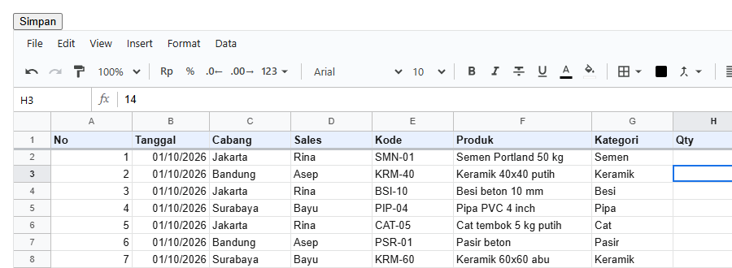

# 9. Memuat dan menyimpan

[Daftar isi](../README.md#daftar-isi) · Sebelumnya: [8. Menjaga isi yang diketik](08-menjaga-isi.md) · Berikutnya: [10. Hak akses](10-hak-akses.md)

Bab ini membahas dua sisi dari satu pekerjaan: **di React**, memuat workbook dari API, menyimpannya, dan menyimpan otomatis; lalu **di server**, menyimpannya ke database, hanya mengirim yang berubah, dan memeriksa ulang setiap simpanan.

- [9.1 Isi dari server](#91-isi-dari-server)
- [9.2 Tombol Simpan](#92-tombol-simpan)
- [9.3 Workbook bukan state React](#93-workbook-bukan-state-react)
- [9.4 Memuat dari API](#94-memuat-dari-api)
- [9.5 Menyimpan otomatis](#95-menyimpan-otomatis)
- [9.6 Aplikasi lengkap: kasir](#96-aplikasi-lengkap-kasir)
- [9.7 Data dari props](#97-data-dari-props)
- [9.8 Kesalahan yang sering terjadi](#98-kesalahan-yang-sering-terjadi)
- [9.9 Tabelnya](#99-tabelnya)
- [9.10 Kode server](#910-kode-server)
- [9.11 Isi `content`](#911-isi-content)
- [9.12 Relasi dengan view](#912-relasi-dengan-view)
- [9.13 Lanjutan: patch, pemeriksaan, data rahasia](#913-lanjutan-patch-pemeriksaan-data-rahasia)
- [9.14 Undo, redo, `source`, dan `apply`](#914-undo-redo-source-dan-apply)
- [9.15 Jenis op](#915-jenis-op)

## 9.1 Isi dari server

<!-- contoh: 11-langkah4.page.js -->
```jsx
import { useEffect, useState } from 'react';
import { Sheet } from '@kufayeka/sheet';
import { createWorkbook } from '@kufayeka/sheet/core';
import '@kufayeka/sheet/style.css';
import { ambilWorkbook } from './data/api.js';

// Langkah 4: isinya datang dari server. Selama menunggu tampil "Memuat…", lalu sheet tampil berisi.
export default function Halaman() {
    const [wb, setWb] = useState(null);
    useEffect(() => {
        // di aplikasimu: fetch('/api/workbooks/penjualan').then((r) => r.json())
        ambilWorkbook('penjualan').then((doc) => setWb(createWorkbook(doc)));
    }, []);
    if (!wb) return <p>Memuat…</p>;
    return <div style={{ height: 400 }}><Sheet workbook={wb} /></div>;
}
```
<!-- /contoh -->

Yang baru:

- Server mengirim satu JSON, yaitu kolom `content` dari tabel `spreadsheet` ([9.9](09-menyimpan.md#99-tabelnya)).
- `createWorkbook(doc)` mengubah JSON itu jadi workbook lagi. Dipanggil sekali, saat jawabannya datang.
- Selama menunggu, `wb` masih `null`, jadi yang tampil "Memuat…".

`ambilWorkbook` di contoh ini pura-pura jadi server, supaya contohnya bisa langsung dicoba ([`examples/data/api.js`](examples/data/api.js)). Di
aplikasimu, isinya `fetch` ke server-mu sendiri.

## 9.2 Tombol Simpan

<!-- contoh: 11-langkah5.page.js -->
```jsx
import { useEffect, useState } from 'react';
import { Sheet, useWorkbook } from '@kufayeka/sheet';
import { createWorkbook } from '@kufayeka/sheet/core';
import '@kufayeka/sheet/style.css';
import { ambilWorkbook, simpanContent } from './data/api.js';

// Langkah 5: tombol Simpan. Seluruh isi workbook dikirim sebagai satu JSON, dan disimpan sebagai satu baris di database.
export default function Halaman() {
    const [wb, setWb] = useState(null);
    useEffect(() => { ambilWorkbook('penjualan').then((doc) => setWb(createWorkbook(doc))); }, []);
    // true kalau ada yang diubah sejak simpan terakhir
    const adaPerubahan = useWorkbook(wb, (w) => w.unsaved());
    if (!wb) return <p>Memuat…</p>;

    async function simpan() {
        await simpanContent('penjualan', wb.toJSON());   // di aplikasimu: fetch(..., { method: 'PUT', body: JSON.stringify(wb.toJSON()) })
        wb.saved();                                      // workbook mencatat: semua sudah tersimpan
    }
    return (
        <div>
            <button className="simpan" disabled={!adaPerubahan} onClick={simpan}>{adaPerubahan ? 'Simpan' : 'Tersimpan'}</button>
            <div style={{ height: 400 }}><Sheet workbook={wb} /></div>
        </div>
    );
}
```
<!-- /contoh -->



Menyimpan itu dua baris:

1. `wb.toJSON()` dikirim ke server. Server menyimpannya ke kolom `content` ([9.10](09-menyimpan.md#910-kode-server)).
2. `wb.saved()` mencatat bahwa semuanya sudah tersimpan. `wb.unsaved()` jadi `false`, tombolnya jadi "Tersimpan".

Sampai sini kamu sudah punya halaman spreadsheet yang bisa dibuka dan disimpan. Bagian selanjutnya untuk kebutuhan yang lebih banyak: simpan otomatis,
halaman yang lebih besar, Next.js.

## 9.3 Workbook bukan state React

Workbook adalah objek yang berubah sendiri. Isinya berubah setiap kali orang mengetik, dan `<Sheet>` menggambar ulang dirinya tanpa `setState`. Karena itu
workbook **tidak** disimpan sebagai state yang diganti-ganti. Workbook dibuat sekali, lalu objek yang sama dipakai terus:

```jsx
// benar: dibuat sekali, saat komponen pertama kali tampil
const [wb] = useState(() => createWorkbook(doc));
const [wb] = useState(buatTemplate);            // sama, dengan fungsi yang sudah ada
```

| Cara | Akibatnya |
|---|---|
| `const wb = createWorkbook()` di badan komponen | workbook baru di setiap render. Isi, undo, dan seleksi hilang setiap kali ada state lain berubah |
| `useState(createWorkbook())` (dengan tanda kurung) | workbook baru tetap dibuat di setiap render lalu dibuang. Boros, dan `createWorkbook(doc)` yang berat jadi lambat |
| `useMemo(() => createWorkbook(), [])` | biasanya jalan, tetapi React boleh membuang hasil `useMemo` kapan saja. Pakai `useState` |
| `const wb = createWorkbook()` di luar komponen (tingkat modul) | satu workbook untuk semua: di Next.js, semua pengunjung di server memakai workbook yang sama |
| `setWb(...)` setiap kali isinya berubah | tidak perlu. `wb.setValues(...)` langsung terlihat |

Mengganti workbook dengan workbook lain (misalnya membuka file lain) boleh: simpan di `useState` lalu panggil `setWb(createWorkbook(docLain))`.
`<Sheet>` menampilkan workbook baru itu.

## 9.4 Memuat dari API

Hook untuk memuat workbook, dan hook untuk menyimpannya (9.5), ditaruh di satu file. File ini dipakai oleh semua contoh berikutnya:

<!-- contoh: 11-hooks.js -->
```js
import { useEffect, useRef, useState } from 'react';
import { useWorkbook } from '@kufayeka/sheet';
import { createWorkbook } from '@kufayeka/sheet/core';
import { ambilWorkbook, simpanPatch } from './data/api.js';

/**
 * Workbook dari API: { wb, error, cobaLagi }. wb null selama memuat.
 * @param {string} id  id workbook di API-mu. Berganti id = workbook lain dimuat.
 */
export function useWorkbookDariApi(id, opsi) {
    const [keadaan, setKeadaan] = useState({ wb: null, error: null });
    const [percobaan, setPercobaan] = useState(0);
    useEffect(() => {
        // AbortController: kalau komponen dilepas atau id berganti sebelum jawaban datang, permintaan lama dibatalkan dan jawabannya diabaikan.
        // Ini juga yang membuat StrictMode (yang menjalankan effect dua kali saat development) aman
        const batal = new AbortController();
        setKeadaan({ wb: null, error: null });
        ambilWorkbook(id, batal.signal)
            // createWorkbook di sini, sekali per isi yang dimuat. Opsinya (user, beforeOp) ikut dari pemanggil
            .then((doc) => setKeadaan({ wb: createWorkbook(doc, opsi), error: null }))
            .catch((err) => { if (err.name !== 'AbortError') setKeadaan({ wb: null, error: err.message }); });
        return () => batal.abort();
        // opsi sengaja tidak ikut: objek opsi yang ditulis langsung di pemanggil berubah setiap render
        // eslint-disable-next-line react-hooks/exhaustive-deps
    }, [id, percobaan]);
    return { ...keadaan, cobaLagi: () => setPercobaan((n) => n + 1) };
}

/**
 * Simpan otomatis `jeda` milidetik setelah orang berhenti mengubah. Hanya yang berubah yang dikirim (patch), bukan seluruh workbook.
 * Mengembalikan 'tersimpan' | 'menunggu' | 'menyimpan' | 'gagal'.
 */
export function useAutosave(wb, id, jeda = 1000) {
    const [status, setStatus] = useState('tersimpan');
    const sibuk = useRef(false);
    const belum = useWorkbook(wb, (w) => w.unsaved());

    useEffect(() => {
        if (!wb) return undefined;
        let timer = null;
        const simpan = async () => {
            // satu penyimpanan pada satu waktu: perubahan yang datang selama menyimpan dikirim berikutnya
            if (sibuk.current) { timer = setTimeout(simpan, jeda); return; }
            if (!wb.unsaved()) { setStatus('tersimpan'); return; }
            const patch = wb.pendingPatch();
            sibuk.current = true;
            setStatus('menyimpan');
            try {
                const jawaban = await simpanPatch(id, patch);
                // saved() hanya melupakan yang ikut di patch ini: yang diubah selama menunggu jawaban tetap tercatat belum tersimpan
                wb.saved(patch, jawaban);
                if (wb.unsaved()) { setStatus('menunggu'); timer = setTimeout(simpan, jeda); } else setStatus('tersimpan');
            } catch {
                // patch tidak hilang: penyimpanan berikutnya mengirimnya lagi bersama perubahan yang lebih baru
                setStatus('gagal');
                timer = setTimeout(simpan, jeda * 5);
            } finally {
                sibuk.current = false;
            }
        };
        // setiap perubahan menunda penyimpanan (debounce): mengetik 20 sel berturut-turut = satu kali simpan
        const off = wb.on('op', () => { setStatus('menunggu'); clearTimeout(timer); timer = setTimeout(simpan, jeda); });
        return () => { off(); clearTimeout(timer); };
    }, [wb, id, jeda]);

    // menutup tab saat masih ada yang belum tersimpan: browser bertanya dulu
    useEffect(() => {
        if (!belum) return undefined;
        const tahan = (e) => { e.preventDefault(); e.returnValue = ''; };
        window.addEventListener('beforeunload', tahan);
        return () => window.removeEventListener('beforeunload', tahan);
    }, [belum]);

    return status;
}
```
<!-- /contoh -->

Halaman yang memakainya:

<!-- contoh: 11-memuat.page.js -->
```jsx
import { Sheet } from '@kufayeka/sheet';
import '@kufayeka/sheet/style.css';
import { useWorkbookDariApi } from './11-hooks.js';

// Workbook dimuat dari API saat halaman dibuka. Selama memuat tampil teks, kalau gagal tampil pesan dan tombol coba lagi.
export default function HalamanPenjualan() {
    const { wb, error, cobaLagi } = useWorkbookDariApi('penjualan-oktober');
    if (error) return <p>Gagal memuat: {error} <button onClick={cobaLagi}>Coba lagi</button></p>;
    if (!wb) return <p>Memuat penjualan…</p>;
    return <div style={{ height: 520 }}><Sheet workbook={wb} fileName="Penjualan Oktober" /></div>;
}
```
<!-- /contoh -->

`ambilWorkbook` dan `simpanPatch` di contoh ini datang dari API tiruan ([`examples/data/api.js`](examples/data/api.js)) supaya contohnya bisa
dijalankan. Di aplikasimu, keduanya adalah `fetch` ke API-mu sendiri. Isi file itu menjelaskan caranya.

Yang perlu diperhatikan:

- **`createWorkbook(doc)` dipanggil di dalam `.then`**, sekali per isi yang dimuat, lalu disimpan ke state. Jangan memanggilnya di badan komponen.
- **AbortController.** Kalau komponen dilepas, atau `id` berganti sebelum jawaban datang, jawaban lama diabaikan. Tanpa ini, membuka workbook A lalu
  cepat-cepat pindah ke B bisa berakhir dengan B yang tertimpa A. Hal yang sama membuat `<StrictMode>` aman, karena StrictMode menjalankan effect dua
  kali saat development.
- **Berganti workbook**: `id` lain memuat workbook lain, dan `<Sheet>` menampilkan workbook baru begitu jawabannya datang.

## 9.5 Menyimpan otomatis

`useAutosave` di file yang sama menyimpan satu detik setelah orang berhenti mengubah:

<!-- contoh: 11-autosave.page.js -->
```jsx
import { Sheet } from '@kufayeka/sheet';
import '@kufayeka/sheet/style.css';
import { useWorkbookDariApi, useAutosave } from './11-hooks.js';

const TEKS = { tersimpan: 'Semua perubahan tersimpan', menunggu: 'Belum tersimpan…', menyimpan: 'Menyimpan…', gagal: 'Gagal menyimpan, mencoba lagi' };

export default function HalamanAutosave() {
    const { wb } = useWorkbookDariApi('penjualan-oktober');
    const status = useAutosave(wb, 'penjualan-oktober');
    if (!wb) return <p>Memuat penjualan…</p>;
    return (
        <div style={{ height: 560, display: 'flex', flexDirection: 'column' }}>
            <p className="status-simpan" style={{ margin: '4px 8px', color: status === 'gagal' ? '#d93025' : '#5f6368' }}>{TEKS[status]}</p>
            <Sheet workbook={wb} style={{ flex: 1 }} />
        </div>
    );
}
```
<!-- /contoh -->

Cara kerjanya:

1. **Hanya yang berubah yang dikirim.** `wb.pendingPatch()` berisi baris, kolom, dan sheet yang berubah sejak simpan terakhir. Mengubah satu sel di sheet
   10.000 baris mengirim satu baris, bukan 10.000.
2. **Debounce.** Setiap perubahan (`wb.on('op')`) menunda penyimpanan. Mengetik 20 sel berturut-turut menghasilkan satu kali simpan.
3. **`wb.saved(patch, jawaban)`** memberi tahu workbook bahwa patch itu sudah tersimpan. Yang dilupakan hanya isi patch itu. Perubahan yang dibuat selama
   menunggu jawaban server tetap tercatat dan ikut di penyimpanan berikutnya, jadi tidak ada yang hilang.
4. **Satu penyimpanan pada satu waktu.** Kalau penyimpanan sebelumnya belum selesai, yang berikutnya menunggu.
5. **Gagal simpan** tidak membuang apa-apa. Patch berikutnya mengirim semua yang belum tersimpan.
6. **`beforeunload`**: menutup tab saat masih ada yang belum tersimpan membuat browser bertanya dulu. `useWorkbook(wb, (w) => w.unsaved())` memberi tahu
   kapan pengaman ini perlu dipasang.

Apa yang dilakukan server dengan patch itu (menggabungkan, memeriksa, menolak), dan bentuk tabel database-nya, dibahas di [bab 9](09-menyimpan.md).

## 9.6 Aplikasi lengkap: kasir

Semua bagian di atas dalam satu halaman. Header menampilkan omzet, jumlah transaksi, Undo/Redo, dan status simpan. Panel kanan menampilkan transaksi
yang dipilih, dan di bawahnya ada form React untuk menambah transaksi:


<!-- contoh: 11-kasir.page.js -->
```jsx
import { useRef, useState } from 'react';
import { Sheet, useWorkbook } from '@kufayeka/sheet';
import '@kufayeka/sheet/style.css';
import { useWorkbookDariApi, useAutosave } from './11-hooks.js';
import { PRODUK } from './data/toko.js';

const STATUS = { tersimpan: 'Tersimpan', menunggu: 'Belum tersimpan', menyimpan: 'Menyimpan…', gagal: 'Gagal menyimpan' };
const rupiah = (n) => 'Rp ' + Math.round(n || 0).toLocaleString('id-ID');

// Bagian atas halaman: angka dari sheet, tombol yang tahu kapan bisa dipakai, status simpan. Bukan bagian dari <Sheet>, tapi ikut berubah bersamanya.
function Ringkasan({ wb, status, sheetRef }) {
    const omzet = useWorkbook(wb, (w) => w.value('Penjualan', 'N1'));
    const transaksi = useWorkbook(wb, (w) => w.value('Penjualan', 'N2'));
    const bisaUndo = useWorkbook(wb, (w) => w.canUndo());
    const bisaRedo = useWorkbook(wb, (w) => w.canRedo());
    return (
        <header className="kasir-atas" style={{ display: 'flex', gap: 12, alignItems: 'center', padding: '6px 8px' }}>
            <b>Omzet <span className="kasir-omzet">{rupiah(omzet)}</span></b>
            <span><span className="kasir-jumlah">{transaksi}</span> transaksi</span>
            <button className="kasir-undo" disabled={!bisaUndo} onClick={() => wb.undo()}>Undo</button>
            <button disabled={!bisaRedo} onClick={() => wb.redo()}>Redo</button>
            <button onClick={() => sheetRef.current.select('N1')}>Ke total</button>
            <span className="kasir-status" style={{ marginLeft: 'auto', color: '#5f6368' }}>{STATUS[status]}</span>
        </header>
    );
}

// Detail baris yang sedang dipilih di sheet. Baris dipegang lewat id-nya, jadi tetap baris yang sama walau sheet di-sort atau disisipi baris
function Detail({ wb, rowId }) {
    const teks = useWorkbook(wb, (w) => {
        const r = rowId ? w.rowIndex('Penjualan', rowId) : -1;
        if (r < 1) return '';
        const d = (c) => w.display('Penjualan', r, c).text;
        return `No ${d(0)} · ${d(1)} · ${d(2)} (${d(3)})\n${d(5)}\n${d(7)} x ${d(8)}, diskon ${d(9)}\nTotal ${d(10)}`;
    });
    return <pre className="kasir-detail" style={{ font: 'inherit', whiteSpace: 'pre-wrap', minHeight: 80 }}>{teks || 'Pilih satu transaksi'}</pre>;
}

// Form React biasa yang menambah satu transaksi ke sheet. source 'user': aturan dan validasi sheet tetap berlaku
function TransaksiBaru({ wb, sheetRef }) {
    const [kode, setKode] = useState(PRODUK[0][0]);
    const [qty, setQty] = useState(1);
    const tambah = (e) => {
        e.preventDefault();
        const p = PRODUK.find((x) => x[0] === kode);
        const jual = wb.sheet('Penjualan');
        const r = wb.value('Penjualan', 'N2') + 1;            // nomor baris setelah transaksi terakhir (baris 0 adalah judul kolom)
        const n = r + 1;                                       // nomor baris seperti tertulis di layar, untuk rumus
        jual.setValues(r, 0, [[r, 46325, 'Jakarta', 'Rina', p[0], p[1], p[2], Number(qty), p[5], 0, `=H${n}*I${n}*(1-J${n})`]], { source: 'user' });
        sheetRef.current.select('A' + n);
        setQty(1);
    };
    return (
        <form className="kasir-form" onSubmit={tambah} style={{ display: 'flex', flexWrap: 'wrap', gap: 6 }}>
            <select style={{ width: '100%' }} value={kode} onChange={(e) => setKode(e.target.value)}>{PRODUK.map((p) => <option key={p[0]} value={p[0]}>{p[1]}</option>)}</select>
            <input className="kasir-qty" type="number" min="1" value={qty} onChange={(e) => setQty(e.target.value)} />
            <button className="kasir-tambah">Tambah</button>
        </form>
    );
}

export default function Kasir() {
    const { wb } = useWorkbookDariApi('penjualan-oktober');
    const status = useAutosave(wb, 'penjualan-oktober');
    const sheetRef = useRef(null);
    const [rowId, setRowId] = useState(null);
    if (!wb) return <p>Memuat penjualan…</p>;
    return (
        <div style={{ height: 600, display: 'flex', flexDirection: 'column', font: '13px system-ui' }}>
            <Ringkasan wb={wb} status={status} sheetRef={sheetRef} />
            <div style={{ flex: 1, display: 'flex', minHeight: 0 }}>
                <Sheet ref={sheetRef} workbook={wb} style={{ flex: 1 }}
                    onSelectionChange={(sel) => setRowId(wb.rowId('Penjualan', sel.active.r))} />
                <aside style={{ width: 230, padding: 8, borderLeft: '1px solid #dadce0' }}>
                    <Detail wb={wb} rowId={rowId} />
                    <TransaksiBaru wb={wb} sheetRef={sheetRef} />
                </aside>
            </div>
        </div>
    );
}
```
<!-- /contoh -->

Yang dipakai di sini:

- **`useWorkbook` di setiap komponen yang membaca workbook.** `Ringkasan` membaca dua sel dan dua status undo, `Detail` membaca satu baris. Masing-masing
  hanya digambar ulang kalau yang dibacanya berubah.
- **`ref` ke `<Sheet>`** untuk perintah dari luar: `sheetRef.current.select('N1')` memilih sel dan menggulir ke sana. Daftar lengkapnya ada di
  [3.6](03-komponen-sheet.md#36-memberi-perintah-lewat-ref).
- **`onSelectionChange`** memberi seleksi dalam nomor. Yang disimpan di state adalah **id baris** (`wb.rowId(...)`), bukan nomornya, jadi panel detail
  tetap menunjuk transaksi yang sama walaupun sheet di-sort atau disisipi baris.
- **Form React menulis ke sheet** dengan `{ source: 'user' }`, jadi validasi dan aturan sheet ([8.3](08-menjaga-isi.md#83-pilihan-dari-daftar-dropdown),
  [bab 8](08-menjaga-isi.md)) tetap berlaku seperti kalau orang mengetiknya sendiri. Perubahan itu juga masuk undo dan ikut tersimpan otomatis.
- **Tombol Undo di luar sheet** cukup memanggil `wb.undo()`. Sheet dan header ikut berubah.

## 9.7 Data dari props

Laporan yang datanya datang lewat props, misalnya dari pilihan cabang di atasnya:

<!-- contoh: 11-props.page.js -->
```jsx
import { useEffect, useState } from 'react';
import { Sheet } from '@kufayeka/sheet';
import { createWorkbook, populate } from '@kufayeka/sheet/core';
import '@kufayeka/sheet/style.css';
import { penjualan, CABANG } from './data/toko.js';

// Laporan per cabang: cabang dipilih di luar sheet, datanya datang lewat props. Workbook dibuat sekali, isinya diganti saat props berubah.
function buatTemplate() {
    const wb = createWorkbook();
    wb.setSettings({ locale: 'id-ID', currency: 'IDR' });
    const lap = wb.sheet('Sheet1');
    lap.setSheetProps({ name: 'Transaksi', freezeRows: 1 });
    lap.setColProps('B', { format: { type: 'date' } });
    lap.setColProps('E:F', { format: { type: 'money', decimals: 0 } });
    lap.setColProps('C', { width: 180 });
    const rekap = wb.sheet(wb.addSheet('Rekap'));
    rekap.setValues('A1', [['Transaksi', '=COUNT(Transaksi!A:A)'], ['Omzet', '=SUM(Transaksi!F:F)']]);
    rekap.setColProps('B', { format: { type: 'money', decimals: 0 }, width: 140 });
    return wb;
}

function LaporanCabang({ data, sheet, onSheetChange }) {
    // useState dengan fungsi: workbook dibuat SEKALI untuk umur komponen ini, tidak setiap render
    const [wb] = useState(buatTemplate);
    // props berubah: isi tabelnya diganti, workbook-nya tetap. Undo, sheet aktif, lebar kolom yang diatur orang, semuanya tetap
    useEffect(() => {
        wb.sheet('Transaksi').clear('A1:F1000', { source: 'remote' });     // remote: tidak masuk undo, ini bukan perubahan orang
        populate(wb, 'Transaksi', { at: 'A1', fields: ['No', 'Tanggal', 'Produk', 'Qty', 'Harga', 'Total'], header: true }, data, { source: 'remote' });
    }, [wb, data]);
    // sheet yang tampil dikontrol dari luar lewat props sheet + onSheetChange
    return <Sheet workbook={wb} sheet={wb.sheetIdByName(sheet)} onSheetChange={(id) => onSheetChange(wb.sheetProps(id).name)} style={{ height: 460 }} />;
}

export default function HalamanCabang() {
    const [cabang, setCabang] = useState('Jakarta');
    const [sheet, setSheet] = useState('Transaksi');
    const [data, setData] = useState([]);
    useEffect(() => {
        // di aplikasi: fetch('/api/penjualan?cabang=' + cabang)
        setData(penjualan(60).filter((x) => x.Cabang === cabang).map((x) => ({ ...x, Total: x.Qty * x.Harga * (1 - x.Diskon) })));
    }, [cabang]);
    return (
        <div>
            <p style={{ display: 'flex', gap: 8, margin: 8 }}>
                <select className="pilih-cabang" value={cabang} onChange={(e) => setCabang(e.target.value)}>{CABANG.map((c) => <option key={c}>{c}</option>)}</select>
                <button onClick={() => setSheet('Transaksi')}>Transaksi</button>
                <button onClick={() => setSheet('Rekap')}>Rekap</button>
                <span>Sheet aktif: {sheet}</span>
            </p>
            <LaporanCabang data={data} sheet={sheet} onSheetChange={setSheet} />
        </div>
    );
}
```
<!-- /contoh -->

Ada dua cara menanggapi props yang berubah:

| Cara | Kapan |
|---|---|
| **Isi diganti di `useEffect`** (seperti contoh): `clear` lalu `populate`, dengan `{ source: 'remote' }` | workbook-nya tetap sama: lebar kolom yang diatur orang, sheet aktif, dan seleksi tetap. `remote` membuat pengisian ini tidak masuk undo, jadi Ctrl+Z tidak menghapus data laporan |
| **Workbook baru dengan `key`**: `<LaporanCabang key={cabang} ... />` | semuanya mulai dari awal untuk setiap cabang, termasuk undo dan pengaturan tampilan. Paling sederhana kalau memang itu yang diinginkan |

**Sheet aktif yang dikontrol.** Dengan prop `sheet` (id sheet) dan `onSheetChange`, sheet yang tampil dipegang oleh state-mu. Tombol di luar sheet bisa
memindahkannya, dan klik tab di sheet memberi tahu state-mu. Contoh di atas menyimpan nama sheet di state dan mengubahnya menjadi id dengan
`wb.sheetIdByName`. Nama lebih cocok untuk URL atau `localStorage`.

## 9.8 Kesalahan yang sering terjadi

| Gejala | Sebab | Solusi |
|---|---|---|
| Isi kembali kosong, undo hilang, setiap kali state lain berubah | `createWorkbook()` dipanggil di badan komponen | `useState(() => createWorkbook(...))` (9.3) |
| Total di header tidak ikut berubah | dibaca sekali dengan `wb.value(...)` di render | `useWorkbook(wb, (w) => w.value(...))` (11.7) |
| Header digambar ulang terus walau totalnya sama | `baca` mengembalikan objek atau array baru | kembalikan angka atau teks, atau pecah menjadi beberapa `useWorkbook` |
| Pindah cepat dari workbook A ke B, yang tampil malah A | jawaban API yang lama datang belakangan | `AbortController` di effect (9.4) |
| Perubahan hilang setelah autosave | `wb.saved()` dipanggil tanpa patch yang dikirim, atau sebelum jawaban datang | `wb.saved(patch, jawaban)` dengan patch yang sama, setelah server menjawab (9.5) |
| Ctrl+Z menghapus data yang diisi dari API | data diisi dengan source bawaan (`code`), jadi masuk undo | isi dengan `{ source: 'remote' }` (9.7) |
| Form React melewati validasi sheet | ditulis tanpa source, jadi dianggap kode | `{ source: 'user' }` (9.6) |
| Panel detail menunjuk baris yang salah setelah sort | yang disimpan nomor baris | simpan `wb.rowId(r)`, cari nomornya lagi dengan `wb.rowIndex(id)` |

## 9.9 Tabelnya

```sql
create table spreadsheet (
    id      text primary key,     -- id dari aplikasimu: 'stok', 'penjualan-2026-10', ...
    content jsonb not null        -- wb.toJSON(), utuh
);
```

Isinya kira-kira begini:

| id | content |
|---|---|
| `stok` | `{"id":"…","version":3,"settings":{…},"sheets":[{"props":{"name":"Produk"},"rows":[…]}]}` |
| `penjualan-2026-10` | `{"id":"…","version":12,"settings":{…},"sheets":[…]}` |
| `laporan-bulanan` | `{…}` |

Itu saja. Satu spreadsheet = satu baris. Kalau mau, tambah kolom milikmu sendiri: pemilik, dibuat kapan, diubah kapan.

## 9.10 Kode server

Contoh dengan Express. Framework lain (Next.js route, Fastify, Hono) sama saja: dua route.

```js
// ambil: kirim content apa adanya
app.get('/api/spreadsheet/:id', async (req, res) => {
    const { rows } = await db.query('select content from spreadsheet where id = $1', [req.params.id]);
    if (!rows.length) return res.status(404).end();
    res.json(rows[0].content);
});

// simpan: content baru menggantikan yang lama (atau dibuat kalau belum ada)
app.put('/api/spreadsheet/:id', express.json({ limit: '20mb' }), async (req, res) => {
    await db.query(
        'insert into spreadsheet (id, content) values ($1, $2) on conflict (id) do update set content = excluded.content',
        [req.params.id, req.body]
    );
    res.json({ ok: true });
});
```

Di browser, pasangannya sudah ada di [9.1 dan 9.2](09-menyimpan.md#91-isi-dari-server):

```js
const content = await fetch('/api/spreadsheet/stok').then((r) => r.json());
const wb = createWorkbook(content);                                   // buka
// ... orang mengedit ...
await fetch('/api/spreadsheet/stok', { method: 'PUT', headers: { 'Content-Type': 'application/json' }, body: JSON.stringify(wb.toJSON()) });
wb.saved();                                                           // simpan
```

## 9.11 Isi `content`

Daftar harga tiga produk, dilihat dari tiga sisi: di layar, di dalam `content`, dan bagian mana yang berubah saat diedit:

<!-- contoh: 12-simulasi.js -->
```js
import { createWorkbook } from '@kufayeka/sheet/core';

// Apa isi `content` yang disimpan? Daftar harga tiga produk, dilihat dari tiga sisi: di layar, di dalam content, dan apa yang berubah saat diedit.
// Id aslinya UUID panjang; di sini diganti nama pendek (r1, k1, ...) supaya mudah dibaca.

// ---- alat cetak
const pendek = new Map();
const nama = (id, awalan) => { if (!pendek.has(id)) pendek.set(id, awalan + ([...pendek.values()].filter((x) => x.startsWith(awalan)).length + 1)); return pendek.get(id); };
const isi = (cells) => Object.entries(cells).map(([k, v]) => (pendek.get(k) || k) + ':' + (v && v.f !== undefined ? '[rumus, hasil ' + v.v + ']' : JSON.stringify(v))).join('  ');
function kotak(judul, kolom, baris) {
    const lebar = kolom.map((k, i) => Math.max(k.length, ...baris.map((b) => String(b[i]).length)));
    const garis = '+' + lebar.map((l) => '-'.repeat(l + 2)).join('+') + '+';
    const satu = (b) => '| ' + b.map((x, i) => String(x).padEnd(lebar[i])).join(' | ') + ' |';
    if (judul) console.log(judul);
    console.log([garis, satu(kolom), garis, ...baris.map(satu), garis].join('\n'));
}
function layar(wb) {
    const akhir = wb.lastFilled('Harga');
    const baris = [];
    for (let r = 0; r <= akhir.r; r++) baris.push([r + 1, ...Array.from({ length: akhir.c + 1 }, (_, c) => wb.display('Harga', r, c).text)]);
    kotak('', ['', ...Array.from({ length: akhir.c + 1 }, (_, c) => String.fromCharCode(65 + c))], baris);
}
function barisContent(content) {
    const sh = content.sheets[0];
    sh.columns.slice(0, 5).forEach((c) => nama(c.id, 'k'));
    kotak('', ['id', 'key', 'cells'], sh.rows.map((r) => [nama(r.id, 'r'), r.key, isi(r.cells)]));
}

// ---- 1. di layar
const wb = createWorkbook();
wb.setSheetProps('Sheet1', { name: 'Harga' });
wb.setValues('Harga', 'A1', [['Kode', 'Produk', 'Harga', 'Stok', 'Nilai'], ['SMN-01', 'Semen 50 kg', 72000, 420, '=C2*D2'], ['BSI-10', 'Besi 10 mm', 79500, 260, '=C3*D3'], ['CAT-05', 'Cat 5 kg', 145000, 64, '=C4*D4']]);
console.log('1. DI LAYAR');
layar(wb);

// ---- 2. di dalam content = wb.toJSON()
let content = wb.toJSON();
console.log('\n2. DI DALAM content (yang disimpan di kolom content)');
console.log('content.sheets[0].props   =', JSON.stringify(content.sheets[0].props), '| rowCount', content.sheets[0].rowCount, '(baris kosong di bawah tidak disimpan, hanya dihitung)');
console.log('content.sheets[0].rows    = satu baris layar, satu baris di sini:');
barisContent(content);
console.log('k1..k5 adalah kolom A..E. Rumus disimpan beserta hasilnya, supaya SQL bisa membaca angkanya.');

// ---- 3. stok besi diubah jadi 300
wb.setValues('Harga', 'D3', 300, { source: 'user' });
console.log('\n3. STOK BESI DIUBAH JADI 300: yang berubah di content hanya baris r3 (dan hasil rumusnya)');
content = wb.toJSON();
barisContent(content);

// ---- 4. baris baru disisipkan di baris 3
wb.insertRows('Harga', '3');
wb.setValues('Harga', 'A3', [['SMN-02', 'Semen putih', 112000, 35, '=C3*D3']], { source: 'user' });
console.log('\n4. BARIS BARU DI BARIS 3');
layar(wb);
content = wb.toJSON();
barisContent(content);
const baru = content.sheets[0].rows.find((r) => pendek.get(r.id) === 'r5');
console.log('Baris baru (r5) mendapat key ' + baru.key + ', di antara 08 dan 0C. Urutan baris ditentukan key; besi dan cat tidak ditulis ulang.');

// ---- 5. dibuka lagi dari content
const dibuka = createWorkbook(content);
console.log('\n5. DIBUKA LAGI: createWorkbook(content) -> E3', dibuka.input('Harga', 'E3'), '=', dibuka.value('Harga', 'E3'));
```
<!-- /contoh -->

<!-- hasil: 12-simulasi.js -->
```text
1. DI LAYAR
+---+--------+-------------+--------+------+----------+
|   | A      | B           | C      | D    | E        |
+---+--------+-------------+--------+------+----------+
| 1 | Kode   | Produk      | Harga  | Stok | Nilai    |
| 2 | SMN-01 | Semen 50 kg | 72000  | 420  | 30240000 |
| 3 | BSI-10 | Besi 10 mm  | 79500  | 260  | 20670000 |
| 4 | CAT-05 | Cat 5 kg    | 145000 | 64   | 9280000  |
+---+--------+-------------+--------+------+----------+

2. DI DALAM content (yang disimpan di kolom content)
content.sheets[0].props   = {"name":"Harga"} | rowCount 1000 (baris kosong di bawah tidak disimpan, hanya dihitung)
content.sheets[0].rows    = satu baris layar, satu baris di sini:
+----+-----+-----------------------------------------------------------------------------+
| id | key | cells                                                                       |
+----+-----+-----------------------------------------------------------------------------+
| r1 | 04  | k1:"Kode"  k2:"Produk"  k3:"Harga"  k4:"Stok"  k5:"Nilai"                   |
| r2 | 08  | k1:"SMN-01"  k2:"Semen 50 kg"  k3:72000  k4:420  k5:[rumus, hasil 30240000] |
| r3 | 0C  | k1:"BSI-10"  k2:"Besi 10 mm"  k3:79500  k4:260  k5:[rumus, hasil 20670000]  |
| r4 | 0G  | k1:"CAT-05"  k2:"Cat 5 kg"  k3:145000  k4:64  k5:[rumus, hasil 9280000]     |
+----+-----+-----------------------------------------------------------------------------+
k1..k5 adalah kolom A..E. Rumus disimpan beserta hasilnya, supaya SQL bisa membaca angkanya.

3. STOK BESI DIUBAH JADI 300: yang berubah di content hanya baris r3 (dan hasil rumusnya)
+----+-----+-----------------------------------------------------------------------------+
| id | key | cells                                                                       |
+----+-----+-----------------------------------------------------------------------------+
| r1 | 04  | k1:"Kode"  k2:"Produk"  k3:"Harga"  k4:"Stok"  k5:"Nilai"                   |
| r2 | 08  | k1:"SMN-01"  k2:"Semen 50 kg"  k3:72000  k4:420  k5:[rumus, hasil 30240000] |
| r3 | 0C  | k1:"BSI-10"  k2:"Besi 10 mm"  k3:79500  k4:300  k5:[rumus, hasil 23850000]  |
| r4 | 0G  | k1:"CAT-05"  k2:"Cat 5 kg"  k3:145000  k4:64  k5:[rumus, hasil 9280000]     |
+----+-----+-----------------------------------------------------------------------------+

4. BARIS BARU DI BARIS 3
+---+--------+-------------+--------+------+----------+
|   | A      | B           | C      | D    | E        |
+---+--------+-------------+--------+------+----------+
| 1 | Kode   | Produk      | Harga  | Stok | Nilai    |
| 2 | SMN-01 | Semen 50 kg | 72000  | 420  | 30240000 |
| 3 | SMN-02 | Semen putih | 112000 | 35   | 3920000  |
| 4 | BSI-10 | Besi 10 mm  | 79500  | 300  | 23850000 |
| 5 | CAT-05 | Cat 5 kg    | 145000 | 64   | 9280000  |
+---+--------+-------------+--------+------+----------+
+----+-----+-----------------------------------------------------------------------------+
| id | key | cells                                                                       |
+----+-----+-----------------------------------------------------------------------------+
| r1 | 04  | k1:"Kode"  k2:"Produk"  k3:"Harga"  k4:"Stok"  k5:"Nilai"                   |
| r2 | 08  | k1:"SMN-01"  k2:"Semen 50 kg"  k3:72000  k4:420  k5:[rumus, hasil 30240000] |
| r5 | 0A  | k1:"SMN-02"  k2:"Semen putih"  k3:112000  k4:35  k5:[rumus, hasil 3920000]  |
| r3 | 0C  | k1:"BSI-10"  k2:"Besi 10 mm"  k3:79500  k4:300  k5:[rumus, hasil 23850000]  |
| r4 | 0G  | k1:"CAT-05"  k2:"Cat 5 kg"  k3:145000  k4:64  k5:[rumus, hasil 9280000]     |
+----+-----+-----------------------------------------------------------------------------+
Baris baru (r5) mendapat key 0A, di antara 08 dan 0C. Urutan baris ditentukan key; besi dan cat tidak ditulis ulang.

5. DIBUKA LAGI: createWorkbook(content) -> E3 =C3*D3 = 3920000
```
<!-- /hasil -->

Yang bisa diambil dari sini:

- **Satu baris di layar = satu baris di `content.sheets[…].rows`.** Isi sel-selnya ada di `cells`, dengan id kolom sebagai kuncinya. Sel kosong tidak
  disimpan.
- **Baris kosong di bawah tidak disimpan.** Sheet baru punya 1000 baris, tetapi yang disimpan hanya yang berisi, ditambah angka `rowCount`. Daftar 12
  produk berukuran sekitar 8 KB.
- **Rumus disimpan beserta hasilnya** (`v`). Saat dibuka lagi, hasilnya dihitung ulang. `v` ada supaya SQL dan alat lain yang tidak memakai library ini
  bisa membaca angkanya (9.12).
- **Urutan baris ditentukan `key`, bukan nomor.** Baris yang disisipkan mendapat key di antara kedua tetangganya.

## 9.12 Relasi dengan view

Data tetap disimpan utuh di `content`. Kalau ingin membacanya dari SQL seperti tabel biasa, atau menghubungkan dua spreadsheet, buat **view** PostgreSQL:


Dua spreadsheet terpisah: master produk dan penjualan Oktober. Keduanya disimpan dengan cara 9.10:

<!-- contoh: 12-db.js -->
```js
import { writeFileSync } from 'node:fs';
import { createWorkbook } from '@kufayeka/sheet/core';
import { PRODUK, KOLOM_PRODUK, penjualan, KOLOM_PENJUALAN, barisPenjualan } from './data/toko.js';

// Dua spreadsheet terpisah, seperti dua file: master produk, dan penjualan Oktober. Masing-masing disimpan sebagai satu baris di tabel spreadsheet.
const produk = createWorkbook();
produk.setSheetProps('Sheet1', { name: 'Produk' });
produk.setValues('Produk', 'A1', [KOLOM_PRODUK, ...PRODUK]);

const jual = createWorkbook();
jual.setSheetProps('Sheet1', { name: 'Penjualan' });
jual.setValues('Penjualan', 'A1', [KOLOM_PENJUALAN]);
jual.setValues('Penjualan', 'A2', barisPenjualan(penjualan(300), 2));        // kolom Total adalah rumus

// yang dikirim ke database: satu INSERT per spreadsheet, content = toJSON() utuh
const insert = (id, wb) => `insert into spreadsheet (id, content) values ('${id}', $json$${JSON.stringify(wb.toJSON())}$json$);`;
const sql = [insert('master-produk', produk), insert('penjualan-2026-10', jual)].join('\n');
if (process.argv[2]) writeFileSync(process.argv[2], sql);
console.log('master-produk     :', Math.round(JSON.stringify(produk.toJSON()).length / 1024), 'KB,', produk.toJSON().sheets[0].rows.length, 'baris tersimpan');
console.log('penjualan-2026-10 :', Math.round(JSON.stringify(jual.toJSON()).length / 1024), 'KB,', jual.toJSON().sheets[0].rows.length, 'baris tersimpan');
```
<!-- /contoh -->

<!-- hasil: 12-db.js -->
```text
master-produk     : 8 KB, 13 baris tersimpan
penjualan-2026-10 : 317 KB, 301 baris tersimpan
```
<!-- /hasil -->

View-nya:

<!-- contoh: 12-db.sql -->
```sql
-- Satu tabel untuk semua spreadsheet. content = wb.toJSON(), utuh.
create table spreadsheet (
    id      text primary key,          -- id milik aplikasimu, misalnya 'stok-toko'
    content jsonb not null
);

-- View umum: setiap baris setiap sheet sebagai { "judul kolom": nilai }. Judulnya diambil dari baris pertama sheet.
-- Sel rumus dibaca dari hasilnya (v), yang ikut tersimpan di content.
create view spreadsheet_rows as
with sh as (
    select sp.id as spreadsheet_id, s->'props'->>'name' as sheet, s
    from spreadsheet sp, jsonb_array_elements(sp.content->'sheets') s
), r as (
    select spreadsheet_id, sheet, x.row->>'id' as row_id, x.row->'cells' as cells,
           row_number() over (partition by spreadsheet_id, sheet order by x.row->>'key' collate "C") as nomor
    from sh, jsonb_array_elements(sh.s->'rows') as x(row)
), judul as (
    select spreadsheet_id, sheet, cells from r where nomor = 1
)
select r.spreadsheet_id, r.sheet, r.row_id, r.nomor,
       (select jsonb_object_agg(judul.cells->>c.key,
                                case when jsonb_typeof(c.value) = 'object' and c.value ? 'f' then c.value->'v' else c.value end)
        from jsonb_each(r.cells) c where judul.cells ? c.key) as data
from r join judul using (spreadsheet_id, sheet)
where r.nomor > 1 and r.cells <> '{}'::jsonb;

-- View per "tabel": kolom dengan nama dan tipe, seperti tabel biasa
create view produk as
select spreadsheet_id, row_id, data->>'Kode' as kode, data->>'Nama produk' as nama, data->>'Kategori' as kategori,
       (data->>'Harga jual')::numeric as harga_jual, (data->>'Stok')::int as stok
from spreadsheet_rows where spreadsheet_id = 'master-produk' and sheet = 'Produk';

create view penjualan as
select spreadsheet_id, row_id, (data->>'No')::int as no, data->>'Cabang' as cabang, data->>'Kode' as kode,
       (data->>'Qty')::numeric as qty, (data->>'Total')::numeric as total
from spreadsheet_rows where sheet = 'Penjualan';
```
<!-- /contoh -->

- `spreadsheet_rows` adalah view umum. Setiap baris setiap sheet menjadi `{ "judul kolom": nilai }`, dengan judul yang diambil dari baris pertama
  sheet. View ini cukup dibuat sekali, untuk semua spreadsheet.
- `produk` dan `penjualan` adalah view per "tabel": nama kolom dan tipenya ditentukan di sini.
- Sel rumus dibaca dari hasilnya (`v`), jadi kolom `Total` berisi angka.

Lalu query biasa, termasuk `JOIN` antar spreadsheet:

```sql
select p.kategori, sum(j.qty) as qty, sum(j.total) as omzet
from penjualan j join produk p on p.kode = j.kode
group by p.kategori order by omzet desc;
```

Hasilnya, dijalankan di PostgreSQL 18 dengan data contoh di atas:

```text
 kategori | qty  |   omzet
----------+------+-----------
 Bata     |  244 | 178494750
 Cat      |  428 | 143393750
 Semen    | 1066 |  97448800
 Keramik  |  501 |  62241200
 Pasir    |  174 |  49358000
 Pipa     |  440 |  46807950
 Besi     |  405 |  42708700
```

Angka yang sama dengan pivot di [7.6](07-data.md#76-pivot-table). Yang perlu diingat:

- **View membaca judul kolom.** Kalau orang mengganti judul "Harga jual" di sheet, view `produk` perlu disesuaikan. Untuk sheet yang dibaca SQL, kunci
  judulnya dengan aturan `readonly` ([bab 8](08-menjaga-isi.md)).
- **View hanya untuk membaca.** Menulis tetap lewat spreadsheet: buka, ubah, simpan `content`.
- Untuk data besar yang sering di-query, ganti `create view` dengan `create materialized view`, lalu `refresh materialized view` setelah menyimpan.

## 9.13 Lanjutan: patch, pemeriksaan, data rahasia

Cara 9.10 sudah cukup untuk sebagian besar aplikasi. Bagian ini untuk tiga keadaan khusus:

| Keadaan | Jawabannya |
|---|---|
| Spreadsheet besar (puluhan ribu baris), disimpan sering | kirim bagian yang berubah saja (`pendingPatch`), dan gabungkan di server (`mergePatch`) |
| Ada aturan per orang (kasir tidak boleh mengubah harga) | server memeriksa ulang dengan `checkPatch`, karena browser bisa diakali |
| Ada data yang tidak boleh sampai ke browser (harga beli) | server mengirim `viewFor(content, …)`, bukan `content` utuh |

### Patch dan pemeriksaan

<!-- contoh: 12-alur.js -->
```js
import { createWorkbook, mergePatch, checkPatch } from '@kufayeka/sheet/core';
import { PRODUK, KOLOM_PRODUK } from './data/toko.js';

// Alur simpan dari awal sampai akhir: server punya workbook tersimpan, kasir membukanya, mengubah stok, browser mengirim patch,
// server memeriksa lalu menggabungkan. Kode server dan browser ada di satu file supaya bisa dijalankan; di aplikasi, keduanya terpisah.

// ---- SERVER: workbook yang tersimpan, dan aturan untuk peran kasir (sama dengan yang dipasang di browser, bab 10)
let tersimpan = (() => {
    const wb = createWorkbook();
    wb.setSheetProps('Sheet1', { name: 'Produk' });
    wb.setValues('Produk', 'A1', [KOLOM_PRODUK, ...PRODUK]);
    return { ...wb.toJSON(), version: 1 };
})();
const aturanKasir = [
    { sheet: 'Produk', columns: ['Harga beli'], mode: 'hidden' },
    { sheet: 'Produk', columns: ['Kode', 'Nama produk', 'Kategori', 'Satuan', 'Harga jual', 'Stok min.'], mode: 'readonly' }
];
const tipe = { Produk: { headerRow: 1, fields: { Stok: { kind: 'int' } } } };

// ---- BROWSER: buka, pasang aturan, kasir mengubah dua stok
const wb = createWorkbook(tersimpan);
wb.setRules(aturanKasir);
wb.setValues('Produk', 'G2', 400, { source: 'user' });
wb.setValues('Produk', 'G5', 140, { source: 'user' });
const patch = wb.pendingPatch();
console.log('patch dikirim   :', patch.rows.upsert.length, 'baris diubah,', patch.rows.delete.length, 'dihapus, dari versi', patch.workbook.version);

// ---- SERVER: periksa dengan aturan dan tipe yang sama, lalu gabungkan dan naikkan versinya
const cek = checkPatch(tersimpan, patch, { rules: aturanKasir, types: tipe });
console.log('checkPatch      :', JSON.stringify(cek));
if (cek.ok) {
    tersimpan = { ...mergePatch(tersimpan, patch, { rules: aturanKasir }), version: tersimpan.version + 1 };
}
console.log('tersimpan G2,G5 :', createWorkbook(tersimpan).value('Produk', 'G2'), createWorkbook(tersimpan).value('Produk', 'G5'), '| versi', tersimpan.version);

// ---- BROWSER: server menjawab versi baru. Yang sudah terkirim dilupakan
wb.saved(patch, { version: tersimpan.version });
console.log('belum tersimpan :', wb.unsaved(), '| versi di browser', wb.version);

// ---- patch yang dibuat tanpa lewat sheet (misalnya lewat devtools) untuk mengubah harga jual dan menulis stok pecahan: ditolak
const palsu = JSON.parse(JSON.stringify(wb.pendingPatch()));
const baris2 = tersimpan.sheets[0].rows[1];
const kolom = (judul) => tersimpan.sheets[0].columns[KOLOM_PRODUK.indexOf(judul)].id;
palsu.rows.upsert.push({ ...baris2, sheetId: tersimpan.sheets[0].id, cells: { ...baris2.cells, [kolom('Harga jual')]: 1, [kolom('Stok')]: 2.5 } });
const tolak = checkPatch(tersimpan, palsu, { rules: aturanKasir, types: tipe });
console.log('patch palsu     :', tolak.ok);
for (const p of tolak.problems) console.log('  -', p.address, p.reason);
```
<!-- /contoh -->

<!-- hasil: 12-alur.js -->
```text
patch dikirim   : 2 baris diubah, 0 dihapus, dari versi 1
checkPatch      : {"ok":true,"problems":[]}
tersimpan G2,G5 : 400 140 | versi 2
belum tersimpan : false | versi di browser 2
patch palsu     : false
  - F2 a protected cell was changed
  - G2 expected a whole number (Stok)
```
<!-- /hasil -->

Server yang menerima patch tetap menyimpan dengan cara 9.9, satu baris `content`:

```js
const lama = (await db.query('select content from spreadsheet where id = $1', [id])).rows[0].content;
const cek = checkPatch(lama, patch, { rules, types });             // tolak kalau ada yang tidak boleh
if (!cek.ok) return res.status(403).json(cek.problems);
const baru = createWorkbook(mergePatch(lama, patch)).toJSON();       // gabungkan, lalu hitung ulang hasil rumus (v)
await db.query('update spreadsheet set content = $2 where id = $1', [id, baru]);
```

`createWorkbook(…).toJSON()` setelah `mergePatch` membuat hasil rumus (`v`) di `content` tetap benar untuk view di 9.12.

| Fungsi | Artinya |
|---|---|
| `wb.toJSON()` | seluruh isi, untuk disimpan sebagai `content` |
| `wb.pendingPatch()` | yang berubah sejak simpan terakhir |
| `wb.saved(patch?)` | tandai sudah tersimpan. Tanpa patch: semuanya, untuk simpan utuh |
| `wb.unsaved()` | ada yang belum tersimpan atau tidak |
| `checkPatch(content, patch, { rules, types, access, who })` | `{ ok, problems }` |
| `mergePatch(content, patch)` | `content` baru dengan patch digabungkan |
| `viewFor(content, { rules, access, who })` | `content` tanpa data yang tidak boleh dilihat orang itu |

### Data rahasia: `viewFor`

<!-- contoh: 12-viewfor.js -->
```js
import { createWorkbook, viewFor } from '@kufayeka/sheet/core';
import { PRODUK, KOLOM_PRODUK } from './data/toko.js';

// viewFor: workbook seperti yang boleh dimiliki kasir. Harga beli tidak dikirim sama sekali, dan rumus yang membacanya dikirim sebagai hasilnya.
const wb = createWorkbook();
wb.setSheetProps('Sheet1', { name: 'Produk' });
wb.setValues('Produk', 'A1', [[...KOLOM_PRODUK, 'Margin'], ...PRODUK.map((p, i) => [...p, `=(F${i + 2}-E${i + 2})/F${i + 2}`])]);
const tersimpan = wb.toJSON();
const aturanKasir = [{ sheet: 'Produk', columns: ['Harga beli'], mode: 'hidden' }];

const untukKasir = viewFor(tersimpan, { rules: aturanKasir });
const dibuka = createWorkbook(untukKasir);
console.log('harga beli E2   :', JSON.stringify(dibuka.value('Produk', 'E2')), '(tidak ada di JSON yang dikirim)');
console.log('margin I2       :', dibuka.input('Produk', 'I2'), '-> nilai jadi, bukan rumus yang bisa dibongkar');
console.log('harga jual F2   :', dibuka.value('Produk', 'F2'));
console.log('angka 64000 ada di JSON kasir:', JSON.stringify(untukKasir).includes('64000'), '| di JSON asli:', JSON.stringify(tersimpan).includes('64000'));
```
<!-- /contoh -->

<!-- hasil: 12-viewfor.js -->
```text
harga beli E2   : null (tidak ada di JSON yang dikirim)
margin I2       : 0.111111111111111 -> nilai jadi, bukan rumus yang bisa dibongkar
harga jual F2   : 72000
angka 64000 ada di JSON kasir: false | di JSON asli: true
```
<!-- /hasil -->

Rumus yang membaca sel rahasia dikirim sebagai hasilnya saja. Hasil itu sendiri tetap terlihat: margin 11,1% dan harga jual 72.000 masih membuka harga
beli. Kalau margin juga rahasia, sembunyikan kolom margin juga.

### Dua orang menyimpan bersamaan

Dengan simpan utuh, yang menyimpan belakangan menimpa yang lebih dulu. Dengan patch, yang tertimpa hanya baris yang sama-sama diubah. Untuk banyak
orang yang mengedit bersamaan dan saling melihat perubahannya, perubahan dikirim satu per satu (`wb.on('op')`) dan diterapkan di browser lain dengan
`wb.apply(ops, { source: 'remote' })`. Bagian ini akan dibahas sendiri.

## 9.14 Undo, redo, `source`, dan `apply`

Setiap perubahan adalah daftar op. Daftar itu bisa dicatat, dikirim, dan diterapkan di workbook lain:

<!-- contoh: 04-11-undo.ts -->
```ts
import { createWorkbook } from '@kufayeka/sheet/core';
import type { Op, WorkbookEvents } from '@kufayeka/sheet/core';

// Pelajaran 11: undo dan redo, source, dan apply: perubahan sebagai daftar op yang bisa dicatat, dikirim, dan diterapkan di workbook lain.
const kasir = createWorkbook(null, { user: { id: 'k1', name: 'Kasir 1' }, now: () => new Date(Date.UTC(2026, 9, 27, 9, 0)) });
const log: Array<WorkbookEvents['op']> = [];
kasir.on('op', (e) => log.push(e));
const s = kasir.sheet('Sheet1');

s.setValues('A1', [['Barang', 'Qty'], ['Semen', 10]]);   // perubahan 1
s.setStyle('A1:B1', { bold: true });                     // perubahan 2
s.insertRows('2');                                       // perubahan 3
console.log('perubahan  :', log.map((e) => e.ops.map((o) => o.t).join('+')).join(', '));
console.log('bisa undo  :', kasir.canUndo(), '| bisa redo:', kasir.canRedo(), '| revision', kasir.revision);

kasir.undo(); kasir.undo();
console.log('dua undo   :', s.value('A1'), '| gaya A1:', s.style('A1') ?? 'tidak ada', '| bisa redo:', kasir.canRedo());
kasir.redo();
console.log('redo       :', JSON.stringify(s.style('A1')));
console.log('op dicatat :', log[0].ops[0].at, 'oleh', JSON.stringify(log[0].ops[0].user));

// op yang sama diterapkan di workbook lain yang isinya sama (server, atau komputer lain)
const server = createWorkbook(kasir.toJSON());
const ops: Op[] = log[0].ops;
const sesudah: Op[] | null = server.apply([{ t: 'cells', sheet: server.sheetIds()[0], changes: [{ row: server.rowId('Sheet1', 1), col: server.colId('Sheet1', 1), before: 10, after: 25 }] }], { source: 'remote' });
console.log('apply      :', server.value('Sheet1', 'B2'), '| diterapkan', sesudah?.length, 'op | masuk undo server:', server.canUndo(), '| op kasir pertama:', ops[0].t);
```
<!-- /contoh -->

<!-- hasil: 04-11-undo.ts -->
```text
perubahan  : cells, styles, insertRows
bisa undo  : true | bisa redo: false | revision 3
dua undo   : Barang | gaya A1: tidak ada | bisa redo: true
redo       : {"bold":true}
op dicatat : 2026-10-27T09:00:00.000Z oleh {"id":"k1","name":"Kasir 1"}
apply      : 25 | diterapkan 1 op | masuk undo server: false | op kasir pertama: cells
```
<!-- /hasil -->

**`source`** mengatakan dari mana sebuah perubahan datang. Ini menentukan apa yang memeriksanya dan apakah perubahan itu masuk undo:

| `source` | Artinya | Diperiksa validasi, tipe, hak akses | `beforeOp` | Masuk undo |
|---|---|---|---|---|
| `'user'` | orang mengetik, paste, fill, atau kodemu menulis atas nama orang | ya | ya | ya |
| `'code'` (bawaan) | kode aplikasimu | tidak | ya | ya |
| `'undo'`, `'redo'` | undo dan redo | tidak | ya | (pindah tumpukan) |
| `'remote'` | perubahan dari komputer lain atau server | tidak | tidak | tidak |

| Fungsi | Artinya |
|---|---|
| `wb.undo()`, `wb.redo()` | mundur atau maju satu perubahan. `false` kalau tidak ada |
| `wb.canUndo()`, `wb.canRedo()` | apakah ada yang bisa di-undo atau di-redo |
| `wb.apply(ops, { source })` | terapkan daftar op sebagai satu perubahan. Mengembalikan op yang diterapkan, atau `null` kalau ditolak. Semua fungsi bab ini akhirnya memanggil ini |
| `wb.revision` | angka yang naik setiap ada perubahan |
| `wb.tick()` | hitung ulang `NOW()` dan `TODAY()` |

Opsi `createWorkbook(doc, opsi)`:

| Opsi | Artinya |
|---|---|
| `user` | `{ id, name }` orang yang sedang bekerja. Tercatat di setiap op dan di komentar |
| `beforeOp` | 4.10 |
| `now` | jam workbook: `() => new Date(...)`. Untuk `TODAY()`, `NOW()`, waktu op dan komentar. Berguna untuk test |
| `undoLimit` | berapa langkah undo diingat. Bawaan 200 |

## 9.15 Jenis op

Isi `ops` di event `op` dan yang dilihat `beforeOp`. `sheet` adalah id sheet; baris dan kolom selalu id, jadi op yang sama tetap benar walaupun
diterapkan di workbook yang barisnya sudah bergeser.

| `op.t` | Isinya |
|---|---|
| `cells` | `changes: [{ row, col, before, after }]`: isi sel. Rumus berbentuk `{ f, refs }` |
| `styles` | `changes: [{ row, col, before, after }]`: gaya sel |
| `insertRows`, `deleteRows` | `rows: [{ id, key, cells, style, props }]`. `key` menentukan urutan |
| `insertCols`, `deleteCols` | `cols: [{ id, key, props }]` |
| `moveRows`, `moveCols` | `moves: [{ id, before, after }]`: key lama dan baru |
| `rowProps`, `colProps` | `changes: [{ id, before, after }]` |
| `sheetProps` | `before`, `after`: props sheet |
| `addSheet`, `removeSheet` | `sheet`: isi sheet lengkap |
| `moveSheet` | `before`, `after`: key urutan sheet |
| `settings` | `before`, `after`: pengaturan workbook |

Setiap op juga membawa `user` (dari opsi `user`) dan `at` (waktu ISO). Menghapus baris di ujung sebuah range menghasilkan dua op dalam satu perubahan:
`cells` (rumus yang range-nya menyusut) lalu `deleteRows`.

Seperti apa op-op itu untuk perubahan sehari-hari, dengan id diganti nama pendek supaya mudah dibaca:

<!-- contoh: 04-12-op.ts -->
```ts
import { createWorkbook } from '@kufayeka/sheet/core';
import type { Op } from '@kufayeka/sheet/core';

// Seperti apa sebuah op. Setiap perubahan dicetak dengan id diganti nama pendek supaya mudah dibaca.
const wb = createWorkbook(null, { user: { id: 'u1', name: 'Rina' }, now: () => new Date(Date.UTC(2026, 9, 27, 9, 0)) });
const s = wb.sheet('Sheet1');
const pendek = new Map<string, string>();
const nama = (id: string) => { if (!pendek.has(id)) pendek.set(id, 'id' + (pendek.size + 1)); return pendek.get(id) ?? id; };
// isi sel sebagai JSON, dengan id di dalamnya (rumus menyimpan referensinya sebagai id) juga diganti nama pendek
const teks = (v: unknown) => JSON.stringify(v ?? null).replace(/[0-9a-f]{8}-[0-9a-f]{4}-[0-9a-f]{4}-[0-9a-f]{4}-[0-9a-f]{12}/g, (id) => nama(id));
const ringkas = (op: Op): string => {
    switch (op.t) {
        case 'cells': case 'styles':
            return op.t + ' ' + op.changes.map((ch) => nama(ch.row) + '/' + nama(ch.col) + ': ' + teks(ch.before) + ' -> ' + teks(ch.after)).join(', ');
        case 'insertRows': case 'deleteRows':
            return op.t + ' ' + op.rows.map((r) => nama(r.id) + ' key ' + r.key).join(', ');
        case 'rowProps': case 'colProps':
            return op.t + ' ' + op.changes.map((ch) => nama(ch.id) + ': ' + JSON.stringify(ch.before) + ' -> ' + JSON.stringify(ch.after)).join(', ');
        case 'sheetProps': case 'settings':
            return op.t + ' ' + JSON.stringify(op.before) + ' -> ' + JSON.stringify(op.after);
        default:
            return op.t;
    }
};
wb.on('op', (e) => e.ops.forEach((op) => console.log(e.source.padEnd(5), '|', ringkas(op), '| oleh', JSON.stringify(op.user), 'pada', op.at)));

s.setValues('A1', 'Semen');
s.setStyle('A1', { bold: true });
s.setValues('B1', '=A1');
s.insertRows('1');
s.setColProps('A', { width: 140 });
s.setSheetProps({ freezeRows: 1 });
wb.setSettings({ locale: 'id-ID' });
wb.undo();
```
<!-- /contoh -->

<!-- hasil: 04-12-op.ts -->
```text
code  | cells id1/id2: null -> "Semen" | oleh {"id":"u1","name":"Rina"} pada 2026-10-27T09:00:00.000Z
code  | styles id1/id2: null -> {"bold":true} | oleh {"id":"u1","name":"Rina"} pada 2026-10-27T09:00:00.000Z
code  | cells id1/id3: null -> {"f":"=⟦0⟧","refs":[{"k":"cell","r1":"id1","c1":"id2","r2":null,"c2":null,"ra1":false,"ca1":false}]} | oleh {"id":"u1","name":"Rina"} pada 2026-10-27T09:00:00.000Z
code  | insertRows id4 key 02 | oleh {"id":"u1","name":"Rina"} pada 2026-10-27T09:00:00.000Z
code  | colProps id2: {} -> {"width":140} | oleh {"id":"u1","name":"Rina"} pada 2026-10-27T09:00:00.000Z
code  | sheetProps {"name":"Sheet1"} -> {"name":"Sheet1","freezeRows":1} | oleh {"id":"u1","name":"Rina"} pada 2026-10-27T09:00:00.000Z
code  | settings {} -> {"locale":"id-ID"} | oleh {"id":"u1","name":"Rina"} pada 2026-10-27T09:00:00.000Z
undo  | settings {"locale":"id-ID"} -> {} | oleh {"id":"u1","name":"Rina"} pada 2026-10-27T09:00:00.000Z
```
<!-- /hasil -->

[Daftar isi](../README.md#daftar-isi) · Sebelumnya: [8. Menjaga isi yang diketik](08-menjaga-isi.md) · Berikutnya: [10. Hak akses](10-hak-akses.md)
