# 10. Kontrol Akses & Perizinan (ACL/RBAC)

[Daftar isi](../README.md#daftar-isi) · Sebelumnya: [09. Persistensi State & Sinkronisasi Server](09-menyimpan.md) · Berikutnya: [11. Komentar Sel & Interoperabilitas Excel](11-komentar-excel.md)

Bab ini membedah arsitektur **Access Control List (ACL)** dan **Role-Based Access Control (RBAC)** tingkat enterprise pada `@kufayeka/sheet`: penegakan izin deklaratif, granularitas proteksi tingkat sel/baris/kolom, resolusi prioritas aturan (*conflict resolution*), proteksi kondisional dinamis (`when`), kustomisasi elemen antarmuka (`ui`), verifikasi patch mutasi server (`checkPatch`), dan penyensoran data sensitif (*data masking* via `viewFor`).

---

## 1. Arsitektur Keamanan & Prinsip Whitelist

Model keamanan `@kufayeka/sheet` menganut filosofi **Default-Deny (Whitelist)**:

```text
┌───────────────────────────────┐     ┌───────────────────────────────┐
│  Identitas User & Role (Who)  │     │ Aturan Akses (AccessRow[])    │
└───────────────┬───────────────┘     └───────────────┬───────────────┘
                │                                     │
                └──────────────────┬──────────────────┘
                                   │
                                   ▼
                ┌─────────────────────────────────────┐
                │     Mesin Evaluasi ACL (Resolver)   │
                └──────────────────┬──────────────────┘
                                   │
        ┌──────────────────────────┼──────────────────────────┐
        ▼                          ▼                          ▼
┌──────────────────┐      ┌──────────────────┐      ┌──────────────────┐
│  1. Read / Write │      │  2. Read-Only    │      │  3. Masked       │
│  (Bebas Disunting│      │  (Hanya Baca,    │      │  (Sensor '•••',  │
│   tanpa hambatan)│      │   Ikon Gembok)   │      │   Ikon Mata)     │
└──────────────────┘      └──────────────────┘      └──────────────────┘
        │
        └──────────────────────────┬──────────────────────────┘
                                   ▼
                          ┌──────────────────┐
                          │ 4. Inaccessible  │
                          │ (Kosong Penuh/   │
                          │  Sembunyi Total) │
                          └──────────────────┘
```

1. **Prinsip Whitelist**: Jika suatu sel atau aksi tidak secara eksplisit diberikan izin (`allow`), maka entitas tersebut otomatis berstatus tidak dapat diakses (*inaccessible*).
2. **Pemisahan Auth vs ACL**: Library tidak menangani session atau login. Sistem autentikasi aplikasi Anda cukup menyediakan payload identitas: `{ user: string, roles: string[] }`.
3. **Isomorfik & Server-Enforced**: Aturan ACL yang sama dijalankan di browser (untuk UX antarmuka) dan dieksekusi ulang di backend Node.js (`viewFor` dan `checkPatch`) untuk menjamin keamanan dari manipulasi client.

---

## 2. Empat Status Izin Sel

Bagi pengguna yang sedang membuka sheet, setiap sel dievaluasi ke dalam salah satu dari empat status izin:

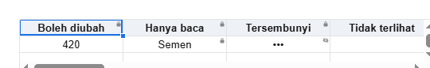

| Status Sel | Hak Pengguna | Indikator Visual Grid |
|---|---|---|
| **Read/Write (`edit`)** | Pengguna memiliki izin membaca dan mengedit nilai/formula. | Tampilan sel normal tanpa batasan. |
| **Read-Only (`read`)** | Pengguna hanya dapat membaca nilai terhitung; input editor terkunci. | Konten sel tampil dengan ikon gembok kecil di sudut sel. |
| **Masked / Hidden** | Mengetahui bahwa sel memiliki isi data, namun nilai aktual disensor. | Menampilkan karakter masker `•••` dengan ikon sensor mata dicoret. |
| **Inaccessible** | Pengguna tidak memiliki izin membaca sel. | Sel tampil kosong (*blank*) tanpa metadata apapun. |

---

## 3. Dual Rendering Mode: Runtime Live vs Setup Mode

Komponen antarmuka mendukung dua mode operasi melalui prop `access.view`:

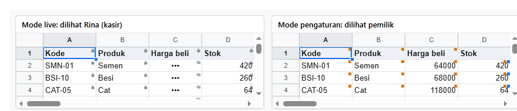

| Mode Operasi | Target Pengguna | Karakteristik Tampilan |
|---|---|---|
| **Runtime (`view: 'live'`)** | Pengguna operasional (misal: Kasir, Staf Gudang). | Menerapkan hak akses aktual: indikator gembok, masking `•••`, atau sel kosong. |
| **Design / Setup (`view: 'setup'`)** | Administrator / Manajer perancang aturan. | Seluruh data sel tampil normal, disertai indikator visual kotak warna (*marker badge*) yang memetakan aturan ACL pada masing-masing peran. |

---

## 4. Struktur Sintaks Deklarasi Aturan (`AccessRow`)

Setiap baris aturan didefinisikan sebagai objek terstruktur:

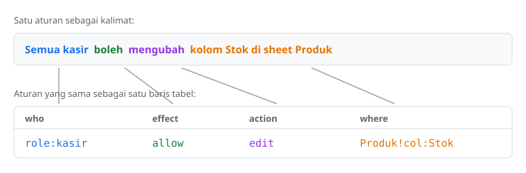

```ts
interface AccessRow {
    who: string;           // 'role:kasir', 'user:rina', '*' (semua orang)
    effect: 'allow' | 'deny';
    action: string;        // 'read', 'edit', 'format.bold', 'ui.toolbar', '*'
    where?: string;        // 'Produk!A1:I13', 'Produk!col:Stok'; kosong = global
    when?: string;         // Formula evaluasi dinamis (misal '=$I2="Dihentikan"')
    message?: string;      // Pesan error kustom saat aksi pengguna ditolak
}
```

---

## 5. Implementasi Panduan Langkah demi Langkah

Semua contoh berikut mengacu pada dataset stok produk konstruksi berikut:

<!-- contoh: data/stok-akses.js -->
```js
import { createWorkbook } from '@kufayeka/sheet/core';
import { PRODUK, KOLOM_PRODUK } from './toko.js';

// Bahan bersama bab 10: workbook stok toko.

/** Sheet Produk: Kode, Nama produk, Kategori, Satuan, Harga beli, Harga jual, Stok, Stok min., Status (A..I), 12 produk. */
export function buatStok() {
    const wb = createWorkbook();
    wb.setSettings({ locale: 'id-ID', currency: 'IDR' });
    const p = wb.sheet('Sheet1');
    p.setSheetProps({ name: 'Produk' });
    p.setValues('A1', [[...KOLOM_PRODUK, 'Status'], ...PRODUK.map((x, i) => [...x, i === 7 ? 'Dihentikan' : 'Aktif'])]);
    p.setStyle('A1:I1', { bold: true, fill: '#eef2f7' });
    return wb;
}
```
<!-- /contoh -->

---

### 5.1 Hak Akses Baca Saja (Read-Only)

Memberikan izin baca pada seluruh rentang data tabel. Seluruh sel terkunci dengan ikon gembok:

<!-- contoh: 13-08-baca.page.tsx -->
```tsx
import { useState } from 'react';
import { Sheet } from '@kufayeka/sheet';
import type { AccessRow } from '@kufayeka/sheet/core';
import '@kufayeka/sheet/style.css';
import { buatStok } from './data/stok-akses.js';

// 13.8 Aturan pertama: kasir boleh MEMBACA tabel produk.
const rows: AccessRow[] = [
    { who: 'role:kasir', effect: 'allow', action: 'read', where: 'Produk!A1:I13' }
];

export default function Halaman() {
    const [wb] = useState(buatStok);
    const rina = { user: 'rina', roles: ['kasir'] };       // dari sistem login aplikasimu
    return (
        <div style={{ height: 330 }}>
            <Sheet workbook={wb} access={{ rows, who: rina }} />
        </div>
    );
}
```
<!-- /contoh -->

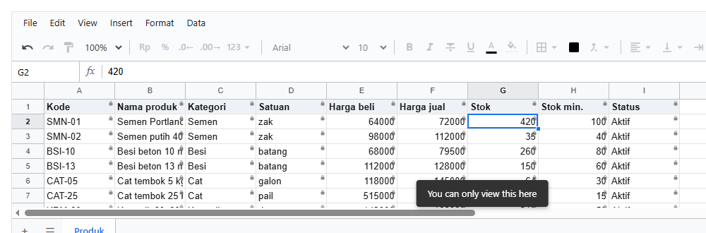

---

### 5.2 Evaluasi Whitelist & Default Deny

Kolom yang tidak disebutkan di dalam aturan `allow` tidak akan ditampilkan sama sekali ke pengguna:

<!-- contoh: 13-09-tidak-disebut.page.tsx -->
```tsx
import { useState } from 'react';
import { Sheet } from '@kufayeka/sheet';
import type { AccessRow, Who } from '@kufayeka/sheet/core';
import '@kufayeka/sheet/style.css';
import { buatStok } from './data/stok-akses.js';

// 13.9 Yang tidak disebut, tidak didapat. Aturannya sekarang hanya untuk kolom A sampai D.
const rows: AccessRow[] = [
    { who: 'role:kasir', effect: 'allow', action: 'read', where: 'Produk!A1:D13' }     // baru: A-D saja
];

// baru: pilihan "Lihat sebagai", untuk membandingkan dua orang
const ORANG: Record<string, Who> = {
    rina: { user: 'rina', roles: ['kasir'] },
    tamu: { user: 'tamu' }                                   // tanpa role
};

export default function Halaman() {
    const [wb] = useState(buatStok);
    const [sebagai, setSebagai] = useState('rina');
    return (
        <div>
            <p>Lihat sebagai <select className="lihat-sebagai" value={sebagai} onChange={(e) => setSebagai(e.target.value)}>
                {Object.keys(ORANG).map((nama) => <option key={nama}>{nama}</option>)}
            </select></p>
            <div style={{ height: 300 }}>
                <Sheet workbook={wb} access={{ rows, who: ORANG[sebagai] }} />
            </div>
        </div>
    );
}
```
<!-- /contoh -->

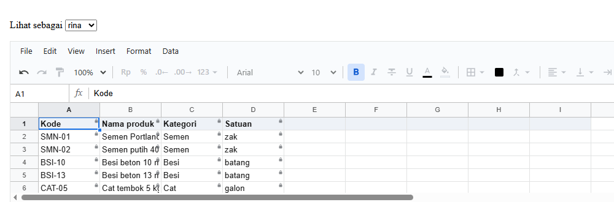
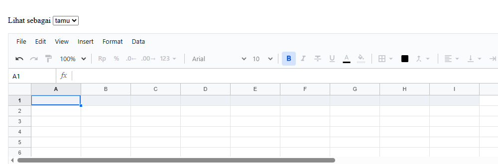

---

### 5.3 Memberikan Hak Edit Penuh

Mengizinkan pengguna mengubah seluruh nilai pada area yang ditentukan:

<!-- contoh: 13-10-ubah.page.tsx -->
```tsx
import { useState } from 'react';
import { Sheet } from '@kufayeka/sheet';
import type { AccessRow } from '@kufayeka/sheet/core';
import '@kufayeka/sheet/style.css';
import { buatStok } from './data/stok-akses.js';

// 13.10 Boleh mengubah. Ganti read dengan edit.
const rows: AccessRow[] = [
    { who: 'role:kasir', effect: 'allow', action: 'edit', where: 'Produk!A1:I13' }     // baru: edit
];

export default function Halaman() {
    const [wb] = useState(buatStok);
    return (
        <div style={{ height: 330 }}>
            <Sheet workbook={wb} access={{ rows, who: { user: 'rina', roles: ['kasir'] } }} />
        </div>
    );
}
```
<!-- /contoh -->

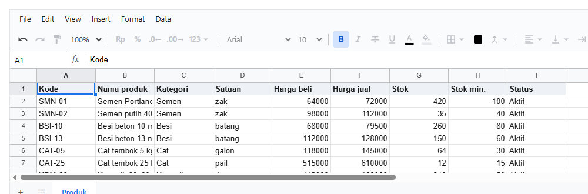

---

### 5.4 Membaca Seluruh Kolom, Mengubah Sebagian Kolom

Kombinasi izin baca menyeluruh dengan izin edit khusus pada kolom kuantitas stok:

<!-- contoh: 13-11-campur.page.tsx -->
```tsx
import { useState } from 'react';
import { Sheet } from '@kufayeka/sheet';
import type { AccessRow } from '@kufayeka/sheet/core';
import '@kufayeka/sheet/style.css';
import { buatStok } from './data/stok-akses.js';

// 13.11 Baca semua, ubah sebagian: baca seluruh tabel, ubah kolom G (Stok) saja.
const rows: AccessRow[] = [
    { who: 'role:kasir', effect: 'allow', action: 'read', where: 'Produk!A1:I13' },
    { who: 'role:kasir', effect: 'allow', action: 'edit', where: 'Produk!G2:G13' }     // baru
];

export default function Halaman() {
    const [wb] = useState(buatStok);
    return (
        <div style={{ height: 330 }}>
            <Sheet workbook={wb} access={{ rows, who: { user: 'rina', roles: ['kasir'] } }} />
        </div>
    );
}
```
<!-- /contoh -->


---

### 5.5 Menargetkan Kolom Berdasarkan Nama Header (`col:Nama`)

Menyebut kolom berdasarkan judul header teksnya membuat aturan tetap kebal terhadap pergeseran posisi akibat penyisipan kolom:

<!-- contoh: 13-12-kolom.page.tsx -->
```tsx
import { useState } from 'react';
import { Sheet } from '@kufayeka/sheet';
import type { AccessRow } from '@kufayeka/sheet/core';
import '@kufayeka/sheet/style.css';
import { buatStok } from './data/stok-akses.js';

// 13.12 Kolom ditulis dengan judulnya: col:Stok, bukan G2:G13. Tetap benar walaupun kolomnya bergeser.
const rows: AccessRow[] = [
    { who: 'role:kasir', effect: 'allow', action: 'read', where: 'Produk!A1:I13' },
    { who: 'role:kasir', effect: 'allow', action: 'edit', where: 'Produk!col:Stok' }   // baru: judul kolom
];

export default function Halaman() {
    const [wb] = useState(buatStok);
    // tombol untuk mencoba: kolom baru disisipkan di A, Stok bergeser ke H, aturannya ikut
    const sisipkan = () => wb.sheet('Produk').insertCols('A');
    return (
        <div>
            <p><button className="sisipkan" onClick={sisipkan}>Sisipkan kolom di A</button></p>
            <div style={{ height: 300 }}>
                <Sheet workbook={wb} access={{ rows, who: { user: 'rina', roles: ['kasir'] } }} />
            </div>
        </div>
    );
}
```
<!-- /contoh -->

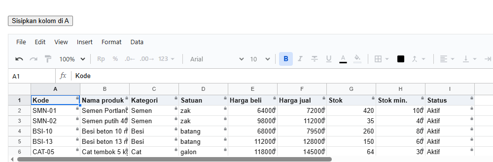
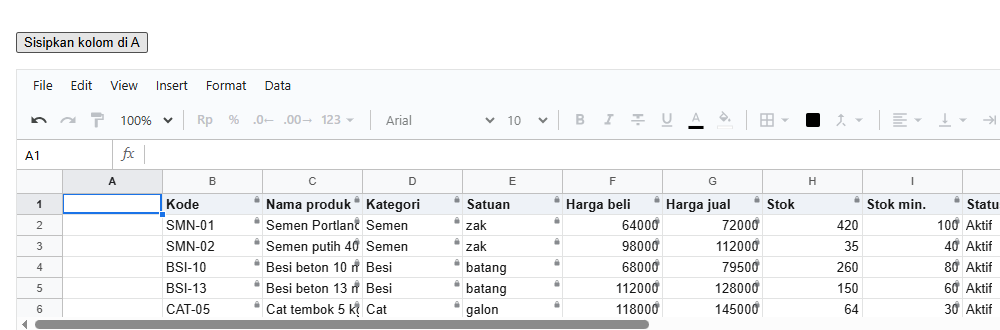

---

### 5.6 Menyensor Data Sensitif (Masking `•••`)

Menggunakan `deny read` untuk menyamarkan nilai sel menjadi `•••` tanpa menghilangkan layout sel:

<!-- contoh: 13-13-sembunyi.page.tsx -->
```tsx
import { useState } from 'react';
import { Sheet } from '@kufayeka/sheet';
import type { AccessRow } from '@kufayeka/sheet/core';
import '@kufayeka/sheet/style.css';
import { buatStok } from './data/stok-akses.js';

// 13.13 Menyembunyikan isi: harga beli (kolom E) tampil ••• untuk kasir.
const rows: AccessRow[] = [
    { who: 'role:kasir', effect: 'allow', action: 'read', where: 'Produk!A1:I13' },
    { who: 'role:kasir', effect: 'allow', action: 'edit', where: 'Produk!col:Stok' },
    { who: 'role:kasir', effect: 'deny', action: 'read', where: 'Produk!col:Harga beli' }   // baru
];

export default function Halaman() {
    const [wb] = useState(buatStok);
    return (
        <div style={{ height: 330 }}>
            <Sheet workbook={wb} access={{ rows, who: { user: 'rina', roles: ['kasir'] } }} />
        </div>
    );
}
```
<!-- /contoh -->

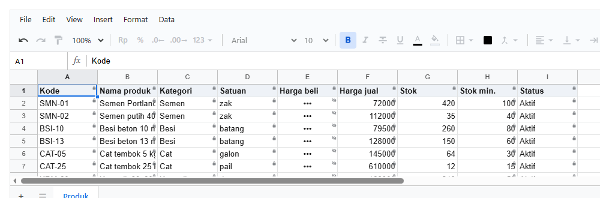

---

### 5.7 Menyembunyikan Sel Penuh (`deny see`)

Jika pengguna tidak boleh mengetahui apakah suatu sel memiliki data atau tidak, gunakan `deny see`:

<!-- contoh: 13-14-tak-terlihat.page.tsx -->
```tsx
import { useState } from 'react';
import { Sheet } from '@kufayeka/sheet';
import type { AccessRow } from '@kufayeka/sheet/core';
import '@kufayeka/sheet/style.css';
import { buatStok } from './data/stok-akses.js';

// 13.14 Tidak terlihat sama sekali: sama dengan 13.13, tapi deny see. Kolom E tampil kosong.
const rows: AccessRow[] = [
    { who: 'role:kasir', effect: 'allow', action: 'read', where: 'Produk!A1:I13' },
    { who: 'role:kasir', effect: 'allow', action: 'edit', where: 'Produk!col:Stok' },
    { who: 'role:kasir', effect: 'deny', action: 'see', where: 'Produk!col:Harga beli' }    // baru: see, bukan read
];

export default function Halaman() {
    const [wb] = useState(buatStok);
    return (
        <div style={{ height: 330 }}>
            <Sheet workbook={wb} access={{ rows, who: { user: 'rina', roles: ['kasir'] } }} />
        </div>
    );
}
```
<!-- /contoh -->

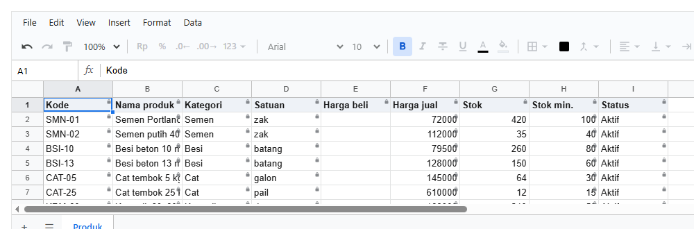

---

### 5.8 Multi-Peran (Role-Based Access Control)

Menetapkan izin yang berbeda untuk staf kasir dan staf gudang, serta penanganan pengguna yang memiliki banyak peran sekaligus:

<!-- contoh: 13-15-role.page.tsx -->
```tsx
import { useState } from 'react';
import { Sheet } from '@kufayeka/sheet';
import type { AccessRow, Who } from '@kufayeka/sheet/core';
import '@kufayeka/sheet/style.css';
import { buatStok } from './data/stok-akses.js';

// 13.15 Role: aturan untuk semua kasir, dan satu role lagi, gudang.
const rows: AccessRow[] = [
    { who: 'role:kasir', effect: 'allow', action: 'read', where: 'Produk!A1:I13' },
    { who: 'role:gudang', effect: 'allow', action: 'read', where: 'Produk!A1:I13' },        // baru
    { who: 'role:gudang', effect: 'allow', action: 'edit', where: 'Produk!col:Stok' }       // baru
];

const ORANG: Record<string, Who> = {
    rina: { user: 'rina', roles: ['kasir'] },
    joko: { user: 'joko', roles: ['gudang'] },
    sari: { user: 'sari', roles: ['kasir', 'gudang'] }       // dua role sekaligus
};

export default function Halaman() {
    const [wb] = useState(buatStok);
    const [sebagai, setSebagai] = useState('rina');
    return (
        <div>
            <p>Lihat sebagai <select className="lihat-sebagai" value={sebagai} onChange={(e) => setSebagai(e.target.value)}>
                {Object.keys(ORANG).map((nama) => <option key={nama}>{nama}</option>)}
            </select></p>
            <div style={{ height: 300 }}>
                <Sheet workbook={wb} access={{ rows, who: ORANG[sebagai] }} />
            </div>
        </div>
    );
}
```
<!-- /contoh -->


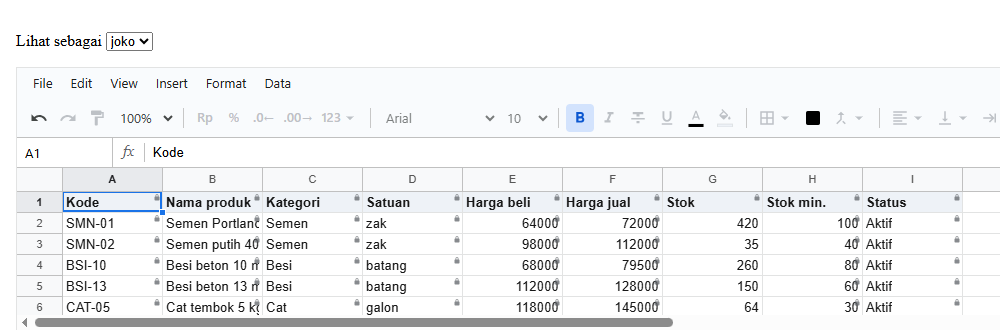


---

### 5.9 Izin Wildcard untuk Semua Pengguna (`who: '*'`)

Mengizinkan seluruh pengguna (termasuk tamu publik) membaca data umum, sementara role internal memperoleh akses tambahan:

<!-- contoh: 13-16-semua.page.tsx -->
```tsx
import { useState } from 'react';
import { Sheet } from '@kufayeka/sheet';
import type { AccessRow, Who } from '@kufayeka/sheet/core';
import '@kufayeka/sheet/style.css';
import { buatStok } from './data/stok-akses.js';

// 13.16 Semua orang (*): siapa pun boleh membaca kolom A sampai D, termasuk yang tidak punya role.
const rows: AccessRow[] = [
    { who: '*', effect: 'allow', action: 'read', where: 'Produk!A1:D13' },                  // baru
    { who: 'role:kasir', effect: 'allow', action: 'read', where: 'Produk!A1:I13' }
];

const ORANG: Record<string, Who> = {
    tamu: { user: 'tamu' },
    rina: { user: 'rina', roles: ['kasir'] }
};

export default function Halaman() {
    const [wb] = useState(buatStok);
    const [sebagai, setSebagai] = useState('tamu');
    return (
        <div>
            <p>Lihat sebagai <select className="lihat-sebagai" value={sebagai} onChange={(e) => setSebagai(e.target.value)}>
                {Object.keys(ORANG).map((nama) => <option key={nama}>{nama}</option>)}
            </select></p>
            <div style={{ height: 300 }}>
                <Sheet workbook={wb} access={{ rows, who: ORANG[sebagai] }} />
            </div>
        </div>
    );
}
```
<!-- /contoh -->


---

### 5.10 Resolusi Konflik: Prioritas Akun Pengguna vs Role

Aturan spesifik akun (`user:<id>`) memiliki prioritas evaluasi lebih tinggi dibandingkan aturan level role (`role:<id>`):

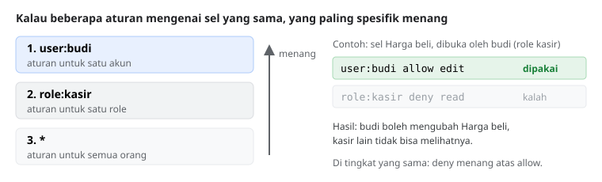

<!-- contoh: 13-17-akun.page.tsx -->
```tsx
import { useState } from 'react';
import { Sheet } from '@kufayeka/sheet';
import type { AccessRow, Who } from '@kufayeka/sheet/core';
import '@kufayeka/sheet/style.css';
import { buatStok } from './data/stok-akses.js';

// 13.17 Satu akun: kasir tidak boleh melihat harga beli, kecuali budi, yang boleh mengubahnya.
const rows: AccessRow[] = [
    { who: 'role:kasir', effect: 'allow', action: 'read', where: 'Produk!A1:I13' },
    { who: 'role:kasir', effect: 'deny', action: 'read', where: 'Produk!col:Harga beli' },
    { who: 'user:budi', effect: 'allow', action: 'edit', where: 'Produk!col:Harga beli' }   // baru: budi, walaupun kasir
];

const ORANG: Record<string, Who> = {
    rina: { user: 'rina', roles: ['kasir'] },
    budi: { user: 'budi', roles: ['kasir'] }
};

export default function Halaman() {
    const [wb] = useState(buatStok);
    const [sebagai, setSebagai] = useState('rina');
    return (
        <div>
            <p>Lihat sebagai <select className="lihat-sebagai" value={sebagai} onChange={(e) => setSebagai(e.target.value)}>
                {Object.keys(ORANG).map((nama) => <option key={nama}>{nama}</option>)}
            </select></p>
            <div style={{ height: 300 }}>
                <Sheet workbook={wb} access={{ rows, who: ORANG[sebagai] }} />
            </div>
        </div>
    );
}
```
<!-- /contoh -->

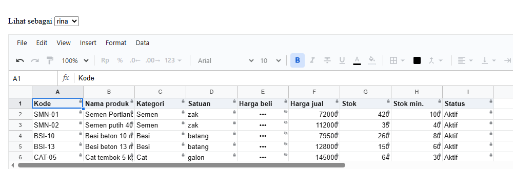


---

### 5.11 Hak Akses Pemilik Dokumen (Owner Privilege)

Pemilik dokumen (`owner`) memiliki hak akses tidak terbatas untuk membaca dan mengedit seluruh sel:

<!-- contoh: 13-18-pemilik.page.tsx -->
```tsx
import { useState } from 'react';
import { Sheet, useWorkbook } from '@kufayeka/sheet';
import type { AccessRow, Who } from '@kufayeka/sheet/core';
import '@kufayeka/sheet/style.css';
import { buatStok } from './data/stok-akses.js';

// 13.18 Pemilik: satu baris user:<nama> allow * tanpa where.
const rows: AccessRow[] = [
    { who: 'user:yeka', effect: 'allow', action: '*' },                                    // baru
    { who: 'role:kasir', effect: 'allow', action: 'read', where: 'Produk!A1:I13' },
    { who: '*', effect: 'deny', action: 'edit', where: 'Produk!col:Harga beli' }
];

const ORANG: Record<string, Who> = {
    yeka: { user: 'yeka', roles: ['kasir'] },                // pemilik, juga kasir
    rina: { user: 'rina', roles: ['kasir'] }
};

export default function Halaman() {
    const [wb] = useState(buatStok);
    const [sebagai, setSebagai] = useState('yeka');
    // baru: wb.access().owner, untuk menampilkan tombol yang hanya untuk pemilik (misalnya "Atur hak akses")
    const pemilik = useWorkbook(wb, (w) => w.access().owner);
    return (
        <div>
            <p>
                Lihat sebagai <select className="lihat-sebagai" value={sebagai} onChange={(e) => setSebagai(e.target.value)}>
                    {Object.keys(ORANG).map((nama) => <option key={nama}>{nama}</option>)}
                </select>{' '}
                {pemilik ? <button>Atur hak akses</button> : null}
            </p>
            <div style={{ height: 300 }}>
                <Sheet workbook={wb} access={{ rows, who: ORANG[sebagai] }} />
            </div>
        </div>
    );
}
```
<!-- /contoh -->

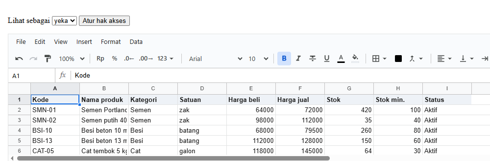


---

### 5.12 Aturan Bersyarat Dinamis (`when`)

Aturan proteksi sel dapat dievaluasi secara dinamis berbasis ekspresi formula boolean:

<!-- contoh: 13-19-syarat.page.tsx -->
```tsx
import { useState } from 'react';
import { Sheet } from '@kufayeka/sheet';
import type { AccessRow } from '@kufayeka/sheet/core';
import '@kufayeka/sheet/style.css';
import { buatStok } from './data/stok-akses.js';

// 13.19 Aturan dengan syarat: gudang boleh mengubah stok, KECUALI di baris produk yang sudah Dihentikan (kolom I).
const rows: AccessRow[] = [
    { who: 'role:gudang', effect: 'allow', action: 'read', where: 'Produk!A1:I13' },
    { who: 'role:gudang', effect: 'allow', action: 'edit', where: 'Produk!G2:G13' },
    { who: 'role:gudang', effect: 'deny', action: 'edit', where: 'Produk!G2:G13',
      when: '=$I2="Dihentikan"', message: 'Produk ini sudah dihentikan' }                  // baru
];

// untuk contoh ini, BSI-10 (baris 4) juga sudah dihentikan
function buatStokDihentikan() {
    const wb = buatStok();
    wb.sheet('Produk').setValues('I4', 'Dihentikan');
    return wb;
}

export default function Halaman() {
    const [wb] = useState(buatStokDihentikan);
    return (
        <div style={{ height: 330 }}>
            <Sheet workbook={wb} access={{ rows, who: { user: 'joko', roles: ['gudang'] } }} />
        </div>
    );
}
```
<!-- /contoh -->

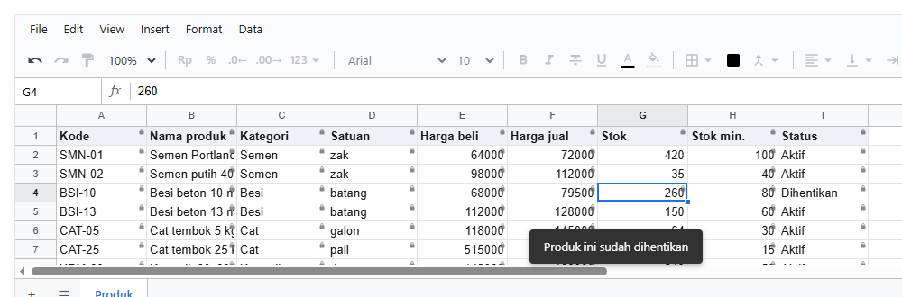

---

### 5.13 Pembatasan Perizinan Styling & Aksi Operasional

Membatasi aksi formatting dan fungsionalitas toolbar/menu:

<!-- contoh: 13-20-format.page.tsx -->
```tsx
import { useState } from 'react';
import { Sheet } from '@kufayeka/sheet';
import type { AccessRow } from '@kufayeka/sheet/core';
import '@kufayeka/sheet/style.css';
import { buatStok } from './data/stok-akses.js';

// 13.20 Format: kasir boleh memiringkan teks, tapi tidak boleh menebalkan.
const rows: AccessRow[] = [
    { who: 'role:kasir', effect: 'allow', action: 'edit', where: 'Produk!A1:I13' },
    { who: 'role:kasir', effect: 'allow', action: 'format.italic' }                        // baru: tanpa where = di mana saja
];

export default function Halaman() {
    const [wb] = useState(buatStok);
    return (
        <div style={{ height: 330 }}>
            <Sheet workbook={wb} access={{ rows, who: { user: 'rina', roles: ['kasir'] } }} />
        </div>
    );
}
```
<!-- /contoh -->


Mengontrol izin Aksi Spreadsheet (Sort, Filter, Clipboard, Comment):

<!-- contoh: 13-21-aksi.page.tsx -->
```tsx
import { useState } from 'react';
import { Sheet } from '@kufayeka/sheet';
import type { AccessRow } from '@kufayeka/sheet/core';
import '@kufayeka/sheet/style.css';
import { buatStok } from './data/stok-akses.js';

// 13.21 Aksi lain: satu aksi (sort), satu kelompok (format = semua format.*), dan pengecualian di dalam kelompok (bold).
const rows: AccessRow[] = [
    { who: 'role:kasir', effect: 'allow', action: 'edit', where: 'Produk!A1:I13' },
    { who: 'role:kasir', effect: 'allow', action: 'sort' },             // baru: satu aksi
    { who: 'role:kasir', effect: 'allow', action: 'format' },           // baru: satu kelompok
    { who: 'role:kasir', effect: 'deny', action: 'format.bold' }        // baru: kecuali tebal
];

export default function Halaman() {
    const [wb] = useState(buatStok);
    return (
        <div style={{ height: 330 }}>
            <Sheet workbook={wb} access={{ rows, who: { user: 'rina', roles: ['kasir'] } }} />
        </div>
    );
}
```
<!-- /contoh -->

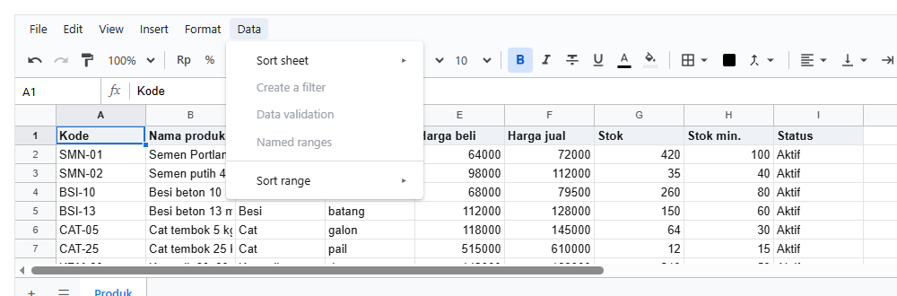

---

### 5.14 Mengontrol Visibilitas Modul Antarmuka (`ui.*`)

Menyembunyikan menu bar, toolbar, atau panel tertentu berbasis role:

<!-- contoh: 13-22-layar.page.tsx -->
```tsx
import { useState } from 'react';
import { Sheet } from '@kufayeka/sheet';
import type { AccessRow } from '@kufayeka/sheet/core';
import '@kufayeka/sheet/style.css';
import { buatStok } from './data/stok-akses.js';

// 13.22 Bagian layar: kasir bekerja tanpa toolbar dan tanpa menu Insert.
const rows: AccessRow[] = [
    { who: 'role:kasir', effect: 'allow', action: 'read', where: 'Produk!A1:I13' },
    { who: 'role:kasir', effect: 'deny', action: 'ui.toolbar' },        // baru: satu bagian besar
    { who: 'role:kasir', effect: 'deny', action: 'ui.menu.Insert' }     // baru: satu menu
];

export default function Halaman() {
    const [wb] = useState(buatStok);
    return (
        <div style={{ height: 330 }}>
            <Sheet workbook={wb} access={{ rows, who: { user: 'rina', roles: ['kasir'] } }} />
        </div>
    );
}
```
<!-- /contoh -->

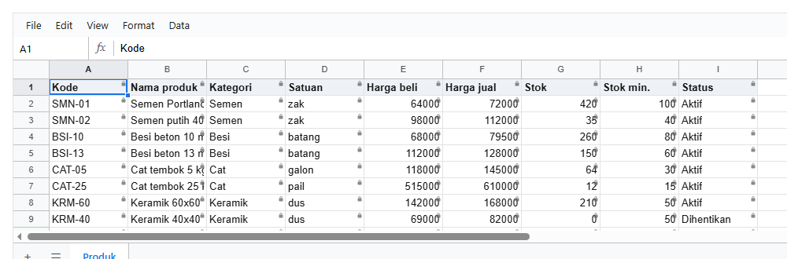

Membatasi Batas Area Viewport & Tab Sheet:

<!-- contoh: 13-23-area.page.tsx -->
```tsx
import { useState } from 'react';
import { Sheet } from '@kufayeka/sheet';
import type { AccessRow } from '@kufayeka/sheet/core';
import '@kufayeka/sheet/style.css';
import { buatStok } from './data/stok-akses.js';

// 13.23 Hanya sebagian sheet yang tampil (view.area), dan hanya sheet tertentu (view.sheet).
const rows: AccessRow[] = [
    { who: 'role:kasir', effect: 'allow', action: 'read', where: 'Produk!A1:I13' },
    { who: 'role:kasir', effect: 'allow', action: 'view.area', where: 'Produk!A1:D13' },  // baru
    { who: 'role:kasir', effect: 'allow', action: 'view.sheet', where: 'Produk' }         // baru
];

function buatDuaSheet() {
    const wb = buatStok();
    wb.addSheet('Rekap');                                   // sheet kedua, yang tidak boleh terlihat kasir
    return wb;
}

export default function Halaman() {
    const [wb] = useState(buatDuaSheet);
    return (
        <div style={{ height: 330 }}>
            <Sheet workbook={wb} access={{ rows, who: { user: 'rina', roles: ['kasir'] } }} />
        </div>
    );
}
```
<!-- /contoh -->

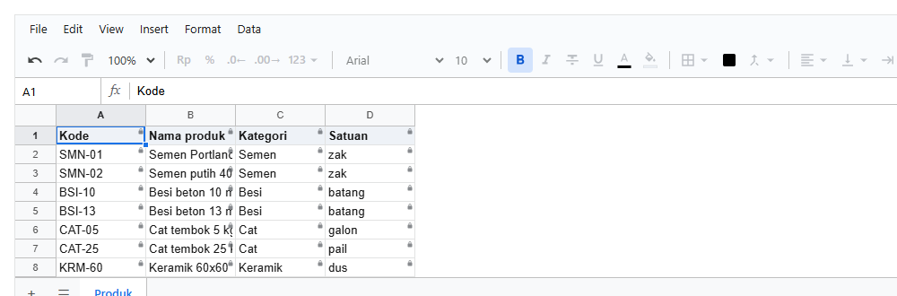

---

### 5.15 Kustomisasi Tanda Proteksi Sel (`marks`)

Mengonfigurasi tampilan visual ikon gembok, masking, shading warna, atau motif garis-garis pada sel terproteksi:

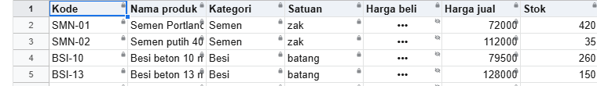

<!-- contoh: 13-25-tanda.page.tsx -->
```tsx
import { useState } from 'react';
import { Sheet } from '@kufayeka/sheet';
import type { CellMarks } from '@kufayeka/sheet';
import type { AccessRow } from '@kufayeka/sheet/core';
import '@kufayeka/sheet/style.css';
import { buatStok } from './data/stok-akses.js';

// 13.25 Variasi tanda (prop marks). Aturan dan orangnya sama; hanya marks yang berbeda, satu variasi per sheet.
const ATURAN: AccessRow[] = [
    { who: 'role:kasir', effect: 'allow', action: 'read', where: 'Produk!A1:I13' },
    { who: 'role:kasir', effect: 'allow', action: 'edit', where: 'Produk!col:Stok' },
    { who: 'role:kasir', effect: 'deny', action: 'read', where: 'Produk!col:Harga beli' },
    // hanya supaya gambarnya ringkas: tanpa menu, toolbar, formula bar, dan tab
    ...['menubar', 'toolbar', 'formulaBar', 'tabs'].map((bagian): AccessRow => ({ who: '*', effect: 'deny', action: 'ui.' + bagian }))
];
const rina = { user: 'rina', roles: ['kasir'] };

function Contoh({ marks }: { marks?: false | CellMarks }) {
    const [wb] = useState(buatStok);
    return <div style={{ height: 130, marginBottom: 14 }}><Sheet workbook={wb} access={{ rows: ATURAN, who: rina }} marks={marks} /></div>;
}

export default function VariasiTanda() {
    return (
        <div style={{ width: 760 }}>
            <Contoh />                                                {/* bawaan: gembok + mata */}
            <Contoh marks={{ tint: true }} />                         {/* + latar abu-abu */}
            <Contoh marks={{ stripes: true }} />                      {/* + garis-garis */}
            <Contoh marks={{ lock: false }} />                        {/* tanpa gembok, mata tetap */}
            <Contoh marks={false} />                                  {/* tanpa tanda sama sekali */}
        </div>
    );
}
```
<!-- /contoh -->

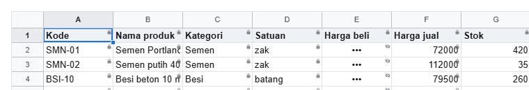
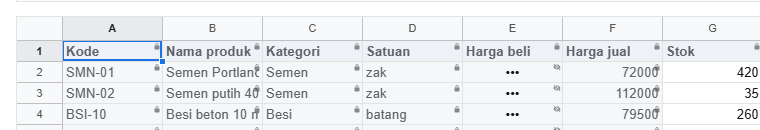
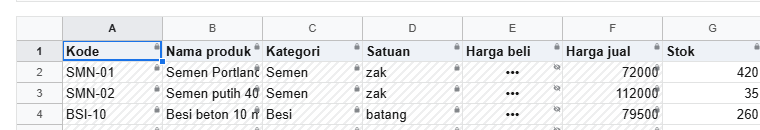

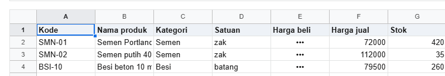

---

### 5.16 Intercept Pesan Feedback Penolakan (`onNotice`)

Menangkap event feedback penolakan untuk dialihkan ke notification toast aplikasi:

<!-- contoh: 13-26-pesan.page.tsx -->
```tsx
import { useState } from 'react';
import { Sheet } from '@kufayeka/sheet';
import type { SheetNotice } from '@kufayeka/sheet';
import type { AccessRow } from '@kufayeka/sheet/core';
import '@kufayeka/sheet/style.css';
import { buatStok } from './data/stok-akses.js';

// 13.26 Pesan penolakan ditampilkan di luar sheet, dengan kata-kata aplikasimu sendiri. Pesan bawaan sheet dimatikan.
const ATURAN: AccessRow[] = [
    { who: 'role:kasir', effect: 'allow', action: 'read', where: 'Produk!A1:I13' },
    { who: 'role:kasir', effect: 'allow', action: 'edit', where: 'Produk!col:Stok' }
];

export default function PesanSendiri() {
    const [wb] = useState(buatStok);
    const [pesan, setPesan] = useState<string | null>(null);

    // onNotice dipanggil untuk setiap pesan sheet, sebelum tampil
    function padaPesan(n: SheetNotice) {
        if (n.kind === 'refused') {
            setPesan(n.address + ': kolom ini hanya bisa dibaca. Yang boleh kamu ubah hanya Stok.');
            return null;           // null: sheet tidak menampilkan pesannya sendiri
        }
        return undefined;          // pesan lain: biarkan sheet yang menampilkan
    }

    return (
        <div style={{ height: 420, display: 'flex', flexDirection: 'column', font: '13px system-ui' }}>
            <div style={{ padding: '8px 12px', background: pesan ? '#fce8e6' : '#f1f3f4', color: pesan ? '#c5221f' : '#5f6368' }}>
                {pesan ?? 'Klik sel lalu ketik. Hanya kolom Stok yang bisa diubah.'}
            </div>
            <Sheet workbook={wb} style={{ flex: 1 }} onNotice={padaPesan} access={{ rows: ATURAN, who: { user: 'rina', roles: ['kasir'] } }} />
        </div>
    );
}
```
<!-- /contoh -->

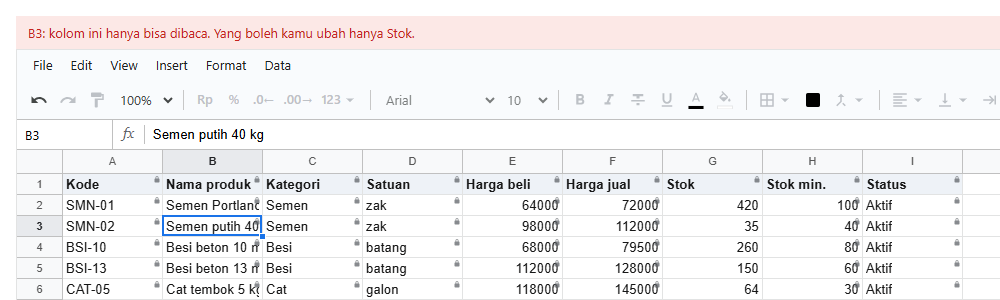

---

## 6. Mode Desain & Pembuatan Aturan Interaktif

### Mode Setup Visual

Mengaktifkan `access.view = 'setup'` untuk menampilkan badge warna pemetaan aturan pada sel:

<!-- contoh: 13-27-setup.page.tsx -->
```tsx
import { useState } from 'react';
import { Sheet } from '@kufayeka/sheet';
import type { AccessRow } from '@kufayeka/sheet/core';
import '@kufayeka/sheet/style.css';
import { buatStok } from './data/stok-akses.js';

// 13.27 Mode pengaturan. Satu tambahan dari 13.8: view: 'setup', dan yang membuka adalah pemilik.
const ATURAN: AccessRow[] = [
    { who: 'user:yeka', effect: 'allow', action: '*' },
    { who: 'role:kasir', effect: 'allow', action: 'read', where: 'Produk!A1:I13' },
    { who: 'role:kasir', effect: 'deny', action: 'read', where: 'Produk!col:Harga beli' },
    { who: 'role:gudang', effect: 'allow', action: 'edit', where: 'Produk!col:Stok' }
];

export default function ModePengaturan() {
    const [wb] = useState(buatStok);
    return (
        <div style={{ height: 420 }}>
            <Sheet workbook={wb} access={{ rows: ATURAN, who: { user: 'yeka' }, view: 'setup' }} />   {/* baru: view */}
        </div>
    );
}
```
<!-- /contoh -->

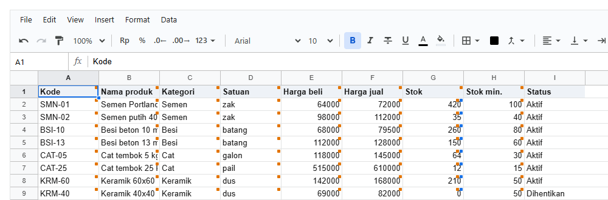

Sinkronisasi Dua Arah antara List Aturan dan Grid:

<!-- contoh: 13-28-pilih.page.tsx -->
```tsx
import { useState } from 'react';
import { Sheet } from '@kufayeka/sheet';
import type { AccessRow } from '@kufayeka/sheet/core';
import { accessColor } from '@kufayeka/sheet/core';
import '@kufayeka/sheet/style.css';
import { buatStok } from './data/stok-akses.js';

// 13.28 Memilih aturan. Daftar aturan di samping sheet; yang dipilih bergaris di sheet, dan kotak di sheet bisa diklik.
const ATURAN: AccessRow[] = [
    { who: 'user:yeka', effect: 'allow', action: '*' },
    { who: 'role:kasir', effect: 'allow', action: 'read', where: 'Produk!A1:I13' },
    { who: 'role:kasir', effect: 'deny', action: 'read', where: 'Produk!col:Harga beli' },
    { who: 'role:gudang', effect: 'allow', action: 'edit', where: 'Produk!col:Stok' }
];

export default function PilihAturan() {
    const [wb] = useState(buatStok);
    const [dipilih, setDipilih] = useState<number | null>(2);                       // baru: baris yang dipilih
    return (
        <div style={{ display: 'flex', height: 420, font: '13px system-ui' }}>
            <Sheet workbook={wb} style={{ flex: 1 }}
                access={{ rows: ATURAN, who: { user: 'yeka' }, view: 'setup',
                          selected: dipilih,                                        // baru: bergaris di sheet
                          onSelect: setDipilih }} />                                {/* baru: klik kotak di sheet */}
            <ul className="daftar" style={{ width: 330, margin: 0, padding: 10, listStyle: 'none', borderLeft: '1px solid #dadce0' }}>
                {ATURAN.map((r, i) => (
                    <li key={i} onClick={() => setDipilih(i)}
                        style={{ padding: '5px 6px', cursor: 'pointer', borderRadius: 4, background: i === dipilih ? '#e8f0fe' : undefined }}>
                        {/* baru: warna yang sama dengan kotak di sheet */}
                        <i style={{ display: 'inline-block', width: 8, height: 8, borderRadius: 2, marginRight: 6, background: accessColor(r.who) }} />
                        {r.who} · {r.effect} {r.action} {r.where ?? ''}
                    </li>
                ))}
            </ul>
        </div>
    );
}
```
<!-- /contoh -->

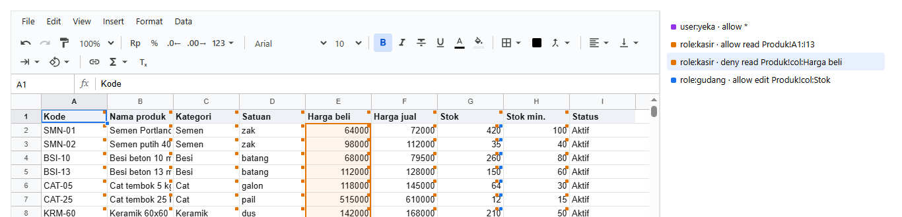

Menambah Aturan dari Seleksi Range Kursor Pengguna:

<!-- contoh: 13-29-tambah.page.tsx -->
```tsx
import { useState } from 'react';
import { Sheet } from '@kufayeka/sheet';
import type { SheetSelection } from '@kufayeka/sheet';
import type { AccessRow } from '@kufayeka/sheet/core';
import { accessColor } from '@kufayeka/sheet/core';
import '@kufayeka/sheet/style.css';
import { buatStok } from './data/stok-akses.js';

// 13.29 Membuat aturan dari range yang dipilih. Satu tambahan dari 13.28: onSelectionChange dan tombol Tambah.
const AWAL: AccessRow[] = [
    { who: 'user:yeka', effect: 'allow', action: '*' },
    { who: 'role:kasir', effect: 'allow', action: 'read', where: 'Produk!A1:I13' }
];

export default function TambahAturan() {
    const [wb] = useState(buatStok);
    const [rows, setRows] = useState<AccessRow[]>(AWAL);                           // baru: aturan sekarang bisa bertambah
    const [dipilih, setDipilih] = useState<number | null>(null);
    const [range, setRange] = useState<SheetSelection | null>(null);              // baru: range yang dipilih di sheet

    function tambah() {                                                             // baru
        if (!range) return;
        setRows([...rows, { who: 'role:kasir', effect: 'deny', action: 'read', where: range.sheet.name + '!' + range.address }]);
        setDipilih(rows.length);                                                    // aturan baru langsung terpilih
    }

    return (
        <div style={{ display: 'flex', height: 420, font: '13px system-ui' }}>
            <Sheet workbook={wb} style={{ flex: 1 }} onSelectionChange={setRange}       // baru
                access={{ rows, who: { user: 'yeka' }, view: 'setup', selected: dipilih, onSelect: setDipilih }} />
            <div style={{ width: 330, padding: 10, borderLeft: '1px solid #dadce0' }}>
                <p>Range: <b className="range">{range ? range.sheet.name + '!' + range.address : '-'}</b></p>
                <button className="tambah" onClick={tambah} disabled={!range}>Sembunyikan untuk kasir</button>
                <ul style={{ margin: '10px 0 0', padding: 0, listStyle: 'none' }}>
                    {rows.map((r, i) => (
                        <li key={i} onClick={() => setDipilih(i)}
                            style={{ padding: '5px 6px', cursor: 'pointer', borderRadius: 4, background: i === dipilih ? '#e8f0fe' : undefined }}>
                            <i style={{ display: 'inline-block', width: 8, height: 8, borderRadius: 2, marginRight: 6, background: accessColor(r.who) }} />
                            {r.who} · {r.effect} {r.action} {r.where ?? ''}
                        </li>
                    ))}
                </ul>
            </div>
        </div>
    );
}
```
<!-- /contoh -->

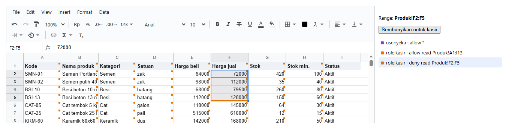

---

### 5.17 Editor Hak Akses Komprehensif

Komponen editor perancang ACL lengkap dengan fitur *Live Preview* lintas role:

<!-- contoh: 04-13-editor-akses.page.tsx -->
```tsx
import { useEffect, useRef, useState } from 'react';
import { Sheet } from '@kufayeka/sheet';
import type { SheetSelection, SheetHandle } from '@kufayeka/sheet';
import { createWorkbook, validateAccess, accessColor } from '@kufayeka/sheet/core';
import type { Workbook, AccessRow, Who } from '@kufayeka/sheet/core';
import '@kufayeka/sheet/style.css';

// Layar pengaturan hak akses buatan aplikasimu sendiri, di luar sheet:
// 1. Mode "Pengaturan": setiap sel yang kena aturan diberi kotak warna kecil, satu per who
// 2. pilih range di sheet, pilih siapa dan aturannya, Tambah: satu baris baru
// 3. klik baris di daftar: range-nya bergaris dan terpilih di sheet. Klik kotak di sel: barisnya terpilih di daftar
// 4. Mode "Lihat sebagai ...": sheet seperti yang dilihat orang itu (gembok di sel hanya-baca, mata di sel tersembunyi)
// 5. baris-barisnya disimpan ke tabel database

function buatStok(): Workbook {
    const wb = createWorkbook();
    wb.setSettings({ locale: 'id-ID', currency: 'IDR' });
    const s = wb.sheet('Sheet1');
    s.setSheetProps({ name: 'Produk', freezeRows: 1 });
    s.setValues('A1', [
        ['Kode', 'Produk', 'Harga beli', 'Harga jual', 'Stok'],
        ['SMN-01', 'Semen 50 kg', 64000, 72000, 420],
        ['BSI-10', 'Besi 10 mm', 68000, 79500, 260],
        ['CAT-05', 'Cat 5 kg', 118000, 145000, 64],
        ['PSR-01', 'Pasir m3', 245000, 290000, 31]
    ]);
    s.setStyle('A1:E1', { bold: true, fill: '#e8f0fe' });
    s.setColProps('C:D', { format: { type: 'money', decimals: 0 } });
    s.setColProps('B', { width: 130 });
    return wb;
}

// aturan awal: pemilik boleh semua, kasir dan gudang membaca tabelnya, gudang mengubah stok
const ATURAN_AWAL: AccessRow[] = [
    { who: 'user:yeka', effect: 'allow', action: '*' },
    { who: 'role:kasir', effect: 'allow', action: 'read', where: 'Produk!A1:E5' },
    { who: 'role:gudang', effect: 'allow', action: 'read', where: 'Produk!A1:E5' },
    { who: 'role:gudang', effect: 'allow', action: 'edit', where: 'Produk!col:Stok' }
];
// mode layar: pengaturan, atau sheet seperti dilihat seseorang (akun + role-nya, seperti dari sesi login aplikasimu)
const MODE: Record<string, { nama: string; who: Who }> = {
    setup: { nama: 'Pengaturan', who: { user: 'yeka' } },
    rina: { nama: 'Lihat sebagai Rina (kasir)', who: { user: 'rina', roles: ['kasir'] } },
    joko: { nama: 'Lihat sebagai Joko (gudang)', who: { user: 'joko', roles: ['gudang'] } }
};
// pilihan aturan untuk satu range: effect + action, dengan kata yang dimengerti orang
const ATURAN = {
    edit: { effect: 'allow', action: 'edit', label: 'boleh diubah' },
    read: { effect: 'allow', action: 'read', label: 'hanya baca' },
    hidden: { effect: 'deny', action: 'read', label: 'tersembunyi (•••)' },
    invisible: { effect: 'deny', action: 'see', label: 'tidak terlihat' }
} as const;
type Pilihan = keyof typeof ATURAN;

export default function EditorAkses() {
    const [wb] = useState(buatStok);
    const sheet = useRef<SheetHandle>(null);
    const [rows, setRows] = useState<AccessRow[]>(ATURAN_AWAL);
    const [pilihan, setPilihan] = useState<SheetSelection | null>(null);   // seleksi terakhir di sheet
    const [dipilih, setDipilih] = useState<number | null>(null);           // baris aturan yang dipilih
    const [siapa, setSiapa] = useState('role:kasir');
    const [aturan, setAturan] = useState<Pilihan>('read');
    const [mode, setMode] = useState('setup');

    // satu aturan baru = satu baris baru, langsung terpilih
    function tambah() {
        if (!pilihan) return;
        const { effect, action } = ATURAN[aturan];
        setRows([...rows, { who: siapa, effect, action, where: pilihan.sheet.name + '!' + pilihan.address }]);
        setDipilih(rows.length);
    }
    const hapus = (i: number) => { setRows(rows.filter((_, j) => j !== i)); setDipilih(null); };
    // memilih baris di daftar: range-nya juga terpilih di sheet
    function pilih(i: number) {
        setDipilih(i);
        const where = rows[i].where;
        if (where) sheet.current?.select(where.includes('!') ? where.slice(where.indexOf('!') + 1) : where);
    }
    // sheet yang dilihat sebagai orang lain: tidak ada yang dipilih
    useEffect(() => { if (mode !== 'setup') setDipilih(null); }, [mode]);
    const masalah = validateAccess(rows);

    return (
        <div style={{ display: 'flex', height: 520, font: '13px system-ui' }}>
            <Sheet ref={sheet} workbook={wb} style={{ flex: 1 }} onSelectionChange={setPilihan}
                access={{ rows, who: MODE[mode].who, view: mode === 'setup' ? 'setup' : 'live', selected: dipilih, onSelect: setDipilih }} />
            <aside className="editor-akses" style={{ width: 380, padding: 12, borderLeft: '1px solid #dadce0', overflow: 'auto' }}>
                <h3 style={{ margin: '0 0 8px' }}>Aturan akses</h3>
                <p>
                    Mode <select className="lihat-sebagai" value={mode} onChange={(e) => setMode(e.target.value)}>
                        {Object.entries(MODE).map(([id, m]) => <option key={id} value={id}>{m.nama}</option>)}
                    </select>
                </p>
                <p>Range terpilih: <b className="range-terpilih">{pilihan ? pilihan.sheet.name + '!' + pilihan.address : '-'}</b></p>
                <p>
                    <select className="pilih-peran" value={siapa} onChange={(e) => setSiapa(e.target.value)}>
                        <option value="role:kasir">role:kasir</option><option value="role:gudang">role:gudang</option>
                        <option value="user:rina">user:rina</option><option value="*">semua orang</option>
                    </select>{' '}
                    <select className="pilih-mode" value={aturan} onChange={(e) => setAturan(e.target.value as Pilihan)}>
                        {(Object.keys(ATURAN) as Pilihan[]).map((k) => <option key={k} value={k}>{ATURAN[k].label}</option>)}
                    </select>{' '}
                    <button className="tambah-aturan" onClick={tambah} disabled={!pilihan || mode !== 'setup'}>Tambah</button>
                </p>
                <table className="daftar-aturan" style={{ width: '100%', borderCollapse: 'collapse' }}>
                    <thead><tr><th /><th align="left">who</th><th align="left">effect</th><th align="left">action</th><th align="left">where</th><th /></tr></thead>
                    <tbody>
                        {rows.map((r, i) => (
                            <tr key={i} onClick={() => pilih(i)} style={{ borderTop: '1px solid #eee', cursor: 'pointer', background: i === dipilih ? '#e8f0fe' : undefined }}>
                                {/* warna yang sama dengan kotak di sheet */}
                                <td><i style={{ display: 'inline-block', width: 8, height: 8, borderRadius: 2, background: accessColor(r.who) }} /></td>
                                <td>{r.who}</td><td>{r.effect}</td><td>{r.action}</td><td>{r.where ?? ''}</td>
                                <td><button onClick={(e) => { e.stopPropagation(); hapus(i); }}>✕</button></td>
                            </tr>
                        ))}
                    </tbody>
                </table>
                <p style={{ color: masalah.length ? '#d93025' : '#188038' }}>{masalah.length ? masalah.map((m) => 'baris ' + (m.row + 1) + ': ' + m.problem).join('; ') : 'Aturan sah, siap disimpan'}</p>
            </aside>
        </div>
    );
}
```
<!-- /contoh -->

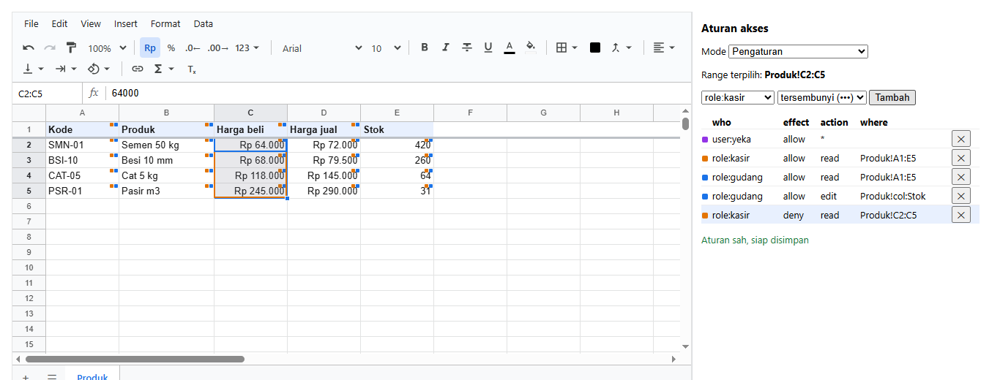
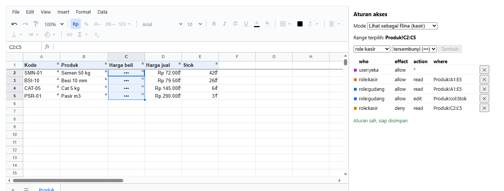

---

## 6. Penegakan Keamanan di Server (`viewFor` & `checkPatch`)

Keamanan data tidak boleh hanya bergantung pada browser client. Engine `@kufayeka/sheet/core` menyediakan dua pilar validasi server:

### A. Sensor Data Rahasia Sebelum Pengiriman (`viewFor`)
Fungsi `viewFor` menghapus sel-sel terlarang dari payload JSON dokumen sebelum dikirimkan melalui HTTP response:

<!-- contoh: 13-32-viewfor.ts -->
```ts
import { viewFor } from '@kufayeka/sheet/core';
import type { AccessRow } from '@kufayeka/sheet/core';
import { buatStok } from './data/stok-akses.js';

// 13.32 viewFor. Saat rina membuka, server mengirim isi workbook TANPA isi yang tersembunyi untuknya.
const rows: AccessRow[] = [
    { who: 'role:kasir', effect: 'allow', action: 'read', where: 'Produk!A1:I13' },
    { who: 'role:kasir', effect: 'deny', action: 'read', where: 'Produk!col:Harga beli' }
];
const isi = buatStok().toJSON();                       // yang tersimpan di database

const dikirim = viewFor(isi, { access: rows, who: { user: 'rina', roles: ['kasir'] } });
const teks = JSON.stringify(dikirim);
console.log('harga beli Semen (64000) ikut terkirim?', teks.includes('64000'));
console.log('nama produk ikut terkirim?            ', teks.includes('Semen Portland'));
```
<!-- /contoh -->

<!-- hasil: 13-32-viewfor.ts -->
```text
harga beli Semen (64000) ikut terkirim? false
nama produk ikut terkirim?             true
```
<!-- /hasil -->

### B. Validasi Mutasi Patch Server-Side (`checkPatch`)
Fungsi `checkPatch` memverifikasi integritas setiap operasi perubahan sebelum diterapkan ke database:

<!-- contoh: 13-33-checkpatch.ts -->
```ts
import { createWorkbook, checkPatch } from '@kufayeka/sheet/core';
import type { AccessRow } from '@kufayeka/sheet/core';
import { buatStok } from './data/stok-akses.js';

// 13.33 checkPatch. Perubahan dari browser rina diperiksa lagi sebelum disimpan, dengan aturan yang sama.
const rows: AccessRow[] = [
    { who: 'role:kasir', effect: 'allow', action: 'read', where: 'Produk!A1:I13' },
    { who: 'role:kasir', effect: 'allow', action: 'edit', where: 'Produk!col:Stok' }
];
const rina = { user: 'rina', roles: ['kasir'] };
const isi = buatStok().toJSON();

// perubahan yang boleh: stok
const satu = createWorkbook(isi);
satu.sheet('Produk').setValues('G2', 400);
console.log('ubah stok:', checkPatch(isi, satu.pendingPatch(), { access: rows, who: rina }).ok ? 'diterima' : 'ditolak');

// perubahan yang tidak boleh: nama produk (browser yang diakali bisa saja mengirimnya)
const dua = createWorkbook(isi);
dua.sheet('Produk').setValues('B2', 'Semen murah');
const hasil = checkPatch(isi, dua.pendingPatch(), { access: rows, who: rina });
console.log('ubah nama:', hasil.ok ? 'diterima' : 'ditolak', '|', hasil.problems.map((p) => p.address + ': ' + p.reason).join(', '));
```
<!-- /contoh -->

<!-- hasil: 13-33-checkpatch.ts -->
```text
ubah stok: diterima
ubah nama: ditolak | B2: You can only view this here
```
<!-- /hasil -->

---

## 7. Katalog Aksi & Target Hak Akses

Daftar berikut dihasilkan otomatis dari registry `ACTION_INFO` engine:

<!-- tabel: 13-35-daftar.ts -->
| Kelompok | action |
|---|---|
| Cells | `read`, `edit`, `see` |
| Format | `format.bold`, `format.italic`, `format.underline`, `format.strike`, `format.color`, `format.fill`, `format.borders`, `format.align`, `format.wrap`, `format.rotate`, `format.size`, `format.font`, `format.number`, `format.link`, `format.merge`, `format.conditional`, `format.clear` |
| Rows | `rows.insert`, `rows.delete`, `rows.resize`, `rows.hide`, `rows.group` |
| Columns | `cols.insert`, `cols.delete`, `cols.resize`, `cols.hide`, `cols.group` |
| Sheets | `sheets.add`, `sheets.delete`, `sheets.rename`, `sheets.move`, `sheets.hide` |
| View | `view.area`, `view.sheet`, `view.freeze`, `view.gridlines` |
| Data | `sort`, `filter`, `pivot`, `chart`, `validation`, `names`, `settings` |
| Clipboard and files | `copy`, `paste`, `download`, `import` |
| Comments | `comment.read`, `comment.create`, `comment.reply`, `comment.edit`, `comment.delete`, `comment.moderate` |
| Access | `access` |
| Layar | `ui.menubar`, `ui.toolbar`, `ui.formulaBar`, `ui.headers`, `ui.gridlines`, `ui.tabs`, `ui.disallowed` |
| Layar: Toolbar | `ui.tool.undo`, `ui.tool.redo`, `ui.tool.paint`, `ui.tool.zoom`, `ui.tool.currency`, `ui.tool.percent`, `ui.tool.decimals`, `ui.tool.formats`, `ui.tool.font`, `ui.tool.size`, `ui.tool.bold`, `ui.tool.italic`, `ui.tool.strike`, `ui.tool.underline`, `ui.tool.color`, `ui.tool.fill`, `ui.tool.borders`, `ui.tool.merge`, `ui.tool.align`, `ui.tool.valign`, `ui.tool.wrap`, `ui.tool.rotate`, `ui.tool.link`, `ui.tool.functions`, `ui.tool.clear` |
| Layar: Menus | `ui.menu.File`, `ui.menu.Edit`, `ui.menu.View`, `ui.menu.Insert`, `ui.menu.Format`, `ui.menu.Data` |
| Layar: Menu items | `ui.menu.file:import`, `ui.menu.file:download`, `ui.menu.file:settings`, `ui.menu.edit:find`, `ui.menu.edit:deleteRows`, `ui.menu.edit:deleteCols`, `ui.menu.view:freezeRows`, `ui.menu.view:freezeCols`, `ui.menu.view:group`, `ui.menu.view:comments`, `ui.menu.view:zoom`, `ui.menu.insert:rowsAbove`, `ui.menu.insert:colsLeft`, `ui.menu.insert:sheet`, `ui.menu.insert:checkbox`, `ui.menu.insert:dropdown`, `ui.menu.insert:fn`, `ui.menu.insert:link`, `ui.menu.insert:comment`, `ui.menu.insert:pivot`, `ui.menu.insert:chart`, `ui.menu.insert:sparkline`, `ui.menu.format:conditional`, `ui.menu.data:sortSheet`, `ui.menu.data:sortRange`, `ui.menu.data:filter`, `ui.menu.data:validation`, `ui.menu.data:names` |
| Layar: Panels | `ui.panel.comments`, `ui.panel.pivot`, `ui.panel.chart`, `ui.panel.conditional`, `ui.panel.names`, `ui.panel.validation`, `ui.panel.find`, `ui.panel.settings`, `ui.panel.filter` |
| Layar: Features | `ui.feature.contextMenu`, `ui.feature.fillHandle`, `ui.feature.resize`, `ui.feature.groups`, `ui.cell.commentMark`, `ui.cell.validation` |
<!-- /tabel -->

---

[Daftar isi](../README.md#daftar-isi) · Sebelumnya: [09. Persistensi State & Sinkronisasi Server](09-menyimpan.md) · Berikutnya: [11. Komentar Sel & Interoperabilitas Excel](11-komentar-excel.md)
