# 10. Kontrol Akses & Perizinan (ACL/RBAC)

[Daftar isi](../README.md#daftar-isi) · Sebelumnya: [09. Persistensi State & Sinkronisasi Server](09-menyimpan.md) · Berikutnya: [11. Komentar Sel & Interoperabilitas Excel](11-komentar-excel.md)

Bab ini membedah arsitektur **Access Control List (ACL)** dan **Role-Based Access Control (RBAC)** tingkat enterprise pada `@kufayeka/sheet`: penegakan izin deklaratif, granularitas proteksi tingkat sel/baris/kolom, resolusi prioritas aturan (*conflict resolution*), proteksi kondisional dinamis (`when`), kustomisasi elemen antarmuka (`ui`), verifikasi patch mutasi server (`checkPatch`), dan penyensoran data sensitif (*data masking* via `viewFor`).

---

## 1. Arsitektur Keamanan & Prinsip Whitelist

Model keamanan `@kufayeka/sheet` menganut filosofi **Default-Deny (Whitelist)**:

```text
┌───────────────────────────────┐     ┌───────────────────────────────┐
│ Who (id) + People (grup)      │     │ Aturan Akses (AccessRow[])    │
└───────────────┬───────────────┘     └───────────────┬───────────────┘
                │                                     │
                └──────────────────┬──────────────────┘
                                   │
                                   ▼
                ┌─────────────────────────────────────┐
                │     Mesin Evaluasi ACL (Resolver)   │
                └──────────────────┬──────────────────┘
                                   │
        ┌──────────────────────────┼──────────────────────────┐
        ▼                          ▼                          ▼
┌──────────────────┐      ┌──────────────────┐      ┌──────────────────┐
│  1. Read / Write │      │  2. Read-Only    │      │  3. Masked       │
│  (Bebas Disunting│      │  (Hanya Baca,    │      │  (Sensor '•••',  │
│   tanpa hambatan)│      │   Ikon Gembok)   │      │   Ikon Mata)     │
└──────────────────┘      └──────────────────┘      └──────────────────┘
        │
        └──────────────────────────┬──────────────────────────┘
                                   ▼
                          ┌──────────────────┐
                          │ 4. Inaccessible  │
                          │ (Kosong Penuh/   │
                          │  Sembunyi Total) │
                          └──────────────────┘
```

1. **Prinsip Whitelist**: Jika suatu sel atau aksi tidak secara eksplisit diberikan izin (`allow`), maka entitas tersebut otomatis berstatus tidak dapat diakses (*inaccessible*).
2. **Pemisahan Auth vs ACL**: Library tidak menangani session atau login. Sistem autentikasi aplikasi Anda cukup menyediakan **id akun** orang yang membuka (`setWho({ who: 'rina' })` / `access.who`) dan daftar orang serta grupnya (`setPeople({ users, groups })` / prop `people`). Workbook sendiri yang mencocokkan id itu ke grup, jadi host tidak pernah mengirim daftar role/grup milik orang tersebut.
3. **Isomorfik & Server-Enforced**: Aturan ACL yang sama dijalankan di browser (untuk UX antarmuka) dan dieksekusi ulang di backend Node.js (`viewFor` dan `checkPatch`) untuk menjamin keamanan dari manipulasi client.

---

## 2. Empat Status Izin Sel

Bagi pengguna yang sedang membuka sheet, setiap sel dievaluasi ke dalam salah satu dari empat status izin:

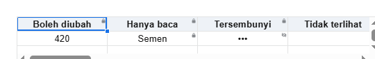

| Status Sel | Hak Pengguna | Indikator Visual Grid |
|---|---|---|
| **Read/Write (`edit`)** | Pengguna memiliki izin membaca dan mengedit nilai/formula. | Tampilan sel normal tanpa batasan. |
| **Read-Only (`read`)** | Pengguna hanya dapat membaca nilai terhitung; input editor terkunci. | Konten sel tampil dengan ikon gembok kecil di sudut sel. |
| **Masked / Hidden** | Mengetahui bahwa sel memiliki isi data, namun nilai aktual disensor. | Menampilkan karakter masker `•••` dengan ikon sensor mata dicoret. |
| **Inaccessible** | Pengguna tidak memiliki izin membaca sel. | Sel tampil kosong (*blank*) tanpa metadata apapun. |

---

## 3. Dual Rendering Mode: Runtime Live vs Setup Mode

Komponen antarmuka mendukung dua mode operasi melalui prop `access.view`:

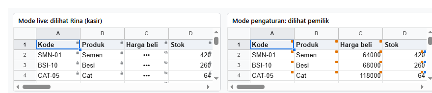

| Mode Operasi | Target Pengguna | Karakteristik Tampilan |
|---|---|---|
| **Runtime (`view: 'live'`)** | Pengguna operasional (misal: Kasir, Staf Gudang). | Menerapkan hak akses aktual: indikator gembok, masking `•••`, atau sel kosong. |
| **Design / Setup (`view: 'setup'`)** | Administrator / Manajer perancang aturan. | Seluruh data sel tampil normal, disertai indikator visual kotak warna (*marker badge*) yang memetakan aturan ACL pada masing-masing peran. |

---

## 4. Struktur Sintaks Deklarasi Aturan (`AccessRow`)

Setiap baris aturan didefinisikan sebagai objek terstruktur:

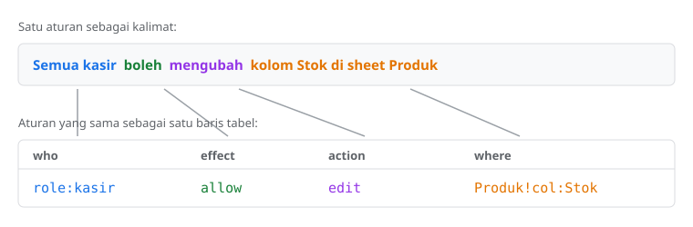

```ts
interface AccessRow {
    who: string;           // 'rina' (user), 'group:kasir', '*' (semua orang)
    effect: 'allow' | 'deny';
    action: string;        // 'read', 'edit', 'format.bold', 'ui.toolbar', '*'
    where?: string;        // 'Produk!A1:I13', 'Produk!col:Stok'; kosong = global
    when?: string;         // Formula evaluasi dinamis (misal '=$I2="Dihentikan"')
    message?: string;      // Pesan saat aksi INI ditolak (pada action '*': pesan untuk setiap penolakan)
}
```

Isi `who`:

| Ditulis | Artinya | Cocok dengan `access.who` |
|---|---|---|
| `'rina'` | user dengan id `rina` | `setWho({ who: 'rina' })` |
| `'user:rina'` | sama dengan `'rina'` (awalan `user:` boleh dipakai, boleh tidak) | `setWho({ who: 'rina' })` |
| `'group:kasir'` | semua orang yang terdaftar di grup `kasir` | `setWho({ who: 'rina' })` + `setPeople({ groups: { kasir: ['rina'] } })` |
| `'*'` | semua orang | siapa saja |

`who` yang dikirim ke workbook selalu **id akun telanjang**, tidak pernah daftar grup. Keanggotaan grup dibaca dari `setPeople`, jadi host tidak bisa memberi dirinya grup yang bukan haknya, dan hanya ada satu tempat yang tahu.

Tiga pintu, masing-masing boleh tidak dipakai:

| Pintu | Isi | Bila tidak dipakai |
|---|---|---|
| `setAccess(rows)` / `access.rows` | daftar `AccessRow[]` (satu argumen saja) | tidak dipanggil, `null`, atau `[]`: workbook **tanpa** kebijakan akses, semua boleh |
| `setWho({ who })` / `access.who` | id akun yang membuka | bukan siapa-siapa: baris `user:`/`group:` tidak berlaku, dengan kebijakan terpasang ia tidak mendapat apa-apa |
| `setPeople({ users, groups })` / prop `people` | kamus nama/foto (`users`) dan keanggotaan grup (`groups`) | setiap id tampil apa adanya, dan tidak ada yang masuk grup mana pun |

Di server sama: `viewFor(doc, { access, who, people })`, `checkPatch(doc, patch, { access, who, people })`, `mergePatch(doc, patch, { access, who, people })`. Tanpa `people`, baris `group:` tidak akan cocok dengan siapa pun.

`message` hanya ditampilkan untuk penolakan aksi milik baris itu. Baris `deny ui.menubar` dengan pesan "Menu dikunci" tidak akan muncul saat orang yang sama ditolak menambah sheet. Untuk satu pesan yang dipakai di **setiap** penolakan, tulis di baris `deny` dengan `action: '*'`.

---

## 5. Implementasi Panduan Langkah demi Langkah

Semua contoh berikut mengacu pada dataset stok produk konstruksi berikut:

<!-- contoh: data/stok-akses.js -->
```js
import { createWorkbook } from '@kufayeka/sheet/core';
import { PRODUK, KOLOM_PRODUK } from './toko.js';

// Bahan bersama bab 10: workbook stok toko.

/** Sheet Produk: Kode, Nama produk, Kategori, Satuan, Harga beli, Harga jual, Stok, Stok min., Status (A..I), 12 produk. */
export function buatStok() {
    const wb = createWorkbook();
    wb.setSettings({ locale: 'id-ID', currency: 'IDR' });
    const p = wb.sheet('Sheet1');
    p.setSheetProps({ name: 'Produk' });
    p.setValues('A1', [[...KOLOM_PRODUK, 'Status'], ...PRODUK.map((x, i) => [...x, i === 7 ? 'Dihentikan' : 'Aktif'])]);
    p.setStyle('A1:I1', { bold: true, fill: '#eef2f7' });
    return wb;
}
```
<!-- /contoh -->

---

### 5.1 Hak Akses Baca Saja (Read-Only)

Memberikan izin baca pada seluruh rentang data tabel. Seluruh sel terkunci dengan ikon gembok:

<!-- contoh: 13-08-baca.page.tsx -->
```tsx
import { useState } from 'react';
import { Sheet } from '@kufayeka/sheet';
import type { AccessRow } from '@kufayeka/sheet/core';
import '@kufayeka/sheet/style.css';
import { buatStok } from './data/stok-akses.js';

// 13.8 Aturan pertama: kasir boleh MEMBACA tabel produk.
const ORANG_GRUP = { users: [{ id: 'rina', name: 'Rina Dewi' }], groups: { kasir: ['rina'] } };

const rows: AccessRow[] = [
    { who: 'group:kasir', effect: 'allow', action: 'read', where: 'Produk!A1:I13' }
];

export default function Halaman() {
    const [wb] = useState(buatStok);
    const rina = 'rina';       // dari sistem login aplikasimu
    return (
        <div style={{ height: 330 }}>
            <Sheet workbook={wb} people={ORANG_GRUP} access={{ rows, who: rina }} />
        </div>
    );
}
```
<!-- /contoh -->

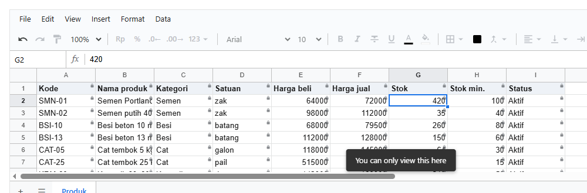

---

### 5.2 Evaluasi Whitelist & Default Deny

Kolom yang tidak disebutkan di dalam aturan `allow` tidak akan ditampilkan sama sekali ke pengguna:

<!-- contoh: 13-09-tidak-disebut.page.tsx -->
```tsx
import { useState } from 'react';
import { Sheet } from '@kufayeka/sheet';
import type { AccessRow, Who } from '@kufayeka/sheet/core';
import '@kufayeka/sheet/style.css';
import { buatStok } from './data/stok-akses.js';

// 13.9 Yang tidak disebut, tidak didapat. Aturannya sekarang hanya untuk kolom A sampai D.
const ORANG_GRUP = { users: [{ id: 'rina', name: 'Rina Dewi' }, { id: 'tamu', name: 'Tamu' }], groups: { kasir: ['rina'] } };

const rows: AccessRow[] = [
    { who: 'group:kasir', effect: 'allow', action: 'read', where: 'Produk!A1:D13' }     // baru: A-D saja
];

// baru: pilihan "Lihat sebagai", untuk membandingkan dua orang
const ORANG: Record<string, Who> = {
    rina: 'rina',
    tamu: 'tamu'                                   // tanpa role
};

export default function Halaman() {
    const [wb] = useState(buatStok);
    const [sebagai, setSebagai] = useState('rina');
    return (
        <div>
            <p>Lihat sebagai <select className="lihat-sebagai" value={sebagai} onChange={(e) => setSebagai(e.target.value)}>
                {Object.keys(ORANG).map((nama) => <option key={nama}>{nama}</option>)}
            </select></p>
            <div style={{ height: 300 }}>
                <Sheet workbook={wb} people={ORANG_GRUP} access={{ rows, who: ORANG[sebagai] }} />
            </div>
        </div>
    );
}
```
<!-- /contoh -->

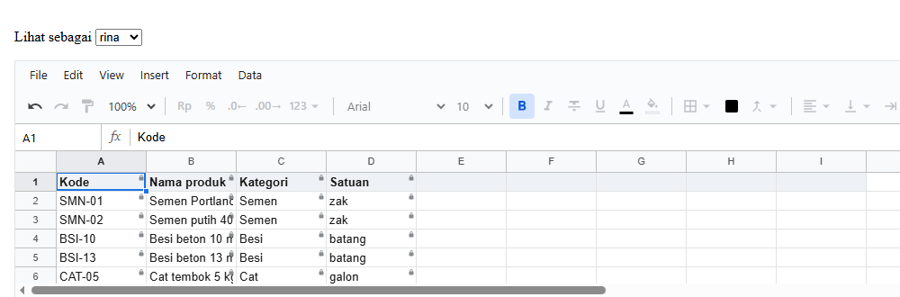
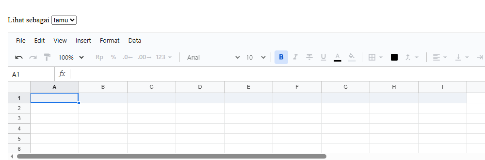

---

### 5.3 Memberikan Hak Edit Penuh

Mengizinkan pengguna mengubah seluruh nilai pada area yang ditentukan:

<!-- contoh: 13-10-ubah.page.tsx -->
```tsx
import { useState } from 'react';
import { Sheet } from '@kufayeka/sheet';
import type { AccessRow } from '@kufayeka/sheet/core';
import '@kufayeka/sheet/style.css';
import { buatStok } from './data/stok-akses.js';

// 13.10 Boleh mengubah. Ganti read dengan edit.
const rows: AccessRow[] = [
    { who: 'group:kasir', effect: 'allow', action: 'edit', where: 'Produk!A1:I13' }     // baru: edit
];

export default function Halaman() {
    const [wb] = useState(buatStok);
    return (
        <div style={{ height: 330 }}>
            <Sheet workbook={wb} people={{ users: [{ id: 'rina', name: 'Rina Dewi' }], groups: { kasir: ['rina'] } }} access={{ rows, who: 'rina' }} />
        </div>
    );
}
```
<!-- /contoh -->

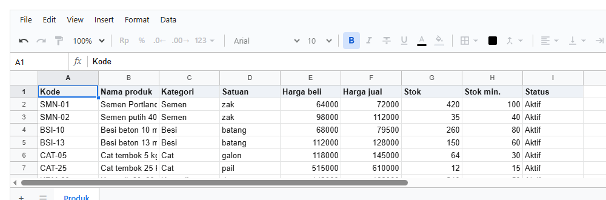

---

### 5.4 Membaca Seluruh Kolom, Mengubah Sebagian Kolom

Kombinasi izin baca menyeluruh dengan izin edit khusus pada kolom kuantitas stok:

<!-- contoh: 13-11-campur.page.tsx -->
```tsx
import { useState } from 'react';
import { Sheet } from '@kufayeka/sheet';
import type { AccessRow } from '@kufayeka/sheet/core';
import '@kufayeka/sheet/style.css';
import { buatStok } from './data/stok-akses.js';

// 13.11 Baca semua, ubah sebagian: baca seluruh tabel, ubah kolom G (Stok) saja.
const rows: AccessRow[] = [
    { who: 'group:kasir', effect: 'allow', action: 'read', where: 'Produk!A1:I13' },
    { who: 'group:kasir', effect: 'allow', action: 'edit', where: 'Produk!G2:G13' }     // baru
];

export default function Halaman() {
    const [wb] = useState(buatStok);
    return (
        <div style={{ height: 330 }}>
            <Sheet workbook={wb} people={{ users: [{ id: 'rina', name: 'Rina Dewi' }], groups: { kasir: ['rina'] } }} access={{ rows, who: 'rina' }} />
        </div>
    );
}
```
<!-- /contoh -->


---

### 5.5 Menargetkan Kolom Berdasarkan Nama Header (`col:Nama`)

Menyebut kolom berdasarkan judul header teksnya membuat aturan tetap kebal terhadap pergeseran posisi akibat penyisipan kolom:

<!-- contoh: 13-12-kolom.page.tsx -->
```tsx
import { useState } from 'react';
import { Sheet } from '@kufayeka/sheet';
import type { AccessRow } from '@kufayeka/sheet/core';
import '@kufayeka/sheet/style.css';
import { buatStok } from './data/stok-akses.js';

// 13.12 Kolom ditulis dengan judulnya: col:Stok, bukan G2:G13. Tetap benar walaupun kolomnya bergeser.
const rows: AccessRow[] = [
    { who: 'group:kasir', effect: 'allow', action: 'read', where: 'Produk!A1:I13' },
    { who: 'group:kasir', effect: 'allow', action: 'edit', where: 'Produk!col:Stok' }   // baru: judul kolom
];

export default function Halaman() {
    const [wb] = useState(buatStok);
    // tombol untuk mencoba: kolom baru disisipkan di A, Stok bergeser ke H, aturannya ikut
    const sisipkan = () => wb.sheet('Produk').insertCols('A');
    return (
        <div>
            <p><button className="sisipkan" onClick={sisipkan}>Sisipkan kolom di A</button></p>
            <div style={{ height: 300 }}>
                <Sheet workbook={wb} people={{ users: [{ id: 'rina', name: 'Rina Dewi' }], groups: { kasir: ['rina'] } }} access={{ rows, who: 'rina' }} />
            </div>
        </div>
    );
}
```
<!-- /contoh -->

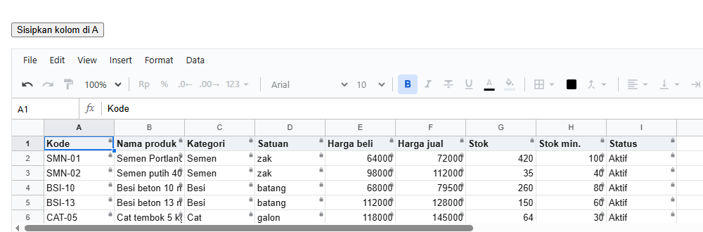
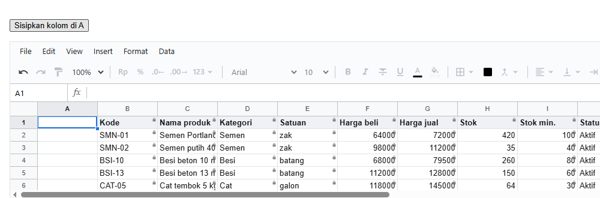

---

### 5.6 Menyensor Data Sensitif (Masking `•••`)

Menggunakan `deny read` untuk menyamarkan nilai sel menjadi `•••` tanpa menghilangkan layout sel:

<!-- contoh: 13-13-sembunyi.page.tsx -->
```tsx
import { useState } from 'react';
import { Sheet } from '@kufayeka/sheet';
import type { AccessRow } from '@kufayeka/sheet/core';
import '@kufayeka/sheet/style.css';
import { buatStok } from './data/stok-akses.js';

// 13.13 Menyembunyikan isi: harga beli (kolom E) tampil ••• untuk kasir.
const rows: AccessRow[] = [
    { who: 'group:kasir', effect: 'allow', action: 'read', where: 'Produk!A1:I13' },
    { who: 'group:kasir', effect: 'allow', action: 'edit', where: 'Produk!col:Stok' },
    { who: 'group:kasir', effect: 'deny', action: 'read', where: 'Produk!col:Harga beli' }   // baru
];

export default function Halaman() {
    const [wb] = useState(buatStok);
    return (
        <div style={{ height: 330 }}>
            <Sheet workbook={wb} people={{ users: [{ id: 'rina', name: 'Rina Dewi' }], groups: { kasir: ['rina'] } }} access={{ rows, who: 'rina' }} />
        </div>
    );
}
```
<!-- /contoh -->

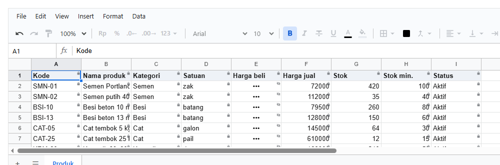

---

### 5.7 Menyembunyikan Sel Penuh (`deny see`)

Jika pengguna tidak boleh mengetahui apakah suatu sel memiliki data atau tidak, gunakan `deny see`:

<!-- contoh: 13-14-tak-terlihat.page.tsx -->
```tsx
import { useState } from 'react';
import { Sheet } from '@kufayeka/sheet';
import type { AccessRow } from '@kufayeka/sheet/core';
import '@kufayeka/sheet/style.css';
import { buatStok } from './data/stok-akses.js';

// 13.14 Tidak terlihat sama sekali: sama dengan 13.13, tapi deny see. Kolom E tampil kosong.
const rows: AccessRow[] = [
    { who: 'group:kasir', effect: 'allow', action: 'read', where: 'Produk!A1:I13' },
    { who: 'group:kasir', effect: 'allow', action: 'edit', where: 'Produk!col:Stok' },
    { who: 'group:kasir', effect: 'deny', action: 'see', where: 'Produk!col:Harga beli' }    // baru: see, bukan read
];

export default function Halaman() {
    const [wb] = useState(buatStok);
    return (
        <div style={{ height: 330 }}>
            <Sheet workbook={wb} people={{ users: [{ id: 'rina', name: 'Rina Dewi' }], groups: { kasir: ['rina'] } }} access={{ rows, who: 'rina' }} />
        </div>
    );
}
```
<!-- /contoh -->

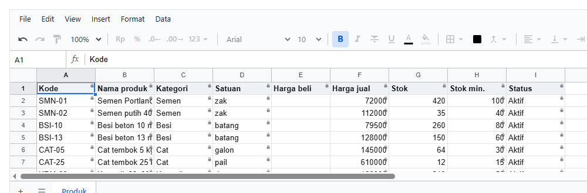

---

### 5.8 Multi-Grup (`group:<id>`)

Menetapkan izin yang berbeda untuk staf kasir dan staf gudang, serta penanganan pengguna yang memiliki banyak peran sekaligus:

<!-- contoh: 13-15-role.page.tsx -->
```tsx
import { useState } from 'react';
import { Sheet } from '@kufayeka/sheet';
import type { AccessRow, Who } from '@kufayeka/sheet/core';
import '@kufayeka/sheet/style.css';
import { buatStok } from './data/stok-akses.js';

// 13.15 Role: aturan untuk semua kasir, dan satu role lagi, gudang.
const ORANG_GRUP = { users: [{ id: 'rina', name: 'Rina Dewi' }, { id: 'joko', name: 'Joko Susilo' }, { id: 'sari', name: 'Sari Utami' }], groups: { gudang: ['joko', 'sari'], kasir: ['rina', 'sari'] } };

const rows: AccessRow[] = [
    { who: 'group:kasir', effect: 'allow', action: 'read', where: 'Produk!A1:I13' },
    { who: 'group:gudang', effect: 'allow', action: 'read', where: 'Produk!A1:I13' },        // baru
    { who: 'group:gudang', effect: 'allow', action: 'edit', where: 'Produk!col:Stok' }       // baru
];

const ORANG: Record<string, Who> = {
    rina: 'rina',
    joko: 'joko',
    sari: 'sari'       // dua role sekaligus
};

export default function Halaman() {
    const [wb] = useState(buatStok);
    const [sebagai, setSebagai] = useState('rina');
    return (
        <div>
            <p>Lihat sebagai <select className="lihat-sebagai" value={sebagai} onChange={(e) => setSebagai(e.target.value)}>
                {Object.keys(ORANG).map((nama) => <option key={nama}>{nama}</option>)}
            </select></p>
            <div style={{ height: 300 }}>
                <Sheet workbook={wb} people={ORANG_GRUP} access={{ rows, who: ORANG[sebagai] }} />
            </div>
        </div>
    );
}
```
<!-- /contoh -->


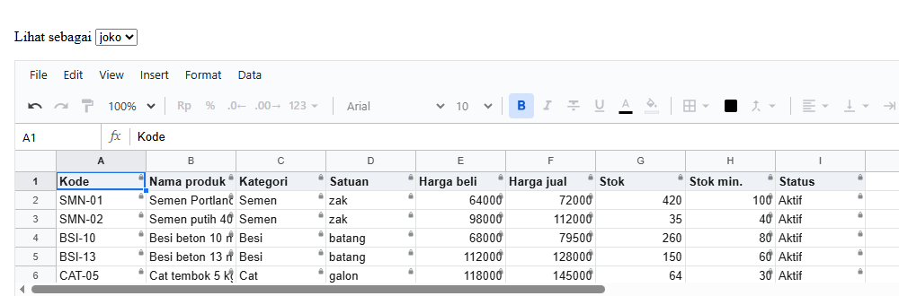


---

### 5.9 Izin Wildcard untuk Semua Pengguna (`who: '*'`)

Mengizinkan seluruh pengguna (termasuk tamu publik) membaca data umum, sementara role internal memperoleh akses tambahan:

<!-- contoh: 13-16-semua.page.tsx -->
```tsx
import { useState } from 'react';
import { Sheet } from '@kufayeka/sheet';
import type { AccessRow, Who } from '@kufayeka/sheet/core';
import '@kufayeka/sheet/style.css';
import { buatStok } from './data/stok-akses.js';

// 13.16 Semua orang (*): siapa pun boleh membaca kolom A sampai D, termasuk yang tidak punya role.
const ORANG_GRUP = { users: [{ id: 'tamu', name: 'Tamu' }, { id: 'rina', name: 'Rina Dewi' }], groups: { kasir: ['rina'] } };

const rows: AccessRow[] = [
    { who: '*', effect: 'allow', action: 'read', where: 'Produk!A1:D13' },                  // baru
    { who: 'group:kasir', effect: 'allow', action: 'read', where: 'Produk!A1:I13' }
];

const ORANG: Record<string, Who> = {
    tamu: 'tamu',
    rina: 'rina'
};

export default function Halaman() {
    const [wb] = useState(buatStok);
    const [sebagai, setSebagai] = useState('tamu');
    return (
        <div>
            <p>Lihat sebagai <select className="lihat-sebagai" value={sebagai} onChange={(e) => setSebagai(e.target.value)}>
                {Object.keys(ORANG).map((nama) => <option key={nama}>{nama}</option>)}
            </select></p>
            <div style={{ height: 300 }}>
                <Sheet workbook={wb} people={ORANG_GRUP} access={{ rows, who: ORANG[sebagai] }} />
            </div>
        </div>
    );
}
```
<!-- /contoh -->


---

### 5.10 Resolusi Konflik: Prioritas Akun Pengguna vs Grup

Aturan spesifik akun (`user:<id>`) memiliki prioritas evaluasi lebih tinggi dibandingkan aturan level grup (`group:<id>`):

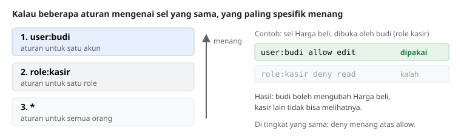

<!-- contoh: 13-17-akun.page.tsx -->
```tsx
import { useState } from 'react';
import { Sheet } from '@kufayeka/sheet';
import type { AccessRow, Who } from '@kufayeka/sheet/core';
import '@kufayeka/sheet/style.css';
import { buatStok } from './data/stok-akses.js';

// 13.17 Satu akun: kasir tidak boleh melihat harga beli, kecuali budi, yang boleh mengubahnya.
const ORANG_GRUP = { users: [{ id: 'rina', name: 'Rina Dewi' }, { id: 'budi', name: 'Budi Santoso' }], groups: { kasir: ['rina', 'budi'] } };

const rows: AccessRow[] = [
    { who: 'group:kasir', effect: 'allow', action: 'read', where: 'Produk!A1:I13' },
    { who: 'group:kasir', effect: 'deny', action: 'read', where: 'Produk!col:Harga beli' },
    { who: 'user:budi', effect: 'allow', action: 'edit', where: 'Produk!col:Harga beli' }   // baru: budi, walaupun kasir
];

const ORANG: Record<string, Who> = {
    rina: 'rina',
    budi: 'budi'
};

export default function Halaman() {
    const [wb] = useState(buatStok);
    const [sebagai, setSebagai] = useState('rina');
    return (
        <div>
            <p>Lihat sebagai <select className="lihat-sebagai" value={sebagai} onChange={(e) => setSebagai(e.target.value)}>
                {Object.keys(ORANG).map((nama) => <option key={nama}>{nama}</option>)}
            </select></p>
            <div style={{ height: 300 }}>
                <Sheet workbook={wb} people={ORANG_GRUP} access={{ rows, who: ORANG[sebagai] }} />
            </div>
        </div>
    );
}
```
<!-- /contoh -->

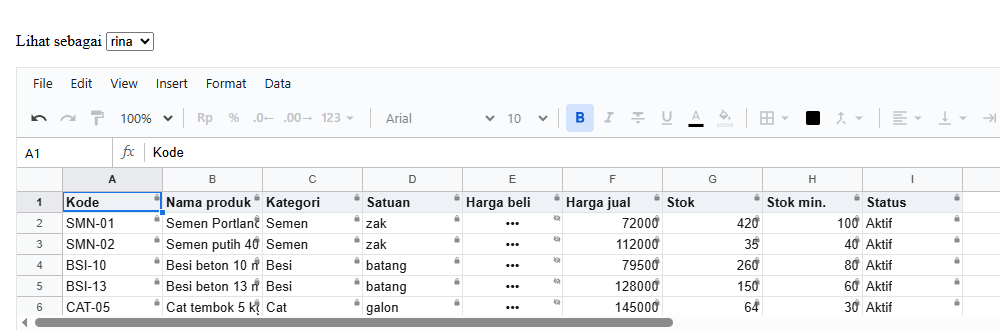


---

### 5.11 Hak Akses Pemilik Dokumen (Owner Privilege)

Pemilik dokumen (`owner`) memiliki hak akses tidak terbatas untuk membaca dan mengedit seluruh sel:

<!-- contoh: 13-18-pemilik.page.tsx -->
```tsx
import { useState } from 'react';
import { Sheet, useWorkbook } from '@kufayeka/sheet';
import type { AccessRow, Who } from '@kufayeka/sheet/core';
import '@kufayeka/sheet/style.css';
import { buatStok } from './data/stok-akses.js';

// 13.18 Pemilik: satu baris user:<nama> allow * tanpa where.
const ORANG_GRUP = { users: [{ id: 'yeka', name: 'Yeka Kufa' }, { id: 'rina', name: 'Rina Dewi' }], groups: { kasir: ['yeka', 'rina'] } };

const rows: AccessRow[] = [
    { who: 'user:yeka', effect: 'allow', action: '*' },                                    // baru
    { who: 'group:kasir', effect: 'allow', action: 'read', where: 'Produk!A1:I13' },
    { who: '*', effect: 'deny', action: 'edit', where: 'Produk!col:Harga beli' }
];

const ORANG: Record<string, Who> = {
    yeka: 'yeka',                // pemilik, juga kasir
    rina: 'rina'
};

export default function Halaman() {
    const [wb] = useState(buatStok);
    const [sebagai, setSebagai] = useState('yeka');
    // baru: wb.access().owner, untuk menampilkan tombol yang hanya untuk pemilik (misalnya "Atur hak akses")
    const pemilik = useWorkbook(wb, (w) => w.access().owner);
    return (
        <div>
            <p>
                Lihat sebagai <select className="lihat-sebagai" value={sebagai} onChange={(e) => setSebagai(e.target.value)}>
                    {Object.keys(ORANG).map((nama) => <option key={nama}>{nama}</option>)}
                </select>{' '}
                {pemilik ? <button>Atur hak akses</button> : null}
            </p>
            <div style={{ height: 300 }}>
                <Sheet workbook={wb} people={ORANG_GRUP} access={{ rows, who: ORANG[sebagai] }} />
            </div>
        </div>
    );
}
```
<!-- /contoh -->

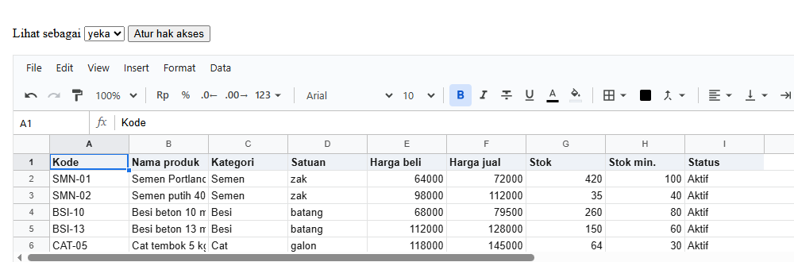


---

### 5.12 Aturan Bersyarat Dinamis (`when`)

Aturan proteksi sel dapat dievaluasi secara dinamis berbasis ekspresi formula boolean:

<!-- contoh: 13-19-syarat.page.tsx -->
```tsx
import { useState } from 'react';
import { Sheet } from '@kufayeka/sheet';
import type { AccessRow } from '@kufayeka/sheet/core';
import '@kufayeka/sheet/style.css';
import { buatStok } from './data/stok-akses.js';

// 13.19 Aturan dengan syarat: gudang boleh mengubah stok, KECUALI di baris produk yang sudah Dihentikan (kolom I).
const rows: AccessRow[] = [
    { who: 'group:gudang', effect: 'allow', action: 'read', where: 'Produk!A1:I13' },
    { who: 'group:gudang', effect: 'allow', action: 'edit', where: 'Produk!G2:G13' },
    { who: 'group:gudang', effect: 'deny', action: 'edit', where: 'Produk!G2:G13',
      when: '=$I2="Dihentikan"', message: 'Produk ini sudah dihentikan' }                  // baru
];

// untuk contoh ini, BSI-10 (baris 4) juga sudah dihentikan
function buatStokDihentikan() {
    const wb = buatStok();
    wb.sheet('Produk').setValues('I4', 'Dihentikan');
    return wb;
}

export default function Halaman() {
    const [wb] = useState(buatStokDihentikan);
    return (
        <div style={{ height: 330 }}>
            <Sheet workbook={wb} people={{ users: [{ id: 'joko', name: 'Joko Susilo' }], groups: { gudang: ['joko'] } }} access={{ rows, who: 'joko' }} />
        </div>
    );
}
```
<!-- /contoh -->

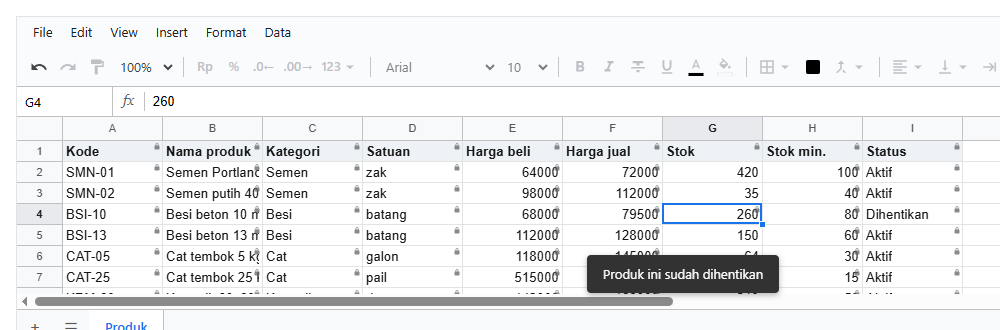

---

### 5.13 Pembatasan Perizinan Styling & Aksi Operasional

Membatasi aksi formatting dan fungsionalitas toolbar/menu:

<!-- contoh: 13-20-format.page.tsx -->
```tsx
import { useState } from 'react';
import { Sheet } from '@kufayeka/sheet';
import type { AccessRow } from '@kufayeka/sheet/core';
import '@kufayeka/sheet/style.css';
import { buatStok } from './data/stok-akses.js';

// 13.20 Format: kasir boleh memiringkan teks, tapi tidak boleh menebalkan.
const rows: AccessRow[] = [
    { who: 'group:kasir', effect: 'allow', action: 'edit', where: 'Produk!A1:I13' },
    { who: 'group:kasir', effect: 'allow', action: 'format.italic' }                        // baru: tanpa where = di mana saja
];

export default function Halaman() {
    const [wb] = useState(buatStok);
    return (
        <div style={{ height: 330 }}>
            <Sheet workbook={wb} people={{ users: [{ id: 'rina', name: 'Rina Dewi' }], groups: { kasir: ['rina'] } }} access={{ rows, who: 'rina' }} />
        </div>
    );
}
```
<!-- /contoh -->


Mengontrol izin Aksi Spreadsheet (Sort, Filter, Clipboard, Comment):

<!-- contoh: 13-21-aksi.page.tsx -->
```tsx
import { useState } from 'react';
import { Sheet } from '@kufayeka/sheet';
import type { AccessRow } from '@kufayeka/sheet/core';
import '@kufayeka/sheet/style.css';
import { buatStok } from './data/stok-akses.js';

// 13.21 Aksi lain: satu aksi (sort), satu kelompok (format = semua format.*), dan pengecualian di dalam kelompok (bold).
const rows: AccessRow[] = [
    { who: 'group:kasir', effect: 'allow', action: 'edit', where: 'Produk!A1:I13' },
    { who: 'group:kasir', effect: 'allow', action: 'sort' },             // baru: satu aksi
    { who: 'group:kasir', effect: 'allow', action: 'format' },           // baru: satu kelompok
    { who: 'group:kasir', effect: 'deny', action: 'format.bold' }        // baru: kecuali tebal
];

export default function Halaman() {
    const [wb] = useState(buatStok);
    return (
        <div style={{ height: 330 }}>
            <Sheet workbook={wb} people={{ users: [{ id: 'rina', name: 'Rina Dewi' }], groups: { kasir: ['rina'] } }} access={{ rows, who: 'rina' }} />
        </div>
    );
}
```
<!-- /contoh -->

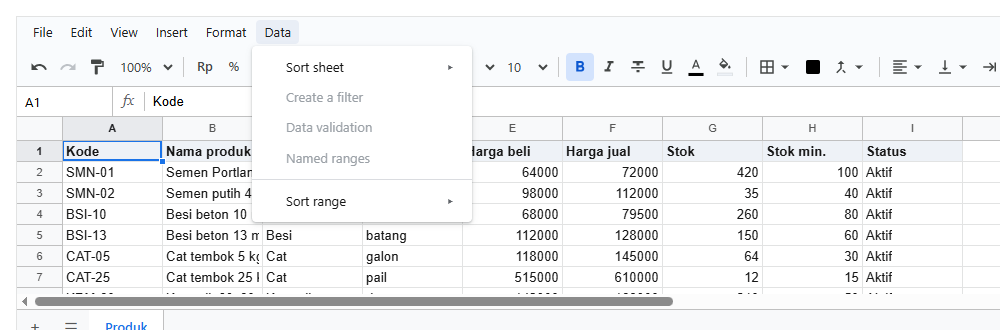

---

### 5.14 Mengontrol Visibilitas Modul Antarmuka (`ui.*`)

Menyembunyikan menu bar, toolbar, atau panel tertentu berbasis grup:

<!-- contoh: 13-22-layar.page.tsx -->
```tsx
import { useState } from 'react';
import { Sheet } from '@kufayeka/sheet';
import type { AccessRow } from '@kufayeka/sheet/core';
import '@kufayeka/sheet/style.css';
import { buatStok } from './data/stok-akses.js';

// 13.22 Bagian layar: kasir bekerja tanpa toolbar dan tanpa menu Insert.
const rows: AccessRow[] = [
    { who: 'group:kasir', effect: 'allow', action: 'read', where: 'Produk!A1:I13' },
    { who: 'group:kasir', effect: 'deny', action: 'ui.toolbar' },        // baru: satu bagian besar
    { who: 'group:kasir', effect: 'deny', action: 'ui.menu.Insert' }     // baru: satu menu
];

export default function Halaman() {
    const [wb] = useState(buatStok);
    return (
        <div style={{ height: 330 }}>
            <Sheet workbook={wb} people={{ users: [{ id: 'rina', name: 'Rina Dewi' }], groups: { kasir: ['rina'] } }} access={{ rows, who: 'rina' }} />
        </div>
    );
}
```
<!-- /contoh -->

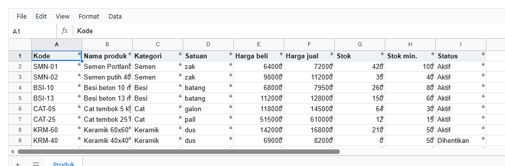

Membatasi Batas Area Viewport & Tab Sheet:

<!-- contoh: 13-23-area.page.tsx -->
```tsx
import { useState } from 'react';
import { Sheet } from '@kufayeka/sheet';
import type { AccessRow } from '@kufayeka/sheet/core';
import '@kufayeka/sheet/style.css';
import { buatStok } from './data/stok-akses.js';

// 13.23 Hanya sebagian sheet yang tampil (view.area), dan hanya sheet tertentu (view.sheet).
const rows: AccessRow[] = [
    { who: 'group:kasir', effect: 'allow', action: 'read', where: 'Produk!A1:I13' },
    { who: 'group:kasir', effect: 'allow', action: 'view.area', where: 'Produk!A1:D13' },  // baru
    { who: 'group:kasir', effect: 'allow', action: 'view.sheet', where: 'Produk' }         // baru
];

function buatDuaSheet() {
    const wb = buatStok();
    wb.addSheet('Rekap');                                   // sheet kedua, yang tidak boleh terlihat kasir
    return wb;
}

export default function Halaman() {
    const [wb] = useState(buatDuaSheet);
    return (
        <div style={{ height: 330 }}>
            <Sheet workbook={wb} people={{ users: [{ id: 'rina', name: 'Rina Dewi' }], groups: { kasir: ['rina'] } }} access={{ rows, who: 'rina' }} />
        </div>
    );
}
```
<!-- /contoh -->

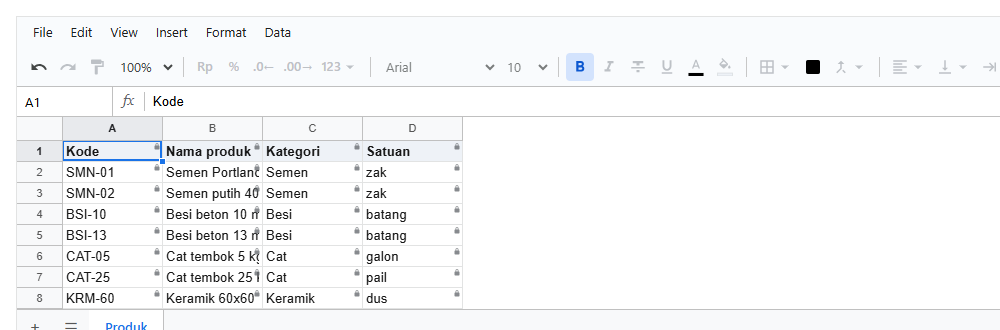

---

### 5.15 Kustomisasi Tanda Proteksi Sel (`marks`)

Mengonfigurasi tampilan visual ikon gembok, masking, shading warna, atau motif garis-garis pada sel terproteksi:

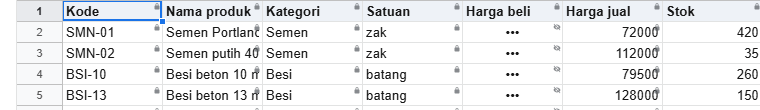

<!-- contoh: 13-25-tanda.page.tsx -->
```tsx
import { useState } from 'react';
import { Sheet } from '@kufayeka/sheet';
import type { CellMarks } from '@kufayeka/sheet';
import type { AccessRow } from '@kufayeka/sheet/core';
import '@kufayeka/sheet/style.css';
import { buatStok } from './data/stok-akses.js';

// 13.25 Variasi tanda (prop marks). Aturan dan orangnya sama; hanya marks yang berbeda, satu variasi per sheet.
const ORANG_GRUP = { users: [{ id: 'rina', name: 'Rina Dewi' }], groups: { kasir: ['rina'] } };

const ATURAN: AccessRow[] = [
    { who: 'group:kasir', effect: 'allow', action: 'read', where: 'Produk!A1:I13' },
    { who: 'group:kasir', effect: 'allow', action: 'edit', where: 'Produk!col:Stok' },
    { who: 'group:kasir', effect: 'deny', action: 'read', where: 'Produk!col:Harga beli' },
    // hanya supaya gambarnya ringkas: tanpa menu, toolbar, formula bar, dan tab
    ...['menubar', 'toolbar', 'formulaBar', 'tabs'].map((bagian): AccessRow => ({ who: '*', effect: 'deny', action: 'ui.' + bagian }))
];
const rina = 'rina';

function Contoh({ marks }: { marks?: false | CellMarks }) {
    const [wb] = useState(buatStok);
    return <div style={{ height: 130, marginBottom: 14 }}><Sheet workbook={wb} people={ORANG_GRUP} access={{ rows: ATURAN, who: rina }} marks={marks} /></div>;
}

export default function VariasiTanda() {
    return (
        <div style={{ width: 760 }}>
            <Contoh />                                                {/* bawaan: gembok + mata */}
            <Contoh marks={{ tint: true }} />                         {/* + latar abu-abu */}
            <Contoh marks={{ stripes: true }} />                      {/* + garis-garis */}
            <Contoh marks={{ lock: false }} />                        {/* tanpa gembok, mata tetap */}
            <Contoh marks={false} />                                  {/* tanpa tanda sama sekali */}
        </div>
    );
}
```
<!-- /contoh -->

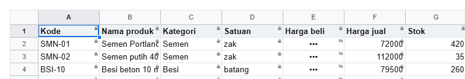
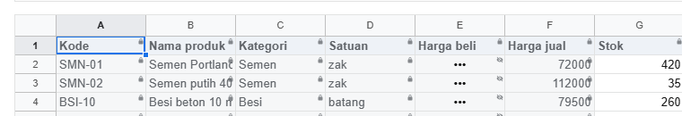
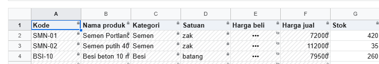

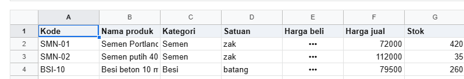

---

### 5.16 Intercept Pesan Feedback Penolakan (`onNotice`)

Menangkap event feedback penolakan untuk dialihkan ke notification toast aplikasi:

<!-- contoh: 13-26-pesan.page.tsx -->
```tsx
import { useState } from 'react';
import { Sheet } from '@kufayeka/sheet';
import type { SheetNotice } from '@kufayeka/sheet';
import type { AccessRow } from '@kufayeka/sheet/core';
import '@kufayeka/sheet/style.css';
import { buatStok } from './data/stok-akses.js';

// 13.26 Pesan penolakan ditampilkan di luar sheet, dengan kata-kata aplikasimu sendiri. Pesan bawaan sheet dimatikan.
const ATURAN: AccessRow[] = [
    { who: 'group:kasir', effect: 'allow', action: 'read', where: 'Produk!A1:I13' },
    { who: 'group:kasir', effect: 'allow', action: 'edit', where: 'Produk!col:Stok' }
];

export default function PesanSendiri() {
    const [wb] = useState(buatStok);
    const [pesan, setPesan] = useState<string | null>(null);

    // onNotice dipanggil untuk setiap pesan sheet, sebelum tampil
    function padaPesan(n: SheetNotice) {
        if (n.kind === 'refused') {
            setPesan(n.address + ': kolom ini hanya bisa dibaca. Yang boleh kamu ubah hanya Stok.');
            return null;           // null: sheet tidak menampilkan pesannya sendiri
        }
        return undefined;          // pesan lain: biarkan sheet yang menampilkan
    }

    return (
        <div style={{ height: 420, display: 'flex', flexDirection: 'column', font: '13px system-ui' }}>
            <div style={{ padding: '8px 12px', background: pesan ? '#fce8e6' : '#f1f3f4', color: pesan ? '#c5221f' : '#5f6368' }}>
                {pesan ?? 'Klik sel lalu ketik. Hanya kolom Stok yang bisa diubah.'}
            </div>
            <Sheet workbook={wb} style={{ flex: 1 }} onNotice={padaPesan} people={{ users: [{ id: 'rina', name: 'Rina Dewi' }], groups: { kasir: ['rina'] } }} access={{ rows: ATURAN, who: 'rina' }} />
        </div>
    );
}
```
<!-- /contoh -->

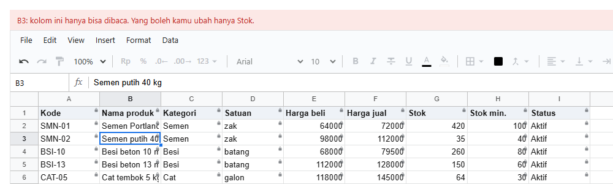

### 5.18 Tombol Save dan Isi File yang Diunduh

#### Siapa boleh menyimpan

Kalau aplikasi mengisi prop `onSave`, menu File punya tiga tombol simpan ([Bab 09 bagian 7.8](09-menyimpan.md#78-tombol-save-di-menu-file-onsave)). Masing-masing adalah aksi tersendiri, jadi bisa diizinkan atau ditolak satu per satu:

| Aksi | Tombol |
|---|---|
| `file.save` | Save (juga Ctrl+S) |
| `file.saveAsNewVersion` | Save as new version |
| `file.saveAsACopy` | Save as a copy |
| `file` atau `file.*` | ketiganya sekaligus |

Contoh di bawah memakai tiga orang:

- **admin**: boleh semuanya;
- **supervisor**: tidak boleh menimpa file, tapi boleh membuat versi baru atau salinan;
- **viewer**: tidak boleh menyimpan, tidak boleh mengubah, dan tidak boleh membaca harga beli.

Tombol yang ditolak menjadi abu-abu. Kalau viewer menekan Ctrl+S, muncul `message` dari baris aturannya.

<!-- contoh: 13-36-simpan.page.tsx -->
```tsx
import { useState } from 'react';
import { Sheet } from '@kufayeka/sheet';
import type { SheetSave } from '@kufayeka/sheet';
import type { AccessRow } from '@kufayeka/sheet/core';
import '@kufayeka/sheet/style.css';
import { buatStok } from './data/stok-akses.js';

// 13.36 Tombol Save di menu File, diatur per role. Admin boleh ketiganya, supervisor tidak boleh menimpa file (hanya versi baru atau salinan),
// viewer tidak boleh menyimpan sama sekali dan tidak boleh membaca harga beli.
const ORANG_GRUP = { users: [{ id: 'yeka', name: 'Yeka Kufa' }, { id: 'sari', name: 'Sari Utami' }, { id: 'budi', name: 'Budi Santoso' }], groups: { admin: ['yeka'], spv: ['sari'], viewer: ['budi'] } };

const ATURAN: AccessRow[] = [
    { who: '*', effect: 'allow', action: '*' },
    { who: 'group:spv', effect: 'deny', action: 'file.save', message: 'Supervisor tidak menimpa file. Pakai Save as new version.' },
    { who: 'group:viewer', effect: 'deny', action: 'file.*', message: 'Kamu hanya bisa melihat file ini.' },
    { who: 'group:viewer', effect: 'deny', action: 'edit' },
    { who: 'group:viewer', effect: 'deny', action: 'read', where: 'Produk!col:Harga beli' }
];

const ORANG: Record<string, string> = {
    admin: 'yeka',
    spv: 'sari',
    viewer: 'budi'
};

export default function TombolSimpan() {
    const [wb] = useState(buatStok);
    const [siapa, setSiapa] = useState('viewer');
    const [catatan, setCatatan] = useState('Belum ada yang disimpan.');

    // satu fungsi untuk ketiga tombol; di aplikasi sungguhan di sinilah API dipanggil (lihat bab 9 bagian 7.8)
    async function simpan({ mode, doc }: SheetSave) {
        const kata = { save: 'menimpa file', saveAsNewVersion: 'membuat versi baru', saveAsACopy: 'membuat salinan' }[mode];
        setCatatan(ORANG[siapa] + ' ' + kata + ' (workbook ' + String(doc.id).slice(0, 8) + '…)');
    }

    return (
        <div style={{ height: 420, display: 'flex', flexDirection: 'column', font: '13px system-ui' }}>
            <div style={{ padding: '8px 12px', display: 'flex', gap: 12, alignItems: 'center', background: '#f1f3f4' }}>
                Lihat sebagai
                <select className="lihat-sebagai" value={siapa} onChange={(e) => setSiapa(e.target.value)}>
                    <option value="admin">admin (yeka)</option>
                    <option value="spv">supervisor (sari)</option>
                    <option value="viewer">viewer (budi)</option>
                </select>
                <span>{catatan}</span>
            </div>
            <Sheet workbook={wb} style={{ flex: 1 }} onSave={simpan} people={ORANG_GRUP} access={{ rows: ATURAN, who: ORANG[siapa] }} />
        </div>
    );
}
```
<!-- /contoh -->

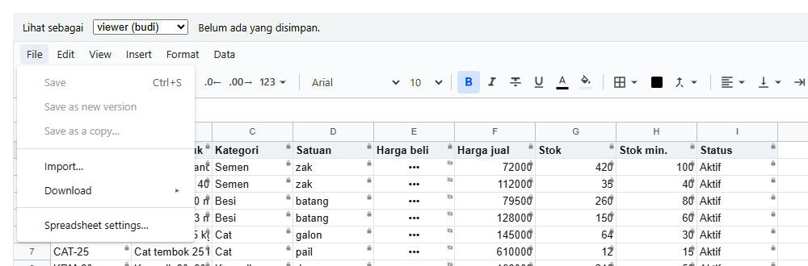

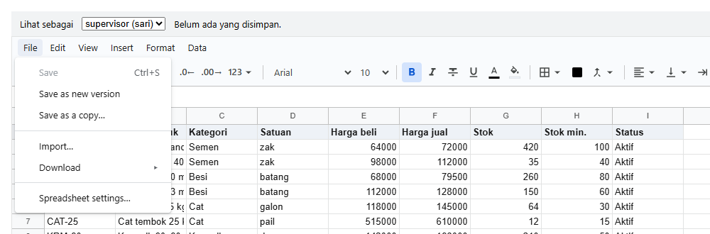

Seperti semua aturan di bab ini, pemeriksaan di browser hanya mengatur tombolnya. Route simpan di server harus memeriksa baris yang sama.

#### Apa yang ada di file yang diunduh

File yang sudah diunduh berada di luar kendali aplikasi. Siapa pun yang memegang file itu bisa membukanya di Excel, di editor teks, atau dengan meng-unzip-nya. Karena itu, *File → Download* (.xlsx dan .csv) hanya berisi apa yang dilihat orang itu di layar:

| Sel | Di layar | Di file yang diunduh |
|---|---|---|
| `deny read` | `•••` | teks `-` |
| `deny see` | kosong | kosong |
| rumus yang membaca sel di atas (misalnya total atau margin) | hasilnya | **hasilnya saja**, rumusnya tidak ikut |
| komentar di sel `deny read` / `deny see` | tidak terlihat | tidak ikut |
| baris dan kolom | — | tetap di posisinya, tidak ada yang dihapus atau digeser |

Alasannya:

- **Kenapa `-`, bukan kosong?** Sel kosong berarti "datanya memang tidak ada", dan pembaca file bisa salah paham. `-` berarti "ada isinya, tapi bukan untuk Anda".
- **Kenapa rumus dibuang?** Excel menghitung ulang rumus saat file dibuka. Rumus `=F2-E2` yang membaca `-` akan menghasilkan error atau angka yang salah. Selain itu, rumusnya sendiri memberi tahu dari sel mana angka itu dihitung.
- **Kenapa posisi tidak digeser?** Kalau kolom rahasia dihapus dari file, semua alamat sel di kanannya bergeser dan rumus lain di file menunjuk ke sel yang salah.
- **Kenapa tidak memakai fitur "hide" milik Excel?** Siapa pun bisa meng-unhide-nya.

Tanda `-` bisa diganti lewat prop `downloadMask`: `<Sheet downloadMask="***">` atau `downloadMask=""` untuk sel kosong. Dari kode, pakai opsi `mask` pada `exportXlsx(wb, { mask })` dan `exportCsv(wb, sheet, { mask })`.

Contoh berikut adalah file yang diunduh budi (viewer). Harga beli tidak boleh ia baca, kolom Status tidak boleh ia lihat, dan kolom Margin berisi rumus yang membaca harga beli:

<!-- contoh: 13-37-unduh.ts -->
```ts
import { exportCsv, exportXlsx, importXlsx } from '@kufayeka/sheet/core';
import type { AccessRow } from '@kufayeka/sheet/core';
import { buatStok } from './data/stok-akses.js';

// 13.37 Isi file yang diunduh budi (viewer). Harga beli tidak boleh ia baca, kolom Status tidak boleh ia lihat sama sekali, dan kolom Margin
// adalah rumus yang membaca harga beli.
const wb = buatStok();
const p = wb.sheet('Produk');
p.setValues('J1', 'Margin');
p.setValues('J2', '=F2-E2');
p.setValues('J3', '=F3-E3');

const rows: AccessRow[] = [
    { who: '*', effect: 'allow', action: '*' },
    { who: 'group:viewer', effect: 'deny', action: 'read', where: 'Produk!col:Harga beli' },
    { who: 'group:viewer', effect: 'deny', action: 'see', where: 'Produk!col:Status' }
];
wb.setPeople({ users: [{ id: 'budi', name: 'BUDI' }], groups: { viewer: ['budi'] } });
wb.setWho({ who: 'budi' });
wb.setAccess(rows);

// CSV: tiga baris pertama
console.log(exportCsv(wb, 'Produk').split('\r\n').slice(0, 3).join('\n'));

// Excel: file dibuka lagi untuk melihat isinya
const { workbook: file } = await importXlsx(exportXlsx(wb));
console.log('');
console.log('Harga beli E2 di file :', file.value('Produk', 'E2'));
console.log('Status I2 di file     :', file.value('Produk', 'I2'));
console.log('Margin J2 di file     :', file.value('Produk', 'J2'), '| isinya rumus?', String(file.input('Produk', 'J2')).startsWith('='));

// tanda lain, atau kosong
console.log('');
console.log('mask "***":', exportCsv(wb, 'Produk', { mask: '***' }).split('\r\n')[1]);
console.log('mask ""   :', exportCsv(wb, 'Produk', { mask: '' }).split('\r\n')[1]);
```
<!-- /contoh -->

<!-- hasil: 13-37-unduh.ts -->
```text
Kode,Nama produk,Kategori,Satuan,Harga beli,Harga jual,Stok,Stok min.,Status,Margin
SMN-01,Semen Portland 50 kg,Semen,zak,-,72000,420,100,,8000
SMN-02,Semen putih 40 kg,Semen,zak,-,112000,35,40,,14000

Harga beli E2 di file : -
Status I2 di file     : null
Margin J2 di file     : 8000 | isinya rumus? false

mask "***": SMN-01,Semen Portland 50 kg,Semen,zak,***,72000,420,100,,8000
mask ""   : SMN-01,Semen Portland 50 kg,Semen,zak,,72000,420,100,,8000
```
<!-- /hasil -->

Kalau orang itu sama sekali tidak boleh mengunduh, tolak aksi `download`.

Ini berlaku untuk file yang dibuat di browser. Kalau workbook dibuka lewat `viewFor` di server ([bagian 6](#6-penegakan-keamanan-di-server-viewfor--checkpatch)), data rahasia memang tidak pernah sampai ke browser, sehingga file yang diunduh pun tidak mungkin memuatnya.

### 5.19 Akun Sungguhan: Id `uuid`, Role sebagai Grup

Contoh-contoh sebelumnya memakai id pendek seperti `'rina'` agar mudah dibaca. Di aplikasi sungguhan, id akun biasanya `uuid`, dan setiap akun punya **role** (`ADMINISTRATOR`, `GUDANG`, ...). Petanya ke sheet:

| Di aplikasi | Di sheet |
|---|---|
| `id` akun (`uuid`) | `setWho({ who: id })`, baris `user:<uuid>` |
| `role` akun | grup: baris `group:<ROLE>` |
| Daftar akun beserta role-nya | `setPeople({ users, groups })`, dengan `groups` = akun per role |
| Nama lengkap, username, foto | `users` di `setPeople`, hanya untuk tampilan |

Sheet butuh tiga jawaban dari server:

| Route | Isi | Dioper ke |
|---|---|---|
| `GET /auth/me` | akun yang sedang login: `{ id, role, ... }` | `id` saja ke `setWho` / `access.who` |
| `GET /accounts/directory` | `{ users: [{ id, name, username, photoUrl }], groups: { ROLE: [id, ...] } }` | `setPeople` / prop `people` |
| `GET /sheet/:id` | `{ content, access, version }` | `content` ke `createWorkbook`, `access` ke `setAccess` / `access.rows` |

Contoh di bawah memakai tiga akun. Budi ber-role `GUDANG`, Ani `ADMINISTRATOR`, dan Citra `KEUANGAN`, role yang tidak disebut aturan mana pun:

<!-- contoh: 13-38-akun.ts -->
```ts
import { createWorkbook } from '@kufayeka/sheet/core';
import type { AccessRow, People } from '@kufayeka/sheet/core';
import { buatStok } from './data/stok-akses.js';

// 13.38 Akun sungguhan: id akun berupa uuid, role akun menjadi grup. Tiga jawaban server yang dipakai sheet, ditulis di sini apa adanya.

// GET /auth/me: siapa yang sedang login (dari sesi/token aplikasimu)
const BUDI = '3fa85f64-5717-4562-b3fc-2c963f66afa6';
const ANI = '7c1f0a2e-4b3d-4a91-8e22-5f6d7a8b9c01';
const CITRA = 'b2d4e6f8-1a3c-4e5f-9a7b-0c2d4e6f8a1b';

// GET /accounts/directory: semua akun, dalam bentuk yang diterima setPeople().
// users = kamus untuk tampilan, groups = akun per role (dibangun server dari kolom role tabel akun)
const people: People = {
    users: [
        { id: ANI, name: 'Ani Wijaya', username: 'ani', photoUrl: '/foto/ani.jpg' },
        { id: BUDI, name: 'Budi Santoso', username: 'budi', photoUrl: '/foto/budi.jpg' },
        { id: CITRA, name: 'Citra Lestari', username: 'citra', photoUrl: null }
    ],
    groups: { ADMINISTRATOR: [ANI], GUDANG: [BUDI], KEUANGAN: [CITRA] }
};

// GET /sheet/:id -> access: SEMUA baris akses workbook ini (bukan hanya milik pemanggil)
const access: AccessRow[] = [
    { who: 'group:GUDANG', effect: 'allow', action: 'read', where: 'Produk!A1:I13' },
    { who: 'group:GUDANG', effect: 'allow', action: 'edit', where: 'Produk!col:Stok' },
    { who: 'group:GUDANG', effect: 'deny', action: 'read', where: 'Produk!col:Harga beli' },
    { who: 'group:ADMINISTRATOR', effect: 'allow', action: '*' }
];

// Yang dilakukan FE setelah ketiga jawaban itu datang. Satu workbook per orang di sini, agar ketiganya bisa dibandingkan.
const content = buatStok().toJSON();                 // = jawaban GET /sheet/:id -> content
for (const me of [BUDI, ANI, CITRA]) {
    const wb = createWorkbook(content);
    wb.setPeople(people);
    wb.setWho({ who: me });                          // hanya id akun, tidak pernah role-nya
    wb.setAccess(access);
    const mode = (a: string) => (wb.modeAt('Produk', a) || { mode: 'edit' }).mode;
    console.log(wb.label(me).padEnd(22), '| grup:', wb.access().roles.join(',').padEnd(13),
        '| Stok G2:', mode('G2').padEnd(9), '| Harga beli E2:', mode('E2').padEnd(9), '| tambah sheet:', wb.can('sheets.add'));
}

// Yang tersimpan (baris akses, penulis komentar) tetap uuid; yang tampil di layar dicari di kamus
const wb = createWorkbook(content);
wb.setPeople(people);
console.log('');
console.log('user:' + BUDI, '->', wb.label(BUDI));
console.log('akun yang sudah dihapus ->', wb.label('0f0f0f0f-0000-4000-8000-000000000000'));
```
<!-- /contoh -->

<!-- hasil: 13-38-akun.ts -->
```text
Budi Santoso - budi    | grup: GUDANG        | Stok G2: edit      | Harga beli E2: hidden    | tambah sheet: false
Ani Wijaya - ani       | grup: ADMINISTRATOR | Stok G2: edit      | Harga beli E2: edit      | tambah sheet: true
Citra Lestari - citra  | grup: KEUANGAN      | Stok G2: invisible | Harga beli E2: invisible | tambah sheet: false

user:3fa85f64-5717-4562-b3fc-2c963f66afa6 -> Budi Santoso - budi
akun yang sudah dihapus -> 0f0f0f0f-0000-4000-8000-000000000000
```
<!-- /hasil -->

Budi boleh mengubah Stok tetapi Harga beli tersensor (`hidden`, tampil `•••`). Ani, lewat `group:ADMINISTRATOR` + `*`, boleh semuanya. Citra tidak disebut aturan mana pun, jadi ia tidak diberi apa-apa (`invisible`). Ia **tidak** mendapat semuanya, karena workbook ini punya aturan.

Di React, ketiga jawaban itu langsung dioper ke `<Sheet>`:

```tsx
import { useEffect, useState } from 'react';
import { Sheet } from '@kufayeka/sheet';
import { createWorkbook } from '@kufayeka/sheet/core';
import type { AccessRow, People, Workbook } from '@kufayeka/sheet/core';

export function LembarKerja({ fileId }: { fileId: string }) {
    const [me, setMe] = useState<string | null>(null);
    const [people, setPeople] = useState<People>();
    const [rows, setRows] = useState<AccessRow[]>([]);
    const [wb, setWb] = useState<Workbook | null>(null);

    useEffect(() => {
        const get = (url: string) => fetch(url, { credentials: 'include' }).then((r) => r.json());
        Promise.all([get('/auth/me'), get('/accounts/directory'), get('/sheet/' + fileId)]).then(([akun, orang, berkas]) => {
            setMe(akun.id);                          // id akun saja; role-nya dibaca sheet dari `orang.groups`
            setPeople(orang);
            setRows(berkas.access);                  // SEMUA baris akses workbook ini
            setWb(createWorkbook(berkas.content));
        });
    }, [fileId]);

    return <Sheet workbook={wb} people={people} access={{ rows, who: me }} />;
}
```

`workbook={null}` menampilkan kerangka loading. Sel baru muncul setelah ketiga jawaban datang, jadi tidak ada sel yang sempat tampil tanpa aturan.

Beberapa hal yang menentukan:

- **`who` hanya id akun, tidak pernah role-nya.** Role diambil sheet dari `groups` di daftar akun, dan server membangun `groups` dari kolom role tabel akun. Isi permintaan dari browser tidak pernah dipakai untuk itu, sehingga tidak ada yang bisa mengaku ber-role lain.
- **`access` berisi semua baris, bukan hanya milik pemanggil.** Sheet sendiri yang memilih baris yang berlaku. Kalau server hanya mengirim baris yang menyebut pemanggil, orang seperti Citra akan menerima `[]`, dan `setAccess([])` berarti workbook *tanpa* aturan, sehingga ia malah boleh semuanya. Dengan semua baris terkirim, `[]` hanya punya satu arti: workbook memang tidak punya aturan.
- **Yang tersimpan selalu uuid.** Baris akses, penulis komentar, dan pemilik semuanya menyimpan id. Layar menampilkan `"Nama - username"` dan foto dari `users`, sehingga akun yang berganti nama tetap satu orang. Akun yang sudah dihapus (tidak ada di daftar) tampil sebagai id-nya.
- **Daftar akun terbuka untuk semua yang sudah login.** `GET /accounts/directory` mengembalikan *semua* akun aktif (nama, username, foto, role) kepada siapa pun yang login, karena sheet butuh nama setiap orang yang disebut aturan atau komentar. Ini wajar untuk aplikasi internal. Kalau daftar akun di aplikasimu bersifat rahasia (misalnya aplikasi multi-tenant), saring di server, misalnya hanya akun satu organisasi, atau hanya akun yang disebut di baris akses dan komentar workbook itu.
- **Daftar aturan sendiri tidak rahasia, tetapi isi sel bisa rahasia.** Baris akses boleh dikirim utuh. Yang tidak boleh sampai ke browser adalah *isi* sel yang ditutup. Untuk itu server menyaring `content` dengan `viewFor(content, { access, who, people })` sebelum mengirim, dan memeriksa simpanan dengan `checkPatch` ([bagian 6](#6-penegakan-keamanan-di-server-viewfor--checkpatch)).

---

## 6. Mode Desain & Pembuatan Aturan Interaktif

### Mode Setup Visual

Mengaktifkan `access.view = 'setup'` untuk menampilkan badge warna pemetaan aturan pada sel:

<!-- contoh: 13-27-setup.page.tsx -->
```tsx
import { useState } from 'react';
import { Sheet } from '@kufayeka/sheet';
import type { AccessRow } from '@kufayeka/sheet/core';
import '@kufayeka/sheet/style.css';
import { buatStok } from './data/stok-akses.js';

// 13.27 Mode pengaturan. Satu tambahan dari 13.8: view: 'setup', dan yang membuka adalah pemilik.
const ATURAN: AccessRow[] = [
    { who: 'user:yeka', effect: 'allow', action: '*' },
    { who: 'group:kasir', effect: 'allow', action: 'read', where: 'Produk!A1:I13' },
    { who: 'group:kasir', effect: 'deny', action: 'read', where: 'Produk!col:Harga beli' },
    { who: 'group:gudang', effect: 'allow', action: 'edit', where: 'Produk!col:Stok' }
];

export default function ModePengaturan() {
    const [wb] = useState(buatStok);
    return (
        <div style={{ height: 420 }}>
            <Sheet workbook={wb} people={{ users: [{ id: 'yeka', name: 'Yeka Kufa' }], groups: {  } }} access={{ rows: ATURAN, who: 'yeka', view: 'setup' }} />   {/* baru: view */}
        </div>
    );
}
```
<!-- /contoh -->

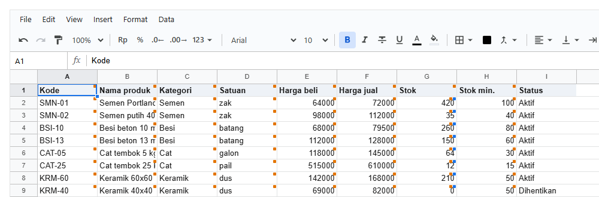

Sinkronisasi Dua Arah antara List Aturan dan Grid:

<!-- contoh: 13-28-pilih.page.tsx -->
```tsx
import { useState } from 'react';
import { Sheet } from '@kufayeka/sheet';
import type { AccessRow } from '@kufayeka/sheet/core';
import { accessColor } from '@kufayeka/sheet/core';
import '@kufayeka/sheet/style.css';
import { buatStok } from './data/stok-akses.js';

// 13.28 Memilih aturan. Daftar aturan di samping sheet; yang dipilih bergaris di sheet, dan kotak di sheet bisa diklik.
const ATURAN: AccessRow[] = [
    { who: 'user:yeka', effect: 'allow', action: '*' },
    { who: 'group:kasir', effect: 'allow', action: 'read', where: 'Produk!A1:I13' },
    { who: 'group:kasir', effect: 'deny', action: 'read', where: 'Produk!col:Harga beli' },
    { who: 'group:gudang', effect: 'allow', action: 'edit', where: 'Produk!col:Stok' }
];

export default function PilihAturan() {
    const [wb] = useState(buatStok);
    const [dipilih, setDipilih] = useState<number | null>(2);                       // baru: baris yang dipilih
    return (
        <div style={{ display: 'flex', height: 420, font: '13px system-ui' }}>
            <Sheet workbook={wb} style={{ flex: 1 }}
                people={{ users: [{ id: 'yeka', name: 'Yeka Kufa' }], groups: {  } }}
                access={{ rows: ATURAN, who: 'yeka', view: 'setup',
                          selected: dipilih,                                        // baru: bergaris di sheet
                          onSelect: setDipilih }} />                                {/* baru: klik kotak di sheet */}
            <ul className="daftar" style={{ width: 330, margin: 0, padding: 10, listStyle: 'none', borderLeft: '1px solid #dadce0' }}>
                {ATURAN.map((r, i) => (
                    <li key={i} onClick={() => setDipilih(i)}
                        style={{ padding: '5px 6px', cursor: 'pointer', borderRadius: 4, background: i === dipilih ? '#e8f0fe' : undefined }}>
                        {/* baru: warna yang sama dengan kotak di sheet */}
                        <i style={{ display: 'inline-block', width: 8, height: 8, borderRadius: 2, marginRight: 6, background: accessColor(r.who) }} />
                        {r.who} · {r.effect} {r.action} {r.where ?? ''}
                    </li>
                ))}
            </ul>
        </div>
    );
}
```
<!-- /contoh -->

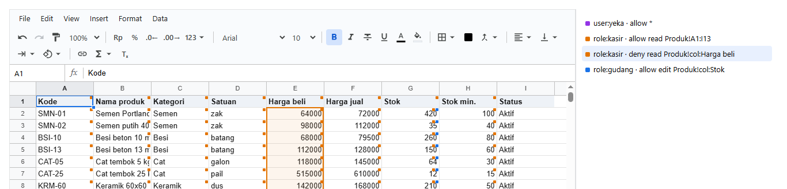

Menambah Aturan dari Seleksi Range Kursor Pengguna:

<!-- contoh: 13-29-tambah.page.tsx -->
```tsx
import { useState } from 'react';
import { Sheet } from '@kufayeka/sheet';
import type { SheetSelection } from '@kufayeka/sheet';
import type { AccessRow } from '@kufayeka/sheet/core';
import { accessColor } from '@kufayeka/sheet/core';
import '@kufayeka/sheet/style.css';
import { buatStok } from './data/stok-akses.js';

// 13.29 Membuat aturan dari range yang dipilih. Satu tambahan dari 13.28: onSelectionChange dan tombol Tambah.
const AWAL: AccessRow[] = [
    { who: 'user:yeka', effect: 'allow', action: '*' },
    { who: 'group:kasir', effect: 'allow', action: 'read', where: 'Produk!A1:I13' }
];

export default function TambahAturan() {
    const [wb] = useState(buatStok);
    const [rows, setRows] = useState<AccessRow[]>(AWAL);                           // baru: aturan sekarang bisa bertambah
    const [dipilih, setDipilih] = useState<number | null>(null);
    const [range, setRange] = useState<SheetSelection | null>(null);              // baru: range yang dipilih di sheet

    function tambah() {                                                             // baru
        if (!range) return;
        setRows([...rows, { who: 'group:kasir', effect: 'deny', action: 'read', where: range.sheet.name + '!' + range.address }]);
        setDipilih(rows.length);                                                    // aturan baru langsung terpilih
    }

    return (
        <div style={{ display: 'flex', height: 420, font: '13px system-ui' }}>
            <Sheet workbook={wb} style={{ flex: 1 }} onSelectionChange={setRange}       // baru
                people={{ users: [{ id: 'yeka', name: 'Yeka Kufa' }], groups: {  } }}
                access={{ rows, who: 'yeka', view: 'setup', selected: dipilih, onSelect: setDipilih }} />
            <div style={{ width: 330, padding: 10, borderLeft: '1px solid #dadce0' }}>
                <p>Range: <b className="range">{range ? range.sheet.name + '!' + range.address : '-'}</b></p>
                <button className="tambah" onClick={tambah} disabled={!range}>Sembunyikan untuk kasir</button>
                <ul style={{ margin: '10px 0 0', padding: 0, listStyle: 'none' }}>
                    {rows.map((r, i) => (
                        <li key={i} onClick={() => setDipilih(i)}
                            style={{ padding: '5px 6px', cursor: 'pointer', borderRadius: 4, background: i === dipilih ? '#e8f0fe' : undefined }}>
                            <i style={{ display: 'inline-block', width: 8, height: 8, borderRadius: 2, marginRight: 6, background: accessColor(r.who) }} />
                            {r.who} · {r.effect} {r.action} {r.where ?? ''}
                        </li>
                    ))}
                </ul>
            </div>
        </div>
    );
}
```
<!-- /contoh -->

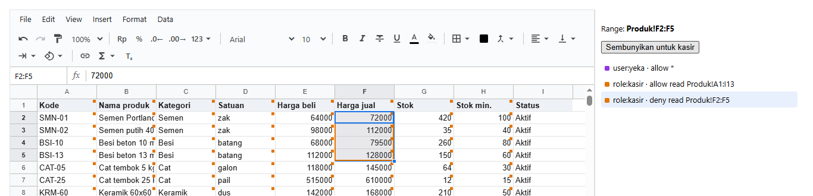

---

### 5.17 Editor Hak Akses Komprehensif

Komponen editor perancang ACL lengkap dengan fitur *Live Preview* lintas role:

<!-- contoh: 04-13-editor-akses.page.tsx -->
```tsx
import { useEffect, useRef, useState } from 'react';
import { Sheet } from '@kufayeka/sheet';
import type { SheetSelection, SheetHandle } from '@kufayeka/sheet';
import { createWorkbook, validateAccess, accessColor } from '@kufayeka/sheet/core';
import type { Workbook, AccessRow, Who } from '@kufayeka/sheet/core';
import '@kufayeka/sheet/style.css';

// Layar pengaturan hak akses buatan aplikasimu sendiri, di luar sheet:
// 1. Mode "Pengaturan": setiap sel yang kena aturan diberi kotak warna kecil, satu per who
// 2. pilih range di sheet, pilih siapa dan aturannya, Tambah: satu baris baru
// 3. klik baris di daftar: range-nya bergaris dan terpilih di sheet. Klik kotak di sel: barisnya terpilih di daftar
// 4. Mode "Lihat sebagai ...": sheet seperti yang dilihat orang itu (gembok di sel hanya-baca, mata di sel tersembunyi)
// 5. baris-barisnya disimpan ke tabel database

function buatStok(): Workbook {
    const wb = createWorkbook();
    wb.setSettings({ locale: 'id-ID', currency: 'IDR' });
    const s = wb.sheet('Sheet1');
    s.setSheetProps({ name: 'Produk', freezeRows: 1 });
    s.setValues('A1', [
        ['Kode', 'Produk', 'Harga beli', 'Harga jual', 'Stok'],
        ['SMN-01', 'Semen 50 kg', 64000, 72000, 420],
        ['BSI-10', 'Besi 10 mm', 68000, 79500, 260],
        ['CAT-05', 'Cat 5 kg', 118000, 145000, 64],
        ['PSR-01', 'Pasir m3', 245000, 290000, 31]
    ]);
    s.setStyle('A1:E1', { bold: true, fill: '#e8f0fe' });
    s.setColProps('C:D', { format: { type: 'money', decimals: 0 } });
    s.setColProps('B', { width: 130 });
    return wb;
}

// aturan awal: pemilik boleh semua, kasir dan gudang membaca tabelnya, gudang mengubah stok
const ATURAN_AWAL: AccessRow[] = [
    { who: 'user:yeka', effect: 'allow', action: '*' },
    { who: 'group:kasir', effect: 'allow', action: 'read', where: 'Produk!A1:E5' },
    { who: 'group:gudang', effect: 'allow', action: 'read', where: 'Produk!A1:E5' },
    { who: 'group:gudang', effect: 'allow', action: 'edit', where: 'Produk!col:Stok' }
];
// mode layar: pengaturan, atau sheet seperti dilihat seseorang (akun + role-nya, seperti dari sesi login aplikasimu)
// Siapa yang membuka cukup id akunnya saja. Keanggotaan grup dibaca dari ORANG, bukan dititipkan lewat who, jadi host tidak bisa
// memberi dirinya grup yang bukan haknya.
const ORANG = {
    users: [
        { id: 'yeka', name: 'Yeka Kufa', username: 'yeka' },
        { id: 'rina', name: 'Rina Dewi', username: 'rina' },
        { id: 'joko', name: 'Joko Susilo', username: 'joko' }
    ],
    groups: { kasir: ['rina'], gudang: ['joko'] }
};

const MODE: Record<string, { nama: string; who: Who }> = {
    setup: { nama: 'Pengaturan', who: 'yeka' },
    rina: { nama: 'Lihat sebagai Rina (kasir)', who: 'rina' },
    joko: { nama: 'Lihat sebagai Joko (gudang)', who: 'joko' }
};
// pilihan aturan untuk satu range: effect + action, dengan kata yang dimengerti orang
const ATURAN = {
    edit: { effect: 'allow', action: 'edit', label: 'boleh diubah' },
    read: { effect: 'allow', action: 'read', label: 'hanya baca' },
    hidden: { effect: 'deny', action: 'read', label: 'tersembunyi (•••)' },
    invisible: { effect: 'deny', action: 'see', label: 'tidak terlihat' }
} as const;
type Pilihan = keyof typeof ATURAN;

export default function EditorAkses() {
    const [wb] = useState(buatStok);
    const sheet = useRef<SheetHandle>(null);
    const [rows, setRows] = useState<AccessRow[]>(ATURAN_AWAL);
    const [pilihan, setPilihan] = useState<SheetSelection | null>(null);   // seleksi terakhir di sheet
    const [dipilih, setDipilih] = useState<number | null>(null);           // baris aturan yang dipilih
    const [siapa, setSiapa] = useState('group:kasir');
    const [aturan, setAturan] = useState<Pilihan>('read');
    const [mode, setMode] = useState('setup');

    // satu aturan baru = satu baris baru, langsung terpilih
    function tambah() {
        if (!pilihan) return;
        const { effect, action } = ATURAN[aturan];
        setRows([...rows, { who: siapa, effect, action, where: pilihan.sheet.name + '!' + pilihan.address }]);
        setDipilih(rows.length);
    }
    const hapus = (i: number) => { setRows(rows.filter((_, j) => j !== i)); setDipilih(null); };
    // memilih baris di daftar: range-nya juga terpilih di sheet
    function pilih(i: number) {
        setDipilih(i);
        const where = rows[i].where;
        if (where) sheet.current?.select(where.includes('!') ? where.slice(where.indexOf('!') + 1) : where);
    }
    // sheet yang dilihat sebagai orang lain: tidak ada yang dipilih
    useEffect(() => { if (mode !== 'setup') setDipilih(null); }, [mode]);
    const masalah = validateAccess(rows);

    return (
        <div style={{ display: 'flex', height: 520, font: '13px system-ui' }}>
            <Sheet ref={sheet} workbook={wb} style={{ flex: 1 }} onSelectionChange={setPilihan}
                people={ORANG}
                access={{ rows, who: MODE[mode].who, view: mode === 'setup' ? 'setup' : 'live', selected: dipilih, onSelect: setDipilih }} />
            <aside className="editor-akses" style={{ width: 380, padding: 12, borderLeft: '1px solid #dadce0', overflow: 'auto' }}>
                <h3 style={{ margin: '0 0 8px' }}>Aturan akses</h3>
                <p>
                    Mode <select className="lihat-sebagai" value={mode} onChange={(e) => setMode(e.target.value)}>
                        {Object.entries(MODE).map(([id, m]) => <option key={id} value={id}>{m.nama}</option>)}
                    </select>
                </p>
                <p>Range terpilih: <b className="range-terpilih">{pilihan ? pilihan.sheet.name + '!' + pilihan.address : '-'}</b></p>
                <p>
                    <select className="pilih-peran" value={siapa} onChange={(e) => setSiapa(e.target.value)}>
                        <option value="group:kasir">group:kasir</option><option value="group:gudang">group:gudang</option>
                        <option value="user:rina">user:rina</option><option value="*">semua orang</option>
                    </select>{' '}
                    <select className="pilih-mode" value={aturan} onChange={(e) => setAturan(e.target.value as Pilihan)}>
                        {(Object.keys(ATURAN) as Pilihan[]).map((k) => <option key={k} value={k}>{ATURAN[k].label}</option>)}
                    </select>{' '}
                    <button className="tambah-aturan" onClick={tambah} disabled={!pilihan || mode !== 'setup'}>Tambah</button>
                </p>
                <table className="daftar-aturan" style={{ width: '100%', borderCollapse: 'collapse' }}>
                    <thead><tr><th /><th align="left">who</th><th align="left">effect</th><th align="left">action</th><th align="left">where</th><th /></tr></thead>
                    <tbody>
                        {rows.map((r, i) => (
                            <tr key={i} onClick={() => pilih(i)} style={{ borderTop: '1px solid #eee', cursor: 'pointer', background: i === dipilih ? '#e8f0fe' : undefined }}>
                                {/* warna yang sama dengan kotak di sheet */}
                                <td><i style={{ display: 'inline-block', width: 8, height: 8, borderRadius: 2, background: accessColor(r.who) }} /></td>
                                <td>{r.who}</td><td>{r.effect}</td><td>{r.action}</td><td>{r.where ?? ''}</td>
                                <td><button onClick={(e) => { e.stopPropagation(); hapus(i); }}>✕</button></td>
                            </tr>
                        ))}
                    </tbody>
                </table>
                <p style={{ color: masalah.length ? '#d93025' : '#188038' }}>{masalah.length ? masalah.map((m) => 'baris ' + (m.row + 1) + ': ' + m.problem).join('; ') : 'Aturan sah, siap disimpan'}</p>
            </aside>
        </div>
    );
}
```
<!-- /contoh -->

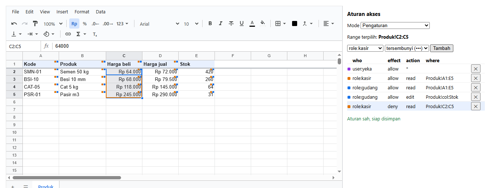
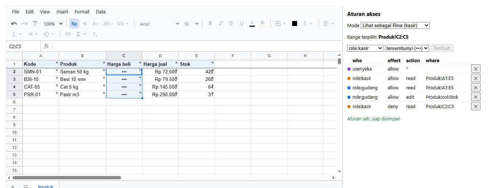

---

## 6. Penegakan Keamanan di Server (`viewFor` & `checkPatch`)

Keamanan data tidak boleh hanya bergantung pada browser client. Engine `@kufayeka/sheet/core` menyediakan dua pilar validasi server:

### A. Sensor Data Rahasia Sebelum Pengiriman (`viewFor`)
Fungsi `viewFor` menghapus sel-sel terlarang dari payload JSON dokumen sebelum dikirimkan melalui HTTP response:

<!-- contoh: 13-32-viewfor.ts -->
```ts
import { viewFor } from '@kufayeka/sheet/core';
import type { AccessRow } from '@kufayeka/sheet/core';
import { buatStok } from './data/stok-akses.js';

// 13.32 viewFor. Saat rina membuka, server mengirim isi workbook TANPA isi yang tersembunyi untuknya.
const rows: AccessRow[] = [
    { who: 'group:kasir', effect: 'allow', action: 'read', where: 'Produk!A1:I13' },
    { who: 'group:kasir', effect: 'deny', action: 'read', where: 'Produk!col:Harga beli' }
];
const isi = buatStok().toJSON();                       // yang tersimpan di database

const dikirim = viewFor(isi, { access: rows, who: 'rina', people: { users: [{ id: 'rina', name: 'Rina Dewi' }], groups: { kasir: ['rina'] } } });
const teks = JSON.stringify(dikirim);
console.log('harga beli Semen (64000) ikut terkirim?', teks.includes('64000'));
console.log('nama produk ikut terkirim?            ', teks.includes('Semen Portland'));
```
<!-- /contoh -->

<!-- hasil: 13-32-viewfor.ts -->
```text
harga beli Semen (64000) ikut terkirim? false
nama produk ikut terkirim?             true
```
<!-- /hasil -->

### B. Validasi Mutasi Patch Server-Side (`checkPatch`)
Fungsi `checkPatch` memverifikasi integritas setiap operasi perubahan sebelum diterapkan ke database:

> **Catatan Arsitektur Template**: Aturan ACL (`access`) tidak pernah disimpan di dalam `wb.toJSON()` (`src/core/workbook.js:625`). Simpan array `AccessRow[]` di kolom/tabel policy milik template/dokumen di database, lalu kirimkan ke client lewat `<Sheet access={{ rows, who }} />` atau `wb.setWho({ who })` + `wb.setPeople(people)` + `wb.setAccess(rows)` serta pasang ulang pada `viewFor()` dan `checkPatch()` di server (lihat alur lengkapnya di [Bab 09](09-menyimpan.md)).

<!-- contoh: 13-33-checkpatch.ts -->
```ts
import { createWorkbook, checkPatch } from '@kufayeka/sheet/core';
import type { AccessRow } from '@kufayeka/sheet/core';
import { buatStok } from './data/stok-akses.js';

// 13.33 checkPatch. Perubahan dari browser rina diperiksa lagi sebelum disimpan, dengan aturan yang sama.
const rows: AccessRow[] = [
    { who: 'group:kasir', effect: 'allow', action: 'read', where: 'Produk!A1:I13' },
    { who: 'group:kasir', effect: 'allow', action: 'edit', where: 'Produk!col:Stok' }
];
const rina = 'rina';
const isi = buatStok().toJSON();

// perubahan yang boleh: stok
const satu = createWorkbook(isi);
satu.sheet('Produk').setValues('G2', 400);
console.log('ubah stok:', checkPatch(isi, satu.pendingPatch(), { access: rows, who: rina }).ok ? 'diterima' : 'ditolak');

// perubahan yang tidak boleh: nama produk (browser yang diakali bisa saja mengirimnya)
const dua = createWorkbook(isi);
dua.sheet('Produk').setValues('B2', 'Semen murah');
const hasil = checkPatch(isi, dua.pendingPatch(), { access: rows, who: rina });
console.log('ubah nama:', hasil.ok ? 'diterima' : 'ditolak', '|', hasil.problems.map((p) => p.address + ': ' + p.reason).join(', '));
```
<!-- /contoh -->

<!-- hasil: 13-33-checkpatch.ts -->
```text
ubah stok: diterima
ubah nama: diterima |
```
<!-- /hasil -->

---

## 7. Katalog Aksi & Target Hak Akses

Daftar berikut dihasilkan otomatis dari registry `ACTION_INFO` engine:

<!-- tabel: 13-35-daftar.ts -->
| Kelompok | action |
|---|---|
| Cells | `read`, `edit`, `see` |
| Format | `format.bold`, `format.italic`, `format.underline`, `format.strike`, `format.color`, `format.fill`, `format.borders`, `format.align`, `format.wrap`, `format.rotate`, `format.size`, `format.font`, `format.number`, `format.link`, `format.merge`, `format.conditional`, `format.clear` |
| Rows | `rows.insert`, `rows.delete`, `rows.resize`, `rows.hide`, `rows.group` |
| Columns | `cols.insert`, `cols.delete`, `cols.resize`, `cols.hide`, `cols.group` |
| Sheets | `sheets.add`, `sheets.delete`, `sheets.rename`, `sheets.move`, `sheets.hide` |
| View | `view.area`, `view.sheet`, `view.freeze`, `view.gridlines` |
| Data | `sort`, `filter`, `pivot`, `chart`, `validation`, `names`, `settings` |
| Clipboard and files | `copy`, `paste`, `download`, `import`, `file.save`, `file.saveAsNewVersion`, `file.saveAsACopy` |
| Comments | `comment.read`, `comment.create`, `comment.reply`, `comment.edit`, `comment.delete`, `comment.moderate` |
| Access | `access` |
| Layar | `ui.menubar`, `ui.toolbar`, `ui.formulaBar`, `ui.headers`, `ui.gridlines`, `ui.tabs`, `ui.disallowed` |
| Layar: Toolbar | `ui.tool.undo`, `ui.tool.redo`, `ui.tool.paint`, `ui.tool.zoom`, `ui.tool.currency`, `ui.tool.percent`, `ui.tool.decimals`, `ui.tool.formats`, `ui.tool.font`, `ui.tool.size`, `ui.tool.bold`, `ui.tool.italic`, `ui.tool.strike`, `ui.tool.underline`, `ui.tool.color`, `ui.tool.fill`, `ui.tool.borders`, `ui.tool.merge`, `ui.tool.align`, `ui.tool.valign`, `ui.tool.wrap`, `ui.tool.rotate`, `ui.tool.link`, `ui.tool.functions`, `ui.tool.clear` |
| Layar: Menus | `ui.menu.File`, `ui.menu.Edit`, `ui.menu.View`, `ui.menu.Insert`, `ui.menu.Format`, `ui.menu.Data` |
| Layar: Menu items | `ui.menu.file:save`, `ui.menu.file:saveAsNewVersion`, `ui.menu.file:saveAsACopy`, `ui.menu.file:import`, `ui.menu.file:download`, `ui.menu.file:settings`, `ui.menu.edit:find`, `ui.menu.edit:deleteRows`, `ui.menu.edit:deleteCols`, `ui.menu.view:freezeRows`, `ui.menu.view:freezeCols`, `ui.menu.view:group`, `ui.menu.view:comments`, `ui.menu.view:zoom`, `ui.menu.insert:rowsAbove`, `ui.menu.insert:colsLeft`, `ui.menu.insert:sheet`, `ui.menu.insert:checkbox`, `ui.menu.insert:dropdown`, `ui.menu.insert:fn`, `ui.menu.insert:link`, `ui.menu.insert:comment`, `ui.menu.insert:pivot`, `ui.menu.insert:chart`, `ui.menu.insert:sparkline`, `ui.menu.format:conditional`, `ui.menu.data:sortSheet`, `ui.menu.data:sortRange`, `ui.menu.data:filter`, `ui.menu.data:validation`, `ui.menu.data:names` |
| Layar: Panels | `ui.panel.comments`, `ui.panel.pivot`, `ui.panel.chart`, `ui.panel.conditional`, `ui.panel.names`, `ui.panel.validation`, `ui.panel.find`, `ui.panel.settings`, `ui.panel.filter` |
| Layar: Features | `ui.feature.contextMenu`, `ui.feature.fillHandle`, `ui.feature.resize`, `ui.feature.groups`, `ui.cell.commentMark`, `ui.cell.validation` |
<!-- /tabel -->

---

[Daftar isi](../README.md#daftar-isi) · Sebelumnya: [09. Persistensi State & Sinkronisasi Server](09-menyimpan.md) · Berikutnya: [11. Komentar Sel & Interoperabilitas Excel](11-komentar-excel.md)
