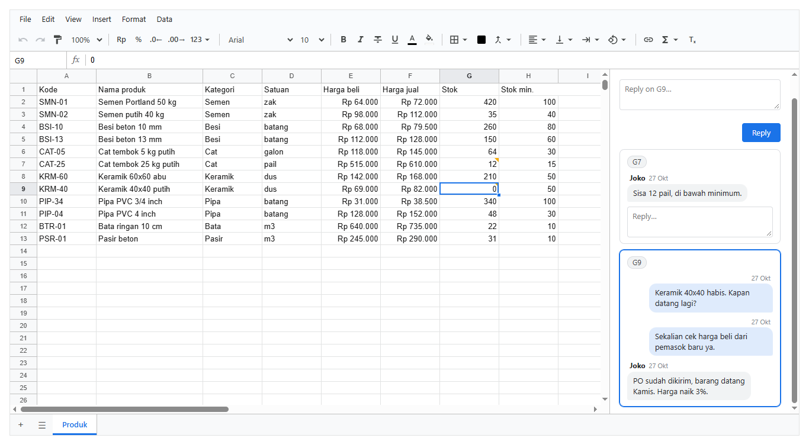

# 11. Komentar dan Excel

[Daftar isi](../README.md#daftar-isi) · Sebelumnya: [10. Hak akses](10-hak-akses.md) · Berikutnya: [12. Performa dan referensi](12-referensi.md)

Bab ini membahas komentar di sel, lalu impor dan ekspor Excel dan CSV.

- [11.1 Contoh: stok yang habis](#111-contoh-stok-yang-habis)
- [11.2 Cara kerjanya](#112-cara-kerjanya)
- [11.3 Contoh](#113-contoh)
- [11.4 Yang ikut dan yang tidak](#114-yang-ikut-dan-yang-tidak)

## 11.1 Contoh: stok yang habis

<!-- contoh: 14-komentar.js -->
```js
import { createWorkbook, viewFor } from '@kufayeka/sheet/core';
import { PRODUK, KOLOM_PRODUK } from './data/toko.js';

// Diskusi di sel: manajer bertanya soal stok keramik yang habis, gudang menjawab, manajer menutup diskusinya.
export function buatDiskusi() {
    const doc = (() => {
        const w = createWorkbook();
        w.setSettings({ locale: 'id-ID', currency: 'IDR' });
        w.setSheetProps('Sheet1', { name: 'Produk' });
        w.setValues('Produk', 'A1', [KOLOM_PRODUK, ...PRODUK]);
        w.setColProps('Produk', 'E:F', { format: { type: 'money', decimals: 0 } });
        w.setColProps('Produk', 'B', { width: 180 });
        return w.toJSON();
    })();
    // setiap orang membuka workbook-nya sendiri dengan user-nya: nama penulis dan waktu tercatat di komentar
    const dewi = createWorkbook(doc, { user: { id: 'user:dewi', name: 'Dewi' }, now: () => new Date(Date.UTC(2026, 9, 27, 9, 15)) });
    const t = dewi.addComment('Produk', 'G9', 'Keramik 40x40 habis. Kapan datang lagi?');
    dewi.replyComment('Produk', t.thread, 'Sekalian cek harga beli dari pemasok baru ya.');
    const joko = createWorkbook(dewi.toJSON(), { user: { id: 'user:joko', name: 'Joko' }, now: () => new Date(Date.UTC(2026, 9, 27, 10, 2)) });
    joko.replyComment('Produk', t.thread, 'PO sudah dikirim, barang datang Kamis. Harga naik 3%.');
    joko.addComment('Produk', 'G7', 'Sisa 12 pail, di bawah minimum.');
    return { doc: joko.toJSON(), thread: t.thread };
}

const { doc, thread } = buatDiskusi();
const dewi = createWorkbook(doc, { user: { id: 'user:dewi', name: 'Dewi' } });
const tampil = (x) => `${wantedAt(x)}: ` + x.items.map((i) => i.by.name + ' ' + i.at.slice(11, 16) + ' "' + i.text + '"').join(' / ');
const wantedAt = (x) => (x.at ? dewi.address(x.at.r, x.at.c) : '(sel terhapus)');
for (const x of dewi.comments('Produk')) console.log(tampil(x));
console.log('G9 punya komentar:', dewi.hasComment('Produk', 'G9'), '| G2:', dewi.hasComment('Produk', 'G2'));

// diskusi mengikuti selnya: baris disisipkan di atas, komentar ikut turun
dewi.insertRows('Produk', '2');
console.log('setelah sisip   :', dewi.comments('Produk').map(wantedAt).join(', '));

// hanya penulis yang boleh mengubah atau menghapus komentarnya. Dari kode, yang tidak boleh melempar error (di layar tombolnya tidak ada)
const punyaJoko = dewi.comments('Produk')[0].items[2];
try { dewi.editComment('Produk', thread, punyaJoko.id, 'diubah orang lain'); } catch (err) { console.log('ubah milik Joko :', err.message); }

// komentar ikut tersimpan di workbook, dan viewFor tidak mengirimnya ke orang tanpa hak comment.read
const access = [{ who: '*', effect: 'allow', action: 'read' }];   // tamu boleh membaca sel, tapi tidak punya comment.read
console.log('dikirim ke tamu :', createWorkbook(viewFor(dewi.toJSON(), { access, who: 'tamu' })).comments('Produk').length, 'diskusi');
```
<!-- /contoh -->

<!-- hasil: 14-komentar.js -->
```text
G9: Dewi 09:15 "Keramik 40x40 habis. Kapan datang lagi?" / Dewi 09:15 "Sekalian cek harga beli dari pemasok baru ya." / Joko 10:02 "PO sudah dikirim, barang datang Kamis. Harga naik 3%."
G7: Joko 10:02 "Sisa 12 pail, di bawah minimum."
G9 punya komentar: true | G2: false
setelah sisip   : G10, G8
ubah milik Joko : only the one who wrote a comment can change it
dikirim ke tamu : 0 diskusi
```
<!-- /hasil -->

Di layar, komentar ada di panel samping (View → Comments, Insert → Comment, atau Ctrl+Alt+M). Sel yang punya diskusi terbuka diberi tanda di pojoknya. Panel
memisahkan diskusi yang masih terbuka dan yang sudah selesai, dan setiap diskusi bisa dibalas di tempat:



<!-- contoh: 14-komentar.page.js -->
```jsx
import { useState } from 'react';
import { Sheet } from '@kufayeka/sheet';
import { createWorkbook } from '@kufayeka/sheet/core';
import '@kufayeka/sheet/style.css';
import { buatDiskusi } from './14-komentar.js';

// Dewi membuka workbook yang sudah berisi diskusi. Komentar ada di panel samping (View > Comments), sel berkomentar diberi tanda di pojoknya.
export default function DiskusiStok() {
    const [wb] = useState(() => createWorkbook(buatDiskusi().doc));
    return <div style={{ height: 720 }}><Sheet workbook={wb} user={{ id: 'user:dewi', name: 'Dewi' }} /></div>;
}
```
<!-- /contoh -->

## 11.2 Cara kerjanya

- **Penulis** diambil dari opsi `user` di `createWorkbook(doc, { user: { id, name } })`, atau dari prop `user` di `<Sheet>`. Waktunya dari jam workbook
  (opsi `now`, bawaannya jam komputer).
- **Diskusi mengikuti selnya.** Baris disisipkan atau di-sort, diskusinya ikut. Kalau baris atau kolomnya dihapus, diskusinya tetap ada dengan `at: null`,
  dan kembali ke selnya kalau penghapusan itu di-undo.
- **Seperti chat.** Satu sel punya satu diskusi. Komentar Anda sendiri ada di kanan tanpa nama, komentar orang lain di kiri dengan namanya. Tidak ada
  status buka atau tutup: diskusi selesai kalau komentarnya dihapus.
- **Hanya penulisnya** yang boleh mengubah atau menghapus komentar. Pengecualiannya orang dengan hak `comment.moderate` kalau ada aturan akses. Dari kode,
  percobaan yang tidak boleh melempar error, sedangkan di layar tombolnya tidak ditampilkan. Menghapus komentar pertama sebuah diskusi menghapus seluruh
  diskusinya.
- **Hak akses** ([bab 10](10-hak-akses.md)): `comment.read`, `comment.create`, `comment.reply`, `comment.edit`, `comment.delete`,
  `comment.moderate`. Tanpa aturan akses, semua orang boleh membaca dan menulis. Dengan aturan akses, orang tanpa `comment.read` tidak melihat panelnya, dan `viewFor`
  tidak mengirim komentar kepadanya.

| Fungsi | Artinya |
|---|---|
| `addComment(sel, teks)` | diskusi baru di sel itu, atau balasan kalau sel itu sudah punya diskusi terbuka. Mengembalikan `{ thread, item }` |
| `replyComment(thread, teks)` | balas sebuah diskusi. Mengembalikan id balasan |
| `editComment(thread, item, teks)` | ubah teks komentar sendiri. Komentarnya diberi `edited` |
| `deleteComment(thread, item)` | hapus komentar sendiri |
| `comments()` | semua diskusi sheet: `[{ id, items: [{ id, by: { id, name }, text, at, edited? }], at: { r, c } }]` |
| `commentAt(sel)` | diskusi terbuka di sel itu, atau `null` |
| `hasComment(sel)` | apakah sel itu punya diskusi terbuka (cepat, untuk menggambar tanda) |

Semua fungsi di atas dipanggil dari handle sheet (`wb.sheet('Produk').addComment('G9', ...)`), atau dari `wb` dengan nama sheet di depan. Setiap
panggilan adalah satu perubahan yang bisa di-undo.

## 11.3 Contoh

<!-- contoh: 15-excel.js -->
```js
import { exportXlsx, importXlsx, importXlsxInto, exportCsv, importCsvInto, parseCsv, createWorkbook } from '@kufayeka/sheet/core';
import { PRODUK, KOLOM_PRODUK } from './data/toko.js';

// ---- ke Excel: daftar stok dengan rumus, format rupiah, conditional formatting, named range, dan judul yang dibekukan
const wb = createWorkbook();
wb.setSettings({ locale: 'id-ID', currency: 'IDR' });
wb.setSheetProps('Sheet1', { name: 'Stok', freezeRows: 1 });
wb.setValues('Stok', 'A1', [[...KOLOM_PRODUK, 'Margin'], ...PRODUK.map((p, i) => [...p, `=(F${i + 2}-E${i + 2})/F${i + 2}`])]);
wb.setColProps('Stok', 'E:F', { format: { type: 'money', decimals: 0 } });
wb.setColProps('Stok', 'I', { format: { type: 'percent', decimals: 1 } });
wb.addConditional('Stok', 'G2:G13', { op: 'eq', a: 0, style: { fill: '#d93025', color: '#ffffff', bold: true } });
wb.addName('Stok', 'Stok', 'G2:G13');
wb.setValues('Stok', 'K1', [['Total stok', '=SUM(Stok)']]);
const bytes = exportXlsx(wb);                              // Uint8Array: kirim sebagai unduhan, lampiran email, atau simpan ke storage
console.log('file xlsx      :', bytes.length > 4000 ? 'lebih dari 4 KB' : bytes.length + ' byte', '| diawali', String.fromCharCode(bytes[0], bytes[1]), '(zip)');

// ---- dari Excel: file yang sama dibaca lagi, seperti file dari laptop orang
// .xlsx tidak menyimpan locale: berikan pengaturan workbook barunya sendiri
const { workbook: balik, warnings } = await importXlsx(bytes, { settings: { locale: 'id-ID', currency: 'IDR' } });
const s = balik.sheet('Stok');
console.log('rumus I2       :', s.input('I2'), '=', s.display('I2').text);
console.log('format E2      :', s.display('E2').text, '| beku', s.sheetProps().freezeRows, 'baris');
console.log('named range    :', balik.names().map((n) => n.name + ' = ' + n.ref).join(', '), '| K1:L1', s.value('K1'), s.value('L1'));
console.log('conditional    :', s.conditionals().length, 'aturan | G9 digambar', JSON.stringify(s.shownStyle('G9')));
console.log('peringatan     :', warnings.length ? warnings.join(' / ') : 'tidak ada');

// ditambahkan ke workbook yang sudah ada, sebagai sheet baru (nama yang sudah dipakai diberi nomor)
const laporan = createWorkbook();
const masuk = await importXlsxInto(laporan, bytes);
console.log('masuk ke wb lain:', laporan.sheetIds().map((id) => laporan.sheetProps(id).name).join(', '), '| sheet baru', masuk.sheetIds.length);

// ---- CSV keluar: teks seperti yang tampil di sel. Titik koma untuk Excel berbahasa Indonesia, yang memakai koma sebagai desimal
const csv = exportCsv(wb, 'Stok', { delimiter: ';' });
console.log('CSV baris 1-2  :', csv.split('\r\n').slice(0, 2).join(' | '));

// ---- CSV masuk: ekspor pesanan dari marketplace. Setiap field dibaca seperti diketik di locale workbook
const dariMarketplace = 'No Pesanan;Tanggal;Produk;Qty;Harga\r\nINV/2610/001;26/10/2026;"Semen Portland 50 kg; zak";40;72.000\r\nINV/2610/002;26/10/2026;Pipa PVC 4 inch;3;152.000,50';
console.log('parseCsv       :', JSON.stringify(parseCsv(dariMarketplace)[1]));
const toko = createWorkbook();
toko.setSettings({ locale: 'id-ID', currency: 'IDR' });
const hasil = importCsvInto(toko, dariMarketplace, 'Marketplace');
const m = toko.sheet('Marketplace');
console.log('sheet baru     :', toko.sheetProps(hasil.sheetIds[0]).name, '| B2', m.value('B2'), '(tanggal) | E3', m.value('E3'), '(angka) | C2', JSON.stringify(m.value('C2')));
```
<!-- /contoh -->

<!-- hasil: 15-excel.js -->
```text
file xlsx      : lebih dari 4 KB | diawali PK (zip)
rumus I2       : =(F2-E2)/F2 = 11,1%
format E2      : Rp 64.000 | beku 1 baris
named range    : Stok = Stok!G2:G13 | K1:L1 Total stok 1592
conditional    : 1 aturan | G9 digambar {"bold":true,"color":"#ffffff","fill":"#d93025"}
peringatan     : tidak ada
masuk ke wb lain: Sheet1, Stok | sheet baru 1
CSV baris 1-2  : Kode;Nama produk;Kategori;Satuan;Harga beli;Harga jual;Stok;Stok min.;Margin;;Total stok;1592 | SMN-01;Semen Portland 50 kg;Semen;zak;Rp 64.000;Rp 72.000;420;100;11,1%;;;
parseCsv       : ["INV/2610/001","26/10/2026","Semen Portland 50 kg; zak","40","72.000"]
sheet baru     : Marketplace | B2 46321 (tanggal) | E3 152000.5 (angka) | C2 "Semen Portland 50 kg; zak"
```
<!-- /hasil -->

| Fungsi | Artinya |
|---|---|
| `exportXlsx(wb)` | isi file `.xlsx` sebagai `Uint8Array` |
| `importXlsx(bytes, opsi?)` | workbook baru dari file: `{ workbook, warnings }`. `opsi` sama dengan `createWorkbook`, ditambah `settings` untuk locale dan mata uang |
| `importXlsxInto(wb, bytes)` | sheet-sheet file ditambahkan ke workbook yang sudah ada, sebagai satu perubahan: `{ sheetIds, warnings }` |
| `exportCsv(wb, sheet, { delimiter })` | satu sheet sebagai teks CSV, berisi teks seperti yang tampil di sel. Pemisah bawaannya koma |
| `parseCsv(teks, pemisah?)` | CSV menjadi array baris. Pemisah ditebak dari baris pertama (koma, titik koma, atau tab) kalau tidak diberikan |
| `importCsvInto(wb, teks, nama)` | CSV sebagai sheet baru. Setiap field dibaca seperti diketik di locale workbook: `152.000,50` menjadi angka, `26/10/2026` menjadi tanggal |
| `codeOfFormat(format, settings)` | kode format Excel untuk sebuah format (`'"Rp" #,##0'`), untuk alat sendiri |

**Mengunduh di browser:**

```js
const blob = new Blob([exportXlsx(wb)], { type: 'application/vnd.openxmlformats-officedocument.spreadsheetml.sheet' });
const a = Object.assign(document.createElement('a'), { href: URL.createObjectURL(blob), download: 'Stok.xlsx' });
a.click();
URL.revokeObjectURL(a.href);
```

**Membuka file yang dipilih orang:** `importXlsx(new Uint8Array(await file.arrayBuffer()))`.

## 11.4 Yang ikut dan yang tidak

| Bagian | Ke `.xlsx` | Dari `.xlsx` |
|---|---|---|
| nilai, rumus (termasuk antar sheet), tanggal | ya | ya. Fungsi yang tidak dikenal disebut di `warnings` |
| format angka, uang, persen, tanggal | ya | ya |
| gaya: huruf, warna, latar, perataan, border, teks turun | ya | ya |
| merge, lebar kolom, tinggi baris, baris dan kolom tersembunyi | ya | ya |
| baris dan kolom yang dibekukan | ya | ya |
| named range | ya | ya |
| conditional formatting | ya | ya. Jenis yang tidak ada di sini (data bar, ikon) dilewati dan disebut di `warnings` |
| filter | ya | ya. Filter warna dan top 10 disebut di `warnings` |
| grup baris dan kolom | ya | ya |
| pivot table | sebagai nilai | sebagai nilai |
| validasi data | ya: daftar, daftar dari range, checkbox (sebagai daftar TRUE/FALSE), angka, tanggal, panjang teks, teks memuat. Email dan URL tidak, karena Excel tidak punya jenis itu | ya. Jenis lain (rumus bebas) disebut di `warnings` |
| komentar | ya, sebagai *note* Excel: satu note per diskusi, satu baris per komentar (`Dewi: …`) | ya, dibaca balik menjadi diskusi dengan penulis per baris |
| gambar dan grafik | tidak ada di library ini | dilewati, disebut di `warnings` |
| locale | tidak disimpan oleh Excel | beri lewat `settings` |
| aturan, tipe kolom, policy | tidak ikut: itu milik aplikasimu | |

Tampilkan `warnings` kepada orang yang mengimpor, supaya ia tahu apa yang tidak terbawa dari filenya.

**CSV** hanya membawa teks. `exportCsv` menulis yang tampil di sel (`Rp 64.000`, `420 zak`), dan isi sel yang tersembunyi untuk orang itu ditulis
kosong. Untuk Excel berbahasa Indonesia, yang memakai koma sebagai tanda desimal, pakai `{ delimiter: ';' }`.

[Daftar isi](../README.md#daftar-isi) · Sebelumnya: [10. Hak akses](10-hak-akses.md) · Berikutnya: [12. Performa dan referensi](12-referensi.md)
