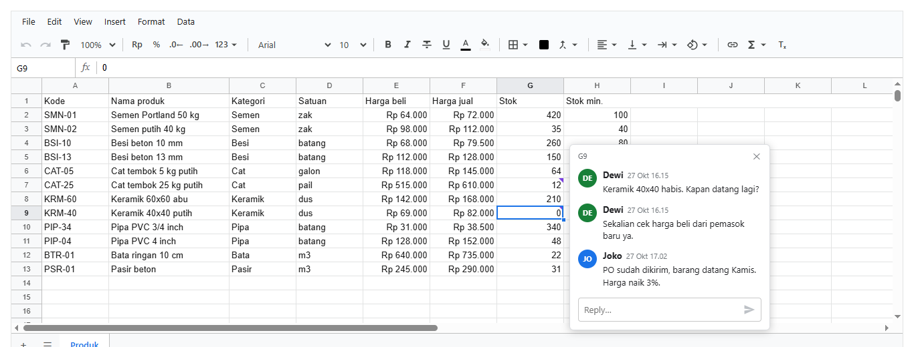
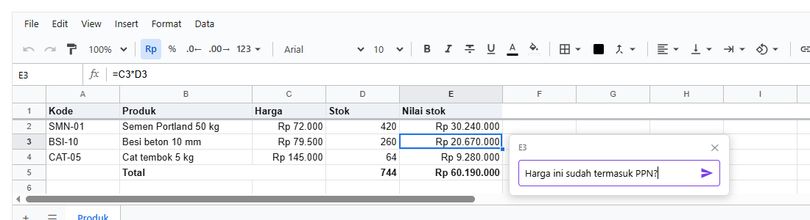
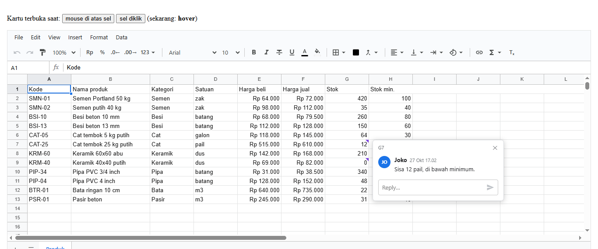
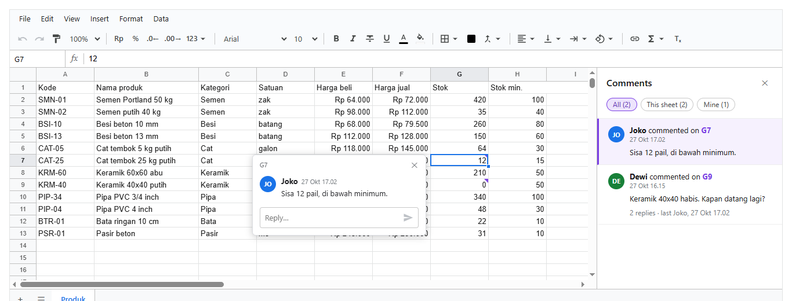
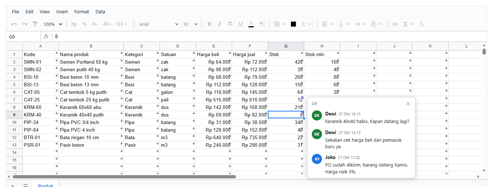

# 11. Komentar Sel & Interoperabilitas Excel/CSV

[Daftar isi](../README.md#daftar-isi) · Sebelumnya: [10. Kontrol Akses & Perizinan (ACL/RBAC)](10-hak-akses.md) · Berikutnya: [12. Visualisasi Data & Dashboard](12-dashboard.md)

Bab ini membedah fitur kolaborasi dan interoperabilitas data pada `@kufayeka/sheet`: sistem komentar sel berutas (*Threaded Cell Comments*), manajemen hak akses diskusi, interaksi hover/klik, panel samping komentar, serta import dan export dokumen format Microsoft Excel (`.xlsx`) dan CSV dengan kepatuhan locale.

---

## 1. Arsitektur Komentar Sel Berutas (Threaded Comments)

Komentar pada `@kufayeka/sheet` mengadopsi model diskusi terstruktur (*threaded conversation*):

```text
┌────────────────────────────────────────────────────────┐
│             Sel Target Koordinat (misal: G9)           │
└───────────────────────────┬────────────────────────────┘
                            │ memiliki 1 thread diskusi
                            ▼
┌────────────────────────────────────────────────────────┐
│  Komentar Induk: { id, author, time, body: "..." }     │
└───────────────┬────────────────────────┬───────────────┘
                │                        │
                ▼                        ▼
┌───────────────────────────────┐ ┌───────────────────────────────┐
│ Balasan 1:                    │ │ Balasan 2:                    │
│ { author: "PM", body: "..." } │ │ { author: "Site", body: "..."}│
└───────────────────────────────┘ └───────────────────────────────┘
                │                        │
                └───────────────┬────────┘
                                │
                                ▼
┌────────────────────────────────────────────────────────┐
│           Status Thread: "Open" atau "Resolved"        │
└────────────────────────────────────────────────────────┘
```

- **Threaded**: Setiap sel dapat memiliki satu utas diskusi yang terdiri dari komentar awal dan rangkaian balasan.
- **Identitas Terikat**: Identitas penulis diambil secara otomatis dari properti `user: { id, name }` pada saat inisialisasi workbook atau prop `<Sheet user={...} />`.
- **Indikator Visual**: Sel yang memiliki diskusi aktif ditandai segitiga ungu di sudut kanan atas.



---

## 2. Implementasi Panduan Langkah demi Langkah

---

### 2.1 Pembuatan Komentar Pertama

Membuat thread komentar baru pada sel via menu konteks atau interaksi pengguna:

<!-- contoh: 11-03-tulis.page.tsx -->
```tsx
import { useState } from 'react';
import { Sheet } from '@kufayeka/sheet';
import { createWorkbook } from '@kufayeka/sheet/core';
import '@kufayeka/sheet/style.css';
import { buatProduk } from './data/produk.js';

// 11.3 Komentar pertama: Sheet tahu siapa yang membuka lewat prop user. Pilih sel, tekan Ctrl+Alt+M, tulis, Ctrl+Enter.
export default function Halaman() {
    const [wb] = useState(() => createWorkbook(buatProduk().toJSON()));
    // baru: user, nama dan id orang yang membuka sheet. Namanya tercatat di setiap komentar yang ia tulis
    return <div style={{ height: 300 }}><Sheet workbook={wb} user={{ id: 'user:dewi', name: 'Dewi' }} /></div>;
}
```
<!-- /contoh -->



---

### 2.2 Membaca dan Membalas Diskusi (Replies & Resolve)

Pengguna lain dapat membaca komentar yang ada dan menambahkan balasan berurutan:

<!-- contoh: 11-04-diskusi.page.tsx -->
```tsx
import { useState } from 'react';
import { Sheet } from '@kufayeka/sheet';
import { createWorkbook } from '@kufayeka/sheet/core';
import '@kufayeka/sheet/style.css';
import { buatDiskusi } from './data/diskusi.js';

// 11.4 Workbook yang sudah berisi diskusi: Dewi bertanya soal stok keramik di G9, Joko dari gudang menjawab, dan Joko menulis catatan di G7.
export default function Halaman() {
    // baru: isinya dibuat oleh orang-orang lain sebelumnya. Dewi yang membuka, jadi komentar Dewi tanpa tanda "orang lain"
    const [wb] = useState(() => createWorkbook(buatDiskusi().doc));
    return <div style={{ height: 520 }}><Sheet workbook={wb} user={{ id: 'user:dewi', name: 'Dewi' }} /></div>;
}
```
<!-- /contoh -->


---

### 2.3 Mode Pemicu: Hover vs Click Trigger

Kartu komentar dapat dikonfigurasi agar muncul saat kursor mouse melintas (*hover preview*) atau hanya saat sel diklik aktif:

<!-- contoh: 11-05-buka.page.tsx -->
```tsx
import { useState } from 'react';
import { Sheet } from '@kufayeka/sheet';
import { createWorkbook } from '@kufayeka/sheet/core';
import '@kufayeka/sheet/style.css';
import { buatDiskusi } from './data/diskusi.js';

// 11.5 Kartu muncul saat mouse di atas sel bertanda (hover), atau hanya saat sel diklik (click). Tombol di atas menggantinya.
export default function Halaman() {
    const [wb] = useState(() => createWorkbook(buatDiskusi().doc));
    const [cara, setCara] = useState<'hover' | 'click'>('hover');
    return (
        <div>
            <p>
                Kartu terbuka saat: <button className="hover" onClick={() => setCara('hover')}>mouse di atas sel</button>{' '}
                <button className="click" onClick={() => setCara('click')}>sel diklik</button> (sekarang: <b>{cara}</b>)
            </p>
            {/* baru: comments.open */}
            <div style={{ height: 520 }}><Sheet workbook={wb} user={{ id: 'user:dewi', name: 'Dewi' }} comments={{ open: cara }} /></div>
        </div>
    );
}
```
<!-- /contoh -->



---

### 2.4 Panel Samping Daftar Seluruh Diskusi (`View → Comments`)

Membuka daftar navigasi seluruh komentar di seluruh lembar kerja melalui panel samping:

<!-- contoh: 11-06-daftar.page.tsx -->
```tsx
import { useState } from 'react';
import { Sheet } from '@kufayeka/sheet';
import { createWorkbook } from '@kufayeka/sheet/core';
import '@kufayeka/sheet/style.css';
import { buatDiskusi } from './data/diskusi.js';

// 11.6 Daftar semua diskusi: View > Comments. Tidak ada kode baru, panelnya bagian dari Sheet.
export default function Halaman() {
    const [wb] = useState(() => createWorkbook(buatDiskusi().doc));
    return <div style={{ height: 520 }}><Sheet workbook={wb} user={{ id: 'user:dewi', name: 'Dewi' }} /></div>;
}
```
<!-- /contoh -->



---

### 2.5 Hak Akses Granular pada Komentar

Fitur komentar terintegrasi penuh dengan sistem perizinan ACL (`comment.read`, `comment.create`, `comment.reply`, `comment.moderate`):

<!-- contoh: 11-07-akses.page.tsx -->
```tsx
import { useState } from 'react';
import { Sheet } from '@kufayeka/sheet';
import { createWorkbook, type AccessRow } from '@kufayeka/sheet/core';
import '@kufayeka/sheet/style.css';
import { buatDiskusi } from './data/diskusi.js';

// 11.7 Siapa boleh apa: baris akses yang sama dengan bab 10. Rina dari keuangan boleh membaca sel dan komentar, tapi tidak ikut menulis.
const akses: AccessRow[] = [
    { who: 'user:dewi', effect: 'allow', action: '*' },
    { who: 'role:gudang', effect: 'allow', action: 'read' },
    { who: 'role:gudang', effect: 'allow', action: 'comment.read' },
    { who: 'role:gudang', effect: 'allow', action: 'comment.reply' },
    { who: 'role:keuangan', effect: 'allow', action: 'read' },
    // baru: comment.read saja, tanpa comment.create dan comment.reply
    { who: 'role:keuangan', effect: 'allow', action: 'comment.read' }
];

export default function Halaman() {
    const [wb] = useState(() => createWorkbook(buatDiskusi().doc));
    return (
        <div style={{ height: 520 }}>
            <Sheet workbook={wb} user={{ id: 'user:rina', name: 'Rina' }} access={{ rows: akses, who: { user: 'rina', roles: ['keuangan'] } }} />
        </div>
    );
}
```
<!-- /contoh -->



---

## 3. Manipulasi Komentar secara Programatis

Helper pembuatan dataset beranotasi komentar:

<!-- contoh: data/diskusi.js -->
```js
import { createWorkbook } from '@kufayeka/sheet/core';
import { PRODUK, KOLOM_PRODUK } from './toko.js';

// Diskusi di sel: Dewi (manajer) bertanya soal stok keramik yang habis, Joko (gudang) menjawab.
export function buatDiskusi() {
    const doc = (() => {
        const w = createWorkbook();
        w.setSettings({ locale: 'id-ID', currency: 'IDR' });
        w.setSheetProps('Sheet1', { name: 'Produk' });
        w.setValues('Produk', 'A1', [KOLOM_PRODUK, ...PRODUK]);
        w.setColProps('Produk', 'E:F', { format: { type: 'money', decimals: 0 } });
        w.setColProps('Produk', 'B', { width: 180 });
        return w.toJSON();
    })();
    // setiap orang membuka workbook-nya sendiri dengan user-nya: nama penulis dan waktu tercatat di komentar
    const dewi = createWorkbook(doc, { user: { id: 'user:dewi', name: 'Dewi' }, now: () => new Date(Date.UTC(2026, 9, 27, 9, 15)) });
    const t = dewi.addComment('Produk', 'G9', 'Keramik 40x40 habis. Kapan datang lagi?');
    dewi.replyComment('Produk', t.thread, 'Sekalian cek harga beli dari pemasok baru ya.');
    const joko = createWorkbook(dewi.toJSON(), { user: { id: 'user:joko', name: 'Joko' }, now: () => new Date(Date.UTC(2026, 9, 27, 10, 2)) });
    joko.replyComment('Produk', t.thread, 'PO sudah dikirim, barang datang Kamis. Harga naik 3%.');
    joko.addComment('Produk', 'G7', 'Sisa 12 pail, di bawah minimum.');
    return { doc: joko.toJSON(), thread: t.thread };
}
```
<!-- /contoh -->

Pengujian Programatis API Komentar:

<!-- contoh: 14-komentar.js -->
```js
import { createWorkbook, viewFor } from '@kufayeka/sheet/core';
import { buatDiskusi } from './data/diskusi.js';

// Isinya dibuat oleh buatDiskusi (data/diskusi.js): Dewi bertanya di G9, Joko menjawab dan menulis catatan di G7.
const { doc, thread } = buatDiskusi();
const dewi = createWorkbook(doc, { user: { id: 'user:dewi', name: 'Dewi' } });
const tampil = (x) => `${wantedAt(x)}: ` + x.items.map((i) => i.by.name + ' ' + i.at.slice(11, 16) + ' "' + i.text + '"').join(' / ');
const wantedAt = (x) => (x.at ? dewi.address(x.at.r, x.at.c) : '(sel terhapus)');
for (const x of dewi.comments('Produk')) console.log(tampil(x));
console.log('G9 punya komentar:', dewi.hasComment('Produk', 'G9'), '| G2:', dewi.hasComment('Produk', 'G2'));

// diskusi mengikuti selnya: baris disisipkan di atas, komentar ikut turun
dewi.insertRows('Produk', '2');
console.log('setelah sisip   :', dewi.comments('Produk').map(wantedAt).join(', '));

// hanya penulis yang boleh mengubah atau menghapus komentarnya. Dari kode, yang tidak boleh melempar error (di layar tombolnya tidak ada)
const punyaJoko = dewi.comments('Produk')[0].items[2];
try { dewi.editComment('Produk', thread, punyaJoko.id, 'diubah orang lain'); } catch (err) { console.log('ubah milik Joko :', err.message); }

// komentar ikut tersimpan di workbook, dan viewFor tidak mengirimnya ke orang tanpa hak comment.read
const access = [{ who: '*', effect: 'allow', action: 'read' }];   // tamu boleh membaca sel, tapi tidak punya comment.read
console.log('dikirim ke tamu :', createWorkbook(viewFor(dewi.toJSON(), { access, who: 'tamu' })).comments('Produk').length, 'diskusi');
```
<!-- /contoh -->

<!-- hasil: 14-komentar.js -->
```text
G9: Dewi 09:15 "Keramik 40x40 habis. Kapan datang lagi?" / Dewi 09:15 "Sekalian cek harga beli dari pemasok baru ya." / Joko 10:02 "PO sudah dikirim, barang datang Kamis. Harga naik 3%."
G7: Joko 10:02 "Sisa 12 pail, di bawah minimum."
G9 punya komentar: true | G2: false
setelah sisip   : G10, G8
ubah milik Joko : only the one who wrote a comment can change it
dikirim ke tamu : 0 diskusi
```
<!-- /hasil -->

---

## 4. Interoperabilitas Microsoft Excel (`.xlsx`) & CSV

Engine `@kufayeka/sheet/core` mengimplementasikan parser dan serializer native OpenXML (`.xlsx`) berkinerja tinggi tanpa dependensi eksternal:

<!-- contoh: 15-excel.js -->
```js
import { exportXlsx, importXlsx, importXlsxInto, exportCsv, importCsvInto, parseCsv, createWorkbook } from '@kufayeka/sheet/core';
import { PRODUK, KOLOM_PRODUK } from './data/toko.js';

// ---- ke Excel: daftar stok dengan rumus, format rupiah, conditional formatting, named range, dan judul yang dibekukan
const wb = createWorkbook();
wb.setSettings({ locale: 'id-ID', currency: 'IDR' });
wb.setSheetProps('Sheet1', { name: 'Stok', freezeRows: 1 });
wb.setValues('Stok', 'A1', [[...KOLOM_PRODUK, 'Margin'], ...PRODUK.map((p, i) => [...p, `=(F${i + 2}-E${i + 2})/F${i + 2}`])]);
wb.setColProps('Stok', 'E:F', { format: { type: 'money', decimals: 0 } });
wb.setColProps('Stok', 'I', { format: { type: 'percent', decimals: 1 } });
wb.addConditional('Stok', 'G2:G13', { op: 'eq', a: 0, style: { fill: '#d93025', color: '#ffffff', bold: true } });
wb.addName('Stok', 'Stok', 'G2:G13');
wb.setValues('Stok', 'K1', [['Total stok', '=SUM(Stok)']]);
const bytes = exportXlsx(wb);                              // Uint8Array: kirim sebagai unduhan, lampiran email, atau simpan ke storage
console.log('file xlsx      :', bytes.length > 4000 ? 'lebih dari 4 KB' : bytes.length + ' byte', '| diawali', String.fromCharCode(bytes[0], bytes[1]), '(zip)');

// ---- dari Excel: file yang sama dibaca lagi, seperti file dari laptop orang
// .xlsx tidak menyimpan locale: berikan pengaturan workbook barunya sendiri
const { workbook: balik, warnings } = await importXlsx(bytes, { settings: { locale: 'id-ID', currency: 'IDR' } });
const s = balik.sheet('Stok');
console.log('rumus I2       :', s.input('I2'), '=', s.display('I2').text);
console.log('format E2      :', s.display('E2').text, '| beku', s.sheetProps().freezeRows, 'baris');
console.log('named range    :', balik.names().map((n) => n.name + ' = ' + n.ref).join(', '), '| K1:L1', s.value('K1'), s.value('L1'));
console.log('conditional    :', s.conditionals().length, 'aturan | G9 digambar', JSON.stringify(s.shownStyle('G9')));
console.log('peringatan     :', warnings.length ? warnings.join(' / ') : 'tidak ada');

// ditambahkan ke workbook yang sudah ada, sebagai sheet baru (nama yang sudah dipakai diberi nomor)
const laporan = createWorkbook();
const masuk = await importXlsxInto(laporan, bytes);
console.log('masuk ke wb lain:', laporan.sheetIds().map((id) => laporan.sheetProps(id).name).join(', '), '| sheet baru', masuk.sheetIds.length);

// ---- CSV keluar: teks seperti yang tampil di sel. Titik koma untuk Excel berbahasa Indonesia, yang memakai koma sebagai desimal
const csv = exportCsv(wb, 'Stok', { delimiter: ';' });
console.log('CSV baris 1-2  :', csv.split('\r\n').slice(0, 2).join(' | '));

// ---- CSV masuk: ekspor pesanan dari marketplace. Setiap field dibaca seperti diketik di locale workbook
const dariMarketplace = 'No Pesanan;Tanggal;Produk;Qty;Harga\r\nINV/2610/001;26/10/2026;"Semen Portland 50 kg; zak";40;72.000\r\nINV/2610/002;26/10/2026;Pipa PVC 4 inch;3;152.000,50';
console.log('parseCsv       :', JSON.stringify(parseCsv(dariMarketplace)[1]));
const toko = createWorkbook();
toko.setSettings({ locale: 'id-ID', currency: 'IDR' });
const hasil = importCsvInto(toko, dariMarketplace, 'Marketplace');
const m = toko.sheet('Marketplace');
console.log('sheet baru     :', toko.sheetProps(hasil.sheetIds[0]).name, '| B2', m.value('B2'), '(tanggal) | E3', m.value('E3'), '(angka) | C2', JSON.stringify(m.value('C2')));
```
<!-- /contoh -->

<!-- hasil: 15-excel.js -->
```text
file xlsx      : lebih dari 4 KB | diawali PK (zip)
rumus I2       : =(F2-E2)/F2 = 11,1%
format E2      : Rp 64.000 | beku 1 baris
named range    : Stok = Stok!G2:G13 | K1:L1 Total stok 1592
conditional    : 1 aturan | G9 digambar {"bold":true,"color":"#ffffff","fill":"#d93025"}
peringatan     : tidak ada
masuk ke wb lain: Sheet1, Stok | sheet baru 1
CSV baris 1-2  : Kode;Nama produk;Kategori;Satuan;Harga beli;Harga jual;Stok;Stok min.;Margin;;Total stok;1592 | SMN-01;Semen Portland 50 kg;Semen;zak;Rp 64.000;Rp 72.000;420;100;11,1%;;;
parseCsv       : ["INV/2610/001","26/10/2026","Semen Portland 50 kg; zak","40","72.000"]
sheet baru     : Marketplace | B2 46321 (tanggal) | E3 152000.5 (angka) | C2 "Semen Portland 50 kg; zak"
```
<!-- /hasil -->

---

## 5. Matriks Kompatibilitas Fitur XLSX

| Fitur Spreadsheet | Export XLSX | Import XLSX | Catatan Konversi |
|---|---|---|---|
| **Nilai Sel (Primitif)** | Ya | Ya | Angka, teks, boolean, dan null dikonversi sesuai spesifikasi OpenXML. |
| **Formula Kalkulasi** | Ya | Ya | Formula standar diekspor. Fungsi khusus lokal seperti `TERBILANG` diekspor bersama nilai hasil evaluasinya. |
| **Formatting & Gaya Sel** | Ya | Ya | Bold, italic, color, background fill, borders, font size, dan alignment. |
| **Number & Date Format** | Ya | Ya | Dikonversi ke OpenXML format code (misal `#,##0`). |
| **Conditional Formatting** | Ya | Ya | Diekspor sebagai rule conditional formatting native Excel. |
| **Named Ranges** | Ya | Ya | Ditransformasikan menjadi Excel Defined Names. |
| **Freeze Panes** | Ya | Ya | Baris dan kolom beku dipertahankan secara utuh. |
| **Threaded Comments** | Ya | Ya | Diekspor sebagai OpenXML Threaded Comments standar. |

---

[Daftar isi](../README.md#daftar-isi) · Sebelumnya: [10. Kontrol Akses & Perizinan (ACL/RBAC)](10-hak-akses.md) · Berikutnya: [12. Visualisasi Data & Dashboard](12-dashboard.md)
