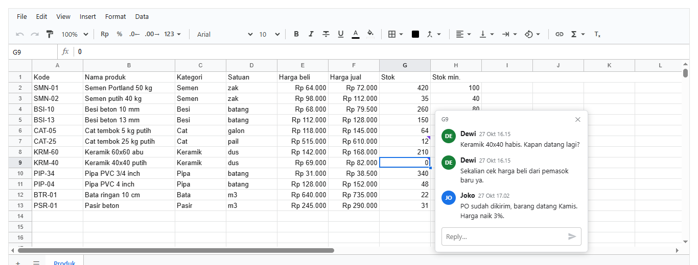
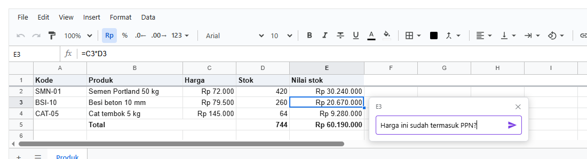
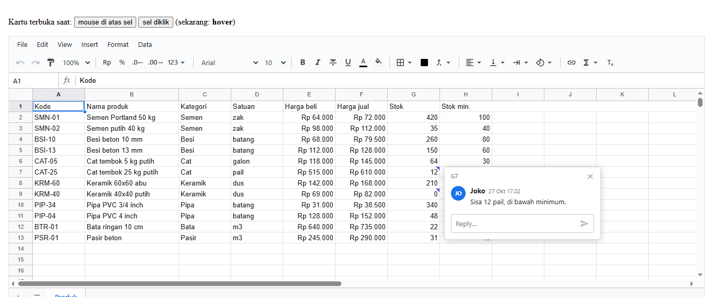
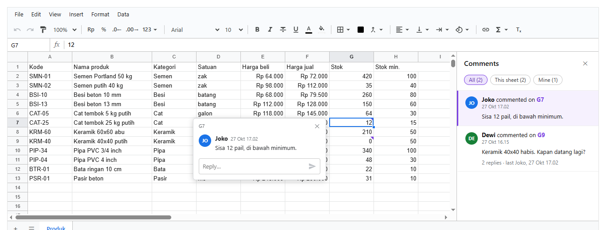
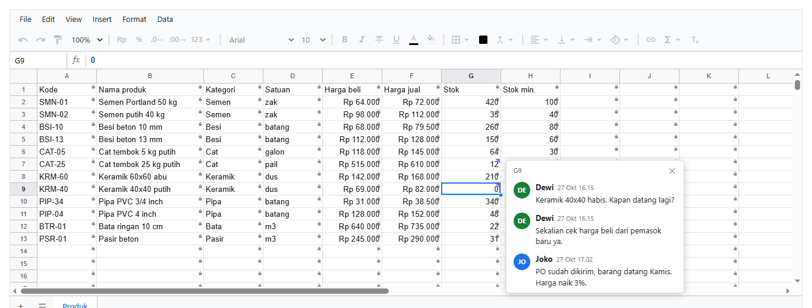

# 11. Komentar dan Excel

[Daftar isi](../README.md#daftar-isi) · Sebelumnya: [10. Hak akses](10-hak-akses.md) · Berikutnya: [12. Chart dan dashboard](12-dashboard.md)

Bab ini membahas **komentar di sel**, yaitu tempat orang bertanya dan menjawab soal isi sebuah sel tanpa mengubah isinya, lalu **impor dan ekspor
Excel dan CSV**. Bagian komentar disusun seperti bab lain: pengenalan tanpa kode, lalu langkah demi langkah dengan halaman React dan foto hasilnya.

**Bagian A. Pengenalan (tanpa kode)**
- [11.1 Komentar adalah diskusi di sebuah sel](#111-komentar-adalah-diskusi-di-sebuah-sel)
- [11.2 Yang dilihat orang di layar](#112-yang-dilihat-orang-di-layar)

**Bagian B. Langkah demi langkah**
- [11.3 Komentar pertama](#113-komentar-pertama)
- [11.4 Membaca dan membalas](#114-membaca-dan-membalas)
- [11.5 Kartu muncul saat mouse lewat, atau saat diklik](#115-kartu-muncul-saat-mouse-lewat-atau-saat-diklik)
- [11.6 Daftar semua komentar](#116-daftar-semua-komentar)
- [11.7 Siapa boleh apa](#117-siapa-boleh-apa)

**Bagian C. Contoh lengkap, yang sering keliru, dan referensi**
- [11.8 Contoh lengkap: komentar dari kode](#118-contoh-lengkap-komentar-dari-kode)
- [11.9 Yang sering keliru](#119-yang-sering-keliru)
- [11.10 Referensi komentar](#1110-referensi-komentar)

**Bagian D. Excel dan CSV**
- [11.11 Contoh](#1111-contoh)
- [11.12 Yang ikut dan yang tidak](#1112-yang-ikut-dan-yang-tidak)

---

# Bagian A. Pengenalan

## 11.1 Komentar adalah diskusi di sebuah sel

Bayangkan stok keramik di sel G9 tertulis 0. Dewi, manajer toko, ingin tahu kapan barang datang. Ia tidak mengubah angkanya, karena angka itu
memang benar. Ia **menulis komentar** di sel itu: "Keramik 40x40 habis. Kapan datang lagi?". Joko dari gudang membaca dan **membalas** di tempat
yang sama. Semua obrolan soal sel G9 berkumpul di G9.

Beberapa hal yang perlu dipegang sejak awal:

- **Satu sel, satu diskusi.** Komentar pertama memulai diskusi, komentar berikutnya adalah balasan. Diskusi tidak punya status "selesai". Kalau
  sudah tidak perlu, komentarnya dihapus.
- **Setiap komentar mencatat penulis dan waktunya.** Penulis adalah orang yang membuka sheet, yang Anda berikan lewat prop `user`.
- **Komentar tidak mengubah isi sel.** Rumus, format, dan nilai tetap seperti semula.
- **Diskusi mengikuti selnya.** Kalau baris disisipkan di atasnya atau tabel di-sort, diskusinya ikut pindah bersama selnya.
- **Komentar ikut tersimpan** di workbook (`toJSON`), jadi tersimpan ke server bersama isinya ([bab 9](09-menyimpan.md)).

## 11.2 Yang dilihat orang di layar



1. **Tanda ungu di pojok kanan atas sel.** Artinya sel itu punya diskusi.
2. **Kartu di samping sel.** Berisi semua komentar, satu di bawah yang lain, yang terbaru paling bawah. Setiap komentar menunjukkan lingkaran
   inisial penulis, nama, waktu, dan teksnya.
3. **Kotak "Reply…" di bawah kartu.** Tempat menulis balasan. Ctrl+Enter atau tombol panah untuk mengirim.
4. **Tombol ⋯** muncul saat mouse di atas komentar milik sendiri. Isinya Edit dan Delete. Komentar orang lain tidak punya tombol ini.
5. **Kapan kartunya muncul** bisa diatur: saat mouse lewat di atas sel bertanda (bawaan), atau hanya saat sel diklik.
6. **View → Comments** membuka daftar semua diskusi di panel kanan: "Dewi commented on G9". Klik salah satunya untuk langsung ke selnya.

Tulisan di layar sheet (Reply, Comments, commented on) memakai bahasa Inggris, sama seperti menu dan tombol lain di sheet.

---

# Bagian B. Langkah demi langkah

## 11.3 Komentar pertama

**Tujuan:** sheet tahu siapa yang membukanya, lalu orang itu menulis komentar pertama.

<!-- contoh: 11-03-tulis.page.tsx -->
```tsx
import { useState } from 'react';
import { Sheet } from '@kufayeka/sheet';
import { createWorkbook } from '@kufayeka/sheet/core';
import '@kufayeka/sheet/style.css';
import { buatProduk } from './data/produk.js';

// 11.3 Komentar pertama: Sheet tahu siapa yang membuka lewat prop user. Pilih sel, tekan Ctrl+Alt+M, tulis, Ctrl+Enter.
export default function Halaman() {
    const [wb] = useState(() => createWorkbook(buatProduk().toJSON()));
    // baru: user, nama dan id orang yang membuka sheet. Namanya tercatat di setiap komentar yang ia tulis
    return <div style={{ height: 300 }}><Sheet workbook={wb} user={{ id: 'user:dewi', name: 'Dewi' }} /></div>;
}
```
<!-- /contoh -->



**Penjelasan:**

- Satu-satunya yang baru adalah prop **`user`**: `id` untuk mengenali orangnya, `name` untuk ditampilkan. Biasanya diambil dari sesi login di
  aplikasi Anda.
- Pilih sel, lalu tekan **Ctrl+Alt+M** (atau menu **Insert → Comment**). Kartu kosong muncul di samping sel dengan kotak yang siap diketik.
- **Ctrl+Enter** atau tombol panah mengirim. Sel langsung mendapat tanda ungu, dan kartu tetap terbuka menampilkan komentar yang baru dikirim.
- **Escape** menutup kartu. Tulisan yang belum dikirim tidak hilang: saat kartu sel itu dibuka lagi, tulisannya masih ada.

## 11.4 Membaca dan membalas

**Tujuan:** membuka workbook yang sudah berisi diskusi, lalu membalasnya.

<!-- contoh: 11-04-diskusi.page.tsx -->
```tsx
import { useState } from 'react';
import { Sheet } from '@kufayeka/sheet';
import { createWorkbook } from '@kufayeka/sheet/core';
import '@kufayeka/sheet/style.css';
import { buatDiskusi } from './data/diskusi.js';

// 11.4 Workbook yang sudah berisi diskusi: Dewi bertanya soal stok keramik di G9, Joko dari gudang menjawab, dan Joko menulis catatan di G7.
export default function Halaman() {
    // baru: isinya dibuat oleh orang-orang lain sebelumnya. Dewi yang membuka, jadi komentar Dewi tanpa tanda "orang lain"
    const [wb] = useState(() => createWorkbook(buatDiskusi().doc));
    return <div style={{ height: 520 }}><Sheet workbook={wb} user={{ id: 'user:dewi', name: 'Dewi' }} /></div>;
}
```
<!-- /contoh -->


**Penjelasan:**

- Isi workbook dibuat oleh `buatDiskusi()` (file `data/diskusi.js`, isinya di [11.8](#118-contoh-lengkap-komentar-dari-kode)): Dewi bertanya
  di G9, Joko menjawab, Joko juga menulis catatan di G7. Di aplikasi sungguhan, isi ini datang dari server.
- **Klik sel bertanda** untuk membuka kartunya. Kartu tetap terbuka sampai Anda memilih sel lain, menekan Escape, atau menekan ✕.
- Balasan ditulis di kotak **Reply…** paling bawah. Balasan selalu masuk ke diskusi sel itu, walaupun orang lain baru saja ikut membalas.
- **Balasan orang lain muncul sendiri.** Kalau perubahan dari server diterapkan ke workbook saat kartu terbuka, komentar barunya langsung tampil
  di bawah.
- **Mengubah dan menghapus:** arahkan mouse ke komentar Anda sendiri, klik **⋯**, lalu **Edit** atau **Delete**. Komentar yang diubah diberi
  keterangan "edited". Menghapus komentar pertama berarti menghapus seluruh diskusi, jadi pilihannya bernama **Delete discussion**.

## 11.5 Kartu muncul saat mouse lewat, atau saat diklik

**Tujuan:** mengatur kapan kartu muncul.

<!-- contoh: 11-05-buka.page.tsx -->
```tsx
import { useState } from 'react';
import { Sheet } from '@kufayeka/sheet';
import { createWorkbook } from '@kufayeka/sheet/core';
import '@kufayeka/sheet/style.css';
import { buatDiskusi } from './data/diskusi.js';

// 11.5 Kartu muncul saat mouse di atas sel bertanda (hover), atau hanya saat sel diklik (click). Tombol di atas menggantinya.
export default function Halaman() {
    const [wb] = useState(() => createWorkbook(buatDiskusi().doc));
    const [cara, setCara] = useState<'hover' | 'click'>('hover');
    return (
        <div>
            <p>
                Kartu terbuka saat: <button className="hover" onClick={() => setCara('hover')}>mouse di atas sel</button>{' '}
                <button className="click" onClick={() => setCara('click')}>sel diklik</button> (sekarang: <b>{cara}</b>)
            </p>
            {/* baru: comments.open */}
            <div style={{ height: 520 }}><Sheet workbook={wb} user={{ id: 'user:dewi', name: 'Dewi' }} comments={{ open: cara }} /></div>
        </div>
    );
}
```
<!-- /contoh -->



**Penjelasan:**

- Prop **`comments={{ open: 'hover' }}`** adalah bawaan, jadi boleh tidak ditulis. Saat mouse berada di atas sel bertanda, kartunya muncul.
  Saat mouse pergi, kartu hilang sekitar sepertiga detik kemudian. Jeda ini memberi waktu untuk memindahkan mouse dari sel ke kartu.
- Selama mouse berada di atas kartu, kartu tidak hilang. **Begitu Anda mulai mengetik di kartu**, kartu tetap terbuka walaupun mouse pergi.
- **`comments={{ open: 'click' }}`** membuat kartu hanya muncul saat sel diklik. Pilih ini kalau sheet Anda padat komentar dan kartu yang muncul
  sendiri terasa mengganggu.
- Kedua cara tetap bisa membuka kartu dengan klik dan dengan Ctrl+Alt+M.

## 11.6 Daftar semua komentar

**Tujuan:** melihat semua diskusi di workbook dan berpindah ke salah satunya.

<!-- contoh: 11-06-daftar.page.tsx -->
```tsx
import { useState } from 'react';
import { Sheet } from '@kufayeka/sheet';
import { createWorkbook } from '@kufayeka/sheet/core';
import '@kufayeka/sheet/style.css';
import { buatDiskusi } from './data/diskusi.js';

// 11.6 Daftar semua diskusi: View > Comments. Tidak ada kode baru, panelnya bagian dari Sheet.
export default function Halaman() {
    const [wb] = useState(() => createWorkbook(buatDiskusi().doc));
    return <div style={{ height: 520 }}><Sheet workbook={wb} user={{ id: 'user:dewi', name: 'Dewi' }} /></div>;
}
```
<!-- /contoh -->



**Penjelasan:**

- Tidak ada kode baru. Daftar dibuka dari menu **View → Comments** dan ditutup dengan ✕ atau menu yang sama.
- Setiap baris berbunyi **"Dewi commented on G9"**: siapa yang memulai diskusi dan di sel mana. Di bawahnya ada waktu, komentar pertama, lalu
  jumlah balasan dan siapa yang terakhir menulis ("2 replies · last Joko, 27 Okt 17.02").
- Kalau workbook punya lebih dari satu sheet, alamatnya ditulis lengkap dengan nama sheet, misalnya **Produk!G9**.
- Tiga pilihan di atas daftar:

  | Pilihan | Yang tampil |
  |---|---|
  | **All** | semua diskusi di semua sheet |
  | **This sheet** | diskusi di sheet yang sedang dibuka |
  | **Mine** | diskusi tempat Anda pernah menulis, baik memulai maupun membalas |

- **Klik sebuah baris**: sheet pindah ke sel itu (juga ke sheet lain kalau perlu) dan kartunya terbuka. Membaca dan membalas dilakukan di kartu,
  karena daftar ini hanya untuk mencari.
- Diskusi milik sel yang sedang dipilih ditandai garis ungu di kiri.

## 11.7 Siapa boleh apa

**Tujuan:** mengatur siapa yang boleh membaca, memulai, dan membalas komentar, dengan baris akses yang sama seperti [bab 10](10-hak-akses.md).

<!-- contoh: 11-07-akses.page.tsx -->
```tsx
import { useState } from 'react';
import { Sheet } from '@kufayeka/sheet';
import { createWorkbook, type AccessRow } from '@kufayeka/sheet/core';
import '@kufayeka/sheet/style.css';
import { buatDiskusi } from './data/diskusi.js';

// 11.7 Siapa boleh apa: baris akses yang sama dengan bab 10. Rina dari keuangan boleh membaca sel dan komentar, tapi tidak ikut menulis.
const akses: AccessRow[] = [
    { who: 'user:dewi', effect: 'allow', action: '*' },
    { who: 'role:gudang', effect: 'allow', action: 'read' },
    { who: 'role:gudang', effect: 'allow', action: 'comment.read' },
    { who: 'role:gudang', effect: 'allow', action: 'comment.reply' },
    { who: 'role:keuangan', effect: 'allow', action: 'read' },
    // baru: comment.read saja, tanpa comment.create dan comment.reply
    { who: 'role:keuangan', effect: 'allow', action: 'comment.read' }
];

export default function Halaman() {
    const [wb] = useState(() => createWorkbook(buatDiskusi().doc));
    return (
        <div style={{ height: 520 }}>
            <Sheet workbook={wb} user={{ id: 'user:rina', name: 'Rina' }} access={{ rows: akses, who: { user: 'rina', roles: ['keuangan'] } }} />
        </div>
    );
}
```
<!-- /contoh -->



**Penjelasan:**

- Tanpa prop `access`, semua orang boleh membaca dan menulis komentar. Begitu ada `access`, berlaku aturan bab 10: **yang tidak disebut, tidak
  boleh**.
- Rina punya `read` dan `comment.read`. Ia melihat tanda ungu dan bisa membuka kartu, tetapi kotak Reply tidak ada. Kalau ia menekan Ctrl+Alt+M di
  sel tanpa diskusi, sheet menolak dengan pesan (lewat `onNotice`, lihat [bab 10](10-hak-akses.md)).
- Gudang punya `comment.reply`: boleh membalas diskusi yang sudah ada, tetapi tidak boleh memulai diskusi baru.
- Orang tanpa `comment.read` tidak melihat tanda, kartu, maupun daftar. `viewFor` di server juga tidak mengirim komentar kepadanya
  ([11.8](#118-contoh-lengkap-komentar-dari-kode)).
- Gembok di setiap sel pada foto bukan bagian dari komentar. Gembok itu tanda bahwa Rina hanya boleh membaca isi sel ([bab 10](10-hak-akses.md)).

Daftar hak komentar lengkap ada di [11.10](#1110-referensi-komentar).

---

# Bagian C. Contoh lengkap, yang sering keliru, dan referensi

## 11.8 Contoh lengkap: komentar dari kode

Semua yang bisa dilakukan di layar juga bisa dilakukan dari kode. Contoh ini membuat diskusi yang dipakai halaman-halaman di atas, lalu
menunjukkan bahwa diskusi ikut pindah bersama selnya, hanya penulis yang boleh mengubah komentarnya, dan server tidak mengirim komentar kepada orang
yang tidak berhak membacanya.

Isinya dibuat oleh `data/diskusi.js`. Setiap orang membuka workbook dengan user-nya sendiri:

<!-- contoh: data/diskusi.js -->
```js
import { createWorkbook } from '@kufayeka/sheet/core';
import { PRODUK, KOLOM_PRODUK } from './toko.js';

// Diskusi di sel: Dewi (manajer) bertanya soal stok keramik yang habis, Joko (gudang) menjawab.
export function buatDiskusi() {
    const doc = (() => {
        const w = createWorkbook();
        w.setSettings({ locale: 'id-ID', currency: 'IDR' });
        w.setSheetProps('Sheet1', { name: 'Produk' });
        w.setValues('Produk', 'A1', [KOLOM_PRODUK, ...PRODUK]);
        w.setColProps('Produk', 'E:F', { format: { type: 'money', decimals: 0 } });
        w.setColProps('Produk', 'B', { width: 180 });
        return w.toJSON();
    })();
    // setiap orang membuka workbook-nya sendiri dengan user-nya: nama penulis dan waktu tercatat di komentar
    const dewi = createWorkbook(doc, { user: { id: 'user:dewi', name: 'Dewi' }, now: () => new Date(Date.UTC(2026, 9, 27, 9, 15)) });
    const t = dewi.addComment('Produk', 'G9', 'Keramik 40x40 habis. Kapan datang lagi?');
    dewi.replyComment('Produk', t.thread, 'Sekalian cek harga beli dari pemasok baru ya.');
    const joko = createWorkbook(dewi.toJSON(), { user: { id: 'user:joko', name: 'Joko' }, now: () => new Date(Date.UTC(2026, 9, 27, 10, 2)) });
    joko.replyComment('Produk', t.thread, 'PO sudah dikirim, barang datang Kamis. Harga naik 3%.');
    joko.addComment('Produk', 'G7', 'Sisa 12 pail, di bawah minimum.');
    return { doc: joko.toJSON(), thread: t.thread };
}
```
<!-- /contoh -->

Lalu Dewi membacanya dari kode:

<!-- contoh: 14-komentar.js -->
```js
import { createWorkbook, viewFor } from '@kufayeka/sheet/core';
import { buatDiskusi } from './data/diskusi.js';

// Isinya dibuat oleh buatDiskusi (data/diskusi.js): Dewi bertanya di G9, Joko menjawab dan menulis catatan di G7.
const { doc, thread } = buatDiskusi();
const dewi = createWorkbook(doc, { user: { id: 'user:dewi', name: 'Dewi' } });
const tampil = (x) => `${wantedAt(x)}: ` + x.items.map((i) => i.by.name + ' ' + i.at.slice(11, 16) + ' "' + i.text + '"').join(' / ');
const wantedAt = (x) => (x.at ? dewi.address(x.at.r, x.at.c) : '(sel terhapus)');
for (const x of dewi.comments('Produk')) console.log(tampil(x));
console.log('G9 punya komentar:', dewi.hasComment('Produk', 'G9'), '| G2:', dewi.hasComment('Produk', 'G2'));

// diskusi mengikuti selnya: baris disisipkan di atas, komentar ikut turun
dewi.insertRows('Produk', '2');
console.log('setelah sisip   :', dewi.comments('Produk').map(wantedAt).join(', '));

// hanya penulis yang boleh mengubah atau menghapus komentarnya. Dari kode, yang tidak boleh melempar error (di layar tombolnya tidak ada)
const punyaJoko = dewi.comments('Produk')[0].items[2];
try { dewi.editComment('Produk', thread, punyaJoko.id, 'diubah orang lain'); } catch (err) { console.log('ubah milik Joko :', err.message); }

// komentar ikut tersimpan di workbook, dan viewFor tidak mengirimnya ke orang tanpa hak comment.read
const access = [{ who: '*', effect: 'allow', action: 'read' }];   // tamu boleh membaca sel, tapi tidak punya comment.read
console.log('dikirim ke tamu :', createWorkbook(viewFor(dewi.toJSON(), { access, who: 'tamu' })).comments('Produk').length, 'diskusi');
```
<!-- /contoh -->

<!-- hasil: 14-komentar.js -->
```text
G9: Dewi 09:15 "Keramik 40x40 habis. Kapan datang lagi?" / Dewi 09:15 "Sekalian cek harga beli dari pemasok baru ya." / Joko 10:02 "PO sudah dikirim, barang datang Kamis. Harga naik 3%."
G7: Joko 10:02 "Sisa 12 pail, di bawah minimum."
G9 punya komentar: true | G2: false
setelah sisip   : G10, G8
ubah milik Joko : only the one who wrote a comment can change it
dikirim ke tamu : 0 diskusi
```
<!-- /hasil -->

**Yang perlu diperhatikan:**

- Setiap orang membuka workbook-nya sendiri dengan opsi `user`. Nama dan id dari opsi itulah yang tercatat sebagai penulis.
- Jam diambil dari opsi `now` workbook (bawaannya jam komputer). Contoh ini memakai jam tetap supaya hasilnya selalu sama.
- Dari kode, perubahan yang tidak diizinkan **melempar error**. Di layar, tombolnya memang tidak ditampilkan.

## 11.9 Yang sering keliru

| Gejala | Penyebab | Perbaikan |
|---|---|---|
| Semua komentar tertulis atas nama "Anonymous" | prop `user` tidak diberikan | berikan `user={{ id, name }}` dari sesi login |
| Tombol ⋯ tidak muncul di komentar sendiri | `id` di `user` berbeda dengan `id` saat komentar ditulis, misalnya sekali `'dewi'` dan sekali `'user:dewi'` | pakai id yang sama setiap kali |
| Kartu muncul sendiri dan mengganggu | `open: 'hover'` adalah bawaan | `comments={{ open: 'click' }}` |
| Orang tidak bisa memulai diskusi, padahal bisa membalas | punya `comment.reply` tetapi tidak punya `comment.create` | tambahkan baris `comment.create` untuk orang itu |
| Komentar hilang setelah disimpan oleh orang tanpa `comment.read` | menyimpan seluruh isi tanpa `mergePatch` | simpan dengan patch dan `mergePatch` ([bab 9](09-menyimpan.md)), yang menjaga komentar yang tidak ia terima |
| Diskusi tidak tampil di daftar | baris atau kolom selnya dihapus (diskusinya punya `at: null`) | undo penghapusan itu, maka diskusi kembali ke selnya |

## 11.10 Referensi komentar

### Prop `<Sheet>`

| Prop | Artinya |
|---|---|
| `user={{ id, name }}` | orang yang membuka sheet. Namanya tercatat di komentar yang ia tulis, dan komentarnya bisa ia ubah atau hapus |
| `comments={{ open: 'hover' \| 'click' }}` | kapan kartu muncul. Bawaan `'hover'` |

### Keyboard dan menu

| Tombol / menu | Yang terjadi |
|---|---|
| Ctrl+Alt+M, Insert → Comment | membuka kartu sel yang dipilih, kotaknya siap diketik |
| Ctrl+Enter | di kotak balasan: mengirim. Di kotak edit: menyimpan |
| Escape | di kotak edit: batal. Di tempat lain dalam kartu: menutup kartu |
| View → Comments | membuka atau menutup daftar semua diskusi |

### Hak akses

| Hak | Yang diizinkan |
|---|---|
| `comment.read` | melihat tanda, kartu, dan daftar. Tanpa ini, komentar tidak dikirim oleh `viewFor` |
| `comment.create` | memulai diskusi di sel yang belum punya diskusi |
| `comment.reply` | membalas diskusi yang sudah ada |
| `comment.edit` | mengubah komentar **sendiri** |
| `comment.delete` | menghapus komentar **sendiri** |
| `comment.moderate` | mengubah dan menghapus komentar **siapa saja** |

### Fungsi

Semua fungsi dipanggil dari handle sheet (`wb.sheet('Produk').addComment('G9', ...)`), atau dari `wb` dengan nama sheet di depan
(`wb.addComment('Produk', 'G9', ...)`). Setiap perubahan dihitung satu langkah undo.

| Fungsi | Artinya |
|---|---|
| `addComment(sel, teks)` | memulai diskusi di sel itu, atau membalas kalau sel itu sudah punya diskusi. Mengembalikan `{ thread, item }` |
| `replyComment(thread, teks)` | membalas sebuah diskusi. Mengembalikan id balasan |
| `editComment(thread, item, teks)` | mengubah teks komentar sendiri. Komentarnya diberi `edited` |
| `deleteComment(thread, item)` | menghapus komentar sendiri. Kalau itu komentar pertama, seluruh diskusinya terhapus |
| `mayChangeComment(thread, item, 'edit' \| 'delete')` | `true` kalau orang ini boleh mengubah atau menghapus komentar itu. Kartu memakainya untuk memutuskan tombol ⋯ |
| `comments()` | semua diskusi sheet: `[{ id, items: [{ id, by: { id, name }, text, at, edited? }], at: { r, c } }]` |
| `commentAt(sel)` | diskusi di sel itu, atau `null` |
| `hasComment(sel)` | apakah sel itu punya diskusi (cepat, dipakai untuk menggambar tanda) |

### Warna

Warna ungu tanda, garis daftar, dan tombol kirim diambil dari variabel CSS `--ks-comment` (bawaan `#7b3fe4`). Contoh menggantinya:

```css
.ks-sheet { --ks-comment: #c2185b; }
```

---

# Bagian D. Excel dan CSV

## 11.11 Contoh

<!-- contoh: 15-excel.js -->
```js
import { exportXlsx, importXlsx, importXlsxInto, exportCsv, importCsvInto, parseCsv, createWorkbook } from '@kufayeka/sheet/core';
import { PRODUK, KOLOM_PRODUK } from './data/toko.js';

// ---- ke Excel: daftar stok dengan rumus, format rupiah, conditional formatting, named range, dan judul yang dibekukan
const wb = createWorkbook();
wb.setSettings({ locale: 'id-ID', currency: 'IDR' });
wb.setSheetProps('Sheet1', { name: 'Stok', freezeRows: 1 });
wb.setValues('Stok', 'A1', [[...KOLOM_PRODUK, 'Margin'], ...PRODUK.map((p, i) => [...p, `=(F${i + 2}-E${i + 2})/F${i + 2}`])]);
wb.setColProps('Stok', 'E:F', { format: { type: 'money', decimals: 0 } });
wb.setColProps('Stok', 'I', { format: { type: 'percent', decimals: 1 } });
wb.addConditional('Stok', 'G2:G13', { op: 'eq', a: 0, style: { fill: '#d93025', color: '#ffffff', bold: true } });
wb.addName('Stok', 'Stok', 'G2:G13');
wb.setValues('Stok', 'K1', [['Total stok', '=SUM(Stok)']]);
const bytes = exportXlsx(wb);                              // Uint8Array: kirim sebagai unduhan, lampiran email, atau simpan ke storage
console.log('file xlsx      :', bytes.length > 4000 ? 'lebih dari 4 KB' : bytes.length + ' byte', '| diawali', String.fromCharCode(bytes[0], bytes[1]), '(zip)');

// ---- dari Excel: file yang sama dibaca lagi, seperti file dari laptop orang
// .xlsx tidak menyimpan locale: berikan pengaturan workbook barunya sendiri
const { workbook: balik, warnings } = await importXlsx(bytes, { settings: { locale: 'id-ID', currency: 'IDR' } });
const s = balik.sheet('Stok');
console.log('rumus I2       :', s.input('I2'), '=', s.display('I2').text);
console.log('format E2      :', s.display('E2').text, '| beku', s.sheetProps().freezeRows, 'baris');
console.log('named range    :', balik.names().map((n) => n.name + ' = ' + n.ref).join(', '), '| K1:L1', s.value('K1'), s.value('L1'));
console.log('conditional    :', s.conditionals().length, 'aturan | G9 digambar', JSON.stringify(s.shownStyle('G9')));
console.log('peringatan     :', warnings.length ? warnings.join(' / ') : 'tidak ada');

// ditambahkan ke workbook yang sudah ada, sebagai sheet baru (nama yang sudah dipakai diberi nomor)
const laporan = createWorkbook();
const masuk = await importXlsxInto(laporan, bytes);
console.log('masuk ke wb lain:', laporan.sheetIds().map((id) => laporan.sheetProps(id).name).join(', '), '| sheet baru', masuk.sheetIds.length);

// ---- CSV keluar: teks seperti yang tampil di sel. Titik koma untuk Excel berbahasa Indonesia, yang memakai koma sebagai desimal
const csv = exportCsv(wb, 'Stok', { delimiter: ';' });
console.log('CSV baris 1-2  :', csv.split('\r\n').slice(0, 2).join(' | '));

// ---- CSV masuk: ekspor pesanan dari marketplace. Setiap field dibaca seperti diketik di locale workbook
const dariMarketplace = 'No Pesanan;Tanggal;Produk;Qty;Harga\r\nINV/2610/001;26/10/2026;"Semen Portland 50 kg; zak";40;72.000\r\nINV/2610/002;26/10/2026;Pipa PVC 4 inch;3;152.000,50';
console.log('parseCsv       :', JSON.stringify(parseCsv(dariMarketplace)[1]));
const toko = createWorkbook();
toko.setSettings({ locale: 'id-ID', currency: 'IDR' });
const hasil = importCsvInto(toko, dariMarketplace, 'Marketplace');
const m = toko.sheet('Marketplace');
console.log('sheet baru     :', toko.sheetProps(hasil.sheetIds[0]).name, '| B2', m.value('B2'), '(tanggal) | E3', m.value('E3'), '(angka) | C2', JSON.stringify(m.value('C2')));
```
<!-- /contoh -->

<!-- hasil: 15-excel.js -->
```text
file xlsx      : lebih dari 4 KB | diawali PK (zip)
rumus I2       : =(F2-E2)/F2 = 11,1%
format E2      : Rp 64.000 | beku 1 baris
named range    : Stok = Stok!G2:G13 | K1:L1 Total stok 1592
conditional    : 1 aturan | G9 digambar {"bold":true,"color":"#ffffff","fill":"#d93025"}
peringatan     : tidak ada
masuk ke wb lain: Sheet1, Stok | sheet baru 1
CSV baris 1-2  : Kode;Nama produk;Kategori;Satuan;Harga beli;Harga jual;Stok;Stok min.;Margin;;Total stok;1592 | SMN-01;Semen Portland 50 kg;Semen;zak;Rp 64.000;Rp 72.000;420;100;11,1%;;;
parseCsv       : ["INV/2610/001","26/10/2026","Semen Portland 50 kg; zak","40","72.000"]
sheet baru     : Marketplace | B2 46321 (tanggal) | E3 152000.5 (angka) | C2 "Semen Portland 50 kg; zak"
```
<!-- /hasil -->

| Fungsi | Artinya |
|---|---|
| `exportXlsx(wb)` | isi file `.xlsx` sebagai `Uint8Array` |
| `importXlsx(bytes, opsi?)` | workbook baru dari file: `{ workbook, warnings }`. `opsi` sama dengan `createWorkbook`, ditambah `settings` untuk locale dan mata uang |
| `importXlsxInto(wb, bytes)` | sheet-sheet file ditambahkan ke workbook yang sudah ada, sebagai satu perubahan: `{ sheetIds, warnings }` |
| `exportCsv(wb, sheet, { delimiter })` | satu sheet sebagai teks CSV, berisi teks seperti yang tampil di sel. Pemisah bawaannya koma |
| `parseCsv(teks, pemisah?)` | CSV menjadi array baris. Pemisah ditebak dari baris pertama (koma, titik koma, atau tab) kalau tidak diberikan |
| `importCsvInto(wb, teks, nama)` | CSV sebagai sheet baru. Setiap field dibaca seperti diketik di locale workbook: `152.000,50` menjadi angka, `26/10/2026` menjadi tanggal |
| `codeOfFormat(format, settings)` | kode format Excel untuk sebuah format (`'"Rp" #,##0'`), untuk alat sendiri |

**Mengunduh di browser:**

```js
const blob = new Blob([exportXlsx(wb)], { type: 'application/vnd.openxmlformats-officedocument.spreadsheetml.sheet' });
const a = Object.assign(document.createElement('a'), { href: URL.createObjectURL(blob), download: 'Stok.xlsx' });
a.click();
URL.revokeObjectURL(a.href);
```

**Membuka file yang dipilih orang:** `importXlsx(new Uint8Array(await file.arrayBuffer()))`.

## 11.12 Yang ikut dan yang tidak

| Bagian | Ke `.xlsx` | Dari `.xlsx` |
|---|---|---|
| nilai, rumus (termasuk antar sheet), tanggal | ya | ya. Fungsi yang tidak dikenal disebut di `warnings` |
| format angka, uang, persen, tanggal | ya | ya |
| gaya: huruf, warna, latar, perataan, border, teks turun | ya | ya |
| merge, lebar kolom, tinggi baris, baris dan kolom tersembunyi | ya | ya |
| baris dan kolom yang dibekukan | ya | ya |
| named range | ya | ya |
| conditional formatting | ya | ya. Jenis yang tidak ada di sini (data bar, ikon) dilewati dan disebut di `warnings` |
| filter | ya | ya. Filter warna dan top 10 disebut di `warnings` |
| grup baris dan kolom | ya | ya |
| pivot table | sebagai nilai | sebagai nilai |
| validasi data | ya: daftar, daftar dari range, checkbox (sebagai daftar TRUE/FALSE), angka, tanggal, panjang teks, teks memuat. Email dan URL tidak, karena Excel tidak punya jenis itu | ya. Jenis lain (rumus bebas) disebut di `warnings` |
| komentar | ya, sebagai *note* Excel: satu note per diskusi, satu baris per komentar (`Dewi: …`) | ya, dibaca balik menjadi diskusi dengan penulis per baris |
| gambar dan grafik | tidak ada di library ini | dilewati, disebut di `warnings` |
| locale | tidak disimpan oleh Excel | beri lewat `settings` |
| aturan, tipe kolom, policy | tidak ikut: itu milik aplikasimu | |

Tampilkan `warnings` kepada orang yang mengimpor, supaya ia tahu apa yang tidak terbawa dari filenya.

**CSV** hanya membawa teks. `exportCsv` menulis yang tampil di sel (`Rp 64.000`, `420 zak`), dan isi sel yang tersembunyi untuk orang itu ditulis
kosong. Untuk Excel berbahasa Indonesia, yang memakai koma sebagai tanda desimal, pakai `{ delimiter: ';' }`.

[Daftar isi](../README.md#daftar-isi) · Sebelumnya: [10. Hak akses](10-hak-akses.md) · Berikutnya: [12. Chart dan dashboard](12-dashboard.md)
