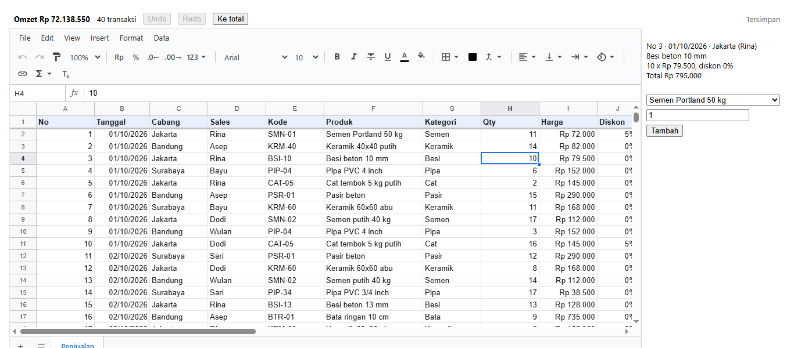
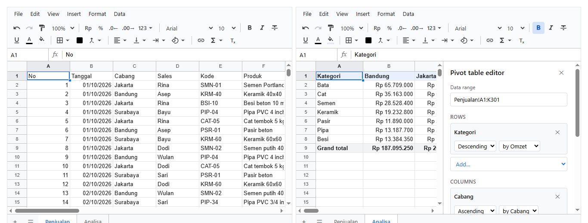

# 11. Memakai di React

[Daftar isi](../README.md#daftar-isi) · Sebelumnya: [10. Aturan dan tipe kolom](10-aturan.md) · Berikutnya: [12. Menyimpan ke server](12-server.md)

Bab ini tentang memasang sheet di aplikasi React sungguhan: di mana workbook disimpan, cara membaca isinya dari komponen lain, memuat dari API dengan
`useEffect`, menyimpan otomatis, menghubungkan form React dengan sheet, dan Next.js. Semua contoh di sini dijalankan oleh test di Chrome sungguhan
(`test/grid-react.test.js`).

- [11.1 Workbook bukan state React](#111-workbook-bukan-state-react)
- [11.2 Membaca workbook dari komponen lain: `useWorkbook`](#112-membaca-workbook-dari-komponen-lain-useworkbook)
- [11.3 Memuat dari API](#113-memuat-dari-api)
- [11.4 Menyimpan otomatis](#114-menyimpan-otomatis)
- [11.5 Aplikasi lengkap: kasir](#115-aplikasi-lengkap-kasir)
- [11.6 Data dari props](#116-data-dari-props)
- [11.7 Dua tampilan, satu workbook](#117-dua-tampilan-satu-workbook)
- [11.8 Next.js](#118-nextjs)
- [11.9 Kesalahan yang sering terjadi](#119-kesalahan-yang-sering-terjadi)

## 11.1 Workbook bukan state React

Workbook adalah objek yang berubah sendiri. Isinya berubah setiap kali orang mengetik, dan `<Sheet>` menggambar ulang dirinya tanpa `setState`. Karena itu
workbook **tidak** disimpan sebagai state yang diganti-ganti. Workbook dibuat sekali, lalu objek yang sama dipakai terus:

```jsx
// benar: dibuat sekali, saat komponen pertama kali tampil
const [wb] = useState(() => createWorkbook(doc));
const [wb] = useState(buatTemplate);            // sama, dengan fungsi yang sudah ada
```

| Cara | Akibatnya |
|---|---|
| `const wb = createWorkbook()` di badan komponen | workbook baru di setiap render. Isi, undo, dan seleksi hilang setiap kali ada state lain berubah |
| `useState(createWorkbook())` (dengan tanda kurung) | workbook baru tetap dibuat di setiap render lalu dibuang. Boros, dan `createWorkbook(doc)` yang berat jadi lambat |
| `useMemo(() => createWorkbook(), [])` | biasanya jalan, tetapi React boleh membuang hasil `useMemo` kapan saja. Pakai `useState` |
| `const wb = createWorkbook()` di luar komponen (tingkat modul) | satu workbook untuk semua: di Next.js, semua pengunjung di server memakai workbook yang sama |
| `setWb(...)` setiap kali isinya berubah | tidak perlu. `wb.setValues(...)` langsung terlihat |

Mengganti workbook dengan workbook lain (misalnya membuka file lain) boleh: simpan di `useState` lalu panggil `setWb(createWorkbook(docLain))`.
`<Sheet>` menampilkan workbook baru itu.

## 11.2 Membaca workbook dari komponen lain: `useWorkbook`

Total di header halaman, tombol Undo yang tahu kapan bisa dipakai, tanda "belum tersimpan". Semua komponen ini bukan bagian dari `<Sheet>`, tetapi
harus ikut berubah bersamanya. `useWorkbook` dari `@kufayeka/sheet` melakukannya:

```jsx
import { useWorkbook } from '@kufayeka/sheet';

const omzet = useWorkbook(wb, (w) => w.value('Penjualan', 'N1'));
const bisaUndo = useWorkbook(wb, (w) => w.canUndo());
const belumTersimpan = useWorkbook(wb, (w) => w.unsaved());
```

- Fungsi kedua (`baca`) dijalankan setelah setiap perubahan: diketik orang, ditulis kode, undo, redo, disimpan, atau aturan akses berganti.
- Komponen **hanya digambar ulang kalau hasil `baca` berubah**. Komponen yang membaca total tidak digambar ulang saat orang mengetik di sel yang tidak
  mempengaruhi total. Ini juga diperiksa oleh test.
- Kembalikan nilai sederhana (angka, teks, boolean). Objek atau array yang dibuat di dalam `baca` selalu baru, sehingga komponennya digambar ulang di
  setiap perubahan. Itu tidak salah, hanya kurang hemat.
- `useWorkbook(wb)` tanpa fungsi kedua mengembalikan workbook itu sendiri, dan komponennya digambar ulang di setiap perubahan.
- `wb` boleh `null` selama masih memuat. Hasilnya `undefined`, dan `baca` tidak dijalankan.
- Jaga `baca` tetap ringan. Membaca beberapa sel itu ringan. Menjumlahkan 100.000 baris dengan JavaScript tidak ringan: buat rumus di sheet, lalu baca
  hasilnya.

## 11.3 Memuat dari API

Hook untuk memuat workbook, dan hook untuk menyimpannya (11.4), ditaruh di satu file. File ini dipakai oleh semua contoh berikutnya:

<!-- contoh: 11-hooks.js -->
```js
import { useEffect, useRef, useState } from 'react';
import { useWorkbook } from '@kufayeka/sheet';
import { createWorkbook } from '@kufayeka/sheet/core';
import { ambilWorkbook, simpanPatch } from './data/api.js';

/**
 * Workbook dari API: { wb, error, cobaLagi }. wb null selama memuat.
 * @param {string} id  id workbook di API-mu. Berganti id = workbook lain dimuat.
 */
export function useWorkbookDariApi(id, opsi) {
    const [keadaan, setKeadaan] = useState({ wb: null, error: null });
    const [percobaan, setPercobaan] = useState(0);
    useEffect(() => {
        // AbortController: kalau komponen dilepas atau id berganti sebelum jawaban datang, permintaan lama dibatalkan dan jawabannya diabaikan.
        // Ini juga yang membuat StrictMode (yang menjalankan effect dua kali saat development) aman
        const batal = new AbortController();
        setKeadaan({ wb: null, error: null });
        ambilWorkbook(id, batal.signal)
            // createWorkbook di sini, sekali per isi yang dimuat. Opsinya (user, beforeOp) ikut dari pemanggil
            .then((doc) => setKeadaan({ wb: createWorkbook(doc, opsi), error: null }))
            .catch((err) => { if (err.name !== 'AbortError') setKeadaan({ wb: null, error: err.message }); });
        return () => batal.abort();
        // opsi sengaja tidak ikut: objek opsi yang ditulis langsung di pemanggil berubah setiap render
        // eslint-disable-next-line react-hooks/exhaustive-deps
    }, [id, percobaan]);
    return { ...keadaan, cobaLagi: () => setPercobaan((n) => n + 1) };
}

/**
 * Simpan otomatis `jeda` milidetik setelah orang berhenti mengubah. Hanya yang berubah yang dikirim (patch), bukan seluruh workbook.
 * Mengembalikan 'tersimpan' | 'menunggu' | 'menyimpan' | 'gagal'.
 */
export function useAutosave(wb, id, jeda = 1000) {
    const [status, setStatus] = useState('tersimpan');
    const sibuk = useRef(false);
    const belum = useWorkbook(wb, (w) => w.unsaved());

    useEffect(() => {
        if (!wb) return undefined;
        let timer = null;
        const simpan = async () => {
            // satu penyimpanan pada satu waktu: perubahan yang datang selama menyimpan dikirim berikutnya
            if (sibuk.current) { timer = setTimeout(simpan, jeda); return; }
            if (!wb.unsaved()) { setStatus('tersimpan'); return; }
            const patch = wb.pendingPatch();
            sibuk.current = true;
            setStatus('menyimpan');
            try {
                const jawaban = await simpanPatch(id, patch);
                // saved() hanya melupakan yang ikut di patch ini: yang diubah selama menunggu jawaban tetap tercatat belum tersimpan
                wb.saved(patch, jawaban);
                if (wb.unsaved()) { setStatus('menunggu'); timer = setTimeout(simpan, jeda); } else setStatus('tersimpan');
            } catch {
                // patch tidak hilang: penyimpanan berikutnya mengirimnya lagi bersama perubahan yang lebih baru
                setStatus('gagal');
                timer = setTimeout(simpan, jeda * 5);
            } finally {
                sibuk.current = false;
            }
        };
        // setiap perubahan menunda penyimpanan (debounce): mengetik 20 sel berturut-turut = satu kali simpan
        const off = wb.on('op', () => { setStatus('menunggu'); clearTimeout(timer); timer = setTimeout(simpan, jeda); });
        return () => { off(); clearTimeout(timer); };
    }, [wb, id, jeda]);

    // menutup tab saat masih ada yang belum tersimpan: browser bertanya dulu
    useEffect(() => {
        if (!belum) return undefined;
        const tahan = (e) => { e.preventDefault(); e.returnValue = ''; };
        window.addEventListener('beforeunload', tahan);
        return () => window.removeEventListener('beforeunload', tahan);
    }, [belum]);

    return status;
}
```
<!-- /contoh -->

Halaman yang memakainya:

<!-- contoh: 11-memuat.page.js -->
```jsx
import { Sheet } from '@kufayeka/sheet';
import '@kufayeka/sheet/style.css';
import { useWorkbookDariApi } from './11-hooks.js';

// Workbook dimuat dari API saat halaman dibuka. Selama memuat tampil teks, kalau gagal tampil pesan dan tombol coba lagi.
export default function HalamanPenjualan() {
    const { wb, error, cobaLagi } = useWorkbookDariApi('penjualan-oktober');
    if (error) return <p>Gagal memuat: {error} <button onClick={cobaLagi}>Coba lagi</button></p>;
    if (!wb) return <p>Memuat penjualan…</p>;
    return <div style={{ height: 520 }}><Sheet workbook={wb} fileName="Penjualan Oktober" /></div>;
}
```
<!-- /contoh -->

`ambilWorkbook` dan `simpanPatch` di contoh ini datang dari API tiruan ([`examples/data/api.js`](examples/data/api.js)) supaya contohnya bisa
dijalankan. Di aplikasimu, keduanya adalah `fetch` ke API-mu sendiri. Isi file itu menjelaskan caranya.

Yang perlu diperhatikan:

- **`createWorkbook(doc)` dipanggil di dalam `.then`**, sekali per isi yang dimuat, lalu disimpan ke state. Jangan memanggilnya di badan komponen.
- **AbortController.** Kalau komponen dilepas, atau `id` berganti sebelum jawaban datang, jawaban lama diabaikan. Tanpa ini, membuka workbook A lalu
  cepat-cepat pindah ke B bisa berakhir dengan B yang tertimpa A. Hal yang sama membuat `<StrictMode>` aman, karena StrictMode menjalankan effect dua
  kali saat development.
- **Berganti workbook**: `id` lain memuat workbook lain, dan `<Sheet>` menampilkan workbook baru begitu jawabannya datang.

## 11.4 Menyimpan otomatis

`useAutosave` di file yang sama menyimpan satu detik setelah orang berhenti mengubah:

<!-- contoh: 11-autosave.page.js -->
```jsx
import { Sheet } from '@kufayeka/sheet';
import '@kufayeka/sheet/style.css';
import { useWorkbookDariApi, useAutosave } from './11-hooks.js';

const TEKS = { tersimpan: 'Semua perubahan tersimpan', menunggu: 'Belum tersimpan…', menyimpan: 'Menyimpan…', gagal: 'Gagal menyimpan, mencoba lagi' };

export default function HalamanAutosave() {
    const { wb } = useWorkbookDariApi('penjualan-oktober');
    const status = useAutosave(wb, 'penjualan-oktober');
    if (!wb) return <p>Memuat penjualan…</p>;
    return (
        <div style={{ height: 560, display: 'flex', flexDirection: 'column' }}>
            <p className="status-simpan" style={{ margin: '4px 8px', color: status === 'gagal' ? '#d93025' : '#5f6368' }}>{TEKS[status]}</p>
            <Sheet workbook={wb} style={{ flex: 1 }} />
        </div>
    );
}
```
<!-- /contoh -->

Cara kerjanya:

1. **Hanya yang berubah yang dikirim.** `wb.pendingPatch()` berisi baris, kolom, dan sheet yang berubah sejak simpan terakhir. Mengubah satu sel di sheet
   10.000 baris mengirim satu baris, bukan 10.000.
2. **Debounce.** Setiap perubahan (`wb.on('op')`) menunda penyimpanan. Mengetik 20 sel berturut-turut menghasilkan satu kali simpan.
3. **`wb.saved(patch, jawaban)`** memberi tahu workbook bahwa patch itu sudah tersimpan. Yang dilupakan hanya isi patch itu. Perubahan yang dibuat selama
   menunggu jawaban server tetap tercatat dan ikut di penyimpanan berikutnya, jadi tidak ada yang hilang.
4. **Satu penyimpanan pada satu waktu.** Kalau penyimpanan sebelumnya belum selesai, yang berikutnya menunggu.
5. **Gagal simpan** tidak membuang apa-apa. Patch berikutnya mengirim semua yang belum tersimpan.
6. **`beforeunload`**: menutup tab saat masih ada yang belum tersimpan membuat browser bertanya dulu. `useWorkbook(wb, (w) => w.unsaved())` memberi tahu
   kapan pengaman ini perlu dipasang.

Apa yang dilakukan server dengan patch itu (menggabungkan, memeriksa, menolak), dan bentuk tabel database-nya, dibahas di [bab 12](12-server.md).

## 11.5 Aplikasi lengkap: kasir

Semua bagian di atas dalam satu halaman. Header menampilkan omzet, jumlah transaksi, Undo/Redo, dan status simpan. Panel kanan menampilkan transaksi
yang dipilih, dan di bawahnya ada form React untuk menambah transaksi:



<!-- contoh: 11-kasir.page.js -->
```jsx
import { useRef, useState } from 'react';
import { Sheet, useWorkbook } from '@kufayeka/sheet';
import '@kufayeka/sheet/style.css';
import { useWorkbookDariApi, useAutosave } from './11-hooks.js';
import { PRODUK } from './data/toko.js';

const STATUS = { tersimpan: 'Tersimpan', menunggu: 'Belum tersimpan', menyimpan: 'Menyimpan…', gagal: 'Gagal menyimpan' };
const rupiah = (n) => 'Rp ' + Math.round(n || 0).toLocaleString('id-ID');

// Bagian atas halaman: angka dari sheet, tombol yang tahu kapan bisa dipakai, status simpan. Bukan bagian dari <Sheet>, tapi ikut berubah bersamanya.
function Ringkasan({ wb, status, sheetRef }) {
    const omzet = useWorkbook(wb, (w) => w.value('Penjualan', 'N1'));
    const transaksi = useWorkbook(wb, (w) => w.value('Penjualan', 'N2'));
    const bisaUndo = useWorkbook(wb, (w) => w.canUndo());
    const bisaRedo = useWorkbook(wb, (w) => w.canRedo());
    return (
        <header className="kasir-atas" style={{ display: 'flex', gap: 12, alignItems: 'center', padding: '6px 8px' }}>
            <b>Omzet <span className="kasir-omzet">{rupiah(omzet)}</span></b>
            <span><span className="kasir-jumlah">{transaksi}</span> transaksi</span>
            <button className="kasir-undo" disabled={!bisaUndo} onClick={() => wb.undo()}>Undo</button>
            <button disabled={!bisaRedo} onClick={() => wb.redo()}>Redo</button>
            <button onClick={() => sheetRef.current.select('N1')}>Ke total</button>
            <span className="kasir-status" style={{ marginLeft: 'auto', color: '#5f6368' }}>{STATUS[status]}</span>
        </header>
    );
}

// Detail baris yang sedang dipilih di sheet. Baris dipegang lewat id-nya, jadi tetap baris yang sama walau sheet di-sort atau disisipi baris
function Detail({ wb, rowId }) {
    const teks = useWorkbook(wb, (w) => {
        const r = rowId ? w.rowIndex('Penjualan', rowId) : -1;
        if (r < 1) return '';
        const d = (c) => w.display('Penjualan', r, c).text;
        return `No ${d(0)} · ${d(1)} · ${d(2)} (${d(3)})\n${d(5)}\n${d(7)} x ${d(8)}, diskon ${d(9)}\nTotal ${d(10)}`;
    });
    return <pre className="kasir-detail" style={{ font: 'inherit', whiteSpace: 'pre-wrap', minHeight: 80 }}>{teks || 'Pilih satu transaksi'}</pre>;
}

// Form React biasa yang menambah satu transaksi ke sheet. source 'user': aturan dan validasi sheet tetap berlaku
function TransaksiBaru({ wb, sheetRef }) {
    const [kode, setKode] = useState(PRODUK[0][0]);
    const [qty, setQty] = useState(1);
    const tambah = (e) => {
        e.preventDefault();
        const p = PRODUK.find((x) => x[0] === kode);
        const jual = wb.sheet('Penjualan');
        const r = wb.value('Penjualan', 'N2') + 1;            // nomor baris setelah transaksi terakhir (baris 0 adalah judul kolom)
        const n = r + 1;                                       // nomor baris seperti tertulis di layar, untuk rumus
        jual.setValues(r, 0, [[r, 46325, 'Jakarta', 'Rina', p[0], p[1], p[2], Number(qty), p[5], 0, `=H${n}*I${n}*(1-J${n})`]], { source: 'user' });
        sheetRef.current.select('A' + n);
        setQty(1);
    };
    return (
        <form className="kasir-form" onSubmit={tambah} style={{ display: 'flex', flexWrap: 'wrap', gap: 6 }}>
            <select style={{ width: '100%' }} value={kode} onChange={(e) => setKode(e.target.value)}>{PRODUK.map((p) => <option key={p[0]} value={p[0]}>{p[1]}</option>)}</select>
            <input className="kasir-qty" type="number" min="1" value={qty} onChange={(e) => setQty(e.target.value)} />
            <button className="kasir-tambah">Tambah</button>
        </form>
    );
}

export default function Kasir() {
    const { wb } = useWorkbookDariApi('penjualan-oktober');
    const status = useAutosave(wb, 'penjualan-oktober');
    const sheetRef = useRef(null);
    const [rowId, setRowId] = useState(null);
    if (!wb) return <p>Memuat penjualan…</p>;
    return (
        <div style={{ height: 600, display: 'flex', flexDirection: 'column', font: '13px system-ui' }}>
            <Ringkasan wb={wb} status={status} sheetRef={sheetRef} />
            <div style={{ flex: 1, display: 'flex', minHeight: 0 }}>
                <Sheet ref={sheetRef} workbook={wb} style={{ flex: 1 }}
                    onSelectionChange={(sel) => setRowId(wb.rowId('Penjualan', sel.active.r))} />
                <aside style={{ width: 230, padding: 8, borderLeft: '1px solid #dadce0' }}>
                    <Detail wb={wb} rowId={rowId} />
                    <TransaksiBaru wb={wb} sheetRef={sheetRef} />
                </aside>
            </div>
        </div>
    );
}
```
<!-- /contoh -->

Yang dipakai di sini:

- **`useWorkbook` di setiap komponen yang membaca workbook.** `Ringkasan` membaca dua sel dan dua status undo, `Detail` membaca satu baris. Masing-masing
  hanya digambar ulang kalau yang dibacanya berubah.
- **`ref` ke `<Sheet>`** untuk perintah dari luar: `sheetRef.current.select('N1')` memilih sel dan menggulir ke sana. Daftar lengkapnya ada di
  [3.3](03-komponen-sheet.md#33-handle-ref).
- **`onSelectionChange`** memberi seleksi dalam nomor. Yang disimpan di state adalah **id baris** (`wb.rowId(...)`), bukan nomornya, jadi panel detail
  tetap menunjuk transaksi yang sama walaupun sheet di-sort atau disisipi baris.
- **Form React menulis ke sheet** dengan `{ source: 'user' }`, jadi validasi dan aturan sheet ([bab 7](07-data.md#74-validasi-data),
  [bab 10](10-aturan.md)) tetap berlaku seperti kalau orang mengetiknya sendiri. Perubahan itu juga masuk undo dan ikut tersimpan otomatis.
- **Tombol Undo di luar sheet** cukup memanggil `wb.undo()`. Sheet dan header ikut berubah.

## 11.6 Data dari props

Laporan yang datanya datang lewat props, misalnya dari pilihan cabang di atasnya:

<!-- contoh: 11-props.page.js -->
```jsx
import { useEffect, useState } from 'react';
import { Sheet } from '@kufayeka/sheet';
import { createWorkbook, populate } from '@kufayeka/sheet/core';
import '@kufayeka/sheet/style.css';
import { penjualan, CABANG } from './data/toko.js';

// Laporan per cabang: cabang dipilih di luar sheet, datanya datang lewat props. Workbook dibuat sekali, isinya diganti saat props berubah.
function buatTemplate() {
    const wb = createWorkbook();
    wb.setSettings({ locale: 'id-ID', currency: 'IDR' });
    const lap = wb.sheet('Sheet1');
    lap.setSheetProps({ name: 'Transaksi', freezeRows: 1 });
    lap.setColProps('B', { format: { type: 'date' } });
    lap.setColProps('E:F', { format: { type: 'money', decimals: 0 } });
    lap.setColProps('C', { width: 180 });
    const rekap = wb.sheet(wb.addSheet('Rekap'));
    rekap.setValues('A1', [['Transaksi', '=COUNT(Transaksi!A:A)'], ['Omzet', '=SUM(Transaksi!F:F)']]);
    rekap.setColProps('B', { format: { type: 'money', decimals: 0 }, width: 140 });
    return wb;
}

function LaporanCabang({ data, sheet, onSheetChange }) {
    // useState dengan fungsi: workbook dibuat SEKALI untuk umur komponen ini, tidak setiap render
    const [wb] = useState(buatTemplate);
    // props berubah: isi tabelnya diganti, workbook-nya tetap. Undo, sheet aktif, lebar kolom yang diatur orang, semuanya tetap
    useEffect(() => {
        wb.sheet('Transaksi').clear('A1:F1000', { source: 'remote' });     // remote: tidak masuk undo, ini bukan perubahan orang
        populate(wb, 'Transaksi', { at: 'A1', fields: ['No', 'Tanggal', 'Produk', 'Qty', 'Harga', 'Total'], header: true }, data, { source: 'remote' });
    }, [wb, data]);
    // sheet yang tampil dikontrol dari luar lewat props sheet + onSheetChange
    return <Sheet workbook={wb} sheet={wb.sheetIdByName(sheet)} onSheetChange={(id) => onSheetChange(wb.sheetProps(id).name)} style={{ height: 460 }} />;
}

export default function HalamanCabang() {
    const [cabang, setCabang] = useState('Jakarta');
    const [sheet, setSheet] = useState('Transaksi');
    const [data, setData] = useState([]);
    useEffect(() => {
        // di aplikasi: fetch('/api/penjualan?cabang=' + cabang)
        setData(penjualan(60).filter((x) => x.Cabang === cabang).map((x) => ({ ...x, Total: x.Qty * x.Harga * (1 - x.Diskon) })));
    }, [cabang]);
    return (
        <div>
            <p style={{ display: 'flex', gap: 8, margin: 8 }}>
                <select className="pilih-cabang" value={cabang} onChange={(e) => setCabang(e.target.value)}>{CABANG.map((c) => <option key={c}>{c}</option>)}</select>
                <button onClick={() => setSheet('Transaksi')}>Transaksi</button>
                <button onClick={() => setSheet('Rekap')}>Rekap</button>
                <span>Sheet aktif: {sheet}</span>
            </p>
            <LaporanCabang data={data} sheet={sheet} onSheetChange={setSheet} />
        </div>
    );
}
```
<!-- /contoh -->

Ada dua cara menanggapi props yang berubah:

| Cara | Kapan |
|---|---|
| **Isi diganti di `useEffect`** (seperti contoh): `clear` lalu `populate`, dengan `{ source: 'remote' }` | workbook-nya tetap sama: lebar kolom yang diatur orang, sheet aktif, dan seleksi tetap. `remote` membuat pengisian ini tidak masuk undo, jadi Ctrl+Z tidak menghapus data laporan |
| **Workbook baru dengan `key`**: `<LaporanCabang key={cabang} ... />` | semuanya mulai dari awal untuk setiap cabang, termasuk undo dan pengaturan tampilan. Paling sederhana kalau memang itu yang diinginkan |

**Sheet aktif yang dikontrol.** Dengan prop `sheet` (id sheet) dan `onSheetChange`, sheet yang tampil dipegang oleh state-mu. Tombol di luar sheet bisa
memindahkannya, dan klik tab di sheet memberi tahu state-mu. Contoh di atas menyimpan nama sheet di state dan mengubahnya menjadi id dengan
`wb.sheetIdByName`. Nama lebih cocok untuk URL atau `localStorage`.

## 11.7 Dua tampilan, satu workbook

Dua `<Sheet>` boleh menampilkan workbook yang sama. Isi dan undo milik workbook, sedangkan seleksi, gulir, dan sheet aktif milik masing-masing tampilan:

<!-- contoh: 11-dua-tampilan.page.js -->
```jsx
import { useState } from 'react';
import { Sheet } from '@kufayeka/sheet';
import '@kufayeka/sheet/style.css';
import { buatAnalisa } from './08-pivot.js';

// Satu workbook, dua tampilan berdampingan: data di kiri, pivot-nya di kanan. Mengubah Qty di kiri langsung mengubah pivot di kanan.
// Seleksi, gulir, dan sheet aktif milik masing-masing tampilan. Isi dan undo milik workbook, jadi sama untuk keduanya.
export default function DuaTampilan() {
    const [wb] = useState(buatAnalisa);
    return (
        <div style={{ display: 'flex', gap: 8, height: 520 }}>
            <Sheet workbook={wb} sheet={wb.sheetIdByName('Penjualan')} style={{ flex: 1 }} />
            <Sheet workbook={wb} sheet={wb.sheetIdByName('Analisa')} style={{ flex: 1 }} />
        </div>
    );
}
```
<!-- /contoh -->



Mengubah Qty di kiri langsung mengubah pivot di kanan. Pola yang sama berguna untuk data dan grafik, data dan ringkasan, atau sheet induk dan sheet
detail yang berdampingan.

## 11.8 Next.js

Di App Router, cara yang paling enak adalah membaca workbook di **server component** lalu memberikannya ke client component sebagai props. Halaman
langsung tampil berisi, tanpa "Memuat…" dan tanpa permintaan kedua dari browser:

<!-- contoh: 11-next-page.js -->
```js
// app/penjualan/[id]/page.js  (Next.js App Router, server component)
// Workbook dibaca dari database di server, lalu diberikan ke client component sebagai props. Halaman langsung tampil berisi, tanpa "Memuat…".
import { db } from '@/lib/db';                         // koneksi database milik aplikasimu
import { LembarPenjualan } from './LembarPenjualan';

export default async function Page({ params }) {
    const { id } = await params;
    const doc = await db.workbooks.findJson(id);       // JSON hasil wb.toJSON() yang dulu disimpan (bab 12)
    if (!doc) return <p>Workbook tidak ada</p>;
    return (
        <main style={{ height: '100vh' }}>
            <LembarPenjualan id={id} doc={doc} />
        </main>
    );
}
```
<!-- /contoh -->

<!-- contoh: 11-next-client.js -->
```js
// app/penjualan/[id]/LembarPenjualan.js  (client component)
'use client';
import { useState } from 'react';
import { Sheet, useWorkbook } from '@kufayeka/sheet';
import { createWorkbook } from '@kufayeka/sheet/core';
import '@kufayeka/sheet/style.css';
import { useAutosave } from './useAutosave';            // hook dari 11.4

export function LembarPenjualan({ id, doc }) {
    // doc dari server dipakai sekali untuk membuat workbook. Render berikutnya memakai workbook yang sama
    const [wb] = useState(() => createWorkbook(doc));
    const status = useAutosave(wb, id);
    const omzet = useWorkbook(wb, (w) => w.display('Penjualan', 'N1').text);
    return (
        <div style={{ height: '100%', display: 'flex', flexDirection: 'column' }}>
            <header>Omzet {omzet} · {status}</header>
            <Sheet workbook={wb} fileName={'Penjualan ' + id} style={{ flex: 1 }} />
        </div>
    );
}
```
<!-- /contoh -->

- `doc` adalah JSON biasa (hasil `wb.toJSON()` yang dulu disimpan), jadi bisa melewati batas server ke client. Workbook-nya sendiri dibuat di client.
- Komponen yang memanggil `createWorkbook`, `useState`, atau `useWorkbook` harus client component (`'use client'`). `<Sheet>` sendiri sudah client
  component, jadi bisa dipakai langsung di halaman yang tidak membuat workbook ([1.5](01-mulai-cepat.md#15-nextjs)).
- Untuk halaman yang memuat dari API di browser (11.3), server merender teks memuatnya dulu. `<Sheet>` juga aman dirender di server karena tidak
  menyentuh `window` atau `document` saat render.

## 11.9 Kesalahan yang sering terjadi

| Gejala | Sebab | Solusi |
|---|---|---|
| Isi kembali kosong, undo hilang, setiap kali state lain berubah | `createWorkbook()` dipanggil di badan komponen | `useState(() => createWorkbook(...))` (11.1) |
| Total di header tidak ikut berubah | dibaca sekali dengan `wb.value(...)` di render | `useWorkbook(wb, (w) => w.value(...))` (11.2) |
| Header digambar ulang terus walau totalnya sama | `baca` mengembalikan objek atau array baru | kembalikan angka atau teks, atau pecah menjadi beberapa `useWorkbook` |
| Pindah cepat dari workbook A ke B, yang tampil malah A | jawaban API yang lama datang belakangan | `AbortController` di effect (11.3) |
| Perubahan hilang setelah autosave | `wb.saved()` dipanggil tanpa patch yang dikirim, atau sebelum jawaban datang | `wb.saved(patch, jawaban)` dengan patch yang sama, setelah server menjawab (11.4) |
| Ctrl+Z menghapus data yang diisi dari API | data diisi dengan source bawaan (`code`), jadi masuk undo | isi dengan `{ source: 'remote' }` (11.6) |
| Form React melewati validasi sheet | ditulis tanpa source, jadi dianggap kode | `{ source: 'user' }` (11.5) |
| Panel detail menunjuk baris yang salah setelah sort | yang disimpan nomor baris | simpan `wb.rowId(r)`, cari nomornya lagi dengan `wb.rowIndex(id)` |

[Daftar isi](../README.md#daftar-isi) · Sebelumnya: [10. Aturan dan tipe kolom](10-aturan.md) · Berikutnya: [12. Menyimpan ke server](12-server.md)
