# 12. Chart dan dashboard

[Daftar isi](../README.md#daftar-isi) · Sebelumnya: [11. Komentar dan Excel](11-komentar-excel.md) · Berikutnya: [13. Performa dan referensi](13-referensi.md)

Bab ini membahas **chart** (kolom, batang, garis, area, pie, donut, kombinasi dua sumbu, scatter, bullet, waterfall), **kurva S di atas time
schedule**, **sparkline dan data bar di sel**, lalu cara menyusunnya menjadi **dashboard**: form sebagai pintu input, tabel sebagai sumber
data, dan sheet yang hanya dibaca sebagai tampilan. Setiap langkah adalah satu halaman React dengan foto hasilnya.

**Bagian A. Pengenalan (tanpa kode)**
- [12.1 Form, tabel, dashboard](#121-form-tabel-dashboard)
- [12.2 Chart menempel di sel](#122-chart-menempel-di-sel)

**Bagian B. Langkah demi langkah**
- [12.3 Chart pertama](#123-chart-pertama)
- [12.4 Mengatur chart dari layar](#124-mengatur-chart-dari-layar)
- [12.5 Kolom dan garis, dua sumbu](#125-kolom-dan-garis-dua-sumbu)
- [12.6 Pie dan donut](#126-pie-dan-donut)
- [12.7 Bullet: aktual terhadap rencana](#127-bullet-aktual-terhadap-rencana)
- [12.8 Waterfall: dari kontrak ke sisa tagih](#128-waterfall-dari-kontrak-ke-sisa-tagih)
- [12.9 Kurva S di atas time schedule](#129-kurva-s-di-atas-time-schedule)
- [12.10 Sparkline dan data bar](#1210-sparkline-dan-data-bar)
- [12.11 Seri dari range sendiri, dan scatter](#1211-seri-dari-range-sendiri-dan-scatter)
- [12.12 Form mengisi tabel, dashboard hanya dibaca](#1212-form-mengisi-tabel-dashboard-hanya-dibaca)

**Bagian C. Contoh lengkap, yang sering keliru, dan referensi**
- [12.13 Contoh lengkap: dashboard proyek](#1213-contoh-lengkap-dashboard-proyek)
- [12.14 Yang sering keliru](#1214-yang-sering-keliru)
- [12.15 Referensi](#1215-referensi)

---

# Bagian A. Pengenalan

## 12.1 Form, tabel, dashboard

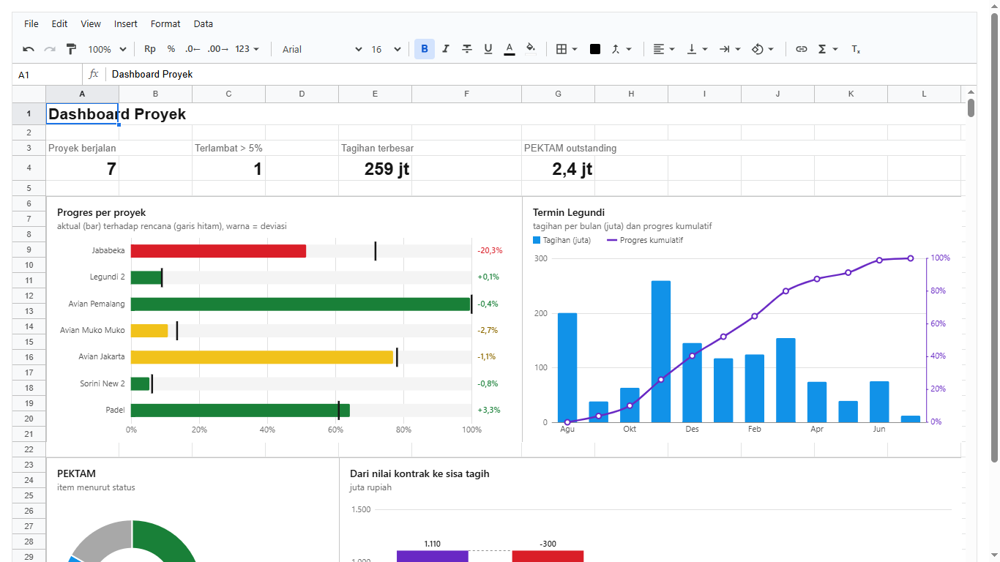

Dashboard proyek seperti di atas disusun dari tiga lapis:

1. **Form, pintu input.** Orang lapangan tidak mengetik di sheet. Mereka mengisi form di aplikasi Anda, misalnya "progres minggu ini 70,5%".
   Form itu menulis ke tabel.
2. **Tabel, sumber data.** Sheet biasa seperti `Progres`, `Termin`, `PEKTAM`: satu baris satu proyek, satu bulan, atau satu pekerjaan tambah.
   Bisa juga dibuat dengan tipe kolom ([bab 8](08-menjaga-isi.md)) supaya isinya selalu benar.
3. **Dashboard, hanya dibaca.** Satu sheet yang isinya **rumus dan chart saja**. Rumusnya membaca tabel, chart-nya membaca rumus atau tabel.
   Dengan hak akses ([bab 10](10-hak-akses.md)) sheet ini dikunci: semua orang bisa melihat, tidak ada yang bisa mengubah.

Karena dashboard hanya rumus dan chart, begitu satu angka di tabel berubah, semua yang membacanya ikut berubah saat itu juga. Tidak ada
tombol "refresh".

## 12.2 Chart menempel di sel

Chart di sheet ini tidak melayang bebas. Setiap chart berdiri di **`at`**, blok sel tempatnya (misalnya `'E2:K16'`), dan membaca datanya
dengan salah satu dari dua cara (atau keduanya sekaligus):

| Cara | Kapan | Bentuknya |
|---|---|---|
| **Blok** | cepat, sebagian besar kasus | `data: 'A1:C7'`: satu range, dibaca seperti Excel membaca pilihan sel (lihat di bawah) |
| **Range per seri** | kolomnya tidak bersebelahan, atau dari sheet lain | `categories: 'A2:A8'` untuk semua seri, lalu setiap seri punya `values` (Y) dan `name` atau `nameFrom` (sel namanya) |

Scatter memakai cara kedua: setiap seri punya `x` dan `values` sendiri ([12.11](#1211-seri-dari-range-sendiri-dan-scatter)).

Semua range itu disimpan menurut **id baris dan kolom**, seperti named range. Akibatnya:

- Baris disisipkan di atas chart: chart ikut turun. Kolom disisipkan di kiri data: range datanya ikut bergeser.
- Isi sel di range data berubah: chart langsung berubah.
- Chart ikut tersimpan di workbook (`toJSON`), dan saat diekspor ke .xlsx menjadi **chart Excel asli** di sel yang sama.

**Cara chart membaca blok** sama seperti Excel membaca pilihan sel:

- **Seri ke bawah atau ke samping.** Kalau range lebih tinggi daripada lebarnya, tiap kolom jadi satu seri. Kalau lebih lebar, tiap baris
  jadi satu seri. Pilihan `seriesIn: 'cols'` atau `'rows'` memaksanya.
- **Baris pertama berisi teks** (dan tidak ada angkanya) dipakai sebagai **nama seri**.
- **Kolom pertama berisi teks** dipakai sebagai **kategori**, misalnya nama bulan. Kalau tidak ada, kategorinya 1, 2, 3, dan seterusnya.
- **Sel yang bukan angka** dianggap kosong: garis putus di situ, kolomnya tidak digambar.

**Dua macam chart menurut latarnya:**

| `background` | Seperti apa | Untuk apa |
|---|---|---|
| `'white'` (bawaan) | kartu putih bergaris tepi. Klik untuk memilih, tarik untuk menggeser | chart biasa di dashboard |
| `'none'` | transparan, digambar **di atas** sel. Klik tembus ke sel di bawahnya. Chart dipilih lewat tepinya | kurva S di atas time schedule |

---

# Bagian B. Langkah demi langkah

## 12.3 Chart pertama

**Tujuan:** chart kolom dari tabel penjualan bulanan.

<!-- contoh: 12-03-kolom.page.tsx -->
```tsx
import { useState } from 'react';
import { Sheet } from '@kufayeka/sheet';
import { createWorkbook } from '@kufayeka/sheet/core';
import '@kufayeka/sheet/style.css';

// 12.3 Chart pertama: penjualan bahan per bulan sebagai chart kolom, menempel di sel E2:K16.
function buat() {
    const wb = createWorkbook();
    wb.setSettings({ locale: 'id-ID', currency: 'IDR' });
    const s = wb.sheet('Sheet1');
    s.setSheetProps({ name: 'Penjualan' });
    s.setValues('A1', [
        ['Bulan', 'Semen (zak)', 'Besi (batang)'],
        ['Mei', 182, 96], ['Jun', 205, 110], ['Jul', 171, 124], ['Agu', 226, 131], ['Sep', 244, 118], ['Okt', 263, 142]
    ]);
    s.setStyle('A1:C1', { bold: true, fill: '#eef2f7' });
    s.setColProps('B:C', { width: 110 });
    // baru: chart di sel E2:K16 yang membaca A1:C7
    s.addChart({ at: 'E2:K16', data: 'A1:C7', type: 'column', title: 'Penjualan per bulan' });
    return wb;
}

export default function Halaman() {
    const [wb] = useState(buat);
    return <div style={{ height: 710 }}><Sheet workbook={wb} /></div>;
}
```
<!-- /contoh -->

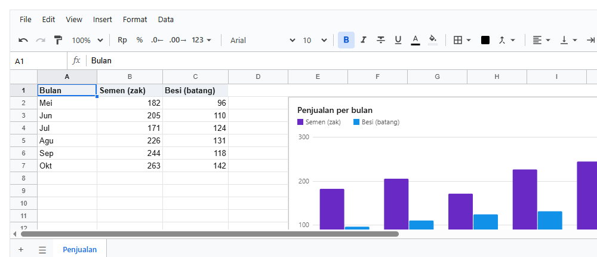

**Penjelasan:**

- `addChart` menerima `at` (tempat chart) dan `data` (range yang dibaca). Hasilnya id chart, dipakai untuk `setChart` dan `removeChart`.
- Bulan ada di kolom A, jadi menjadi kategori. "Semen (zak)" dan "Besi (batang)" di baris 1 menjadi nama seri.
- Arahkan mouse ke sebuah batang: nilainya muncul di kotak kecil.
- **Tanpa kode** pun bisa: pilih A1:C7, lalu **Insert → Chart**. Chart kolom langsung dibuat di sebelah kanan pilihan, lalu dipilih.

## 12.4 Mengatur chart dari layar

**Tujuan:** mengubah apa pun tentang chart tanpa kode. Halamannya sama dengan [12.3](#123-chart-pertama).

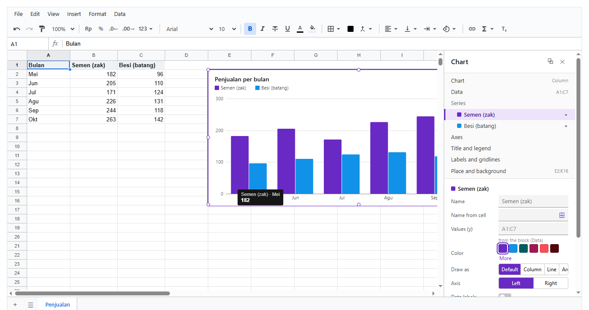

**Memilih dan memindah:**

- **Klik chart** untuk memilihnya. Bingkai ungu dan 8 titik pegangan muncul, dan **panel Chart** terbuka di kanan.
- **Tarik chart** untuk memindahkannya, dan **tarik titik pegangan** untuk mengubah ukurannya. Keduanya per sel penuh, karena chart menempel
  di sel.
- **Delete** menghapus chart yang dipilih. **Escape** melepasnya. Setiap perubahan bisa di-undo (Ctrl+Z).

**Panel Chart terdiri dari dua bagian:**

1. **Pohon** di atas berisi bagian-bagian chart: *Chart* (jenis), *Data*, *Series* (satu baris per seri; titik di kanan menyembunyikan
   atau menampilkan seri itu), *Axes*, *Title and legend*, *Labels and gridlines*, *Place and background*. Ada juga bagian yang hanya
   muncul untuk jenis tertentu: *Slices* (pie, donut), *Center* (donut), *Limits* (bullet), *Steps* (waterfall).
2. **Isian** di bawahnya: pengaturan bagian yang dipilih saja.

**Klik langsung di chart** memilih bagiannya: klik batang memilih serinya (seperti di foto), klik judul atau legenda memilih *Title and
legend*, klik angka sumbu memilih *Axes*, klik potongan pie memilih *Slices*.

**Cara isian bekerja:**

| Isian | Kapan berlaku |
|---|---|
| warna (6 warna cepat, **More** untuk warna lain, ↺ kembali ke bawaan) | langsung saat diklik |
| pilihan (misalnya Left / Right) dan saklar | langsung |
| teks dan angka | saat **Enter** atau saat pindah dari isian. Isian yang dikosongkan menghapus pengaturan itu |
| range, dengan tombol **⊞** | ketik range, atau klik ⊞ lalu pilih sel di grid |

**Tombol lain:**

- **Data → Add series**: seri baru tanpa range. Isi *Values* dengan ⊞, maka seri itu langsung tergambar.
- **⧉** di kepala panel menyalin gaya chart (jenis, warna, judul, legenda, sumbu, dan lainnya, tetapi bukan letak dan range-nya). Pilih chart
  lain, lalu **⎘** untuk menempelkannya.
- **Sparkline** punya panelnya sendiri, yang terbuka saat salah satu selnya dipilih ([12.10](#1210-sparkline-dan-data-bar)).

**Panel menawarkan semua yang bisa ditulis di kode.** Panel dibentuk dari daftar pengaturan yang sama dengan tabel di
[12.15](#1215-referensi), dan sebuah tes memastikan setiap pengaturan di types punya isiannya di panel.

Orang tanpa hak `chart` tetap melihat chart dan nilai saat mouse diarahkan, tetapi tidak bisa memilih, memindah, atau mengubahnya.

## 12.5 Kolom dan garis, dua sumbu

**Tujuan:** tagihan termin per bulan (kolom, dalam juta) dan progres kumulatif (garis, dalam persen) di satu chart.

<!-- contoh: 12-05-combo.page.tsx -->
```tsx
import { useState } from 'react';
import { Sheet } from '@kufayeka/sheet';
import { createWorkbook } from '@kufayeka/sheet/core';
import '@kufayeka/sheet/style.css';
import { TERMIN } from './data/proyek.js';

// 12.5 Kolom dan garis dengan dua sumbu: tagihan termin per bulan (kiri, juta) dan progres kumulatif (kanan, persen).
function buat() {
    const wb = createWorkbook();
    wb.setSettings({ locale: 'id-ID', currency: 'IDR' });
    const s = wb.sheet('Sheet1');
    s.setSheetProps({ name: 'Termin' });
    s.setValues('A1', [['Bulan', 'Tagihan (juta)', 'Progres kumulatif'], ...TERMIN]);
    s.setColProps('B:C', { width: 120 });
    s.setColProps('C', { width: 120, format: { type: 'percent', decimals: 1 } });
    s.setStyle('A1:C1', { bold: true, fill: '#eef2f7' });
    s.addChart({
        at: 'E1:L18', data: 'A1:C13', type: 'combo', title: 'Termin Legundi', subtitle: 'tagihan per bulan dan progres kumulatif', smooth: true,
        // baru: seri kedua digambar sebagai garis, di sumbu kanan
        series: [{ color: '#1192e8' }, { type: 'line', axis: 'right', color: '#6929c4' }]
    });
    return wb;
}

export default function Halaman() {
    const [wb] = useState(buat);
    return <div style={{ height: 560 }}><Sheet workbook={wb} /></div>;
}
```
<!-- /contoh -->

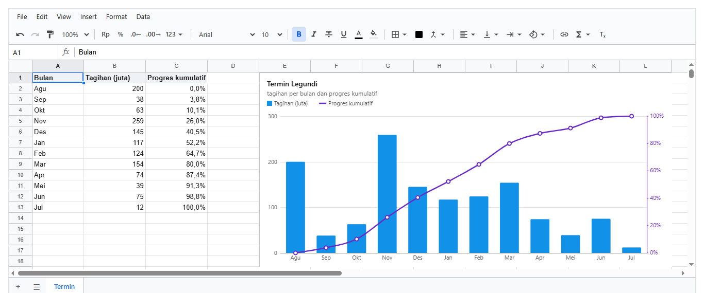

**Penjelasan:**

- `type: 'combo'` membuat seri digambar sebagai kolom, kecuali seri yang punya `type: 'line'` (atau `'area'`).
- `axis: 'right'` memberi seri itu **sumbu sendiri di kanan**. Ini perlu karena satuannya berbeda: juta rupiah dan persen.
- Sumbu kanan tertulis dalam persen karena sel di kolom C berformat persen. Sumbu **mengikuti format sel datanya**, jadi tidak perlu diatur.
- `smooth: true` membuat garis melengkung halus tanpa melewati puncak, sama seperti chart garis Nexa.

## 12.6 Pie dan donut

**Tujuan:** pembagian pekerjaan tambah menurut statusnya.

<!-- contoh: 12-06-donut.page.tsx -->
```tsx
import { useState } from 'react';
import { Sheet } from '@kufayeka/sheet';
import { createWorkbook } from '@kufayeka/sheet/core';
import '@kufayeka/sheet/style.css';
import { PEKTAM } from './data/proyek.js';

// 12.6 Pie dan donut: status pekerjaan tambah (PEKTAM), dihitung dengan COUNTIF dari tabelnya.
function buat() {
    const wb = createWorkbook();
    const s = wb.sheet('Sheet1');
    s.setSheetProps({ name: 'PEKTAM' });
    s.setValues('A1', [['Pekerjaan', 'Status'], ...PEKTAM.map((p) => [p[0], p[1]])]);
    s.setColProps('A', { width: 220 });
    s.setValues('D1', [['Status', 'Jumlah'], ...['Lunas', 'Retensi blm nagih', 'Submit', 'Cancel'].map((st, i) => [st, '=COUNTIF($B$2:$B$13,D' + (i + 2) + ')'])]);
    s.setColProps('D', { width: 130 });
    s.setStyle('A1:E1', { bold: true, fill: '#eef2f7' });
    const warna = ['#198038', '#f1c21b', '#1192e8', '#a8a8a8'];
    // baru: dua chart dari data yang sama, satu pie dan satu donut
    s.addChart({ at: 'D7:G18', data: 'D1:E5', type: 'pie', title: 'Pie', legend: 'right', labels: true, colors: warna });
    s.addChart({ at: 'H1:L18', data: 'D1:E5', type: 'donut', title: 'PEKTAM menurut status', legend: 'right', centerLabel: 'item', colors: warna });
    return wb;
}

export default function Halaman() {
    const [wb] = useState(buat);
    return <div style={{ height: 560 }}><Sheet workbook={wb} /></div>;
}
```
<!-- /contoh -->

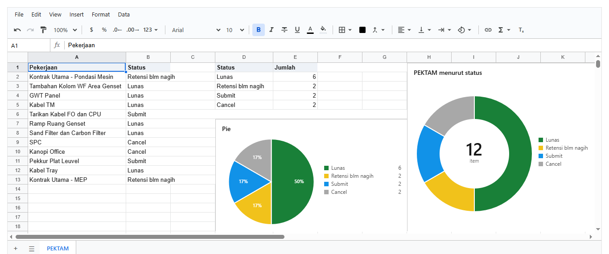

**Penjelasan:**

- Pie dan donut memakai **seri pertama** saja. Kategori jadi potongan, angkanya jadi besar potongan.
- Angka `Jumlah` dihitung dengan `COUNTIF` dari tabel, bukan diketik. Kalau status sebuah pekerjaan berubah, chart ikut berubah.
- `labels: true` menulis persen di setiap potongan yang cukup besar.
- Donut menulis totalnya di tengah. `centerLabel` mengganti tulisan kecil di bawahnya, dan `centerText` mengganti angkanya.
- `colors` memberi warna untuk tiap potongan secara berurutan, misalnya hijau untuk Lunas dan abu-abu untuk Cancel.

## 12.7 Bullet: aktual terhadap rencana

**Tujuan:** isi laporan progres mingguan ("aktual, rencana, deviasi") dalam satu gambar.

<!-- contoh: 12-07-bullet.page.tsx -->
```tsx
import { useState } from 'react';
import { Sheet } from '@kufayeka/sheet';
import { createWorkbook } from '@kufayeka/sheet/core';
import '@kufayeka/sheet/style.css';
import { PROGRES } from './data/proyek.js';

// 12.7 Bullet: progres aktual setiap proyek (bar) terhadap rencananya (garis hitam), warnanya menurut deviasi.
function buat() {
    const wb = createWorkbook();
    wb.setSettings({ locale: 'id-ID' });
    const s = wb.sheet('Sheet1');
    s.setSheetProps({ name: 'Progres' });
    s.setValues('A1', [['Proyek', 'Minggu', 'Aktual', 'Rencana'], ...PROGRES]);
    s.setColProps('A', { width: 140 });
    s.setColProps('C:D', { format: { type: 'percent', decimals: 2 } });
    s.setStyle('A1:D1', { bold: true, fill: '#eef2f7' });
    s.addChart({
        at: 'F1:L18', data: 'A1:D8', type: 'bullet', title: 'Progres per proyek', subtitle: 'merah: terlambat lebih dari 5%, kuning: lebih dari 1%',
        // baru: seri pertama (Minggu) disembunyikan; Aktual jadi bar, Rencana jadi garis target
        series: [{ hidden: true }], warn: 1, bad: 5
    });
    return wb;
}

export default function Halaman() {
    const [wb] = useState(buat);
    return <div style={{ height: 560 }}><Sheet workbook={wb} /></div>;
}
```
<!-- /contoh -->

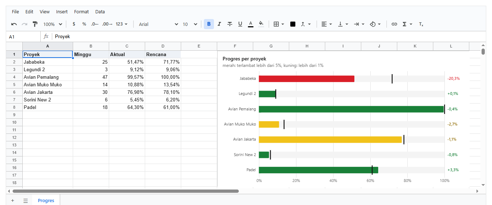

**Penjelasan:**

- Untuk setiap kategori (proyek): seri pertama yang tampil digambar sebagai **bar** (aktual), seri kedua sebagai **garis hitam** (rencana).
- Kolom Minggu ikut terbaca sebagai seri, jadi disembunyikan dengan `series: [{ hidden: true }]`.
- Warna bar menurut deviasi (aktual dikurangi rencana): **merah** kalau tertinggal lebih dari `bad` (bawaan 5), **kuning** kalau lebih dari
  `warn` (bawaan 1), **hijau** kalau tidak. Pada sumbu persen, batasnya dibaca sebagai **poin persen**: 5 berarti 5%.
- Angka deviasi tertulis di ujung kanan setiap baris.

## 12.8 Waterfall: dari kontrak ke sisa tagih

**Tujuan:** melihat ke mana nilai kontrak pergi.

<!-- contoh: 12-08-waterfall.page.tsx -->
```tsx
import { useState } from 'react';
import { Sheet } from '@kufayeka/sheet';
import { createWorkbook } from '@kufayeka/sheet/core';
import '@kufayeka/sheet/style.css';

// 12.8 Waterfall: dari nilai kontrak, dikurangi uang muka, termin, dan retensi, sampai sisa yang masih bisa ditagih.
function buat() {
    const wb = createWorkbook();
    wb.setSettings({ locale: 'id-ID' });
    const s = wb.sheet('Sheet1');
    s.setValues('A1', [['Langkah', 'Juta rupiah'], ['Nilai kontrak', 1110], ['Uang muka', -300], ['Termin 1-11', -520], ['Retensi ditahan', -55], ['Sisa tagih', null]]);
    s.setColProps('A', { width: 130 });
    s.setStyle('A1:B1', { bold: true, fill: '#eef2f7' });
    // baru: kategori pertama adalah total awal; sel terakhir kosong, jadi dihitung sebagai total akhir
    s.addChart({ at: 'D1:J18', data: 'A1:B6', type: 'waterfall', title: 'Dari nilai kontrak ke sisa tagih', subtitle: 'juta rupiah', totals: [0], downColor: '#1192e8' });
    return wb;
}

export default function Halaman() {
    const [wb] = useState(buat);
    return <div style={{ height: 560 }}><Sheet workbook={wb} /></div>;
}
```
<!-- /contoh -->

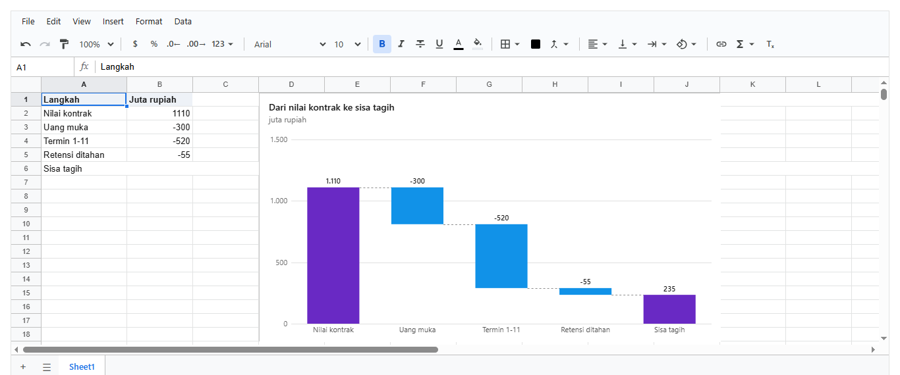

**Penjelasan:**

- Batang pertama adalah titik awal (`totals: [0]`, kategori pertama). Batang berikutnya naik atau turun sebesar angkanya.
- Sel terakhir dibiarkan **kosong**, jadi dihitung sebagai **total**: sisanya dijumlahkan oleh chart sendiri.
- `downColor`, `upColor`, dan `totalColor` mengatur warnanya. Bawaannya hijau naik, merah turun, ungu total. Di sini pengurangan dibuat
  biru, karena uang yang sudah dibayar bukan hal buruk.

## 12.9 Kurva S di atas time schedule

**Tujuan:** kurva S rencana dan realisasi, digambar tepat di atas kolom minggu time schedule.

<!-- contoh: 12-09-kurva-s.page.tsx -->
```tsx
import { useState } from 'react';
import { Sheet } from '@kufayeka/sheet';
import '@kufayeka/sheet/style.css';
import { buatJadwal } from './data/proyek.js';

// Kurva S di atas time schedule: chart garis transparan yang titik-titiknya jatuh di tengah kolom minggu.
function buat() {
    const wb = buatJadwal();
    const s = wb.sheet('Jadwal');
    s.addChart({
        at: 'E2:N9', data: 'E11:N12', type: 'line', seriesIn: 'rows',
        background: 'none', align: 'cells', grid: false, smooth: true, legend: 'top',
        y: { min: 0, max: 1 }, yAxis: true,
        series: [{ name: 'Rencana', axis: 'right' }, { name: 'Realisasi', axis: 'right', dash: true, color: '#1192e8', endLabel: 'Realisasi ' }]
    });
    return wb;
}

export default function Halaman() {
    const [wb] = useState(buat);
    return <div style={{ height: 420 }}><Sheet workbook={wb} /></div>;
}
```
<!-- /contoh -->

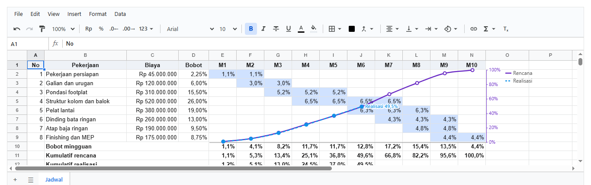

**Penjelasan:**

- Isi time schedule dibuat oleh `buatJadwal()` (file `data/proyek.js`, lihat [12.13](#1213-contoh-lengkap-dashboard-proyek)): bobot setiap
  pekerjaan dibagi rata ke minggu pelaksanaannya, lalu dijumlahkan menjadi baris "Bobot mingguan" dan "Kumulatif rencana". Semuanya rumus.
- **`background: 'none'`** membuat chart transparan. Bar jadwal di bawahnya tetap terlihat, dan klik di dalam chart tembus ke sel. Chart
  dipilih lewat **tepinya** (mouse berubah menjadi tanda geser).
- **`align: 'cells'`** membuat titik minggu ke-n jatuh **tepat di tengah kolom M-n**. Kalau kolom dilebarkan, kurvanya ikut menyesuaikan.
  Sumbu dan legenda digambar di luar blok sel, di sebelah kanan.
- Data E11:N12 lebih lebar daripada tingginya, jadi tiap baris menjadi satu seri. `seriesIn: 'rows'` hanya menegaskannya.
- Realisasi berhenti di minggu ke-6 karena sel M7–M10 masih kosong. `endLabel` menulis angka terakhirnya ("Realisasi 49,5%").
- `y: { min: 0, max: 1 }` mengunci sumbu dari 0% sampai 100%, supaya kurva tidak meregang saat progres masih kecil.

## 12.10 Sparkline dan data bar

**Tujuan:** tren 8 minggu di satu sel per proyek, dan bar di belakang angka aktual.

<!-- contoh: 12-10-sparkline.page.tsx -->
```tsx
import { useState } from 'react';
import { Sheet } from '@kufayeka/sheet';
import { createWorkbook } from '@kufayeka/sheet/core';
import '@kufayeka/sheet/style.css';
import { PROGRES } from './data/proyek.js';

// 12.10 Sparkline dan data bar: tren 8 minggu di satu sel per proyek, dan bar di belakang angka aktual.
function buat() {
    const wb = createWorkbook();
    wb.setSettings({ locale: 'id-ID' });
    const s = wb.sheet('Sheet1');
    s.setSheetProps({ name: 'Progres' });
    const minggu = ['M-7', 'M-6', 'M-5', 'M-4', 'M-3', 'M-2', 'M-1', 'M0'];
    s.setValues('A1', [['Proyek', 'Aktual', 'Tren 8 minggu', ...minggu],
        ...PROGRES.map(([nama, , aktual], i) => [nama, aktual, null, ...minggu.map((_, k) => Math.round(aktual * (0.55 + k * 0.0643 + Math.sin(k + i) * 0.01) * 1000) / 1000)])]);
    s.setColProps('A', { width: 140 });
    s.setColProps('B', { width: 110, format: { type: 'percent', decimals: 1 } });
    s.setColProps('C', { width: 150 });
    s.setColProps('D:K', { width: 56, format: { type: 'percent', decimals: 0 } });
    s.setStyle('A1:K1', { bold: true, fill: '#eef2f7' });
    // baru: sparkline di C2:C8, sel ke-i menggambar baris ke-i dari D2:K8
    s.addSparkline({ at: 'C2:C8', data: 'D2:K8', type: 'line', color: '#6929c4' });
    // baru: data bar di kolom Aktual (aturan conditional formatting)
    s.addConditional('B2:B8', { kind: 'bar', color: '#1192e8' });
    return wb;
}

export default function Halaman() {
    const [wb] = useState(buat);
    return <div style={{ height: 350 }}><Sheet workbook={wb} /></div>;
}
```
<!-- /contoh -->

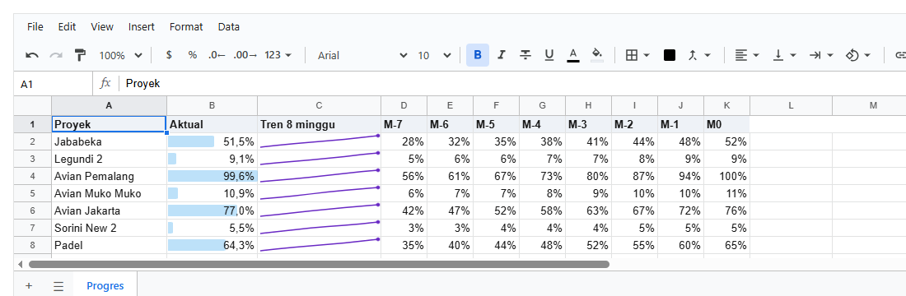

**Penjelasan:**

- **Sparkline** adalah chart kecil di dalam satu sel, tanpa sumbu. `addSparkline({ at: 'C2:C8', data: 'D2:K8' })` membuat sel ke-i dari C2:C8
  menggambar baris ke-i dari D2:K8. Kalau `at` berupa satu baris, sel ke-i menggambar kolom ke-i.
- Jenisnya `'line'` (titik di nilai terakhir), `'column'`, atau `'winloss'` (naik untuk positif, turun untuk negatif). Ikut bergeser
  bersama selnya, sama seperti chart.
- **Data bar** adalah aturan conditional formatting ([bab 6](06-format.md)) dengan `kind: 'bar'`: bar di belakang teks sel, sepanjang
  angkanya dibandingkan angka terbesar di range itu (dari 0 kalau semuanya positif). Data bar bisa dipakai bersama aturan warna lain.
  Dari layar: **Format → Conditional formatting**, tab **Data bar**.
- **Sparkline dari layar:** pilih range datanya (misalnya D2:K8), lalu **Insert → Sparkline**. Sparkline dibuat di kolom tepat di kanan
  pilihan, satu sel per baris (atau di baris tepat di bawahnya kalau pilihannya satu baris), dan panel **Sparklines** terbuka untuk mengatur
  jenis, warna, titik, min/max, dan range-nya. Klik sel sparkline kapan saja untuk membuka panel itu lagi.

## 12.11 Seri dari range sendiri, dan scatter

**Tujuan:** chart dari kolom yang tidak bersebelahan, dan scatter dengan X berupa tanggal yang jaraknya tidak rata.

<!-- contoh: 12-11-seri.page.tsx -->
```tsx
import { useState } from 'react';
import { Sheet } from '@kufayeka/sheet';
import { createWorkbook } from '@kufayeka/sheet/core';
import '@kufayeka/sheet/style.css';
import { PROGRES } from './data/proyek.js';

// 12.11 Seri dari range sendiri: Aktual di kolom C dan Rencana di kolom F, dengan kolom lain di antaranya. Lalu scatter: progres terhadap
// tanggal opname yang jaraknya tidak rata, dari sheet lain.
function buat() {
    const wb = createWorkbook();
    wb.setSettings({ locale: 'id-ID' });
    const s = wb.sheet('Sheet1');
    s.setSheetProps({ name: 'Progres' });
    s.setValues('A1', [['Proyek', 'Minggu', 'Aktual', 'Catatan', 'PIC', 'Rencana'], ...PROGRES.map(([p, m, a, r]) => [p, m, a, '', '', r])]);
    s.setColProps('A', { width: 130 });
    s.setColProps('C', { format: { type: 'percent', decimals: 1 } });
    s.setColProps('F', { format: { type: 'percent', decimals: 1 } });
    s.setStyle('A1:F1', { bold: true, fill: '#eef2f7' });
    // baru: tanpa data blok; kategori dan setiap seri menunjuk range-nya sendiri
    s.addChart({
        at: 'H1:L14', type: 'bullet', title: 'Aktual (C) terhadap Rencana (F)',
        categories: 'A2:A8', series: [{ nameFrom: 'C1', values: 'C2:C8' }, { nameFrom: 'F1', values: 'F2:F8' }]
    });
    const opname = wb.sheet(wb.addSheet('Opname'));
    opname.setValues('A1', [['Tanggal', 'Progres'], [46266, 0.02], [46280, 0.08], [46301, 0.21], [46309, 0.27], [46330, 0.44], [46337, 0.5]]);
    opname.setColProps('A', { format: { type: 'date' } });
    opname.setColProps('B', { format: { type: 'percent', decimals: 0 } });
    // baru: scatter, X dan Y setiap seri sendiri-sendiri; X tanggal dengan jarak sebenarnya
    s.addChart({
        at: 'A10:F24', type: 'scatter', title: 'Progres per tanggal opname', lines: true, smooth: true, legend: 'none',
        series: [{ name: 'Realisasi', x: 'Opname!A2:A7', values: 'Opname!B2:B7' }]
    });
    return wb;
}

export default function Halaman() {
    const [wb] = useState(buat);
    return <div style={{ height: 710 }}><Sheet workbook={wb} /></div>;
}
```
<!-- /contoh -->

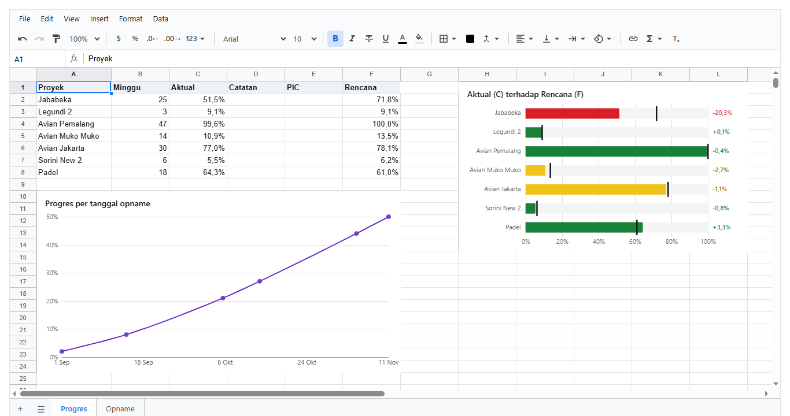

**Penjelasan:**

- Chart bullet tidak punya `data`. **`categories: 'A2:A8'`** memberi label untuk semua seri, dan setiap seri menunjuk range-nya sendiri:
  Aktual di kolom C, Rencana di kolom F. Kolom Catatan dan PIC di antaranya tidak mengganggu, dan tidak perlu menyembunyikan seri.
- **`nameFrom: 'C1'`** mengambil nama seri dari sel. Kalau judul kolomnya diubah, nama di chart ikut berubah. `name: 'Aktual'` menulis
  namanya langsung.
- Range bisa dari **sheet lain**: `'Opname!A2:A7'`.
- **Scatter**: setiap seri punya **`x`** dan **`values`** sendiri. Titik diletakkan menurut nilai X yang sebenarnya, jadi opname tanggal
  1 dan 22 Oktober berjarak tiga minggu, bukan satu langkah. Karena sel X berformat tanggal, sumbunya menulis tanggal.
- `lines: true` menyambung titik-titiknya dengan garis. Seri dengan `type: 'points'` tetap berupa titik saja.
- Kedua cara bisa digabung: blok `data` dibaca lebih dulu, lalu seri yang punya `values` sendiri ditambahkan sesudahnya. Di panel: **Data →
  Add series**.
- Di file Excel, setiap seri ditulis dengan range-nya sendiri (scatter menjadi scatter Excel), dan chart Excel yang datanya terpisah-pisah
  sekarang ikut masuk.

## 12.12 Form mengisi tabel, dashboard hanya dibaca

**Tujuan:** alur lengkap dari [12.1](#121-form-tabel-dashboard). Pilih proyek, isi progres, simpan, dan chart di dashboard langsung berubah.

<!-- contoh: 12-12-form.page.tsx -->
```tsx
import { useState } from 'react';
import { Sheet } from '@kufayeka/sheet';
import { createWorkbook, type AccessRow } from '@kufayeka/sheet/core';
import '@kufayeka/sheet/style.css';
import { PROGRES } from './data/proyek.js';

// 12.12 Form sebagai pintu input, tabel sebagai sumber data, dashboard read-only: orang lapangan mengisi progres lewat form biasa,
// angkanya masuk ke tabel Progres, dan chart di sheet Dashboard langsung ikut berubah. Dashboard tidak bisa diedit siapa pun.
function buat() {
    const wb = createWorkbook();
    wb.setSettings({ locale: 'id-ID' });
    const tabel = wb.sheet('Sheet1');
    tabel.setSheetProps({ name: 'Progres' });
    tabel.setValues('A1', [['Proyek', 'Minggu', 'Aktual', 'Rencana'], ...PROGRES]);
    tabel.setColProps('C:D', { format: { type: 'percent', decimals: 2 } });
    const dash = wb.sheet(wb.addSheet('Dashboard'));
    dash.setValues('A1', [['Rata-rata deviasi', '=AVERAGE(Progres!C2:C8)-AVERAGE(Progres!D2:D8)']]);
    dash.setStyle('B1', { bold: true, format: { type: 'percent', decimals: 2 } });
    dash.setColProps('A', { width: 140 });
    dash.addChart({ at: 'A3:H18', data: 'Progres!A1:D8', type: 'bullet', title: 'Progres per proyek', series: [{ hidden: true }] });
    return wb;
}
// baru: dashboard hanya untuk dibaca, chart pun tidak bisa digeser atau diubah
const akses: AccessRow[] = [{ who: '*', effect: 'allow', action: 'read' }];

export default function Halaman() {
    const [wb] = useState(buat);
    const [proyek, setProyek] = useState(PROGRES[0][0]);
    const [aktual, setAktual] = useState('');
    // baru: form biasa milik aplikasi Anda; tombolnya menulis ke tabel lewat kode (kode tidak dibatasi aturan akses, orang yang dibatasi)
    function simpan() {
        const baris = PROGRES.findIndex((p) => p[0] === proyek) + 2;
        const angka = Number(aktual.replace(',', '.')) / 100;
        if (!Number.isFinite(angka)) return;
        wb.sheet('Progres').setValues('C' + baris, angka);
        setAktual('');
    }
    return (
        <div>
            <form className="form-progres" onSubmit={(e) => { e.preventDefault(); simpan(); }} style={{ display: 'flex', gap: 8, alignItems: 'end', marginBottom: 10 }}>
                <label>Proyek<br /><select value={proyek} onChange={(e) => setProyek(e.target.value)}>{PROGRES.map((p) => <option key={p[0]}>{p[0]}</option>)}</select></label>
                <label>Aktual (%)<br /><input value={aktual} onChange={(e) => setAktual(e.target.value)} placeholder="mis. 74,2" /></label>
                <button type="submit">Simpan progres</button>
            </form>
            <div style={{ height: 420 }}>
                <Sheet workbook={wb} sheet={wb.sheetIdByName('Dashboard')} access={{ rows: akses, who: 'tamu' }} marks={false} />
            </div>
        </div>
    );
}
```
<!-- /contoh -->

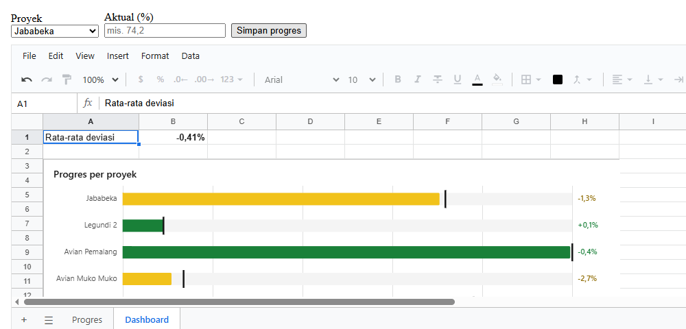

**Penjelasan:**

- **Form** adalah form biasa milik aplikasi Anda. Tombolnya memanggil `setValues` ke tabel Progres. Validasi isinya bisa dilakukan di form,
  atau dengan tipe kolom di tabel ([bab 8](08-menjaga-isi.md)).
- **Dashboard** ditampilkan dengan baris akses `read` saja ([bab 10](10-hak-akses.md)). Sel tidak bisa diedit, dan chart tidak bisa dipilih,
  digeser, atau diubah. Nilai saat mouse diarahkan tetap muncul. `marks={false}` menyembunyikan gembok di setiap sel, karena semuanya memang
  terkunci.
- Kode aplikasi Anda **tidak dibatasi** baris akses. Yang dibatasi adalah orang yang memakai sheet. Karena itu form tetap bisa menulis ke
  tabel walaupun dashboard dikunci.
- Rumus "Rata-rata deviasi" di B1 dan chart sama-sama membaca sheet Progres, jadi keduanya berubah bersamaan.

---

# Bagian C. Contoh lengkap, yang sering keliru, dan referensi

## 12.13 Contoh lengkap: dashboard proyek

Satu workbook dengan sheet Jadwal (kurva S), tiga sheet tabel (Progres, Termin, PEKTAM), dan sheet Dashboard yang hanya berisi rumus,
chart, sparkline, dan data bar.

<!-- contoh: 12-13-dashboard.page.tsx -->
```tsx
import { useState } from 'react';
import { Sheet } from '@kufayeka/sheet';
import '@kufayeka/sheet/style.css';
import { buatDashboard } from './data/proyek.js';

// Dashboard: sheet yang hanya berisi rumus dan chart dari sheet-sheet tabel.
export default function Halaman() {
    const [wb] = useState(() => { const w = buatDashboard(); return w; });
    return <div style={{ height: 900 }}><Sheet workbook={wb} sheet={wb.sheetIdByName("Dashboard")} /></div>;
}
```
<!-- /contoh -->


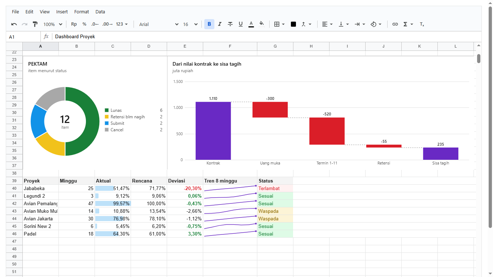

Semua data dan chart-nya dibuat di `data/proyek.js`:

<!-- contoh: data/proyek.js -->
```js
import { createWorkbook } from '@kufayeka/sheet/core';

// Data proyek untuk bab Dashboard: time schedule gudang 10 minggu (bobot, rencana per minggu, kumulatif, realisasi), progres beberapa proyek,
// tagihan termin, dan daftar pekerjaan tambah (PEKTAM). Angkanya contoh, bentuknya seperti laporan proyek sungguhan.

export const PEKERJAAN = [
    ['Pekerjaan persiapan', 45000000, 1, 2],
    ['Galian dan urugan', 120000000, 2, 3],
    ['Pondasi footplat', 310000000, 3, 5],
    ['Struktur kolom dan balok', 520000000, 4, 7],
    ['Pelat lantai', 380000000, 6, 8],
    ['Dinding bata ringan', 260000000, 7, 9],
    ['Atap baja ringan', 190000000, 8, 9],
    ['Finishing dan MEP', 175000000, 9, 10]
];
export const REALISASI = [1.2, 5.1, 13.0, 24.5, 37.0, 49.5];

/**
 * Sheet "Jadwal": A1:N1 judul kolom (No, Pekerjaan, Biaya, Bobot, M1 ... M10), satu baris per pekerjaan dengan bobot dibagi rata ke minggu-minggunya,
 * lalu baris "Bobot mingguan", "Kumulatif rencana", dan "Kumulatif realisasi". Semua angka bobot dan kumulatif adalah rumus.
 */
export function buatJadwal(wb = createWorkbook()) {
    wb.setSettings({ locale: 'id-ID', currency: 'IDR' });
    const s = wb.sheet(wb.sheetIds()[0]);
    s.setSheetProps({ name: 'Jadwal' });
    const minggu = Array.from({ length: 10 }, (_, i) => 'M' + (i + 1));
    s.setValues('A1', [['No', 'Pekerjaan', 'Biaya', 'Bobot', ...minggu]]);
    const n = PEKERJAAN.length, akhir = n + 1;
    PEKERJAAN.forEach(([nama, biaya, dari, sampai], i) => {
        const r = i + 2;
        const baris = [i + 1, nama, biaya, '=C' + r + '/SUM($C$2:$C$' + akhir + ')'];
        // bobot pekerjaan dibagi rata ke minggu-minggu pelaksanaannya
        for (let m = 1; m <= 10; m++) baris.push(m >= dari && m <= sampai ? '=$D' + r + '/' + (sampai - dari + 1) : null);
        s.setValues('A' + r, [baris]);
    });
    const kol = (m) => String.fromCharCode(68 + m); // M1 di kolom E
    const rb = akhir + 1, rk = akhir + 2, rr = akhir + 3;
    s.setValues('B' + rb, [['Bobot mingguan', null, null, ...minggu.map((_, i) => '=SUM(' + kol(i + 1) + '2:' + kol(i + 1) + akhir + ')')]]);
    s.setValues('B' + rk, [['Kumulatif rencana', null, null, ...minggu.map((_, i) => '=SUM($E' + rb + ':' + kol(i + 1) + rb + ')')]]);
    s.setValues('B' + rr, [['Kumulatif realisasi', null, null, ...REALISASI.map((x) => x / 100)]]);
    s.setColProps('A', { width: 40 });
    s.setColProps('B', { width: 190 });
    s.setColProps('C', { width: 120, format: { type: 'money', decimals: 0 } });
    s.setColProps('D', { width: 70, format: { type: 'percent', decimals: 2 } });
    s.setColProps('E:N', { width: 64, format: { type: 'percent', decimals: 1 } });
    s.setStyle('A1:N1', { bold: true, fill: '#eef2f7', align: 'center' });
    s.setStyle('B' + rb + ':N' + rr, { bold: true });
    // bar jadwal: sel minggu yang terisi diberi warna, seperti time schedule di kertas
    s.addConditional('E2:N' + akhir, { op: 'formula', formula: '=E2<>""', style: { fill: '#d0e2ff' } });
    return wb;
}

// progres mingguan per proyek, seperti laporan yang dikirim ke grup: minggu ke berapa, aktual, rencana
export const PROGRES = [
    ['Jababeka', 25, 0.5147, 0.7177], ['Legundi 2', 3, 0.0912, 0.0906], ['Avian Pemalang', 47, 0.99573, 1], ['Avian Muko Muko', 14, 0.1088, 0.13536],
    ['Avian Jakarta', 30, 0.7698, 0.781], ['Sorini New 2', 6, 0.0545, 0.062], ['Padel', 18, 0.643, 0.61]
];
// tagihan termin satu proyek (juta rupiah): bulan, nilai tagihan, progres kumulatif
export const TERMIN = [['Agu', 200, 0], ['Sep', 38, 0.038], ['Okt', 63, 0.101], ['Nov', 259, 0.26], ['Des', 145, 0.405], ['Jan', 117, 0.522], ['Feb', 124, 0.647],
    ['Mar', 154, 0.8], ['Apr', 74, 0.874], ['Mei', 39, 0.913], ['Jun', 75, 0.988], ['Jul', 12, 1]];
// pekerjaan tambah: nama, status, nilai, terbayar (rupiah)
export const PEKTAM = [
    ['Kontrak Utama - Pondasi Mesin', 'Retensi blm nagih', 1000000, 950000], ['Tambahan Kolom WF Area Genset', 'Lunas', 1000000, 1000000],
    ['GWT Panel', 'Lunas', 1000000, 1000000], ['Kabel TM', 'Lunas', 1000000, 1000000], ['Tarikan Kabel FO dan CPU', 'Submit', 1500000, 0],
    ['Ramp Ruang Genset', 'Lunas', 1000000, 1000000], ['Sand Filter dan Carbon Filter', 'Lunas', 1000000, 1000000], ['SPC', 'Cancel', 0, 0],
    ['Kanopi Office', 'Cancel', 0, 0], ['Pekkur Plat Leuvel', 'Submit', 750000, 0], ['Kabel Tray', 'Lunas', 19801689, 19801689],
    ['Kontrak Utama - MEP', 'Retensi blm nagih', 1000000, 950000]
];

/**
 * Workbook dashboard: tiga sheet tabel (Progres, Termin, PEKTAM) sebagai sumber data, lalu sheet Dashboard yang hanya berisi rumus dan chart.
 * Sheet Jadwal (kurva S) ikut di dalamnya.
 */
export function buatDashboard() {
    const wb = buatJadwal();
    const progres = wb.sheet(wb.addSheet('Progres'));
    progres.setValues('A1', [['Proyek', 'Minggu', 'Aktual', 'Rencana', 'Deviasi'], ...PROGRES.map((p, i) => [...p, '=C' + (i + 2) + '-D' + (i + 2)])]);
    progres.setColProps('A', { width: 150 });
    progres.setColProps('C:E', { format: { type: 'percent', decimals: 2 } });
    progres.setStyle('A1:E1', { bold: true, fill: '#eef2f7' });
    // tren 8 minggu terakhir (aktual kumulatif per minggu) untuk sparkline: kolom G sampai N
    progres.setValues('G1', [['M-7', 'M-6', 'M-5', 'M-4', 'M-3', 'M-2', 'M-1', 'M0'],
        ...PROGRES.map(([, , aktual], i) => Array.from({ length: 8 }, (_, k) => Math.round(Math.max(0, aktual * (0.55 + k * 0.0643) + Math.sin(k + i) * 0.006) * 10000) / 10000))]);
    progres.setColProps('G:N', { width: 56, format: { type: 'percent', decimals: 1 } });

    const termin = wb.sheet(wb.addSheet('Termin'));
    termin.setValues('A1', [['Bulan', 'Tagihan (juta)', 'Progres kumulatif'], ...TERMIN]);
    termin.setColProps('C', { format: { type: 'percent', decimals: 1 } });
    termin.setStyle('A1:C1', { bold: true, fill: '#eef2f7' });

    const pektam = wb.sheet(wb.addSheet('PEKTAM'));
    pektam.setValues('A1', [['Pekerjaan', 'Status', 'Nilai', 'Terbayar', 'Outstanding'], ...PEKTAM.map((p, i) => [...p, '=C' + (i + 2) + '-D' + (i + 2)])]);
    pektam.setColProps('A', { width: 220 });
    pektam.setColProps('C:E', { width: 120, format: { type: 'money', decimals: 0 } });
    pektam.setStyle('A1:E1', { bold: true, fill: '#eef2f7' });
    // rekap status untuk donut: dihitung dengan COUNTIF dari tabel, bukan diketik
    pektam.setValues('G1', [['Status', 'Jumlah'], ...['Lunas', 'Retensi blm nagih', 'Submit', 'Cancel'].map((st, i) => [st, '=COUNTIF($B$2:$B$13,G' + (i + 2) + ')'])]);

    const dash = wb.sheet(wb.addSheet('Dashboard'));
    dash.setColProps('A:L', { width: 100 });
    dash.setValues('A1', [['Dashboard Proyek']]);
    dash.setStyle('A1', { bold: true, fontSize: 16 });
    // kartu angka: rumus dari tabel
    dash.setValues('A3', [['Proyek berjalan', null, 'Terlambat > 5%', null, 'Tagihan terbesar', null, 'PEKTAM outstanding'],
        ['=COUNTA(Progres!A2:A8)', null, '=COUNTIF(Progres!E2:E8,"<-0.05")', null, '=MAX(Termin!B2:B13)', null, '=SUM(PEKTAM!E2:E13)/1000000']]);
    dash.setStyle('A3:H3', { color: '#6f6f6f' });
    dash.setStyle('A4:H4', { bold: true, fontSize: 18 });
    dash.setStyle('E4', { format: { type: 'number', decimals: 0, suffix: ' jt' } });
    dash.setStyle('G4', { format: { type: 'number', decimals: 1, suffix: ' jt' } });
    dash.setRowProps('4', { height: 34 });
    // bullet: kategori di kolom A, seri pertama Minggu (disembunyikan), lalu Aktual (bar) dan Rencana (garis target)
    dash.addChart({ at: 'A6:F21', data: 'Progres!A1:D8', type: 'bullet', title: 'Progres per proyek', subtitle: 'aktual (bar) terhadap rencana (garis hitam), warna = deviasi',
        series: [{ hidden: true }] });
    // column + line dengan dua sumbu: tagihan per bulan (kiri) dan progres kumulatif (kanan)
    dash.addChart({ at: 'G6:L21', data: 'Termin!A1:C13', type: 'combo', title: 'Termin Legundi', subtitle: 'tagihan per bulan (juta) dan progres kumulatif',
        smooth: true, series: [{ color: '#1192e8' }, { type: 'line', axis: 'right', color: '#6929c4' }] });
    // donut status PEKTAM dari rekap COUNTIF
    dash.addChart({ at: 'A23:D37', data: 'PEKTAM!G1:H5', type: 'donut', title: 'PEKTAM', subtitle: 'item menurut status', legend: 'right', centerLabel: 'item',
        colors: ['#198038', '#f1c21b', '#1192e8', '#a8a8a8'] });
    // waterfall: dari nilai kontrak ke sisa tagih
    dash.setValues('N1', [['Langkah', 'Juta'], ['Kontrak', 1110], ['Uang muka', -300], ['Termin 1-11', -520], ['Retensi', -55], ['Sisa tagih', null]]);
    dash.addChart({ at: 'E23:L37', data: 'N1:O6', type: 'waterfall', title: 'Dari nilai kontrak ke sisa tagih', subtitle: 'juta rupiah', totals: [0] });
    // tabel ringkas di bawah chart: rumus dari sheet Progres, data bar di kolom Aktual, sparkline tren, dan status berwarna
    dash.setValues('A39', [['Proyek', 'Minggu', 'Aktual', 'Rencana', 'Deviasi', 'Tren 8 minggu', 'Status']]);
    for (let i = 0; i < PROGRES.length; i++) {
        const r = 40 + i, p = i + 2;
        dash.setValues('A' + r, [['=Progres!A' + p, '=Progres!B' + p, '=Progres!C' + p, '=Progres!D' + p, '=Progres!E' + p, null,
            '=IF(E' + r + '<-0.05,"Terlambat",IF(E' + r + '<-0.01,"Waspada","Sesuai"))']]);
    }
    dash.setStyle('A39:G39', { bold: true, fill: '#f4f4f4' });
    dash.setStyle('C40:E46', { format: { type: 'percent', decimals: 2 } });
    dash.setColProps('F', { width: 150 });
    dash.addConditional('C40:C46', { kind: 'bar', color: '#1192e8' });
    dash.addConditional('E40:E46', { op: 'lt', a: -0.05, style: { color: '#da1e28', bold: true } });
    dash.addConditional('E40:E46', { op: 'gte', a: -0.01, style: { color: '#198038', bold: true } });
    dash.addConditional('G40:G46', { op: 'textIs', a: 'Terlambat', style: { color: '#da1e28', fill: '#fff1f1' } });
    dash.addConditional('G40:G46', { op: 'textIs', a: 'Waspada', style: { color: '#8e6a00', fill: '#fcf4d6' } });
    dash.addConditional('G40:G46', { op: 'textIs', a: 'Sesuai', style: { color: '#198038', fill: '#defbe6' } });
    dash.addSparkline({ at: 'F40:F46', data: 'Progres!G2:N8', type: 'line', color: '#6929c4' });
    return wb;
}
```
<!-- /contoh -->

**Yang perlu diperhatikan:**

- **Kartu angka** (baris 3–4) adalah sel biasa: rumus seperti `=COUNTIF(Progres!E2:E8,"<-0.05")`, huruf besar, dan format dengan akhiran
  `' jt'`. Tidak perlu komponen khusus.
- **Status berwarna** di kolom G adalah rumus `IF` biasa, ditambah tiga aturan conditional formatting `textIs`.
- **Chart membaca sheet lain** lewat `data: 'Progres!A1:D8'`. Sheet Dashboard sendiri tidak menyimpan angka mentah.

## 12.14 Yang sering keliru

| Gejala | Penyebab | Perbaikan |
|---|---|---|
| Chart menampilkan "No data" | range `data` tidak berisi angka, atau barisnya sudah dihapus | periksa `charts()[i].dataText`, lalu `setChart(id, { data: '...' })` |
| Nama seri tertulis "Series 1" | baris pertama range berisi angka, bukan teks | sertakan baris judul di range, atau beri `series: [{ name: '...' }]` |
| Kategori terbaca sebagai seri (ada batang "Tahun") | kolom kategori berisi angka (2024, 2025) | `categories: true` memaksa kolom pertama menjadi kategori |
| Seri dan kategori tertukar | range lebih lebar daripada tingginya, atau sebaliknya | `seriesIn: 'cols'` atau `'rows'` |
| Bullet semuanya hijau | batas `warn`/`bad` dalam angka biasa, padahal sel berformat persen | pada sumbu persen batasnya poin persen: `bad: 5` berarti 5% |
| Kurva S tidak lurus dengan kolom minggu | `align` masih `'fit'` | `align: 'cells'`, dan `at` tepat di kolom minggu |
| Sel di bawah kurva S tidak bisa diklik | chart masih berlatar putih | `background: 'none'` |
| Orang bisa menggeser chart di dashboard | baris akses memberi `chart` atau `*` | dashboard cukup `read` saja |
| Ada kolom yang tidak diinginkan ikut jadi seri | blok `data` mencakup kolom di antaranya | pakai range per seri ([12.11](#1211-seri-dari-range-sendiri-dan-scatter)), atau sembunyikan seri itu |
| Titik scatter berjarak sama padahal tanggalnya tidak | chart masih jenis line (X sebagai kategori) | `type: 'scatter'` dengan `x` per seri |
| Seri baru dari "Add series" tidak tergambar | belum punya range `values` | isi *Values* dengan ⊞ |

## 12.15 Referensi

### Semua pengaturan

Tabel ini dicetak dari daftar yang juga membentuk panel Chart, jadi selalu lengkap: setiap baris adalah satu isian di panel (node pohon →
isian) sekaligus satu kunci di kode. Kunci `series.x` berarti kunci `x` di salah satu isi daftar `series`, dan `y.min` berarti `min` di
dalam `y`.

<!-- hasil: 12-pengaturan.js -->
```text
**Chart** (`addChart`, `setChart`; di panel: node pohon → isian)

| Node | Isian | Kunci | Jenis isian | Untuk chart | Keterangan |
|---|---|---|---|---|---|
| Chart | Type | `type` | kartu jenis | semua |  |
| Data | Block | `data` | range (⊞ dari grid) | semua | One block read as Excel reads a selection; leave it empty for series of their own ranges |
| Data | Series in | `seriesIn` | pilihan: Auto, Columns, Rows | semua |  |
| Data | Categories | `categories` | range (⊞ dari grid) | column, bar, line, area, combo, bullet, waterfall, pie, donut | A range of labels every series shares (or the first column of the block) |
| Series → (satu seri) | Name | `series.name` | teks | semua |  |
| Series → (satu seri) | Name from cell | `series.nameFrom` | range (⊞ dari grid) | semua |  |
| Series → (satu seri) | Values (y) | `series.values` | range (⊞ dari grid) | semua | Its own range (a series past the block's) |
| Series → (satu seri) | X values | `series.x` | range (⊞ dari grid) | scatter |  |
| Series → (satu seri) | Color | `series.color` | warna | semua |  |
| Series → (satu seri) | Draw as | `series.type` | pilihan: Default, Column, Line, Area | column, line, area, combo |  |
| Series → (satu seri) | Draw as | `series.type` | pilihan: Default, Line, Points | scatter |  |
| Series → (satu seri) | Axis | `series.axis` | pilihan: Left, Right | column, line, area, combo |  |
| Series → (satu seri) | Dashed | `series.dash` | saklar | line, area, combo, scatter |  |
| Series → (satu seri) | Line width | `series.width` | angka (px) | line, area, combo, scatter |  |
| Series → (satu seri) | Smooth | `series.smooth` | saklar | line, area, combo, scatter |  |
| Series → (satu seri) | Markers | `series.markers` | saklar | line, area, combo |  |
| Series → (satu seri) | Point size | `series.size` | angka (px) | scatter |  |
| Series → (satu seri) | Data labels | `series.labels` | saklar | semua |  |
| Series → (satu seri) | End label | `series.endLabel` | teks | line, area, combo, scatter | Text before the last value, at the end of the line |
| Series → (satu seri) | Hidden | `series.hidden` | saklar | semua |  |
| Axes → Value axis (left) | Min | `y.min` | angka | column, bar, line, area, combo, scatter, bullet, waterfall |  |
| Axes → Value axis (left) | Max | `y.max` | angka | column, bar, line, area, combo, scatter, bullet, waterfall |  |
| Axes → Value axis (left) | Before | `y.prefix` | teks | column, bar, line, area, combo, scatter, bullet, waterfall, pie, donut |  |
| Axes → Value axis (left) | After | `y.suffix` | teks | column, bar, line, area, combo, scatter, bullet, waterfall, pie, donut |  |
| Axes → Value axis (left) | Decimals | `y.decimals` | angka | column, bar, line, area, combo, scatter, bullet, waterfall, pie, donut |  |
| Axes → Value axis (left) | Percent | `y.percent` | saklar | column, bar, line, area, combo, scatter, bullet, waterfall, pie, donut | Write 0.5 as 50% (on its own when the cells are percents) |
| Axes → Right axis | Min | `y2.min` | angka | column, bar, line, area, combo, scatter, bullet, waterfall |  |
| Axes → Right axis | Max | `y2.max` | angka | column, bar, line, area, combo, scatter, bullet, waterfall |  |
| Axes → Right axis | Before | `y2.prefix` | teks | column, bar, line, area, combo, scatter, bullet, waterfall, pie, donut |  |
| Axes → Right axis | After | `y2.suffix` | teks | column, bar, line, area, combo, scatter, bullet, waterfall, pie, donut |  |
| Axes → Right axis | Decimals | `y2.decimals` | angka | column, bar, line, area, combo, scatter, bullet, waterfall, pie, donut |  |
| Axes → Right axis | Percent | `y2.percent` | saklar | column, bar, line, area, combo, scatter, bullet, waterfall, pie, donut | Write 0.5 as 50% (on its own when the cells are percents) |
| Axes → X axis | Min | `x.min` | angka | scatter |  |
| Axes → X axis | Max | `x.max` | angka | scatter |  |
| Axes → X axis | Before | `x.prefix` | teks | scatter |  |
| Axes → X axis | After | `x.suffix` | teks | scatter |  |
| Axes → X axis | Decimals | `x.decimals` | angka | scatter |  |
| Axes → X axis | Percent | `x.percent` | saklar | scatter |  |
| Axes → Show | Show the value axis | `yAxis` | saklar | semua |  |
| Axes → Show | Show the categories (x) | `xAxis` | saklar | semua |  |
| Title and legend | Title | `title` | teks | semua |  |
| Title and legend | Subtitle | `subtitle` | teks | semua |  |
| Title and legend | Legend | `legend` | pilihan: Top, Right, Bottom, Off | semua |  |
| Labels and gridlines | Data labels | `labels` | saklar | semua |  |
| Labels and gridlines | Gridlines | `grid` | saklar | column, bar, line, area, combo, scatter, bullet, waterfall |  |
| Labels and gridlines | Stacked | `stacked` | saklar | column, bar, area, combo |  |
| Labels and gridlines | Smooth lines | `smooth` | saklar | line, area, combo, scatter |  |
| Labels and gridlines | Markers | `markers` | saklar | line, area, combo |  |
| Labels and gridlines | Lines through the points | `lines` | saklar | scatter |  |
| Place and background | Cells | `at` | range (⊞ dari grid) | semua | The block of cells the chart stands on |
| Place and background | Background | `background` | pilihan: White, Transparent | semua | Transparent: over the cells, a click goes through; pick it by its edge |
| Place and background | Points | `align` | pilihan: Fit, On the columns | column, line, area, combo | On the columns: category i in the middle of column i of its cells (an S-curve over a schedule) |
| Slices | Colors | `colors` | warna per potongan | pie, donut | One per slice, in the order of the categories |
| Center | Center text | `centerText` | teks | donut |  |
| Center | Under it | `centerLabel` | teks | donut |  |
| Limits | Amber when below by | `warn` | angka | bullet |  |
| Limits | Red when below by | `bad` | angka | bullet |  |
| Steps | Totals (category numbers) | `totals` | nomor kategori | waterfall | From 1; the last one is a total when its cell is empty |
| Steps | Up | `upColor` | warna | waterfall |  |
| Steps | Down | `downColor` | warna | waterfall |  |
| Steps | Total | `totalColor` | warna | waterfall |  |

**Sparkline** (`addSparkline`, `setSparkline`; panelnya terbuka saat sel sparkline dipilih)

| Node | Isian | Kunci | Jenis isian | Untuk | Keterangan |
|---|---|---|---|---|---|
| Sparklines | Type | `type` | pilihan: Line, Column, Win/loss | semua |  |
| Sparklines | Color | `color` | warna | semua |  |
| Sparklines | Negative | `negColor` | warna | semua |  |
| Sparklines | Dots | `markers` | pilihan: Last, All, None | semua |  |
| Sparklines | Min | `min` | angka | semua |  |
| Sparklines | Max | `max` | angka | semua |  |
| Sparklines | Cells | `at` | range (⊞ dari grid) | semua |  |
| Sparklines | Data | `data` | range (⊞ dari grid) | semua |  |
```
<!-- /hasil -->

Bawaannya: `type: 'column'`, `seriesIn: 'auto'`, `legend: 'top'`, `grid: true`, `markers: true`, `background: 'white'`, `align: 'fit'`, sumbu
menurut format sel datanya, warna dari palet Carbon, bullet `warn: 1` dan `bad: 5`, waterfall `totals: [0]`.

### Fungsi

| Fungsi | Artinya |
|---|---|
| `addChart(spec)` | chart baru (`at`, lalu `data` atau seri dengan `values` sendiri). Mengembalikan id |
| `setChart(id, patch)` | ubah sebagian pengaturan (`at` dan `data` sebagai teks range) |
| `removeChart(id)` | hapus chart |
| `charts()` | semua chart sheet: pengaturannya (range sebagai teks), `at` dan `atText`, `dataText`, `dataAt` |
| `chartData(id)` | yang digambar sekarang: `{ categories, series: [{ name, values, x?, format, ... }], seriesIn, layout, fromBlock }` |
| `CHART_FIELDS`, `SPARKLINE_FIELDS`, `CHART_NODES` | daftar semua pengaturan seperti yang ditawarkan panel (dari `@kufayeka/sheet/core`) |
| `addSparkline({ at, data, type, color, negColor, markers, min, max })` | sparkline di sel `at`. Mengembalikan id grup |
| `setSparkline(id, patch)`, `removeSparkline(id)`, `sparklines()` | ubah, hapus, dan daftar grup sparkline (dengan angka setiap selnya) |
| `addConditional(range, { kind: 'bar', color })` | data bar ([bab 6](06-format.md)) |
| `chartSeries(block, spec)` | dari `@kufayeka/sheet/core`: cara range dibaca, tanpa workbook |
| `CHART_TYPES`, `CHART_DEFAULTS` | daftar jenis chart, dan pengaturan awal chart baru |

Semua fungsi dipanggil dari handle sheet (`wb.sheet('Dashboard').addChart(...)`), atau dari `wb` dengan nama sheet di depan. Setiap
perubahan bisa di-undo.

### Layar

| Aksi | Hasil |
|---|---|
| Insert → Chart | chart kolom dari pilihan (atau blok terisi di sekitar sel aktif), di sebelah kanannya |
| Insert → Sparkline | sparkline per baris pilihan, di kolom tepat di kanannya. Panelnya terbuka |
| klik chart (chart transparan: klik tepinya) | pilih. Panel Chart terbuka |
| tarik chart, tarik titik pegangan | pindah, ubah ukuran, per sel |
| Delete, Escape | hapus chart yang dipilih, lepas pilihan |
| mouse di atas batang, titik, atau potongan | nilainya muncul |
| Format → Conditional formatting → Data bar | data bar dari layar |

### Hak akses

| Hak | Yang diizinkan |
|---|---|
| `chart` | membuat, memindah, mengubah, dan menghapus chart dan sparkline. Melihatnya cukup `read` |
| `ui.menu.insert:chart`, `ui.panel.chart` (bagian layar) | menyembunyikan menu Insert → Chart dan panel Chart |

### Di file Excel

| | Ke .xlsx | Dari .xlsx |
|---|---|---|
| column, bar, line, area, pie, donut, combo dua sumbu, scatter | chart Excel asli di sel yang sama. Setiap seri menunjuk selnya sendiri | ya: sebagai blok kalau bagian-bagiannya membentuk satu blok, kalau tidak sebagai range per seri |
| chart transparan | chart tanpa isi latar | ya (`background: 'none'`) |
| `align: 'cells'` | posisinya tetap, tetapi Excel tidak menempelkan titik ke tengah kolom | tidak |
| bullet, waterfall | sebagai batang dan kolom biasa (Excel tidak punya jenis ini di format chart klasik) | sebagai bar dan column |
| sparkline | sparkline Excel | ya |
| data bar | data bar Excel | ya |
