# 12. Visualisasi Data & Dashboard Interaktif

[Daftar isi](../README.md#daftar-isi) · Sebelumnya: [11. Komentar Sel & Interoperabilitas Excel/CSV](11-komentar-excel.md) · Berikutnya: [13. Optimasi Performa & Referensi API](13-referensi.md)

Bab ini membedah engine visualisasi bawaan `@kufayeka/sheet`: floating chart interaktif yang menempel di atas koordinat sel, ragam tipe chart (Kolom, Bar, Garis, Area, Combo Dual-Axis, Pie, Donut, Bullet progress, Waterfall financial, Kurva S konstruksi, Scatter plot), in-cell sparklines, data bars, serta arsitektur perancangan dashboard analitik eksekutif.

---

## 1. Arsitektur Floating Charts & Data Binding

Visualisasi pada spreadsheet didesain menggunakan paradigma **Floating Overlay yang Terikat Koordinat Sel**:

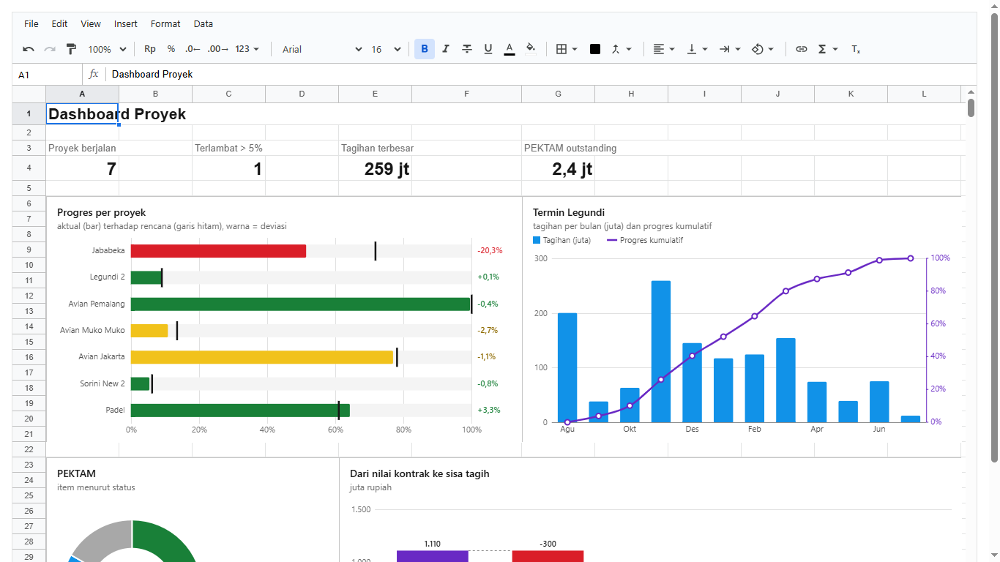

1. **Cell-Anchored**: Posisi dan dimensi chart ditentukan oleh rentang koordinat sel (`at: 'E2:K16'`). Saat baris/kolom disisipkan atau diperlebar, chart menyesuaikan geometrinya secara otomatis.
2. **Reaktif terhadap Mutasi Data**: Mengubah angka di dalam tabel seketika memicu pembaruan visualisasi secara instan tanpa re-render penuh antarmuka.
3. **Pemisahan Hak Akses**: Pengguna operasional hanya memerlukan hak `read` untuk melihat chart dinamis, sedangkan hak `chart` mengizinkan pembuatan, pergeseran posisi, dan modifikasi konfigurasi visualisasi.

---

## 2. Katalog Ragam Tipe Chart

| Tipe Chart | Spesialisasi Penggunaan | Fitur Utama |
|---|---|---|
| **Column / Bar** | Perbandingan kuantitatif antar kategori. | Pengelompokan seri bertumpuk (*stacked*), rotasi label kategori. |
| **Line / Area** | Tren time-series dan kontinuitas temporal. | Garis halus (*smooth curve*), marker titik data, garis putus-putus (*dashed*). |
| **Combo Dual-Axis** | Menghubungkan dua metrik dengan skala unit berbeda (misal: Nominal Rupiah di sumbu kiri, Persentase Progres di sumbu kanan). | Sumbu ganda independen (`axis: 'left'` dan `'right'`). |
| **Pie / Donut** | Komposisi pangsa terhadap 100%. | Nilai sentral di tengah donut (*center text* & *center label*), persentase per irisan. |
| **Bullet** | Pemantauan progres aktual terhadap target rencana. | Batas toleransi deviasi otomatis (zona hijau, kuning `warn`, merah `bad`). |
| **Waterfall** | Jembatan varians finansial (misal: dari nilai kontrak awal hingga sisa tagihan). | Deteksi otomatis langkah naik, turun, dan baris total kumulatif. |
| **Kurva S** | Pengawasan jadwal proyek konstruksi (jadwal kumulatif rencana vs realisasi fisik). | Latar transparan (`background: 'none'`) dengan perataan tepat di tengah kolom minggu (`align: 'cells'`). |
| **Scatter Plot** | Korelasi spasial atau regresi antara dua variabel kontinu (X dan Y). | Nilai koordinat numerik bebas pada sumbu X dan Y. |
| **In-Cell Sparkline** | Tren mini langsung di dalam satu sel tabel. | Jenis Garis (*line*), Batang (*column*), atau Menang/Kalah (*win/loss*). |

---

## 3. Implementasi Panduan Langkah demi Langkah

---

### 3.1 Chart Kolom Dasar

Menampilkan grafik batang kolom dari rentang data tabel:

<!-- contoh: 12-03-kolom.page.tsx -->
```tsx
import { useState } from 'react';
import { Sheet } from '@kufayeka/sheet';
import { createWorkbook } from '@kufayeka/sheet/core';
import '@kufayeka/sheet/style.css';

// 12.3 Chart pertama: penjualan bahan per bulan sebagai chart kolom, menempel di sel E2:K16.
function buat() {
    const wb = createWorkbook();
    wb.setSettings({ locale: 'id-ID', currency: 'IDR' });
    const s = wb.sheet('Sheet1');
    s.setSheetProps({ name: 'Penjualan' });
    s.setValues('A1', [
        ['Bulan', 'Semen (zak)', 'Besi (batang)'],
        ['Mei', 182, 96], ['Jun', 205, 110], ['Jul', 171, 124], ['Agu', 226, 131], ['Sep', 244, 118], ['Okt', 263, 142]
    ]);
    s.setStyle('A1:C1', { bold: true, fill: '#eef2f7' });
    s.setColProps('B:C', { width: 110 });
    // baru: chart di sel E2:K16 yang membaca A1:C7
    s.addChart({ at: 'E2:K16', data: 'A1:C7', type: 'column', title: 'Penjualan per bulan' });
    return wb;
}

export default function Halaman() {
    const [wb] = useState(buat);
    return <div style={{ height: 710 }}><Sheet workbook={wb} /></div>;
}
```
<!-- /contoh -->

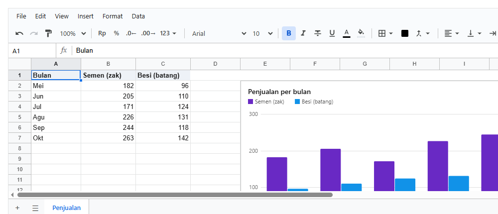
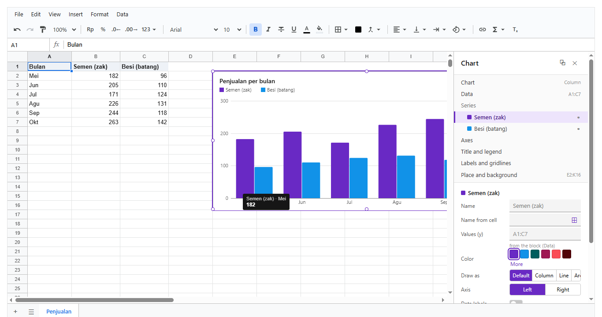

---

### 3.2 Combo Chart dengan Sumbu Ganda (Dual-Axis)

Menampilkan nominal tagihan dalam bentuk batang kolom pada sumbu kiri dan garis persentase progres pada sumbu kanan:

<!-- contoh: 12-05-combo.page.tsx -->
```tsx
import { useState } from 'react';
import { Sheet } from '@kufayeka/sheet';
import { createWorkbook } from '@kufayeka/sheet/core';
import '@kufayeka/sheet/style.css';
import { TERMIN } from './data/proyek.js';

// 12.5 Kolom dan garis dengan dua sumbu: tagihan termin per bulan (kiri, juta) dan progres kumulatif (kanan, persen).
function buat() {
    const wb = createWorkbook();
    wb.setSettings({ locale: 'id-ID', currency: 'IDR' });
    const s = wb.sheet('Sheet1');
    s.setSheetProps({ name: 'Termin' });
    s.setValues('A1', [['Bulan', 'Tagihan (juta)', 'Progres kumulatif'], ...TERMIN]);
    s.setColProps('B:C', { width: 120 });
    s.setColProps('C', { width: 120, format: { type: 'percent', decimals: 1 } });
    s.setStyle('A1:C1', { bold: true, fill: '#eef2f7' });
    s.addChart({
        at: 'E1:L18', data: 'A1:C13', type: 'combo', title: 'Termin Legundi', subtitle: 'tagihan per bulan dan progres kumulatif', smooth: true,
        // baru: seri kedua digambar sebagai garis, di sumbu kanan
        series: [{ color: '#1192e8' }, { type: 'line', axis: 'right', color: '#6929c4' }]
    });
    return wb;
}

export default function Halaman() {
    const [wb] = useState(buat);
    return <div style={{ height: 560 }}><Sheet workbook={wb} /></div>;
}
```
<!-- /contoh -->

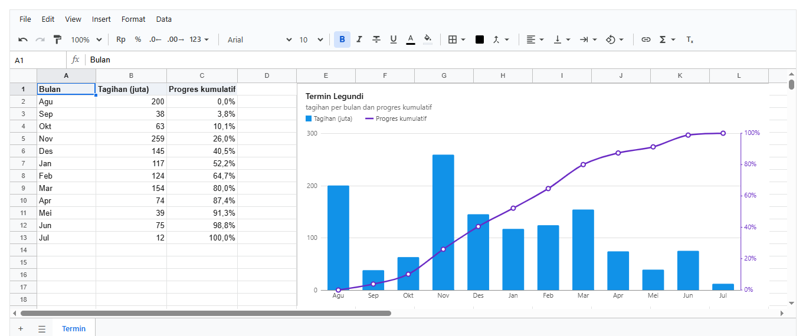

---

### 3.3 Komposisi Donut Chart dengan Teks Sentral

Menampilkan proporsi kategori anggaran dengan total nilai di tengah lingkaran:

<!-- contoh: 12-06-donut.page.tsx -->
```tsx
import { useState } from 'react';
import { Sheet } from '@kufayeka/sheet';
import { createWorkbook } from '@kufayeka/sheet/core';
import '@kufayeka/sheet/style.css';
import { PEKTAM } from './data/proyek.js';

// 12.6 Pie dan donut: status pekerjaan tambah (PEKTAM), dihitung dengan COUNTIF dari tabelnya.
function buat() {
    const wb = createWorkbook();
    const s = wb.sheet('Sheet1');
    s.setSheetProps({ name: 'PEKTAM' });
    s.setValues('A1', [['Pekerjaan', 'Status'], ...PEKTAM.map((p) => [p[0], p[1]])]);
    s.setColProps('A', { width: 220 });
    s.setValues('D1', [['Status', 'Jumlah'], ...['Lunas', 'Retensi blm nagih', 'Submit', 'Cancel'].map((st, i) => [st, '=COUNTIF($B$2:$B$13,D' + (i + 2) + ')'])]);
    s.setColProps('D', { width: 130 });
    s.setStyle('A1:E1', { bold: true, fill: '#eef2f7' });
    const warna = ['#198038', '#f1c21b', '#1192e8', '#a8a8a8'];
    // baru: dua chart dari data yang sama, satu pie dan satu donut
    s.addChart({ at: 'D7:G18', data: 'D1:E5', type: 'pie', title: 'Pie', legend: 'right', labels: true, colors: warna });
    s.addChart({ at: 'H1:L18', data: 'D1:E5', type: 'donut', title: 'PEKTAM menurut status', legend: 'right', centerLabel: 'item', colors: warna });
    return wb;
}

export default function Halaman() {
    const [wb] = useState(buat);
    return <div style={{ height: 560 }}><Sheet workbook={wb} /></div>;
}
```
<!-- /contoh -->

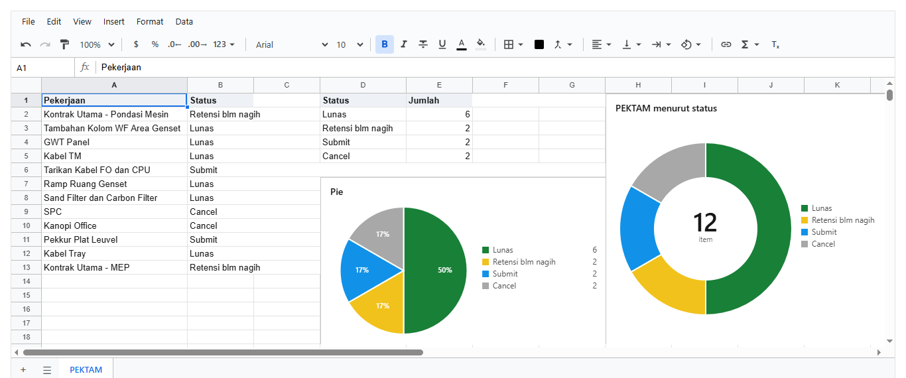

---

### 3.4 Bullet Chart untuk Pemantauan KPI Progres

Membandingkan progres riil fisik terhadap target rencana dengan indikator warna deviasi:

<!-- contoh: 12-07-bullet.page.tsx -->
```tsx
import { useState } from 'react';
import { Sheet } from '@kufayeka/sheet';
import { createWorkbook } from '@kufayeka/sheet/core';
import '@kufayeka/sheet/style.css';
import { PROGRES } from './data/proyek.js';

// 12.7 Bullet: progres aktual setiap proyek (bar) terhadap rencananya (garis hitam), warnanya menurut deviasi.
function buat() {
    const wb = createWorkbook();
    wb.setSettings({ locale: 'id-ID' });
    const s = wb.sheet('Sheet1');
    s.setSheetProps({ name: 'Progres' });
    s.setValues('A1', [['Proyek', 'Minggu', 'Aktual', 'Rencana'], ...PROGRES]);
    s.setColProps('A', { width: 140 });
    s.setColProps('C:D', { format: { type: 'percent', decimals: 2 } });
    s.setStyle('A1:D1', { bold: true, fill: '#eef2f7' });
    s.addChart({
        at: 'F1:L18', data: 'A1:D8', type: 'bullet', title: 'Progres per proyek', subtitle: 'merah: terlambat lebih dari 5%, kuning: lebih dari 1%',
        // baru: seri pertama (Minggu) disembunyikan; Aktual jadi bar, Rencana jadi garis target
        series: [{ hidden: true }], warn: 1, bad: 5
    });
    return wb;
}

export default function Halaman() {
    const [wb] = useState(buat);
    return <div style={{ height: 560 }}><Sheet workbook={wb} /></div>;
}
```
<!-- /contoh -->

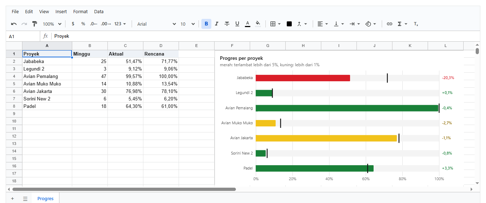

---

### 3.5 Waterfall Chart Finansial

Menganalisis jembatan arus kas atau varians pengurang nilai kontrak:

<!-- contoh: 12-08-waterfall.page.tsx -->
```tsx
import { useState } from 'react';
import { Sheet } from '@kufayeka/sheet';
import { createWorkbook } from '@kufayeka/sheet/core';
import '@kufayeka/sheet/style.css';

// 12.8 Waterfall: dari nilai kontrak, dikurangi uang muka, termin, dan retensi, sampai sisa yang masih bisa ditagih.
function buat() {
    const wb = createWorkbook();
    wb.setSettings({ locale: 'id-ID' });
    const s = wb.sheet('Sheet1');
    s.setValues('A1', [['Langkah', 'Juta rupiah'], ['Nilai kontrak', 1110], ['Uang muka', -300], ['Termin 1-11', -520], ['Retensi ditahan', -55], ['Sisa tagih', null]]);
    s.setColProps('A', { width: 130 });
    s.setStyle('A1:B1', { bold: true, fill: '#eef2f7' });
    // baru: kategori pertama adalah total awal; sel terakhir kosong, jadi dihitung sebagai total akhir
    s.addChart({ at: 'D1:J18', data: 'A1:B6', type: 'waterfall', title: 'Dari nilai kontrak ke sisa tagih', subtitle: 'juta rupiah', totals: [0], downColor: '#1192e8' });
    return wb;
}

export default function Halaman() {
    const [wb] = useState(buat);
    return <div style={{ height: 560 }}><Sheet workbook={wb} /></div>;
}
```
<!-- /contoh -->

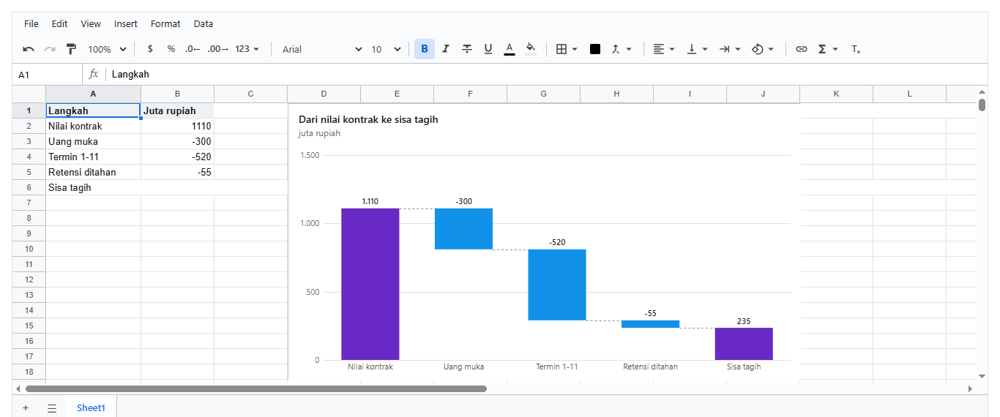

---

### 3.6 Kurva S Konstruksi di Atas Grid Jadwal

Menghamparkan kurva transparan di atas tabel matriks mingguan time-schedule:

<!-- contoh: 12-09-kurva-s.page.tsx -->
```tsx
import { useState } from 'react';
import { Sheet } from '@kufayeka/sheet';
import '@kufayeka/sheet/style.css';
import { buatJadwal } from './data/proyek.js';

// Kurva S di atas time schedule: chart garis transparan yang titik-titiknya jatuh di tengah kolom minggu.
function buat() {
    const wb = buatJadwal();
    const s = wb.sheet('Jadwal');
    s.addChart({
        at: 'E2:N9', data: 'E11:N12', type: 'line', seriesIn: 'rows',
        background: 'none', align: 'cells', grid: false, smooth: true, legend: 'top',
        y: { min: 0, max: 1 }, yAxis: true,
        series: [{ name: 'Rencana', axis: 'right' }, { name: 'Realisasi', axis: 'right', dash: true, color: '#1192e8', endLabel: 'Realisasi ' }]
    });
    return wb;
}

export default function Halaman() {
    const [wb] = useState(buat);
    return <div style={{ height: 420 }}><Sheet workbook={wb} /></div>;
}
```
<!-- /contoh -->

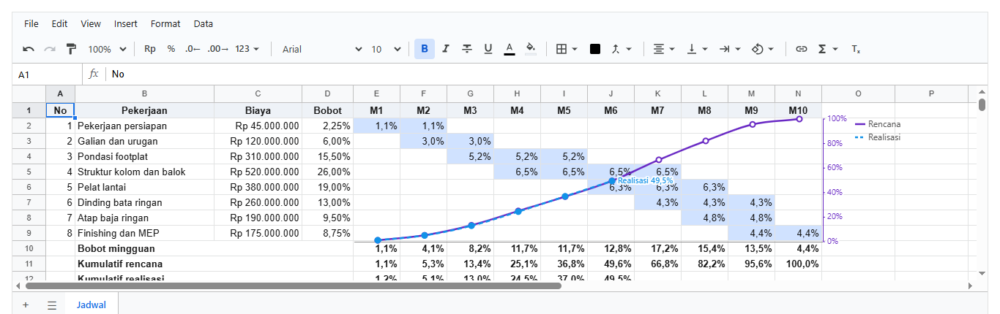

---

### 3.7 In-Cell Sparklines & Data Bars

Menyisipkan visualisasi tren mini langsung di dalam sel:

<!-- contoh: 12-10-sparkline.page.tsx -->
```tsx
import { useState } from 'react';
import { Sheet } from '@kufayeka/sheet';
import { createWorkbook } from '@kufayeka/sheet/core';
import '@kufayeka/sheet/style.css';
import { PROGRES } from './data/proyek.js';

// 12.10 Sparkline dan data bar: tren 8 minggu di satu sel per proyek, dan bar di belakang angka aktual.
function buat() {
    const wb = createWorkbook();
    wb.setSettings({ locale: 'id-ID' });
    const s = wb.sheet('Sheet1');
    s.setSheetProps({ name: 'Progres' });
    const minggu = ['M-7', 'M-6', 'M-5', 'M-4', 'M-3', 'M-2', 'M-1', 'M0'];
    s.setValues('A1', [['Proyek', 'Aktual', 'Tren 8 minggu', ...minggu],
        ...PROGRES.map(([nama, , aktual], i) => [nama, aktual, null, ...minggu.map((_, k) => Math.round(aktual * (0.55 + k * 0.0643 + Math.sin(k + i) * 0.01) * 1000) / 1000)])]);
    s.setColProps('A', { width: 140 });
    s.setColProps('B', { width: 110, format: { type: 'percent', decimals: 1 } });
    s.setColProps('C', { width: 150 });
    s.setColProps('D:K', { width: 56, format: { type: 'percent', decimals: 0 } });
    s.setStyle('A1:K1', { bold: true, fill: '#eef2f7' });
    // baru: sparkline di C2:C8, sel ke-i menggambar baris ke-i dari D2:K8
    s.addSparkline({ at: 'C2:C8', data: 'D2:K8', type: 'line', color: '#6929c4' });
    // baru: data bar di kolom Aktual (aturan conditional formatting)
    s.addConditional('B2:B8', { kind: 'bar', color: '#1192e8' });
    return wb;
}

export default function Halaman() {
    const [wb] = useState(buat);
    return <div style={{ height: 350 }}><Sheet workbook={wb} /></div>;
}
```
<!-- /contoh -->

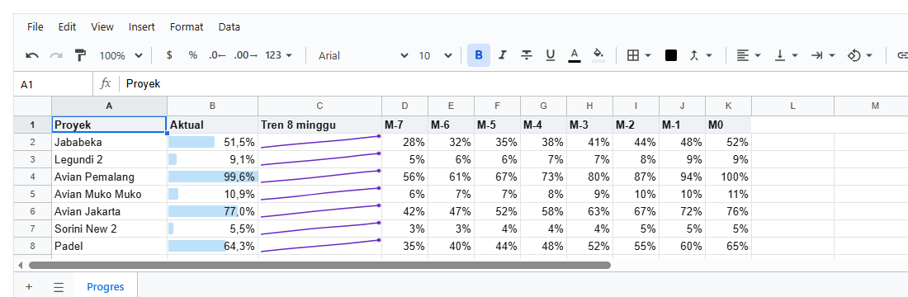

---

### 3.8 Seri Dinamis & Scatter Plot

Konfigurasi seri dengan koordinat independen dan analisis korelasi titik data:

<!-- contoh: 12-11-seri.page.tsx -->
```tsx
import { useState } from 'react';
import { Sheet } from '@kufayeka/sheet';
import { createWorkbook } from '@kufayeka/sheet/core';
import '@kufayeka/sheet/style.css';
import { PROGRES } from './data/proyek.js';

// 12.11 Seri dari range sendiri: Aktual di kolom C dan Rencana di kolom F, dengan kolom lain di antaranya. Lalu scatter: progres terhadap
// tanggal opname yang jaraknya tidak rata, dari sheet lain.
function buat() {
    const wb = createWorkbook();
    wb.setSettings({ locale: 'id-ID' });
    const s = wb.sheet('Sheet1');
    s.setSheetProps({ name: 'Progres' });
    s.setValues('A1', [['Proyek', 'Minggu', 'Aktual', 'Catatan', 'PIC', 'Rencana'], ...PROGRES.map(([p, m, a, r]) => [p, m, a, '', '', r])]);
    s.setColProps('A', { width: 130 });
    s.setColProps('C', { format: { type: 'percent', decimals: 1 } });
    s.setColProps('F', { format: { type: 'percent', decimals: 1 } });
    s.setStyle('A1:F1', { bold: true, fill: '#eef2f7' });
    // baru: tanpa data blok; kategori dan setiap seri menunjuk range-nya sendiri
    s.addChart({
        at: 'H1:L14', type: 'bullet', title: 'Aktual (C) terhadap Rencana (F)',
        categories: 'A2:A8', series: [{ nameFrom: 'C1', values: 'C2:C8' }, { nameFrom: 'F1', values: 'F2:F8' }]
    });
    const opname = wb.sheet(wb.addSheet('Opname'));
    opname.setValues('A1', [['Tanggal', 'Progres'], [46266, 0.02], [46280, 0.08], [46301, 0.21], [46309, 0.27], [46330, 0.44], [46337, 0.5]]);
    opname.setColProps('A', { format: { type: 'date' } });
    opname.setColProps('B', { format: { type: 'percent', decimals: 0 } });
    // baru: scatter, X dan Y setiap seri sendiri-sendiri; X tanggal dengan jarak sebenarnya
    s.addChart({
        at: 'A10:F24', type: 'scatter', title: 'Progres per tanggal opname', lines: true, smooth: true, legend: 'none',
        series: [{ name: 'Realisasi', x: 'Opname!A2:A7', values: 'Opname!B2:B7' }]
    });
    return wb;
}

export default function Halaman() {
    const [wb] = useState(buat);
    return <div style={{ height: 710 }}><Sheet workbook={wb} /></div>;
}
```
<!-- /contoh -->

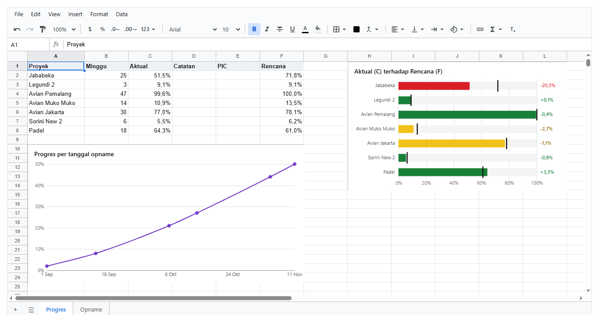

---

### 3.9 Integrasi Form ke Tabel ke Dashboard Realtime

Mengubah input formulir di sel input langsung mengalir ke perhitungan tabel dan grafik ringkasan:

<!-- contoh: 12-12-form.page.tsx -->
```tsx
import { useState } from 'react';
import { Sheet } from '@kufayeka/sheet';
import { createWorkbook, type AccessRow } from '@kufayeka/sheet/core';
import '@kufayeka/sheet/style.css';
import { PROGRES } from './data/proyek.js';

// 12.12 Form sebagai pintu input, tabel sebagai sumber data, dashboard read-only: orang lapangan mengisi progres lewat form biasa,
// angkanya masuk ke tabel Progres, dan chart di sheet Dashboard langsung ikut berubah. Dashboard tidak bisa diedit siapa pun.
function buat() {
    const wb = createWorkbook();
    wb.setSettings({ locale: 'id-ID' });
    const tabel = wb.sheet('Sheet1');
    tabel.setSheetProps({ name: 'Progres' });
    tabel.setValues('A1', [['Proyek', 'Minggu', 'Aktual', 'Rencana'], ...PROGRES]);
    tabel.setColProps('C:D', { format: { type: 'percent', decimals: 2 } });
    const dash = wb.sheet(wb.addSheet('Dashboard'));
    dash.setValues('A1', [['Rata-rata deviasi', '=AVERAGE(Progres!C2:C8)-AVERAGE(Progres!D2:D8)']]);
    dash.setStyle('B1', { bold: true, format: { type: 'percent', decimals: 2 } });
    dash.setColProps('A', { width: 140 });
    dash.addChart({ at: 'A3:H18', data: 'Progres!A1:D8', type: 'bullet', title: 'Progres per proyek', series: [{ hidden: true }] });
    return wb;
}
// baru: dashboard hanya untuk dibaca, chart pun tidak bisa digeser atau diubah
const akses: AccessRow[] = [{ who: '*', effect: 'allow', action: 'read' }];

export default function Halaman() {
    const [wb] = useState(buat);
    const [proyek, setProyek] = useState(PROGRES[0][0]);
    const [aktual, setAktual] = useState('');
    // baru: form biasa milik aplikasi Anda; tombolnya menulis ke tabel lewat kode (kode tidak dibatasi aturan akses, orang yang dibatasi)
    function simpan() {
        const baris = PROGRES.findIndex((p) => p[0] === proyek) + 2;
        const angka = Number(aktual.replace(',', '.')) / 100;
        if (!Number.isFinite(angka)) return;
        wb.sheet('Progres').setValues('C' + baris, angka);
        setAktual('');
    }
    return (
        <div>
            <form className="form-progres" onSubmit={(e) => { e.preventDefault(); simpan(); }} style={{ display: 'flex', gap: 8, alignItems: 'end', marginBottom: 10 }}>
                <label>Proyek<br /><select value={proyek} onChange={(e) => setProyek(e.target.value)}>{PROGRES.map((p) => <option key={p[0]}>{p[0]}</option>)}</select></label>
                <label>Aktual (%)<br /><input value={aktual} onChange={(e) => setAktual(e.target.value)} placeholder="mis. 74,2" /></label>
                <button type="submit">Simpan progres</button>
            </form>
            <div style={{ height: 420 }}>
                <Sheet workbook={wb} sheet={wb.sheetIdByName('Dashboard')} access={{ rows: akses, who: 'tamu' }} marks={false} />
            </div>
        </div>
    );
}
```
<!-- /contoh -->

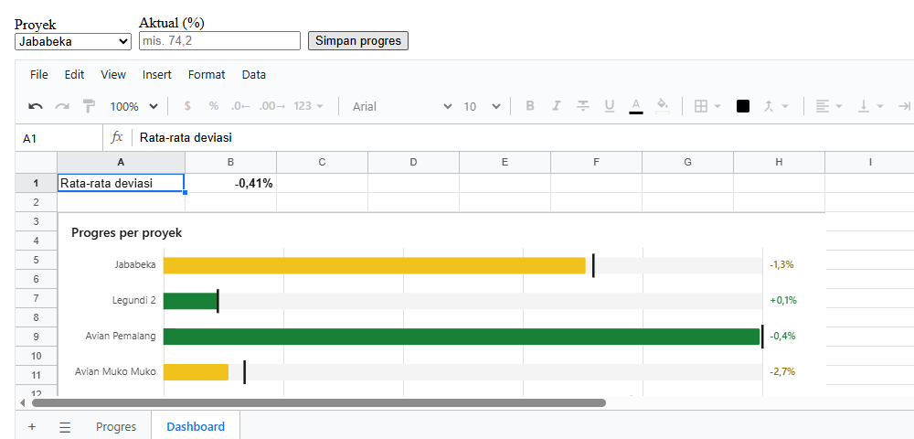

---

### 3.10 Showcase Komprehensif: Dashboard Konstruksi Eksekutif

Implementasi dashboard proyek skala penuh:

<!-- contoh: 12-13-dashboard.page.tsx -->
```tsx
import { useState } from 'react';
import { Sheet } from '@kufayeka/sheet';
import '@kufayeka/sheet/style.css';
import { buatDashboard } from './data/proyek.js';

// Dashboard: sheet yang hanya berisi rumus dan chart dari sheet-sheet tabel.
export default function Halaman() {
    const [wb] = useState(() => { const w = buatDashboard(); return w; });
    return <div style={{ height: 900 }}><Sheet workbook={wb} sheet={wb.sheetIdByName("Dashboard")} /></div>;
}
```
<!-- /contoh -->

Helper dataset dashboard proyek:

<!-- contoh: data/proyek.js -->
```js
import { createWorkbook } from '@kufayeka/sheet/core';

// Data proyek untuk bab Dashboard: time schedule gudang 10 minggu (bobot, rencana per minggu, kumulatif, realisasi), progres beberapa proyek,
// tagihan termin, dan daftar pekerjaan tambah (PEKTAM). Angkanya contoh, bentuknya seperti laporan proyek sungguhan.

export const PEKERJAAN = [
    ['Pekerjaan persiapan', 45000000, 1, 2],
    ['Galian dan urugan', 120000000, 2, 3],
    ['Pondasi footplat', 310000000, 3, 5],
    ['Struktur kolom dan balok', 520000000, 4, 7],
    ['Pelat lantai', 380000000, 6, 8],
    ['Dinding bata ringan', 260000000, 7, 9],
    ['Atap baja ringan', 190000000, 8, 9],
    ['Finishing dan MEP', 175000000, 9, 10]
];
export const REALISASI = [1.2, 5.1, 13.0, 24.5, 37.0, 49.5];

/**
 * Sheet "Jadwal": A1:N1 judul kolom (No, Pekerjaan, Biaya, Bobot, M1 ... M10), satu baris per pekerjaan dengan bobot dibagi rata ke minggu-minggunya,
 * lalu baris "Bobot mingguan", "Kumulatif rencana", dan "Kumulatif realisasi". Semua angka bobot dan kumulatif adalah rumus.
 */
export function buatJadwal(wb = createWorkbook()) {
    wb.setSettings({ locale: 'id-ID', currency: 'IDR' });
    const s = wb.sheet(wb.sheetIds()[0]);
    s.setSheetProps({ name: 'Jadwal' });
    const minggu = Array.from({ length: 10 }, (_, i) => 'M' + (i + 1));
    s.setValues('A1', [['No', 'Pekerjaan', 'Biaya', 'Bobot', ...minggu]]);
    const n = PEKERJAAN.length, akhir = n + 1;
    PEKERJAAN.forEach(([nama, biaya, dari, sampai], i) => {
        const r = i + 2;
        const baris = [i + 1, nama, biaya, '=C' + r + '/SUM($C$2:$C$' + akhir + ')'];
        // bobot pekerjaan dibagi rata ke minggu-minggu pelaksanaannya
        for (let m = 1; m <= 10; m++) baris.push(m >= dari && m <= sampai ? '=$D' + r + '/' + (sampai - dari + 1) : null);
        s.setValues('A' + r, [baris]);
    });
    const kol = (m) => String.fromCharCode(68 + m); // M1 di kolom E
    const rb = akhir + 1, rk = akhir + 2, rr = akhir + 3;
    s.setValues('B' + rb, [['Bobot mingguan', null, null, ...minggu.map((_, i) => '=SUM(' + kol(i + 1) + '2:' + kol(i + 1) + akhir + ')')]]);
    s.setValues('B' + rk, [['Kumulatif rencana', null, null, ...minggu.map((_, i) => '=SUM($E' + rb + ':' + kol(i + 1) + rb + ')')]]);
    s.setValues('B' + rr, [['Kumulatif realisasi', null, null, ...REALISASI.map((x) => x / 100)]]);
    s.setColProps('A', { width: 40 });
    s.setColProps('B', { width: 190 });
    s.setColProps('C', { width: 120, format: { type: 'money', decimals: 0 } });
    s.setColProps('D', { width: 70, format: { type: 'percent', decimals: 2 } });
    s.setColProps('E:N', { width: 64, format: { type: 'percent', decimals: 1 } });
    s.setStyle('A1:N1', { bold: true, fill: '#eef2f7', align: 'center' });
    s.setStyle('B' + rb + ':N' + rr, { bold: true });
    // bar jadwal: sel minggu yang terisi diberi warna, seperti time schedule di kertas
    s.addConditional('E2:N' + akhir, { op: 'formula', formula: '=E2<>""', style: { fill: '#d0e2ff' } });
    return wb;
}

// progres mingguan per proyek, seperti laporan yang dikirim ke grup: minggu ke berapa, aktual, rencana
export const PROGRES = [
    ['Jababeka', 25, 0.5147, 0.7177], ['Legundi 2', 3, 0.0912, 0.0906], ['Avian Pemalang', 47, 0.99573, 1], ['Avian Muko Muko', 14, 0.1088, 0.13536],
    ['Avian Jakarta', 30, 0.7698, 0.781], ['Sorini New 2', 6, 0.0545, 0.062], ['Padel', 18, 0.643, 0.61]
];
// tagihan termin satu proyek (juta rupiah): bulan, nilai tagihan, progres kumulatif
export const TERMIN = [['Agu', 200, 0], ['Sep', 38, 0.038], ['Okt', 63, 0.101], ['Nov', 259, 0.26], ['Des', 145, 0.405], ['Jan', 117, 0.522], ['Feb', 124, 0.647],
    ['Mar', 154, 0.8], ['Apr', 74, 0.874], ['Mei', 39, 0.913], ['Jun', 75, 0.988], ['Jul', 12, 1]];
// pekerjaan tambah: nama, status, nilai, terbayar (rupiah)
export const PEKTAM = [
    ['Kontrak Utama - Pondasi Mesin', 'Retensi blm nagih', 1000000, 950000], ['Tambahan Kolom WF Area Genset', 'Lunas', 1000000, 1000000],
    ['GWT Panel', 'Lunas', 1000000, 1000000], ['Kabel TM', 'Lunas', 1000000, 1000000], ['Tarikan Kabel FO dan CPU', 'Submit', 1500000, 0],
    ['Ramp Ruang Genset', 'Lunas', 1000000, 1000000], ['Sand Filter dan Carbon Filter', 'Lunas', 1000000, 1000000], ['SPC', 'Cancel', 0, 0],
    ['Kanopi Office', 'Cancel', 0, 0], ['Pekkur Plat Leuvel', 'Submit', 750000, 0], ['Kabel Tray', 'Lunas', 19801689, 19801689],
    ['Kontrak Utama - MEP', 'Retensi blm nagih', 1000000, 950000]
];

/**
 * Workbook dashboard: tiga sheet tabel (Progres, Termin, PEKTAM) sebagai sumber data, lalu sheet Dashboard yang hanya berisi rumus dan chart.
 * Sheet Jadwal (kurva S) ikut di dalamnya.
 */
export function buatDashboard() {
    const wb = buatJadwal();
    const progres = wb.sheet(wb.addSheet('Progres'));
    progres.setValues('A1', [['Proyek', 'Minggu', 'Aktual', 'Rencana', 'Deviasi'], ...PROGRES.map((p, i) => [...p, '=C' + (i + 2) + '-D' + (i + 2)])]);
    progres.setColProps('A', { width: 150 });
    progres.setColProps('C:E', { format: { type: 'percent', decimals: 2 } });
    progres.setStyle('A1:E1', { bold: true, fill: '#eef2f7' });
    // tren 8 minggu terakhir (aktual kumulatif per minggu) untuk sparkline: kolom G sampai N
    progres.setValues('G1', [['M-7', 'M-6', 'M-5', 'M-4', 'M-3', 'M-2', 'M-1', 'M0'],
        ...PROGRES.map(([, , aktual], i) => Array.from({ length: 8 }, (_, k) => Math.round(Math.max(0, aktual * (0.55 + k * 0.0643) + Math.sin(k + i) * 0.006) * 10000) / 10000))]);
    progres.setColProps('G:N', { width: 56, format: { type: 'percent', decimals: 1 } });

    const termin = wb.sheet(wb.addSheet('Termin'));
    termin.setValues('A1', [['Bulan', 'Tagihan (juta)', 'Progres kumulatif'], ...TERMIN]);
    termin.setColProps('C', { format: { type: 'percent', decimals: 1 } });
    termin.setStyle('A1:C1', { bold: true, fill: '#eef2f7' });

    const pektam = wb.sheet(wb.addSheet('PEKTAM'));
    pektam.setValues('A1', [['Pekerjaan', 'Status', 'Nilai', 'Terbayar', 'Outstanding'], ...PEKTAM.map((p, i) => [...p, '=C' + (i + 2) + '-D' + (i + 2)])]);
    pektam.setColProps('A', { width: 220 });
    pektam.setColProps('C:E', { width: 120, format: { type: 'money', decimals: 0 } });
    pektam.setStyle('A1:E1', { bold: true, fill: '#eef2f7' });
    // rekap status untuk donut: dihitung dengan COUNTIF dari tabel, bukan diketik
    pektam.setValues('G1', [['Status', 'Jumlah'], ...['Lunas', 'Retensi blm nagih', 'Submit', 'Cancel'].map((st, i) => [st, '=COUNTIF($B$2:$B$13,G' + (i + 2) + ')'])]);

    const dash = wb.sheet(wb.addSheet('Dashboard'));
    dash.setColProps('A:L', { width: 100 });
    dash.setValues('A1', [['Dashboard Proyek']]);
    dash.setStyle('A1', { bold: true, fontSize: 16 });
    // kartu angka: rumus dari tabel
    dash.setValues('A3', [['Proyek berjalan', null, 'Terlambat > 5%', null, 'Tagihan terbesar', null, 'PEKTAM outstanding'],
        ['=COUNTA(Progres!A2:A8)', null, '=COUNTIF(Progres!E2:E8,"<-0.05")', null, '=MAX(Termin!B2:B13)', null, '=SUM(PEKTAM!E2:E13)/1000000']]);
    dash.setStyle('A3:H3', { color: '#6f6f6f' });
    dash.setStyle('A4:H4', { bold: true, fontSize: 18 });
    dash.setStyle('E4', { format: { type: 'number', decimals: 0, suffix: ' jt' } });
    dash.setStyle('G4', { format: { type: 'number', decimals: 1, suffix: ' jt' } });
    dash.setRowProps('4', { height: 34 });
    // bullet: kategori di kolom A, seri pertama Minggu (disembunyikan), lalu Aktual (bar) dan Rencana (garis target)
    dash.addChart({ at: 'A6:F21', data: 'Progres!A1:D8', type: 'bullet', title: 'Progres per proyek', subtitle: 'aktual (bar) terhadap rencana (garis hitam), warna = deviasi',
        series: [{ hidden: true }] });
    // column + line dengan dua sumbu: tagihan per bulan (kiri) dan progres kumulatif (kanan)
    dash.addChart({ at: 'G6:L21', data: 'Termin!A1:C13', type: 'combo', title: 'Termin Legundi', subtitle: 'tagihan per bulan (juta) dan progres kumulatif',
        smooth: true, series: [{ color: '#1192e8' }, { type: 'line', axis: 'right', color: '#6929c4' }] });
    // donut status PEKTAM dari rekap COUNTIF
    dash.addChart({ at: 'A23:D37', data: 'PEKTAM!G1:H5', type: 'donut', title: 'PEKTAM', subtitle: 'item menurut status', legend: 'right', centerLabel: 'item',
        colors: ['#198038', '#f1c21b', '#1192e8', '#a8a8a8'] });
    // waterfall: dari nilai kontrak ke sisa tagih
    dash.setValues('N1', [['Langkah', 'Juta'], ['Kontrak', 1110], ['Uang muka', -300], ['Termin 1-11', -520], ['Retensi', -55], ['Sisa tagih', null]]);
    dash.addChart({ at: 'E23:L37', data: 'N1:O6', type: 'waterfall', title: 'Dari nilai kontrak ke sisa tagih', subtitle: 'juta rupiah', totals: [0] });
    // tabel ringkas di bawah chart: rumus dari sheet Progres, data bar di kolom Aktual, sparkline tren, dan status berwarna
    dash.setValues('A39', [['Proyek', 'Minggu', 'Aktual', 'Rencana', 'Deviasi', 'Tren 8 minggu', 'Status']]);
    for (let i = 0; i < PROGRES.length; i++) {
        const r = 40 + i, p = i + 2;
        dash.setValues('A' + r, [['=Progres!A' + p, '=Progres!B' + p, '=Progres!C' + p, '=Progres!D' + p, '=Progres!E' + p, null,
            '=IF(E' + r + '<-0.05,"Terlambat",IF(E' + r + '<-0.01,"Waspada","Sesuai"))']]);
    }
    dash.setStyle('A39:G39', { bold: true, fill: '#f4f4f4' });
    dash.setStyle('C40:E46', { format: { type: 'percent', decimals: 2 } });
    dash.setColProps('F', { width: 150 });
    dash.addConditional('C40:C46', { kind: 'bar', color: '#1192e8' });
    dash.addConditional('E40:E46', { op: 'lt', a: -0.05, style: { color: '#da1e28', bold: true } });
    dash.addConditional('E40:E46', { op: 'gte', a: -0.01, style: { color: '#198038', bold: true } });
    dash.addConditional('G40:G46', { op: 'textIs', a: 'Terlambat', style: { color: '#da1e28', fill: '#fff1f1' } });
    dash.addConditional('G40:G46', { op: 'textIs', a: 'Waspada', style: { color: '#8e6a00', fill: '#fcf4d6' } });
    dash.addConditional('G40:G46', { op: 'textIs', a: 'Sesuai', style: { color: '#198038', fill: '#defbe6' } });
    dash.addSparkline({ at: 'F40:F46', data: 'Progres!G2:N8', type: 'line', color: '#6929c4' });
    return wb;
}
```
<!-- /contoh -->


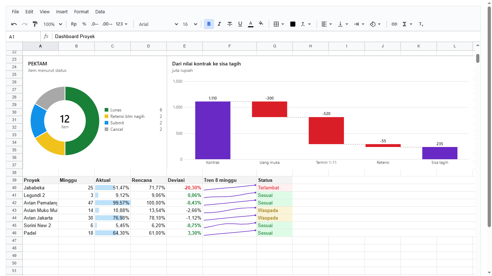

---

## 4. Referensi Lengkap Properti Chart & Sparkline

Berikut adalah katalog spesifikasi properti chart yang dihasilkan langsung dari metadata sistem:

<!-- hasil: 12-pengaturan.js -->
```text
**Chart** (`addChart`, `setChart`; di panel: node pohon → isian)

| Node | Isian | Kunci | Jenis isian | Untuk chart | Keterangan |
|---|---|---|---|---|---|
| Chart | Type | `type` | kartu jenis | semua |  |
| Data | Block | `data` | range (⊞ dari grid) | semua | One block read as Excel reads a selection; leave it empty for series of their own ranges |
| Data | Series in | `seriesIn` | pilihan: Auto, Columns, Rows | semua |  |
| Data | Categories | `categories` | range (⊞ dari grid) | column, bar, line, area, combo, bullet, waterfall, pie, donut | A range of labels every series shares (or the first column of the block) |
| Series → (satu seri) | Name | `series.name` | teks | semua |  |
| Series → (satu seri) | Name from cell | `series.nameFrom` | range (⊞ dari grid) | semua |  |
| Series → (satu seri) | Values (y) | `series.values` | range (⊞ dari grid) | semua | Its own range (a series past the block's) |
| Series → (satu seri) | X values | `series.x` | range (⊞ dari grid) | scatter |  |
| Series → (satu seri) | Color | `series.color` | warna | semua |  |
| Series → (satu seri) | Draw as | `series.type` | pilihan: Default, Column, Line, Area | column, line, area, combo |  |
| Series → (satu seri) | Draw as | `series.type` | pilihan: Default, Line, Points | scatter |  |
| Series → (satu seri) | Axis | `series.axis` | pilihan: Left, Right | column, line, area, combo |  |
| Series → (satu seri) | Dashed | `series.dash` | saklar | line, area, combo, scatter |  |
| Series → (satu seri) | Line width | `series.width` | angka (px) | line, area, combo, scatter |  |
| Series → (satu seri) | Smooth | `series.smooth` | saklar | line, area, combo, scatter |  |
| Series → (satu seri) | Markers | `series.markers` | saklar | line, area, combo |  |
| Series → (satu seri) | Point size | `series.size` | angka (px) | scatter |  |
| Series → (satu seri) | Data labels | `series.labels` | saklar | semua |  |
| Series → (satu seri) | End label | `series.endLabel` | teks | line, area, combo, scatter | Text before the last value, at the end of the line |
| Series → (satu seri) | Hidden | `series.hidden` | saklar | semua |  |
| Axes → Value axis (left) | Min | `y.min` | angka | column, bar, line, area, combo, scatter, bullet, waterfall |  |
| Axes → Value axis (left) | Max | `y.max` | angka | column, bar, line, area, combo, scatter, bullet, waterfall |  |
| Axes → Value axis (left) | Before | `y.prefix` | teks | column, bar, line, area, combo, scatter, bullet, waterfall, pie, donut |  |
| Axes → Value axis (left) | After | `y.suffix` | teks | column, bar, line, area, combo, scatter, bullet, waterfall, pie, donut |  |
| Axes → Value axis (left) | Decimals | `y.decimals` | angka | column, bar, line, area, combo, scatter, bullet, waterfall, pie, donut |  |
| Axes → Value axis (left) | Percent | `y.percent` | saklar | column, bar, line, area, combo, scatter, bullet, waterfall, pie, donut | Write 0.5 as 50% (on its own when the cells are percents) |
| Axes → Right axis | Min | `y2.min` | angka | column, bar, line, area, combo, scatter, bullet, waterfall |  |
| Axes → Right axis | Max | `y2.max` | angka | column, bar, line, area, combo, scatter, bullet, waterfall |  |
| Axes → Right axis | Before | `y2.prefix` | teks | column, bar, line, area, combo, scatter, bullet, waterfall, pie, donut |  |
| Axes → Right axis | After | `y2.suffix` | teks | column, bar, line, area, combo, scatter, bullet, waterfall, pie, donut |  |
| Axes → Right axis | Decimals | `y2.decimals` | angka | column, bar, line, area, combo, scatter, bullet, waterfall, pie, donut |  |
| Axes → Right axis | Percent | `y2.percent` | saklar | column, bar, line, area, combo, scatter, bullet, waterfall, pie, donut | Write 0.5 as 50% (on its own when the cells are percents) |
| Axes → X axis | Min | `x.min` | angka | scatter |  |
| Axes → X axis | Max | `x.max` | angka | scatter |  |
| Axes → X axis | Before | `x.prefix` | teks | scatter |  |
| Axes → X axis | After | `x.suffix` | teks | scatter |  |
| Axes → X axis | Decimals | `x.decimals` | angka | scatter |  |
| Axes → X axis | Percent | `x.percent` | saklar | scatter |  |
| Axes → Show | Show the value axis | `yAxis` | saklar | semua |  |
| Axes → Show | Show the categories (x) | `xAxis` | saklar | semua |  |
| Title and legend | Title | `title` | teks | semua |  |
| Title and legend | Subtitle | `subtitle` | teks | semua |  |
| Title and legend | Legend | `legend` | pilihan: Top, Right, Bottom, Off | semua |  |
| Labels and gridlines | Data labels | `labels` | saklar | semua |  |
| Labels and gridlines | Gridlines | `grid` | saklar | column, bar, line, area, combo, scatter, bullet, waterfall |  |
| Labels and gridlines | Stacked | `stacked` | saklar | column, bar, area, combo |  |
| Labels and gridlines | Smooth lines | `smooth` | saklar | line, area, combo, scatter |  |
| Labels and gridlines | Markers | `markers` | saklar | line, area, combo |  |
| Labels and gridlines | Lines through the points | `lines` | saklar | scatter |  |
| Place and background | Cells | `at` | range (⊞ dari grid) | semua | The block of cells the chart stands on |
| Place and background | Background | `background` | pilihan: White, Transparent | semua | Transparent: over the cells, a click goes through; pick it by its edge |
| Place and background | Points | `align` | pilihan: Fit, On the columns | column, line, area, combo | On the columns: category i in the middle of column i of its cells (an S-curve over a schedule) |
| Slices | Colors | `colors` | warna per potongan | pie, donut | One per slice, in the order of the categories |
| Center | Center text | `centerText` | teks | donut |  |
| Center | Under it | `centerLabel` | teks | donut |  |
| Limits | Amber when below by | `warn` | angka | bullet |  |
| Limits | Red when below by | `bad` | angka | bullet |  |
| Steps | Totals (category numbers) | `totals` | nomor kategori | waterfall | From 1; the last one is a total when its cell is empty |
| Steps | Up | `upColor` | warna | waterfall |  |
| Steps | Down | `downColor` | warna | waterfall |  |
| Steps | Total | `totalColor` | warna | waterfall |  |

**Sparkline** (`addSparkline`, `setSparkline`; panelnya terbuka saat sel sparkline dipilih)

| Node | Isian | Kunci | Jenis isian | Untuk | Keterangan |
|---|---|---|---|---|---|
| Sparklines | Type | `type` | pilihan: Line, Column, Win/loss | semua |  |
| Sparklines | Color | `color` | warna | semua |  |
| Sparklines | Negative | `negColor` | warna | semua |  |
| Sparklines | Dots | `markers` | pilihan: Last, All, None | semua |  |
| Sparklines | Min | `min` | angka | semua |  |
| Sparklines | Max | `max` | angka | semua |  |
| Sparklines | Cells | `at` | range (⊞ dari grid) | semua |  |
| Sparklines | Data | `data` | range (⊞ dari grid) | semua |  |
```
<!-- /hasil -->

---

[Daftar isi](../README.md#daftar-isi) · Sebelumnya: [11. Komentar Sel & Interoperabilitas Excel/CSV](11-komentar-excel.md) · Berikutnya: [13. Optimasi Performa & Referensi API](13-referensi.md)
