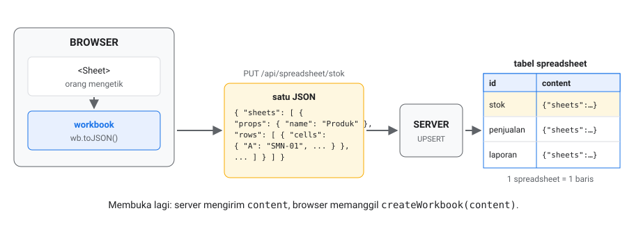
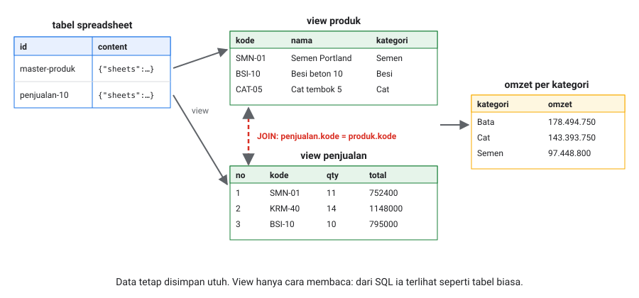

# 12. Menyimpan ke server

[Daftar isi](../README.md#daftar-isi) · Sebelumnya: [11. Memakai di React](11-react.md) · Berikutnya: [13. Access control](13-hak-akses.md)

Cara paling sederhana: satu spreadsheet disimpan sebagai **satu baris** di **satu tabel**. Isinya satu JSON. Tidak perlu memecah ke banyak tabel.



- [12.1 Tabelnya](#121-tabelnya)
- [12.2 Kode server](#122-kode-server)
- [12.3 Isi `content`](#123-isi-content)
- [12.4 Relasi dengan view](#124-relasi-dengan-view)
- [12.5 Lanjutan: patch, pemeriksaan, data rahasia](#125-lanjutan-patch-pemeriksaan-data-rahasia)

## 12.1 Tabelnya

```sql
create table spreadsheet (
    id      text primary key,     -- id dari aplikasimu: 'stok', 'penjualan-2026-10', ...
    content jsonb not null        -- wb.toJSON(), utuh
);
```

Isinya kira-kira begini:

| id | content |
|---|---|
| `stok` | `{"id":"…","version":3,"settings":{…},"sheets":[{"props":{"name":"Produk"},"rows":[…]}]}` |
| `penjualan-2026-10` | `{"id":"…","version":12,"settings":{…},"sheets":[…]}` |
| `laporan-bulanan` | `{…}` |

Itu saja. Satu spreadsheet = satu baris. Kalau mau, tambah kolom milikmu sendiri: pemilik, dibuat kapan, diubah kapan.

## 12.2 Kode server

Contoh dengan Express. Framework lain (Next.js route, Fastify, Hono) sama saja: dua route.

```js
// ambil: kirim content apa adanya
app.get('/api/spreadsheet/:id', async (req, res) => {
    const { rows } = await db.query('select content from spreadsheet where id = $1', [req.params.id]);
    if (!rows.length) return res.status(404).end();
    res.json(rows[0].content);
});

// simpan: content baru menggantikan yang lama (atau dibuat kalau belum ada)
app.put('/api/spreadsheet/:id', express.json({ limit: '20mb' }), async (req, res) => {
    await db.query(
        'insert into spreadsheet (id, content) values ($1, $2) on conflict (id) do update set content = excluded.content',
        [req.params.id, req.body]
    );
    res.json({ ok: true });
});
```

Di browser, pasangannya sudah ada di [11.4 dan 11.5](11-react.md#114-isi-dari-server):

```js
const content = await fetch('/api/spreadsheet/stok').then((r) => r.json());
const wb = createWorkbook(content);                                   // buka
// ... orang mengedit ...
await fetch('/api/spreadsheet/stok', { method: 'PUT', headers: { 'Content-Type': 'application/json' }, body: JSON.stringify(wb.toJSON()) });
wb.saved();                                                           // simpan
```

## 12.3 Isi `content`

Daftar harga tiga produk, dilihat dari tiga sisi: di layar, di dalam `content`, dan bagian mana yang berubah saat diedit:

<!-- contoh: 12-simulasi.js -->
```js
import { createWorkbook } from '@kufayeka/sheet/core';

// Apa isi `content` yang disimpan? Daftar harga tiga produk, dilihat dari tiga sisi: di layar, di dalam content, dan apa yang berubah saat diedit.
// Id aslinya UUID panjang; di sini diganti nama pendek (r1, k1, ...) supaya mudah dibaca.

// ---- alat cetak
const pendek = new Map();
const nama = (id, awalan) => { if (!pendek.has(id)) pendek.set(id, awalan + ([...pendek.values()].filter((x) => x.startsWith(awalan)).length + 1)); return pendek.get(id); };
const isi = (cells) => Object.entries(cells).map(([k, v]) => (pendek.get(k) || k) + ':' + (v && v.f !== undefined ? '[rumus, hasil ' + v.v + ']' : JSON.stringify(v))).join('  ');
function kotak(judul, kolom, baris) {
    const lebar = kolom.map((k, i) => Math.max(k.length, ...baris.map((b) => String(b[i]).length)));
    const garis = '+' + lebar.map((l) => '-'.repeat(l + 2)).join('+') + '+';
    const satu = (b) => '| ' + b.map((x, i) => String(x).padEnd(lebar[i])).join(' | ') + ' |';
    if (judul) console.log(judul);
    console.log([garis, satu(kolom), garis, ...baris.map(satu), garis].join('\n'));
}
function layar(wb) {
    const akhir = wb.lastFilled('Harga');
    const baris = [];
    for (let r = 0; r <= akhir.r; r++) baris.push([r + 1, ...Array.from({ length: akhir.c + 1 }, (_, c) => wb.display('Harga', r, c).text)]);
    kotak('', ['', ...Array.from({ length: akhir.c + 1 }, (_, c) => String.fromCharCode(65 + c))], baris);
}
function barisContent(content) {
    const sh = content.sheets[0];
    sh.columns.slice(0, 5).forEach((c) => nama(c.id, 'k'));
    kotak('', ['id', 'key', 'cells'], sh.rows.map((r) => [nama(r.id, 'r'), r.key, isi(r.cells)]));
}

// ---- 1. di layar
const wb = createWorkbook();
wb.setSheetProps('Sheet1', { name: 'Harga' });
wb.setValues('Harga', 'A1', [['Kode', 'Produk', 'Harga', 'Stok', 'Nilai'], ['SMN-01', 'Semen 50 kg', 72000, 420, '=C2*D2'], ['BSI-10', 'Besi 10 mm', 79500, 260, '=C3*D3'], ['CAT-05', 'Cat 5 kg', 145000, 64, '=C4*D4']]);
console.log('1. DI LAYAR');
layar(wb);

// ---- 2. di dalam content = wb.toJSON()
let content = wb.toJSON();
console.log('\n2. DI DALAM content (yang disimpan di kolom content)');
console.log('content.sheets[0].props   =', JSON.stringify(content.sheets[0].props), '| rowCount', content.sheets[0].rowCount, '(baris kosong di bawah tidak disimpan, hanya dihitung)');
console.log('content.sheets[0].rows    = satu baris layar, satu baris di sini:');
barisContent(content);
console.log('k1..k5 adalah kolom A..E. Rumus disimpan beserta hasilnya, supaya SQL bisa membaca angkanya.');

// ---- 3. stok besi diubah jadi 300
wb.setValues('Harga', 'D3', 300, { source: 'user' });
console.log('\n3. STOK BESI DIUBAH JADI 300: yang berubah di content hanya baris r3 (dan hasil rumusnya)');
content = wb.toJSON();
barisContent(content);

// ---- 4. baris baru disisipkan di baris 3
wb.insertRows('Harga', '3');
wb.setValues('Harga', 'A3', [['SMN-02', 'Semen putih', 112000, 35, '=C3*D3']], { source: 'user' });
console.log('\n4. BARIS BARU DI BARIS 3');
layar(wb);
content = wb.toJSON();
barisContent(content);
const baru = content.sheets[0].rows.find((r) => pendek.get(r.id) === 'r5');
console.log('Baris baru (r5) mendapat key ' + baru.key + ', di antara 08 dan 0C. Urutan baris ditentukan key; besi dan cat tidak ditulis ulang.');

// ---- 5. dibuka lagi dari content
const dibuka = createWorkbook(content);
console.log('\n5. DIBUKA LAGI: createWorkbook(content) -> E3', dibuka.input('Harga', 'E3'), '=', dibuka.value('Harga', 'E3'));
```
<!-- /contoh -->

<!-- hasil: 12-simulasi.js -->
```text
1. DI LAYAR
+---+--------+-------------+--------+------+----------+
|   | A      | B           | C      | D    | E        |
+---+--------+-------------+--------+------+----------+
| 1 | Kode   | Produk      | Harga  | Stok | Nilai    |
| 2 | SMN-01 | Semen 50 kg | 72000  | 420  | 30240000 |
| 3 | BSI-10 | Besi 10 mm  | 79500  | 260  | 20670000 |
| 4 | CAT-05 | Cat 5 kg    | 145000 | 64   | 9280000  |
+---+--------+-------------+--------+------+----------+

2. DI DALAM content (yang disimpan di kolom content)
content.sheets[0].props   = {"name":"Harga"} | rowCount 1000 (baris kosong di bawah tidak disimpan, hanya dihitung)
content.sheets[0].rows    = satu baris layar, satu baris di sini:
+----+-----+-----------------------------------------------------------------------------+
| id | key | cells                                                                       |
+----+-----+-----------------------------------------------------------------------------+
| r1 | 04  | k1:"Kode"  k2:"Produk"  k3:"Harga"  k4:"Stok"  k5:"Nilai"                   |
| r2 | 08  | k1:"SMN-01"  k2:"Semen 50 kg"  k3:72000  k4:420  k5:[rumus, hasil 30240000] |
| r3 | 0C  | k1:"BSI-10"  k2:"Besi 10 mm"  k3:79500  k4:260  k5:[rumus, hasil 20670000]  |
| r4 | 0G  | k1:"CAT-05"  k2:"Cat 5 kg"  k3:145000  k4:64  k5:[rumus, hasil 9280000]     |
+----+-----+-----------------------------------------------------------------------------+
k1..k5 adalah kolom A..E. Rumus disimpan beserta hasilnya, supaya SQL bisa membaca angkanya.

3. STOK BESI DIUBAH JADI 300: yang berubah di content hanya baris r3 (dan hasil rumusnya)
+----+-----+-----------------------------------------------------------------------------+
| id | key | cells                                                                       |
+----+-----+-----------------------------------------------------------------------------+
| r1 | 04  | k1:"Kode"  k2:"Produk"  k3:"Harga"  k4:"Stok"  k5:"Nilai"                   |
| r2 | 08  | k1:"SMN-01"  k2:"Semen 50 kg"  k3:72000  k4:420  k5:[rumus, hasil 30240000] |
| r3 | 0C  | k1:"BSI-10"  k2:"Besi 10 mm"  k3:79500  k4:300  k5:[rumus, hasil 23850000]  |
| r4 | 0G  | k1:"CAT-05"  k2:"Cat 5 kg"  k3:145000  k4:64  k5:[rumus, hasil 9280000]     |
+----+-----+-----------------------------------------------------------------------------+

4. BARIS BARU DI BARIS 3
+---+--------+-------------+--------+------+----------+
|   | A      | B           | C      | D    | E        |
+---+--------+-------------+--------+------+----------+
| 1 | Kode   | Produk      | Harga  | Stok | Nilai    |
| 2 | SMN-01 | Semen 50 kg | 72000  | 420  | 30240000 |
| 3 | SMN-02 | Semen putih | 112000 | 35   | 3920000  |
| 4 | BSI-10 | Besi 10 mm  | 79500  | 300  | 23850000 |
| 5 | CAT-05 | Cat 5 kg    | 145000 | 64   | 9280000  |
+---+--------+-------------+--------+------+----------+
+----+-----+-----------------------------------------------------------------------------+
| id | key | cells                                                                       |
+----+-----+-----------------------------------------------------------------------------+
| r1 | 04  | k1:"Kode"  k2:"Produk"  k3:"Harga"  k4:"Stok"  k5:"Nilai"                   |
| r2 | 08  | k1:"SMN-01"  k2:"Semen 50 kg"  k3:72000  k4:420  k5:[rumus, hasil 30240000] |
| r5 | 0A  | k1:"SMN-02"  k2:"Semen putih"  k3:112000  k4:35  k5:[rumus, hasil 3920000]  |
| r3 | 0C  | k1:"BSI-10"  k2:"Besi 10 mm"  k3:79500  k4:300  k5:[rumus, hasil 23850000]  |
| r4 | 0G  | k1:"CAT-05"  k2:"Cat 5 kg"  k3:145000  k4:64  k5:[rumus, hasil 9280000]     |
+----+-----+-----------------------------------------------------------------------------+
Baris baru (r5) mendapat key 0A, di antara 08 dan 0C. Urutan baris ditentukan key; besi dan cat tidak ditulis ulang.

5. DIBUKA LAGI: createWorkbook(content) -> E3 =C3*D3 = 3920000
```
<!-- /hasil -->

Yang bisa diambil dari sini:

- **Satu baris di layar = satu baris di `content.sheets[…].rows`.** Isi sel-selnya ada di `cells`, dengan id kolom sebagai kuncinya. Sel kosong tidak
  disimpan.
- **Baris kosong di bawah tidak disimpan.** Sheet baru punya 1000 baris, tetapi yang disimpan hanya yang berisi, ditambah angka `rowCount`. Daftar 12
  produk berukuran sekitar 8 KB.
- **Rumus disimpan beserta hasilnya** (`v`). Saat dibuka lagi, hasilnya dihitung ulang. `v` ada supaya SQL dan alat lain yang tidak memakai library ini
  bisa membaca angkanya (12.4).
- **Urutan baris ditentukan `key`, bukan nomor.** Baris yang disisipkan mendapat key di antara kedua tetangganya.

## 12.4 Relasi dengan view

Data tetap disimpan utuh di `content`. Kalau ingin membacanya dari SQL seperti tabel biasa, atau menghubungkan dua spreadsheet, buat **view** PostgreSQL:



Dua spreadsheet terpisah: master produk dan penjualan Oktober. Keduanya disimpan dengan cara 12.2:

<!-- contoh: 12-db.js -->
```js
import { writeFileSync } from 'node:fs';
import { createWorkbook } from '@kufayeka/sheet/core';
import { PRODUK, KOLOM_PRODUK, penjualan, KOLOM_PENJUALAN, barisPenjualan } from './data/toko.js';

// Dua spreadsheet terpisah, seperti dua file: master produk, dan penjualan Oktober. Masing-masing disimpan sebagai satu baris di tabel spreadsheet.
const produk = createWorkbook();
produk.setSheetProps('Sheet1', { name: 'Produk' });
produk.setValues('Produk', 'A1', [KOLOM_PRODUK, ...PRODUK]);

const jual = createWorkbook();
jual.setSheetProps('Sheet1', { name: 'Penjualan' });
jual.setValues('Penjualan', 'A1', [KOLOM_PENJUALAN]);
jual.setValues('Penjualan', 'A2', barisPenjualan(penjualan(300), 2));        // kolom Total adalah rumus

// yang dikirim ke database: satu INSERT per spreadsheet, content = toJSON() utuh
const insert = (id, wb) => `insert into spreadsheet (id, content) values ('${id}', $json$${JSON.stringify(wb.toJSON())}$json$);`;
const sql = [insert('master-produk', produk), insert('penjualan-2026-10', jual)].join('\n');
if (process.argv[2]) writeFileSync(process.argv[2], sql);
console.log('master-produk     :', Math.round(JSON.stringify(produk.toJSON()).length / 1024), 'KB,', produk.toJSON().sheets[0].rows.length, 'baris tersimpan');
console.log('penjualan-2026-10 :', Math.round(JSON.stringify(jual.toJSON()).length / 1024), 'KB,', jual.toJSON().sheets[0].rows.length, 'baris tersimpan');
```
<!-- /contoh -->

<!-- hasil: 12-db.js -->
```text
master-produk     : 8 KB, 13 baris tersimpan
penjualan-2026-10 : 317 KB, 301 baris tersimpan
```
<!-- /hasil -->

View-nya:

<!-- contoh: 12-db.sql -->
```sql
-- Satu tabel untuk semua spreadsheet. content = wb.toJSON(), utuh.
create table spreadsheet (
    id      text primary key,          -- id milik aplikasimu, misalnya 'stok-toko'
    content jsonb not null
);

-- View umum: setiap baris setiap sheet sebagai { "judul kolom": nilai }. Judulnya diambil dari baris pertama sheet.
-- Sel rumus dibaca dari hasilnya (v), yang ikut tersimpan di content.
create view spreadsheet_rows as
with sh as (
    select sp.id as spreadsheet_id, s->'props'->>'name' as sheet, s
    from spreadsheet sp, jsonb_array_elements(sp.content->'sheets') s
), r as (
    select spreadsheet_id, sheet, x.row->>'id' as row_id, x.row->'cells' as cells,
           row_number() over (partition by spreadsheet_id, sheet order by x.row->>'key' collate "C") as nomor
    from sh, jsonb_array_elements(sh.s->'rows') as x(row)
), judul as (
    select spreadsheet_id, sheet, cells from r where nomor = 1
)
select r.spreadsheet_id, r.sheet, r.row_id, r.nomor,
       (select jsonb_object_agg(judul.cells->>c.key,
                                case when jsonb_typeof(c.value) = 'object' and c.value ? 'f' then c.value->'v' else c.value end)
        from jsonb_each(r.cells) c where judul.cells ? c.key) as data
from r join judul using (spreadsheet_id, sheet)
where r.nomor > 1 and r.cells <> '{}'::jsonb;

-- View per "tabel": kolom dengan nama dan tipe, seperti tabel biasa
create view produk as
select spreadsheet_id, row_id, data->>'Kode' as kode, data->>'Nama produk' as nama, data->>'Kategori' as kategori,
       (data->>'Harga jual')::numeric as harga_jual, (data->>'Stok')::int as stok
from spreadsheet_rows where spreadsheet_id = 'master-produk' and sheet = 'Produk';

create view penjualan as
select spreadsheet_id, row_id, (data->>'No')::int as no, data->>'Cabang' as cabang, data->>'Kode' as kode,
       (data->>'Qty')::numeric as qty, (data->>'Total')::numeric as total
from spreadsheet_rows where sheet = 'Penjualan';
```
<!-- /contoh -->

- `spreadsheet_rows` adalah view umum. Setiap baris setiap sheet menjadi `{ "judul kolom": nilai }`, dengan judul yang diambil dari baris pertama
  sheet. View ini cukup dibuat sekali, untuk semua spreadsheet.
- `produk` dan `penjualan` adalah view per "tabel": nama kolom dan tipenya ditentukan di sini.
- Sel rumus dibaca dari hasilnya (`v`), jadi kolom `Total` berisi angka.

Lalu query biasa, termasuk `JOIN` antar spreadsheet:

```sql
select p.kategori, sum(j.qty) as qty, sum(j.total) as omzet
from penjualan j join produk p on p.kode = j.kode
group by p.kategori order by omzet desc;
```

Hasilnya, dijalankan di PostgreSQL 18 dengan data contoh di atas:

```text
 kategori | qty  |   omzet
----------+------+-----------
 Bata     |  244 | 178494750
 Cat      |  428 | 143393750
 Semen    | 1066 |  97448800
 Keramik  |  501 |  62241200
 Pasir    |  174 |  49358000
 Pipa     |  440 |  46807950
 Besi     |  405 |  42708700
```

Angka yang sama dengan pivot di [bab 8](08-pivot.md). Yang perlu diingat:

- **View membaca judul kolom.** Kalau orang mengganti judul "Harga jual" di sheet, view `produk` perlu disesuaikan. Untuk sheet yang dibaca SQL, kunci
  judulnya dengan aturan `readonly` ([bab 10](10-aturan.md)).
- **View hanya untuk membaca.** Menulis tetap lewat spreadsheet: buka, ubah, simpan `content`.
- Untuk data besar yang sering di-query, ganti `create view` dengan `create materialized view`, lalu `refresh materialized view` setelah menyimpan.

## 12.5 Lanjutan: patch, pemeriksaan, data rahasia

Cara 12.2 sudah cukup untuk sebagian besar aplikasi. Bagian ini untuk tiga keadaan khusus:

| Keadaan | Jawabannya |
|---|---|
| Spreadsheet besar (puluhan ribu baris), disimpan sering | kirim bagian yang berubah saja (`pendingPatch`), dan gabungkan di server (`mergePatch`) |
| Ada aturan per orang (kasir tidak boleh mengubah harga) | server memeriksa ulang dengan `checkPatch`, karena browser bisa diakali |
| Ada data yang tidak boleh sampai ke browser (harga beli) | server mengirim `viewFor(content, …)`, bukan `content` utuh |

### Patch dan pemeriksaan

<!-- contoh: 12-alur.js -->
```js
import { createWorkbook, mergePatch, checkPatch } from '@kufayeka/sheet/core';
import { PRODUK, KOLOM_PRODUK } from './data/toko.js';

// Alur simpan dari awal sampai akhir: server punya workbook tersimpan, kasir membukanya, mengubah stok, browser mengirim patch,
// server memeriksa lalu menggabungkan. Kode server dan browser ada di satu file supaya bisa dijalankan; di aplikasi, keduanya terpisah.

// ---- SERVER: workbook yang tersimpan, dan aturan untuk peran kasir (sama dengan yang dipasang di browser, bab 10)
let tersimpan = (() => {
    const wb = createWorkbook();
    wb.setSheetProps('Sheet1', { name: 'Produk' });
    wb.setValues('Produk', 'A1', [KOLOM_PRODUK, ...PRODUK]);
    return { ...wb.toJSON(), version: 1 };
})();
const aturanKasir = [
    { sheet: 'Produk', columns: ['Harga beli'], mode: 'hidden' },
    { sheet: 'Produk', columns: ['Kode', 'Nama produk', 'Kategori', 'Satuan', 'Harga jual', 'Stok min.'], mode: 'readonly' }
];
const tipe = { Produk: { headerRow: 1, fields: { Stok: { kind: 'int' } } } };

// ---- BROWSER: buka, pasang aturan, kasir mengubah dua stok
const wb = createWorkbook(tersimpan);
wb.setRules(aturanKasir);
wb.setValues('Produk', 'G2', 400, { source: 'user' });
wb.setValues('Produk', 'G5', 140, { source: 'user' });
const patch = wb.pendingPatch();
console.log('patch dikirim   :', patch.rows.upsert.length, 'baris diubah,', patch.rows.delete.length, 'dihapus, dari versi', patch.workbook.version);

// ---- SERVER: periksa dengan aturan dan tipe yang sama, lalu gabungkan dan naikkan versinya
const cek = checkPatch(tersimpan, patch, { rules: aturanKasir, types: tipe });
console.log('checkPatch      :', JSON.stringify(cek));
if (cek.ok) {
    tersimpan = { ...mergePatch(tersimpan, patch, { rules: aturanKasir }), version: tersimpan.version + 1 };
}
console.log('tersimpan G2,G5 :', createWorkbook(tersimpan).value('Produk', 'G2'), createWorkbook(tersimpan).value('Produk', 'G5'), '| versi', tersimpan.version);

// ---- BROWSER: server menjawab versi baru. Yang sudah terkirim dilupakan
wb.saved(patch, { version: tersimpan.version });
console.log('belum tersimpan :', wb.unsaved(), '| versi di browser', wb.version);

// ---- patch yang dibuat tanpa lewat sheet (misalnya lewat devtools) untuk mengubah harga jual dan menulis stok pecahan: ditolak
const palsu = JSON.parse(JSON.stringify(wb.pendingPatch()));
const baris2 = tersimpan.sheets[0].rows[1];
const kolom = (judul) => tersimpan.sheets[0].columns[KOLOM_PRODUK.indexOf(judul)].id;
palsu.rows.upsert.push({ ...baris2, sheetId: tersimpan.sheets[0].id, cells: { ...baris2.cells, [kolom('Harga jual')]: 1, [kolom('Stok')]: 2.5 } });
const tolak = checkPatch(tersimpan, palsu, { rules: aturanKasir, types: tipe });
console.log('patch palsu     :', tolak.ok);
for (const p of tolak.problems) console.log('  -', p.address, p.reason);
```
<!-- /contoh -->

<!-- hasil: 12-alur.js -->
```text
patch dikirim   : 2 baris diubah, 0 dihapus, dari versi 1
checkPatch      : {"ok":true,"problems":[]}
tersimpan G2,G5 : 400 140 | versi 2
belum tersimpan : false | versi di browser 2
patch palsu     : false
  - F2 a protected cell was changed
  - G2 expected a whole number (Stok)
```
<!-- /hasil -->

Server yang menerima patch tetap menyimpan dengan cara 12.1, satu baris `content`:

```js
const lama = (await db.query('select content from spreadsheet where id = $1', [id])).rows[0].content;
const cek = checkPatch(lama, patch, { rules, types });             // tolak kalau ada yang tidak boleh
if (!cek.ok) return res.status(403).json(cek.problems);
const baru = createWorkbook(mergePatch(lama, patch)).toJSON();       // gabungkan, lalu hitung ulang hasil rumus (v)
await db.query('update spreadsheet set content = $2 where id = $1', [id, baru]);
```

`createWorkbook(…).toJSON()` setelah `mergePatch` membuat hasil rumus (`v`) di `content` tetap benar untuk view di 12.4.

| Fungsi | Artinya |
|---|---|
| `wb.toJSON()` | seluruh isi, untuk disimpan sebagai `content` |
| `wb.pendingPatch()` | yang berubah sejak simpan terakhir |
| `wb.saved(patch?)` | tandai sudah tersimpan. Tanpa patch: semuanya, untuk simpan utuh |
| `wb.unsaved()` | ada yang belum tersimpan atau tidak |
| `checkPatch(content, patch, { rules, types, access, who })` | `{ ok, problems }` |
| `mergePatch(content, patch)` | `content` baru dengan patch digabungkan |
| `viewFor(content, { rules, access, who })` | `content` tanpa data yang tidak boleh dilihat orang itu |

### Data rahasia: `viewFor`

<!-- contoh: 12-viewfor.js -->
```js
import { createWorkbook, viewFor } from '@kufayeka/sheet/core';
import { PRODUK, KOLOM_PRODUK } from './data/toko.js';

// viewFor: workbook seperti yang boleh dimiliki kasir. Harga beli tidak dikirim sama sekali, dan rumus yang membacanya dikirim sebagai hasilnya.
const wb = createWorkbook();
wb.setSheetProps('Sheet1', { name: 'Produk' });
wb.setValues('Produk', 'A1', [[...KOLOM_PRODUK, 'Margin'], ...PRODUK.map((p, i) => [...p, `=(F${i + 2}-E${i + 2})/F${i + 2}`])]);
const tersimpan = wb.toJSON();
const aturanKasir = [{ sheet: 'Produk', columns: ['Harga beli'], mode: 'hidden' }];

const untukKasir = viewFor(tersimpan, { rules: aturanKasir });
const dibuka = createWorkbook(untukKasir);
console.log('harga beli E2   :', JSON.stringify(dibuka.value('Produk', 'E2')), '(tidak ada di JSON yang dikirim)');
console.log('margin I2       :', dibuka.input('Produk', 'I2'), '-> nilai jadi, bukan rumus yang bisa dibongkar');
console.log('harga jual F2   :', dibuka.value('Produk', 'F2'));
console.log('angka 64000 ada di JSON kasir:', JSON.stringify(untukKasir).includes('64000'), '| di JSON asli:', JSON.stringify(tersimpan).includes('64000'));
```
<!-- /contoh -->

<!-- hasil: 12-viewfor.js -->
```text
harga beli E2   : null (tidak ada di JSON yang dikirim)
margin I2       : 0.111111111111111 -> nilai jadi, bukan rumus yang bisa dibongkar
harga jual F2   : 72000
angka 64000 ada di JSON kasir: false | di JSON asli: true
```
<!-- /hasil -->

Rumus yang membaca sel rahasia dikirim sebagai hasilnya saja. Hasil itu sendiri tetap terlihat: margin 11,1% dan harga jual 72.000 masih membuka harga
beli. Kalau margin juga rahasia, sembunyikan kolom margin juga.

### Dua orang menyimpan bersamaan

Dengan simpan utuh, yang menyimpan belakangan menimpa yang lebih dulu. Dengan patch, yang tertimpa hanya baris yang sama-sama diubah. Untuk banyak
orang yang mengedit bersamaan dan saling melihat perubahannya, perubahan dikirim satu per satu (`wb.on('op')`) dan diterapkan di browser lain dengan
`wb.apply(ops, { source: 'remote' })`. Bagian ini akan dibahas sendiri.

[Daftar isi](../README.md#daftar-isi) · Sebelumnya: [11. Memakai di React](11-react.md) · Berikutnya: [13. Access control](13-hak-akses.md)
