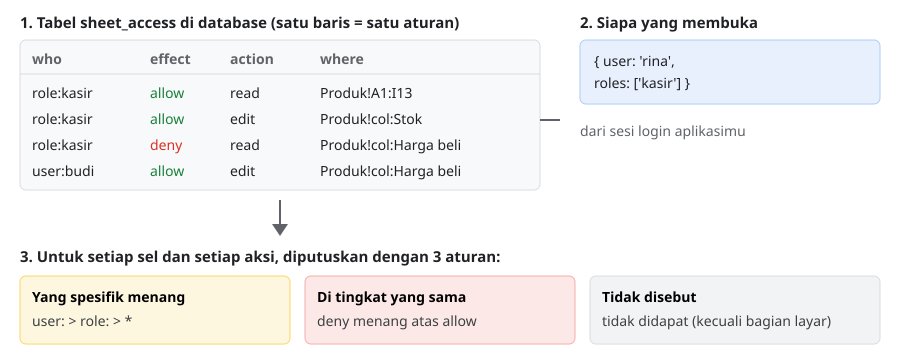
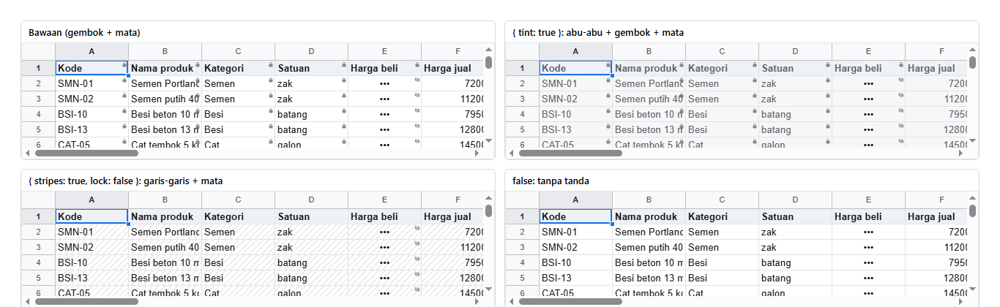

# 13. Hak akses

[Daftar isi](../README.md#daftar-isi) · Sebelumnya: [12. Menyimpan ke server](12-server.md) · Berikutnya: [14. Komentar](14-komentar.md)

Bab ini menjelaskan cara mengatur **siapa boleh apa** di sebuah spreadsheet. Contohnya: kasir boleh membaca tabel produk tapi hanya boleh
mengubah stok, harga beli disembunyikan dari kasir, toolbar tidak muncul untuk orang gudang.

Bab ini disusun berurutan. Mulai dari satu aturan, lalu satu hal baru di setiap langkah. Setiap langkah punya contoh yang dijalankan sungguhan,
dan hasilnya dicetak sebagai **peta akses**:

```
      A B C D E F G H I        E = boleh diubah
   1  r r r r r r r r r        r = hanya baca
   2  r r r r • r E r r        • = tersembunyi (tampil •••)
                               . = tidak terlihat (tampil kosong)
```

Semua contoh memakai sheet **Produk** dari toko bangunan: Kode, Nama produk, Kategori, Satuan, Harga beli, Harga jual, Stok, Stok min., Status
(kolom A sampai I), 12 produk.

Workbook-nya dan fungsi pencetak peta akses dipakai bersama oleh semua contoh di bab ini:

<!-- contoh: data/stok-akses.js -->
```js
import { createWorkbook } from '@kufayeka/sheet/core';
import { PRODUK, KOLOM_PRODUK } from './toko.js';

// Bahan bersama bab 13: workbook stok toko, dan "peta akses" yang mencetak apa yang didapat seseorang di setiap sel.

/** Sheet Produk: Kode, Nama produk, Kategori, Satuan, Harga beli, Harga jual, Stok, Stok min., Status (A..I), 12 produk. */
export function buatStok() {
    const wb = createWorkbook();
    wb.setSettings({ locale: 'id-ID', currency: 'IDR' });
    const p = wb.sheet('Sheet1');
    p.setSheetProps({ name: 'Produk' });
    p.setValues('A1', [[...KOLOM_PRODUK, 'Status'], ...PRODUK.map((x, i) => [...x, i === 7 ? 'Dihentikan' : 'Aktif'])]);
    p.setStyle('A1:I1', { bold: true, fill: '#eef2f7' });
    return wb;
}

const TANDA = { edit: 'E', readonly: 'r', hidden: '•', invisible: '.' };

/**
 * Peta akses baris 1-5, kolom A-I, untuk satu orang:
 *   E = boleh diubah, r = hanya baca, • = tersembunyi (•••), . = tidak terlihat (kosong)
 */
export function peta(wb, rows, who, judul) {
    wb.setAccess(rows, who);
    console.log(judul);
    console.log('      A B C D E F G H I');
    for (let r = 0; r < 5; r++) {
        let line = '  ' + String(r + 1).padStart(2) + '  ';
        for (let c = 0; c < 9; c++) {
            const m = wb.modeAt('Produk', r, c);
            line += (m ? TANDA[m.mode] : TANDA.edit) + ' ';
        }
        console.log(line);
    }
}
```
<!-- /contoh -->

- [13.1 Konsepnya](#131-konsepnya)
- [13.2 Langkah 1: aturan pertama](#132-langkah-1-aturan-pertama)
- [13.3 Langkah 2: boleh mengubah sebagian](#133-langkah-2-boleh-mengubah-sebagian)
- [13.4 Langkah 3: menyembunyikan](#134-langkah-3-menyembunyikan)
- [13.5 Langkah 4: role dan akun](#135-langkah-4-role-dan-akun)
- [13.6 Langkah 5: aturan dengan syarat](#136-langkah-5-aturan-dengan-syarat)
- [13.7 Langkah 6: aksi selain mengisi sel](#137-langkah-6-aksi-selain-mengisi-sel)
- [13.8 Langkah 7: tampilan layar](#138-langkah-7-tampilan-layar)
- [13.9 Langkah 8: di React](#139-langkah-8-di-react)
- [13.10 Langkah 9: di server dan database](#1310-langkah-9-di-server-dan-database)
- [13.11 Langkah 10: membuat layar pengaturan aturan](#1311-langkah-10-membuat-layar-pengaturan-aturan)
- [13.12 Referensi](#1312-referensi)

## 13.1 Konsepnya



Ada tiga bagian:

1. **Aturan disimpan sebagai baris tabel** di database aplikasimu. Satu baris = satu kalimat: "*siapa* (`who`) *boleh/tidak* (`effect`) *melakukan
   apa* (`action`) *di mana* (`where`)". Menambah aturan berarti menambah satu baris, menghapus aturan berarti menghapus satu baris.
2. **Siapa yang membuka** datang dari sistem login aplikasimu: nama akunnya dan role-nya. Library ini tidak mengurus login, akun, atau role. Ia hanya
   menerima "orang ini, dengan role ini".
3. **Library memutuskan** untuk setiap sel dan setiap aksi, dengan tiga aturan tetap:
   - **Yang spesifik menang.** Baris untuk akun (`user:budi`) mengalahkan baris untuk role (`role:kasir`), dan baris untuk role mengalahkan baris
     untuk semua orang (`*`). Dengan ini kamu bisa membuat pengecualian untuk satu orang.
   - **Di tingkat yang sama, `deny` menang.** Kalau satu role membolehkan dan role lain melarang, hasilnya dilarang.
   - **Yang tidak disebut, tidak didapat.** Orang tanpa satu baris pun tidak bisa melihat apa-apa. Satu-satunya pengecualian adalah bagian layar
     (toolbar, menu): bagian itu tampil kecuali dilarang.

Urutan baris di tabel **tidak berpengaruh**. Hasilnya selalu sama, berapa pun banyaknya baris dan bagaimanapun urutannya.

Aturan yang sama dipakai di dua tempat: di browser (untuk menampilkan dan menolak dengan cepat) dan di server (untuk benar-benar menjaga data,
langkah 9). Browser bisa diakali orang, server tidak.

## 13.2 Langkah 1: aturan pertama

Satu baris: kasir boleh **membaca** tabel produk.

<!-- contoh: 13-01-baca.ts -->
```ts
import type { AccessRow } from '@kufayeka/sheet/core';
import { buatStok, peta } from './data/stok-akses.js';

// Langkah 1: satu baris aturan. Kasir boleh MEMBACA tabel produk. Yang tidak disebut tidak didapat sama sekali.
const rows: AccessRow[] = [
    { who: 'role:kasir', effect: 'allow', action: 'read', where: 'Produk!A1:I13' }
];

const wb = buatStok();
peta(wb, rows, { user: 'rina', roles: ['kasir'] }, 'rina (kasir):');

// rina mencoba mengubah stok: ditolak, karena dia hanya boleh membaca
wb.on('reject', (e) => console.log('ditolak:', e.reason));
wb.setValues('Produk', 'G2', 999, { source: 'user' });
console.log('G2 tetap:', wb.value('Produk', 'G2'));

// tamu tidak punya satu baris pun: semuanya kosong
peta(wb, rows, { user: 'tamu' }, 'tamu (tanpa aturan):');
```
<!-- /contoh -->

<!-- hasil: 13-01-baca.ts -->
```text
rina (kasir):
      A B C D E F G H I
   1  r r r r r r r r r 
   2  r r r r r r r r r 
   3  r r r r r r r r r 
   4  r r r r r r r r r 
   5  r r r r r r r r r 
ditolak: You can only view this here
G2 tetap: 420
tamu (tanpa aturan):
      A B C D E F G H I
   1  . . . . . . . . . 
   2  . . . . . . . . . 
   3  . . . . . . . . . 
   4  . . . . . . . . . 
   5  . . . . . . . . .
```
<!-- /hasil -->

Yang terjadi:

- `wb.setAccess(rows, who)` memberikan aturan dan orangnya ke workbook. Sejak itu semua yang dilakukan orang (`source: 'user'`) diperiksa.
- Rina hanya boleh membaca, jadi perubahan stok ditolak dan event `reject` memberi tahu alasannya.
- Tamu tidak punya satu baris pun, jadi tidak mendapat apa-apa. Inilah aturan "yang tidak disebut, tidak didapat".

> Kode aplikasimu sendiri (`source: 'code'`, bawaan setiap fungsi) **tidak** diperiksa. Aturan akses menjaga apa yang dilakukan orang di layar,
> bukan apa yang dilakukan program yang kamu tulis.

## 13.3 Langkah 2: boleh mengubah sebagian

Kasir membaca semua kolom, tapi kolom Stok (G) dan Status (I) boleh diubah. Caranya: tambah baris `allow edit` di dalam area `allow read`.

<!-- contoh: 13-02-edit.ts -->
```ts
import type { AccessRow } from '@kufayeka/sheet/core';
import { buatStok, peta } from './data/stok-akses.js';

// Langkah 2: membuka lubang edit di dalam area baca. Kasir membaca semua, tapi kolom Stok (G) dan Status (I) boleh diubah.
// "edit" mengalahkan "read" di sel yang sama, jadi urutan baris tidak penting.
const rows: AccessRow[] = [
    { who: 'role:kasir', effect: 'allow', action: 'read', where: 'Produk!A1:I13' },
    { who: 'role:kasir', effect: 'allow', action: 'edit', where: 'Produk!col:Stok' },      // kolom ditulis dengan judulnya
    { who: 'role:kasir', effect: 'allow', action: 'edit', where: 'Produk!I2:I13' }         // atau dengan range biasa
];

const wb = buatStok();
peta(wb, rows, { user: 'rina', roles: ['kasir'] }, 'rina (kasir):');

wb.setValues('Produk', 'G2', 400, { source: 'user' });
console.log('G2 diubah rina:', wb.value('Produk', 'G2'));
```
<!-- /contoh -->

<!-- hasil: 13-02-edit.ts -->
```text
rina (kasir):
      A B C D E F G H I
   1  r r r r r r r r r 
   2  r r r r r r E r E 
   3  r r r r r r E r E 
   4  r r r r r r E r E 
   5  r r r r r r E r E 
G2 diubah rina: 400
```
<!-- /hasil -->

- `edit` sudah termasuk membaca. Di sel yang kena `read` dan `edit` sekaligus, `edit` yang dipakai, karena ia memberi lebih banyak.
- `where` bisa ditulis dengan **range** (`Produk!I2:I13`) atau dengan **judul kolom** (`Produk!col:Stok`). Dengan judul kolom, aturannya tetap
  benar walaupun kolomnya nanti dipindah, dan baris judulnya sendiri tidak ikut (G1 tetap hanya baca).

## 13.4 Langkah 3: menyembunyikan

Ada dua cara menyembunyikan isi sel:

| Baris | Di layar | Kapan dipakai |
|---|---|---|
| `deny read` | `•••` | orang boleh tahu selnya berisi, tapi tidak boleh tahu isinya |
| `deny see` | kosong | orang tidak boleh tahu bahwa selnya berisi apa pun |

<!-- contoh: 13-03-sembunyi.ts -->
```ts
import type { AccessRow } from '@kufayeka/sheet/core';
import { buatStok, peta } from './data/stok-akses.js';

// Langkah 3: deny. Harga beli (E) tampil •••, Harga jual (F) tidak terlihat sama sekali. Deny selalu menang atas allow di tingkat yang sama.
const rows: AccessRow[] = [
    { who: 'role:kasir', effect: 'allow', action: 'edit', where: 'Produk!A1:I13' },
    { who: 'role:kasir', effect: 'deny', action: 'read', where: 'Produk!col:Harga beli' },   // ••• : orang tahu ada isinya
    { who: 'role:kasir', effect: 'deny', action: 'see', where: 'Produk!col:Harga jual' }     // kosong : tidak ada tanda apa pun
];

const wb = buatStok();
peta(wb, rows, { user: 'rina', roles: ['kasir'] }, 'rina (kasir):');
console.log('E2 terlihat sebagai:', JSON.stringify(wb.display('Produk', 'E2').text), '| F2 terlihat sebagai:', JSON.stringify(wb.display('Produk', 'F2').text));
```
<!-- /contoh -->

<!-- hasil: 13-03-sembunyi.ts -->
```text
rina (kasir):
      A B C D E F G H I
   1  E E E E E E E E E 
   2  E E E E • . E E E 
   3  E E E E • . E E E 
   4  E E E E • . E E E 
   5  E E E E • . E E E 
E2 terlihat sebagai: "•••" | F2 terlihat sebagai: ""
```
<!-- /hasil -->

Di sini kasir boleh mengubah seluruh tabel, tapi `deny` mengalahkan `allow` di tingkat yang sama (keduanya untuk `role:kasir`). Isi yang
disembunyikan juga **tidak dikirim** oleh server ke orang itu (langkah 9), jadi tidak bisa diintip lewat DevTools.

## 13.5 Langkah 4: role dan akun

Isi kolom `who` ada tiga jenis:

| who | artinya | tingkat |
|---|---|---|
| `user:budi` | akun budi saja | paling spesifik |
| `role:kasir` | semua orang yang punya role kasir | tengah |
| `*` | semua orang | paling umum |

Satu orang boleh punya beberapa role. Aturan dari semua role-nya digabung.

<!-- contoh: 13-04-user.ts -->
```ts
import type { AccessRow } from '@kufayeka/sheet/core';
import { buatStok, peta } from './data/stok-akses.js';

// Langkah 4: role dan akun. Aturan untuk satu akun (user:) mengalahkan aturan untuk role, dan role mengalahkan * (semua orang).
const rows: AccessRow[] = [
    { who: '*', effect: 'allow', action: 'read', where: 'Produk!A1:D13' },                   // semua orang: kolom A-D
    { who: 'role:kasir', effect: 'allow', action: 'read', where: 'Produk!A1:I13' },          // kasir: semua kolom
    { who: 'role:kasir', effect: 'deny', action: 'read', where: 'Produk!col:Harga beli' },   // tapi harga beli disembunyikan
    { who: 'user:budi', effect: 'allow', action: 'edit', where: 'Produk!col:Harga beli' },   // budi (kasir senior) boleh mengubahnya
    { who: 'user:yeka', effect: 'allow', action: '*' }                                       // pemilik: semuanya
];

const wb = buatStok();
peta(wb, rows, { user: 'tamu' }, 'tamu (hanya *):');
peta(wb, rows, { user: 'rina', roles: ['kasir'] }, 'rina (kasir):');
peta(wb, rows, { user: 'budi', roles: ['kasir'] }, 'budi (kasir + aturan akunnya):');
peta(wb, rows, { user: 'yeka' }, 'yeka (pemilik):');
console.log('yeka pemilik?', wb.access().owner);
```
<!-- /contoh -->

<!-- hasil: 13-04-user.ts -->
```text
tamu (hanya *):
      A B C D E F G H I
   1  r r r r . . . . . 
   2  r r r r . . . . . 
   3  r r r r . . . . . 
   4  r r r r . . . . . 
   5  r r r r . . . . . 
rina (kasir):
      A B C D E F G H I
   1  r r r r r r r r r 
   2  r r r r • r r r r 
   3  r r r r • r r r r 
   4  r r r r • r r r r 
   5  r r r r • r r r r 
budi (kasir + aturan akunnya):
      A B C D E F G H I
   1  r r r r r r r r r 
   2  r r r r E r r r r 
   3  r r r r E r r r r 
   4  r r r r E r r r r 
   5  r r r r E r r r r 
yeka (pemilik):
      A B C D E F G H I
   1  E E E E E E E E E 
   2  E E E E E E E E E 
   3  E E E E E E E E E 
   4  E E E E E E E E E 
   5  E E E E E E E E E 
yeka pemilik? true
```
<!-- /hasil -->

Perhatikan kolom E (Harga beli):

- Untuk **tamu**, yang berlaku hanya baris `*`, yaitu kolom A sampai D.
- Untuk **rina**, baris `role:kasir` menang atas `*`, sehingga dia membaca semua kolom, tapi Harga beli disembunyikan.
- Untuk **budi**, baris `user:budi` menang atas `role:kasir`. Dia kasir, tapi khusus Harga beli dia boleh mengubahnya. Ini cara membuat
  pengecualian untuk satu orang.
- Untuk **yeka**, `allow *` tanpa `where` berarti boleh semuanya, dan `wb.access().owner` bernilai `true`.

### Pemilik

Pemilik spreadsheet ditulis sebagai satu baris biasa: **`user:<nama>` · `allow` · `*`**, tanpa `where`. Tidak ada kolom atau pengaturan khusus
lain. Pemilik:

- boleh semua aksi di semua sel, dengan layar lengkap;
- boleh mengubah aturan akses itu sendiri (aksi `access`), jadi layar pengaturan aturan cukup ditampilkan kalau `wb.can('access')`;
- tidak bisa dikalahkan oleh baris `role:` atau `*`, karena baris akun paling spesifik.

<!-- contoh: 13-04-pemilik.ts -->
```ts
import type { AccessRow } from '@kufayeka/sheet/core';
import { buatStok } from './data/stok-akses.js';

// Pemilik = satu baris "user:<nama> allow *". Baris untuk role dan untuk semua orang tidak bisa mengalahkannya, karena baris akun paling spesifik.
const rows: AccessRow[] = [
    { who: 'user:yeka', effect: 'allow', action: '*' },                                       // pemilik
    { who: '*', effect: 'deny', action: 'edit', where: 'Produk!col:Harga beli' },             // semua orang: harga beli dikunci
    { who: 'role:kasir', effect: 'deny', action: 'ui.toolbar' }                               // kasir: tanpa toolbar
];

const wb = buatStok();
const yeka = { user: 'yeka', roles: ['kasir'] };    // yeka juga kasir

wb.setAccess(rows, yeka);
console.log('pemilik?', wb.access().owner, '| E2:', wb.modeAt('Produk', 'E2')?.mode ?? 'edit', '| toolbar:', wb.access().ui.toolbar, '| boleh mengubah aturan:', wb.can('access'));

// HATI-HATI: satu baris deny untuk akun pemilik sendiri mencabut status pemiliknya
wb.setAccess([...rows, { who: 'user:yeka', effect: 'deny', action: 'download' }], yeka);
console.log('dengan deny untuk yeka -> pemilik?', wb.access().owner, '| E2:', wb.modeAt('Produk', 'E2')?.mode ?? 'edit', '| download:', wb.can('download'));

// HATI-HATI: tanpa baris pemilik, yeka hanya orang biasa (di sini tidak dapat apa-apa)
wb.setAccess(rows.slice(1), yeka);
console.log('tanpa baris pemilik -> pemilik?', wb.access().owner, '| E2:', wb.modeAt('Produk', 'E2')?.mode);
```
<!-- /contoh -->

<!-- hasil: 13-04-pemilik.ts -->
```text
pemilik? true | E2: edit | toolbar: true | boleh mengubah aturan: true
dengan deny untuk yeka -> pemilik? false | E2: edit | download: false
tanpa baris pemilik -> pemilik? false | E2: invisible
```
<!-- /hasil -->

Dua hal yang perlu dijaga, karena pemilik hanyalah sebuah baris:

1. **Jangan tulis `deny` untuk akun pemilik sendiri.** Satu `deny` saja sudah mencabut status pemiliknya. Kalau pemilik memang tidak boleh
   melakukan sesuatu, berarti dia bukan pemilik, dan aturannya ditulis seperti untuk orang lain.
2. **Jangan biarkan baris pemilik terhapus.** Tanpa baris itu, pemilik menjadi orang biasa, dan bisa saja tidak mendapat apa-apa. Di layar
   pengaturan aturanmu, sembunyikan tombol hapus untuk baris pemilik, atau tolak penyimpanan yang tidak lagi berisi baris `allow *` untuk pemilik.

Kalau ada beberapa pemilik, tulis satu baris untuk setiap akun. Super admin aplikasimu juga bisa dibuat dengan cara ini: aplikasimu menambahkan
baris `user:<admin> allow *` saat mengambil aturan dari database, tanpa perlu menyimpannya di setiap spreadsheet.

## 13.6 Langkah 5: aturan dengan syarat

Kolom `when` membuat aturan hanya berlaku di baris yang memenuhi syarat. Syaratnya **rumus biasa**, ditulis untuk baris pertama range, lalu
bergeser sendiri ke setiap baris, sama seperti rumus yang di-copy ke bawah.

<!-- contoh: 13-05-syarat.ts -->
```ts
import type { AccessRow } from '@kufayeka/sheet/core';
import { buatStok, peta } from './data/stok-akses.js';

// Langkah 5: aturan dengan syarat (when). Stok boleh diubah, KECUALI di baris produk yang sudah dihentikan.
// Syaratnya rumus biasa, ditulis untuk baris pertama range (baris 2), lalu ikut bergeser ke setiap baris. Dihitung ulang setiap isi sel berubah.
const rows: AccessRow[] = [
    { who: 'role:gudang', effect: 'allow', action: 'read', where: 'Produk!A1:I13' },
    { who: 'role:gudang', effect: 'allow', action: 'edit', where: 'Produk!G2:G13' },
    { who: 'role:gudang', effect: 'deny', action: 'edit', where: 'Produk!G2:G13', when: '=$I2="Dihentikan"', message: 'Produk ini sudah dihentikan' }
];

const wb = buatStok();
wb.on('reject', (e) => console.log('ditolak:', e.reason));
const joko = { user: 'joko', roles: ['gudang'] };
peta(wb, rows, joko, 'joko (gudang), baris 9 = Keramik 40x40 yang Dihentikan:');
console.log('G9:', wb.modeAt('Produk', 'G9')?.mode, '| G2:', wb.modeAt('Produk', 'G2')?.mode ?? 'edit');
wb.setValues('Produk', 'G9', 10, { source: 'user' });

// pemilik mengaktifkan lagi produknya: syaratnya langsung tidak berlaku, joko boleh mengubah stoknya
wb.setValues('Produk', 'I9', 'Aktif');
console.log('setelah I9 = Aktif, G9:', wb.modeAt('Produk', 'G9')?.mode ?? 'edit');
```
<!-- /contoh -->

<!-- hasil: 13-05-syarat.ts -->
```text
joko (gudang), baris 9 = Keramik 40x40 yang Dihentikan:
      A B C D E F G H I
   1  r r r r r r r r r 
   2  r r r r r r E r r 
   3  r r r r r r E r r 
   4  r r r r r r E r r 
   5  r r r r r r E r r 
G9: readonly | G2: edit
ditolak: Produk ini sudah dihentikan
setelah I9 = Aktif, G9: edit
```
<!-- /hasil -->

- `=$I2="Dihentikan"` dihitung untuk setiap baris: di baris 9 jadi `=$I9="Dihentikan"`. Tanda `$` menahan kolom I supaya tidak ikut bergeser.
- Syarat dihitung ulang setiap kali isi sheet berubah. Begitu I9 diubah jadi Aktif, G9 langsung bisa diedit lagi.
- `message` adalah kalimat yang muncul saat aturan ini menolak sesuatu.

## 13.7 Langkah 6: aksi selain mengisi sel

Selain sel, `action` bisa berisi aksi lain: format, sort, filter, menambah baris, mengunduh, berkomentar, dan seterusnya (daftar lengkapnya di
13.12). Aturan aksi biasanya ditulis **tanpa `where`**, artinya berlaku di mana saja.

<!-- contoh: 13-06-aksi.ts -->
```ts
import type { AccessRow } from '@kufayeka/sheet/core';
import { buatStok } from './data/stok-akses.js';

// Langkah 6: aksi selain mengisi sel: format, sort, filter, baris, kolom, sheet, salin, unduh, komentar.
// Satu aksi (format.bold), satu kelompok (format = semua format.*), atau * (semuanya). Tanpa where: berlaku di mana saja.
const rows: AccessRow[] = [
    { who: 'role:kasir', effect: 'allow', action: 'edit', where: 'Produk!A1:I13' },
    { who: 'role:kasir', effect: 'allow', action: 'format' },          // semua format...
    { who: 'role:kasir', effect: 'deny', action: 'format.bold' },      // ...kecuali tebal
    { who: 'role:kasir', effect: 'allow', action: 'sort' },
    { who: 'role:kasir', effect: 'allow', action: 'filter' },
    { who: 'role:kasir', effect: 'allow', action: 'comment.read' }
];

const wb = buatStok();
wb.setAccess(rows, { user: 'rina', roles: ['kasir'] });
for (const a of ['format.italic', 'format.fill', 'format.bold', 'sort', 'filter', 'rows.insert', 'download', 'comment.read', 'comment.create']) {
    console.log(a.padEnd(15), wb.can(a) ? 'boleh' : 'tidak');
}

wb.on('reject', (e) => console.log('ditolak:', e.reason));
const p = wb.sheet('Produk');
p.setStyle('B2', { italic: true }, { source: 'user' });
p.setStyle('B2', { bold: true }, { source: 'user' });
console.log('gaya B2:', JSON.stringify(p.style('B2')));
```
<!-- /contoh -->

<!-- hasil: 13-06-aksi.ts -->
```text
format.italic   boleh
format.fill     boleh
format.bold     tidak
sort            boleh
filter          boleh
rows.insert     tidak
download        tidak
comment.read    boleh
comment.create  tidak
ditolak: You cannot change the formatting here
gaya B2: {"italic":true}
```
<!-- /hasil -->

- `format` adalah **kelompok**: ia mencakup semua `format.*`. Aturan untuk kelompok dan untuk satu aksi bisa dicampur: "semua format, kecuali tebal".
- `wb.can(aksi)` menjawab "boleh atau tidak" untuk orang yang sedang membuka. Dengan ini kamu bisa menyembunyikan tombol di aplikasimu sendiri.
- Aksi yang tidak disebut sama sekali tidak boleh (`rows.insert`, `download`, `comment.create` di contoh ini).

## 13.8 Langkah 7: tampilan layar

Bagian layar ditulis dengan awalan `ui.`, dan **tampil kecuali di-deny**. Ada juga dua aturan tampilan:

| action | where | artinya |
|---|---|---|
| `ui.toolbar`, `ui.menubar`, `ui.formulaBar`, `ui.headers`, `ui.gridlines`, `ui.tabs` | | satu bagian besar layar |
| `ui.menu.Insert`, `ui.tool.paint`, `ui.panel.comments`, ... | | satu menu, tombol, atau panel (daftar di 13.12) |
| `ui.disallowed` | | `deny`: yang tidak boleh disembunyikan, bukan digelapkan |
| `view.area` | `Produk!A1:G13` | hanya area ini yang tampil |
| `view.sheet` | `Produk` | hanya sheet ini yang tampil (satu baris per sheet) |

<!-- contoh: 13-07-layar.ts -->
```ts
import type { AccessRow } from '@kufayeka/sheet/core';
import { buatStok } from './data/stok-akses.js';

// Langkah 7: tampilan. Bagian layar (ui.*) selalu tampil kecuali di-deny. view.area = hanya range ini yang tampil, view.sheet = hanya sheet ini.
// Ingat: ini soal TAMPILAN. Yang menjaga data tetap read / edit / format di atas (dan dicek lagi di server).
const rows: AccessRow[] = [
    { who: 'role:kasir', effect: 'allow', action: 'read', where: 'Produk!A1:I13' },
    { who: 'role:kasir', effect: 'deny', action: 'ui.toolbar' },
    { who: 'role:kasir', effect: 'deny', action: 'ui.menu.Insert' },       // satu menu
    { who: 'role:kasir', effect: 'deny', action: 'ui.tool.paint' },        // satu tombol
    { who: 'role:kasir', effect: 'deny', action: 'ui.disallowed' },        // yang tidak boleh: disembunyikan, bukan digelapkan
    { who: 'role:kasir', effect: 'allow', action: 'view.area', where: 'Produk!A1:G13' },
    { who: 'role:kasir', effect: 'allow', action: 'view.sheet', where: 'Produk' }
];

const wb = buatStok();
wb.setAccess(rows, { user: 'rina', roles: ['kasir'] });
const ui = wb.access().ui;
console.log('menubar', ui.menubar, '| toolbar', ui.toolbar, '| formulaBar', ui.formulaBar, '| tabs', ui.tabs);
console.log('disembunyikan:', ui.hide.join(', '), '| yang tidak boleh:', ui.disallowed);
console.log('area:', JSON.stringify(ui.area), '| sheet:', JSON.stringify(ui.sheets));
console.log('menu Insert tampil?', wb.shows('menu.Insert'), '| menu Format tampil?', wb.shows('menu.Format'));
```
<!-- /contoh -->

<!-- hasil: 13-07-layar.ts -->
```text
menubar true | toolbar false | formulaBar true | tabs true
disembunyikan: menu.Insert, tool.paint | yang tidak boleh: hide
area: {"Produk":"A1:G13"} | sheet: ["Produk"]
menu Insert tampil? false | menu Format tampil? true
```
<!-- /hasil -->

> **Tampilan bukan keamanan.** Menyembunyikan toolbar tidak mencegah orang menebalkan teks dengan Ctrl+B. Yang benar-benar menjaga adalah aturan
> sel dan aksi (`read`, `edit`, `format.bold`, ...), yang juga diperiksa di server. Pakai `ui.*` dan `view.*` untuk merapikan layar, bukan untuk
> melindungi data.

## 13.9 Langkah 8: di React

Di React, aturan dan orangnya diberikan lewat prop `access`. Sheet langsung menerapkannya, dan menerapkannya lagi setiap kali `rows` atau `who`
berubah.

<!-- contoh: 13-08-kasir.page.tsx -->
```tsx
import { useState } from 'react';
import { Sheet } from '@kufayeka/sheet';
import type { AccessRow } from '@kufayeka/sheet/core';
import '@kufayeka/sheet/style.css';
import { buatStok } from './data/stok-akses.js';

// Langkah 8: di layar. Aturan dari database + orang yang login, diberikan ke <Sheet access>. Sheet langsung menerapkannya.
const ATURAN: AccessRow[] = [
    { who: 'role:kasir', effect: 'allow', action: 'read', where: 'Produk!A1:I13' },
    { who: 'role:kasir', effect: 'allow', action: 'edit', where: 'Produk!col:Stok' },
    { who: 'role:kasir', effect: 'deny', action: 'read', where: 'Produk!col:Harga beli' },
    { who: 'role:kasir', effect: 'allow', action: 'sort' },
    { who: 'role:kasir', effect: 'deny', action: 'ui.toolbar' }
];

export default function StokUntukKasir() {
    const [wb] = useState(buatStok);
    // who: dari sesi login aplikasimu (akun + role-nya)
    return (
        <div style={{ height: 480 }}>
            <Sheet workbook={wb} access={{ rows: ATURAN, who: { user: 'rina', roles: ['kasir'] } }} user={{ id: 'rina', name: 'Rina' }} />
        </div>
    );
}
```
<!-- /contoh -->


Rina tidak mendapat toolbar, Harga beli tampil `•••`, dan hanya kolom Stok yang bisa diubah. Klik sel lain lalu ketik: sheet menolak dan
menjelaskan alasannya.

Prop `access` sama dengan memanggil `wb.setAccess(rows, who)` sendiri. Pilih salah satu, jangan keduanya.

### Tanda di sel: gembok dan mata

Supaya orang tahu sebelum mencoba mengetik, sel yang tidak boleh diubah diberi tanda kecil di **pojok kanan atas**:

| Tanda | Di sel | Artinya |
|---|---|---|
| gembok | sel yang terlihat isinya | hanya bisa dibaca |
| mata dicoret | sel `•••` | isinya tersembunyi |
| (tidak ada) | sel kosong yang tidak terlihat | tidak ada tanda, supaya tidak ada petunjuk bahwa sel itu berisi |
| (tidak ada) | sel yang boleh diubah | sel biasa |

Itu tampilan bawaannya. Prop **`marks`** mengaturnya, dan pilihannya bebas dicampur:

| `marks` | Hasil |
|---|---|
| tidak diisi | `{ lock: true, hidden: true }`: gembok dan mata |
| `{ tint: true }` | ditambah latar abu-abu muda dan teks sedikit pudar di sel hanya-baca |
| `{ stripes: true }` | ditambah garis-garis tipis |
| `{ lock: false }` | tanpa gembok (mata tetap) |
| `false` | tanpa tanda sama sekali |

<!-- contoh: 13-12-tanda.page.tsx -->
```tsx
import { useState } from 'react';
import { Sheet } from '@kufayeka/sheet';
import type { CellMarks } from '@kufayeka/sheet';
import type { AccessRow } from '@kufayeka/sheet/core';
import '@kufayeka/sheet/style.css';
import { buatStok } from './data/stok-akses.js';

// Tanda di sel yang tidak boleh diubah: prop marks. Aturan dan orangnya sama di keempat sheet, hanya tandanya yang berbeda.
const ATURAN: AccessRow[] = [
    { who: 'role:kasir', effect: 'allow', action: 'read', where: 'Produk!A1:I13' },
    { who: 'role:kasir', effect: 'allow', action: 'edit', where: 'Produk!col:Stok' },
    { who: 'role:kasir', effect: 'deny', action: 'read', where: 'Produk!col:Harga beli' },
    ...['menubar', 'toolbar', 'formulaBar', 'tabs'].map((bagian): AccessRow => ({ who: '*', effect: 'deny', action: 'ui.' + bagian }))
];
const RINA = { user: 'rina', roles: ['kasir'] };

const PILIHAN: Array<{ judul: string; marks: false | CellMarks | undefined }> = [
    { judul: 'Bawaan (gembok + mata)', marks: undefined },
    { judul: '{ tint: true }: abu-abu + gembok + mata', marks: { tint: true } },
    { judul: '{ stripes: true, lock: false }: garis-garis + mata', marks: { stripes: true, lock: false } },
    { judul: 'false: tanpa tanda', marks: false }
];

function Contoh({ judul, marks }: { judul: string; marks: false | CellMarks | undefined }) {
    const [wb] = useState(buatStok);
    return (
        <div style={{ border: '1px solid #dadce0', borderRadius: 6, overflow: 'hidden' }}>
            <div style={{ padding: '6px 10px', fontWeight: 600 }}>{judul}</div>
            <div style={{ height: 160 }}><Sheet workbook={wb} access={{ rows: ATURAN, who: RINA }} marks={marks} /></div>
        </div>
    );
}

export default function PilihanTanda() {
    return (
        <div style={{ display: 'grid', gridTemplateColumns: '1fr 1fr', gap: 12, padding: 12, font: '13px system-ui' }}>
            {PILIHAN.map((p) => <Contoh key={p.judul} judul={p.judul} marks={p.marks} />)}
        </div>
    );
}
```
<!-- /contoh -->



Tanda ini berlaku untuk semua sel yang tidak boleh diubah, baik karena baris aturan akses maupun karena aturan dari kode aplikasimu
(`setRules`, [bab 10](10-aturan.md)).

Tanda ini hanya bantuan untuk mata. Yang benar-benar menjaga datanya tetap aturannya sendiri, yang juga diperiksa di server (langkah 9).

### Pesan penolakan: diganti, dimatikan, atau ditampilkan di luar sheet

Saat sesuatu ditolak, sheet menampilkan pesan kecil di bawah grid. Teksnya diambil dari kolom `message` baris aturan, atau teks bawaan kalau
kosong. Semua pesan sheet lewat satu prop, **`onNotice`**, sebelum tampil. Prop ini sekaligus event-nya:

| `onNotice` mengembalikan | Yang terjadi |
|---|---|
| tidak ada (`undefined`) | pesan bawaan sheet tampil |
| teks | teks itu yang tampil, menggantikan pesan bawaan |
| `null` | sheet tidak menampilkan apa pun; aplikasimu menampilkannya sendiri |

Isi `SheetNotice` yang diterima:

| Kolom | Isi |
|---|---|
| `kind` | `refused` (ditolak), `error` (gagal), `info` (pemberitahuan) |
| `reason` | teks bawaan sheet, atau `message` dari baris aturan |
| `address` | sel yang dicoba, misalnya `B4` (kalau ada) |
| `action` | aksi yang ditolak: `edit`, `copy`, `paste`, `comment.reply`, ... (kalau diketahui) |
| `source`, `op` | untuk penolakan dari workbook: siapa yang mengubah dan op-nya |

Untuk mematikan semua pesan bawaan: `onNotice={() => null}`. Contoh di bawah menampilkan penolakan di bar merah di atas sheet, dengan kata-kata
sendiri untuk setiap aksi:

<!-- contoh: 13-11-pesan.page.tsx -->
```tsx
import { useState } from 'react';
import { Sheet } from '@kufayeka/sheet';
import type { SheetNotice } from '@kufayeka/sheet';
import type { AccessRow } from '@kufayeka/sheet/core';
import '@kufayeka/sheet/style.css';
import { buatStok } from './data/stok-akses.js';

// Pesan penolakan ditampilkan di luar sheet, dengan kata-kata aplikasimu sendiri. Pesan bawaan sheet dimatikan.
const ATURAN: AccessRow[] = [
    { who: 'role:kasir', effect: 'allow', action: 'read', where: 'Produk!A1:I13' },
    { who: 'role:kasir', effect: 'allow', action: 'edit', where: 'Produk!col:Stok' },
    { who: 'role:kasir', effect: 'deny', action: 'copy' }
];

// teks sendiri untuk setiap aksi yang ditolak
const KATA: Record<string, string> = {
    edit: 'Kolom ini hanya bisa dibaca. Yang boleh kamu ubah hanya Stok.',
    copy: 'Data stok tidak boleh disalin keluar.'
};

export default function PesanSendiri() {
    const [wb] = useState(buatStok);
    const [pesan, setPesan] = useState<string | null>(null);

    // onNotice dipanggil untuk setiap pesan sheet: refused (ditolak), error, info
    function padaPesan(n: SheetNotice) {
        if (n.kind === 'refused') {
            setPesan((n.address ? n.address + ': ' : '') + (KATA[n.action ?? ''] ?? n.reason));
            return null;           // null: sheet tidak menampilkan pesannya sendiri
        }
        return undefined;          // error dan info: biarkan sheet yang menampilkan
    }

    return (
        <div style={{ height: 420, display: 'flex', flexDirection: 'column', font: '13px system-ui' }}>
            <div className="pesan-sendiri" style={{ padding: '8px 12px', background: pesan ? '#fce8e6' : '#f1f3f4', color: pesan ? '#c5221f' : '#5f6368' }}>
                {pesan ?? 'Klik sel lalu ketik. Hanya kolom Stok yang bisa diubah.'}
            </div>
            <Sheet workbook={wb} style={{ flex: 1 }} onNotice={padaPesan}
                access={{ rows: ATURAN, who: { user: 'rina', roles: ['kasir'] } }} />
        </div>
    );
}
```
<!-- /contoh -->


Di luar React (misalnya di server, atau di kode yang memakai workbook langsung), penolakan dari workbook didengar dengan `wb.on('reject', fn)`
([4.9](04-api-workbook.md)).

## 13.10 Langkah 9: di server dan database

Di database, aturan disimpan di tabel tersendiri, satu baris per aturan:

```sql
create table sheet_access (
    id              bigserial primary key,
    spreadsheet_id  text not null references spreadsheet(id) on delete cascade,
    who             text not null,          -- 'user:rina', 'role:kasir', '*'
    effect          text not null check (effect in ('allow', 'deny')),
    action          text not null,          -- 'read', 'edit', 'format.bold', 'ui.toolbar', ...
    "where"         text,                   -- 'Produk!A1:I13', 'Produk!col:Stok'; kosong = di mana saja
    "when"          text,                   -- '=$I2="Dihentikan"'
    message         text
);
create index on sheet_access (spreadsheet_id);
```

Pertanyaan seperti "siapa saja yang boleh mengubah kolom Stok?" cukup dijawab dengan satu `select`. Untuk dipakai, ambil semua baris milik
spreadsheet itu dan berikan apa adanya ke library.

Server memakai baris yang sama dengan browser:

- **`viewFor(doc, { access, who })`** saat orang membuka: isi workbook yang boleh dikirim ke orang ini. Sel yang tersembunyi tidak ikut terkirim.
- **`checkPatch(doc, patch, { access, who })`** saat orang menyimpan: perubahan diperiksa sekali lagi sebelum disimpan.
- **`validateAccess(rows)`** sebelum aturan disimpan: memeriksa isi barisnya benar.

<!-- contoh: 13-09-server.ts -->
```ts
import { createWorkbook, viewFor, checkPatch, validateAccess } from '@kufayeka/sheet/core';
import type { AccessRow } from '@kufayeka/sheet/core';
import { buatStok } from './data/stok-akses.js';

// Langkah 9: di server. Browser bisa diakali, jadi server memakai baris aturan YANG SAMA:
//   viewFor    = isi workbook yang boleh dikirim ke orang ini (yang tersembunyi tidak ikut terkirim)
//   checkPatch = perubahan yang dikirim orang ini, diperiksa sebelum disimpan
const rows: AccessRow[] = [
    { who: 'role:kasir', effect: 'allow', action: 'read', where: 'Produk!A1:I13' },
    { who: 'role:kasir', effect: 'allow', action: 'edit', where: 'Produk!col:Stok' },
    { who: 'role:kasir', effect: 'deny', action: 'read', where: 'Produk!col:Harga beli' }
];
const rina = { user: 'rina', roles: ['kasir'] };

// 0. sebelum disimpan ke tabel: aturannya benar?
console.log('aturan benar?', validateAccess(rows).length === 0);
console.log('aturan salah :', JSON.stringify(validateAccess([{ who: 'kasir', effect: 'allow', action: 'format.blod' }])));

// 1. GET: yang dikirim ke rina. Harga beli Semen (64000) tidak ikut
const doc = buatStok().toJSON();
const dikirim = JSON.stringify(viewFor(doc, { access: rows, who: rina }));
console.log('harga beli ikut terkirim?', dikirim.includes('64000'), '| nama produk ikut?', dikirim.includes('Semen Portland'));

// 2. PUT: perubahan dari browser rina, diperiksa lagi
const browser = createWorkbook(doc);
browser.sheet('Produk').setValues('G2', 400);          // stok: boleh
console.log('ubah stok   :', checkPatch(doc, browser.pendingPatch(), { access: rows, who: rina }).ok ? 'diterima' : 'ditolak');
browser.sheet('Produk').setValues('B2', 'Semen murah'); // nama produk: tidak boleh (browser yang diakali bisa mengirimnya)
const hasil = checkPatch(doc, browser.pendingPatch(), { access: rows, who: rina });
console.log('ubah nama   :', hasil.ok ? 'diterima' : 'ditolak', '|', hasil.problems.map((p) => p.address + ': ' + p.reason).join(', '));
```
<!-- /contoh -->

<!-- hasil: 13-09-server.ts -->
```text
aturan benar? true
aturan salah : [{"row":0,"problem":"who is \"user:<name>\", \"role:<name>\" or \"*\""},{"row":0,"problem":"there is no action \"format.blod\""}]
harga beli ikut terkirim? false | nama produk ikut? true
ubah stok   : diterima
ubah nama   : ditolak | B2: You can only view this here
```
<!-- /hasil -->

Cara menyambungkan ini ke route GET dan PUT dijelaskan di [bab 12](12-server.md).

## 13.11 Langkah 10: membuat layar pengaturan aturan

Library tidak punya layar pengaturan aturan bawaan. Kamu membuatnya sendiri di aplikasimu, dengan tampilan aplikasimu. Sheet membantu dengan
**mode pengaturan**: `access.view: 'setup'`.


**Yang terlihat di mode pengaturan:**

- Setiap sel yang kena aturan mendapat **kotak warna kecil di pojok kanan atas, satu kotak untuk setiap who** yang punya aturan di sel itu.
  Di gambar, C3 punya dua kotak: kasir dan gudang. Dua aturan untuk kasir di sel yang sama tetap satu kotak.
- Arahkan kursor ke kotak untuk melihat siapa dan aturan nomor berapa saja.
- Aturan yang **dipilih** diberi garis di sekeliling range-nya, dengan warna who-nya.
- Gembok dan mata tidak muncul di mode ini. Apa isi aturannya terbaca di daftar aturan.

**Cara menyambungkannya:**

| Kamu | Sheet |
|---|---|
| `access.view: 'setup'` | menggambar kotak who di setiap sel yang kena aturan |
| `access.selected: i` | memberi garis pada range baris aturan ke-`i` |
| `access.onSelect: (i) => ...` | dipanggil saat kotak di sel diklik, dengan nomor baris aturannya |
| `accessColor(who)` | warna yang sama dengan kotak di sheet, untuk daftar aturanmu sendiri |
| `ref.select(range)` | memilih range di sheet saat baris di daftarmu diklik |
| `onSelectionChange` | alamat range yang dipilih orang di sheet, sekali setelah mouse dilepas, untuk membuat aturan baru |

**Alurnya:**

1. Orang memilih range di sheet. Alamatnya (`Produk!C2:C5`) datang lewat `onSelectionChange`.
2. Orang memilih siapa dan aturannya, lalu menekan Tambah. Aplikasimu menambah **satu baris** ke daftar.
3. Klik baris di daftar: `selected` berubah, range-nya bergaris dan terpilih di sheet. Klik kotak di sheet: `onSelect` memberi tahu baris yang mana.
4. Ganti mode ke "Lihat sebagai Rina": `view` kembali ke `'live'`, dan `who` diganti Rina. Sheet tampil persis seperti yang Rina lihat, dengan
   gembok dan matanya, jadi aturannya bisa dicoba sebelum disimpan.
5. `validateAccess` memeriksa barisnya, lalu baris-baris itu disimpan ke tabel `sheet_access`.


<!-- contoh: 04-13-editor-akses.page.tsx -->
```tsx
import { useEffect, useRef, useState } from 'react';
import { Sheet } from '@kufayeka/sheet';
import type { SheetSelection, SheetHandle } from '@kufayeka/sheet';
import { createWorkbook, validateAccess, accessColor } from '@kufayeka/sheet/core';
import type { Workbook, AccessRow, Who } from '@kufayeka/sheet/core';
import '@kufayeka/sheet/style.css';

// Layar pengaturan hak akses buatan aplikasimu sendiri, di luar sheet:
// 1. Mode "Pengaturan": setiap sel yang kena aturan diberi kotak warna kecil, satu per who
// 2. pilih range di sheet, pilih siapa dan aturannya, Tambah: satu baris baru
// 3. klik baris di daftar: range-nya bergaris dan terpilih di sheet. Klik kotak di sel: barisnya terpilih di daftar
// 4. Mode "Lihat sebagai ...": sheet seperti yang dilihat orang itu (gembok di sel hanya-baca, mata di sel tersembunyi)
// 5. baris-barisnya disimpan ke tabel database

function buatStok(): Workbook {
    const wb = createWorkbook();
    wb.setSettings({ locale: 'id-ID', currency: 'IDR' });
    const s = wb.sheet('Sheet1');
    s.setSheetProps({ name: 'Produk', freezeRows: 1 });
    s.setValues('A1', [
        ['Kode', 'Produk', 'Harga beli', 'Harga jual', 'Stok'],
        ['SMN-01', 'Semen 50 kg', 64000, 72000, 420],
        ['BSI-10', 'Besi 10 mm', 68000, 79500, 260],
        ['CAT-05', 'Cat 5 kg', 118000, 145000, 64],
        ['PSR-01', 'Pasir m3', 245000, 290000, 31]
    ]);
    s.setStyle('A1:E1', { bold: true, fill: '#e8f0fe' });
    s.setColProps('C:D', { format: { type: 'money', decimals: 0 } });
    s.setColProps('B', { width: 130 });
    return wb;
}

// aturan awal: pemilik boleh semua, kasir dan gudang membaca tabelnya, gudang mengubah stok
const ATURAN_AWAL: AccessRow[] = [
    { who: 'user:yeka', effect: 'allow', action: '*' },
    { who: 'role:kasir', effect: 'allow', action: 'read', where: 'Produk!A1:E5' },
    { who: 'role:gudang', effect: 'allow', action: 'read', where: 'Produk!A1:E5' },
    { who: 'role:gudang', effect: 'allow', action: 'edit', where: 'Produk!col:Stok' }
];
// mode layar: pengaturan, atau sheet seperti dilihat seseorang (akun + role-nya, seperti dari sesi login aplikasimu)
const MODE: Record<string, { nama: string; who: Who }> = {
    setup: { nama: 'Pengaturan', who: { user: 'yeka' } },
    rina: { nama: 'Lihat sebagai Rina (kasir)', who: { user: 'rina', roles: ['kasir'] } },
    joko: { nama: 'Lihat sebagai Joko (gudang)', who: { user: 'joko', roles: ['gudang'] } }
};
// pilihan aturan untuk satu range: effect + action, dengan kata yang dimengerti orang
const ATURAN = {
    edit: { effect: 'allow', action: 'edit', label: 'boleh diubah' },
    read: { effect: 'allow', action: 'read', label: 'hanya baca' },
    hidden: { effect: 'deny', action: 'read', label: 'tersembunyi (•••)' },
    invisible: { effect: 'deny', action: 'see', label: 'tidak terlihat' }
} as const;
type Pilihan = keyof typeof ATURAN;

export default function EditorAkses() {
    const [wb] = useState(buatStok);
    const sheet = useRef<SheetHandle>(null);
    const [rows, setRows] = useState<AccessRow[]>(ATURAN_AWAL);
    const [pilihan, setPilihan] = useState<SheetSelection | null>(null);   // seleksi terakhir di sheet
    const [dipilih, setDipilih] = useState<number | null>(null);           // baris aturan yang dipilih
    const [siapa, setSiapa] = useState('role:kasir');
    const [aturan, setAturan] = useState<Pilihan>('read');
    const [mode, setMode] = useState('setup');

    // satu aturan baru = satu baris baru, langsung terpilih
    function tambah() {
        if (!pilihan) return;
        const { effect, action } = ATURAN[aturan];
        setRows([...rows, { who: siapa, effect, action, where: pilihan.sheet.name + '!' + pilihan.address }]);
        setDipilih(rows.length);
    }
    const hapus = (i: number) => { setRows(rows.filter((_, j) => j !== i)); setDipilih(null); };
    // memilih baris di daftar: range-nya juga terpilih di sheet
    function pilih(i: number) {
        setDipilih(i);
        const where = rows[i].where;
        if (where) sheet.current?.select(where.includes('!') ? where.slice(where.indexOf('!') + 1) : where);
    }
    // sheet yang dilihat sebagai orang lain: tidak ada yang dipilih
    useEffect(() => { if (mode !== 'setup') setDipilih(null); }, [mode]);
    const masalah = validateAccess(rows);

    return (
        <div style={{ display: 'flex', height: 520, font: '13px system-ui' }}>
            <Sheet ref={sheet} workbook={wb} style={{ flex: 1 }} onSelectionChange={setPilihan}
                access={{ rows, who: MODE[mode].who, view: mode === 'setup' ? 'setup' : 'live', selected: dipilih, onSelect: setDipilih }} />
            <aside className="editor-akses" style={{ width: 380, padding: 12, borderLeft: '1px solid #dadce0', overflow: 'auto' }}>
                <h3 style={{ margin: '0 0 8px' }}>Aturan akses</h3>
                <p>
                    Mode <select className="lihat-sebagai" value={mode} onChange={(e) => setMode(e.target.value)}>
                        {Object.entries(MODE).map(([id, m]) => <option key={id} value={id}>{m.nama}</option>)}
                    </select>
                </p>
                <p>Range terpilih: <b className="range-terpilih">{pilihan ? pilihan.sheet.name + '!' + pilihan.address : '-'}</b></p>
                <p>
                    <select className="pilih-peran" value={siapa} onChange={(e) => setSiapa(e.target.value)}>
                        <option value="role:kasir">role:kasir</option><option value="role:gudang">role:gudang</option>
                        <option value="user:rina">user:rina</option><option value="*">semua orang</option>
                    </select>{' '}
                    <select className="pilih-mode" value={aturan} onChange={(e) => setAturan(e.target.value as Pilihan)}>
                        {(Object.keys(ATURAN) as Pilihan[]).map((k) => <option key={k} value={k}>{ATURAN[k].label}</option>)}
                    </select>{' '}
                    <button className="tambah-aturan" onClick={tambah} disabled={!pilihan || mode !== 'setup'}>Tambah</button>
                </p>
                <table className="daftar-aturan" style={{ width: '100%', borderCollapse: 'collapse' }}>
                    <thead><tr><th /><th align="left">who</th><th align="left">effect</th><th align="left">action</th><th align="left">where</th><th /></tr></thead>
                    <tbody>
                        {rows.map((r, i) => (
                            <tr key={i} onClick={() => pilih(i)} style={{ borderTop: '1px solid #eee', cursor: 'pointer', background: i === dipilih ? '#e8f0fe' : undefined }}>
                                {/* warna yang sama dengan kotak di sheet */}
                                <td><i style={{ display: 'inline-block', width: 8, height: 8, borderRadius: 2, background: accessColor(r.who) }} /></td>
                                <td>{r.who}</td><td>{r.effect}</td><td>{r.action}</td><td>{r.where ?? ''}</td>
                                <td><button onClick={(e) => { e.stopPropagation(); hapus(i); }}>✕</button></td>
                            </tr>
                        ))}
                    </tbody>
                </table>
                <p style={{ color: masalah.length ? '#d93025' : '#188038' }}>{masalah.length ? masalah.map((m) => 'baris ' + (m.row + 1) + ': ' + m.problem).join('; ') : 'Aturan sah, siap disimpan'}</p>
            </aside>
        </div>
    );
}
```
<!-- /contoh -->

Kalau satu sel punya lebih dari empat who, sheet menampilkan tiga kotak dan tanda `+n`. Warna setiap who dihitung dari namanya, jadi
`role:kasir` selalu berwarna sama di setiap layar dan komputer. Warna sendiri bisa diberikan lewat `access.colors`:
`{ 'role:kasir': '#1a73e8' }`.

## 13.12 Referensi

### Kolom satu baris aturan (`AccessRow`)

| Kolom | Isi | Wajib |
|---|---|---|
| `who` | `user:<nama>`, `role:<nama>`, atau `*` | ya |
| `effect` | `allow` atau `deny` | ya |
| `action` | satu aksi, satu kelompok (`format`), `ui.<bagian>`, `view.area`, `view.sheet`, atau `*` | ya |
| `where` | `Produk!A1:I13` (range), `Produk!col:Stok,Status` (judul kolom), `Produk` (satu sheet), `A1:I13` (semua sheet); kosong = di mana saja | tidak |
| `when` | rumus untuk baris pertama range, aturan berlaku di baris yang hasilnya TRUE | tidak |
| `message` | kalimat yang ditampilkan saat aturan ini menolak | tidak |

### Siapa yang membuka (`Who`)

`'rina'` (akun saja), atau `{ user: 'rina', roles: ['kasir', 'gudang'] }`.

### Aturan untuk sel

| Baris | Hasil di sel |
|---|---|
| `allow edit` | boleh diubah (dan dibaca) |
| `allow read` | hanya baca |
| `deny edit` | paling tinggi hanya baca: membatasi `allow` yang ada, tidak memberi izin baca sendiri |
| `deny read` | tersembunyi, tampil `•••` |
| `deny see` | tidak terlihat, tampil kosong |
| tidak ada baris | tidak terlihat |

### Semua isi `action`

<!-- tabel: 13-10-daftar.ts -->
| Kelompok | action |
|---|---|
| Cells | `read`, `edit`, `see` |
| Format | `format.bold`, `format.italic`, `format.underline`, `format.strike`, `format.color`, `format.fill`, `format.borders`, `format.align`, `format.wrap`, `format.rotate`, `format.size`, `format.font`, `format.number`, `format.link`, `format.merge`, `format.conditional`, `format.clear` |
| Rows | `rows.insert`, `rows.delete`, `rows.resize`, `rows.hide`, `rows.group` |
| Columns | `cols.insert`, `cols.delete`, `cols.resize`, `cols.hide`, `cols.group` |
| Sheets | `sheets.add`, `sheets.delete`, `sheets.rename`, `sheets.move`, `sheets.hide` |
| View | `view.area`, `view.sheet`, `view.freeze`, `view.gridlines` |
| Data | `sort`, `filter`, `pivot`, `validation`, `names`, `settings` |
| Clipboard and files | `copy`, `paste`, `download`, `import` |
| Comments | `comment.read`, `comment.create`, `comment.reply`, `comment.resolve`, `comment.edit`, `comment.delete`, `comment.moderate` |
| Access | `access` |
| Layar | `ui.menubar`, `ui.toolbar`, `ui.formulaBar`, `ui.headers`, `ui.gridlines`, `ui.tabs`, `ui.disallowed` |
| Layar: Toolbar | `ui.tool.undo`, `ui.tool.redo`, `ui.tool.paint`, `ui.tool.zoom`, `ui.tool.currency`, `ui.tool.percent`, `ui.tool.decimals`, `ui.tool.formats`, `ui.tool.font`, `ui.tool.size`, `ui.tool.bold`, `ui.tool.italic`, `ui.tool.strike`, `ui.tool.underline`, `ui.tool.color`, `ui.tool.fill`, `ui.tool.borders`, `ui.tool.merge`, `ui.tool.align`, `ui.tool.valign`, `ui.tool.wrap`, `ui.tool.rotate`, `ui.tool.link`, `ui.tool.functions`, `ui.tool.clear` |
| Layar: Menus | `ui.menu.File`, `ui.menu.Edit`, `ui.menu.View`, `ui.menu.Insert`, `ui.menu.Format`, `ui.menu.Data` |
| Layar: Menu items | `ui.menu.file:import`, `ui.menu.file:download`, `ui.menu.file:settings`, `ui.menu.edit:find`, `ui.menu.edit:deleteRows`, `ui.menu.edit:deleteCols`, `ui.menu.view:freezeRows`, `ui.menu.view:freezeCols`, `ui.menu.view:group`, `ui.menu.view:comments`, `ui.menu.view:zoom`, `ui.menu.insert:rowsAbove`, `ui.menu.insert:colsLeft`, `ui.menu.insert:sheet`, `ui.menu.insert:checkbox`, `ui.menu.insert:dropdown`, `ui.menu.insert:fn`, `ui.menu.insert:link`, `ui.menu.insert:comment`, `ui.menu.insert:pivot`, `ui.menu.format:conditional`, `ui.menu.data:sortSheet`, `ui.menu.data:sortRange`, `ui.menu.data:filter`, `ui.menu.data:validation`, `ui.menu.data:names` |
| Layar: Panels | `ui.panel.comments`, `ui.panel.pivot`, `ui.panel.conditional`, `ui.panel.names`, `ui.panel.validation`, `ui.panel.find`, `ui.panel.settings`, `ui.panel.filter` |
| Layar: Features | `ui.feature.contextMenu`, `ui.feature.fillHandle`, `ui.feature.resize`, `ui.feature.groups`, `ui.cell.commentMark`, `ui.cell.validation` |
<!-- /tabel -->

Daftar ini dibuat dari `ACTION_INFO` dan `UI_ITEMS` milik library, jadi selalu sesuai dengan yang dikenal library. Pakai dua daftar itu untuk
dropdown di layar pengaturanmu.

### Fungsi

| Fungsi | Gunanya |
|---|---|
| `wb.setAccess(rows, who)` | menerapkan aturan untuk orang yang membuka; `null` menghapus semua aturan |
| `wb.access()` | hasil akhirnya: `{ owner, roles, ui, message }` |
| `wb.can(action)` | boleh melakukan aksi ini atau tidak |
| `wb.shows(id)` | bagian layar ini tampil atau tidak (`'menu.Insert'`, `'tool.paint'`) |
| `wb.modeAt(sheet, sel)` | hasil di satu sel: `{ mode: 'readonly' \| 'hidden' \| 'invisible', message }`, atau `null` kalau boleh diubah |
| `resolveAccess(rows, who)` | hasil akhir untuk satu orang tanpa workbook, misalnya untuk pratinjau |
| `validateAccess(rows)` | `[{ row, problem }]`, kosong kalau semua baris benar |
| `parseWhere(where)` | memecah isi `where` jadi `{ sheet, range, columns }` |
| `viewFor(doc, { access, who })` | di server: isi yang boleh dikirim |
| `checkPatch(doc, patch, { access, who })` | di server: perubahan diperiksa sebelum disimpan |
| `<Sheet access={{ rows, who }}>` | di React: sama dengan `setAccess` |
| `<Sheet access={{ rows, who, view: 'setup', selected, onSelect, colors }}>` | mode pengaturan: kotak who di sel, aturan terpilih bergaris (13.11) |
| `<Sheet marks={{ lock, hidden, tint, stripes }}>` | tanda di sel yang tidak boleh diubah; `false` = tanpa tanda (13.9) |
| `<Sheet onNotice={(n) => ...}>` | setiap pesan sheet sebelum tampil: diganti, dimatikan, atau ditampilkan sendiri (13.9) |
| `accessColor(who, colors?)` | warna sebuah who, sama dengan kotak di sheet |
| `accessPlaces(wb, rows)` | di mana setiap baris aturan menyentuh sheet: `at(sheet, r, c)`, `rects(i, sheet)`, `colorOf(i)` |
