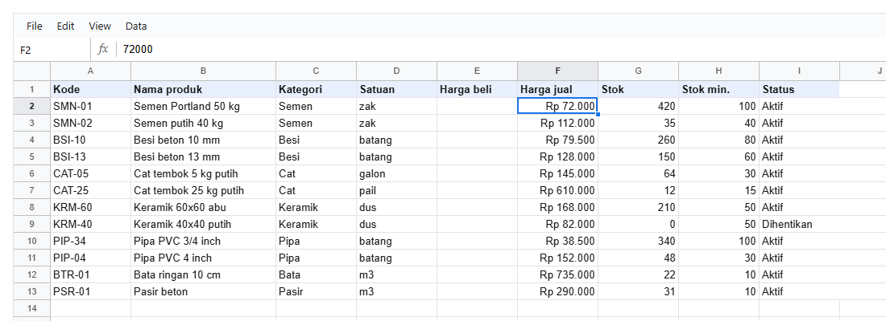

# 13. Access control

[Daftar isi](../README.md#daftar-isi) · Sebelumnya: [12. Menyimpan ke server](12-server.md) · Berikutnya: [14. Komentar](14-komentar.md)

Siapa boleh melakukan apa, ditulis sebagai **satu objek biasa** (policy) yang disimpan aplikasimu di database bersama workbook-nya. Browser memakai
policy itu untuk menampilkan dan menolak, dan server memakai policy yang sama untuk `viewFor` dan `checkPatch` ([bab 12](12-server.md)). Pengguna,
grup, dan login tetap milik aplikasimu. Library ini hanya menerima "orang ini, dengan grup-grup ini".

Tidak ada panel pengaturan hak akses bawaan di dalam sheet. Editor policy dibuat di aplikasimu sendiri, sesuai tampilan aplikasimu, dengan bantuan
`ACTION_INFO`, `UI_ITEMS`, dan `validatePolicy` (13.4).

- [13.1 Contoh: toko dengan empat peran](#131-contoh-toko-dengan-empat-peran)
- [13.2 Bentuk policy](#132-bentuk-policy)
- [13.3 Di layar](#133-di-layar)
- [13.4 Membuat editor policy sendiri](#134-membuat-editor-policy-sendiri)

## 13.1 Contoh: toko dengan empat peran

Pemilik boleh semuanya. Manajer boleh mengedit. Kasir hanya melihat, kecuali kolom Status, dan tidak bisa melihat harga beli. Orang gudang hanya
mengubah stok produk yang masih aktif. Siapa pun yang tidak terdaftar menjadi auditor yang hanya bisa membaca dan berkomentar:

<!-- contoh: 13-hak-akses.js -->
```js
import { createWorkbook, validatePolicy, ACTIONS, UI_ITEMS } from '@kufayeka/sheet/core';
import { PRODUK, KOLOM_PRODUK } from './data/toko.js';

// Satu policy untuk workbook stok toko, disimpan di database bersama workbook-nya. Siapa yang membuka menentukan apa yang boleh.
export const POLICY = {
    owners: ['user:yeka'],
    members: { 'user:dewi': 'manajer', 'user:rina': 'kasir', 'group:gudang': 'gudang', 'user:pak-audit': 'auditor' },
    default: 'auditor',
    message: 'Bagian ini bukan wewenangmu',
    roles: {
        manajer: { can: ['edit', 'format', 'rows', 'sort', 'filter', 'copy', 'download', 'comment.read', 'comment.create', 'comment.reply'] },
        // kasir hanya melihat, kecuali kolom Status yang boleh diubah. Harga beli tidak terlihat sama sekali
        kasir: {
            can: ['sort', 'filter', 'comment.read'],
            ui: { toolbar: false, hide: ['menu.Insert', 'menu.Format'] },
            ranges: [
                { sheet: 'Produk', columns: ['Status'], mode: 'edit' },
                { sheet: 'Produk', columns: ['Harga beli'], mode: 'invisible' }
            ]
        },
        // gudang mengubah stok saja, dan hanya untuk produk yang masih aktif
        gudang: {
            can: ['filter'],
            ranges: [
                { sheet: 'Produk', columns: ['Stok'], mode: 'edit' },
                { sheet: 'Produk', range: 'A2:I1000', when: '=$I2="Dihentikan"', mode: 'readonly', message: 'Produk ini sudah dihentikan' },
                { sheet: 'Produk', columns: ['Harga beli'], mode: 'hidden' }
            ]
        },
        auditor: { can: ['comment.read', 'comment.create', 'comment.reply', 'download'], ui: { disallowed: 'hide', menubar: false } }
    }
};

export function buatStok() {
    const wb = createWorkbook();
    wb.setSettings({ locale: 'id-ID', currency: 'IDR' });
    const p = wb.sheet('Sheet1');
    p.setSheetProps({ name: 'Produk' });
    p.setValues('A1', [[...KOLOM_PRODUK, 'Status'], ...PRODUK.map((x, i) => [...x, i === 7 ? 'Dihentikan' : 'Aktif'])]);
    p.setStyle('A1:I1', { bold: true, fill: '#e8f0fe' });
    p.setColProps('E:F', { format: { type: 'money', decimals: 0 } });
    p.setColProps('B', { width: 180 });
    return wb;
}

console.log('policy sah        :', JSON.stringify(validatePolicy(POLICY)));
console.log('salah ketik       :', JSON.stringify(validatePolicy({ roles: { kasir: { can: ['edti'] } } })));
console.log('jumlah tindakan   :', ACTIONS.length, '| bagian layar:', UI_ITEMS.length);

const doc = buatStok().toJSON();
// siapa: 'user:rina', atau { user: 'joko', groups: ['gudang'] } kalau orang itu anggota grup (tanpa awalan user: dan group:)
function coba(siapa, label) {
    const wb = createWorkbook(doc);
    wb.setAccess(POLICY, siapa);
    const ditolak = [];
    wb.on('reject', (e) => ditolak.push(e.reason));
    const orang = { source: 'user' };
    wb.setValues('Produk', 'G2', 999, orang);          // stok
    wb.setValues('Produk', 'G9', 999, orang);          // stok produk dihentikan
    wb.setValues('Produk', 'I3', 'Dihentikan', orang); // status
    wb.deleteRows('Produk', '13', 1, orang);           // hapus baris
    console.log(label.padEnd(15), '| peran', (wb.access().owner ? 'pemilik' : wb.access().roles.join(',')).padEnd(8), '| G2', String(wb.value('Produk', 'G2')).padEnd(3), 'G9', String(wb.value('Produk', 'G9')).padEnd(3),
        'I3', String(wb.value('Produk', 'I3')).padEnd(10), '| E2', JSON.stringify(wb.display('Produk', 'E2').text).padEnd(10), '| sort', wb.can('sort'), '| menu Format', wb.shows('menu.Format'), '| menubar', wb.access().ui.menubar);
    if (ditolak.length) console.log(''.padEnd(15), '  ditolak:', [...new Set(ditolak)].join(' / '));
}
coba('user:yeka', 'yeka (pemilik)');
coba('user:dewi', 'dewi (manajer)');
coba('user:rina', 'rina (kasir)');
coba({ user: 'joko', groups: ['gudang'] }, 'joko (gudang)');
coba('user:tamu', 'tamu (bawaan)');
```
<!-- /contoh -->

<!-- hasil: 13-hak-akses.js -->
```text
policy sah        : []
salah ketik       : [{"path":"roles.kasir.can","problem":"there is no action \"edti\""}]
jumlah tindakan   : 53 | bagian layar: 71
yeka (pemilik)  | peran pemilik  | G2 999 G9 999 I3 Dihentikan | E2 "Rp 64.000" | sort true | menu Format true | menubar true
dewi (manajer)  | peran manajer  | G2 999 G9 999 I3 Dihentikan | E2 "Rp 64.000" | sort true | menu Format true | menubar true
rina (kasir)    | peran kasir    | G2 420 G9 0   I3 Dihentikan | E2 ""         | sort true | menu Format false | menubar true
                  ditolak: Bagian ini bukan wewenangmu
joko (gudang)   | peran gudang   | G2 999 G9 0   I3 Aktif      | E2 "•••"      | sort false | menu Format true | menubar true
                  ditolak: Produk ini sudah dihentikan / Bagian ini bukan wewenangmu
tamu (bawaan)   | peran auditor  | G2 420 G9 0   I3 Aktif      | E2 "Rp 64.000" | sort false | menu Format true | menubar false
                  ditolak: Bagian ini bukan wewenangmu
```
<!-- /hasil -->

Setiap orang mencoba hal yang sama: mengubah stok G2, mengubah stok produk yang dihentikan (G9), mengubah status I3, dan menghapus baris 13. Hasilnya
berbeda menurut perannya.

## 13.2 Bentuk policy

| Kunci | Artinya |
|---|---|
| `owners` | daftar `'user:...'` yang boleh semuanya, termasuk mengubah policy (tindakan `access`) |
| `members` | `{ 'user:dewi': 'manajer', 'group:gudang': 'gudang' }`. Peran boleh satu atau array. Peran sebuah grup berlaku untuk semua anggotanya |
| `default` | peran untuk orang yang tidak terdaftar. Tanpa `default`, mereka hanya bisa melihat |
| `message` | pesan untuk tindakan yang ditolak |
| `roles` | `{ namaPeran: { can, ui, ranges } }` |

**Orang yang membuka** (`who`) ditulis `'user:rina'`, atau `{ user: 'joko', groups: ['gudang'] }` kalau orang itu anggota grup. Di objek, nama ditulis
tanpa awalan `user:` dan `group:`. Kalau seseorang punya beberapa peran (langsung dan lewat grup), hak-haknya digabung.

**`can`**: tindakan yang boleh dilakukan. `'format'` berarti semua `format.*`, `'rows'` berarti semua `rows.*`, dan seterusnya. Daftar lengkapnya:

<!-- contoh: 13-daftar.js -->
```js
import { ACTION_INFO, UI_ITEMS } from '@kufayeka/sheet/core';

// Daftar tindakan (untuk can) dan bagian layar (untuk ui.hide), diambil dari library sendiri. Dipakai juga untuk membuat editor policy sendiri.
const perGrup = (list) => {
    const g = new Map();
    for (const x of list) { if (!g.has(x.group)) g.set(x.group, []); g.get(x.group).push(x.id); }
    return g;
};
console.log('TINDAKAN (can):');
for (const [grup, ids] of perGrup(ACTION_INFO)) console.log('  ' + grup.padEnd(10), ids.join(', '));
console.log('BAGIAN LAYAR (ui.hide):');
for (const [grup, ids] of perGrup(UI_ITEMS)) console.log('  ' + grup.padEnd(10), ids.join(', '));
```
<!-- /contoh -->

<!-- hasil: 13-daftar.js -->
```text
TINDAKAN (can):
  Cells      edit
  Format     format.bold, format.italic, format.underline, format.strike, format.color, format.fill, format.borders, format.align, format.wrap, format.rotate, format.size, format.font, format.number, format.link, format.merge, format.conditional, format.clear
  Rows       rows.insert, rows.delete, rows.resize, rows.hide, rows.group
  Columns    cols.insert, cols.delete, cols.resize, cols.hide, cols.group
  Sheets     sheets.add, sheets.delete, sheets.rename, sheets.move, sheets.hide
  View       view.freeze, view.gridlines
  Data       sort, filter, pivot, validation, names, settings
  Clipboard and files copy, paste, download, import
  Comments   comment.read, comment.create, comment.reply, comment.resolve, comment.edit, comment.delete, comment.moderate
  Access     access
BAGIAN LAYAR (ui.hide):
  Toolbar    tool.undo, tool.redo, tool.paint, tool.zoom, tool.currency, tool.percent, tool.decimals, tool.formats, tool.font, tool.size, tool.bold, tool.italic, tool.strike, tool.underline, tool.color, tool.fill, tool.borders, tool.merge, tool.align, tool.valign, tool.wrap, tool.rotate, tool.link, tool.functions, tool.clear
  Menus      menu.File, menu.Edit, menu.View, menu.Insert, menu.Format, menu.Data
  Menu items menu.file:import, menu.file:download, menu.file:settings, menu.edit:find, menu.edit:deleteRows, menu.edit:deleteCols, menu.view:freezeRows, menu.view:freezeCols, menu.view:group, menu.view:comments, menu.view:zoom, menu.insert:rowsAbove, menu.insert:colsLeft, menu.insert:sheet, menu.insert:checkbox, menu.insert:dropdown, menu.insert:fn, menu.insert:link, menu.insert:comment, menu.insert:pivot, menu.format:conditional, menu.data:sortSheet, menu.data:sortRange, menu.data:filter, menu.data:validation, menu.data:names
  Panels     panel.comments, panel.pivot, panel.conditional, panel.names, panel.validation, panel.find, panel.settings, panel.filter
  Features   feature.contextMenu, feature.fillHandle, feature.resize, feature.groups, cell.commentMark, cell.validation
```
<!-- /hasil -->

**`ranges`**: tempat dengan aturannya sendiri, dengan bentuk yang sama seperti `setRules` ([10.1](10-aturan.md#101-aturan-hanya-baca-dan-tersembunyi)).
Ada empat mode, dari yang paling lemah ke paling kuat:

| Mode | Artinya |
|---|---|
| `edit` | boleh diubah, juga oleh peran yang tidak punya `edit`. Ini daftar putih untuk peran yang hanya melihat, seperti kolom Status untuk kasir |
| `readonly` | boleh dilihat, tidak boleh diubah |
| `hidden` | tampil `•••`. Isinya tidak dikirim oleh `viewFor` |
| `invisible` | tampil kosong, tanpa tanda bahwa sel itu berisi |

Kalau dua aturan bertemu di sel yang sama, yang lebih kuat menang. Itu sebabnya stok G9 tetap terkunci untuk gudang walaupun kolom Stok berstatus `edit`.

**`ui`**: apa yang tampil di layar untuk peran itu.

| Kunci | Artinya |
|---|---|
| `menubar`, `toolbar`, `formulaBar`, `headers`, `gridlines`, `tabs` | `false` menyembunyikan bagian besar itu |
| `hide` | id bagian layar yang disembunyikan (daftar di atas) |
| `disallowed` | tombol untuk tindakan yang tidak boleh: `'grey'` (bawaan, tampil tapi tidak bisa dipakai) atau `'hide'` |
| `sheets` | hanya sheet-sheet ini yang terlihat (nama atau id). Sheet lain juga tidak dikirim `viewFor` |
| `area` | hanya range ini yang tampil: `'A1:H500'`, atau per sheet `{ Ringkasan: 'A1:F40' }` |

## 13.3 Di layar

```jsx
<Sheet workbook={wb} access={{ policy, who: 'user:rina' }} user={{ id: 'user:rina', name: 'Rina' }} />
```

<!-- contoh: 13-kasir.page.js -->
```jsx
import { useState } from 'react';
import { Sheet } from '@kufayeka/sheet';
import '@kufayeka/sheet/style.css';
import { POLICY, buatStok } from './13-hak-akses.js';

// Workbook yang sama, dibuka oleh kasir: tanpa toolbar, tanpa menu Insert dan Format, kolom harga beli kosong, hanya Status yang bisa diubah.
export default function StokUntukKasir() {
    const [wb] = useState(buatStok);
    // access: policy dari database dan orang yang login (dari sesi login aplikasimu)
    return <div style={{ height: 480 }}><Sheet workbook={wb} access={{ policy: POLICY, who: 'user:rina' }} user={{ id: 'user:rina', name: 'Rina' }} /></div>;
}
```
<!-- /contoh -->



Dari kode, `wb.setAccess(policy, who)` melakukan hal yang sama. `wb.access()` memberi `{ owner, roles, ui, message }` hasilnya, `wb.can(tindakan)`
memberi tahu apakah sebuah tindakan boleh, dan `wb.shows(id)` memberi tahu apakah sebuah bagian layar tampil. Mengganti `access` (misalnya setelah
login sebagai orang lain) langsung mengubah tampilan tanpa membuat ulang workbook.

Kode aplikasimu sendiri tidak dihalangi. Perubahan dengan source `code` atau `remote` selalu diterapkan, dan hanya perubahan dari orang (`user`) yang
diperiksa.

## 13.4 Membuat editor policy sendiri

Policy adalah JSON biasa, jadi editornya adalah form biasa di aplikasimu. Library memberi bahannya:

| Fungsi | Artinya |
|---|---|
| `ACTION_INFO` | `[{ id, label, group }]` semua tindakan, untuk daftar centang `can` |
| `UI_ITEMS` | `[{ id, label, group }]` semua bagian layar, untuk daftar `ui.hide` |
| `ACTIONS` | id tindakan saja |
| `validatePolicy(policy)` | `[{ path, problem }]`: salah ketik nama tindakan, mode yang tidak ada, peran yang tidak didefinisikan. Kosong kalau sah. Periksa sebelum menyimpan |
| `resolveAccess(policy, who)` | hasil akhir untuk satu orang, tanpa workbook. Berguna untuk pratinjau "seperti apa yang dilihat Rina" di editormu |

Label dalam bahasa Inggris. Terjemahkan di editormu kalau aplikasimu berbahasa lain.

[Daftar isi](../README.md#daftar-isi) · Sebelumnya: [12. Menyimpan ke server](12-server.md) · Berikutnya: [14. Komentar](14-komentar.md)
