# 13. Hak akses

[Daftar isi](../README.md#daftar-isi) · Sebelumnya: [12. Menyimpan ke server](12-server.md) · Berikutnya: [14. Komentar](14-komentar.md)

Bab ini membahas cara mengatur **siapa boleh melakukan apa** di sebuah spreadsheet. Bab ini panjang, tapi disusun bertahap: dimulai dari
pengertian tanpa kode, lalu satu langkah kecil demi satu langkah kecil. Setiap langkah hanya menambah **satu hal baru**.

**Bagian A. Pengenalan (tanpa kode)**
- [13.1 Apa itu hak akses](#131-apa-itu-hak-akses)
- [13.2 Empat keadaan sel](#132-empat-keadaan-sel)
- [13.3 Dua mode layar](#133-dua-mode-layar)
- [13.4 Kata-kata yang dipakai](#134-kata-kata-yang-dipakai)
- [13.5 Satu aturan = satu kalimat = satu baris tabel](#135-satu-aturan--satu-kalimat--satu-baris-tabel)
- [13.6 Seberapa jauh hak akses bisa mengatur](#136-seberapa-jauh-hak-akses-bisa-mengatur)

**Bagian B. Sel**
- [13.7 Cara membaca contoh di bab ini](#137-cara-membaca-contoh-di-bab-ini)
- [13.8 Aturan pertama: boleh membaca](#138-aturan-pertama-boleh-membaca)
- [13.9 Yang tidak disebut, tidak didapat](#139-yang-tidak-disebut-tidak-didapat)
- [13.10 Boleh mengubah](#1310-boleh-mengubah)
- [13.11 Baca semua, ubah sebagian](#1311-baca-semua-ubah-sebagian)
- [13.12 Kolom ditulis dengan judulnya](#1312-kolom-ditulis-dengan-judulnya)
- [13.13 Menyembunyikan isi](#1313-menyembunyikan-isi)
- [13.14 Tidak terlihat sama sekali](#1314-tidak-terlihat-sama-sekali)

**Bagian C. Siapa**
- [13.15 Role](#1315-role)
- [13.16 Semua orang](#1316-semua-orang)
- [13.17 Satu akun, dan siapa yang menang](#1317-satu-akun-dan-siapa-yang-menang)
- [13.18 Pemilik](#1318-pemilik)

**Bagian D. Lebih dari sel**
- [13.19 Aturan dengan syarat](#1319-aturan-dengan-syarat)
- [13.20 Format](#1320-format)
- [13.21 Aksi lain](#1321-aksi-lain)
- [13.22 Bagian layar](#1322-bagian-layar)
- [13.23 Hanya sebagian sheet yang tampil](#1323-hanya-sebagian-sheet-yang-tampil)

**Bagian E. Tanda dan pesan**
- [13.24 Tanda di sel: gembok dan mata](#1324-tanda-di-sel-gembok-dan-mata)
- [13.25 Variasi tanda](#1325-variasi-tanda)
- [13.26 Pesan penolakan](#1326-pesan-penolakan)

**Bagian F. Mode pengaturan**
- [13.27 Menyalakan mode pengaturan](#1327-menyalakan-mode-pengaturan)
- [13.28 Memilih aturan](#1328-memilih-aturan)
- [13.29 Membuat aturan dari range yang dipilih](#1329-membuat-aturan-dari-range-yang-dipilih)
- [13.30 Berpindah mode: lihat sebagai orang lain](#1330-berpindah-mode-lihat-sebagai-orang-lain)

**Bagian G. Server dan database**
- [13.31 Tabel `sheet_access`](#1331-tabel-sheet_access)
- [13.32 `viewFor`: yang dikirim ke browser](#1332-viewfor-yang-dikirim-ke-browser)
- [13.33 `checkPatch`: yang boleh disimpan](#1333-checkpatch-yang-boleh-disimpan)

**Bagian H. Batas dan referensi**
- [13.34 Batas kemampuan](#1334-batas-kemampuan)
- [13.35 Referensi](#1335-referensi)

---

# Bagian A. Pengenalan

## 13.1 Apa itu hak akses

Bayangkan sebuah toko bangunan. Ada satu spreadsheet stok yang dibuka oleh beberapa orang:

- **Yeka**, pemilik toko, boleh melakukan apa saja.
- **Rina**, kasir, perlu melihat daftar produk dan harga jual. Dia **tidak boleh** melihat harga beli dan **tidak boleh** mengubah harga.
- **Joko**, orang gudang, hanya boleh mengubah angka stok.

Mereka membuka file yang **sama**. Bedanya hanya apa yang boleh dilihat dan diubah oleh masing-masing orang. Itulah hak akses.

Library ini tidak mengurus login, akun, atau role. Itu tetap urusan aplikasimu. Library hanya menerima dua hal:

1. **Daftar aturan**, yang disimpan aplikasimu di database.
2. **Siapa yang membuka**: nama akunnya dan role-nya, dari sistem login aplikasimu.

Dari dua hal itu, library menentukan sendiri apa yang boleh untuk orang tersebut.

## 13.2 Empat keadaan sel

Untuk orang yang sedang membuka sheet, setiap sel selalu dalam **salah satu dari empat keadaan** berikut:

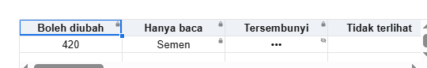

| Keadaan | Orang itu bisa | Yang terlihat di sel |
|---|---|---|
| **Boleh diubah** | membaca dan mengubah | sel biasa |
| **Hanya baca** | membaca saja | isinya, dengan gembok kecil di pojok kanan atas |
| **Tersembunyi** | tahu sel itu berisi, tapi tidak tahu isinya | `•••`, dengan mata dicoret di pojok |
| **Tidak terlihat** | tidak tahu apa-apa | kosong, tanpa tanda apa pun |

Di gambar, baris judulnya juga bergembok, karena kasir hanya boleh membaca judul.

Hampir semua isi bab ini adalah cara menentukan sebuah sel masuk ke keadaan yang mana, untuk siapa.

## 13.3 Dua mode layar

Sheet yang sama bisa ditampilkan dalam dua mode:

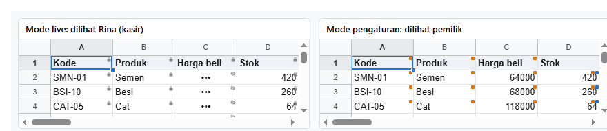

| Mode | Untuk siapa | Yang terlihat |
|---|---|---|
| **Live** (bawaan) | orang yang bekerja: kasir, gudang | hanya yang berlaku untuk dia: gembok, mata, `•••`, sel kosong |
| **Pengaturan** | pemilik yang sedang mengatur aturan | semua isi sel, dan kotak warna kecil di setiap sel yang punya aturan, satu kotak per *who* (13.4) |

Di gambar kiri (live), Rina melihat harga beli sebagai `•••`, dan hampir semua sel bergembok karena dia hanya boleh membaca. Di gambar kanan
(pengaturan), pemilik melihat semua angka, ditambah kotak oranye (kasir) dan kotak biru (gudang) yang menandai sel mana yang punya aturan
untuk siapa.

Di kode, perbedaannya hanya satu nilai: `view: 'live'` atau `view: 'setup'`. Bagian B sampai E memakai mode live. Mode pengaturan dibahas di
bagian F.

## 13.4 Kata-kata yang dipakai

Hanya ada lima kata yang perlu diingat:

| Kata | Artinya | Contoh |
|---|---|---|
| **aturan** | satu kalimat "siapa boleh/tidak melakukan apa di mana" | "kasir boleh membaca tabel produk" |
| **who** | untuk siapa aturan itu | `role:kasir` (semua kasir), `user:budi` (akun budi saja), `*` (semua orang) |
| **effect** | boleh atau tidak | `allow` (boleh), `deny` (tidak boleh) |
| **action** | melakukan apa | `read` (membaca), `edit` (mengubah), `format.bold` (menebalkan), ... |
| **where** | di mana | `Produk!A1:I13` (sebuah range), `Produk!col:Stok` (kolom berjudul Stok) |

## 13.5 Satu aturan = satu kalimat = satu baris tabel

Setiap aturan adalah satu kalimat, dan setiap kalimat ditulis sebagai satu baris tabel:

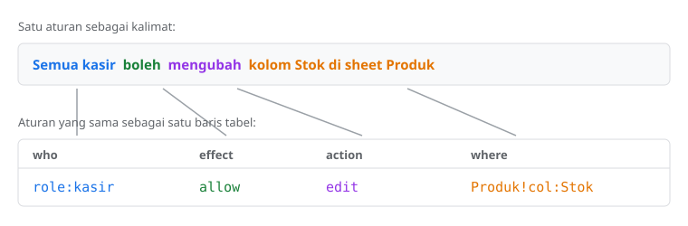

Menambah aturan berarti menambah satu baris, dan menghapus aturan berarti menghapus satu baris. Di kode, satu baris adalah satu objek:

```ts
{ who: 'role:kasir', effect: 'allow', action: 'edit', where: 'Produk!col:Stok' }
```

Daftar semua baris aturan sebuah spreadsheet adalah satu array. Array itulah yang disimpan di database (13.31) dan diberikan ke sheet.

## 13.6 Seberapa jauh hak akses bisa mengatur

Peta lengkap kemampuannya. Setiap baris dibahas di langkah yang disebut di kolom kanan.

| Yang bisa diatur | Sampai sejauh apa | Langkah |
|---|---|---|
| **Sel: empat keadaan** | boleh diubah, hanya baca, tersembunyi, tidak terlihat | 13.8 – 13.14 |
| **Di mana** | satu sel, range, kolom utuh, baris utuh, kolom berdasarkan judulnya, satu sheet, semua sheet | 13.11 – 13.12, 13.35 |
| **Untuk siapa** | satu akun, satu role, beberapa role sekaligus, semua orang, pemilik | 13.15 – 13.18 |
| **Pengecualian** | aturan untuk satu akun mengalahkan aturan role-nya | 13.17 |
| **Syarat** | aturan yang hanya berlaku di baris yang memenuhi rumus, dan berubah sendiri saat isinya berubah | 13.19 |
| **Format** | 17 aksi format satu per satu (tebal, miring, warna, border, merge, ...) atau semuanya sekaligus | 13.20 |
| **Aksi lain** | sort, filter, tambah/hapus baris dan kolom, sheet, salin, tempel, unduh, impor, pivot, validasi, komentar, dan mengubah aturan itu sendiri | 13.21 |
| **Layar** | menu, toolbar, formula bar, header, garis grid, tab, dan setiap menu, tombol, atau panel satu per satu | 13.22 |
| **Yang tampil** | hanya sebagian sheet, atau hanya sheet tertentu | 13.23 |
| **Tanda di sel** | gembok, mata, latar abu-abu, garis-garis; bebas dicampur atau dimatikan | 13.24 – 13.25 |
| **Pesan** | pesan penolakan diganti, dimatikan, atau ditampilkan di luar sheet | 13.26 |
| **Layar pengaturan** | mode pengaturan, untuk aplikasimu membuat editor aturannya sendiri | 13.27 – 13.30 |
| **Keamanan di server** | isi tersembunyi tidak dikirim ke browser; perubahan yang tidak boleh ditolak saat disimpan | 13.32 – 13.33 |

Yang **tidak** bisa diatur dijelaskan di 13.34.

---

# Bagian B. Sel

## 13.7 Cara membaca contoh di bab ini

Setiap langkah di bagian B sampai D adalah **satu halaman React** dengan satu `<Sheet>`, ditambah **foto hasilnya** di browser. Kodenya bisa
langsung disalin ke aplikasimu.

Semua contoh memakai satu sheet bernama **Produk**, berisi 12 produk toko bangunan:

| | A | B | C | D | E | F | G | H | I |
|---|---|---|---|---|---|---|---|---|---|
| 1 | Kode | Nama produk | Kategori | Satuan | Harga beli | Harga jual | Stok | Stok min. | Status |
| 2 | SMN-01 | Semen Portland 50 kg | Semen | zak | 64000 | 72000 | 420 | 100 | Aktif |
| ... | | | | | | | | | |

Workbook-nya dibuat oleh satu fungsi, `buatStok()`, yang dipakai bersama oleh semua contoh:

<!-- contoh: data/stok-akses.js -->
```js
import { createWorkbook } from '@kufayeka/sheet/core';
import { PRODUK, KOLOM_PRODUK } from './toko.js';

// Bahan bersama bab 13: workbook stok toko.

/** Sheet Produk: Kode, Nama produk, Kategori, Satuan, Harga beli, Harga jual, Stok, Stok min., Status (A..I), 12 produk. */
export function buatStok() {
    const wb = createWorkbook();
    wb.setSettings({ locale: 'id-ID', currency: 'IDR' });
    const p = wb.sheet('Sheet1');
    p.setSheetProps({ name: 'Produk' });
    p.setValues('A1', [[...KOLOM_PRODUK, 'Status'], ...PRODUK.map((x, i) => [...x, i === 7 ? 'Dihentikan' : 'Aktif'])]);
    p.setStyle('A1:I1', { bold: true, fill: '#eef2f7' });
    return wb;
}
```
<!-- /contoh -->

Saat membaca foto, perhatikan pojok kanan atas setiap sel (13.2):

| Tanda di pojok sel | Keadaan |
|---|---|
| (tidak ada), dan sel berisi | boleh diubah |
| gembok | hanya baca |
| `•••` dengan mata dicoret | tersembunyi |
| sel kosong tanpa tanda | tidak terlihat |

Di setiap contoh, baris yang **baru** dibanding langkah sebelumnya ditandai `// baru`.

## 13.8 Aturan pertama: boleh membaca

**Tujuan:** kasir boleh membaca tabel produk.

<!-- contoh: 13-08-baca.page.tsx -->
```tsx
import { useState } from 'react';
import { Sheet } from '@kufayeka/sheet';
import type { AccessRow } from '@kufayeka/sheet/core';
import '@kufayeka/sheet/style.css';
import { buatStok } from './data/stok-akses.js';

// 13.8 Aturan pertama: kasir boleh MEMBACA tabel produk.
const rows: AccessRow[] = [
    { who: 'role:kasir', effect: 'allow', action: 'read', where: 'Produk!A1:I13' }
];

export default function Halaman() {
    const [wb] = useState(buatStok);
    const rina = { user: 'rina', roles: ['kasir'] };       // dari sistem login aplikasimu
    return (
        <div style={{ height: 330 }}>
            <Sheet workbook={wb} access={{ rows, who: rina }} />
        </div>
    );
}
```
<!-- /contoh -->

Rina membuka halaman ini, mengklik G2 (stok Semen), lalu mencoba mengetik:

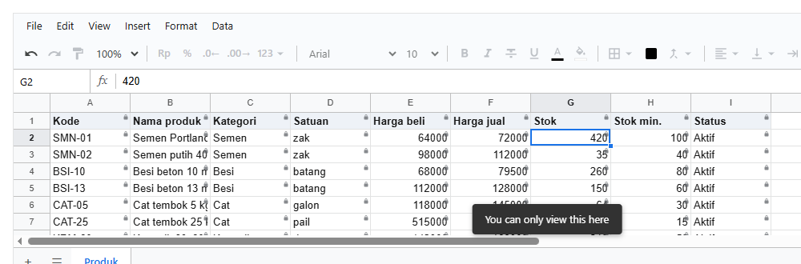

**Penjelasan:**

- `rows` adalah daftar aturan. Isinya satu baris: untuk `role:kasir`, `allow` (boleh), `read` (membaca), di `Produk!A1:I13` (seluruh tabel).
- `rina` adalah orang yang membuka: akun `rina`, dengan role `kasir`. Di aplikasimu, ini datang dari sistem login.
- `access={{ rows, who: rina }}` memberikan keduanya ke sheet. Sheet langsung menerapkannya, dan menerapkannya lagi setiap kali `rows` atau
  `who` berubah.
- Di foto, setiap sel bergembok: **hanya baca**. Saat Rina mengetik di G2, sheet menolak dan menampilkan alasannya di bawah. Nilai G2 tetap
  420.
- Pesan bawaannya berbahasa Inggris. Cara menggantinya dengan kata-katamu sendiri ada di 13.26.

## 13.9 Yang tidak disebut, tidak didapat

**Tujuan:** melihat apa yang terjadi pada sel yang tidak disebut di aturan mana pun.

<!-- contoh: 13-09-tidak-disebut.page.tsx -->
```tsx
import { useState } from 'react';
import { Sheet } from '@kufayeka/sheet';
import type { AccessRow, Who } from '@kufayeka/sheet/core';
import '@kufayeka/sheet/style.css';
import { buatStok } from './data/stok-akses.js';

// 13.9 Yang tidak disebut, tidak didapat. Aturannya sekarang hanya untuk kolom A sampai D.
const rows: AccessRow[] = [
    { who: 'role:kasir', effect: 'allow', action: 'read', where: 'Produk!A1:D13' }     // baru: A-D saja
];

// baru: pilihan "Lihat sebagai", untuk membandingkan dua orang
const ORANG: Record<string, Who> = {
    rina: { user: 'rina', roles: ['kasir'] },
    tamu: { user: 'tamu' }                                   // tanpa role
};

export default function Halaman() {
    const [wb] = useState(buatStok);
    const [sebagai, setSebagai] = useState('rina');
    return (
        <div>
            <p>Lihat sebagai <select className="lihat-sebagai" value={sebagai} onChange={(e) => setSebagai(e.target.value)}>
                {Object.keys(ORANG).map((nama) => <option key={nama}>{nama}</option>)}
            </select></p>
            <div style={{ height: 300 }}>
                <Sheet workbook={wb} access={{ rows, who: ORANG[sebagai] }} />
            </div>
        </div>
    );
}
```
<!-- /contoh -->

Halaman ini punya pilihan **Lihat sebagai**, untuk membandingkan dua orang dengan aturan yang sama.

Dilihat sebagai **rina** (kasir):

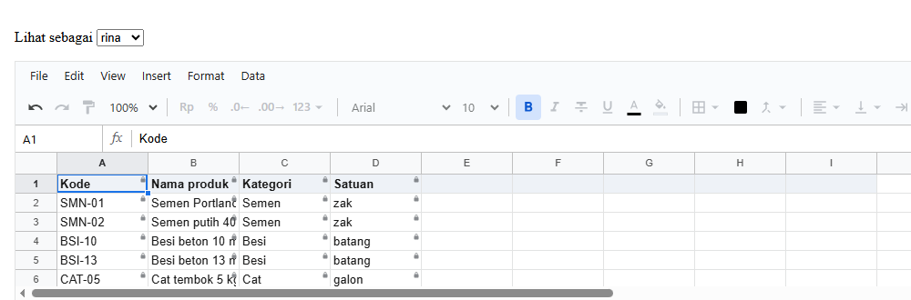

Dilihat sebagai **tamu** (tanpa role):

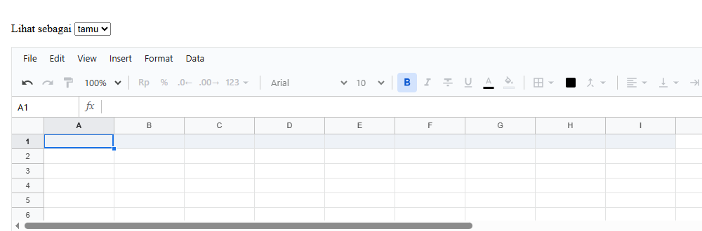

**Penjelasan:**

- Aturannya sekarang hanya menyebut kolom A sampai D. Kolom E sampai I **tidak disebut**, jadi untuk Rina kolom-kolom itu kosong: **tidak
  terlihat**.
- Tamu tidak punya satu baris aturan pun, jadi seluruh sheet kosong untuknya.
- `ORANG` dan `<select>` hanya untuk mencoba. Di aplikasimu, `who` datang dari sistem login, bukan dari pilihan.

Ini aturan dasar yang paling penting: **yang tidak diizinkan, tidak didapat.** Dengan begitu, lupa menulis satu aturan tidak membuat data
bocor. Paling buruk, orang tidak bisa melihat sesuatu yang seharusnya boleh dia lihat, lalu kamu menambah satu baris.

## 13.10 Boleh mengubah

**Tujuan:** kasir boleh mengubah seluruh tabel.

<!-- contoh: 13-10-ubah.page.tsx -->
```tsx
import { useState } from 'react';
import { Sheet } from '@kufayeka/sheet';
import type { AccessRow } from '@kufayeka/sheet/core';
import '@kufayeka/sheet/style.css';
import { buatStok } from './data/stok-akses.js';

// 13.10 Boleh mengubah. Ganti read dengan edit.
const rows: AccessRow[] = [
    { who: 'role:kasir', effect: 'allow', action: 'edit', where: 'Produk!A1:I13' }     // baru: edit
];

export default function Halaman() {
    const [wb] = useState(buatStok);
    return (
        <div style={{ height: 330 }}>
            <Sheet workbook={wb} access={{ rows, who: { user: 'rina', roles: ['kasir'] } }} />
        </div>
    );
}
```
<!-- /contoh -->


**Penjelasan:** satu kata berubah, `read` menjadi `edit`. Tidak ada gembok lagi: semua sel **boleh diubah**. `edit` sudah termasuk membaca,
jadi tidak perlu menulis `read` lagi.

## 13.11 Baca semua, ubah sebagian

**Tujuan:** kasir membaca seluruh tabel, tapi hanya boleh mengubah kolom Stok (G).

<!-- contoh: 13-11-campur.page.tsx -->
```tsx
import { useState } from 'react';
import { Sheet } from '@kufayeka/sheet';
import type { AccessRow } from '@kufayeka/sheet/core';
import '@kufayeka/sheet/style.css';
import { buatStok } from './data/stok-akses.js';

// 13.11 Baca semua, ubah sebagian: baca seluruh tabel, ubah kolom G (Stok) saja.
const rows: AccessRow[] = [
    { who: 'role:kasir', effect: 'allow', action: 'read', where: 'Produk!A1:I13' },
    { who: 'role:kasir', effect: 'allow', action: 'edit', where: 'Produk!G2:G13' }     // baru
];

export default function Halaman() {
    const [wb] = useState(buatStok);
    return (
        <div style={{ height: 330 }}>
            <Sheet workbook={wb} access={{ rows, who: { user: 'rina', roles: ['kasir'] } }} />
        </div>
    );
}
```
<!-- /contoh -->

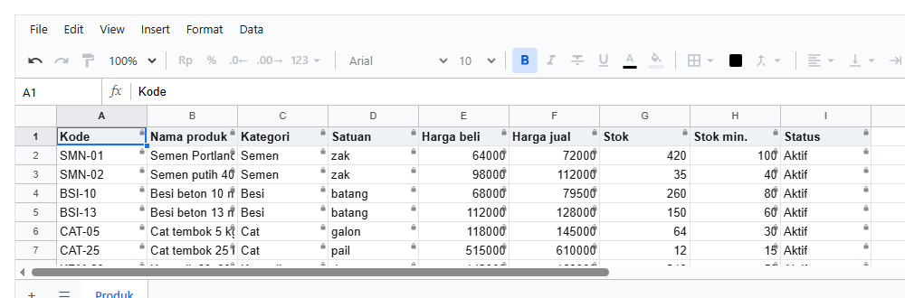

**Penjelasan:**

- Sekarang ada dua baris. Baris pertama memberi `read` di seluruh tabel. Baris kedua memberi `edit` di G2:G13.
- Di kolom Stok, kedua baris berlaku. **`edit` menang**, karena ia memberi lebih banyak, sehingga kolom itu satu-satunya yang tanpa gembok.
- Judul Stok (G1) tetap bergembok, karena G1 tidak termasuk G2:G13.
- Urutan baris di daftar tidak berpengaruh. Kalau kedua baris itu ditukar, hasilnya tetap sama.

## 13.12 Kolom ditulis dengan judulnya

**Tujuan:** hasil yang sama dengan 13.11, tapi kolomnya disebut dengan judulnya (`Stok`), bukan dengan hurufnya (`G`).

<!-- contoh: 13-12-kolom.page.tsx -->
```tsx
import { useState } from 'react';
import { Sheet } from '@kufayeka/sheet';
import type { AccessRow } from '@kufayeka/sheet/core';
import '@kufayeka/sheet/style.css';
import { buatStok } from './data/stok-akses.js';

// 13.12 Kolom ditulis dengan judulnya: col:Stok, bukan G2:G13. Tetap benar walaupun kolomnya bergeser.
const rows: AccessRow[] = [
    { who: 'role:kasir', effect: 'allow', action: 'read', where: 'Produk!A1:I13' },
    { who: 'role:kasir', effect: 'allow', action: 'edit', where: 'Produk!col:Stok' }   // baru: judul kolom
];

export default function Halaman() {
    const [wb] = useState(buatStok);
    // tombol untuk mencoba: kolom baru disisipkan di A, Stok bergeser ke H, aturannya ikut
    const sisipkan = () => wb.sheet('Produk').insertCols('A');
    return (
        <div>
            <p><button className="sisipkan" onClick={sisipkan}>Sisipkan kolom di A</button></p>
            <div style={{ height: 300 }}>
                <Sheet workbook={wb} access={{ rows, who: { user: 'rina', roles: ['kasir'] } }} />
            </div>
        </div>
    );
}
```
<!-- /contoh -->

Sebelum tombol ditekan, hasilnya sama dengan 13.11:

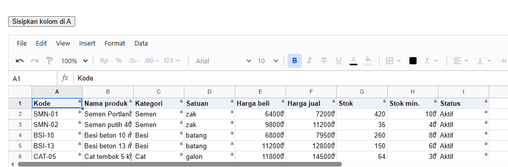

Setelah menekan **Sisipkan kolom di A**, semua kolom bergeser ke kanan dan Stok sekarang ada di H. Aturannya ikut, tanpa diubah:

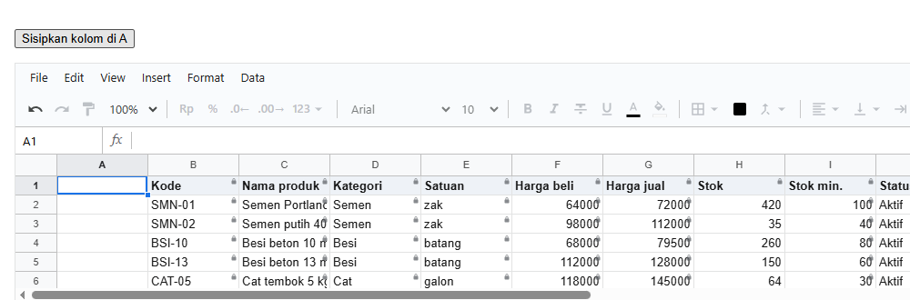

**Penjelasan:**

- `Produk!col:Stok` artinya kolom yang judulnya (di baris 1) adalah "Stok". Baris judulnya sendiri tidak ikut, jadi judul tetap bergembok.
- Kalau ditulis `G2:G13`, aturan itu tetap menunjuk ke kolom G, yang setelah disisipkan berisi Stok min.
- Bentuk lain untuk `where` ada di 13.35, termasuk beberapa kolom sekaligus (`col:Stok,Status`), kolom utuh (`G:G`), baris utuh (`2:5`), dan
  satu sel (`G2`).

## 13.13 Menyembunyikan isi

**Tujuan:** kasir tidak boleh tahu harga beli (kolom E).

<!-- contoh: 13-13-sembunyi.page.tsx -->
```tsx
import { useState } from 'react';
import { Sheet } from '@kufayeka/sheet';
import type { AccessRow } from '@kufayeka/sheet/core';
import '@kufayeka/sheet/style.css';
import { buatStok } from './data/stok-akses.js';

// 13.13 Menyembunyikan isi: harga beli (kolom E) tampil ••• untuk kasir.
const rows: AccessRow[] = [
    { who: 'role:kasir', effect: 'allow', action: 'read', where: 'Produk!A1:I13' },
    { who: 'role:kasir', effect: 'allow', action: 'edit', where: 'Produk!col:Stok' },
    { who: 'role:kasir', effect: 'deny', action: 'read', where: 'Produk!col:Harga beli' }   // baru
];

export default function Halaman() {
    const [wb] = useState(buatStok);
    return (
        <div style={{ height: 330 }}>
            <Sheet workbook={wb} access={{ rows, who: { user: 'rina', roles: ['kasir'] } }} />
        </div>
    );
}
```
<!-- /contoh -->

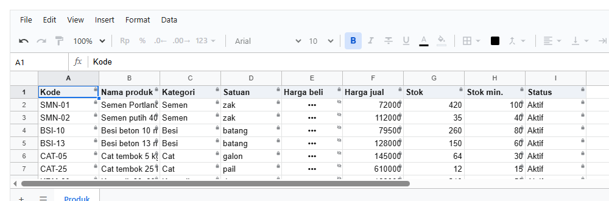

**Penjelasan:**

- Baris baru: `deny` (tidak boleh), `read` (membaca), di kolom Harga beli.
- Di kolom E, ada dua baris yang berlaku: `allow read` dari baris pertama, dan `deny read` dari baris baru. **`deny` menang** atas `allow`.
  Inilah cara membuat pengecualian di dalam area yang sudah diizinkan.
- Di foto, isi kolom Harga beli tampil `•••` dengan mata dicoret: **tersembunyi**.

## 13.14 Tidak terlihat sama sekali

**Tujuan:** sama dengan 13.13, tapi kasir bahkan tidak boleh tahu bahwa kolom itu berisi.

<!-- contoh: 13-14-tak-terlihat.page.tsx -->
```tsx
import { useState } from 'react';
import { Sheet } from '@kufayeka/sheet';
import type { AccessRow } from '@kufayeka/sheet/core';
import '@kufayeka/sheet/style.css';
import { buatStok } from './data/stok-akses.js';

// 13.14 Tidak terlihat sama sekali: sama dengan 13.13, tapi deny see. Kolom E tampil kosong.
const rows: AccessRow[] = [
    { who: 'role:kasir', effect: 'allow', action: 'read', where: 'Produk!A1:I13' },
    { who: 'role:kasir', effect: 'allow', action: 'edit', where: 'Produk!col:Stok' },
    { who: 'role:kasir', effect: 'deny', action: 'see', where: 'Produk!col:Harga beli' }    // baru: see, bukan read
];

export default function Halaman() {
    const [wb] = useState(buatStok);
    return (
        <div style={{ height: 330 }}>
            <Sheet workbook={wb} access={{ rows, who: { user: 'rina', roles: ['kasir'] } }} />
        </div>
    );
}
```
<!-- /contoh -->

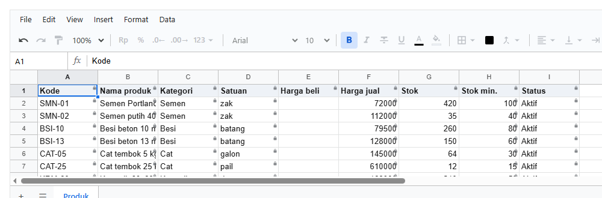

**Penjelasan:** `read` diganti `see`. Kolom Harga beli tampil kosong, tanpa tanda apa pun: **tidak terlihat**.

Kapan memakai yang mana:

| | `deny read` (tersembunyi) | `deny see` (tidak terlihat) |
|---|---|---|
| Di layar | `•••` | kosong |
| Orang tahu ada isinya? | ya | tidak |
| Cocok untuk | data yang orang tahu ada, tapi bukan untuknya (harga beli, gaji) | data yang keberadaannya pun rahasia |

---

# Bagian C. Siapa

## 13.15 Role

**Tujuan:** aturan yang berlaku untuk semua orang dengan role yang sama. Ditambah satu role lagi, `gudang`.

<!-- contoh: 13-15-role.page.tsx -->
```tsx
import { useState } from 'react';
import { Sheet } from '@kufayeka/sheet';
import type { AccessRow, Who } from '@kufayeka/sheet/core';
import '@kufayeka/sheet/style.css';
import { buatStok } from './data/stok-akses.js';

// 13.15 Role: aturan untuk semua kasir, dan satu role lagi, gudang.
const rows: AccessRow[] = [
    { who: 'role:kasir', effect: 'allow', action: 'read', where: 'Produk!A1:I13' },
    { who: 'role:gudang', effect: 'allow', action: 'read', where: 'Produk!A1:I13' },        // baru
    { who: 'role:gudang', effect: 'allow', action: 'edit', where: 'Produk!col:Stok' }       // baru
];

const ORANG: Record<string, Who> = {
    rina: { user: 'rina', roles: ['kasir'] },
    joko: { user: 'joko', roles: ['gudang'] },
    sari: { user: 'sari', roles: ['kasir', 'gudang'] }       // dua role sekaligus
};

export default function Halaman() {
    const [wb] = useState(buatStok);
    const [sebagai, setSebagai] = useState('rina');
    return (
        <div>
            <p>Lihat sebagai <select className="lihat-sebagai" value={sebagai} onChange={(e) => setSebagai(e.target.value)}>
                {Object.keys(ORANG).map((nama) => <option key={nama}>{nama}</option>)}
            </select></p>
            <div style={{ height: 300 }}>
                <Sheet workbook={wb} access={{ rows, who: ORANG[sebagai] }} />
            </div>
        </div>
    );
}
```
<!-- /contoh -->

Dilihat sebagai **rina** (kasir): semua hanya baca.


Dilihat sebagai **joko** (gudang): kolom Stok bisa diubah.


Dilihat sebagai **sari** (kasir dan gudang): gabungan keduanya.


**Penjelasan:**

- `role:kasir` berlaku untuk **setiap** orang yang role-nya kasir. Kasir lain mendapat hal yang sama dengan Rina tanpa ditulis satu per satu.
- Joko (gudang) mendapat aturan gudang: membaca semua, mengubah Stok.
- Sari punya dua role. Aturan dari kedua role-nya **digabung**, jadi dia mendapat yang terbaik dari keduanya: membaca semua dan mengubah
  Stok.

Siapa punya role apa ditentukan aplikasimu, dan diberikan lewat `who`: `{ user: 'sari', roles: ['kasir', 'gudang'] }`.

## 13.16 Semua orang

**Tujuan:** siapa pun yang membuka boleh membaca kolom A sampai D, termasuk orang yang tidak punya role.

<!-- contoh: 13-16-semua.page.tsx -->
```tsx
import { useState } from 'react';
import { Sheet } from '@kufayeka/sheet';
import type { AccessRow, Who } from '@kufayeka/sheet/core';
import '@kufayeka/sheet/style.css';
import { buatStok } from './data/stok-akses.js';

// 13.16 Semua orang (*): siapa pun boleh membaca kolom A sampai D, termasuk yang tidak punya role.
const rows: AccessRow[] = [
    { who: '*', effect: 'allow', action: 'read', where: 'Produk!A1:D13' },                  // baru
    { who: 'role:kasir', effect: 'allow', action: 'read', where: 'Produk!A1:I13' }
];

const ORANG: Record<string, Who> = {
    tamu: { user: 'tamu' },
    rina: { user: 'rina', roles: ['kasir'] }
};

export default function Halaman() {
    const [wb] = useState(buatStok);
    const [sebagai, setSebagai] = useState('tamu');
    return (
        <div>
            <p>Lihat sebagai <select className="lihat-sebagai" value={sebagai} onChange={(e) => setSebagai(e.target.value)}>
                {Object.keys(ORANG).map((nama) => <option key={nama}>{nama}</option>)}
            </select></p>
            <div style={{ height: 300 }}>
                <Sheet workbook={wb} access={{ rows, who: ORANG[sebagai] }} />
            </div>
        </div>
    );
}
```
<!-- /contoh -->

Dilihat sebagai **tamu**:


Dilihat sebagai **rina**:


**Penjelasan:**

- `who: '*'` artinya **semua orang**.
- Tamu tidak punya role, jadi yang berlaku untuknya hanya baris `*`: kolom A sampai D.
- Untuk Rina, baris `role:kasir` mengenai seluruh tabel. Di kolom A sampai D, baris `*` juga berlaku, tapi yang dipakai baris kasir. Kenapa
  begitu, dijelaskan di langkah berikutnya.

## 13.17 Satu akun, dan siapa yang menang

**Tujuan:** kasir tidak boleh melihat harga beli, kecuali Budi, kasir senior yang boleh mengubahnya.

<!-- contoh: 13-17-akun.page.tsx -->
```tsx
import { useState } from 'react';
import { Sheet } from '@kufayeka/sheet';
import type { AccessRow, Who } from '@kufayeka/sheet/core';
import '@kufayeka/sheet/style.css';
import { buatStok } from './data/stok-akses.js';

// 13.17 Satu akun: kasir tidak boleh melihat harga beli, kecuali budi, yang boleh mengubahnya.
const rows: AccessRow[] = [
    { who: 'role:kasir', effect: 'allow', action: 'read', where: 'Produk!A1:I13' },
    { who: 'role:kasir', effect: 'deny', action: 'read', where: 'Produk!col:Harga beli' },
    { who: 'user:budi', effect: 'allow', action: 'edit', where: 'Produk!col:Harga beli' }   // baru: budi, walaupun kasir
];

const ORANG: Record<string, Who> = {
    rina: { user: 'rina', roles: ['kasir'] },
    budi: { user: 'budi', roles: ['kasir'] }
};

export default function Halaman() {
    const [wb] = useState(buatStok);
    const [sebagai, setSebagai] = useState('rina');
    return (
        <div>
            <p>Lihat sebagai <select className="lihat-sebagai" value={sebagai} onChange={(e) => setSebagai(e.target.value)}>
                {Object.keys(ORANG).map((nama) => <option key={nama}>{nama}</option>)}
            </select></p>
            <div style={{ height: 300 }}>
                <Sheet workbook={wb} access={{ rows, who: ORANG[sebagai] }} />
            </div>
        </div>
    );
}
```
<!-- /contoh -->

Dilihat sebagai **rina**: Harga beli tersembunyi.

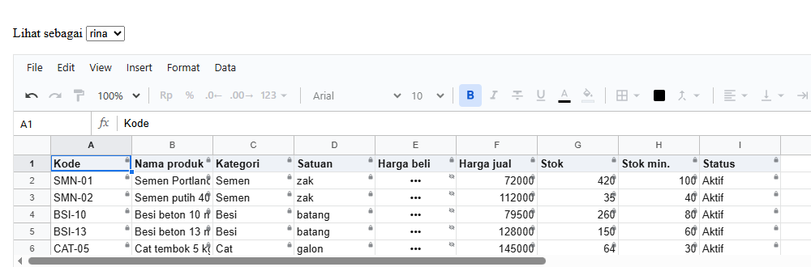

Dilihat sebagai **budi**: Harga beli terlihat dan bisa diubah.

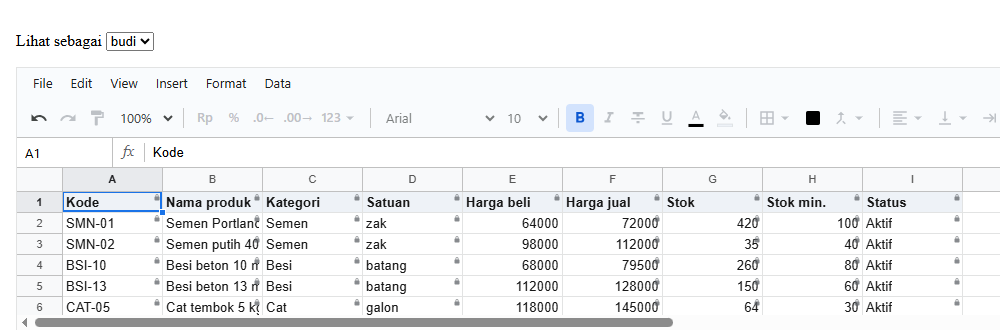

**Penjelasan:**

- `who: 'user:budi'` artinya akun budi saja.
- Untuk Budi, di kolom E ada dua baris yang berlaku: `role:kasir deny read` dan `user:budi allow edit`. Yang menang adalah **yang paling
  spesifik**:

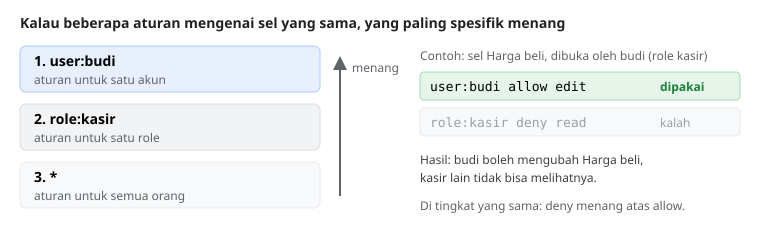

Aturan lengkapnya, untuk setiap sel dan setiap aksi:

1. Ambil hanya baris untuk orang ini: akunnya, role-role-nya, dan `*`.
2. **Yang paling spesifik menang:** `user:` mengalahkan `role:`, dan `role:` mengalahkan `*`.
3. **Di tingkat yang sama, `deny` menang** atas `allow`. Di antara `allow`, yang memberi lebih banyak menang (`edit` atas `read`).
4. **Tidak ada baris sama sekali:** tidak didapat.

## 13.18 Pemilik

**Tujuan:** satu orang yang boleh segalanya, dan tombol yang hanya muncul untuk dia.

<!-- contoh: 13-18-pemilik.page.tsx -->
```tsx
import { useState } from 'react';
import { Sheet, useWorkbook } from '@kufayeka/sheet';
import type { AccessRow, Who } from '@kufayeka/sheet/core';
import '@kufayeka/sheet/style.css';
import { buatStok } from './data/stok-akses.js';

// 13.18 Pemilik: satu baris user:<nama> allow * tanpa where.
const rows: AccessRow[] = [
    { who: 'user:yeka', effect: 'allow', action: '*' },                                    // baru
    { who: 'role:kasir', effect: 'allow', action: 'read', where: 'Produk!A1:I13' },
    { who: '*', effect: 'deny', action: 'edit', where: 'Produk!col:Harga beli' }
];

const ORANG: Record<string, Who> = {
    yeka: { user: 'yeka', roles: ['kasir'] },                // pemilik, juga kasir
    rina: { user: 'rina', roles: ['kasir'] }
};

export default function Halaman() {
    const [wb] = useState(buatStok);
    const [sebagai, setSebagai] = useState('yeka');
    // baru: wb.access().owner, untuk menampilkan tombol yang hanya untuk pemilik (misalnya "Atur hak akses")
    const pemilik = useWorkbook(wb, (w) => w.access().owner);
    return (
        <div>
            <p>
                Lihat sebagai <select className="lihat-sebagai" value={sebagai} onChange={(e) => setSebagai(e.target.value)}>
                    {Object.keys(ORANG).map((nama) => <option key={nama}>{nama}</option>)}
                </select>{' '}
                {pemilik ? <button>Atur hak akses</button> : null}
            </p>
            <div style={{ height: 300 }}>
                <Sheet workbook={wb} access={{ rows, who: ORANG[sebagai] }} />
            </div>
        </div>
    );
}
```
<!-- /contoh -->

Dilihat sebagai **yeka** (pemilik): semua bisa diubah, dan tombol **Atur hak akses** muncul.

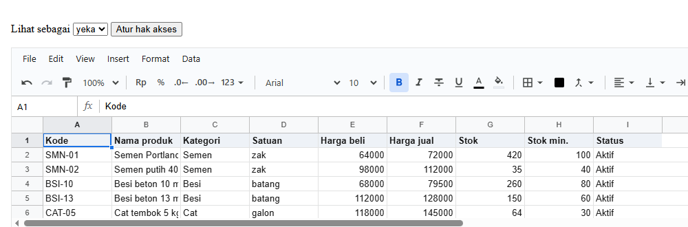

Dilihat sebagai **rina**: hanya baca, tanpa tombol.


**Penjelasan:**

- Pemilik ditulis sebagai satu baris biasa: `user:yeka`, `allow`, `*` (semua aksi), tanpa `where` (di mana saja).
- Yeka juga punya role kasir, dan ada aturan `*` yang mengunci Harga beli. Keduanya kalah, karena baris akun paling spesifik.
- `useWorkbook(wb, (w) => w.access().owner)` membaca apakah orang yang membuka adalah pemilik, dan ikut berubah saat `who` berganti. Pakai ini
  untuk menampilkan tombol yang hanya untuk pemilik, misalnya pintu ke layar pengaturan aturan (bagian F).

Dua hal yang perlu dijaga, karena pemilik hanyalah sebuah baris:

1. **Jangan tulis `deny` untuk akun pemilik sendiri.** Satu `deny` saja sudah mencabut status pemiliknya.
2. **Jangan sampai baris pemilik terhapus.** Tanpa baris itu, pemilik menjadi orang biasa. Di layar pengaturanmu, sembunyikan tombol hapus
   untuk baris itu.

Super admin aplikasimu juga bisa dibuat dengan cara ini: aplikasimu menambahkan baris `user:<admin> allow *` saat mengambil aturan dari
database, tanpa perlu menyimpannya di setiap spreadsheet.

---

# Bagian D. Lebih dari sel

## 13.19 Aturan dengan syarat

**Tujuan:** orang gudang boleh mengubah stok, **kecuali** di baris produk yang sudah dihentikan.

<!-- contoh: 13-19-syarat.page.tsx -->
```tsx
import { useState } from 'react';
import { Sheet } from '@kufayeka/sheet';
import type { AccessRow } from '@kufayeka/sheet/core';
import '@kufayeka/sheet/style.css';
import { buatStok } from './data/stok-akses.js';

// 13.19 Aturan dengan syarat: gudang boleh mengubah stok, KECUALI di baris produk yang sudah Dihentikan (kolom I).
const rows: AccessRow[] = [
    { who: 'role:gudang', effect: 'allow', action: 'read', where: 'Produk!A1:I13' },
    { who: 'role:gudang', effect: 'allow', action: 'edit', where: 'Produk!G2:G13' },
    { who: 'role:gudang', effect: 'deny', action: 'edit', where: 'Produk!G2:G13',
      when: '=$I2="Dihentikan"', message: 'Produk ini sudah dihentikan' }                  // baru
];

// untuk contoh ini, BSI-10 (baris 4) juga sudah dihentikan
function buatStokDihentikan() {
    const wb = buatStok();
    wb.sheet('Produk').setValues('I4', 'Dihentikan');
    return wb;
}

export default function Halaman() {
    const [wb] = useState(buatStokDihentikan);
    return (
        <div style={{ height: 330 }}>
            <Sheet workbook={wb} access={{ rows, who: { user: 'joko', roles: ['gudang'] } }} />
        </div>
    );
}
```
<!-- /contoh -->

Joko (gudang) mengklik G4, stok BSI-10 yang sudah dihentikan, lalu mencoba mengetik:

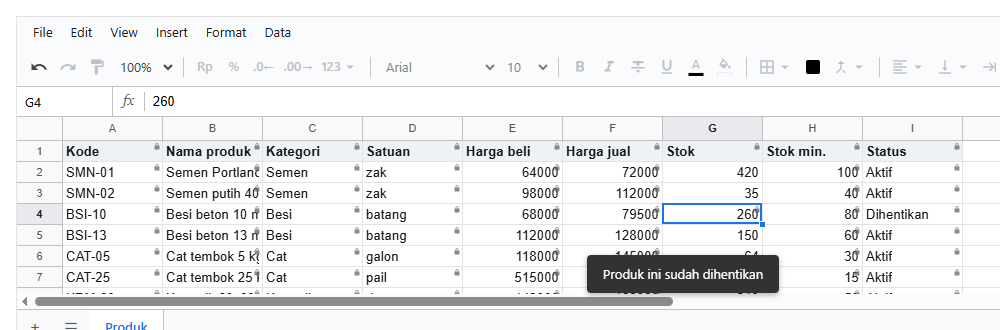

**Penjelasan:**

- `when` adalah syarat berupa **rumus biasa**. Aturan itu hanya berlaku di baris yang hasil rumusnya TRUE.
- Rumusnya ditulis untuk **baris pertama** range (baris 2), lalu bergeser sendiri ke setiap baris, sama seperti rumus yang di-copy ke bawah.
  Di baris 4, rumusnya menjadi `=$I4="Dihentikan"`. Tanda `$` menahan kolom I supaya tidak ikut bergeser.
- Di foto, hanya G4 di kolom Stok yang bergembok, karena BSI-10 berstatus Dihentikan. Saat Joko mengetik, pesannya diambil dari `message`.
- Syarat dihitung ulang setiap kali isi sheet berubah. Kalau I4 diubah kembali menjadi Aktif, G4 langsung bisa diubah lagi.

## 13.20 Format

**Tujuan:** kasir boleh memiringkan teks, tapi tidak boleh menebalkan.

<!-- contoh: 13-20-format.page.tsx -->
```tsx
import { useState } from 'react';
import { Sheet } from '@kufayeka/sheet';
import type { AccessRow } from '@kufayeka/sheet/core';
import '@kufayeka/sheet/style.css';
import { buatStok } from './data/stok-akses.js';

// 13.20 Format: kasir boleh memiringkan teks, tapi tidak boleh menebalkan.
const rows: AccessRow[] = [
    { who: 'role:kasir', effect: 'allow', action: 'edit', where: 'Produk!A1:I13' },
    { who: 'role:kasir', effect: 'allow', action: 'format.italic' }                        // baru: tanpa where = di mana saja
];

export default function Halaman() {
    const [wb] = useState(buatStok);
    return (
        <div style={{ height: 330 }}>
            <Sheet workbook={wb} access={{ rows, who: { user: 'rina', roles: ['kasir'] } }} />
        </div>
    );
}
```
<!-- /contoh -->


**Penjelasan:**

- `format.italic` adalah satu **aksi**. Aturan aksi biasanya ditulis **tanpa `where`**, artinya berlaku di mana saja.
- Di toolbar, tombol miring (*I*) aktif, sedangkan tombol tebal (**B**) dan tombol format lainnya abu-abu, karena tidak disebut.
- Untuk tombol di aplikasimu sendiri, `wb.can('format.italic')` menjawab boleh atau tidak.

## 13.21 Aksi lain

**Tujuan:** mengenal tiga cara menyebut aksi: satu aksi, satu kelompok, dan pengecualian di dalam kelompok.

<!-- contoh: 13-21-aksi.page.tsx -->
```tsx
import { useState } from 'react';
import { Sheet } from '@kufayeka/sheet';
import type { AccessRow } from '@kufayeka/sheet/core';
import '@kufayeka/sheet/style.css';
import { buatStok } from './data/stok-akses.js';

// 13.21 Aksi lain: satu aksi (sort), satu kelompok (format = semua format.*), dan pengecualian di dalam kelompok (bold).
const rows: AccessRow[] = [
    { who: 'role:kasir', effect: 'allow', action: 'edit', where: 'Produk!A1:I13' },
    { who: 'role:kasir', effect: 'allow', action: 'sort' },             // baru: satu aksi
    { who: 'role:kasir', effect: 'allow', action: 'format' },           // baru: satu kelompok
    { who: 'role:kasir', effect: 'deny', action: 'format.bold' }        // baru: kecuali tebal
];

export default function Halaman() {
    const [wb] = useState(buatStok);
    return (
        <div style={{ height: 330 }}>
            <Sheet workbook={wb} access={{ rows, who: { user: 'rina', roles: ['kasir'] } }} />
        </div>
    );
}
```
<!-- /contoh -->

Menu Data dibuka:

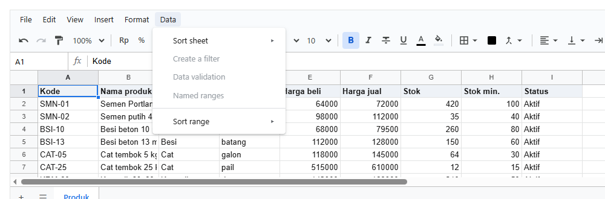

**Penjelasan:**

| Ditulis | Artinya | Di foto |
|---|---|---|
| `sort` | satu aksi: mengurutkan | Sort sheet dan Sort range aktif |
| `format` | satu **kelompok**: semua `format.*` (tebal, miring, warna, border, ...) | tombol format di toolbar aktif |
| `deny format.bold` | pengecualian di dalam kelompok: semua format kecuali tebal | tombol tebal abu-abu |
| (tidak disebut) | filter, validasi, named range | abu-abu di menu Data |

`*` artinya semua aksi, dipakai untuk pemilik. Daftar lengkap semua aksi ada di 13.35.

## 13.22 Bagian layar

**Tujuan:** kasir bekerja tanpa toolbar dan tanpa menu Insert.

<!-- contoh: 13-22-layar.page.tsx -->
```tsx
import { useState } from 'react';
import { Sheet } from '@kufayeka/sheet';
import type { AccessRow } from '@kufayeka/sheet/core';
import '@kufayeka/sheet/style.css';
import { buatStok } from './data/stok-akses.js';

// 13.22 Bagian layar: kasir bekerja tanpa toolbar dan tanpa menu Insert.
const rows: AccessRow[] = [
    { who: 'role:kasir', effect: 'allow', action: 'read', where: 'Produk!A1:I13' },
    { who: 'role:kasir', effect: 'deny', action: 'ui.toolbar' },        // baru: satu bagian besar
    { who: 'role:kasir', effect: 'deny', action: 'ui.menu.Insert' }     // baru: satu menu
];

export default function Halaman() {
    const [wb] = useState(buatStok);
    return (
        <div style={{ height: 330 }}>
            <Sheet workbook={wb} access={{ rows, who: { user: 'rina', roles: ['kasir'] } }} />
        </div>
    );
}
```
<!-- /contoh -->

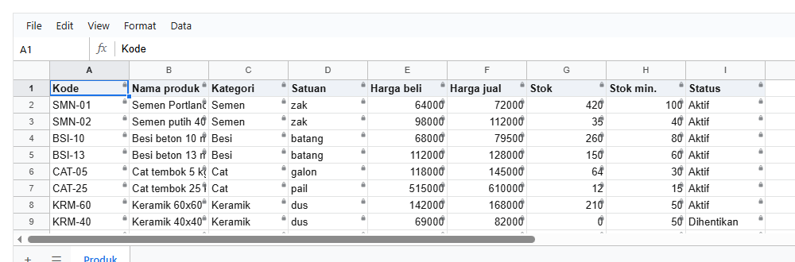

**Penjelasan:**

- Bagian layar ditulis dengan awalan `ui.`. Ada bagian besar (`ui.toolbar`, `ui.menubar`, `ui.formulaBar`, `ui.headers`, `ui.gridlines`,
  `ui.tabs`) dan bagian kecil (`ui.menu.Insert`, `ui.tool.paint`, `ui.panel.comments`, ...).
- Di foto, toolbar hilang, dan menu bar tidak punya Insert lagi.
- Berbeda dengan semua aturan lain, **bagian layar tampil kecuali di-deny**. Kalau tidak begitu, setiap orang harus diberi daftar panjang
  `allow ui.*` hanya supaya layarnya normal.

> **Tampilan bukan keamanan.** Menyembunyikan toolbar tidak mencegah orang menebalkan teks dengan Ctrl+B. Yang benar-benar menjaga adalah
> aturan sel dan aksi (`read`, `edit`, `format.bold`, ...), yang juga diperiksa di server. Pakai `ui.*` untuk merapikan layar, bukan untuk
> melindungi data.

## 13.23 Hanya sebagian sheet yang tampil

**Tujuan:** kasir hanya melihat kolom A sampai D, dan hanya sheet Produk.

<!-- contoh: 13-23-area.page.tsx -->
```tsx
import { useState } from 'react';
import { Sheet } from '@kufayeka/sheet';
import type { AccessRow } from '@kufayeka/sheet/core';
import '@kufayeka/sheet/style.css';
import { buatStok } from './data/stok-akses.js';

// 13.23 Hanya sebagian sheet yang tampil (view.area), dan hanya sheet tertentu (view.sheet).
const rows: AccessRow[] = [
    { who: 'role:kasir', effect: 'allow', action: 'read', where: 'Produk!A1:I13' },
    { who: 'role:kasir', effect: 'allow', action: 'view.area', where: 'Produk!A1:D13' },  // baru
    { who: 'role:kasir', effect: 'allow', action: 'view.sheet', where: 'Produk' }         // baru
];

function buatDuaSheet() {
    const wb = buatStok();
    wb.addSheet('Rekap');                                   // sheet kedua, yang tidak boleh terlihat kasir
    return wb;
}

export default function Halaman() {
    const [wb] = useState(buatDuaSheet);
    return (
        <div style={{ height: 330 }}>
            <Sheet workbook={wb} access={{ rows, who: { user: 'rina', roles: ['kasir'] } }} />
        </div>
    );
}
```
<!-- /contoh -->

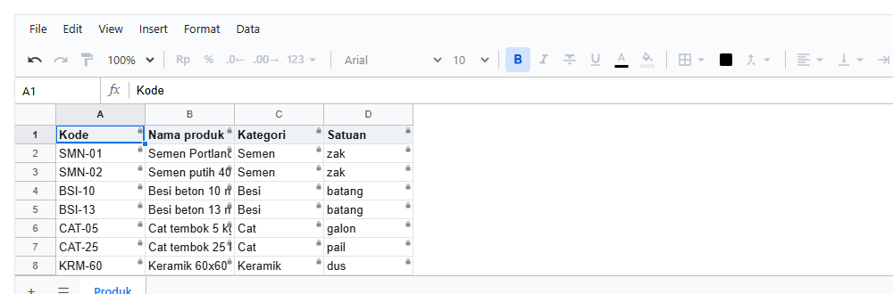

**Penjelasan:**

- `view.area` dengan `where` sebuah range: hanya area itu yang tampil. Kolom E dan seterusnya tidak digambar, sehingga layar terasa seperti
  sheet kecil.
- `view.sheet` dengan `where` nama sebuah sheet: hanya sheet itu yang tampil di tab. Sheet Rekap ada di workbook, tapi tidak muncul. Tulis
  satu baris per sheet yang boleh tampil.
- Sama seperti 13.22, ini soal tampilan. Untuk menjaga isinya, pakai aturan sel.

---

# Bagian E. Tanda dan pesan

## 13.24 Tanda di sel: gembok dan mata

Sejak 13.8, setiap foto memperlihatkan tanda kecil di **pojok kanan atas** sel. Diperbesar dari foto 13.13:

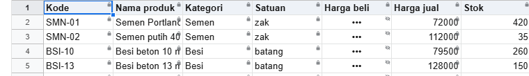

| Tanda | Di sel | Keadaan (13.2) |
|---|---|---|
| gembok | sel yang isinya terlihat | hanya baca |
| mata dicoret | sel `•••` | tersembunyi |
| (tidak ada) | sel yang boleh diubah (kolom Stok) | boleh diubah |
| (tidak ada) | sel kosong | tidak terlihat; sengaja tanpa tanda, supaya tidak ada petunjuk bahwa sel itu berisi |

Tanda ini muncul sendiri, tanpa kode tambahan. Gunanya supaya orang tahu sebelum mencoba mengetik.

Tanda ini juga muncul di sel yang dikunci oleh kode aplikasimu (`setRules`, [bab 10](10-aturan.md)), bukan hanya oleh aturan akses.

## 13.25 Variasi tanda

Prop **`marks`** mengatur tanda di sel. Pilihannya bisa **dinyalakan satu per satu dan dicampur**. Aturan dan orangnya sama di setiap gambar
di bawah; hanya `marks` yang berbeda.

<!-- contoh: 13-25-tanda.page.tsx -->
```tsx
import { useState } from 'react';
import { Sheet } from '@kufayeka/sheet';
import type { CellMarks } from '@kufayeka/sheet';
import type { AccessRow } from '@kufayeka/sheet/core';
import '@kufayeka/sheet/style.css';
import { buatStok } from './data/stok-akses.js';

// 13.25 Variasi tanda (prop marks). Aturan dan orangnya sama; hanya marks yang berbeda, satu variasi per sheet.
const ATURAN: AccessRow[] = [
    { who: 'role:kasir', effect: 'allow', action: 'read', where: 'Produk!A1:I13' },
    { who: 'role:kasir', effect: 'allow', action: 'edit', where: 'Produk!col:Stok' },
    { who: 'role:kasir', effect: 'deny', action: 'read', where: 'Produk!col:Harga beli' },
    // hanya supaya gambarnya ringkas: tanpa menu, toolbar, formula bar, dan tab
    ...['menubar', 'toolbar', 'formulaBar', 'tabs'].map((bagian): AccessRow => ({ who: '*', effect: 'deny', action: 'ui.' + bagian }))
];
const rina = { user: 'rina', roles: ['kasir'] };

function Contoh({ marks }: { marks?: false | CellMarks }) {
    const [wb] = useState(buatStok);
    return <div style={{ height: 130, marginBottom: 14 }}><Sheet workbook={wb} access={{ rows: ATURAN, who: rina }} marks={marks} /></div>;
}

export default function VariasiTanda() {
    return (
        <div style={{ width: 760 }}>
            <Contoh />                                                {/* bawaan: gembok + mata */}
            <Contoh marks={{ tint: true }} />                         {/* + latar abu-abu */}
            <Contoh marks={{ stripes: true }} />                      {/* + garis-garis */}
            <Contoh marks={{ lock: false }} />                        {/* tanpa gembok, mata tetap */}
            <Contoh marks={false} />                                  {/* tanpa tanda sama sekali */}
        </div>
    );
}
```
<!-- /contoh -->

**Bawaan** (`marks` tidak diisi), sama dengan `{ lock: true, hidden: true }`:

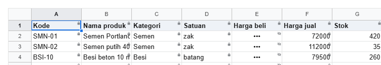

**`{ tint: true }`:** ditambah latar abu-abu muda, dan teks di sel hanya-baca sedikit lebih pudar:

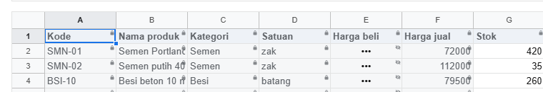

**`{ stripes: true }`:** ditambah garis-garis tipis:

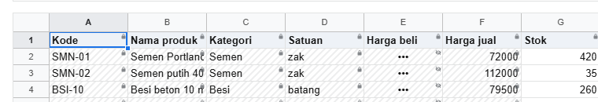

**`{ lock: false }`:** tanpa gembok, mata tetap ada:


**`false`:** tanpa tanda sama sekali. Orang baru tahu sebuah sel terkunci saat mencoba mengetik:

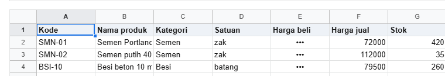

| Pilihan | Bawaan | Artinya |
|---|---|---|
| `lock` | `true` | gembok di sel hanya baca |
| `hidden` | `true` | mata di sel tersembunyi |
| `tint` | `false` | latar abu-abu muda dan teks lebih pudar |
| `stripes` | `false` | garis-garis tipis |

Pilihan yang tidak ditulis memakai nilai bawaannya. Jadi `{ tint: true }` berarti gembok + mata + abu-abu.

Tanda hanya bantuan untuk mata. Yang benar-benar menjaga datanya tetap aturannya sendiri, yang juga diperiksa di server (13.33).

## 13.26 Pesan penolakan

Saat sesuatu ditolak, sheet menampilkan pesan kecil di bawah grid. Teksnya diambil dari kolom `message` baris aturan, atau teks bawaan kalau
`message` kosong.

Semua pesan sheet lewat satu prop, **`onNotice`**, sebelum tampil. Prop ini sekaligus event-nya. Nilai yang dikembalikan menentukan apa yang
tampil:

| `onNotice` mengembalikan | Yang tampil |
|---|---|
| tidak ada | pesan bawaan sheet |
| sebuah teks | teks itu, menggantikan pesan bawaan |
| `null` | tidak ada apa-apa; aplikasimu menampilkannya sendiri |

Isi pesan yang diterima (`SheetNotice`):

| Kolom | Isi |
|---|---|
| `kind` | `refused` (ditolak), `error` (gagal), `info` (pemberitahuan) |
| `reason` | teks bawaan sheet, atau `message` dari baris aturan |
| `address` | sel yang dicoba, misalnya `B3` |
| `action` | aksi yang ditolak: `edit`, `copy`, `paste`, `comment.reply`, ... |
| `source`, `op` | untuk penolakan dari workbook: siapa yang mengubah, dan perubahannya |

Tiga pemakaian, dari yang paling sederhana:

```tsx
// 1. matikan semua pesan bawaan
<Sheet onNotice={() => null} />

// 2. ganti teksnya
<Sheet onNotice={(n) => (n.kind === 'refused' ? 'Kamu tidak boleh mengubah ini' : undefined)} />

// 3. tampilkan sendiri, di luar sheet
<Sheet onNotice={(n) => { tampilkanToastSendiri(n); return null; }} />
```

Contoh lengkap untuk pemakaian ketiga, dengan pesan di bar merah di atas sheet:

<!-- contoh: 13-26-pesan.page.tsx -->
```tsx
import { useState } from 'react';
import { Sheet } from '@kufayeka/sheet';
import type { SheetNotice } from '@kufayeka/sheet';
import type { AccessRow } from '@kufayeka/sheet/core';
import '@kufayeka/sheet/style.css';
import { buatStok } from './data/stok-akses.js';

// 13.26 Pesan penolakan ditampilkan di luar sheet, dengan kata-kata aplikasimu sendiri. Pesan bawaan sheet dimatikan.
const ATURAN: AccessRow[] = [
    { who: 'role:kasir', effect: 'allow', action: 'read', where: 'Produk!A1:I13' },
    { who: 'role:kasir', effect: 'allow', action: 'edit', where: 'Produk!col:Stok' }
];

export default function PesanSendiri() {
    const [wb] = useState(buatStok);
    const [pesan, setPesan] = useState<string | null>(null);

    // onNotice dipanggil untuk setiap pesan sheet, sebelum tampil
    function padaPesan(n: SheetNotice) {
        if (n.kind === 'refused') {
            setPesan(n.address + ': kolom ini hanya bisa dibaca. Yang boleh kamu ubah hanya Stok.');
            return null;           // null: sheet tidak menampilkan pesannya sendiri
        }
        return undefined;          // pesan lain: biarkan sheet yang menampilkan
    }

    return (
        <div style={{ height: 420, display: 'flex', flexDirection: 'column', font: '13px system-ui' }}>
            <div style={{ padding: '8px 12px', background: pesan ? '#fce8e6' : '#f1f3f4', color: pesan ? '#c5221f' : '#5f6368' }}>
                {pesan ?? 'Klik sel lalu ketik. Hanya kolom Stok yang bisa diubah.'}
            </div>
            <Sheet workbook={wb} style={{ flex: 1 }} onNotice={padaPesan} access={{ rows: ATURAN, who: { user: 'rina', roles: ['kasir'] } }} />
        </div>
    );
}
```
<!-- /contoh -->

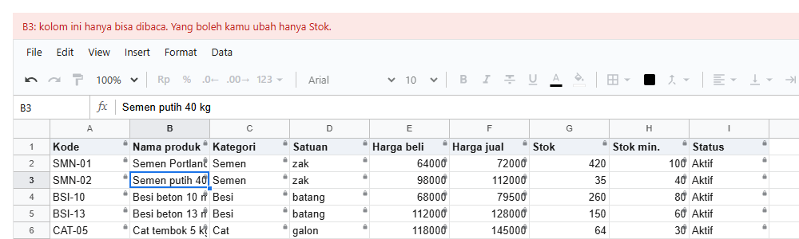

Di luar React, penolakan dari workbook didengar dengan `wb.on('reject', fn)` ([4.9](04-api-workbook.md)).

---

# Bagian F. Mode pengaturan

Bagian ini untuk membuat **layar pengaturan aturan** di aplikasimu. Library tidak punya layar pengaturan bawaan. Kamu membuatnya sendiri, sesuai
tampilan aplikasimu. Sheet membantu dengan mode pengaturan (13.3).

## 13.27 Menyalakan mode pengaturan

**Tujuan:** pemilik melihat sel mana yang punya aturan, untuk siapa.

<!-- contoh: 13-27-setup.page.tsx -->
```tsx
import { useState } from 'react';
import { Sheet } from '@kufayeka/sheet';
import type { AccessRow } from '@kufayeka/sheet/core';
import '@kufayeka/sheet/style.css';
import { buatStok } from './data/stok-akses.js';

// 13.27 Mode pengaturan. Satu tambahan dari 13.8: view: 'setup', dan yang membuka adalah pemilik.
const ATURAN: AccessRow[] = [
    { who: 'user:yeka', effect: 'allow', action: '*' },
    { who: 'role:kasir', effect: 'allow', action: 'read', where: 'Produk!A1:I13' },
    { who: 'role:kasir', effect: 'deny', action: 'read', where: 'Produk!col:Harga beli' },
    { who: 'role:gudang', effect: 'allow', action: 'edit', where: 'Produk!col:Stok' }
];

export default function ModePengaturan() {
    const [wb] = useState(buatStok);
    return (
        <div style={{ height: 420 }}>
            <Sheet workbook={wb} access={{ rows: ATURAN, who: { user: 'yeka' }, view: 'setup' }} />   {/* baru: view */}
        </div>
    );
}
```
<!-- /contoh -->

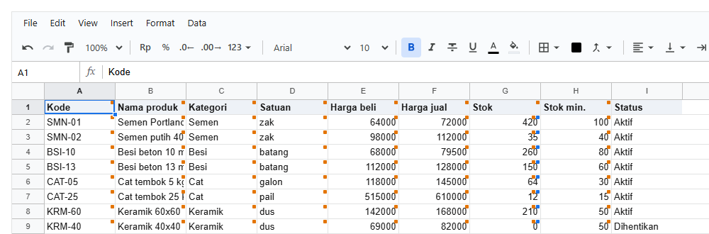

**Penjelasan:**

- Satu tambahan dari 13.8: `view: 'setup'`. Yang membuka adalah pemilik, supaya semua isi terlihat.
- Setiap sel yang kena aturan mendapat **kotak warna kecil di pojok kanan atas, satu kotak untuk setiap who** yang punya aturan di sel itu.
  Di gambar, kolom Stok punya dua kotak: oranye (kasir, karena membaca seluruh tabel) dan biru (gudang, karena mengubah Stok).
- Dua aturan untuk who yang sama di satu sel tetap satu kotak.
- Arahkan kursor ke sebuah kotak untuk melihat who dan nomor aturannya.
- Gembok dan mata tidak muncul di mode ini. Apa isi aturannya dibaca di daftar aturan (langkah berikutnya).
- Kotak hanya digambar di bagian sheet yang berisi data. Aturan untuk kolom utuh tidak memberi kotak di ribuan baris kosong.
- Kalau satu sel punya lebih dari empat who, tampil tiga kotak dan tanda `+n`.

## 13.28 Memilih aturan

**Tujuan:** daftar aturan di samping sheet. Aturan yang dipilih diberi garis di sheet, dan kotak di sheet bisa diklik untuk memilih aturannya.

<!-- contoh: 13-28-pilih.page.tsx -->
```tsx
import { useState } from 'react';
import { Sheet } from '@kufayeka/sheet';
import type { AccessRow } from '@kufayeka/sheet/core';
import { accessColor } from '@kufayeka/sheet/core';
import '@kufayeka/sheet/style.css';
import { buatStok } from './data/stok-akses.js';

// 13.28 Memilih aturan. Daftar aturan di samping sheet; yang dipilih bergaris di sheet, dan kotak di sheet bisa diklik.
const ATURAN: AccessRow[] = [
    { who: 'user:yeka', effect: 'allow', action: '*' },
    { who: 'role:kasir', effect: 'allow', action: 'read', where: 'Produk!A1:I13' },
    { who: 'role:kasir', effect: 'deny', action: 'read', where: 'Produk!col:Harga beli' },
    { who: 'role:gudang', effect: 'allow', action: 'edit', where: 'Produk!col:Stok' }
];

export default function PilihAturan() {
    const [wb] = useState(buatStok);
    const [dipilih, setDipilih] = useState<number | null>(2);                       // baru: baris yang dipilih
    return (
        <div style={{ display: 'flex', height: 420, font: '13px system-ui' }}>
            <Sheet workbook={wb} style={{ flex: 1 }}
                access={{ rows: ATURAN, who: { user: 'yeka' }, view: 'setup',
                          selected: dipilih,                                        // baru: bergaris di sheet
                          onSelect: setDipilih }} />                                {/* baru: klik kotak di sheet */}
            <ul className="daftar" style={{ width: 330, margin: 0, padding: 10, listStyle: 'none', borderLeft: '1px solid #dadce0' }}>
                {ATURAN.map((r, i) => (
                    <li key={i} onClick={() => setDipilih(i)}
                        style={{ padding: '5px 6px', cursor: 'pointer', borderRadius: 4, background: i === dipilih ? '#e8f0fe' : undefined }}>
                        {/* baru: warna yang sama dengan kotak di sheet */}
                        <i style={{ display: 'inline-block', width: 8, height: 8, borderRadius: 2, marginRight: 6, background: accessColor(r.who) }} />
                        {r.who} · {r.effect} {r.action} {r.where ?? ''}
                    </li>
                ))}
            </ul>
        </div>
    );
}
```
<!-- /contoh -->

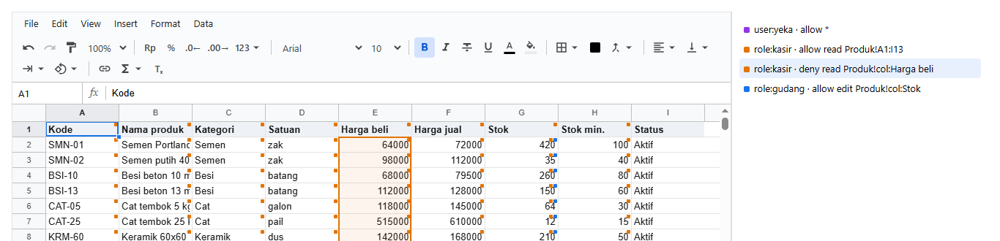

**Penjelasan:**

| Kode | Yang terjadi |
|---|---|
| `selected: dipilih` | range aturan nomor `dipilih` diberi garis di sheet, dengan warna who-nya |
| `onSelect: setDipilih` | dipanggil saat kotak di sel diklik, dengan nomor aturannya |
| `accessColor(r.who)` | warna yang sama dengan kotak di sheet, untuk daftar aturanmu sendiri |

Nomor aturan adalah posisinya di array `rows`, dihitung dari 0. Warna setiap who dihitung dari namanya, jadi `role:kasir` selalu berwarna sama
di setiap layar dan komputer. Warna sendiri bisa diberikan lewat `access.colors`: `{ 'role:kasir': '#1a73e8' }`.

## 13.29 Membuat aturan dari range yang dipilih

**Tujuan:** pemilik memilih range di sheet, lalu menekan satu tombol untuk membuat aturan dari range itu.

<!-- contoh: 13-29-tambah.page.tsx -->
```tsx
import { useState } from 'react';
import { Sheet } from '@kufayeka/sheet';
import type { SheetSelection } from '@kufayeka/sheet';
import type { AccessRow } from '@kufayeka/sheet/core';
import { accessColor } from '@kufayeka/sheet/core';
import '@kufayeka/sheet/style.css';
import { buatStok } from './data/stok-akses.js';

// 13.29 Membuat aturan dari range yang dipilih. Satu tambahan dari 13.28: onSelectionChange dan tombol Tambah.
const AWAL: AccessRow[] = [
    { who: 'user:yeka', effect: 'allow', action: '*' },
    { who: 'role:kasir', effect: 'allow', action: 'read', where: 'Produk!A1:I13' }
];

export default function TambahAturan() {
    const [wb] = useState(buatStok);
    const [rows, setRows] = useState<AccessRow[]>(AWAL);                           // baru: aturan sekarang bisa bertambah
    const [dipilih, setDipilih] = useState<number | null>(null);
    const [range, setRange] = useState<SheetSelection | null>(null);              // baru: range yang dipilih di sheet

    function tambah() {                                                             // baru
        if (!range) return;
        setRows([...rows, { who: 'role:kasir', effect: 'deny', action: 'read', where: range.sheet.name + '!' + range.address }]);
        setDipilih(rows.length);                                                    // aturan baru langsung terpilih
    }

    return (
        <div style={{ display: 'flex', height: 420, font: '13px system-ui' }}>
            <Sheet workbook={wb} style={{ flex: 1 }} onSelectionChange={setRange}       // baru
                access={{ rows, who: { user: 'yeka' }, view: 'setup', selected: dipilih, onSelect: setDipilih }} />
            <div style={{ width: 330, padding: 10, borderLeft: '1px solid #dadce0' }}>
                <p>Range: <b className="range">{range ? range.sheet.name + '!' + range.address : '-'}</b></p>
                <button className="tambah" onClick={tambah} disabled={!range}>Sembunyikan untuk kasir</button>
                <ul style={{ margin: '10px 0 0', padding: 0, listStyle: 'none' }}>
                    {rows.map((r, i) => (
                        <li key={i} onClick={() => setDipilih(i)}
                            style={{ padding: '5px 6px', cursor: 'pointer', borderRadius: 4, background: i === dipilih ? '#e8f0fe' : undefined }}>
                            <i style={{ display: 'inline-block', width: 8, height: 8, borderRadius: 2, marginRight: 6, background: accessColor(r.who) }} />
                            {r.who} · {r.effect} {r.action} {r.where ?? ''}
                        </li>
                    ))}
                </ul>
            </div>
        </div>
    );
}
```
<!-- /contoh -->

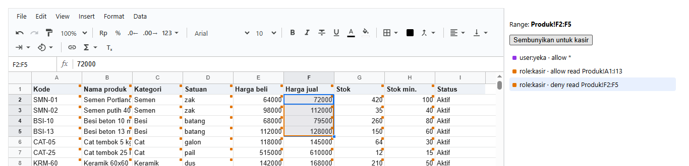

**Penjelasan:**

- `onSelectionChange` memberi range yang dipilih. Event ini muncul **sekali, setelah mouse dilepas**, bukan di setiap sel yang dilewati saat
  men-drag.
- `range.sheet.name + '!' + range.address` menghasilkan `Produk!F2:F5`, yang langsung bisa dipakai sebagai `where`.
- Tombol membuat **satu baris baru** di `rows`, lalu memilihnya, sehingga range-nya langsung bergaris di sheet.
- Di gambar, F2:F5 sudah disembunyikan untuk kasir: baris baru ada di daftar, dan range-nya bergaris oranye.

## 13.30 Berpindah mode: lihat sebagai orang lain

**Tujuan:** mencoba aturan sebelum menyimpannya, dengan melihat sheet persis seperti yang dilihat Rina.

Caranya: ganti `view` ke `'live'` dan `who` ke orang itu. Hanya itu.

```tsx
<Sheet access={{ rows, who: MODE[mode].who, view: mode === 'setup' ? 'setup' : 'live', selected: dipilih, onSelect: setDipilih }} />
```

Contoh lengkap layar pengaturan, dengan semua langkah bagian F ditambah pilihan "Mode", ada di
[4.13](04-api-workbook.md#413-editor-hak-akses-di-luar-sheet).

Mode pengaturan:

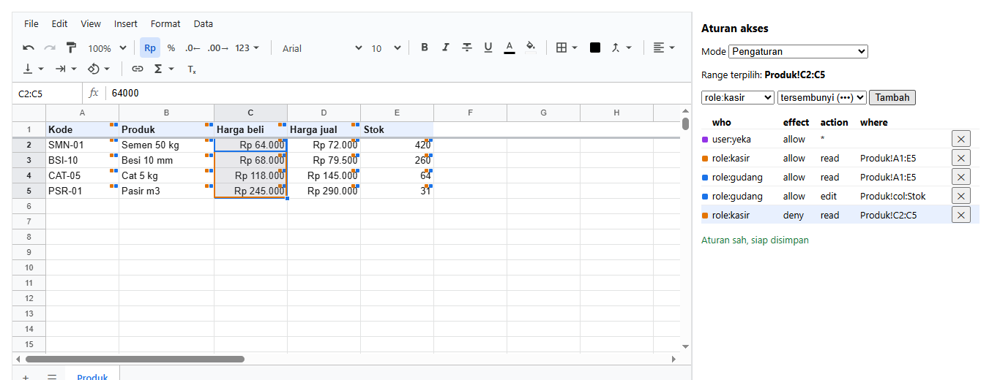

Mode "Lihat sebagai Rina (kasir)", dengan aturan yang sama:

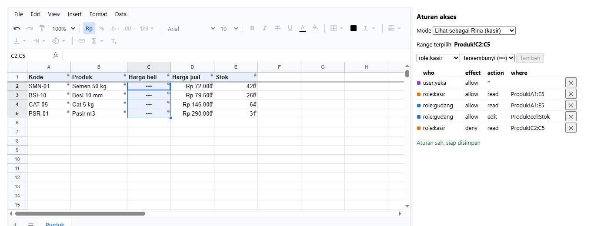

Alur lengkap layar pengaturan:

1. Pemilik memilih range di sheet (13.29).
2. Memilih siapa dan aturannya, lalu menekan Tambah: satu baris baru.
3. Klik baris di daftar: range-nya bergaris dan terpilih di sheet. Klik kotak di sheet: barisnya terpilih di daftar (13.28).
4. Pindah ke "Lihat sebagai ...": sheet tampil seperti untuk orang itu.
5. `validateAccess(rows)` memeriksa barisnya (13.35), lalu baris-baris itu disimpan ke database (13.31).

---

# Bagian G. Server dan database

Browser bisa diakali orang. Karena itu, aturan yang sama juga dijalankan di server, dengan dua fungsi: `viewFor` saat membuka, dan `checkPatch`
saat menyimpan.

## 13.31 Tabel `sheet_access`

Aturan disimpan di tabel tersendiri, satu baris per aturan:

```sql
create table sheet_access (
    id              bigserial primary key,
    spreadsheet_id  text not null references spreadsheet(id) on delete cascade,
    who             text not null,          -- 'user:rina', 'role:kasir', '*'
    effect          text not null check (effect in ('allow', 'deny')),
    action          text not null,          -- 'read', 'edit', 'format.bold', 'ui.toolbar', ...
    "where"         text,                   -- 'Produk!A1:I13', 'Produk!col:Stok'; kosong = di mana saja
    "when"          text,                   -- '=$I2="Dihentikan"'
    message         text
);
create index on sheet_access (spreadsheet_id);
```

Isinya untuk toko di bab ini:

| id | spreadsheet_id | who | effect | action | where | when | message |
|---|---|---|---|---|---|---|---|
| 1 | stok | user:yeka | allow | * | | | |
| 2 | stok | role:kasir | allow | read | Produk!A1:I13 | | |
| 3 | stok | role:kasir | deny | read | Produk!col:Harga beli | | |
| 4 | stok | role:gudang | allow | edit | Produk!col:Stok | | |
| 5 | stok | role:gudang | deny | edit | Produk!G2:G13 | =$I2="Dihentikan" | Produk ini sudah dihentikan |

Karena satu aturan adalah satu baris, pertanyaan seperti "siapa saja yang boleh mengubah kolom Stok?" cukup dijawab dengan satu `select`.
Untuk dipakai, ambil semua baris milik spreadsheet itu, lalu berikan apa adanya ke library sebagai `rows`.

## 13.32 `viewFor`: yang dikirim ke browser

**Tujuan:** saat Rina membuka, server mengirim isi workbook **tanpa** isi yang tersembunyi untuknya.

<!-- contoh: 13-32-viewfor.ts -->
```ts
import { viewFor } from '@kufayeka/sheet/core';
import type { AccessRow } from '@kufayeka/sheet/core';
import { buatStok } from './data/stok-akses.js';

// 13.32 viewFor. Saat rina membuka, server mengirim isi workbook TANPA isi yang tersembunyi untuknya.
const rows: AccessRow[] = [
    { who: 'role:kasir', effect: 'allow', action: 'read', where: 'Produk!A1:I13' },
    { who: 'role:kasir', effect: 'deny', action: 'read', where: 'Produk!col:Harga beli' }
];
const isi = buatStok().toJSON();                       // yang tersimpan di database

const dikirim = viewFor(isi, { access: rows, who: { user: 'rina', roles: ['kasir'] } });
const teks = JSON.stringify(dikirim);
console.log('harga beli Semen (64000) ikut terkirim?', teks.includes('64000'));
console.log('nama produk ikut terkirim?            ', teks.includes('Semen Portland'));
```
<!-- /contoh -->

<!-- hasil: 13-32-viewfor.ts -->
```text
harga beli Semen (64000) ikut terkirim? false
nama produk ikut terkirim?             true
```
<!-- /hasil -->

**Penjelasan:** `viewFor(isi, { access: rows, who })` mengembalikan salinan isi workbook, dengan sel tersembunyi dan tidak terlihat sudah
dikosongkan. Harga beli tidak ikut terkirim, jadi tidak bisa diintip lewat DevTools. Rumus yang membaca sel tersembunyi hanya dikirim
hasilnya, tanpa rumusnya. Cara menyambungkannya ke route GET ada di [bab 12](12-server.md).

## 13.33 `checkPatch`: yang boleh disimpan

**Tujuan:** perubahan dari browser Rina diperiksa sekali lagi sebelum disimpan.

<!-- contoh: 13-33-checkpatch.ts -->
```ts
import { createWorkbook, checkPatch } from '@kufayeka/sheet/core';
import type { AccessRow } from '@kufayeka/sheet/core';
import { buatStok } from './data/stok-akses.js';

// 13.33 checkPatch. Perubahan dari browser rina diperiksa lagi sebelum disimpan, dengan aturan yang sama.
const rows: AccessRow[] = [
    { who: 'role:kasir', effect: 'allow', action: 'read', where: 'Produk!A1:I13' },
    { who: 'role:kasir', effect: 'allow', action: 'edit', where: 'Produk!col:Stok' }
];
const rina = { user: 'rina', roles: ['kasir'] };
const isi = buatStok().toJSON();

// perubahan yang boleh: stok
const satu = createWorkbook(isi);
satu.sheet('Produk').setValues('G2', 400);
console.log('ubah stok:', checkPatch(isi, satu.pendingPatch(), { access: rows, who: rina }).ok ? 'diterima' : 'ditolak');

// perubahan yang tidak boleh: nama produk (browser yang diakali bisa saja mengirimnya)
const dua = createWorkbook(isi);
dua.sheet('Produk').setValues('B2', 'Semen murah');
const hasil = checkPatch(isi, dua.pendingPatch(), { access: rows, who: rina });
console.log('ubah nama:', hasil.ok ? 'diterima' : 'ditolak', '|', hasil.problems.map((p) => p.address + ': ' + p.reason).join(', '));
```
<!-- /contoh -->

<!-- hasil: 13-33-checkpatch.ts -->
```text
ubah stok: diterima
ubah nama: ditolak | B2: You can only view this here
```
<!-- /hasil -->

**Penjelasan:** `checkPatch(isi, patch, { access: rows, who })` memeriksa setiap perubahan di patch dengan aturan yang sama dengan di browser.
Mengubah stok diterima. Mengubah nama produk ditolak, lengkap dengan sel dan alasannya, walaupun browser yang diakali sudah mengirimnya. Cara
menyambungkannya ke route PUT ada di [bab 12](12-server.md).

---

# Bagian H. Batas dan referensi

## 13.34 Batas kemampuan

Yang **tidak** dilakukan oleh hak akses, supaya tidak ada salah paham:

| Tidak bisa | Penjelasan | Yang bisa dilakukan |
|---|---|---|
| Mengurus login, akun, dan role | library hanya menerima "siapa" dari aplikasimu | sistem login aplikasimu |
| Syarat yang tahu siapa yang membuka | rumus `when` membaca isi sheet, bukan nama akun | buat aturan per `user:` di aplikasimu, misalnya satu baris untuk setiap kasir atas barisnya sendiri |
| Syarat berupa kode JavaScript bebas | aturan harus berupa data, supaya server bisa menjalankan aturan yang sama | `when` dengan rumus, atau `beforeOp` ([bab 4](04-api-workbook.md)) untuk logika bisnis di browser |
| Mencatat siapa mengubah apa (audit) | bukan bagian hak akses | event `op` membawa akun dan waktu setiap perubahan ([4.9](04-api-workbook.md)); simpan sendiri |
| Menjaga data dengan tampilan | `ui.*`, `view.*`, dan tanda di sel hanya tampilan | aturan sel dan aksi, ditambah `viewFor` dan `checkPatch` di server |
| Menjaga data tanpa server | browser bisa diakali | selalu jalankan `viewFor` dan `checkPatch` di server |

## 13.35 Referensi

Bagian ini untuk dicari, bukan dibaca dari awal.

### Satu baris aturan (`AccessRow`)

| Kolom | Isi | Wajib |
|---|---|---|
| `who` | `user:<nama>`, `role:<nama>`, atau `*` | ya |
| `effect` | `allow` atau `deny` | ya |
| `action` | satu aksi, satu kelompok (`format`), `ui.<bagian>`, `view.area`, `view.sheet`, atau `*` | ya |
| `where` | lihat tabel di bawah; kosong = di mana saja | tidak |
| `when` | rumus untuk baris pertama range; aturan berlaku di baris yang hasilnya TRUE | tidak |
| `message` | kalimat yang ditampilkan saat aturan ini menolak | tidak |

### Bentuk `where`

| Ditulis | Artinya |
|---|---|
| `Produk!A1:I13` | range di sheet Produk |
| `Produk!G2` | satu sel |
| `Produk!G:H` | kolom G sampai H utuh |
| `Produk!2:5` | baris 2 sampai 5 utuh |
| `Produk!col:Stok` | kolom yang judulnya Stok (tanpa baris judulnya) |
| `Produk!col:Stok,Status` | beberapa kolom berdasarkan judulnya |
| `Produk` | seluruh sheet Produk |
| `A1:I13` (tanpa nama sheet) | range itu di setiap sheet |
| kosong | di mana saja |

Tanda `$` boleh dipakai (`$G$2`). `where` yang tidak bisa dibaca **tidak mengenai sel mana pun**, dan `validateAccess` melaporkannya.

### Siapa yang membuka (`Who`)

`'rina'` (akun saja), atau `{ user: 'rina', roles: ['kasir', 'gudang'] }`.

### Aturan untuk sel

| Baris | Hasil di sel |
|---|---|
| `allow edit` | boleh diubah (dan dibaca) |
| `allow read` | hanya baca |
| `deny edit` | paling tinggi hanya baca: membatasi `allow` yang ada, tidak memberi izin baca sendiri |
| `deny read` | tersembunyi (`•••`) |
| `deny see` | tidak terlihat (kosong) |
| tidak ada baris | tidak terlihat |

### Semua isi `action`

<!-- tabel: 13-35-daftar.ts -->
| Kelompok | action |
|---|---|
| Cells | `read`, `edit`, `see` |
| Format | `format.bold`, `format.italic`, `format.underline`, `format.strike`, `format.color`, `format.fill`, `format.borders`, `format.align`, `format.wrap`, `format.rotate`, `format.size`, `format.font`, `format.number`, `format.link`, `format.merge`, `format.conditional`, `format.clear` |
| Rows | `rows.insert`, `rows.delete`, `rows.resize`, `rows.hide`, `rows.group` |
| Columns | `cols.insert`, `cols.delete`, `cols.resize`, `cols.hide`, `cols.group` |
| Sheets | `sheets.add`, `sheets.delete`, `sheets.rename`, `sheets.move`, `sheets.hide` |
| View | `view.area`, `view.sheet`, `view.freeze`, `view.gridlines` |
| Data | `sort`, `filter`, `pivot`, `validation`, `names`, `settings` |
| Clipboard and files | `copy`, `paste`, `download`, `import` |
| Comments | `comment.read`, `comment.create`, `comment.reply`, `comment.resolve`, `comment.edit`, `comment.delete`, `comment.moderate` |
| Access | `access` |
| Layar | `ui.menubar`, `ui.toolbar`, `ui.formulaBar`, `ui.headers`, `ui.gridlines`, `ui.tabs`, `ui.disallowed` |
| Layar: Toolbar | `ui.tool.undo`, `ui.tool.redo`, `ui.tool.paint`, `ui.tool.zoom`, `ui.tool.currency`, `ui.tool.percent`, `ui.tool.decimals`, `ui.tool.formats`, `ui.tool.font`, `ui.tool.size`, `ui.tool.bold`, `ui.tool.italic`, `ui.tool.strike`, `ui.tool.underline`, `ui.tool.color`, `ui.tool.fill`, `ui.tool.borders`, `ui.tool.merge`, `ui.tool.align`, `ui.tool.valign`, `ui.tool.wrap`, `ui.tool.rotate`, `ui.tool.link`, `ui.tool.functions`, `ui.tool.clear` |
| Layar: Menus | `ui.menu.File`, `ui.menu.Edit`, `ui.menu.View`, `ui.menu.Insert`, `ui.menu.Format`, `ui.menu.Data` |
| Layar: Menu items | `ui.menu.file:import`, `ui.menu.file:download`, `ui.menu.file:settings`, `ui.menu.edit:find`, `ui.menu.edit:deleteRows`, `ui.menu.edit:deleteCols`, `ui.menu.view:freezeRows`, `ui.menu.view:freezeCols`, `ui.menu.view:group`, `ui.menu.view:comments`, `ui.menu.view:zoom`, `ui.menu.insert:rowsAbove`, `ui.menu.insert:colsLeft`, `ui.menu.insert:sheet`, `ui.menu.insert:checkbox`, `ui.menu.insert:dropdown`, `ui.menu.insert:fn`, `ui.menu.insert:link`, `ui.menu.insert:comment`, `ui.menu.insert:pivot`, `ui.menu.format:conditional`, `ui.menu.data:sortSheet`, `ui.menu.data:sortRange`, `ui.menu.data:filter`, `ui.menu.data:validation`, `ui.menu.data:names` |
| Layar: Panels | `ui.panel.comments`, `ui.panel.pivot`, `ui.panel.conditional`, `ui.panel.names`, `ui.panel.validation`, `ui.panel.find`, `ui.panel.settings`, `ui.panel.filter` |
| Layar: Features | `ui.feature.contextMenu`, `ui.feature.fillHandle`, `ui.feature.resize`, `ui.feature.groups`, `ui.cell.commentMark`, `ui.cell.validation` |
<!-- /tabel -->

Daftar ini dibuat dari `ACTION_INFO` dan `UI_ITEMS` milik library, jadi selalu sesuai dengan yang dikenal library. Pakai kedua daftar itu untuk
dropdown di layar pengaturanmu.

### Prop di `<Sheet>`

| Prop | Isi | Langkah |
|---|---|---|
| `access.rows` | daftar aturan | 13.8 |
| `access.who` | siapa yang membuka | 13.8 |
| `access.view` | `'live'` (bawaan) atau `'setup'` | 13.27 |
| `access.selected` | nomor aturan yang diberi garis (mode pengaturan) | 13.28 |
| `access.onSelect` | dipanggil saat kotak di sel diklik (mode pengaturan) | 13.28 |
| `access.colors` | warna sendiri untuk sebagian who | 13.28 |
| `marks` | `{ lock, hidden, tint, stripes }` atau `false` | 13.25 |
| `onNotice` | setiap pesan sheet, sebelum tampil | 13.26 |
| `onSelectionChange` | range yang dipilih, sekali setelah mouse dilepas | 13.29 |

### Fungsi

| Fungsi | Gunanya |
|---|---|
| `wb.setAccess(rows, who)` | menerapkan aturan untuk orang yang membuka; `null` menghapus semua aturan |
| `wb.access()` | hasil akhirnya: `{ owner, roles, ui, message }` |
| `wb.can(action)` | boleh melakukan aksi ini atau tidak |
| `wb.shows(id)` | bagian layar ini tampil atau tidak (`'menu.Insert'`, `'tool.paint'`) |
| `wb.modeAt(sheet, sel)` | keadaan satu sel: `{ mode: 'readonly' \| 'hidden' \| 'invisible', message }`, atau `null` kalau boleh diubah |
| `resolveAccess(rows, who)` | hasil akhir untuk satu orang tanpa workbook |
| `validateAccess(rows)` | `[{ row, problem }]`, kosong kalau semua baris benar |
| `parseWhere(where)` | memecah `where` menjadi `{ sheet, range, columns }` |
| `accessColor(who)` | warna sebuah who, sama dengan kotak di sheet |
| `accessPlaces(wb, rows)` | di mana setiap aturan menyentuh sheet: `at(sheet, r, c)`, `rects(i, sheet)`, `colorOf(i)` |
| `viewFor(isi, { access, who })` | di server: isi yang boleh dikirim |
| `checkPatch(isi, patch, { access, who })` | di server: perubahan diperiksa sebelum disimpan |
