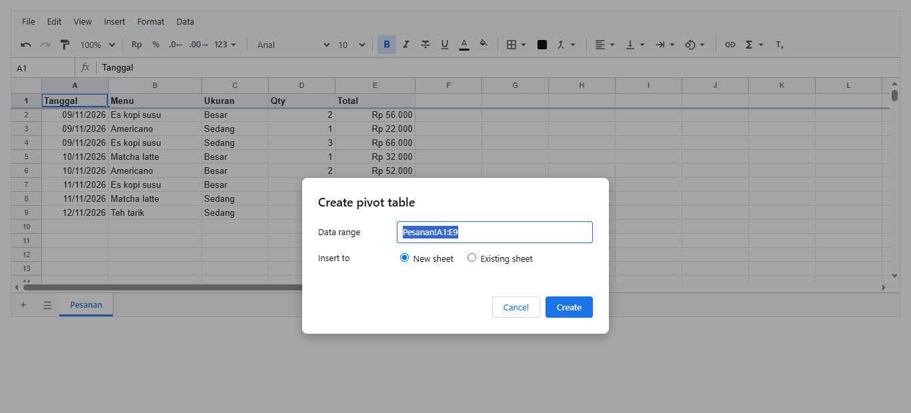
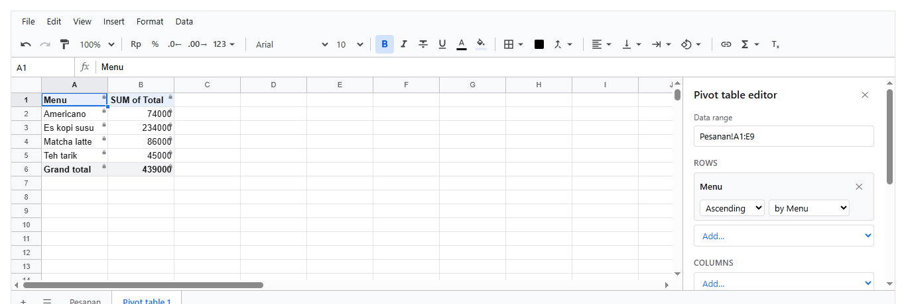
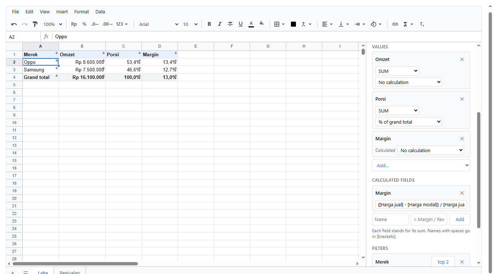
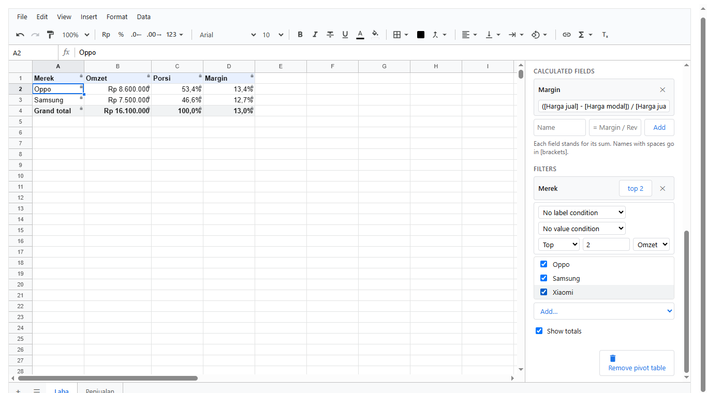
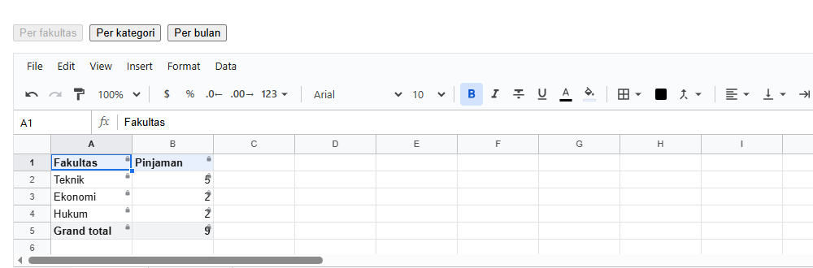
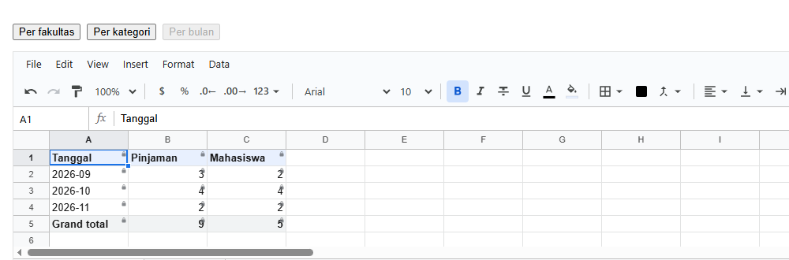
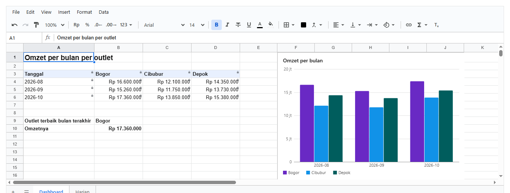
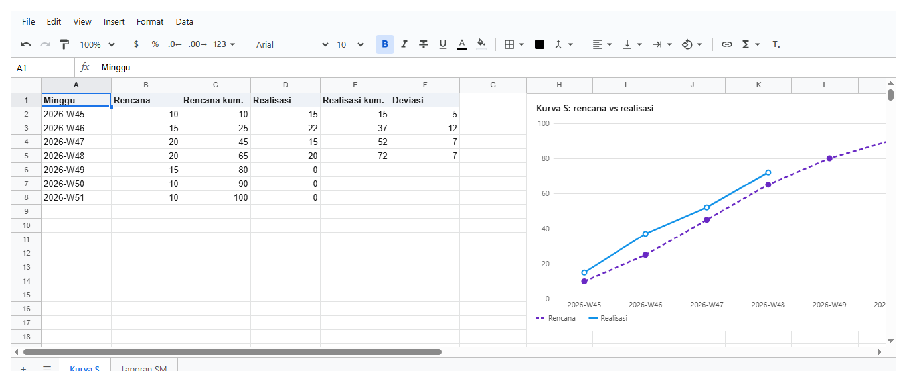

# 14. Pivot Table

[Daftar isi](../README.md#daftar-isi) · Sebelumnya: [13. Optimasi Performa & Referensi API](13-referensi.md)

Bab ini membahas pivot table secara utuh: apa gunanya, dari bagian apa saja ia tersusun, tiga cara membuatnya (lewat menu, lewat kode React, dan di server), cara memakainya untuk data dari file, lalu serangkaian kasus nyata dari yang paling sederhana sampai yang paling lengkap. Bab ini ditutup dengan studi kasus Kurva S proyek konstruksi dan referensi semua parameternya.

Semua tabel hasil di bab ini **dibuat oleh kode contohnya sendiri** saat dokumentasi disusun, jadi angka yang Anda lihat adalah angka yang benar-benar dihasilkan library.

## Isi bab

1. [Apa itu pivot table](#1-apa-itu-pivot-table)
2. [Bagian-bagian sebuah pivot](#2-bagian-bagian-sebuah-pivot)
3. [Tiga cara membuat pivot](#3-tiga-cara-membuat-pivot)
4. [Kasus dari sederhana sampai lanjutan](#4-kasus-dari-sederhana-sampai-lanjutan)
5. [Pivot yang hidup: berubah bersama datanya](#5-pivot-yang-hidup-berubah-bersama-datanya)
6. [Pivot dari file CSV dan Excel](#6-pivot-dari-file-csv-dan-excel)
7. [Pivot dan hak akses](#7-pivot-dan-hak-akses)
8. [Pivot dan grafik: dashboard](#8-pivot-dan-grafik-dashboard)
9. [Batasan dan cara mengatasinya](#9-batasan-dan-cara-mengatasinya)
10. [Studi kasus: Kurva S proyek konstruksi](#10-studi-kasus-kurva-s-proyek-konstruksi)
11. [Referensi](#11-referensi)

---

## 1. Apa itu pivot table

Pivot table **meringkas banyak baris data menjadi tabel kecil**. Pertanyaan yang dijawabnya selalu berbentuk:

> "Hitung **sesuatu** (jumlah, rata-rata, banyaknya …), dikelompokkan menurut **sesuatu yang lain**."

```
DATA (banyak baris)                              PIVOT (ringkasan)
Tanggal     Barang          Kategori   Total      Kategori     Omzet
2026-11-02  Beras 5 kg      Sembako    225000     Kebersihan   111000
2026-11-02  Sabun mandi     Kebersihan  27000  ─► Minuman      162000
2026-11-03  Kopi sachet     Minuman     30000     Sembako      613000
...         (10 baris)                            Grand total  886000
```

Bagi yang terbiasa dengan database, pivot adalah `GROUP BY` yang hasilnya langsung menjadi tabel di sheet:

```sql
SELECT Kategori, SUM(Total) AS Omzet FROM Penjualan GROUP BY Kategori
```

Kapan memakai pivot, kapan memakai rumus biasa:

| Kebutuhan | Pilihan |
|---|---|
| Ringkasan yang barisnya **mengikuti isi data** (setiap kategori baru otomatis muncul) | Pivot |
| Satu angka di tempat tertentu (total bulan ini, stok satu barang) | Rumus (`SUMIFS`, `COUNTIFS`, `XLOOKUP`) |
| Tabel yang barisnya **sudah ditentukan** (daftar minggu sebuah jadwal) | Rumus yang membaca pivot, lihat [bagian 10](#10-studi-kasus-kurva-s-proyek-konstruksi) |

---

## 2. Bagian-bagian sebuah pivot

Sebuah pivot terdiri dari **sumber data** dan **pengaturan** (`spec`).

### 2.1 Sumber data

Sumber adalah sebuah range (atau named range) yang **baris pertamanya berisi nama kolom**. Nama-nama itulah yang disebut *field* dan dipakai di seluruh pengaturan.

```
Penjualan!A1:E11
    A          B          C          D     E
1   Tanggal    Barang     Kategori   Qty   Total      ← nama field
2   2026-11-02 Beras 5 kg Sembako    3     225000     ← satu record
3   ...
```

Aturan sumber:

- **Baris pertama = nama field.** Kolom tanpa judul diberi nama `Column B`, `Column C`, dan seterusnya. Dua kolom dengan nama sama menjadi `Nama` dan `Nama 2`.
- **Baris kosong dilewati.** Karena itu sumber boleh dibuat lebih panjang dari datanya, misalnya `A1:E500`, supaya baris baru di bawahnya ikut terhitung tanpa mengubah pivot.
- **Nama sheet yang mengandung spasi ditulis di antara tanda kutip satu:** `'Laporan SM'!A1:D500`.
- **Pivot tidak boleh ditulis di dalam sumbernya sendiri.** Letakkan di sheet lain atau di luar range sumber.
- Nilai rumus di sumber dibaca **hasilnya**, bukan teks rumusnya.

### 2.2 Pengaturan (`spec`)

| Parameter | Bentuk | Wajib | Gunanya |
|---|---|---|---|
| `rows` | `string[]` | tidak | Field yang menjadi **baris** pivot (dikelompokkan ke bawah). Lebih dari satu field membentuk tingkat: `['Departemen', 'Akun']`. |
| `columns` | `string[]` | tidak | Field yang menjadi **kolom** pivot (dikelompokkan ke samping). |
| `values` | `{ field, fn?, as?, show?, base? }[]` | **ya** | Yang dihitung. `field` = kolom yang dihitung (atau nama calculated field), `fn` = cara menghitung (default `SUM`), `as` = judul kolom hasilnya, `show` = cara menampilkan ([2.5](#25-cara-menampilkan-nilai-show)), `base` = field yang dilalui oleh `show` berjalan. Boleh lebih dari satu. |
| `calculated` | `{ name, formula }[]` | tidak | Field hitungan dari field lain ([2.7](#27-calculated-field-calculated)). |
| `filters` | `{ [field]: { hidden?, label?, value?, top? } }` | tidak | Penyaring ([2.6](#26-filter-filters)): nilai yang dibuang, kondisi label, kondisi nilai, dan N teratas. |
| `sort` | `{ [field]: 'asc' \| 'desc' \| { by, dir } }` | tidak | Urutan kelompok. Tanpa `by`: menurut nama kelompok. Dengan `by`: menurut sebuah nilai (judul `as` atau nama field-nya). Default: `'asc'` menurut nama. |
| `group` | `{ [field]: 'year' \| 'quarter' \| 'month' \| 'week' \| 'day' \| 'weekday' }` | tidak | Tanggal dikumpulkan per tahun (`2026`), kuartal (`2026-Q4`), bulan (`2026-10`), minggu ISO (`2026-W44`, minggu dimulai Senin), hari (`2026-11-03`), atau **nama hari** (`Senin` … `Minggu`, dalam bahasa workbook, Senin lebih dulu). |
| `totals` | `boolean` | tidak | `true` (default): baris dan kolom **Grand total**, serta subtotal di setiap kelompok luar. `false`: tanpa total. |

### 2.3 Fungsi hitung (`fn`)

| `fn` | Menghasilkan | Contoh pertanyaan |
|---|---|---|
| `SUM` | jumlah angka | "Berapa omzetnya?" |
| `COUNT` | banyaknya **angka** | "Berapa transaksi yang punya nilai?" |
| `COUNTA` | banyaknya sel **terisi** (teks atau angka) | "Berapa tiket?" (nomor tiket berupa teks) |
| `COUNTUNIQUE` | banyaknya nilai **berbeda** | "Berapa pelanggan yang berbeda?" |
| `AVERAGE` | rata-rata | "Berapa nilai rata-rata kelas?" |
| `MEDIAN` | nilai tengah | "Berapa belanja yang paling umum?" (tidak tertarik oleh satu-dua angka ekstrem) |
| `MAX` / `MIN` | terbesar / terkecil | "Berapa struk terbesar?" |
| `PRODUCT` | hasil kali | jarang dipakai; untuk faktor yang dikalikan |

Total dan subtotal dihitung **dari record aslinya**, bukan dari angka-angka di atasnya. Rata-rata di baris Grand total adalah rata-rata semua record, bukan rata-rata dari rata-rata, sehingga hasilnya selalu benar.

### 2.4 Apa yang ditulis pivot ke sheet

- Pivot menulis tabelnya mulai dari sel `at`, ke kanan dan ke bawah, seluas yang dibutuhkan.
- Baris judul ditebalkan dengan latar biru muda; baris total ditebalkan dengan latar abu-abu.
- Hasilnya berupa **nilai biasa**: rumus lain boleh membacanya (`=Rekap!B2`, `SUMIF`, `INDEX/MATCH`).
- Sel pivot **tidak bisa diketik** oleh pengguna (ditolak dengan pesan "This is a pivot table: change it in its editor"). Yang diubah adalah data atau pengaturannya.
- Format angka **tidak** ikut dari sumbernya. Atur formatnya di kolom tempat pivot ditulis, misalnya `setColProps('B', { format: { type: 'money' } })`. Satu pengecualian: nilai yang ditampilkan sebagai persen (`show` bagian dari total, `percentRunningTotal`, `percentDifference`) langsung ditulis dengan format persen.

### 2.5 Cara menampilkan nilai (`show`)

Sama dengan **Show Values As** di Excel. Angkanya tetap dihitung dengan `fn`, lalu ditampilkan dengan cara lain. Satu field boleh dimasukkan ke `values` beberapa kali dengan `show` yang berbeda.

| `show` | Nama di panel | Yang ditampilkan | Contoh pertanyaan |
|---|---|---|---|
| (tidak diisi) | No calculation | nilainya sendiri | "Berapa omzetnya?" |
| `percentOfTotal` | % of grand total | bagian dari Grand total | "Berapa persen omzet dari kategori ini?" |
| `percentOfColumn` | % of column total | bagian dari total kolomnya | "Dari omzet bulan ini, berapa persen dari tiap cabang?" |
| `percentOfRow` | % of row total | bagian dari total barisnya | "Dari omzet cabang ini, berapa persen di tiap bulan?" |
| `runningTotal` | Running total in | jumlah dari kelompok pertama sampai kelompok itu | "Berapa omzet sejak Januari?" |
| `percentRunningTotal` | % running total in | `runningTotal` sebagai persen dari jumlah semua | "Sudah berapa persen target tercapai?" (Kurva S) |
| `difference` | Difference from previous | selisih dengan kelompok sebelumnya | "Naik berapa dibanding bulan lalu?" |
| `percentDifference` | % difference from previous | selisih sebagai persen dari kelompok sebelumnya | "Tumbuh berapa persen dibanding bulan lalu?" |
| `rank` | Rank largest to smallest | peringkat, 1 untuk yang terbesar; nilai yang sama mendapat peringkat yang sama | "Bulan ke berapa yang terbaik?" |

Empat cara terakhir **berjalan sepanjang sebuah field**, yaitu `base`. Kalau tidak diisi, yang dipakai adalah field baris yang paling dalam (atau field kolom pertama kalau tidak ada field baris). Pada pivot per bulan, "berjalan sepanjang Tanggal" berarti bulan demi bulan. Baris yang berada di atas tingkat field itu (subtotal kelompok luar, Grand total) tidak punya urutan untuk dilalui, sehingga dibiarkan kosong. Kelompok pertama juga tidak punya "sebelumnya", sehingga `difference` di sana kosong.

### 2.6 Filter (`filters`)

Setiap field boleh punya satu filter yang terdiri dari beberapa bagian. Ini sama dengan menu filter di Excel:

| Bagian | Nama di Excel | Bentuk | Bekerja pada |
|---|---|---|---|
| `hidden` | kotak centang | `['Draft', 'Batal']` | **record**: record dengan nilai ini dibuang sebelum dihitung |
| `label` | Label Filters / Date Filters | `{ op, value, to? }` | **record**: dibandingkan dengan nilai field (atau kelompok tanggalnya bila field itu dikelompokkan) |
| `value` | Value Filters | `{ by, op, value, to? }` | **kelompok**: total sebuah value per kelompok dibandingkan dengan angka |
| `top` | Top 10 | `{ n, by, bottom? }` | **kelompok**: N kelompok dengan value terbesar (atau terkecil bila `bottom: true`) |

`value` dan `top` hanya berlaku untuk field yang ada di `rows` atau `columns`, karena yang dibandingkan adalah total kelompoknya. Kelompok yang tidak lolos dibuang **beserta** record-nya, lalu semua total dihitung ulang tanpa kelompok itu, sama seperti di Excel. Untuk field baris yang di dalam (misalnya Produk di dalam Bulan), `top` memilih N teratas **di dalam setiap kelompok luar**.

Kondisi `label` (`op`):

| `op` | Arti | `op` | Arti |
|---|---|---|---|
| `equals` | sama dengan | `notEquals` | tidak sama dengan |
| `beginsWith` | dimulai dengan | `notBeginsWith` | tidak dimulai dengan |
| `endsWith` | diakhiri dengan | `notEndsWith` | tidak diakhiri dengan |
| `contains` | mengandung | `notContains` | tidak mengandung |
| `greaterThan` | lebih dari | `greaterOrEqual` | lebih dari atau sama dengan |
| `lessThan` | kurang dari | `lessOrEqual` | kurang dari atau sama dengan |
| `between` | di antara `value` dan `to` (termasuk ujungnya) | `notBetween` | di luar `value` dan `to` |

Huruf besar dan kecil dianggap sama. Untuk field tanggal, `value` dan `to` boleh ditulis sebagai teks `'2026-10-01'`.

Kondisi `value` (`op`): `'='`, `'<>'`, `'>'`, `'>='`, `'<'`, `'<='`, `'between'`, `'notBetween'`. `by` diisi judul `as` sebuah value (atau nama field-nya). Kelompok yang kosong tidak pernah lolos.

### 2.7 Calculated field (`calculated`)

Sama dengan **Calculated Field** di Excel: field baru yang dihitung dari field lain.

```js
calculated: [
    { name: 'Laba', formula: '[Harga jual] - [Harga modal]' },
    { name: 'Margin', formula: '([Harga jual] - [Harga modal]) / [Harga jual]' }
],
values: [{ field: 'Laba' }, { field: 'Margin' }]
```

- Setiap nama field di rumus berarti **jumlah (SUM) field itu** di kelompoknya, dan rumusnya dihitung dari jumlah-jumlah itu. Karena itu `Margin` per merek adalah margin merek itu, dan `Margin` di Grand total adalah margin seluruh penjualan, bukan rata-rata dari margin per transaksi.
- Rumus boleh berisi angka, `+ - * /`, dan tanda kurung. Nama field yang mengandung spasi atau tanda lain ditulis di dalam `[kurung siku]` atau `'kutip satu'`.
- Pembagian dengan nol menghasilkan sel **kosong**.
- `fn` diabaikan untuk calculated field: hasilnya selalu dihitung dari SUM, sama seperti di Excel.
- Calculated field boleh dipakai di `sort`, filter `value`, dan `top`, sama seperti value biasa.

---

## 3. Tiga cara membuat pivot

Ketiga cara di bawah menghasilkan pivot yang sama, dan bisa dicampur. Pivot yang dibuat dari kode tetap bisa diatur ulang lewat panel, begitu pula sebaliknya.

| Cara | Siapa yang membuat | Cocok untuk |
|---|---|---|
| [3.1 Lewat menu](#31-lewat-menu-insert--pivot-table) | pengguna sheet | analisis sendiri, laporan dadakan |
| [3.2 Lewat kode React](#32-lewat-kode-react) | aplikasi | laporan yang selalu ada, tombol "lihat per …" |
| [3.3 Di server](#33-di-server-nodejs) | backend | API laporan, email harian, menggabungkan banyak file |

### 3.1 Lewat menu (Insert → Pivot table)

Kode hanya menyediakan data. Pivot dibuat sendiri oleh orang yang memakai sheet.

<!-- contoh: 14-01-menu.page.tsx -->
```tsx
import { useState } from 'react';
import { Sheet } from '@kufayeka/sheet';
import { createWorkbook } from '@kufayeka/sheet/core';
import '@kufayeka/sheet/style.css';

// 14.1 Pivot lewat menu: kode hanya menyediakan data. Pivot-nya dibuat oleh orang yang memakai sheet, lewat Insert > Pivot table.
// Data: pesanan sebuah kafe, satu baris per minuman yang dipesan.
function buatKafe() {
    const wb = createWorkbook();
    wb.setSettings({ locale: 'id-ID', currency: 'IDR' });
    const s = wb.sheet('Sheet1');
    s.setSheetProps({ name: 'Pesanan', freezeRows: 1 });
    s.setValues('A1', [
        ['Tanggal',    'Menu',          'Ukuran', 'Qty', 'Total'],
        ['2026-11-09', 'Es kopi susu',  'Besar',   2,    56000],
        ['2026-11-09', 'Americano',     'Sedang',  1,    22000],
        ['2026-11-09', 'Es kopi susu',  'Sedang',  3,    66000],
        ['2026-11-10', 'Matcha latte',  'Besar',   1,    32000],
        ['2026-11-10', 'Americano',     'Besar',   2,    52000],
        ['2026-11-11', 'Es kopi susu',  'Besar',   4,   112000],
        ['2026-11-11', 'Matcha latte',  'Sedang',  2,    54000],
        ['2026-11-12', 'Teh tarik',     'Sedang',  3,    45000]
    ]);
    s.setStyle('A1:E1', { bold: true, fill: '#eef2f7' });
    s.setColProps('B', { width: 140 });
    s.setColProps('E', { format: { type: 'money', decimals: 0 }, width: 120 });
    return wb;
}

export default function Halaman() {
    const [wb] = useState(buatKafe);
    return (
        <div style={{ height: 460 }}>
            <Sheet workbook={wb} fileName="Pesanan kafe" />
        </div>
    );
}
```
<!-- /contoh -->

Langkahnya di layar:

1. Klik salah satu sel di dalam data, lalu buka menu **Insert → Pivot table**.
2. Dialog **Create pivot table** muncul. **Data range** sudah terisi dengan seluruh tabel tempat sel aktif berada (bisa diubah). Pilih **New sheet** (pivot ditaruh di sheet baru) atau **Existing sheet** lalu isi selnya.
3. Klik **Create**.



Setelah dibuat, panel **Pivot table editor** terbuka di sebelah kanan. Panel ini juga terbuka setiap kali Anda mengklik sel di dalam pivot.



Isi panel:

| Bagian | Isinya |
|---|---|
| **Data range** | Sumber data, bisa diubah. |
| **Rows** / **Columns** | Field kelompok. Pilih dari **Add…**. Setiap field punya urutan (**Ascending** / **Descending**) dan dasar urutan (**by** nama field atau **by** salah satu value). Field yang berisi tanggal mendapat pilihan tambahan: **Year**, **Quarter**, **Month**, **Week**, **Day**, **Day of week**. |
| **Values** | Yang dihitung, dengan pilihan fungsinya (SUM, COUNT, AVERAGE, …) dan cara menampilkannya ([2.5](#25-cara-menampilkan-nilai-show)). Untuk cara yang berjalan (running total, difference, rank), muncul pilihan **along …** untuk memilih field yang dilalui. |
| **Calculated fields** | Daftar field hitungan beserta rumusnya (bisa diubah langsung). Isi **Name** dan rumus, lalu klik **Add**: field itu dibuat sekaligus dimasukkan ke Values. |
| **Filters** | Field penyaring. Klik tombolnya untuk membuka: **label condition**, **value condition** dan **Top / Bottom N** (dua yang terakhir hanya untuk field yang ada di Rows atau Columns), lalu daftar nilai dengan kotak centang. Tombolnya meringkas isi filter, misalnya `2 hidden, top 5`. |
| **Show totals** | Menampilkan atau menyembunyikan Grand total dan subtotal. |
| **Remove pivot table** | Menghapus pivot beserta tabel yang ditulisnya. |

Isian teks di panel (nilai kondisi, angka Top N, rumus) diterapkan saat Anda menekan **Enter** atau pindah ke isian lain, bukan pada setiap ketikan.

Pivot yang dibuat dari kode dengan pengaturan lanjutan tetap bisa diatur di panel. Halaman berikut membuat pivot laba toko ponsel ([4.10](#410-toko-ponsel-laba-dan-margin-per-merek)) dengan calculated field, `show`, dan filter Top 2:

<!-- contoh: 14-20-panel.page.tsx -->
```tsx
import { useState } from 'react';
import { Sheet } from '@kufayeka/sheet';
import { createWorkbook } from '@kufayeka/sheet/core';
import type { Workbook } from '@kufayeka/sheet/core';
import '@kufayeka/sheet/style.css';

// 14.20 Panel editor dengan pengaturan lanjutan: data penjualan toko ponsel (bagian 4.11), pivot dengan calculated field Margin,
// Omzet ditampilkan juga sebagai % dari grand total, dan filter Top 2 merek menurut Omzet. Semuanya bisa diubah lagi di panel.
function buatToko(): Workbook {
    const wb = createWorkbook();
    wb.setSettings({ locale: 'id-ID', currency: 'IDR' });
    const jual = wb.sheet('Sheet1');
    jual.setSheetProps({ name: 'Penjualan' });
    jual.setValues('A1', [
        ['Merek',   'Tipe',          'Harga jual', 'Harga modal'],
        ['Samsung', 'Galaxy A16',     2600000,      2250000],
        ['Samsung', 'Galaxy A36',     4900000,      4300000],
        ['Xiaomi',  'Redmi 14C',      1500000,      1320000],
        ['Xiaomi',  'Redmi Note 14',  3100000,      2700000],
        ['Oppo',    'A60',            2400000,      2150000],
        ['Oppo',    'Reno 13',        6200000,      5300000]
    ]);
    const laba = wb.sheet(wb.addSheet('Laba'));
    laba.addPivot('A1', 'Penjualan!A1:D7', {
        rows: ['Merek'],
        calculated: [{ name: 'Margin', formula: '([Harga jual] - [Harga modal]) / [Harga jual]' }],
        values: [
            { field: 'Harga jual', as: 'Omzet' },
            { field: 'Harga jual', as: 'Porsi', show: 'percentOfTotal' },
            { field: 'Margin' }
        ],
        filters: { Merek: { top: { n: 2, by: 'Omzet' } } },
        sort: { Merek: { by: 'Omzet', dir: 'desc' } }
    });
    laba.setColProps('B', { format: { type: 'money', decimals: 0 }, width: 130 });
    laba.setColProps('D', { format: { type: 'percent', decimals: 1 } });
    wb.moveSheet('Laba', 0);
    return wb;
}

export default function Halaman() {
    const [wb] = useState(buatToko);
    return (
        <div style={{ height: 760 }}>
            <Sheet workbook={wb} />
        </div>
    );
}
```
<!-- /contoh -->

Saat sel di dalam pivot diklik, panelnya terbuka. Omzet tampil dua kali, sekali sebagai angka dan sekali sebagai **% of grand total**; Margin adalah calculated field:



Filter Merek dibuka: tidak ada kondisi label maupun kondisi nilai, dan **Top 2** menurut Omzet. Itulah sebabnya Xiaomi tidak muncul, meskipun kotaknya tetap tercentang:



Perhatikan bahwa angka di gambar tampil tanpa format Rupiah (`74000`). Seperti dijelaskan di [2.4](#24-apa-yang-ditulis-pivot-ke-sheet), format diatur di kolom tujuannya lewat toolbar (tombol **Rp**) atau kode.

### 3.2 Lewat kode React

Aplikasi membuat pivot dengan `sheet.addPivot(at, source, spec)`, lalu menggantinya dengan `setPivot(id, { spec })`. Pada contoh berikut, pustakawan cukup menekan tombol untuk melihat data peminjaman dari tiga sudut pandang, tanpa perlu mengerti pengaturan pivot.

<!-- contoh: 14-02-kode.page.tsx -->
```tsx
import { useState } from 'react';
import { Sheet, useWorkbook } from '@kufayeka/sheet';
import { createWorkbook } from '@kufayeka/sheet/core';
import type { PivotSpec, Workbook } from '@kufayeka/sheet/core';
import '@kufayeka/sheet/style.css';

// 14.2 Pivot lewat kode React: aplikasi yang membuat pivot, dan tombol aplikasi yang mengganti cara meringkasnya.
// Data: peminjaman buku di perpustakaan kampus, satu baris per peminjaman. Pustakawan ingin melihat jumlah pinjaman
// menurut tiga sudut pandang tanpa harus mengerti pengaturan pivot: per fakultas, per kategori buku, atau per bulan.
const SUDUT: Record<string, PivotSpec> = {
    fakultas: { rows: ['Fakultas'], values: [{ field: 'Judul', fn: 'COUNTA', as: 'Pinjaman' }], sort: { Fakultas: { by: 'Pinjaman', dir: 'desc' } } },
    kategori: { rows: ['Kategori'], columns: ['Fakultas'], values: [{ field: 'Judul', fn: 'COUNTA', as: 'Pinjaman' }] },
    bulan: { rows: ['Tanggal'], group: { Tanggal: 'month' }, values: [{ field: 'Judul', fn: 'COUNTA', as: 'Pinjaman' }, { field: 'Peminjam', fn: 'COUNTUNIQUE', as: 'Mahasiswa' }] }
};

function buatPerpustakaan(): Workbook {
    const wb = createWorkbook();
    const s = wb.sheet('Sheet1');
    s.setSheetProps({ name: 'Peminjaman' });
    s.setValues('A1', [
        ['Tanggal',    'Peminjam', 'Fakultas', 'Kategori',  'Judul'],
        ['2026-09-02', 'Nadia',    'Teknik',   'Komputer',  'Algoritma dan Struktur Data'],
        ['2026-09-05', 'Raka',     'Ekonomi',  'Bisnis',    'Pengantar Akuntansi'],
        ['2026-09-18', 'Nadia',    'Teknik',   'Matematika','Kalkulus Jilid 1'],
        ['2026-10-01', 'Laras',    'Hukum',    'Hukum',     'Hukum Perdata'],
        ['2026-10-07', 'Bayu',     'Teknik',   'Komputer',  'Basis Data'],
        ['2026-10-15', 'Raka',     'Ekonomi',  'Matematika','Statistika Bisnis'],
        ['2026-10-22', 'Sekar',    'Teknik',   'Komputer',  'Jaringan Komputer'],
        ['2026-11-03', 'Laras',    'Hukum',    'Hukum',     'Hukum Pidana'],
        ['2026-11-04', 'Bayu',     'Teknik',   'Matematika','Aljabar Linear']
    ]);
    // pivot dibuat oleh aplikasi, di sheet Ringkasan, dengan sudut pandang pertama
    const r = wb.sheet(wb.addSheet('Ringkasan'));
    r.addPivot('A1', 'Peminjaman!A1:E500', SUDUT.fakultas);
    wb.moveSheet('Ringkasan', 0);                                         // Ringkasan tampil lebih dulu
    return wb;
}

export default function Halaman() {
    const [wb] = useState(buatPerpustakaan);
    const [sudut, setSudut] = useState('fakultas');
    // id pivot dibaca dari workbook, dan ikut diperbarui saat workbook berubah
    const idPivot = useWorkbook(wb, (w) => w.sheet('Ringkasan').pivots()[0]?.id);

    function ganti(nama: string) {
        if (!idPivot) return;
        wb.sheet('Ringkasan').setPivot(idPivot, { spec: SUDUT[nama] });   // pengaturan diganti; tabelnya ditulis ulang
        setSudut(nama);
    }

    return (
        <div>
            <p style={{ font: '14px system-ui', display: 'flex', gap: 8 }}>
                {Object.keys(SUDUT).map((nama) => (
                    <button key={nama} className={'sudut-' + nama} onClick={() => ganti(nama)} disabled={sudut === nama}>Per {nama}</button>
                ))}
            </p>
            <div style={{ height: 300 }}>
                <Sheet workbook={wb} />
            </div>
        </div>
    );
}
```
<!-- /contoh -->

Saat pertama dibuka, pivot memakai sudut pandang "per fakultas", diurutkan dari pinjaman terbanyak:



Setelah tombol **Per bulan** ditekan, pengaturan yang sama diganti; tabel ditulis ulang di tempat yang sama:



Metode yang dipakai:

| Metode | Gunanya |
|---|---|
| `sheet.addPivot(at, source, spec)` | Membuat pivot. Mengembalikan `id`. Menolak (melempar error) bila `source` bukan range atau named range, atau bila `at` berada di dalam sumbernya. |
| `sheet.setPivot(id, { spec?, source?, at? })` | Mengganti pengaturan, sumber, atau letaknya. |
| `sheet.removePivot(id)` | Menghapus pivot dan mengosongkan sel yang ditulisnya. |
| `sheet.pivots()` | Daftar pivot di sheet itu: `{ id, source, spec, area }`. `area` adalah kotak sel yang sedang ditempati. |
| `sheet.pivotAt('B3')` | Pivot yang menempati sebuah sel, atau `null`. |

Semua perubahan ini masuk riwayat undo dan ikut tersimpan di `wb.toJSON()`.

### 3.3 Di server (Node.js)

Pivot tidak membutuhkan browser. Ada tiga pola yang paling sering dipakai:

- **Pola A, langsung dari database:** `pivot(records, spec)` menerima daftar record (hasil query) dan mengembalikan tabel jadi. Tidak ada sheet sama sekali.
- **Pola B, dari workbook tersimpan:** buka JSON dengan `createWorkbook(json)`, baca sheet sebagai record dengan `tableOf()`, lalu ringkas. Banyak file bisa digabung dulu sebelum diringkas.
- **Pola C, server membuat workbook laporan:** server menulis data dan pivot ke workbook baru lalu menyimpannya. Orang yang membukanya mendapat pivot yang masih bisa diatur.

<!-- contoh: 14-11-server.js -->
```js
import { createWorkbook, tableOf, pivot } from '@kufayeka/sheet/core';

// 14.11 Pivot di server (Node.js, tanpa browser dan tanpa React). Tiga pola yang paling sering dipakai.

// ---- Pola A: data langsung dari database --------------------------------------------------------------------------------------------------
// Contoh: hasil `SELECT tanggal, kota, total FROM pesanan` (di sini ditulis sebagai array). Tidak ada sheet sama sekali:
// pivot() menerima daftar record dan mengembalikan tabel jadi. Cocok untuk API laporan atau email laporan harian.
const dariDatabase = [
    { tanggal: '2026-09-03', kota: 'Medan',    total: 420000 },
    { tanggal: '2026-09-17', kota: 'Makassar', total: 310000 },
    { tanggal: '2026-10-01', kota: 'Medan',    total: 275000 },
    { tanggal: '2026-10-08', kota: 'Medan',    total: 510000 },
    { tanggal: '2026-10-21', kota: 'Makassar', total: 190000 },
    { tanggal: '2026-11-04', kota: 'Makassar', total: 640000 }
];
const perBulan = pivot(dariDatabase, {
    rows: ['tanggal'], group: { tanggal: 'month' },
    columns: ['kota'],
    values: [{ field: 'total', fn: 'SUM' }]
});
console.log('A. tabel jadi (cells):');
for (const baris of perBulan.cells) console.log('   ' + baris.map((x) => String(x ?? '').padEnd(12)).join(''));
// satu angka bisa diambil langsung: value(kunci baris, kunci kolom, nomor value)
console.log('   Medan Oktober    :', perBulan.value(['2026-10'], ['Medan'], 0));
console.log('   semua kota, semua bulan:', perBulan.value([], [], 0));

// ---- Pola B: dari workbook yang tersimpan --------------------------------------------------------------------------------------------------
// Workbook disimpan sebagai JSON (bab 9). Server membukanya, membaca satu sheet sebagai record dengan tableOf, lalu meringkasnya.
// Di sini JSON-nya dibuat dulu supaya contoh bisa berdiri sendiri; di aplikasi nyata JSON ini datang dari database.
function workbookCabang(kota, angka) {
    const wb = createWorkbook();
    const s = wb.sheet('Sheet1');
    s.setSheetProps({ name: 'Penjualan' });
    s.setValues('A1', [['Produk', 'Qty'], ...angka]);
    return { kota, json: wb.toJSON() };
}
const tersimpan = [
    workbookCabang('Medan',    [['Kopi', 40], ['Teh', 25]]),
    workbookCabang('Makassar', [['Kopi', 18], ['Teh', 31], ['Coklat', 12]])
];
// semua file cabang dibaca, setiap record diberi tahu asal kotanya, lalu digabung jadi satu daftar
const gabungan = tersimpan.flatMap(({ kota, json }) =>
    tableOf(createWorkbook(json), 'Penjualan', 'A:B').records.map((r) => ({ ...r, Kota: kota })));
const nasional = pivot(gabungan, { rows: ['Produk'], columns: ['Kota'], values: [{ field: 'Qty', fn: 'SUM' }] });
console.log('B. gabungan dua file cabang:');
for (const baris of nasional.cells) console.log('   ' + baris.map((x) => String(x ?? '').padEnd(12)).join(''));

// ---- Pola C: server membuat workbook laporan yang berisi pivot hidup --------------------------------------------------------------------------
// Server menulis data dan pivot ke workbook baru, lalu menyimpannya. Orang yang membukanya nanti mendapat pivot yang masih bisa diatur.
const laporan = createWorkbook();
const data = laporan.sheet('Sheet1');
data.setSheetProps({ name: 'Data' });
data.setValues('A1', [['Produk', 'Kota', 'Qty'], ...gabungan.map((r) => [r.Produk, r.Kota, r.Qty])]);
const ringkas = laporan.sheet(laporan.addSheet('Ringkasan'));
ringkas.addPivot('A1', 'Data!A1:C200', { rows: ['Kota'], values: [{ field: 'Qty', fn: 'SUM', as: 'Qty' }] });
const json = laporan.toJSON();                                       // inilah yang disimpan ke database
const dibukaLagi = createWorkbook(json);
console.log('C. disimpan lalu dibuka lagi:', dibukaLagi.sheet('Ringkasan').pivots().length, 'pivot,',
    'Grand total =', dibukaLagi.sheet('Ringkasan').value('B4'));
```
<!-- /contoh -->

<!-- hasil: 14-11-server.js -->
```text
A. tabel jadi (cells):
   tanggal     Makassar    Medan       Grand total 
   2026-09     310000      420000      730000      
   2026-10     190000      785000      975000      
   2026-11     640000                  640000      
   Grand total 1140000     1205000     2345000     
   Medan Oktober    : 785000
   semua kota, semua bulan: 2345000
B. gabungan dua file cabang:
   Produk      Makassar    Medan       Grand total 
   Coklat      12                      12          
   Kopi        18          40          58          
   Teh         31          25          56          
   Grand total 61          65          126         
C. disimpan lalu dibuka lagi: 1 pivot, Grand total = 126
```
<!-- /hasil -->

Hasil `pivot()`:

| Bagian | Isinya |
|---|---|
| `cells` | Tabel jadi sebagai array dua dimensi, siap ditulis ke sheet (`setValues`) atau dikirim sebagai JSON. |
| `header` | Banyaknya baris judul di awal `cells`. |
| `rows` | Setiap baris dengan jenisnya: `'row'`, `'subtotal'`, atau `'total'`. |
| `rowKeys` / `colKeys` | Kunci kelompok baris dan kolom. Nama hari (`group: 'weekday'`) disimpan sebagai angka 1 (Senin) sampai 7 (Minggu). |
| `columns` | Untuk setiap kolom setelah label baris: nomor value (urutan di `spec.values`) yang ditampilkannya. |
| `value(rowKey, colKey, i)` | Satu angka hasil hitung: kelompok baris, kelompok kolom, dan nomor value. `[]` berarti "semua" (total). |
| `shown(rowKey, colKey, i)` | Angka yang **ditampilkan** tabel: sama dengan `value()`, kecuali value itu punya `show`. |

`pivot(records, spec, { locale })` menerima pilihan ketiga: `locale` menentukan bahasa nama hari, misalnya `'id-ID'` untuk Senin, Selasa, …. Default-nya `'en-US'`. Pivot di dalam sheet otomatis memakai locale workbook.

Tanggal di `group` boleh berbentuk **nomor hari** (isi sel tanggal), **objek `Date`** (dari driver database seperti `pg`; yang dipakai adalah tanggal lokalnya), atau **teks ISO** `'2026-09-03'` / `'2026-09-03T10:15:00Z'` (dari JSON; yang dipakai adalah sepuluh karakter pertamanya). Nilai yang bukan tanggal tetap menjadi kelompok tersendiri.

---

## 4. Kasus dari sederhana sampai lanjutan

Setiap kasus dimulai dari **data yang dimiliki** dan **pertanyaan yang ingin dijawab**, lalu pengaturan pivotnya, lalu hasilnya.

| Kasus | Yang dipelajari |
|---|---|
| [4.1 Toko kelontong](#41-toko-kelontong-omzet-per-kategori) | pivot paling dasar: satu kelompok, satu jumlah |
| [4.2 HR](#42-hr-orang-kota-dan-gaji-per-departemen) | beberapa value sekaligus, `COUNTA`, `COUNTUNIQUE`, `AVERAGE` |
| [4.3 Wali kelas](#43-wali-kelas-rata-rata-nilai-kelas--mapel) | tabel dua arah (`rows` + `columns`), format angka |
| [4.4 Helpdesk](#44-helpdesk-tiket-per-bulan-tanpa-yang-batal) | kelompok tanggal per bulan, `filters` |
| [4.5 Toko online](#45-toko-online-tiga-produk-terlaris) | urut menurut nilai, membaca pivot dengan rumus |
| [4.6 Keuangan](#46-keuangan-pengeluaran-per-kuartal-dengan-subtotal) | dua tingkat baris, subtotal, kuartal |
| [4.7 Restoran](#47-restoran-lima-angka-per-cabang) | lima fungsi pada satu pivot, rata-rata vs median |
| [4.8 Laundry](#48-laundry-porsi-kumulatif-pertumbuhan-dan-peringkat) | `show`: porsi, kumulatif, pertumbuhan, peringkat |
| [4.9 Marketplace](#49-marketplace-kondisi-label-kondisi-nilai-dan-top-n) | filter kondisi label, kondisi nilai, Top N, rentang tanggal |
| [4.10 Toko ponsel](#410-toko-ponsel-laba-dan-margin-per-merek) | calculated field: laba dan margin |
| [4.11 Klinik](#411-klinik-hari-paling-ramai) | kelompok menurut nama hari |

### 4.1 Toko kelontong: omzet per kategori

**Data:** penjualan satu minggu, satu baris per nota (tanggal, barang, kategori, qty, total).
**Pertanyaan:** *"Kategori mana yang paling banyak menghasilkan uang minggu ini?"*

<!-- contoh: 14-03-toko.js -->
```js
import { createWorkbook } from '@kufayeka/sheet/core';
import { tabelSheet } from './data/cetak.js';

// 14.3 Toko kelontong. Data: daftar penjualan satu minggu, satu baris per nota.
// Pertanyaan pemilik: "Kategori mana yang paling banyak menghasilkan uang minggu ini?"
const wb = createWorkbook();
wb.setSettings({ locale: 'id-ID', currency: 'IDR' });

const jual = wb.sheet('Sheet1');
jual.setSheetProps({ name: 'Penjualan' });
jual.setValues('A1', [
    ['Tanggal',    'Barang',            'Kategori',  'Qty', 'Total'],
    ['2026-11-02', 'Beras 5 kg',        'Sembako',    3,     225000],
    ['2026-11-02', 'Minyak goreng 2 L', 'Sembako',    4,     148000],
    ['2026-11-02', 'Sabun mandi',       'Kebersihan', 6,      27000],
    ['2026-11-03', 'Kopi sachet',       'Minuman',   20,      30000],
    ['2026-11-03', 'Beras 5 kg',        'Sembako',    2,     150000],
    ['2026-11-04', 'Teh botol',         'Minuman',   12,      60000],
    ['2026-11-04', 'Deterjen 800 g',    'Kebersihan', 3,      66000],
    ['2026-11-05', 'Gula 1 kg',         'Sembako',    5,      90000],
    ['2026-11-06', 'Air mineral 600 ml','Minuman',   24,      72000],
    ['2026-11-07', 'Sabun mandi',       'Kebersihan', 4,      18000]
]);

// Pivot di sheet baru: satu baris per Kategori, isinya jumlah Total
const ringkas = wb.sheet(wb.addSheet('Ringkasan'));
ringkas.addPivot('A1', 'Penjualan!A1:E11', {
    rows: ['Kategori'],
    values: [{ field: 'Total', fn: 'SUM', as: 'Omzet' }]
});
ringkas.setColProps('B', { format: { type: 'money', decimals: 0 } });

console.log(tabelSheet(ringkas, 'A1:B5'));
```
<!-- /contoh -->

<!-- tabel: 14-03-toko.js -->
| Kategori | Omzet |
| --- | --- |
| Kebersihan | Rp 111.000 |
| Minuman | Rp 162.000 |
| Sembako | Rp 613.000 |
| Grand total | Rp 886.000 |
<!-- /tabel -->

Satu field di `rows` berarti satu baris per kategori. Satu value `SUM` berarti satu angka per baris. Baris **Grand total** ditambahkan otomatis.

### 4.2 HR: orang, kota, dan gaji per departemen

**Data:** daftar karyawan, satu baris per orang (NIK, nama, departemen, kota, gaji).
**Pertanyaan:** *"Berapa orang di tiap departemen, di berapa kota mereka bekerja, dan berapa gaji rata-ratanya?"*

<!-- contoh: 14-04-karyawan.js -->
```js
import { createWorkbook } from '@kufayeka/sheet/core';
import { tabelSheet } from './data/cetak.js';

// 14.4 Bagian HR. Data: daftar karyawan, satu baris per orang.
// Pertanyaan HR: "Berapa orang di tiap departemen, di berapa kota mereka bekerja, dan berapa gaji rata-ratanya?"
const wb = createWorkbook();
wb.setSettings({ locale: 'id-ID', currency: 'IDR' });

const orang = wb.sheet('Sheet1');
orang.setSheetProps({ name: 'Karyawan' });
orang.setValues('A1', [
    ['NIK',   'Nama',           'Departemen', 'Kota',      'Gaji'],
    ['K-001', 'Andi Wijaya',    'Penjualan',  'Jakarta',   8500000],
    ['K-002', 'Bunga Lestari',  'Penjualan',  'Bandung',   7800000],
    ['K-003', 'Citra Ayu',      'Penjualan',  'Jakarta',   9200000],
    ['K-004', 'Dodi Saputra',   'Gudang',     'Bekasi',    5600000],
    ['K-005', 'Eka Pratama',    'Gudang',     'Bekasi',    5400000],
    ['K-006', 'Fajar Nugroho',  'Gudang',     'Bekasi',    5900000],
    ['K-007', 'Gita Maharani',  'Keuangan',   'Jakarta',  11000000],
    ['K-008', 'Hadi Santoso',   'Keuangan',   'Jakarta',   9800000],
    ['K-009', 'Indah Permata',  'IT',         'Jakarta',  12500000],
    ['K-010', 'Joko Susilo',    'IT',         'Yogyakarta', 10400000]
]);

const rekap = wb.sheet(wb.addSheet('Rekap'));
rekap.addPivot('A1', 'Karyawan!A1:E11', {
    rows: ['Departemen'],
    values: [
        { field: 'NIK', fn: 'COUNTA', as: 'Jumlah orang' },          // COUNTA menghitung sel yang terisi (NIK berupa teks)
        { field: 'Kota', fn: 'COUNTUNIQUE', as: 'Jumlah kota' },     // COUNTUNIQUE: berapa nilai yang BERBEDA
        { field: 'Gaji', fn: 'AVERAGE', as: 'Gaji rata-rata' }
    ]
});
rekap.setColProps('D', { format: { type: 'money', decimals: 0 } });

console.log(tabelSheet(rekap, 'A1:D6'));
```
<!-- /contoh -->

<!-- tabel: 14-04-karyawan.js -->
| Departemen | Jumlah orang | Jumlah kota | Gaji rata-rata |
| --- | --- | --- | --- |
| Gudang | 3 | 1 | Rp 5.633.333 |
| IT | 2 | 2 | Rp 11.450.000 |
| Keuangan | 2 | 1 | Rp 10.400.000 |
| Penjualan | 3 | 2 | Rp 8.500.000 |
| Grand total | 10 | 4 | Rp 8.610.000 |
<!-- /tabel -->

- **`COUNTA` pada NIK**, bukan `COUNT`, karena NIK berupa teks (`K-001`), sedangkan `COUNT` hanya menghitung angka.
- **`COUNTUNIQUE` pada Kota** menghitung kota yang **berbeda**: tiga orang Gudang semuanya di Bekasi, jadi hasilnya 1.
- **Grand total gaji rata-rata** (8.610.000) adalah rata-rata kesepuluh orang, bukan rata-rata dari empat rata-rata departemen.

### 4.3 Wali kelas: rata-rata nilai kelas × mapel

**Data:** nilai ujian, satu baris per siswa per mata pelajaran.
**Pertanyaan:** *"Berapa nilai rata-rata tiap kelas di tiap mata pelajaran?"* Jawabannya tabel dua arah.

<!-- contoh: 14-05-nilai.js -->
```js
import { createWorkbook } from '@kufayeka/sheet/core';
import { tabelSheet } from './data/cetak.js';

// 14.5 Wali kelas. Data: nilai ujian, satu baris per siswa per mata pelajaran.
// Pertanyaan: "Berapa nilai rata-rata tiap kelas di tiap mata pelajaran?" Jawabannya tabel dua arah: kelas ke bawah, mapel ke samping.
const wb = createWorkbook();
wb.setSettings({ locale: 'id-ID' });                  // 80,7 dengan koma, cara Indonesia
const nilai = wb.sheet('Sheet1');
nilai.setSheetProps({ name: 'Nilai' });
nilai.setValues('A1', [
    ['Siswa',  'Kelas', 'Mapel',       'Nilai'],
    ['Ayu',    '8A',    'Matematika',   88],
    ['Ayu',    '8A',    'IPA',          92],
    ['Ayu',    '8A',    'B. Inggris',   79],
    ['Bima',   '8A',    'Matematika',   72],
    ['Bima',   '8A',    'IPA',          68],
    ['Bima',   '8A',    'B. Inggris',   85],
    ['Candra', '8B',    'Matematika',   95],
    ['Candra', '8B',    'IPA',          90],
    ['Candra', '8B',    'B. Inggris',   70],
    ['Dewi',   '8B',    'Matematika',   64],
    ['Dewi',   '8B',    'IPA',          77],
    ['Dewi',   '8B',    'B. Inggris',   93]
]);

const rekap = wb.sheet(wb.addSheet('Rata-rata'));
rekap.addPivot('A1', 'Nilai!A1:D13', {
    rows: ['Kelas'],                                  // ke bawah
    columns: ['Mapel'],                               // ke samping
    values: [{ field: 'Nilai', fn: 'AVERAGE' }]
});
// pivot menulis angka apa adanya (80,6666...): tampilannya diatur lewat format kolom, satu angka di belakang koma
rekap.setColProps('B:E', { format: { type: 'number', decimals: 1 } });

console.log(tabelSheet(rekap, 'A1:E4'));
```
<!-- /contoh -->

<!-- tabel: 14-05-nilai.js -->
| Kelas | B. Inggris | IPA | Matematika | Grand total |
| --- | --- | --- | --- | --- |
| 8A | 82,0 | 80,0 | 80,0 | 80,7 |
| 8B | 81,5 | 83,5 | 79,5 | 81,5 |
| Grand total | 81,8 | 81,8 | 79,8 | 81,1 |
<!-- /tabel -->

`rows: ['Kelas']` mengisi baris, `columns: ['Mapel']` mengisi kolom, dan setiap sel di tengah adalah rata-rata untuk pasangan kelas–mapel itu. Rata-rata seperti 80,666… ditulis apa adanya; format kolom `{ type: 'number', decimals: 1 }` yang membuatnya tampil 80,7.

### 4.4 Helpdesk: tiket per bulan, tanpa yang batal

**Data:** tiket keluhan pelanggan (nomor, tanggal dibuka, prioritas, status).
**Pertanyaan:** *"Berapa tiket masuk tiap bulan, per prioritas? Tiket yang dibatalkan pelanggan tidak usah dihitung."*

<!-- contoh: 14-06-tiket.js -->
```js
import { createWorkbook } from '@kufayeka/sheet/core';
import { tabelSheet } from './data/cetak.js';

// 14.6 Tim helpdesk. Data: tiket keluhan pelanggan, satu baris per tiket, dengan tanggal dibuka, prioritas, dan status.
// Pertanyaan kepala tim: "Berapa tiket masuk tiap bulan, per prioritas? Tiket yang dibatalkan pelanggan tidak usah dihitung."
const wb = createWorkbook();
const tiket = wb.sheet('Sheet1');
tiket.setSheetProps({ name: 'Tiket' });
tiket.setValues('A1', [
    ['No',    'Dibuka',     'Prioritas', 'Status'],
    ['T-101', '2026-08-04', 'Tinggi',    'Selesai'],
    ['T-102', '2026-08-11', 'Rendah',    'Selesai'],
    ['T-103', '2026-08-19', 'Sedang',    'Batal'],
    ['T-104', '2026-08-27', 'Sedang',    'Selesai'],
    ['T-105', '2026-09-02', 'Tinggi',    'Selesai'],
    ['T-106', '2026-09-09', 'Tinggi',    'Selesai'],
    ['T-107', '2026-09-15', 'Rendah',    'Batal'],
    ['T-108', '2026-09-30', 'Sedang',    'Selesai'],
    ['T-109', '2026-10-01', 'Tinggi',    'Terbuka'],
    ['T-110', '2026-10-06', 'Rendah',    'Terbuka'],
    ['T-111', '2026-10-14', 'Rendah',    'Selesai'],
    ['T-112', '2026-10-21', 'Sedang',    'Terbuka']
]);

const rekap = wb.sheet(wb.addSheet('Per bulan'));
rekap.addPivot('A1', 'Tiket!A1:D13', {
    rows: ['Dibuka'],
    group: { Dibuka: 'month' },                       // tanggal dikumpulkan per bulan: 2026-08, 2026-09, ...
    columns: ['Prioritas'],
    values: [{ field: 'No', fn: 'COUNTA', as: 'Tiket' }],
    filters: { Status: { hidden: ['Batal'] } }        // tiket berstatus Batal dibuang sebelum dihitung
});

console.log(tabelSheet(rekap, 'A1:E5'));
```
<!-- /contoh -->

<!-- tabel: 14-06-tiket.js -->
| Dibuka | Rendah | Sedang | Tinggi | Grand total |
| --- | --- | --- | --- | --- |
| 2026-08 | 1 | 1 | 1 | 3 |
| 2026-09 |  | 1 | 2 | 3 |
| 2026-10 | 2 | 1 | 1 | 4 |
| Grand total | 3 | 3 | 4 | 10 |
<!-- /tabel -->

- `group: { Dibuka: 'month' }` mengumpulkan semua tanggal di bulan yang sama menjadi satu baris (`2026-08`). Teks bulan tersusun sesuai urutan waktu.
- `filters: { Status: { hidden: ['Batal'] } }` membuang tiket T-103 dan T-107 **sebelum** dihitung. Itulah sebabnya Agustus berisi 3, bukan 4.
- Sel yang kosong (September–Rendah) berarti tidak ada record untuk pasangan itu. Nilainya kosong, bukan 0.

### 4.5 Toko online: tiga produk terlaris

**Data:** pesanan bulan ini, satu baris per barang dalam sebuah pesanan.
**Pertanyaan:** *"Tiga produk apa yang paling laku, dan berapa pembelinya?"*

<!-- contoh: 14-07-terlaris.js -->
```js
import { createWorkbook } from '@kufayeka/sheet/core';
import { tabelSheet } from './data/cetak.js';

// 14.7 Toko online. Data: pesanan bulan ini, satu baris per barang di sebuah pesanan.
// Pertanyaan: "Tiga produk apa yang paling laku (paling banyak terjual), dan berapa pembelinya?"
// Pivot diurutkan menurut NILAINYA (Terjual, terbesar di atas), bukan menurut nama produk, lalu tiga teratas dibaca dengan rumus biasa.
const wb = createWorkbook();
wb.setSettings({ locale: 'id-ID', currency: 'IDR' });

const pesanan = wb.sheet('Sheet1');
pesanan.setSheetProps({ name: 'Pesanan' });
pesanan.setValues('A1', [
    ['Pesanan', 'Pembeli', 'Produk',          'Qty'],
    ['P-5001',  'rani',    'Kaos polos',        3],
    ['P-5001',  'rani',    'Topi',              1],
    ['P-5002',  'budi',    'Kaos polos',        2],
    ['P-5003',  'sinta',   'Celana chino',      1],
    ['P-5004',  'agus',    'Kaos polos',        5],
    ['P-5004',  'agus',    'Kaus kaki (3 psg)', 2],
    ['P-5005',  'rani',    'Kaus kaki (3 psg)', 4],
    ['P-5006',  'dewi',    'Topi',              2],
    ['P-5007',  'budi',    'Celana chino',      2],
    ['P-5008',  'tono',    'Kaus kaki (3 psg)', 3],
    ['P-5009',  'sinta',   'Jaket',             1]
]);

const laris = wb.sheet(wb.addSheet('Terlaris'));
laris.addPivot('A1', 'Pesanan!A1:D12', {
    rows: ['Produk'],
    values: [
        { field: 'Qty', fn: 'SUM', as: 'Terjual' },
        { field: 'Pembeli', fn: 'COUNTUNIQUE', as: 'Pembeli' }
    ],
    sort: { Produk: { by: 'Terjual', dir: 'desc' } },  // urut menurut Terjual, terbesar dulu
    totals: false                                       // tanpa Grand total: baris 2-4 pasti tiga teratas
});

// Hasil pivot adalah nilai biasa di sel, jadi rumus bisa membacanya: ringkasan "tiga teratas" untuk dashboard
laris.setValues('E1', [
    ['Peringkat', 'Produk', 'Terjual'],
    [1, '=A2', '=B2'],
    [2, '=A3', '=B3'],
    [3, '=A4', '=B4']
]);

console.log(tabelSheet(laris, 'A1:C6'));
console.log();
console.log(tabelSheet(laris, 'E1:G4'));
```
<!-- /contoh -->

Pivot-nya:

<!-- tabel: 14-07-terlaris.js -->
| Produk | Terjual | Pembeli |
| --- | --- | --- |
| Kaos polos | 10 | 3 |
| Kaus kaki (3 psg) | 9 | 3 |
| Celana chino | 3 | 2 |
| Topi | 3 | 2 |
| Jaket | 1 | 1 |

| Peringkat | Produk | Terjual |
| --- | --- | --- |
| 1 | Kaos polos | 10 |
| 2 | Kaus kaki (3 psg) | 9 |
| 3 | Celana chino | 3 |
<!-- /tabel -->

- `sort: { Produk: { by: 'Terjual', dir: 'desc' } }` mengurutkan produk menurut **nilai** Terjual, bukan menurut nama. `by` diisi judul `as` sebuah value (atau nama field-nya kalau tanpa `as`).
- `totals: false` menghilangkan Grand total, sehingga baris 2–4 **pasti** tiga teratas dan bisa dibaca rumus biasa (`=A2`, `=B2`, …).
- Kalau produk lainnya memang tidak perlu ditampilkan, pakai filter `top: { n: 3, by: 'Terjual' }` (lihat [4.9](#49-marketplace-kondisi-label-kondisi-nilai-dan-top-n)): sisanya dibuang dan Grand total hanya menjumlahkan ketiganya.
- Celana chino dan Topi sama-sama terjual 3. Untuk nilai yang sama, urutannya mengikuti nama.

### 4.6 Keuangan: pengeluaran per kuartal dengan subtotal

**Data:** jurnal pengeluaran setahun (tanggal, departemen, akun, jumlah).
**Pertanyaan direktur:** *"Berapa pengeluaran tiap departemen per kuartal, dirinci per jenis biaya, dengan subtotal per departemen?"*

<!-- contoh: 14-08-anggaran.js -->
```js
import { createWorkbook } from '@kufayeka/sheet/core';
import { tabelSheet } from './data/cetak.js';

// 14.8 Bagian keuangan. Data: jurnal pengeluaran setahun, satu baris per transaksi.
// Pertanyaan direktur: "Berapa pengeluaran tiap departemen per kuartal, dirinci per jenis biaya, dengan subtotal per departemen?"
// Dua tingkat baris (Departemen, lalu Akun di dalamnya) menghasilkan subtotal per departemen dengan sendirinya.
const wb = createWorkbook();
wb.setSettings({ locale: 'id-ID', currency: 'IDR' });

const jurnal = wb.sheet('Sheet1');
jurnal.setSheetProps({ name: 'Jurnal' });
jurnal.setValues('A1', [
    ['Tanggal',    'Departemen', 'Akun',        'Jumlah'],
    ['2026-01-15', 'Pemasaran',  'Iklan',       12000000],
    ['2026-02-03', 'Pemasaran',  'Perjalanan',   3500000],
    ['2026-03-20', 'IT',         'Lisensi',      8000000],
    ['2026-04-11', 'Pemasaran',  'Iklan',       15000000],
    ['2026-05-07', 'IT',         'Perangkat',   22000000],
    ['2026-06-25', 'IT',         'Lisensi',      8000000],
    ['2026-07-14', 'Pemasaran',  'Perjalanan',   4200000],
    ['2026-08-02', 'Pemasaran',  'Iklan',        9000000],
    ['2026-09-30', 'IT',         'Perangkat',    6500000],
    ['2026-10-19', 'Pemasaran',  'Iklan',       18000000],
    ['2026-11-05', 'IT',         'Lisensi',      8000000],
    ['2026-12-12', 'Pemasaran',  'Perjalanan',   5100000]
]);

const laporan = wb.sheet(wb.addSheet('Per kuartal'));
laporan.addPivot('A1', 'Jurnal!A1:D13', {
    rows: ['Departemen', 'Akun'],                        // dua tingkat: departemen, lalu akun di dalamnya
    columns: ['Tanggal'],
    group: { Tanggal: 'quarter' },                       // 2026-Q1 ... 2026-Q4
    values: [{ field: 'Jumlah', fn: 'SUM' }],
    totals: true                                         // subtotal tiap departemen dan grand total
});
laporan.setColProps('C:G', { format: { type: 'money', decimals: 0 } });

console.log(tabelSheet(laporan, 'A1:G8'));
```
<!-- /contoh -->

<!-- tabel: 14-08-anggaran.js -->
| Departemen | Akun | 2026-Q1 | 2026-Q2 | 2026-Q3 | 2026-Q4 | Grand total |
| --- | --- | --- | --- | --- | --- | --- |
| IT | Lisensi | Rp 8.000.000 | Rp 8.000.000 |  | Rp 8.000.000 | Rp 24.000.000 |
|  | Perangkat |  | Rp 22.000.000 | Rp 6.500.000 |  | Rp 28.500.000 |
| IT total |  | Rp 8.000.000 | Rp 30.000.000 | Rp 6.500.000 | Rp 8.000.000 | Rp 52.500.000 |
| Pemasaran | Iklan | Rp 12.000.000 | Rp 15.000.000 | Rp 9.000.000 | Rp 18.000.000 | Rp 54.000.000 |
|  | Perjalanan | Rp 3.500.000 |  | Rp 4.200.000 | Rp 5.100.000 | Rp 12.800.000 |
| Pemasaran total |  | Rp 15.500.000 | Rp 15.000.000 | Rp 13.200.000 | Rp 23.100.000 | Rp 66.800.000 |
| Grand total |  | Rp 23.500.000 | Rp 45.000.000 | Rp 19.700.000 | Rp 31.100.000 | Rp 119.300.000 |
<!-- /tabel -->

- **Dua field di `rows`** (`['Departemen', 'Akun']`) menghasilkan dua tingkat. Nama departemen hanya ditulis di baris pertama kelompoknya, supaya mudah dibaca.
- **Subtotal** (`IT total`, `Pemasaran total`) muncul karena `totals: true` dan ada lebih dari satu tingkat baris.
- `group: { Tanggal: 'quarter' }` di `columns` membuat satu kolom per kuartal.

### 4.7 Restoran: lima angka per cabang

**Data:** struk kasir satu minggu dari tiga cabang.
**Pertanyaan:** *"Untuk tiap cabang: omzet, jumlah struk, rata-rata dan median belanja per struk, serta struk terbesar?"*

<!-- contoh: 14-09-restoran.js -->
```js
import { createWorkbook } from '@kufayeka/sheet/core';
import { tabelSheet } from './data/cetak.js';

// 14.9 Pemilik restoran dengan tiga cabang. Data: struk kasir satu minggu, satu baris per struk.
// Pertanyaan: "Untuk tiap cabang: berapa omzetnya, berapa struk, berapa rata-rata dan nilai tengah (median) belanja per struk,
// dan berapa struk terbesar?" Satu pivot, lima angka sekaligus.
// Rata-rata gampang tertarik oleh satu-dua struk besar (pesta, rombongan); median tidak, jadi keduanya dilihat bersama.
const wb = createWorkbook();
wb.setSettings({ locale: 'id-ID', currency: 'IDR' });

const struk = wb.sheet('Sheet1');
struk.setSheetProps({ name: 'Struk' });
struk.setValues('A1', [
    ['No',   'Cabang',  'Total'],
    ['1001', 'Kemang',   185000],
    ['1002', 'Kemang',   92000],
    ['1003', 'Kemang',   2450000],
    ['1004', 'Kemang',   134000],
    ['1005', 'Depok',    78000],
    ['1006', 'Depok',    101000],
    ['1007', 'Depok',    66000],
    ['1008', 'Depok',    120000],
    ['1009', 'Depok',    88000],
    ['1010', 'Bekasi',   156000],
    ['1011', 'Bekasi',   143000],
    ['1012', 'Bekasi',   171000]
]);

const kinerja = wb.sheet(wb.addSheet('Kinerja'));
kinerja.addPivot('A1', 'Struk!A1:C13', {
    rows: ['Cabang'],
    values: [
        { field: 'Total', fn: 'SUM', as: 'Omzet' },
        { field: 'No', fn: 'COUNTA', as: 'Struk' },
        { field: 'Total', fn: 'AVERAGE', as: 'Rata-rata' },
        { field: 'Total', fn: 'MEDIAN', as: 'Median' },
        { field: 'Total', fn: 'MAX', as: 'Terbesar' }
    ],
    sort: { Cabang: { by: 'Omzet', dir: 'desc' } }
});
kinerja.setColProps('B', { format: { type: 'money', decimals: 0 } });
kinerja.setColProps('D:F', { format: { type: 'money', decimals: 0 } });

console.log(tabelSheet(kinerja, 'A1:F5'));
```
<!-- /contoh -->

<!-- tabel: 14-09-restoran.js -->
| Cabang | Omzet | Struk | Rata-rata | Median | Terbesar |
| --- | --- | --- | --- | --- | --- |
| Kemang | Rp 2.861.000 | 4 | Rp 715.250 | Rp 159.500 | Rp 2.450.000 |
| Bekasi | Rp 470.000 | 3 | Rp 156.667 | Rp 156.000 | Rp 171.000 |
| Depok | Rp 453.000 | 5 | Rp 90.600 | Rp 88.000 | Rp 120.000 |
| Grand total | Rp 3.784.000 | 12 | Rp 315.333 | Rp 127.000 | Rp 2.450.000 |
<!-- /tabel -->

Lihat cabang Kemang: **rata-ratanya** Rp 715.250, tetapi **mediannya** hanya Rp 159.500. Satu struk rombongan sebesar Rp 2.450.000 menarik rata-rata ke atas. Median menunjukkan belanja tamu yang umum. Karena itu kedua angka sebaiknya dilihat bersama, dan `MAX` membantu menemukan penyebabnya.

### 4.8 Laundry: porsi, kumulatif, pertumbuhan, dan peringkat

**Data:** nota setengah tahun, satu baris per nota (tanggal, layanan, total).
**Pertanyaan pemilik:** *"Bulan mana menyumbang paling banyak, berapa omzet sejak Januari, naik atau turun dibanding bulan sebelumnya, dan bulan ke berapa yang terbaik?"*

Satu field (Total) dimasukkan lima kali ke `values`, masing-masing dengan `show` yang berbeda:

<!-- contoh: 14-16-tampil.js -->
```js
import { createWorkbook } from '@kufayeka/sheet/core';
import { tabelSheet } from './data/cetak.js';

// 14.16 Jasa laundry kiloan. Data: nota setengah tahun, satu baris per nota.
// Pertanyaan pemilik: "Bulan mana menyumbang paling banyak, berapa omzet sejak Januari, naik atau turun dibanding bulan sebelumnya,
// dan bulan ke berapa yang terbaik?" Satu field Total, ditampilkan lima cara (Excel: Show Values As).
const wb = createWorkbook();
wb.setSettings({ locale: 'id-ID', currency: 'IDR' });

const nota = wb.sheet('Sheet1');
nota.setSheetProps({ name: 'Nota' });
nota.setValues('A1', [
    ['Tanggal',    'Layanan',    'Total'],
    ['2026-01-08', 'Cuci kering', 1850000],
    ['2026-01-22', 'Setrika',      950000],
    ['2026-02-05', 'Cuci kering', 2100000],
    ['2026-02-19', 'Setrika',      700000],
    ['2026-03-04', 'Cuci kering', 1600000],
    ['2026-03-18', 'Setrika',      800000],
    ['2026-04-09', 'Cuci kering', 2600000],
    ['2026-04-23', 'Setrika',     1100000],
    ['2026-05-07', 'Cuci kering', 2900000],
    ['2026-05-21', 'Setrika',     1300000],
    ['2026-06-11', 'Cuci kering', 2500000],
    ['2026-06-25', 'Setrika',     1200000]
]);

const tren = wb.sheet(wb.addSheet('Tren'));
tren.addPivot('A1', 'Nota!A1:C13', {
    rows: ['Tanggal'], group: { Tanggal: 'month' },
    values: [
        { field: 'Total', as: 'Omzet' },
        { field: 'Total', as: 'Porsi', show: 'percentOfTotal' },              // bagian dari omzet semua bulan
        { field: 'Total', as: 'Sejak Januari', show: 'runningTotal' },        // kumulatif, bulan demi bulan
        { field: 'Total', as: 'Naik/turun', show: 'percentDifference' },      // dibanding bulan sebelumnya
        { field: 'Total', as: 'Peringkat', show: 'rank' }                     // 1 = bulan dengan omzet terbesar
    ]
});
// kolom persen (Porsi, Naik/turun) diberi format persen oleh pivot sendiri; yang lain diberi format Rupiah di sini
tren.setColProps('B', { format: { type: 'money', decimals: 0 } });
tren.setColProps('D', { format: { type: 'money', decimals: 0 } });

console.log(tabelSheet(tren, 'A1:F8'));
```
<!-- /contoh -->

<!-- tabel: 14-16-tampil.js -->
| Tanggal | Omzet | Porsi | Sejak Januari | Naik/turun | Peringkat |
| --- | --- | --- | --- | --- | --- |
| 2026-01 | Rp 2.800.000 | 14,3% | Rp 2.800.000 |  | 4 |
| 2026-02 | Rp 2.800.000 | 14,3% | Rp 5.600.000 | 0,0% | 4 |
| 2026-03 | Rp 2.400.000 | 12,2% | Rp 8.000.000 | -14,3% | 6 |
| 2026-04 | Rp 3.700.000 | 18,9% | Rp 11.700.000 | 54,2% | 2 |
| 2026-05 | Rp 4.200.000 | 21,4% | Rp 15.900.000 | 13,5% | 1 |
| 2026-06 | Rp 3.700.000 | 18,9% | Rp 19.600.000 | -11,9% | 2 |
| Grand total | Rp 19.600.000 | 100,0% |  |  |  |
<!-- /tabel -->

- **Porsi** (`percentOfTotal`): Mei menyumbang 21,4% dari omzet setengah tahun. Kolom ini langsung berformat persen.
- **Sejak Januari** (`runningTotal`) berjalan sepanjang Tanggal, bulan demi bulan. Di Grand total kosong, karena tidak ada urutan untuk dilalui.
- **Naik/turun** (`percentDifference`): April naik 54,2% dari Maret. Januari kosong karena tidak punya bulan sebelumnya.
- **Peringkat** (`rank`): Januari dan Februari sama-sama Rp 2,8 juta, jadi keduanya berperingkat 4 dan tidak ada peringkat 5, sama seperti `RANK` di Excel.

### 4.9 Marketplace: kondisi label, kondisi nilai, dan Top N

**Data:** pesanan satu bulan (tanggal, produk, qty, omzet).
**Tiga pertanyaan penjual:**
- **a.** *"Berapa penjualan semua produk kaos?"*
- **b.** *"Produk mana yang omzetnya di atas Rp 1 juta?"*
- **c.** *"Tiga produk terlaris di paruh pertama bulan ini?"*

<!-- contoh: 14-17-filter.js -->
```js
import { createWorkbook } from '@kufayeka/sheet/core';
import { tabelSheet } from './data/cetak.js';

// 14.17 Penjual di marketplace. Data: pesanan satu bulan, satu baris per pesanan.
// Tiga pertanyaan, tiga jenis filter (Excel: Label Filters, Value Filters, Top 10):
//   a. "Berapa penjualan semua produk kaos?"                       -> kondisi label: Produk mengandung "kaos"
//   b. "Produk mana yang omzetnya lebih dari 1 juta?"              -> kondisi nilai: Omzet > 1.000.000
//   c. "Tiga produk terlaris paruh pertama bulan ini?"             -> top 3 menurut Qty, dan tanggal di antara 1 dan 15
const wb = createWorkbook();
wb.setSettings({ locale: 'id-ID', currency: 'IDR' });

const pesanan = wb.sheet('Sheet1');
pesanan.setSheetProps({ name: 'Pesanan' });
pesanan.setValues('A1', [
    ['Tanggal',    'Produk',            'Qty', 'Omzet'],
    ['2026-10-02', 'Kaos polos hitam',   12,    600000],
    ['2026-10-04', 'Kemeja flanel',       3,    540000],
    ['2026-10-06', 'Kaos polos putih',   10,    500000],
    ['2026-10-09', 'Celana jogger',       6,    720000],
    ['2026-10-12', 'Kaos oversize',       8,    640000],
    ['2026-10-14', 'Topi baseball',       9,    405000],
    ['2026-10-18', 'Celana jogger',       5,    600000],
    ['2026-10-21', 'Kemeja flanel',       4,    720000],
    ['2026-10-25', 'Kaos polos hitam',    7,    350000],
    ['2026-10-29', 'Topi baseball',       2,     90000]
]);
const DATA = 'Pesanan!A1:D11';
const hasil = wb.sheet(wb.addSheet('Hasil'));
hasil.setColProps('C', { format: { type: 'money', decimals: 0 } });
hasil.setColProps('G', { format: { type: 'money', decimals: 0 } });
hasil.setColProps('K', { format: { type: 'money', decimals: 0 } });

// a. kondisi label: hanya produk yang namanya mengandung "kaos" (huruf besar atau kecil sama saja)
hasil.addPivot('A1', DATA, {
    rows: ['Produk'],
    values: [{ field: 'Qty', as: 'Qty' }, { field: 'Omzet', as: 'Omzet' }],
    filters: { Produk: { label: { op: 'contains', value: 'kaos' } } }
});
// b. kondisi nilai: hanya produk yang total Omzet-nya lebih dari 1 juta (dihitung per produk, bukan per pesanan)
hasil.addPivot('E1', DATA, {
    rows: ['Produk'],
    values: [{ field: 'Qty', as: 'Qty' }, { field: 'Omzet', as: 'Omzet' }],
    filters: { Produk: { value: { by: 'Omzet', op: '>', value: 1000000 } } }
});
// c. dua filter sekaligus: tanggal 1 sampai 15 Oktober (kondisi label pada tanggal), lalu tiga produk dengan Qty terbanyak
hasil.addPivot('I1', DATA, {
    rows: ['Produk'],
    values: [{ field: 'Qty', as: 'Qty' }, { field: 'Omzet', as: 'Omzet' }],
    filters: {
        Tanggal: { label: { op: 'between', value: '2026-10-01', to: '2026-10-15' } },
        Produk: { top: { n: 3, by: 'Qty' } }
    },
    sort: { Produk: { by: 'Qty', dir: 'desc' } }
});

console.log('**a. Produk mengandung "kaos"**\n');
console.log(tabelSheet(hasil, 'A1:C5'));
console.log('\n**b. Omzet di atas Rp 1 juta**\n');
console.log(tabelSheet(hasil, 'E1:G4'));
console.log('\n**c. Tiga terlaris, 1–15 Oktober**\n');
console.log(tabelSheet(hasil, 'I1:K5'));
```
<!-- /contoh -->

<!-- tabel: 14-17-filter.js -->
**a. Produk mengandung "kaos"**

| Produk | Qty | Omzet |
| --- | --- | --- |
| Kaos oversize | 8 | Rp 640.000 |
| Kaos polos hitam | 19 | Rp 950.000 |
| Kaos polos putih | 10 | Rp 500.000 |
| Grand total | 37 | Rp 2.090.000 |

**b. Omzet di atas Rp 1 juta**

| Produk | Qty | Omzet |
| --- | --- | --- |
| Celana jogger | 11 | Rp 1.320.000 |
| Kemeja flanel | 7 | Rp 1.260.000 |
| Grand total | 18 | Rp 2.580.000 |

**c. Tiga terlaris, 1–15 Oktober**

| Produk | Qty | Omzet |
| --- | --- | --- |
| Kaos polos hitam | 12 | Rp 600.000 |
| Kaos polos putih | 10 | Rp 500.000 |
| Topi baseball | 9 | Rp 405.000 |
| Grand total | 31 | Rp 1.505.000 |
<!-- /tabel -->

- **a.** `label: { op: 'contains', value: 'kaos' }` membandingkan **nama** produk. Huruf besar dan kecil dianggap sama.
- **b.** `value: { by: 'Omzet', op: '>', value: 1000000 }` membandingkan **total omzet per produk**, bukan omzet per pesanan. Celana jogger lolos karena dua pesanannya berjumlah Rp 1,32 juta, padahal tidak ada satu pesanan pun yang di atas 1 juta.
- **c.** Dua filter bekerja berurutan. Kondisi label pada Tanggal membuang pesanan di luar 1–15 Oktober lebih dulu, lalu `top` memilih tiga produk dengan Qty terbanyak dari sisanya. Grand total hanya menjumlahkan ketiga produk itu.

### 4.10 Toko ponsel: laba dan margin per merek

**Data:** penjualan per unit, dengan harga jual dan harga modal.
**Pertanyaan pemilik:** *"Berapa laba dan margin tiap merek?"* Laba dan margin tidak ada di data, jadi keduanya dibuat sebagai calculated field.

<!-- contoh: 14-18-hitung.js -->
```js
import { createWorkbook } from '@kufayeka/sheet/core';
import { tabelSheet } from './data/cetak.js';

// 14.18 Toko ponsel. Data: penjualan per unit, dengan harga jual dan harga modalnya.
// Pertanyaan pemilik: "Berapa laba dan margin tiap merek?" Laba dan margin tidak ada di data: dibuat sebagai calculated field
// (Excel: Calculated Field). Setiap nama field di rumus berarti JUMLAH field itu di kelompoknya, jadi margin per merek benar,
// termasuk di baris Grand total (bukan rata-rata dari margin per transaksi).
const wb = createWorkbook();
wb.setSettings({ locale: 'id-ID', currency: 'IDR' });

const jual = wb.sheet('Sheet1');
jual.setSheetProps({ name: 'Penjualan' });
jual.setValues('A1', [
    ['Merek',   'Tipe',          'Harga jual', 'Harga modal'],
    ['Samsung', 'Galaxy A16',     2600000,      2250000],
    ['Samsung', 'Galaxy A36',     4900000,      4300000],
    ['Samsung', 'Galaxy A16',     2600000,      2250000],
    ['Xiaomi',  'Redmi 14C',      1500000,      1320000],
    ['Xiaomi',  'Redmi Note 14',  3100000,      2700000],
    ['Xiaomi',  'Redmi 14C',      1500000,      1320000],
    ['Oppo',    'A60',            2400000,      2150000],
    ['Oppo',    'Reno 13',        6200000,      5300000]
]);

const laba = wb.sheet(wb.addSheet('Laba'));
laba.addPivot('A1', 'Penjualan!A1:D9', {
    rows: ['Merek'],
    calculated: [
        { name: 'Laba', formula: '[Harga jual] - [Harga modal]' },         // nama dengan spasi ditulis di dalam [ ]
        { name: 'Margin', formula: '([Harga jual] - [Harga modal]) / [Harga jual]' }
    ],
    values: [
        { field: 'Tipe', fn: 'COUNTA', as: 'Unit' },
        { field: 'Harga jual', as: 'Omzet' },
        { field: 'Laba' },
        { field: 'Margin' }
    ],
    sort: { Merek: { by: 'Laba', dir: 'desc' } }
});
laba.setColProps('C:D', { format: { type: 'money', decimals: 0 } });
laba.setColProps('E', { format: { type: 'percent', decimals: 1 } });

console.log(tabelSheet(laba, 'A1:E5'));
```
<!-- /contoh -->

<!-- tabel: 14-18-hitung.js -->
| Merek | Unit | Omzet | Laba | Margin |
| --- | --- | --- | --- | --- |
| Samsung | 3 | Rp 10.100.000 | Rp 1.300.000 | 12,9% |
| Oppo | 2 | Rp 8.600.000 | Rp 1.150.000 | 13,4% |
| Xiaomi | 3 | Rp 6.100.000 | Rp 760.000 | 12,5% |
| Grand total | 8 | Rp 24.800.000 | Rp 3.210.000 | 12,9% |
<!-- /tabel -->

Margin Grand total (12,9%) adalah laba seluruhnya dibagi omzet seluruhnya (3,21 juta / 24,8 juta), bukan rata-rata dari tiga margin merek. Itulah gunanya rumus dihitung dari jumlah. Pivot ini juga diurutkan menurut calculated field `Laba`.

### 4.11 Klinik: hari paling ramai

**Data:** janji temu dua minggu (tanggal, pasien, tindakan).
**Pertanyaan admin:** *"Hari apa yang paling ramai, supaya dokter tambahan dijadwalkan di hari itu?"*

<!-- contoh: 14-19-hari.js -->
```js
import { createWorkbook } from '@kufayeka/sheet/core';
import { tabelSheet } from './data/cetak.js';

// 14.19 Klinik gigi. Data: janji temu dua minggu, satu baris per pasien.
// Pertanyaan admin: "Hari apa yang paling ramai, supaya dokter tambahan dijadwalkan di hari itu?"
// Tanggal dikelompokkan menurut NAMA HARI (Senin pertama, seperti minggu ISO); namanya mengikuti bahasa workbook.
const wb = createWorkbook();
wb.setSettings({ locale: 'id-ID' });

const janji = wb.sheet('Sheet1');
janji.setSheetProps({ name: 'Janji temu' });
janji.setValues('A1', [
    ['Tanggal',    'Pasien', 'Tindakan'],
    ['2026-11-02', 'Ani',    'Scaling'],
    ['2026-11-02', 'Budi',   'Tambal'],
    ['2026-11-03', 'Cici',   'Kontrol'],
    ['2026-11-05', 'Dedi',   'Cabut'],
    ['2026-11-07', 'Eka',    'Scaling'],
    ['2026-11-07', 'Fani',   'Tambal'],
    ['2026-11-07', 'Gita',   'Kontrol'],
    ['2026-11-09', 'Hadi',   'Tambal'],
    ['2026-11-09', 'Iwan',   'Scaling'],
    ['2026-11-12', 'Joko',   'Kontrol'],
    ['2026-11-14', 'Kiki',   'Cabut'],
    ['2026-11-14', 'Lina',   'Scaling'],
    ['2026-11-14', 'Mira',   'Tambal']
]);

const ramai = wb.sheet(wb.addSheet('Per hari'));
ramai.addPivot('A1', "'Janji temu'!A1:C14", {
    rows: ['Tanggal'],
    group: { Tanggal: 'weekday' },                                             // Senin, Selasa, ... Minggu
    values: [
        { field: 'Pasien', fn: 'COUNTA', as: 'Pasien' },
        { field: 'Pasien', fn: 'COUNTA', as: 'Porsi', show: 'percentOfTotal' }
    ]
});

console.log(tabelSheet(ramai, 'A1:C6'));
```
<!-- /contoh -->

<!-- tabel: 14-19-hari.js -->
| Tanggal | Pasien | Porsi |
| --- | --- | --- |
| Senin | 4 | 30,8% |
| Selasa | 1 | 7,7% |
| Kamis | 2 | 15,4% |
| Sabtu | 6 | 46,2% |
| Grand total | 13 | 100,0% |
<!-- /tabel -->

`group: { Tanggal: 'weekday' }` mengumpulkan semua Senin menjadi satu baris, semua Selasa menjadi satu baris, dan seterusnya. Urutannya dimulai dari Senin, dan namanya mengikuti bahasa workbook (`locale: 'id-ID'`). Hari yang tidak ada janji temunya (Rabu, Jumat, Minggu) tidak muncul.

---

## 5. Pivot yang hidup: berubah bersama datanya

Pivot bukan salinan sekali jadi. Contoh berikut memakai data kunjungan klinik dan memperlihatkan empat sifatnya:

1. data bertambah, pivot ikut berubah;
2. pengaturannya diganti dari kode;
3. selnya tidak bisa diketik pengguna;
4. pivot dihapus, sel yang ditulisnya kembali kosong.

Rumus di luar pivot (`Porsi Umum`) ikut berubah karena membaca hasil pivot.

<!-- contoh: 14-10-hidup.js -->
```js
import { createWorkbook } from '@kufayeka/sheet/core';

// 14.10 Pivot itu hidup: data berubah, pivot ikut; pengaturannya bisa diganti dari kode; selnya tidak bisa diketik orang;
// dan rumus di luar pivot membaca hasilnya seperti sel biasa. Data: kunjungan klinik, satu baris per pasien.
const wb = createWorkbook();
const kunjungan = wb.sheet('Sheet1');
kunjungan.setSheetProps({ name: 'Kunjungan' });
kunjungan.setValues('A1', [
    ['Tanggal',    'Poli',  'Pasien'],
    ['2026-11-02', 'Umum',  'Rina'],
    ['2026-11-02', 'Gigi',  'Tono'],
    ['2026-11-03', 'Umum',  'Budi'],
    ['2026-11-10', 'Anak',  'Dafa'],
    ['2026-11-11', 'Umum',  'Sari']
]);

const rekap = wb.sheet(wb.addSheet('Rekap'));
// Sumber sengaja dibuat sampai baris 500: baris kosong dilewati, dan kunjungan baru di bawahnya langsung ikut terhitung
const id = rekap.addPivot('A1', 'Kunjungan!A1:C500', {
    rows: ['Poli'],
    values: [{ field: 'Pasien', fn: 'COUNTA', as: 'Kunjungan' }]
});
// rumus biasa yang membaca pivot: berapa persen kunjungan ke poli Umum
rekap.setValues('D1', [['Porsi Umum'], ['=SUMIF(A:A, "Umum", B:B) / SUMIF(A:A, "Grand total", B:B)']]);
rekap.setStyle('D2', { format: { type: 'percent', decimals: 0 } });

const baris = () => rekap.pivots()[0].area;
const isi = () => {
    const a = baris();
    const hasil = [];
    for (let r = a.r1; r <= a.r2; r++) hasil.push(rekap.display(r, 0).text + ' ' + rekap.display(r, 1).text);
    return hasil.join(', ');
};

console.log('awal             :', isi(), '| porsi Umum', rekap.display('D2').text);

// 1. data bertambah: satu kunjungan baru di baris 7, pivot dihitung ulang dengan sendirinya
kunjungan.setValues('A7', [['2026-11-12', 'Gigi', 'Wati']]);
console.log('kunjungan baru   :', isi(), '| porsi Umum', rekap.display('D2').text);

// 2. pengaturan diganti dari kode: per minggu, bukan per poli
rekap.setPivot(id, { spec: { rows: ['Tanggal'], group: { Tanggal: 'week' }, values: [{ field: 'Pasien', fn: 'COUNTA', as: 'Kunjungan' }] } });
console.log('per minggu       :', isi());

// 3. orang mencoba mengetik di sel pivot: ditolak, karena pivot diubah lewat pengaturannya, bukan diketik
const ditolak = [];
wb.on('reject', (e) => ditolak.push(e.reason));
rekap.setValues('B2', 99, { source: 'user' });
console.log('diketik di pivot :', ditolak[0]);

// 4. pivot dihapus: sel yang tadi ditulisnya kosong lagi
rekap.removePivot(id);
console.log('dihapus          :', rekap.pivots().length, 'pivot, A1 sekarang', JSON.stringify(rekap.value('A1')));
```
<!-- /contoh -->

<!-- hasil: 14-10-hidup.js -->
```text
awal             : Poli Kunjungan, Anak 1, Gigi 1, Umum 3, Grand total 5 | porsi Umum 60%
kunjungan baru   : Poli Kunjungan, Anak 1, Gigi 2, Umum 3, Grand total 6 | porsi Umum 50%
per minggu       : Tanggal Kunjungan, 2026-W45 3, 2026-W46 3, Grand total 6
diketik di pivot : This is a pivot table: change it in its editor
dihapus          : 0 pivot, A1 sekarang null
```
<!-- /hasil -->

Kapan sebuah pivot dihitung ulang:

| Kejadian | Pivot dihitung ulang? |
|---|---|
| Sel di dalam sumber berubah (diketik, ditempel, undo, dari kode) | ya |
| Pengaturan diganti (`setPivot`, panel editor) | ya |
| Named range yang dipakai sebagai sumber diubah | ya |
| Hak akses orang yang membuka diganti (`setAccess`, prop `access` di `<Sheet>`) | ya, lihat [bagian 7](#7-pivot-dan-hak-akses) |
| Server menggabungkan simpanan (`mergePatch`) | ya, dihitung dari seluruh data |
| Sel di luar sumber berubah | tidak perlu |

---

## 6. Pivot dari file CSV dan Excel

Data sering datang sebagai file: ekspor CSV dari aplikasi kasir lain, atau `.xlsx` kiriman orang. Langkahnya selalu sama: file dimasukkan sebagai sheet, pivot dibuat di atas sheet itu, lalu hasilnya bisa diunduh lagi.

<!-- contoh: 14-12-file.js -->
```js
import { createWorkbook, importCsvInto, exportXlsx, importXlsx } from '@kufayeka/sheet/core';

// 14.12 Pivot dari file. Data: ekspor CSV dari aplikasi kasir lain (atau file .xlsx kiriman orang), dan yang diinginkan hanyalah ringkasannya.
// Langkahnya selalu sama: file dimasukkan sebagai sheet, lalu pivot dibuat di atas sheet itu, lalu hasilnya bisa diunduh lagi sebagai .xlsx.

// 1. isi file CSV, seperti yang dibaca dari <input type="file"> (file.text()) atau dari disk di server (fs.readFile)
const csv = [
    'tanggal,gudang,barang,keluar',
    '2026-11-03,Cikarang,Palet kayu,40',
    '2026-11-03,Cikarang,Stretch film,12',
    '2026-11-04,Surabaya,Palet kayu,25',
    '2026-11-05,Cikarang,Palet kayu,18',
    '2026-11-05,Surabaya,Kardus besar,60',
    '2026-11-06,Surabaya,Stretch film,9'
].join('\n');

const wb = createWorkbook();
const { sheetIds } = importCsvInto(wb, csv, 'Barang keluar');          // file menjadi sheet "Barang keluar"
const sumber = wb.sheet(sheetIds[0]);
console.log('1. CSV masuk          :', sumber.lastFilled().r + 1, 'baris, angka terbaca sebagai angka:', typeof sumber.value('D2'));

// 2. pivot di sheet baru, di atas data dari file
const rekap = wb.sheet(wb.addSheet('Per gudang'));
rekap.addPivot('A1', "'Barang keluar'!A1:D100", {                   // nama sheet berspasi ditulis di antara tanda kutip satu
    rows: ['gudang'], columns: ['barang'],
    values: [{ field: 'keluar', fn: 'SUM' }]
});
const baris = [];
for (let r = 0; r < 4; r++) baris.push([0, 1, 2, 3, 4].map((c) => String(rekap.display(r, c).text).padEnd(14)).join(''));
console.log('2. pivot:\n   ' + baris.join('\n   '));

// 3. diunduh sebagai .xlsx: di browser lewat menu File > Download atau tombol aplikasi; di server bytes ini dikirim sebagai lampiran
const bytes = exportXlsx(wb);
console.log('3. file .xlsx         :', bytes.length > 1000 ? 'jadi' : 'kosong', '(' + Math.round(bytes.length / 1024) + ' KB)');

// 4. yang perlu diketahui: di dalam file .xlsx pivot ditulis sebagai ANGKA, bukan sebagai pivot Excel.
//    Orang yang membukanya di Excel melihat ringkasannya, tetapi tidak bisa mengatur ulang pivotnya.
//    Simpan workbook sebagai JSON (bab 9) bila pivot harus tetap bisa diatur.
const { workbook: dibuka } = await importXlsx(bytes);
const kembali = dibuka.sheet('Per gudang');
console.log('4. dibuka lagi        : pivot', kembali.pivots().length, '| C2 tetap', kembali.value('C2'), '(angka biasa)');
```
<!-- /contoh -->

<!-- hasil: 14-12-file.js -->
```text
1. CSV masuk          : 7 baris, angka terbaca sebagai angka: number
2. pivot:
   gudang        Kardus besar  Palet kayu    Stretch film  Grand total   
   Cikarang                    58            12            70            
   Surabaya      60            25            9             94            
   Grand total   60            83            21            164           
3. file .xlsx         : jadi (8 KB)
4. dibuka lagi        : pivot 0 | C2 tetap 58 (angka biasa)
```
<!-- /hasil -->

| Fungsi | Gunanya |
|---|---|
| `importCsvInto(wb, teks, nama)` | Teks CSV menjadi sheet baru. Angka dan tanggal dikenali sebagai angka dan tanggal. |
| `importXlsxInto(wb, bytes)` / `importXlsx(bytes)` | File `.xlsx` menjadi sheet baru, atau workbook baru. |
| `exportXlsx(wb)` | Workbook menjadi bytes `.xlsx` (menu **File → Download** memakai fungsi yang sama). |

Yang perlu diperhatikan:

- **Di file `.xlsx`, pivot ditulis sebagai angka biasa**, bukan sebagai pivot Excel. Orang yang membukanya di Excel melihat ringkasannya, tetapi tidak bisa mengatur ulang pivotnya.
- **Pivot di dalam file `.xlsx` yang diimpor** juga masuk sebagai angka biasa. Buat pivot baru di atas data mentahnya kalau ingin bisa diatur.
- Simpan workbook sebagai **JSON** ([bab 9](09-menyimpan.md)) bila pivot harus tetap hidup.

---

## 7. Pivot dan hak akses

Pivot membaca **sel yang tidak boleh dibaca seseorang sebagai kosong**. Akibatnya, pivot tidak bisa dipakai untuk mengintip data yang disembunyikan dari orang itu, termasuk lewat totalnya.

Pada contoh berikut, kolom Margin hanya boleh dibaca manajer. Workbook dan pivot yang sama dibuka oleh manajer dan oleh salesman:

<!-- contoh: 14-13-akses.js -->
```js
import { createWorkbook, viewFor } from '@kufayeka/sheet/core';

// 14.13 Pivot dan hak akses. Data: penjualan per salesman, dengan kolom Margin (keuntungan) yang hanya boleh dilihat manajer.
// Satu workbook yang sama dibuka manajer dan salesman. Pertanyaannya: apakah pivot bisa dipakai salesman untuk mengintip margin?
// Jawabannya tidak: pivot membaca sel yang tidak boleh dibaca seseorang sebagai KOSONG, jadi ringkasannya pun tidak membocorkan isinya.
function buat() {
    const wb = createWorkbook();
    const jual = wb.sheet('Sheet1');
    jual.setSheetProps({ name: 'Penjualan' });
    jual.setValues('A1', [
        ['Sales', 'Wilayah', 'Omzet',   'Margin'],
        ['Rudi',  'Barat',   12000000,  2400000],
        ['Sari',  'Barat',    9500000,  2100000],
        ['Tomi',  'Timur',   15000000,  2250000],
        ['Wina',  'Timur',    7000000,  1750000]
    ]);
    const rekap = wb.sheet(wb.addSheet('Rekap'));
    rekap.addPivot('A1', 'Penjualan!A1:D5', {
        rows: ['Wilayah'],
        values: [{ field: 'Omzet', fn: 'SUM', as: 'Omzet' }, { field: 'Margin', fn: 'SUM', as: 'Margin' }]
    });
    return wb;
}

// Semua orang boleh membaca; kolom Margin (D) ditutup untuk role sales
const ATURAN = [
    { who: '*', effect: 'allow', action: 'read' },
    { who: 'group:sales', effect: 'deny', action: 'read', where: 'Penjualan!D1:D100' }
];
const ORANG = { users: [{ id: 'bu-ani', name: 'Ani' }, { id: 'rudi', name: 'Rudi' }], groups: { manajer: ['bu-ani'], sales: ['rudi'] } };
const ringkas = (wb) => [1, 2, 3].map((r) => wb.display('Rekap', r, 0).text + ' ' + wb.value('Rekap', r, 1) + ' / ' + wb.value('Rekap', r, 2)).join(' | ');

// 1. di browser: workbook diberi hak akses orang yang membukanya (<Sheet access> melakukan ini), pivot dihitung ulang untuk orang itu
const manajer = buat();
manajer.setPeople({ users: [{ id: 'bu-ani', name: 'BU-ANI' }], groups: { manajer: ['bu-ani'] } });
manajer.setWho({ who: 'bu-ani' });
manajer.setAccess(ATURAN);
console.log('manajer  (Omzet / Margin):', ringkas(manajer));

const sales = buat();
sales.setPeople({ users: [{ id: 'rudi', name: 'RUDI' }], groups: { sales: ['rudi'] } });
sales.setWho({ who: 'rudi' });
sales.setAccess(ATURAN);
console.log('salesman (Omzet / Margin):', ringkas(sales));

// 2. di server: viewFor menyiapkan dokumen yang dikirim ke salesman. Isi kolom Margin tidak ikut terkirim sama sekali,
//    jadi ringkasan yang dihitung di browsernya juga tidak punya angka margin.
const dokumenSales = viewFor(buat().toJSON(), { access: ATURAN, who: 'rudi', people: ORANG });
const dibukaSales = createWorkbook(dokumenSales);
dibukaSales.setPeople({ users: [{ id: 'rudi', name: 'RUDI' }], groups: { sales: ['rudi'] } });
dibukaSales.setWho({ who: 'rudi' });
dibukaSales.setAccess(ATURAN);
console.log('dikirim server ke salesman:', ringkas(dibukaSales));
```
<!-- /contoh -->

<!-- hasil: 14-13-akses.js -->
```text
manajer  (Omzet / Margin): Barat 21500000 / 4500000 | Timur 22000000 / 4000000 | Grand total 43500000 / 8500000
salesman (Omzet / Margin): Barat 21500000 / 0 | Timur 22000000 / 0 | Grand total 43500000 / 0
dikirim server ke salesman: Barat 21500000 / 0 | Timur 22000000 / 0 | Grand total 43500000 / 0
```
<!-- /hasil -->

Perlindungannya berlaku di tiga tempat:

| Tempat | Yang terjadi |
|---|---|
| **Browser** | Saat hak akses dipasang (`setAccess`, atau prop `access` di `<Sheet>`), semua pivot dihitung ulang untuk orang itu. |
| **Server, saat membuka** (`viewFor`) | Sel pivot yang membaca data tersembunyi dikirim dalam versi orang itu. Angka lengkapnya tidak pernah meninggalkan server. |
| **Server, saat menyimpan** (`mergePatch`) | Tabel pivot versi orang itu tidak menimpa tabel lengkap. Setelah simpanan digabung, semua pivot dihitung ulang dari seluruh data, termasuk perubahan yang baru ia buat. |

Hal ini berbeda dari **rumus**. Rumus yang membaca sel tersembunyi tetap dikirim **hasilnya** (tanpa teks rumus dan tanpa sel sumbernya), supaya ringkasan seperti "Total proyek" tetap bisa ditampilkan kepada semua orang. Jadi:

| Ingin | Pakai |
|---|---|
| Ringkasan dari data rahasia yang **boleh dilihat** semua orang | rumus (`SUMIFS`, `SUMIF` …) |
| Ringkasan yang **mengikuti hak akses** tiap orang | pivot |

Penjelasan lengkap tentang aturan akses ada di [bab 10](10-hak-akses.md).

---

## 8. Pivot dan grafik: dashboard

Karena hasil pivot adalah sel biasa, grafik dan rumus bisa dibuat di atasnya. Contoh ini memakai data penjualan harian tiga outlet toko roti. Ringkasan per bulan menjadi grafik kolom, dan satu angka besar menunjukkan outlet terbaik bulan terakhir.

<!-- contoh: 14-14-dashboard.page.tsx -->
```tsx
import { useState } from 'react';
import { Sheet } from '@kufayeka/sheet';
import { createWorkbook } from '@kufayeka/sheet/core';
import type { Workbook } from '@kufayeka/sheet/core';
import '@kufayeka/sheet/style.css';

// 14.14 Pivot + grafik: dashboard kecil di dalam sheet. Data: penjualan roti dari tiga outlet, satu baris per hari per outlet.
// Pemilik ingin melihat omzet tiap bulan per outlet sebagai grafik kolom, dan satu angka besar: outlet terbaik bulan terakhir.
function buatToko(): Workbook {
    const wb = createWorkbook();
    wb.setSettings({ locale: 'id-ID', currency: 'IDR' });
    const data = wb.sheet('Sheet1');
    data.setSheetProps({ name: 'Harian' });
    const outlet = ['Cibubur', 'Depok', 'Bogor'];
    const baris: (string | number)[][] = [['Tanggal', 'Outlet', 'Omzet']];
    // tiga bulan, setiap hari Senin, setiap outlet: angka dibuat dari rumus tetap supaya hasilnya selalu sama
    for (let minggu = 0; minggu < 13; minggu++) {
        const hari = new Date(Date.UTC(2026, 7, 3 + minggu * 7));
        const tanggal = hari.toISOString().slice(0, 10);
        outlet.forEach((o, i) => baris.push([tanggal, o, 2_000_000 + i * 450_000 + minggu * 120_000 + ((minggu * 7 + i * 3) % 5) * 90_000]));
    }
    data.setValues('A1', baris);

    const dasbor = wb.sheet(wb.addSheet('Dashboard'));
    dasbor.setValues('A1', 'Omzet per bulan per outlet');
    dasbor.setStyle('A1', { bold: true, fontSize: 14 });
    // a. pivot di A3 (di bawah judul): bulan ke bawah, outlet ke samping, tanpa total (grafik hanya menggambar bulan-bulannya)
    dasbor.addPivot('A3', 'Harian!A1:C500', {
        rows: ['Tanggal'], group: { Tanggal: 'month' },
        columns: ['Outlet'],
        values: [{ field: 'Omzet', fn: 'SUM' }],
        totals: false
    });
    dasbor.setColProps('A', { width: 190 });
    dasbor.setColProps('B:D', { format: { type: 'money', decimals: 0 }, width: 130 });
    // b. grafik kolom dari tabel pivot (A3:D6), digambar di kotak F1:J16
    dasbor.addChart({ at: 'F1:J16', type: 'column', data: 'A3:D6', title: 'Omzet per bulan', legend: 'bottom' });
    // c. angka ringkas dari pivot dengan rumus biasa: outlet dengan omzet terbesar di bulan terakhir (baris 6)
    dasbor.setValues('A9', [
        ['Outlet terbaik bulan terakhir', '=INDEX(B3:D3, MATCH(MAX(B6:D6), B6:D6, 0))'],
        ['Omzetnya', '=MAX(B6:D6)']
    ]);
    dasbor.setStyle('A9:B10', { bold: true });
    dasbor.setStyle('B10', { format: { type: 'money', decimals: 0 } });
    wb.moveSheet('Dashboard', 0);
    return wb;
}

export default function Halaman() {
    const [wb] = useState(buatToko);
    return (
        <div style={{ height: 520 }}>
            <Sheet workbook={wb} />
        </div>
    );
}
```
<!-- /contoh -->



Hal-hal yang membuat dashboard ini rapi:

- **Pivot diletakkan di A3, di bawah judul.** Panel editor pivot terbuka setiap kali sel di dalam pivot dipilih. Kalau pivot berada di A1, panel itu langsung terbuka saat halaman dibuka.
- **`totals: false`**, supaya grafik tidak menggambar batang "Grand total" yang jauh lebih tinggi dari bulan-bulan lainnya.
- **`at` grafik berupa range** (`'F1:J16'`): range itu menjadi kotak tempat grafik digambar.
- **Angka ringkas memakai rumus biasa** yang membaca pivot: `INDEX/MATCH` untuk nama outlet dan `MAX` untuk nilainya.

Jenis grafik dan pengaturannya dibahas lengkap di [bab 12](12-dashboard.md).

---

## 9. Batasan dan cara mengatasinya

| Kebutuhan | Yang bisa dilakukan sekarang |
|---|---|
| Hanya menampilkan beberapa nilai tertentu | Kondisi label `equals` untuk satu nilai, atau sebutkan nilai-nilai lain di `hidden`. |
| Filter dengan "atau" (kategori A **atau** omzet di atas X) | Satu field punya satu kondisi label dan satu kondisi nilai, dan keduanya harus terpenuhi. Untuk "atau", tambahkan kolom bantu di data sumber, misalnya `=IF(OR(C2="A", D2>1000000), "Ya", "Tidak")`, lalu filter kolom itu. |
| Calculated field dengan fungsi (`IF`, `ROUND`, `MAX` …) | Rumus calculated field hanya berisi angka, field, `+ - * /`, dan kurung, sama seperti yang paling sering dipakai di Excel. Untuk yang lebih rumit, buat kolomnya di data sumber dengan rumus sheet, lalu jumlahkan kolom itu. |
| Calculated field yang dihitung per baris lalu dirata-rata | Calculated field selalu dihitung dari jumlah. Kalau yang dibutuhkan memang rata-rata dari nilai per baris, buat kolomnya di data sumber lalu pakai `fn: 'AVERAGE'`. |
| `show` berdasarkan item tertentu (persen dari bulan Januari) | `difference` dan `percentDifference` selalu membandingkan dengan kelompok **sebelumnya**. Untuk membandingkan dengan satu item tetap, pakai rumus di samping pivot. |
| Daftar baris yang tetap (semua minggu sebuah jadwal, termasuk yang belum ada datanya) | Tulis daftarnya sendiri, lalu ambil angkanya dari pivot dengan `SUMIF` (lihat [bagian 10](#10-studi-kasus-kurva-s-proyek-konstruksi)). |
| Pivot dari data di workbook lain | Rumus dan pivot hanya membaca workbook yang sama. Gabungkan di server dengan `tableOf()` + `pivot()` (lihat [3.3](#33-di-server-nodejs), pola B). |
| Pivot yang tetap bisa diatur di Excel | Belum bisa: di `.xlsx`, pivot ditulis sebagai angka (lihat [bagian 6](#6-pivot-dari-file-csv-dan-excel)). |

---

## 10. Studi kasus: Kurva S proyek konstruksi

**Data:**
- **Laporan SM**: laporan progress dari site manager. Setiap baris berisi tanggal, pekerjaan, bobotnya terhadap seluruh proyek (%), dan status persetujuan. Hanya laporan yang **Disetujui** yang dihitung.
- **Jadwal rencana**: target bobot per minggu, dari minggu ke-45 sampai ke-51, totalnya 100%.

**Pertanyaan:** *"Bagaimana progress nyata dibanding rencana, minggu demi minggu, dan sejauh apa deviasinya?"* Jawabannya Kurva S: dua garis kumulatif, rencana dan realisasi.

<!-- contoh: 14-15-kurva-s.page.tsx -->
```tsx
import { useState } from 'react';
import { Sheet } from '@kufayeka/sheet';
import { createWorkbook } from '@kufayeka/sheet/core';
import type { Workbook } from '@kufayeka/sheet/core';
import '@kufayeka/sheet/style.css';

// 14.15 Studi kasus: Kurva S proyek konstruksi, rencana dan realisasi.
// Data: laporan progress dari site manager (SM). Setiap laporan menyebut pekerjaan, bobotnya terhadap seluruh proyek (%), dan statusnya;
// hanya laporan yang sudah Disetujui yang dihitung. Jadwal rencana per minggu ditulis oleh perencana.
// Hasil: tabel Kurva S (rencana, realisasi, kumulatif, deviasi) dan grafik dua garis.
const RENCANA = [10, 15, 20, 20, 15, 10, 10];                          // % rencana minggu 45..51, total 100

function buatProyek(): Workbook {
    const wb = createWorkbook();
    wb.setSettings({ locale: 'id-ID' });

    // 1. laporan SM: sumber pivot. Laporan baru cukup ditambahkan di bawahnya.
    const laporan = wb.sheet('Sheet1');
    laporan.setSheetProps({ name: 'Laporan SM', freezeRows: 1 });
    laporan.setValues('A1', [
        ['Tanggal',    'Pekerjaan', 'Bobot', 'Status'],
        ['2026-11-02', 'Galian',     8,      'Disetujui'],
        ['2026-11-04', 'Galian',     7,      'Disetujui'],
        ['2026-11-10', 'Pondasi',    10,     'Disetujui'],
        ['2026-11-12', 'Pondasi',    12,     'Disetujui'],
        ['2026-11-17', 'Sloof',      15,     'Disetujui'],
        ['2026-11-19', 'Kolom',      18,     'Draft'],
        ['2026-11-24', 'Kolom',      20,     'Disetujui']
    ]);

    const kurva = wb.sheet(wb.addSheet('Kurva S'));
    // 2. pivot realisasi per minggu, jauh di kolom P:Q sebagai "gudang" angka; hanya yang Disetujui
    kurva.addPivot('P1', "'Laporan SM'!A1:D500", {
        rows: ['Tanggal'], group: { Tanggal: 'week' },
        values: [{ field: 'Bobot', fn: 'SUM', as: 'Realisasi' }],
        filters: { Status: { hidden: ['Draft', 'Ditolak'] } },
        totals: false
    });

    // 3. tabel Kurva S: daftar minggu dari JADWAL (tetap), realisasi dicari di pivot dengan SUMIF
    const tabel: (string | number)[][] = [['Minggu', 'Rencana', 'Rencana kum.', 'Realisasi', 'Realisasi kum.', 'Deviasi']];
    RENCANA.forEach((rencana, i) => {
        const r = i + 2;
        tabel.push([
            '2026-W' + (45 + i),
            rencana,
            `=SUM(B$2:B${r})`,
            `=SUMIF(P:P, A${r}, Q:Q)`,
            `=IF(D${r}=0, "", SUM(D$2:D${r}))`,
            `=IF(E${r}="", "", E${r}-C${r})`
        ]);
    });
    kurva.setValues('A1', tabel);
    kurva.setStyle('A1:F1', { bold: true, fill: '#eef2f7' });
    kurva.setColProps('A:F', { width: 105 });

    // 4. grafik dua garis kumulatif, rencana putus-putus
    kurva.addChart({
        at: 'H1:N17', type: 'line', categories: 'A2:A8', markers: true, title: 'Kurva S: rencana vs realisasi', legend: 'bottom',
        series: [{ name: 'Rencana', values: 'C2:C8', dash: true }, { name: 'Realisasi', values: 'E2:E8' }]
    });
    wb.moveSheet('Kurva S', 0);
    return wb;
}

export default function Halaman() {
    const [wb] = useState(buatProyek);
    return (
        <div style={{ height: 560 }}>
            <Sheet workbook={wb} />
        </div>
    );
}
```
<!-- /contoh -->



Susunannya terdiri dari tiga lapis:

```
Laporan SM ──► PIVOT (P:Q)              ──► TABEL KURVA S (A:F)                ──► GRAFIK
               per minggu, hanya            minggu dari JADWAL (tetap)             dua garis
               yang Disetujui               Realisasi = SUMIF(P:P, minggu, Q:Q)    kumulatif
               2026-W45  15                 Rencana kum., Realisasi kum., Deviasi
```

**Kenapa daftar minggunya tidak diambil langsung dari pivot?** Pivot hanya berisi minggu yang **sudah ada laporannya**. Kurva S membutuhkan **semua** minggu jadwal, termasuk yang belum dilaporkan, agar garis rencana tergambar utuh sampai 100%. Karena itu daftar minggu ditulis dari jadwal, dan pivot dipakai sebagai "gudang" angka realisasi yang dicari dengan `SUMIF`.

Kalau yang dibutuhkan **hanya garis realisasi** (tanpa rencana), pivot saja sudah cukup. `show: 'runningTotal'` memberi realisasi kumulatif per minggu, tanpa rumus tambahan:

```js
values: [
    { field: 'Bobot', as: 'Realisasi' },
    { field: 'Bobot', as: 'Realisasi kum.', show: 'runningTotal' }
]
```

| Kolom | Rumus | Artinya |
|---|---|---|
| C, Rencana kum. | `=SUM(B$2:B3)` | rencana dari minggu pertama sampai minggu itu |
| D, Realisasi | `=SUMIF(P:P, A3, Q:Q)` | cari minggu itu di pivot. Kalau tidak ada, hasilnya 0 |
| E, Realisasi kum. | `=IF(D3=0, "", SUM(D$2:D3))` | dikosongkan bila belum ada laporan, supaya garis realisasi berhenti di minggu terakhir yang dilaporkan |
| F, Deviasi | `=IF(E3="", "", E3-C3)` | **positif = lebih cepat** dari rencana, **negatif = terlambat** |

Yang perlu diperhatikan:

- Teks minggu di kolom A (`2026-W45`) harus **sama persis** dengan teks yang ditulis pivot untuk `group: 'week'`.
- Sumber pivot sampai baris 500. Laporan baru cukup ditambahkan di bawah dan langsung ikut terhitung.
- Laporan Kolom (18%) berstatus **Draft**, jadi tidak dihitung. Begitu statusnya diubah menjadi Disetujui, realisasi minggu W47 naik dari 15 menjadi 33, dan semua kumulatif serta deviasi sesudahnya ikut naik.
- Untuk proyek yang dikerjakan banyak orang dengan hak akses berbeda (SM mengisi laporan, semua orang melihat Kurva S), perhatikan [bagian 7](#7-pivot-dan-hak-akses). Orang yang tidak boleh membaca Laporan SM akan melihat pivot realisasi kosong. Untuk Kurva S yang harus terlihat semua orang, hitung realisasinya langsung dengan rumus, misalnya `SUMIFS('Laporan SM'!C:C, 'Laporan SM'!D:D, "Disetujui", …)`, karena hasil rumus tetap dikirim.

---

## 11. Referensi

### Metode sheet

| Metode | Kembalian | Keterangan |
|---|---|---|
| `addPivot(at, source, spec, how?)` | `string` (id) | `at`: sel kiri atas (`'A1'`). `source`: range (`'Data!A1:E500'`) atau nama named range. |
| `setPivot(id, { spec?, source?, at? }, how?)` | `Op[] \| null` | Bagian yang tidak disebut tetap. |
| `removePivot(id, how?)` | `Op[] \| null` | Sel yang ditulis pivot dikosongkan. |
| `pivots()` | `PivotInfo[]` | `{ id, source, spec, area }`; `area` = `{ r1, c1, r2, c2 }` dihitung dari 0, atau `null`. |
| `pivotAt(sel)` | `PivotInfo \| null` | Pivot yang menempati sel itu. |

Semua metode di atas juga tersedia di workbook dengan nama sheet sebagai argumen pertama, misalnya `wb.addPivot('Rekap', 'A1', …)`.

### Fungsi tanpa sheet (`@kufayeka/sheet/core`)

| Fungsi | Keterangan |
|---|---|
| `pivot(records, spec, options?)` | Daftar record menjadi `PivotResult` (`cells`, `header`, `rows`, `rowKeys`, `colKeys`, `columns`, `value()`, `shown()`). `options.locale` menentukan bahasa nama hari. |
| `tableOf(wb, sheet, where)` | Range sheet menjadi `{ fields, records }`. `where`: `'A1:F200'`, kolom utuh `'A:F'` (sampai baris terakhir yang terisi), atau named range (`sheet` boleh `null`). |
| `parseCalculated(formula)` | Memeriksa rumus calculated field. Mengembalikan `{ fields }` (field yang dipakai), atau melempar error dengan alasan yang jelas. Berguna untuk memeriksa isian rumus di aplikasi sendiri. |
| `PIVOT_FUNCTIONS` | Fungsi hitung yang tersedia, sebagai objek `{ SUM, COUNT, … }`. |
| `PIVOT_SHOW` | Semua pilihan `show`. |
| `PIVOT_DATE_GROUPS` | Semua pilihan `group`. |
| `PIVOT_LABEL_OPS` / `PIVOT_VALUE_OPS` | Semua `op` untuk kondisi label dan kondisi nilai. |

### Tipe

```ts
type PivotFunction = 'SUM' | 'COUNT' | 'COUNTA' | 'COUNTUNIQUE' | 'AVERAGE' | 'MAX' | 'MIN' | 'MEDIAN' | 'PRODUCT';
type PivotShow = 'percentOfTotal' | 'percentOfRow' | 'percentOfColumn' | 'runningTotal' | 'percentRunningTotal'
    | 'difference' | 'percentDifference' | 'rank';
type PivotDateGroup = 'year' | 'quarter' | 'month' | 'week' | 'day' | 'weekday';

interface PivotValue {
    field: string;              // field data, atau nama calculated field
    fn?: PivotFunction;         // default SUM; diabaikan untuk calculated field
    as?: string;                // judul kolom
    show?: PivotShow;           // cara menampilkan
    base?: string;              // field yang dilalui runningTotal / difference / rank
}

interface PivotFilter {
    hidden?: CellValue[];                                          // nilai yang dibuang
    label?: { op: PivotLabelOp; value: CellValue; to?: CellValue }; // kondisi pada nilai field
    value?: { by: string; op: PivotValueOp; value: number; to?: number }; // kondisi pada total kelompok
    top?: { n: number; by: string; bottom?: boolean };             // N kelompok teratas / terbawah
}

interface PivotSpec {
    rows?: string[];
    columns?: string[];
    values: PivotValue[];
    calculated?: Array<{ name: string; formula: string }>;
    filters?: Record<string, PivotFilter>;
    sort?: Record<string, 'asc' | 'desc' | { by: string; dir?: 'asc' | 'desc' }>;
    group?: Record<string, PivotDateGroup>;
    totals?: boolean;
}
```

### Hak akses

| Aksi | Mengatur |
|---|---|
| `pivot` | Boleh membuat, mengubah, dan menghapus pivot (menu **Insert → Pivot table** dan panel editor). |
| `ui.menu.insert:pivot` | Menyembunyikan item **Pivot table** di menu Insert. |
| `ui.panel.pivot` | Menyembunyikan panel editor pivot. |
