# Galeri: satu proyek konstruksi

[Daftar isi](../README.md#daftar-isi)

Satu workbook proyek berisi sepuluh sheet yang saling terhubung, seperti yang dipakai kontraktor dan konsultan sehari-hari. Semuanya dibuat dari kode
di [`docs/examples/proyek/`](examples/proyek/), dan semua gambar di halaman ini diambil dari workbook itu di Chrome.

```
Harga ──► AHSP ──► RAB ──► Kurva S ◄── Opname M8 ──► Termin 2
                    │                                   ▲
                    └──────────────► CCO ───────────────┘ (nilai kontrak)
Harian 27-10, Cash Flow, NCR
```

- [Ubah satu harga, semuanya ikut](#ubah-satu-harga-semuanya-ikut)
- [Harga dan AHSP](#harga-dan-ahsp)
- [RAB](#rab)
- [Kurva S](#kurva-s)
- [Opname mingguan](#opname-mingguan)
- [Termin](#termin)
- [CCO](#cco)
- [Laporan harian](#laporan-harian)
- [Cash flow](#cash-flow)
- [NCR](#ncr)
- [Overview proyek dari banyak file](#overview-proyek-dari-banyak-file)
- [Merangkai semuanya](#merangkai-semuanya)

## Ubah satu harga, semuanya ikut

Harga beton ready mix dinaikkan Rp 100.000 per m3 di sheet Harga. Analisa harga satuan, RAB, bobot tiap bab, tagihan termin, dan nilai kontrak
setelah CCO ikut berubah, di sheet masing-masing. Satu undo mengembalikan semuanya.

<!-- contoh: galeri-ubah-harga.js -->
```js
import { buatProyek } from './proyek/index.js';

// Satu angka diubah di sheet Harga; semua yang bergantung padanya, di sheet mana pun, ikut berubah.
const wb = buatProyek();
const d = (sheet, at) => wb.display(sheet, at).text;
const lihat = (keterangan) => console.log(keterangan.padEnd(22), '| HSP beton', d('RAB', 'F10').padEnd(13), '| RAB', d('RAB', 'G17').padEnd(16),
    '| bobot bab beton', d('RAB', 'H9').padEnd(7), '| tagihan termin', d('Termin 2', 'D12').padEnd(16), '| kontrak + CCO', d('CCO', 'E12'));

lihat('awal');
const t0 = performance.now();
wb.setValues('Harga', 'D15', 1250000); // beton ready mix K-300 naik dari 1.150.000 ke 1.250.000 per m3
const ms = performance.now() - t0;
lihat('ready mix naik 100rb');
wb.undo();
lihat('undo');
console.log('hitung ulang semua sheet:', ms < 50 ? 'kurang dari 50 ms' : 'lebih dari 50 ms');
```
<!-- /contoh -->

<!-- hasil: galeri-ubah-harga.js -->
```text
awal                   | HSP beton Rp 1.504.500  | RAB Rp 830.409.300   | bobot bab beton 69,17%  | tagihan termin Rp 373.746.685   | kontrak + CCO Rp 856.159.300
ready mix naik 100rb   | HSP beton Rp 1.616.700  | RAB Rp 844.658.700   | bobot bab beton 69,69%  | tagihan termin Rp 384.675.245   | kontrak + CCO Rp 870.408.700
undo                   | HSP beton Rp 1.504.500  | RAB Rp 830.409.300   | bobot bab beton 69,17%  | tagihan termin Rp 373.746.685   | kontrak + CCO Rp 856.159.300
hitung ulang semua sheet: kurang dari 50 ms
```
<!-- /hasil -->

Yang dihitung ulang cuma rumus yang memang terkena perubahan itu, bukan seluruh workbook. Karena itu tetap cepat walaupun sheet-nya besar ([bab 12](12-referensi.md#121-contoh-setahun-penjualan)).

## Harga dan AHSP

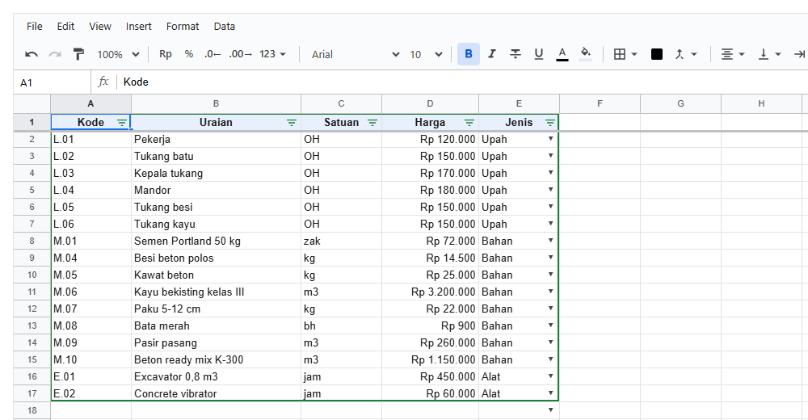

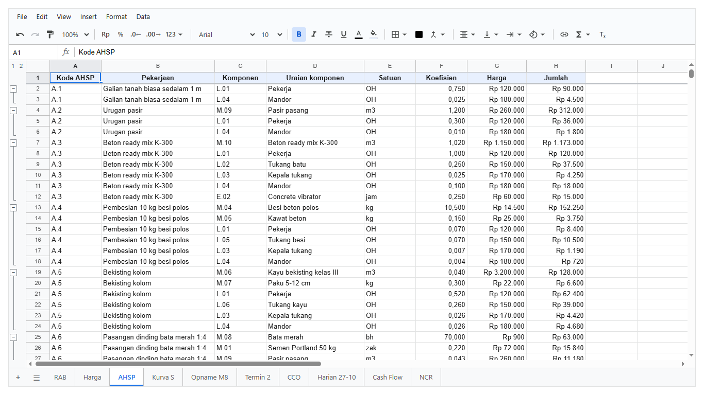

**Harga** berisi daftar harga dasar bahan, upah, dan alat. Kolom Jenis memakai dropdown dan filter. Seluruh tabelnya diberi nama `DaftarHarga`.

**AHSP** berisi satu baris per komponen pekerjaan: kode komponen dan koefisien diketik, sedangkan uraian, satuan, dan harganya diambil dari Harga
dengan `XLOOKUP`. Komponen tiap pekerjaan dikelompokkan supaya bisa dilipat (tombol [−] di kiri). Kode komponen yang salah ketik tampil `?` dengan
latar merah (conditional formatting).

Fitur yang dipakai: `XLOOKUP` ke sheet lain, kolom utuh (`Harga!A:A`), format uang di kolom, grup baris, validasi dropdown, filter, named range,
conditional formatting.

<!-- contoh: proyek/harga-ahsp.js -->
```js
// Daftar Harga dan AHSP (Analisa Harga Satuan Pekerjaan).
// Harga: satu baris per bahan, upah, alat. AHSP: satu baris per komponen sebuah pekerjaan, harganya diambil dari Harga lewat XLOOKUP,
// jadi kalau harga semen naik, semua analisa, RAB, kurva S dan termin ikut berubah.

export const HARGA = [
    ['Kode', 'Uraian', 'Satuan', 'Harga', 'Jenis'],
    ['L.01', 'Pekerja', 'OH', 120000, 'Upah'],
    ['L.02', 'Tukang batu', 'OH', 150000, 'Upah'],
    ['L.03', 'Kepala tukang', 'OH', 170000, 'Upah'],
    ['L.04', 'Mandor', 'OH', 180000, 'Upah'],
    ['L.05', 'Tukang besi', 'OH', 150000, 'Upah'],
    ['L.06', 'Tukang kayu', 'OH', 150000, 'Upah'],
    ['M.01', 'Semen Portland 50 kg', 'zak', 72000, 'Bahan'],
    ['M.04', 'Besi beton polos', 'kg', 14500, 'Bahan'],
    ['M.05', 'Kawat beton', 'kg', 25000, 'Bahan'],
    ['M.06', 'Kayu bekisting kelas III', 'm3', 3200000, 'Bahan'],
    ['M.07', 'Paku 5-12 cm', 'kg', 22000, 'Bahan'],
    ['M.08', 'Bata merah', 'bh', 900, 'Bahan'],
    ['M.09', 'Pasir pasang', 'm3', 260000, 'Bahan'],
    ['M.10', 'Beton ready mix K-300', 'm3', 1150000, 'Bahan'],
    ['E.01', 'Excavator 0,8 m3', 'jam', 450000, 'Alat'],
    ['E.02', 'Concrete vibrator', 'jam', 60000, 'Alat']
];

// [kode AHSP, uraian pekerjaan, satuan, [[komponen, koefisien], ...]]
export const ANALISA = [
    ['A.1', 'Galian tanah biasa sedalam 1 m', 'm3', [['L.01', 0.75], ['L.04', 0.025]]],
    ['A.2', 'Urugan pasir', 'm3', [['M.09', 1.2], ['L.01', 0.3], ['L.04', 0.01]]],
    ['A.3', 'Beton ready mix K-300', 'm3', [['M.10', 1.02], ['L.01', 1], ['L.02', 0.25], ['L.03', 0.025], ['L.04', 0.1], ['E.02', 0.25]]],
    ['A.4', 'Pembesian 10 kg besi polos', '10 kg', [['M.04', 10.5], ['M.05', 0.15], ['L.01', 0.07], ['L.05', 0.07], ['L.03', 0.007], ['L.04', 0.004]]],
    ['A.5', 'Bekisting kolom', 'm2', [['M.06', 0.04], ['M.07', 0.3], ['L.01', 0.52], ['L.06', 0.26], ['L.03', 0.026], ['L.04', 0.026]]],
    ['A.6', 'Pasangan dinding bata merah 1:4', 'm2', [['M.08', 70], ['M.01', 0.22], ['M.09', 0.043], ['L.01', 0.3], ['L.02', 0.1], ['L.03', 0.01], ['L.04', 0.015]]],
    ['A.7', 'Galian tanah dengan excavator', 'm3', [['E.01', 0.05], ['L.01', 0.05]]]
];

/** Sheet "Harga": daftar harga dasar. */
export function buatHarga(wb) {
    const sh = wb.sheet(wb.addSheet('Harga'));
    sh.setValues('A1', HARGA);
    sh.setStyle('A1:E1', { bold: true, fill: '#e8f0fe', align: 'center' });
    sh.setColProps('B', { width: 210 });
    sh.setColProps('D', { width: 120, format: { type: 'money', decimals: 0 } });
    sh.setSheetProps({ freezeRows: 1 });
    // jenis hanya boleh tiga ini, dan bisa disaring
    sh.addValidation('E2:E200', { kind: 'list', values: ['Upah', 'Bahan', 'Alat'] });
    sh.createFilter('A1:E' + HARGA.length);
    wb.addName('DaftarHarga', 'Harga', 'A1:E' + HARGA.length);
    return sh;
}

/** Sheet "AHSP": komponen tiap pekerjaan; uraian, satuan dan harga diambil dari Harga. */
export function buatAhsp(wb) {
    const sh = wb.sheet(wb.addSheet('AHSP'));
    const rows = [['Kode AHSP', 'Pekerjaan', 'Komponen', 'Uraian komponen', 'Satuan', 'Koefisien', 'Harga', 'Jumlah']];
    for (const [kode, uraian, , komponen] of ANALISA) {
        komponen.forEach(([k, koef]) => {
            const r = rows.length + 1;
            rows.push([kode, uraian, k,
                `=XLOOKUP(C${r}, Harga!A:A, Harga!B:B, "?")`,
                `=XLOOKUP(C${r}, Harga!A:A, Harga!C:C, "")`,
                koef,
                `=XLOOKUP(C${r}, Harga!A:A, Harga!D:D, 0)`,
                `=F${r}*G${r}`]);
        });
    }
    sh.setValues('A1', rows);
    sh.setStyle('A1:H1', { bold: true, fill: '#e8f0fe', align: 'center' });
    sh.setColProps('B', { width: 220 });
    sh.setColProps('D', { width: 190 });
    sh.setColProps('G:H', { width: 115, format: { type: 'money', decimals: 0 } });
    sh.setColProps('F', { format: { type: 'number', decimals: 3 } });
    sh.setSheetProps({ freezeRows: 1 });
    // satu grup per pekerjaan, supaya analisa yang panjang bisa dilipat
    let start = 2;
    for (const [, , , komponen] of ANALISA) { sh.groupRows(`${start + 1}:${start + komponen.length - 1}`); start += komponen.length; }
    // komponen yang kodenya tidak ada di daftar harga langsung kelihatan
    sh.addConditional('D2:D500', { op: 'textIs', a: '?', style: { fill: '#f4c7c3', color: '#a50e0e', bold: true } });
    return sh;
}
```
<!-- /contoh -->

## RAB

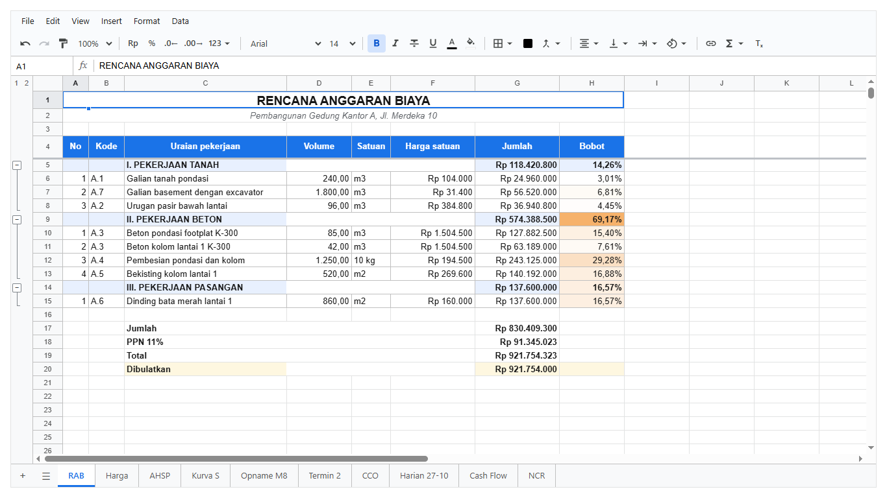

Harga satuan tiap pekerjaan = jumlah komponen AHSP-nya (`SUMIFS`) + 10% overhead, dibulatkan ke ratusan. Tiap bab punya subtotal `SUBTOTAL(9, ...)`,
jadi baris Jumlah di bawah tidak menghitung bab dua kali. Ada PPN, total, dan pembulatan ke ribuan. Bobot tiap pekerjaan dihitung terhadap named
range `TotalRAB`, dan diwarnai dengan skala warna (makin besar makin oranye).

Fitur yang dipakai: `SUMIFS` ke sheet lain, `ROUND`/`ROUNDDOWN` dengan digit negatif, `SUBTOTAL`, named range, merge untuk judul, grup per bab,
freeze 4 baris, border, wrap di header, validasi angka dengan teks bantuan, skala warna.

<!-- contoh: proyek/rab.js -->
```js
// RAB (Rencana Anggaran Biaya). Harga satuan tiap pekerjaan dihitung dari AHSP (jumlah komponennya + 10% overhead dan keuntungan, dibulatkan ke
// ratusan), jumlah per baris = volume x harga satuan, subtotal per bab dengan SUBTOTAL (jadi rekap tidak menghitung bab dua kali), PPN 11%, total
// dibulatkan ke ribuan, dan bobot tiap pekerjaan terhadap total untuk kurva S.

import { ANALISA } from './harga-ahsp.js';

// [bab, [[kode AHSP, uraian di RAB, volume], ...]]
export const PEKERJAAN = [
    ['I. PEKERJAAN TANAH', [['A.1', 'Galian tanah pondasi', 240], ['A.7', 'Galian basement dengan excavator', 1800], ['A.2', 'Urugan pasir bawah lantai', 96]]],
    ['II. PEKERJAAN BETON', [['A.3', 'Beton pondasi footplat K-300', 85], ['A.3', 'Beton kolom lantai 1 K-300', 42], ['A.4', 'Pembesian pondasi dan kolom', 1250], ['A.5', 'Bekisting kolom lantai 1', 520]]],
    ['III. PEKERJAAN PASANGAN', [['A.6', 'Dinding bata merah lantai 1', 860]]]
];

/**
 * Sheet "RAB". Mengembalikan baris tiap pekerjaan (nomor baris layar), supaya sheet lain bisa merujuknya.
 * @returns {{ sh: any, items: { row: number, uraian: string }[], totalRow: number }}
 */
export function buatRab(wb) {
    const sh = wb.sheet(wb.addSheet('RAB'));
    sh.setValues('A1', [['RENCANA ANGGARAN BIAYA'], ['Pembangunan Gedung Kantor A, Jl. Merdeka 10']]);
    sh.mergeCells('A1:H1');
    sh.mergeCells('A2:H2');
    sh.setStyle('A1', { bold: true, fontSize: 14, align: 'center' });
    sh.setStyle('A2', { italic: true, align: 'center', color: '#5f6368' });
    sh.setValues('A4', [['No', 'Kode', 'Uraian pekerjaan', 'Volume', 'Satuan', 'Harga satuan', 'Jumlah', 'Bobot']]);

    let r = 5;
    const items = [], babRows = [];
    for (const [bab, list] of PEKERJAAN) {
        const babRow = r;
        babRows.push(babRow);
        const first = r + 1, last = r + list.length;
        sh.setValues(`A${r}`, [['', '', bab, '', '', '', `=SUBTOTAL(9, G${first}:G${last})`, `=G${r}/TotalRAB`]]);
        r++;
        list.forEach(([kode, uraian, volume], i) => {
            sh.setValues(`A${r}`, [[i + 1, kode, uraian, volume,
                ANALISA.find((a) => a[0] === kode)[2],
                `=ROUND(SUMIFS(AHSP!H:H, AHSP!A:A, B${r}) * 1.1, -2)`,
                `=D${r}*F${r}`,
                `=G${r}/TotalRAB`]]);
            items.push({ row: r, uraian });
            r++;
        });
        // pekerjaan satu bab dikelompokkan di bawah judulnya
        sh.groupRows(`${first}:${last}`);
    }
    const jumlahRow = r + 1;
    sh.setValues(`C${jumlahRow}`, [
        ['Jumlah', '', '', '', `=SUBTOTAL(9, G5:G${r - 1})`],
        ['PPN 11%', '', '', '', `=ROUND(G${jumlahRow}*11%, 0)`],
        ['Total', '', '', '', `=G${jumlahRow}+G${jumlahRow + 1}`],
        ['Dibulatkan', '', '', '', `=ROUNDDOWN(G${jumlahRow + 2}, -3)`]
    ]);
    wb.addName('TotalRAB', 'RAB', `G${jumlahRow}`);

    // tampilan
    sh.setStyle('A4:H4', { bold: true, fill: '#1a73e8', color: '#ffffff', align: 'center', valign: 'middle', wrap: 'wrap' });
    for (const b of babRows) sh.setStyle(`A${b}:H${b}`, { bold: true, fill: '#e8f0fe' });
    sh.setStyle(`C${jumlahRow}:H${jumlahRow + 3}`, { bold: true });
    sh.setStyle(`C${jumlahRow + 3}:H${jumlahRow + 3}`, { fill: '#fef7e0' });
    sh.setStyle(`F5:G${jumlahRow + 3}`, { format: { type: 'money', decimals: 0 } });
    sh.setStyle(`H5:H${r}`, { format: { type: 'percent', decimals: 2 } });
    sh.setStyle(`D5:D${r}`, { format: { type: 'number', decimals: 2 } });
    sh.setStyle(`A4:H${r - 1}`, { borders: { top: LINE, right: LINE, bottom: LINE, left: LINE } });
    sh.setRowProps('4', { height: 34 });
    sh.setColProps('A', { width: 40 });
    sh.setColProps('B', { width: 55 });
    sh.setColProps('C', { width: 250 });
    sh.setColProps('E', { width: 60 });
    sh.setColProps('F:G', { width: 130 });
    sh.setSheetProps({ freezeRows: 4 });

    // volume harus angka >= 0; jumlah yang besar ditandai
    sh.addValidation(`D5:D${r}`, { kind: 'number', op: 'gte', a: 0, help: 'Volume dari gambar kerja' });
    sh.addConditional(`H6:H${r}`, { kind: 'scale', min: { type: 'min', color: '#ffffff' }, max: { type: 'max', color: '#f6b26b' } });
    return { sh, items, totalRow: jumlahRow, lastItemRow: r - 1 };
}

const LINE = { style: 'solid', width: 1, color: '#c0c0c0' };
```
<!-- /contoh -->

## Kurva S

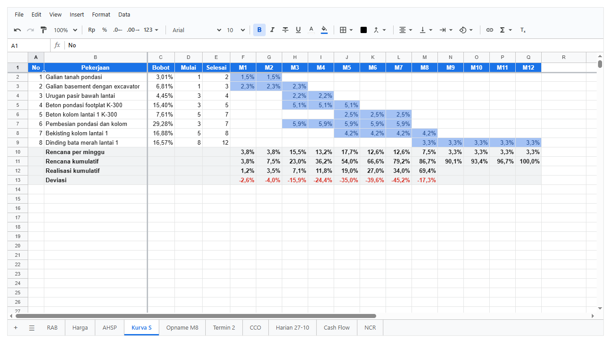

Tiap pekerjaan dari RAB punya bobot, minggu mulai, dan minggu selesai. Bobotnya dibagi rata ke minggu-minggu pelaksanaannya. **Batang gantt-nya bukan
diwarnai manual**: conditional formatting dengan rumus `=AND(F$1>=$D2, F$1<=$E2)` mewarnai sel yang ada di dalam jadwal. Kalau minggu mulai atau
selesai diubah, batangnya ikut bergeser. Di bawahnya ada rencana per minggu, rencana kumulatif, realisasi kumulatif (minggu ke-8 diambil dari sheet
Opname lewat named range `ProgresOpname`), dan deviasi yang merah kalau terlambat.

Fitur yang dipakai: rumus dengan `$` campuran untuk diisi ke banyak sel, conditional formatting berbasis rumus, named range antar sheet, freeze baris
dan kolom, format persen, format angka dengan prefix (`M1`, `M2`, ...), validasi angka antara 1 dan 12.

<!-- contoh: proyek/kurva-s.js -->
```js
// Kurva S (time schedule). Tiap pekerjaan dari RAB: bobotnya, minggu mulai dan selesai. Bobot dibagi rata ke minggu-minggu pelaksanaannya; batang
// gantt digambar oleh conditional formatting (rumus), bukan diwarnai tangan, jadi kalau jadwal digeser batangnya ikut. Di bawahnya: rencana per
// minggu, rencana kumulatif, realisasi kumulatif (minggu terakhir dari sheet Opname), dan deviasi.

export const JADWAL = [[1, 2], [1, 3], [3, 4], [3, 5], [5, 7], [3, 7], [5, 8], [8, 12]];
export const MINGGU = 12;
// realisasi kumulatif minggu 1-7 (dari laporan-laporan sebelumnya); minggu 8 dari sheet Opname
export const REALISASI_LALU = [0.012, 0.035, 0.071, 0.118, 0.19, 0.27, 0.34];

const col = (i) => String.fromCharCode(70 + i); // F, G, H, ... untuk minggu 1, 2, 3, ...

/** Sheet "Kurva S". `items` adalah pekerjaan RAB ({ row }). */
export function buatKurvaS(wb, items) {
    const sh = wb.sheet(wb.addSheet('Kurva S'));
    const last = col(MINGGU - 1);
    const head = ['No', 'Pekerjaan', 'Bobot', 'Mulai', 'Selesai'];
    for (let m = 1; m <= MINGGU; m++) head.push(m);
    sh.setValues('A1', [head]);
    const rows = items.map((it, i) => {
        const r = i + 2;
        const row = [i + 1, `=RAB!C${it.row}`, `=RAB!H${it.row}`, JADWAL[i][0], JADWAL[i][1]];
        for (let m = 0; m < MINGGU; m++) {
            const c = col(m);
            row.push(`=IF(AND(${c}$1>=$D${r}, ${c}$1<=$E${r}), $C${r}/($E${r}-$D${r}+1), "")`);
        }
        return row;
    });
    sh.setValues('A2', rows);
    const end = items.length + 1;
    const sum = end + 1;
    const lines = [['', 'Rencana per minggu'], ['', 'Rencana kumulatif'], ['', 'Realisasi kumulatif'], ['', 'Deviasi']];
    for (let m = 0; m < MINGGU; m++) {
        const c = col(m), prev = m ? col(m - 1) : null;
        lines[0].push(`=SUM(${c}2:${c}${end})`);
        lines[1].push(prev ? `=${prev}${sum + 1}+${c}${sum}` : `=${c}${sum}`);
        lines[2].push(m < REALISASI_LALU.length ? REALISASI_LALU[m] : m === REALISASI_LALU.length ? '=ProgresOpname' : '');
        lines[3].push(`=IF(${c}${sum + 2}="", "", ${c}${sum + 2}-${c}${sum + 1})`);
    }
    for (const line of lines) line.splice(2, 0, '', '', '');
    sh.setValues(`A${sum}`, lines);
    wb.addName('KurvaS', 'Kurva S', `E1:${last}${sum + 2}`);

    // tampilan
    sh.setStyle(`A1:${last}1`, { bold: true, fill: '#1a73e8', color: '#ffffff', align: 'center' });
    sh.setStyle(`F1:${last}1`, { format: { type: 'number', decimals: 0, prefix: 'M' } });
    sh.setStyle(`C2:C${end}`, { format: { type: 'percent', decimals: 2 } });
    sh.setStyle(`F2:${last}${sum + 3}`, { format: { type: 'percent', decimals: 1 } });
    sh.setStyle(`A${sum}:${last}${sum + 3}`, { bold: true, fill: '#f1f3f4' });
    sh.setColProps('A', { width: 36 });
    sh.setColProps('B', { width: 230 });
    sh.setColProps('C:E', { width: 62 });
    sh.setColProps(`F:${last}`, { width: 58 });
    sh.setSheetProps({ freezeRows: 1, freezeCols: 2 });
    // batang gantt: sel di dalam jadwal diwarnai, dari rumus yang sama dengan isinya
    sh.addConditional(`F2:${last}${end}`, { op: 'formula', formula: '=AND(F$1>=$D2, F$1<=$E2)', style: { fill: '#a4c2f4', color: '#1c4587' } });
    // deviasi negatif (terlambat) merah, positif hijau
    sh.addConditional(`F${sum + 3}:${last}${sum + 3}`, { op: 'lt', a: 0, style: { color: '#d93025' } });
    sh.addConditional(`F${sum + 3}:${last}${sum + 3}`, { op: 'gt', a: 0, style: { color: '#188038' } });
    // jadwal: minggu 1 sampai 12, selesai tidak sebelum mulai
    sh.addValidation(`D2:E${end}`, { kind: 'number', op: 'between', a: 1, b: MINGGU, help: 'Minggu ke-1 sampai ke-' + MINGGU });
    return { sh, sumRow: sum };
}
```
<!-- /contoh -->

## Opname mingguan

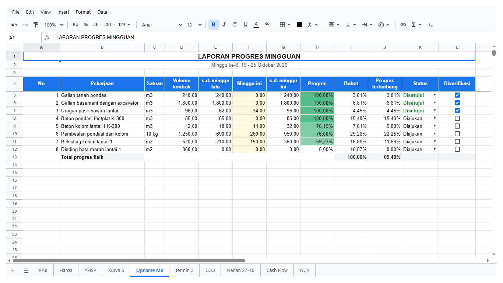

Volume kontrak, satuan, dan bobot diambil dari RAB. Site manager cuma mengisi kolom **Minggu ini** (berlatar kuning). Sisanya rumus: volume s.d.
minggu ini, persentase, dan progres tertimbang. Total progres fisik diberi nama `ProgresOpname`, dan dipakai Kurva S dan Termin. Volume yang
melebihi kontrak otomatis merah. Status pakai dropdown, kolom Diverifikasi pakai checkbox.

Fitur yang dipakai: rujukan ke RAB, `IF` untuk mencegah bagi nol, validasi dropdown dan checkbox, conditional formatting rumus (melebihi kontrak), skala
warna untuk progres, warna status. Di bab 11 (access control), sheet ini dipakai untuk contoh mandor yang cuma boleh mengisi kolom Minggu ini dan baris
yang sudah disetujui terkunci.

<!-- contoh: proyek/opname.js -->
```js
// Opname (laporan progres) minggu ke-8. Volume kontrak, satuan dan bobot diambil dari RAB; site manager mengisi volume minggu ini; sisanya rumus:
// volume s.d. minggu ini, persentase, progres tertimbang, dan total progres fisik (named range ProgresOpname, dipakai Kurva S dan Termin).
// Volume yang melebihi kontrak ditandai merah. Baris yang sudah disetujui PM dikunci lewat aturan (bab 10).

// volume s.d. minggu lalu dan minggu ini, per pekerjaan RAB
export const VOLUME = [[240, 0], [1800, 0], [62, 34], [85, 0], [18, 14], [690, 260], [210, 150], [0, 0]];

/** Sheet "Opname M8". `items` adalah pekerjaan RAB ({ row }). */
export function buatOpname(wb, items) {
    const sh = wb.sheet(wb.addSheet('Opname M8'));
    sh.setValues('A1', [['LAPORAN PROGRES MINGGUAN'], ['Minggu ke-8, 19 - 25 Oktober 2026']]);
    sh.mergeCells('A1:L1');
    sh.mergeCells('A2:L2');
    sh.setStyle('A1', { bold: true, fontSize: 13, align: 'center' });
    sh.setStyle('A2', { align: 'center', color: '#5f6368' });
    sh.setValues('A4', [['No', 'Pekerjaan', 'Satuan', 'Volume kontrak', 's.d. minggu lalu', 'Minggu ini', 's.d. minggu ini', 'Progres', 'Bobot', 'Progres tertimbang', 'Status', 'Diverifikasi']]);
    const rows = items.map((it, i) => {
        const r = i + 5;
        return [i + 1, `=RAB!C${it.row}`, `=RAB!E${it.row}`, `=RAB!D${it.row}`, VOLUME[i][0], VOLUME[i][1],
            `=E${r}+F${r}`, `=IF(D${r}=0, 0, G${r}/D${r})`, `=RAB!H${it.row}`, `=H${r}*I${r}`, i < 3 ? 'Disetujui' : 'Diajukan', i < 3];
    });
    sh.setValues('A5', rows);
    const end = items.length + 4, total = end + 1;
    sh.setValues(`B${total}`, [['Total progres fisik', '', '', '', '', '', '', `=SUM(I5:I${end})`, `=SUM(J5:J${end})`]]);
    wb.addName('ProgresOpname', 'Opname M8', `J${total}`);

    sh.setStyle('A4:L4', { bold: true, fill: '#1a73e8', color: '#ffffff', align: 'center', valign: 'middle', wrap: 'wrap' });
    sh.setStyle(`B${total}:L${total}`, { bold: true, fill: '#f1f3f4' });
    sh.setStyle(`D5:G${end}`, { format: { type: 'number', decimals: 2 } });
    sh.setStyle(`F5:F${end}`, { fill: '#fff8e1' }); // kolom yang diisi site manager
    sh.setStyle(`H5:J${total}`, { format: { type: 'percent', decimals: 2 } });
    sh.setRowProps('4', { height: 40 });
    sh.setColProps('B', { width: 230 });
    sh.setColProps('C', { width: 55 });
    sh.setColProps('D:J', { width: 92 });
    sh.setSheetProps({ freezeRows: 4 });

    sh.addValidation(`F5:F${end}`, { kind: 'number', op: 'gte', a: 0, help: 'Volume yang dikerjakan minggu ini' });
    sh.addValidation(`K5:K${end}`, { kind: 'list', values: ['Draft', 'Diajukan', 'Disetujui', 'Ditolak'] });
    sh.addValidation(`L5:L${end}`, { kind: 'checkbox' });
    // melebihi volume kontrak: merah
    sh.addConditional(`G5:G${end}`, { op: 'formula', formula: '=G5>D5', style: { fill: '#f4c7c3', color: '#a50e0e', bold: true } });
    // progres per pekerjaan sebagai skala warna
    sh.addConditional(`H5:H${end}`, { kind: 'scale', min: { type: 'number', value: 0, color: '#ffffff' }, max: { type: 'number', value: 1, color: '#57bb8a' } });
    sh.addConditional(`K5:K${end}`, { op: 'textIs', a: 'Disetujui', style: { color: '#188038', bold: true } });
    sh.addConditional(`K5:K${end}`, { op: 'textIs', a: 'Ditolak', style: { color: '#d93025', bold: true } });
    return { sh, end, totalRow: total };
}
```
<!-- /contoh -->

## Termin

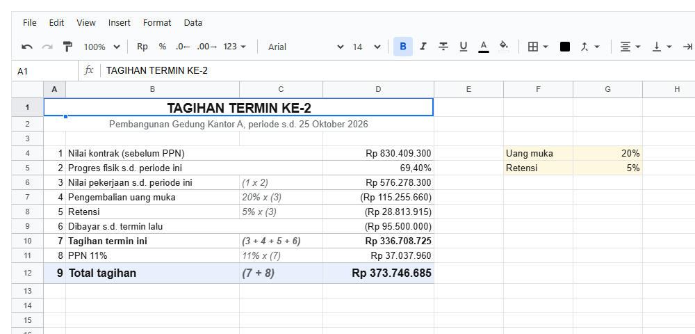

Bentuknya formulir, bukan tabel: label di kiri, nilai di kanan, dan semuanya rumus. Nilai kontrak dari RAB (`TotalRAB`), progres dari Opname
(`ProgresOpname`), potongan uang muka dan retensi dari tarif yang ditulis di sel sendiri dan diberi nama (`UangMuka`, `Retensi`), jadi tarifnya cukup
diubah di satu tempat. Angka negatif tampil dalam kurung.

Fitur yang dipakai: named range sebagai parameter, format uang dengan negatif dalam kurung, format persen di satu sel di tengah kolom uang, merge,
border bawah, ukuran huruf.

<!-- contoh: proyek/termin.js -->
```js
// Termin (tagihan) ke-2. Bentuk formulir, bukan tabel: label di kiri, nilai di kanan, semuanya rumus dari RAB (nilai kontrak) dan Opname (progres).
// Pengembalian uang muka dan retensi dipotong dari nilai pekerjaan, termin yang sudah dibayar dikurangkan, lalu PPN. Rumus di sel uang dibulatkan
// ke rupiah oleh formatnya, jadi tidak ada sen yang tercecer.

/** Sheet "Termin 2". */
export function buatTermin(wb) {
    const sh = wb.sheet(wb.addSheet('Termin 2'));
    sh.setValues('A1', [['TAGIHAN TERMIN KE-2'], ['Pembangunan Gedung Kantor A, periode s.d. 25 Oktober 2026']]);
    sh.mergeCells('A1:D1');
    sh.mergeCells('A2:D2');
    sh.setStyle('A1', { bold: true, fontSize: 14, align: 'center' });
    sh.setStyle('A2', { align: 'center', color: '#5f6368' });
    sh.setValues('A4', [
        ['1', 'Nilai kontrak (sebelum PPN)', '', '=TotalRAB'],
        ['2', 'Progres fisik s.d. periode ini', '', '=ProgresOpname'],
        ['3', 'Nilai pekerjaan s.d. periode ini', '(1 x 2)', '=D4*D5'],
        ['4', 'Pengembalian uang muka', '20% x (3)', '=-D6*UangMuka'],
        ['5', 'Retensi', '5% x (3)', '=-D6*Retensi'],
        ['6', 'Dibayar s.d. termin lalu', '', -95500000],
        ['7', 'Tagihan termin ini', '(3 + 4 + 5 + 6)', '=SUM(D6:D9)'],
        ['8', 'PPN 11%', '11% x (7)', '=D10*11%'],
        ['9', 'Total tagihan', '(7 + 8)', '=D10+D11']
    ]);
    // tarif di sel sendiri, diberi nama: diubah di satu tempat, semua rumus ikut
    sh.setValues('F4', [['Uang muka', 0.2], ['Retensi', 0.05]]);
    wb.addName('UangMuka', 'Termin 2', 'G4');
    wb.addName('Retensi', 'Termin 2', 'G5');
    sh.setStyle('F4:G5', { fill: '#fff8e1' });
    sh.setStyle('G4:G5', { format: { type: 'percent', decimals: 0 } });

    sh.setStyle('D4:D12', { format: { type: 'money', decimals: 0, negative: 'parens' } });
    sh.setStyle('D5', { format: { type: 'percent', decimals: 2 } });
    sh.setStyle('C4:C12', { italic: true, color: '#5f6368' });
    sh.setStyle('A10:D10', { bold: true });
    sh.setStyle('A12:D12', { bold: true, fill: '#e8f0fe', fontSize: 12 });
    const LINE = { style: 'solid', width: 1, color: '#c0c0c0' };
    sh.setStyle('A4:D12', { borders: { bottom: LINE } });
    sh.setColProps('A', { width: 32 });
    sh.setColProps('B', { width: 250 });
    sh.setColProps('C', { width: 120 });
    sh.setColProps('D', { width: 160 });
    sh.setRowProps('12', { height: 30 });
    sh.setStyle('A12:D12', { valign: 'middle' });
    return sh;
}
```
<!-- /contoh -->

## CCO

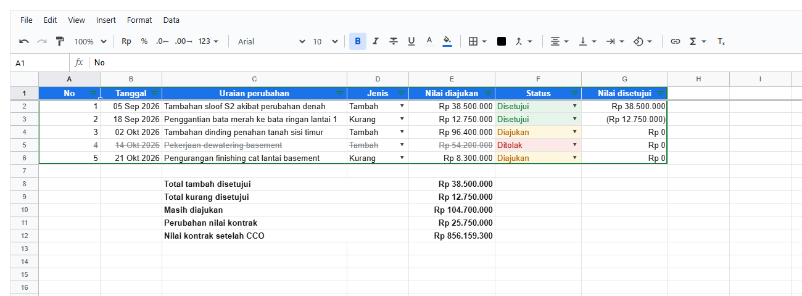

Register perubahan pekerjaan. Jenis (Tambah/Kurang) dan Status pakai dropdown. Nilai disetujui dihitung `IF`: nol kalau belum disetujui, negatif kalau
pekerjaan kurang. Rekap di bawahnya memakai `SUMIFS` dengan dua syarat. Nilai kontrak setelah CCO dijumlahkan dengan `TotalRAB`. Baris yang ditolak
dicoret otomatis, dan status diberi warna. Tabelnya punya filter.

<!-- contoh: proyek/lapangan.js -->
```js
// Sheet-sheet lapangan dan administrasi: Laporan Harian (formulir), CCO (register perubahan pekerjaan), Cash Flow, dan NCR (register temuan mutu).

const LINE = { style: 'solid', width: 1, color: '#c0c0c0' };
const kotak = { top: LINE, right: LINE, bottom: LINE, left: LINE };

/** Sheet "Harian 27-10": formulir laporan harian yang diisi mandor. */
export function buatHarian(wb) {
    const sh = wb.sheet(wb.addSheet('Harian 27-10'));
    sh.setValues('A1', [['LAPORAN HARIAN PROYEK'], ['Pembangunan Gedung Kantor A']]);
    sh.mergeCells('A1:F1');
    sh.mergeCells('A2:F2');
    sh.setStyle('A1', { bold: true, fontSize: 14, align: 'center' });
    sh.setStyle('A2', { align: 'center', color: '#5f6368' });
    sh.setValues('A4', [['Tanggal', '27/10/2026', '', 'Hari ke-', '=B4-DATE(2026, 9, 1)+1']]);
    sh.setValues('A5', [['Cuaca pagi', 'Cerah', '', 'Cuaca siang', 'Hujan ringan']]);
    sh.setStyle('B4', { format: { type: 'date', pattern: 'dddd, d MMMM yyyy' } });
    sh.addValidation('B5', { kind: 'list', values: ['Cerah', 'Berawan', 'Hujan ringan', 'Hujan lebat'] });
    sh.addValidation('E5', { kind: 'list', values: ['Cerah', 'Berawan', 'Hujan ringan', 'Hujan lebat'] });

    // tenaga kerja dan alat berdampingan
    sh.setValues('A7', [['Tenaga kerja', 'Orang', '', 'Alat', 'Jam']]);
    sh.setValues('A8', [['Mandor', 2, '', 'Excavator 0,8 m3', 6], ['Tukang besi', 8, '', 'Concrete vibrator', 4], ['Tukang kayu', 6, '', 'Concrete pump', 3], ['Tukang batu', 4], ['Pekerja', 24]]);
    sh.setValues('A13', [['Jumlah', '=SUM(B8:B12)', '', 'Jumlah jam', '=SUM(E8:E12)']]);
    // material masuk
    sh.setValues('A15', [['Material masuk', 'Volume', 'Satuan', 'Pemasok', 'Diterima']]);
    sh.setValues('A16', [['Besi beton D13', 2.4, 'ton', 'PT Baja Prima', true], ['Beton ready mix K-300', 14, 'm3', 'PT Beton Kita', true], ['Bata merah', 6000, 'bh', 'UD Sumber Tanah', false]]);
    sh.addValidation('E16:E18', { kind: 'checkbox' });
    // pekerjaan hari ini dan kendala
    sh.setValues('A20', [['Pekerjaan hari ini'], ['Pengecoran kolom K1-K14 lantai 1 (14 m3), pembesian kolom K15-K28, pemasangan bekisting balok as A-C.'], [''], ['Kendala'], ['Hujan ringan 13.00-14.30, pengecoran ditunda 1,5 jam. Bata merah 6.000 bh ditolak: ukuran tidak seragam.']]);
    sh.mergeCells('A21:F22');
    sh.mergeCells('A24:F25');
    sh.setStyle('A21:F25', { wrap: 'wrap', valign: 'top' });
    // K3
    sh.setValues('A27', [['Pemeriksaan K3', 'OK'], ['APD lengkap', true], ['Rambu terpasang', true], ['Perancah diperiksa', false]]);
    sh.addValidation('B28:B30', { kind: 'checkbox' });

    for (const r of ['A4:A5', 'D4:D5', 'A7:E7', 'A15:E15', 'A20', 'A23', 'A27:B27']) sh.setStyle(r, { bold: true });
    for (const r of ['A7:B13', 'D7:E13', 'A15:E18', 'A27:B30']) sh.setStyle(r, { borders: kotak });
    for (const r of ['A7:E7', 'A15:E15', 'A27:B27']) sh.setStyle(r, { fill: '#e8f0fe' });
    sh.setStyle('A13:E13', { bold: true });
    sh.setColProps('A', { width: 170 });
    sh.setColProps('B', { width: 130 });
    sh.setColProps('C', { width: 50 });
    sh.setColProps('D', { width: 150 });
    sh.setColProps('E', { width: 115 });
    sh.setRowProps('21:22', { height: 26 });
    sh.setRowProps('24:25', { height: 26 });
    // material yang belum diterima kelihatan
    sh.addConditional('A16:E18', { op: 'formula', formula: '=$E16=FALSE', style: { fill: '#fce8e6' } });
    return sh;
}

/** Sheet "CCO": register perubahan pekerjaan (tambah / kurang), dengan nilai yang disetujui. */
export function buatCco(wb) {
    const sh = wb.sheet(wb.addSheet('CCO'));
    sh.setValues('A1', [['No', 'Tanggal', 'Uraian perubahan', 'Jenis', 'Nilai diajukan', 'Status', 'Nilai disetujui']]);
    const data = [
        ['05/09/2026', 'Tambahan sloof S2 akibat perubahan denah', 'Tambah', 38500000, 'Disetujui'],
        ['18/09/2026', 'Penggantian bata merah ke bata ringan lantai 1', 'Kurang', 12750000, 'Disetujui'],
        ['02/10/2026', 'Tambahan dinding penahan tanah sisi timur', 'Tambah', 96400000, 'Diajukan'],
        ['14/10/2026', 'Pekerjaan dewatering basement', 'Tambah', 54200000, 'Ditolak'],
        ['21/10/2026', 'Pengurangan finishing cat lantai basement', 'Kurang', 8300000, 'Diajukan']
    ];
    sh.setValues('A2', data.map((d, i) => [i + 1, ...d, `=IF(F${i + 2}<>"Disetujui", 0, IF(D${i + 2}="Kurang", -E${i + 2}, E${i + 2}))`]));
    const end = data.length + 1;
    sh.setValues(`C${end + 2}`, [
        ['Total tambah disetujui', '', `=SUMIFS(E2:E${end}, D2:D${end}, "Tambah", F2:F${end}, "Disetujui")`],
        ['Total kurang disetujui', '', `=SUMIFS(E2:E${end}, D2:D${end}, "Kurang", F2:F${end}, "Disetujui")`],
        ['Masih diajukan', '', `=SUMIFS(E2:E${end}, F2:F${end}, "Diajukan")`],
        ['Perubahan nilai kontrak', '', `=SUM(G2:G${end})`],
        ['Nilai kontrak setelah CCO', '', '=TotalRAB+E' + (end + 5)]
    ]);
    sh.setStyle('A1:G1', { bold: true, fill: '#1a73e8', color: '#ffffff', align: 'center' });
    sh.setStyle(`B2:B${end}`, { format: { type: 'date', pattern: 'dd MMM yyyy' } });
    sh.setStyle(`E2:G${end + 6}`, { format: { type: 'money', decimals: 0, negative: 'parens' } });
    sh.setStyle(`C${end + 2}:E${end + 6}`, { bold: true });
    sh.setColProps('C', { width: 300 });
    sh.setColProps('E:G', { width: 140 });
    sh.setSheetProps({ freezeRows: 1 });
    sh.addValidation(`D2:D${end}`, { kind: 'list', values: ['Tambah', 'Kurang'] });
    sh.addValidation(`F2:F${end}`, { kind: 'list', values: ['Diajukan', 'Disetujui', 'Ditolak'] });
    sh.addConditional(`F2:F200`, { op: 'textIs', a: 'Disetujui', style: { fill: '#e6f4ea', color: '#137333' } });
    sh.addConditional(`F2:F200`, { op: 'textIs', a: 'Ditolak', style: { fill: '#fce8e6', color: '#a50e0e' } });
    sh.addConditional(`F2:F200`, { op: 'textIs', a: 'Diajukan', style: { fill: '#fef7e0', color: '#b06000' } });
    sh.addConditional(`A2:E200`, { op: 'formula', formula: '=$F2="Ditolak"', style: { strike: true, color: '#80868b' } });
    sh.createFilter(`A1:G${end}`);
    return sh;
}

/** Sheet "Cash Flow": rencana dan realisasi uang masuk dan keluar per bulan, saldo kumulatif. */
export function buatCashFlow(wb) {
    const sh = wb.sheet(wb.addSheet('Cash Flow'));
    const bulan = ['Agu 2026', 'Sep 2026', 'Okt 2026', 'Nov 2026', 'Des 2026', 'Jan 2027'];
    sh.setValues('A1', [['Uraian', ...bulan, 'Total']]);
    const rows = [
        ['Uang muka', 184350800, 0, 0, 0, 0, 0],
        ['Penerimaan termin', 0, 95500000, 0, 210000000, 260000000, 251000000],
        ['Pengeluaran material', -38000000, -152000000, -186000000, -140000000, -98000000, -45000000],
        ['Pengeluaran upah', -21000000, -48000000, -56000000, -52000000, -44000000, -30000000],
        ['Pengeluaran alat', -12000000, -26000000, -18000000, -9000000, -6000000, -3000000],
        ['Overhead lapangan', -9000000, -9000000, -9000000, -9000000, -9000000, -9000000]
    ];
    sh.setValues('A2', rows.map((row, i) => [...row, `=SUM(B${i + 2}:G${i + 2})`]));
    const n = rows.length + 1;
    const arus = ['Arus kas bersih'], saldo = ['Saldo kumulatif'];
    for (let c = 0; c < bulan.length + 1; c++) {
        const L = String.fromCharCode(66 + c);
        arus.push(`=SUM(${L}2:${L}${n})`);
        saldo.push(c === bulan.length ? '' : c ? `=${String.fromCharCode(65 + c)}${n + 2}+${L}${n + 1}` : `=${L}${n + 1}`);
    }
    sh.setValues(`A${n + 1}`, [arus, saldo]);
    sh.setStyle('A1:H1', { bold: true, fill: '#1a73e8', color: '#ffffff', align: 'center' });
    sh.setStyle(`B2:H${n + 2}`, { format: { type: 'money', decimals: 0, negative: 'parens' } });
    sh.setStyle(`A${n + 1}:H${n + 2}`, { bold: true, fill: '#f1f3f4' });
    sh.setStyle(`H1:H${n + 1}`, { bold: true });
    sh.setColProps('A', { width: 170 });
    sh.setColProps('B:H', { width: 125 });
    sh.setSheetProps({ freezeCols: 1, freezeRows: 1 });
    // saldo negatif (perlu dana talangan) merah
    sh.addConditional(`B${n + 1}:G${n + 2}`, { op: 'lt', a: 0, style: { fill: '#fce8e6', color: '#a50e0e' } });
    return sh;
}

/** Sheet "NCR": register ketidaksesuaian mutu, umur temuan yang masih terbuka, tenggat lewat ditandai. */
export function buatNcr(wb) {
    const sh = wb.sheet(wb.addSheet('NCR'));
    sh.setValues('A1', [['No', 'Tanggal', 'Lokasi', 'Temuan', 'PIC', 'Tenggat', 'Status', 'Umur (hari)']]);
    const data = [
        ['02/10/2026', 'Pondasi F12', 'Selimut beton kurang dari 5 cm', 'Andi', '09/10/2026', 'Closed'],
        ['10/10/2026', 'Kolom K7 lt.1', 'Keropos pada sambungan cor', 'Budi', '17/10/2026', 'Open'],
        ['15/10/2026', 'Gudang material', 'Besi D13 berkarat, tidak ditutup terpal', 'Sari', '18/10/2026', 'Open'],
        ['22/10/2026', 'Bekisting balok B3', 'Penyangga tidak tegak lurus', 'Budi', '30/10/2026', 'Open']
    ];
    sh.setValues('A2', data.map((d, i) => [`NCR-${String(i + 1).padStart(3, '0')}`, ...d, `=IF(G${i + 2}="Closed", "", TODAY()-B${i + 2})`]));
    const end = data.length + 1;
    sh.setValues(`D${end + 2}`, [['Masih terbuka', `=COUNTIF(G2:G${end}, "Open")`], ['Lewat tenggat', `=COUNTIFS(G2:G${end}, "Open", F2:F${end}, "<"&TODAY())`]]);
    sh.setStyle('A1:H1', { bold: true, fill: '#1a73e8', color: '#ffffff', align: 'center' });
    sh.setStyle(`B2:B${end}`, { format: { type: 'date', pattern: 'dd/MM/yyyy' } });
    sh.setStyle(`F2:F${end}`, { format: { type: 'date', pattern: 'dd/MM/yyyy' } });
    sh.setStyle(`D${end + 2}:E${end + 3}`, { bold: true });
    sh.setColProps('C', { width: 140 });
    sh.setColProps('D', { width: 280 });
    sh.setSheetProps({ freezeRows: 1 });
    sh.addValidation(`G2:G${end}`, { kind: 'list', values: ['Open', 'Closed'] });
    // tenggat sudah lewat dan masih terbuka: satu baris merah
    sh.addConditional('A2:H200', { op: 'formula', formula: '=AND($G2="Open", $F2<TODAY())', style: { fill: '#fce8e6', color: '#a50e0e' } });
    sh.addConditional('G2:G200', { op: 'textIs', a: 'Closed', style: { color: '#188038' } });
    sh.createFilter(`A1:H${end}`);
    return sh;
}
```
<!-- /contoh -->

## Laporan harian

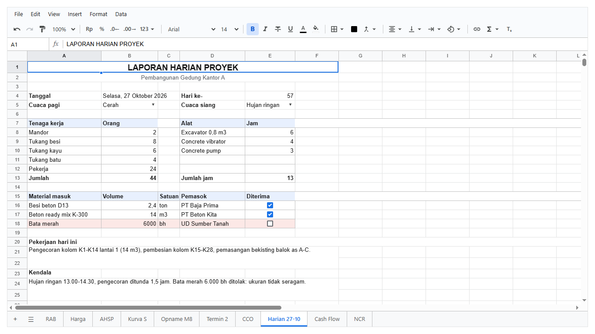

Formulir yang diisi mandor tiap hari: tanggal dengan nama hari, hari ke- (rumus dari tanggal mulai proyek), cuaca dari dropdown, tenaga kerja dan alat
berdampingan dengan jumlahnya, material masuk dengan checkbox Diterima (material yang belum diterima berlatar merah), catatan pekerjaan dan kendala di
sel yang di-merge dan wrap, dan checklist K3.

Di bab 11 sheet ini dipakai untuk contoh mandor yang membukanya tanpa menu dan toolbar, dan hanya bisa mengisi bagian yang memang untuknya.

Kodenya ada di `buatHarian` di [`proyek/lapangan.js`](examples/proyek/lapangan.js) (bagian CCO di atas).

## Cash flow

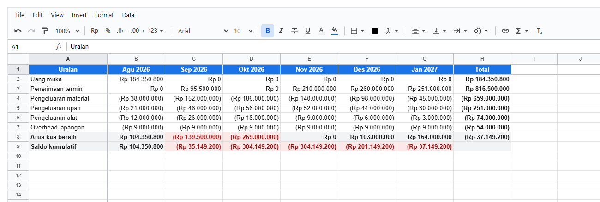

Rencana uang masuk dan keluar per bulan, arus kas bersih, dan saldo kumulatif. Saldo yang negatif (butuh dana talangan) berlatar merah. Kolom uraian
dan baris judul dibekukan. Kodenya di `buatCashFlow` di [`proyek/lapangan.js`](examples/proyek/lapangan.js).

## NCR

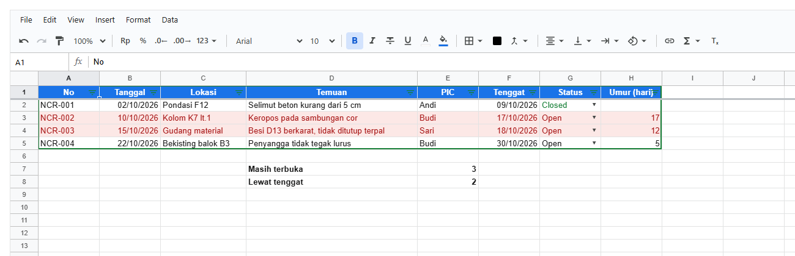

Register temuan mutu. Umur temuan dihitung `TODAY()-tanggal` selama masih Open. Temuan yang tenggatnya lewat dan masih Open satu barisnya merah.
Rekapnya pakai `COUNTIF` dan `COUNTIFS` dengan syarat tanggal (`"<"&TODAY()`). Kodenya di `buatNcr` di
[`proyek/lapangan.js`](examples/proyek/lapangan.js).

## Overview proyek dari banyak file

Di aplikasi sungguhan, tiap tim punya file opname sendiri di storage proyek. Halaman overview menampilkan tabel kurva S gabungan yang **dihitung
server tiap kali halaman dibuka** dan **tidak bisa diedit**.

Kuncinya **named range sebagai kontrak antar file**: tiap file opname wajib punya range bernama `Progres` (kolom Minggu, Tim, Rencana, Realisasi).
Server membaca lewat nama itu dengan `tableOf`, jadi tidak peduli di mana letaknya atau ada baris lain di atasnya. Lalu `pivot` menjumlahkan per minggu,
dan kumulatifnya dihitung.

<!-- contoh: galeri-overview.js -->
```js
import { createWorkbook, tableOf, pivot } from '@kufayeka/sheet/core';

// ---- storage file proyek (di aplikasi sungguhan: tabel atau file di server). Tiap tim mengisi file opname-nya sendiri tiap minggu, dan tiap file
// punya named range "Progres" berisi kolom Minggu, Tim, Rencana, Realisasi. Named range itu "kontrak" antar file: overview cuma bergantung padanya.
function fileOpname(tim, baris) {
    const wb = createWorkbook();
    wb.setValues('Sheet1', 'A1', [['Catatan internal tim ' + tim], [], ['Minggu', 'Tim', 'Rencana', 'Realisasi'], ...baris.map((b) => [b[0], tim, b[1], b[2]])]);
    wb.addName('Progres', 'Sheet1', 'A3:D' + (baris.length + 3));
    return wb.toJSON();
}
const storage = {
    'opname-sipil.sheet': fileOpname('Sipil', [[1, 0.020, 0.012], [2, 0.025, 0.023], [3, 0.090, 0.036], [4, 0.080, 0.047], [5, 0.110, 0.072], [6, 0.085, 0.080], [7, 0.085, 0.070], [8, 0.050, 0.240]]),
    'opname-mep.sheet': fileOpname('MEP', [[5, 0.005, 0.000], [6, 0.008, 0.004], [7, 0.010, 0.006], [8, 0.012, 0.004]])
};

// ---- di server, tiap kali halaman overview dibuka: baca semua file opname, jumlahkan per minggu, buat kumulatif
export function hitungOverview(files) {
    const records = Object.values(files).flatMap((doc) => tableOf(createWorkbook(doc), null, 'Progres').records);
    const perMinggu = pivot(records, {
        rows: ['Minggu'],
        values: [{ field: 'Rencana', fn: 'SUM', as: 'Rencana' }, { field: 'Realisasi', fn: 'SUM', as: 'Realisasi' }],
        totals: false
    });
    let rencana = 0, realisasi = 0;
    return perMinggu.rows.map((r) => {
        const [minggu, rc, rl] = r.cells;
        rencana += rc;
        realisasi += rl;
        return [minggu, rc, rl, Math.round(rencana * 1e4) / 1e4, Math.round(realisasi * 1e4) / 1e4];
    });
}

// dijalankan langsung (node docs/examples/galeri-overview.js): cetak tabelnya
if (typeof process !== 'undefined' && process.argv[1] && process.argv[1].endsWith('galeri-overview.js')) {
    console.log('Minggu | Rencana | Realisasi | Rencana kum. | Realisasi kum.');
    for (const row of hitungOverview(storage)) console.log(row.map((v, i) => (i ? (v * 100).toFixed(1) + '%' : String(v))).join(' | '));
}
export { storage };
```
<!-- /contoh -->

<!-- hasil: galeri-overview.js -->
```text
Minggu | Rencana | Realisasi | Rencana kum. | Realisasi kum.
1 | 2.0% | 1.2% | 2.0% | 1.2%
2 | 2.5% | 2.3% | 4.5% | 3.5%
3 | 9.0% | 3.6% | 13.5% | 7.1%
4 | 8.0% | 4.7% | 21.5% | 11.8%
5 | 11.5% | 7.2% | 33.0% | 19.0%
6 | 9.3% | 8.4% | 42.3% | 27.4%
7 | 9.5% | 7.6% | 51.8% | 35.0%
8 | 6.2% | 24.4% | 58.0% | 59.4%
```
<!-- /hasil -->

Di halaman overview, hasilnya ditampilkan di `<Sheet>` dengan aturan akses yang cuma boleh melihat: tanpa menu, toolbar, formula bar, dan tab,
hanya area tabelnya:

<!-- contoh: galeri-overview.page.js -->
```jsx
import { useState } from 'react';
import { Sheet } from '@kufayeka/sheet';
import { createWorkbook } from '@kufayeka/sheet/core';
import '@kufayeka/sheet/style.css';
import { hitungOverview, storage } from './galeri-overview.js';

// Halaman overview proyek: tabel kurva S hasil hitungan server, dihitung ulang tiap halaman dibuka, tidak bisa diedit.
function bukaOverview() {
    // di aplikasi sungguhan: const rows = await fetch('/api/proyek/1/overview/kurva-s').then((r) => r.json());
    const rows = hitungOverview(storage);
    const wb = createWorkbook();
    wb.setSettings({ locale: 'id-ID' });
    const sh = wb.sheet('Sheet1');
    sh.setSheetProps({ name: 'Kurva S' });
    sh.setValues('A1', [['Minggu', 'Rencana', 'Realisasi', 'Rencana kumulatif', 'Realisasi kumulatif', 'Deviasi'],
        ...rows.map((r, i) => [...r, `=E${i + 2}-D${i + 2}`])]);
    const end = rows.length + 1;
    sh.setStyle('A1:F1', { bold: true, fill: '#1a73e8', color: '#ffffff', align: 'center', wrap: 'wrap' });
    sh.setStyle(`A2:A${end}`, { align: 'center', format: { type: 'number', decimals: 0, prefix: 'M' } });
    sh.setStyle(`B2:F${end}`, { format: { type: 'percent', decimals: 1 } });
    sh.setColProps('B:F', { width: 120 });
    sh.setRowProps('1', { height: 36 });
    sh.addConditional(`F2:F${end}`, { op: 'lt', a: 0, style: { color: '#d93025', bold: true } });
    sh.addConditional(`F2:F${end}`, { op: 'gte', a: 0, style: { color: '#188038', bold: true } });
    sh.addConditional(`E2:E${end}`, { kind: 'scale', min: { type: 'number', value: 0, color: '#ffffff' }, max: { type: 'number', value: 1, color: '#57bb8a' } });
    return wb;
}

// siapa pun yang membuka overview cuma melihat: tanpa menu, toolbar, formula bar, tab; hanya area tabelnya
const HANYA_LIHAT = [
    { who: '*', effect: 'allow', action: 'read', where: 'A1:F9' },
    { who: '*', effect: 'allow', action: 'copy' },
    { who: '*', effect: 'allow', action: 'download' },
    { who: '*', effect: 'allow', action: 'view.area', where: 'A1:F9' },
    { who: '*', effect: 'deny', action: 'ui.menubar' },
    { who: '*', effect: 'deny', action: 'ui.toolbar' },
    { who: '*', effect: 'deny', action: 'ui.formulaBar' },
    { who: '*', effect: 'deny', action: 'ui.tabs' }
];

export default function HalamanOverview() {
    const [wb] = useState(bukaOverview);
    return (
        <div style={{ height: 300 }}>
            <Sheet workbook={wb} access={{ rows: HANYA_LIHAT, who: 'owner' }} />
        </div>
    );
}
```
<!-- /contoh -->

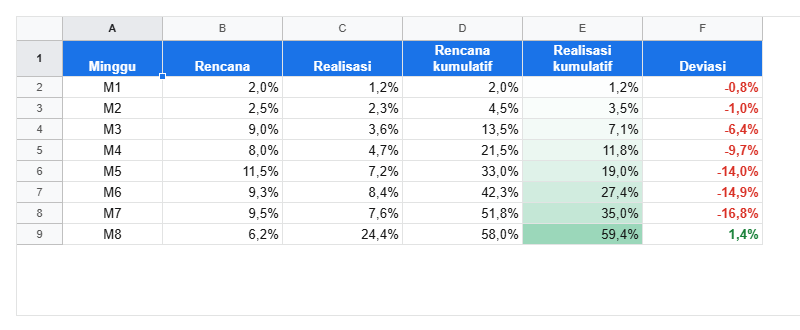

Kenapa dihitung di server, bukan dengan rumus antar file di browser:

- **Hak akses**: owner melihat ringkasan tanpa perlu akses ke file opname tiap tim.
- **Selalu terbaru**: tidak ada nilai lama yang tersimpan; tiap buka dihitung lagi dari file terakhir.
- **Tahan perubahan**: tim boleh menambah baris dan catatan di filenya, selama range `Progres` tetap ada.

Untuk overview lintas banyak proyek (ratusan file), angka-angka seperti progres per minggu sebaiknya diekstrak ke tabel database waktu file disimpan,
lalu overview di-query dari database (bab 10).

## Merangkai semuanya

Fungsi yang membuat seluruh workbook, dan halaman yang menampilkannya:

<!-- contoh: proyek/index.js -->
```js
// Satu workbook proyek yang saling terhubung, dipakai contoh-contoh di dokumentasi:
//
//   Harga ──► AHSP ──► RAB ──► Kurva S ◄── Opname M8 ──► Termin 2
//                       │                                   ▲
//                       └──────────────► CCO ───────────────┘ (nilai kontrak)
//   Harian 27-10, Cash Flow, NCR
//
// Ubah satu harga di sheet Harga: analisa, RAB, bobot, kurva S, termin dan CCO ikut berubah.
import { createWorkbook } from '@kufayeka/sheet/core';
import { buatHarga, buatAhsp } from './harga-ahsp.js';
import { buatRab } from './rab.js';
import { buatKurvaS } from './kurva-s.js';
import { buatOpname } from './opname.js';
import { buatTermin } from './termin.js';
import { buatHarian, buatCco, buatCashFlow, buatNcr } from './lapangan.js';

/**
 * Workbook "Proyek Gedung A".
 * @param {object} [options]  Diteruskan ke createWorkbook (user, beforeOp, now ...).
 */
export function buatProyek(options) {
    // jam dipatok supaya TODAY() (umur NCR, hari ke-) selalu sama di contoh dan gambarnya
    const wb = createWorkbook(null, { now: () => new Date(2026, 9, 27, 9, 0), ...options });
    wb.setSettings({ locale: 'id-ID', currency: 'IDR' });
    buatHarga(wb);
    buatAhsp(wb);
    const rab = buatRab(wb);
    buatKurvaS(wb, rab.items);
    buatOpname(wb, rab.items);
    buatTermin(wb);
    buatCco(wb);
    buatHarian(wb);
    buatCashFlow(wb);
    buatNcr(wb);
    // sheet kosong bawaan createWorkbook tidak dipakai; RAB di depan
    wb.removeSheet('Sheet1');
    wb.moveSheet('RAB', 0);
    wb.saved(wb.pendingPatch());
    return wb;
}
```
<!-- /contoh -->

<!-- contoh: proyek.page.js -->
```jsx
import { useRef, useState } from 'react';
import { Sheet } from '@kufayeka/sheet';
import '@kufayeka/sheet/style.css';
import { buatProyek } from './proyek/index.js';

// Workbook proyek di layar: sepuluh sheet yang saling terhubung, bisa diedit langsung di layar.
export default function HalamanProyek() {
    const [wb] = useState(() => buatProyek());
    return (
        <div style={{ height: '100%' }}>
            <Sheet workbook={wb} fileName="Proyek Gedung A" />
        </div>
    );
}
```
<!-- /contoh -->

[Daftar isi](../README.md#daftar-isi)
