# Galeri Studi Kasus: Enterprise Construction Management Suite

[Daftar Isi](../README.md#daftar-isi)

Halaman ini mendemonstrasikan implementasi menyeluruh `@kufayeka/sheet` dalam arsitektur sistem informasi manajemen konstruksi profesional (*Enterprise Construction Project Management*). Seluruh sistem dimodelkan dalam satu workbook yang menghubungkan **10 lembar kerja operasional**, mencakup siklus perencanaan biaya, penjadwalan waktu, pengendalian mutu lapangan, hingga penagihan termin dan arus kas proyek.

Seluruh data, formula reaktif, aturan validasi, dan dashboard visual di halaman ini dibangun menggunakan kode JavaScript/TypeScript murni yang bersumber langsung dari [`docs/examples/proyek/`](examples/proyek/).

```
[Harga Dasar] ──► [AHSP] ──► [RAB Proyek] ──► [Kurva S] ◄── [Opname M8] ──► [Termin 2]
                                │                                              ▲
                                └────────► [CCO / VO] ─────────────────────────┘ (Nilai Kontrak Baru)
[Laporan Harian], [Cash Flow], [Register NCR Mutu]
```

---

## Daftar Bagian
- [1. Propagasi Reaktif: Rekalkulasi Otomatis Lintas Sheet](#1-propagasi-reaktif-rekalkulasi-otomatis-lintas-sheet)
- [2. Katalog Harga Dasar & Analisa Harga Satuan Pekerjaan (AHSP)](#2-katalog-harga-dasar--analisa-harga-satuan-pekerjaan-ahsp)
- [3. Rencana Anggaran Biaya (RAB)](#3-rencana-anggaran-biaya-rab)
- [4. Jadwal Pelaksanaan & Kurva S (Time Schedule)](#4-jadwal-pelaksanaan--kurva-s-time-schedule)
- [5. Executive Dashboard Visual Proyek](#5-executive-dashboard-visual-proyek)
- [6. Opname Kemajuan Fisik Mingguan](#6-opname-kemajuan-fisik-mingguan)
- [7. Tagihan Termin & Sertifikat Pembayaran](#7-tagihan-termin--sertifikat-pembayaran)
- [8. Contract Change Order (CCO / Variation Order)](#8-contract-change-order-cco--variation-order)
- [9. Laporan Harian Operasional & Inspeksi K3](#9-laporan-harian-operasional--inspeksi-k3)
- [10. Proyeksi Arus Kas (Cash Flow) Proyek](#10-proyeksi-arus-kas-cash-flow-proyek)
- [11. Manajemen Ketidaksesuaian Mutu (Register NCR)](#11-manajemen-ketidaksesuaian-mutu-register-ncr)
- [12. Arsitektur Agregasi Server-Side Multi-File (Executive Overview)](#12-arsitektur-agregasi-server-side-multi-file-executive-overview)
- [13. Integrasi Penuh & Kode Sumber Modul](#13-integrasi-penuh--kode-sumber-modul)

---

## 1. Propagasi Reaktif: Rekalkulasi Otomatis Lintas Sheet

Kekuatan utama engine DAG `@kufayeka/sheet` adalah kemampuannya melakukan reevaluasi formula secara instan lintas lembar kerja tanpa memicu komputasi redundan. 

Pada skenario simulasi di bawah ini, harga material beton ready mix dinaikkan sebesar Rp 100.000/m³ pada sheet **Harga**. Perubahan ini secara otomatis merambat ke:
- Harga satuan beton pada sheet **AHSP**
- Harga satuan pekerjaan dan total anggaran beton pada sheet **RAB**
- Distribusi bobot pekerjaan pada sheet **Kurva S**
- Nilai tagihan progres pada sheet **Termin 2**
- Perhitungan penyesuaian nilai kontrak pada sheet **CCO**

Semua komputasi tersebut selesai dalam waktu **kurang dari 50 milidetik**, dan seluruh status dapat dibatalkan secara bersih dengan satu perintah `undo()`:

<!-- contoh: galeri-ubah-harga.js -->
```js
import { buatProyek } from './proyek/index.js';

// Satu angka diubah di sheet Harga; semua yang bergantung padanya, di sheet mana pun, ikut berubah.
const wb = buatProyek();
const d = (sheet, at) => wb.display(sheet, at).text;
const lihat = (keterangan) => console.log(keterangan.padEnd(22), '| HSP beton', d('RAB', 'F10').padEnd(13), '| RAB', d('RAB', 'G17').padEnd(16),
    '| bobot bab beton', d('RAB', 'H9').padEnd(7), '| tagihan termin', d('Termin 2', 'D12').padEnd(16), '| kontrak + CCO', d('CCO', 'E12'));

lihat('awal');
const t0 = performance.now();
wb.setValues('Harga', 'D15', 1250000); // beton ready mix K-300 naik dari 1.150.000 ke 1.250.000 per m3
const ms = performance.now() - t0;
lihat('ready mix naik 100rb');
wb.undo();
lihat('undo');
console.log('hitung ulang semua sheet:', ms < 50 ? 'kurang dari 50 ms' : 'lebih dari 50 ms');
```
<!-- /contoh -->

<!-- hasil: galeri-ubah-harga.js -->
```text
awal                   | HSP beton Rp 1.504.500  | RAB Rp 830.409.300   | bobot bab beton 69,17%  | tagihan termin Rp 373.746.685   | kontrak + CCO Rp 856.159.300
ready mix naik 100rb   | HSP beton Rp 1.616.700  | RAB Rp 844.658.700   | bobot bab beton 69,69%  | tagihan termin Rp 384.675.245   | kontrak + CCO Rp 870.408.700
undo                   | HSP beton Rp 1.504.500  | RAB Rp 830.409.300   | bobot bab beton 69,17%  | tagihan termin Rp 373.746.685   | kontrak + CCO Rp 856.159.300
hitung ulang semua sheet: kurang dari 50 ms
```
<!-- /hasil -->

---

## 2. Katalog Harga Dasar & Analisa Harga Satuan Pekerjaan (AHSP)

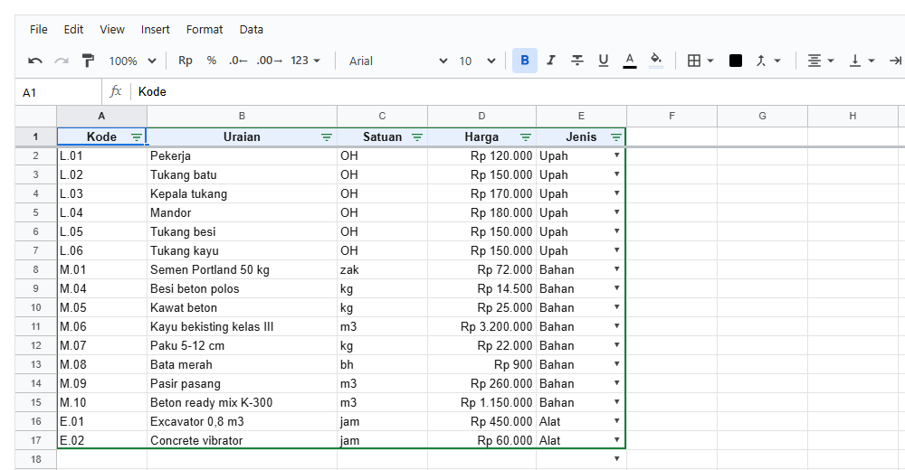

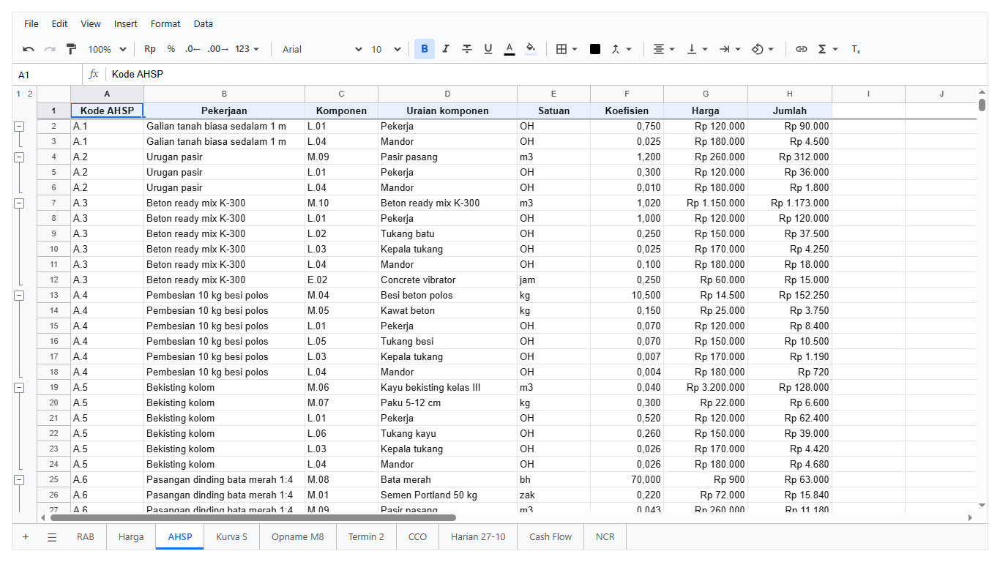

Modul estimasi biaya memisahkan daftar harga dasar komponen dengan struktur koefisien pekerjaan:
- **Sheet Harga**: Berisi katalog master harga dasar material, upah tenaga kerja, dan sewa alat berat. Kolom `Jenis` dibatasi menggunakan validasi dropdown (`Upah`, `Bahan`, `Alat`) dengan filter aktif. Seluruh rentang tabel didaftarkan ke global named range `DaftarHarga`.
- **Sheet AHSP**: Menyusun rincian komponen penyusun untuk setiap kode analisa pekerjaan standar PUPR/SNI. Koefisien tenaga dan material diinput secara langsung, sedangkan uraian, satuan, dan harga satuan diambil secara dinamis dari sheet `Harga` menggunakan formula `XLOOKUP`.

Fitur teknis yang diterapkan:
- Formula dinamis `XLOOKUP` lintas sheet dengan referensi kolom penuh (`Harga!A:A`).
- Outline row grouping hierarkis untuk melipat rincian komponen setiap pekerjaan.
- Conditional formatting untuk mendeteksi kode material yang tidak valid (menampilkan tanda tanya berlatar merah).

<!-- contoh: proyek/harga-ahsp.js -->
```js
// Daftar Harga dan AHSP (Analisa Harga Satuan Pekerjaan).
// Harga: satu baris per bahan, upah, alat. AHSP: satu baris per komponen sebuah pekerjaan, harganya diambil dari Harga lewat XLOOKUP,
// jadi kalau harga semen naik, semua analisa, RAB, kurva S dan termin ikut berubah.

export const HARGA = [
    ['Kode', 'Uraian', 'Satuan', 'Harga', 'Jenis'],
    ['L.01', 'Pekerja', 'OH', 120000, 'Upah'],
    ['L.02', 'Tukang batu', 'OH', 150000, 'Upah'],
    ['L.03', 'Kepala tukang', 'OH', 170000, 'Upah'],
    ['L.04', 'Mandor', 'OH', 180000, 'Upah'],
    ['L.05', 'Tukang besi', 'OH', 150000, 'Upah'],
    ['L.06', 'Tukang kayu', 'OH', 150000, 'Upah'],
    ['M.01', 'Semen Portland 50 kg', 'zak', 72000, 'Bahan'],
    ['M.04', 'Besi beton polos', 'kg', 14500, 'Bahan'],
    ['M.05', 'Kawat beton', 'kg', 25000, 'Bahan'],
    ['M.06', 'Kayu bekisting kelas III', 'm3', 3200000, 'Bahan'],
    ['M.07', 'Paku 5-12 cm', 'kg', 22000, 'Bahan'],
    ['M.08', 'Bata merah', 'bh', 900, 'Bahan'],
    ['M.09', 'Pasir pasang', 'm3', 260000, 'Bahan'],
    ['M.10', 'Beton ready mix K-300', 'm3', 1150000, 'Bahan'],
    ['E.01', 'Excavator 0,8 m3', 'jam', 450000, 'Alat'],
    ['E.02', 'Concrete vibrator', 'jam', 60000, 'Alat']
];

// [kode AHSP, uraian pekerjaan, satuan, [[komponen, koefisien], ...]]
export const ANALISA = [
    ['A.1', 'Galian tanah biasa sedalam 1 m', 'm3', [['L.01', 0.75], ['L.04', 0.025]]],
    ['A.2', 'Urugan pasir', 'm3', [['M.09', 1.2], ['L.01', 0.3], ['L.04', 0.01]]],
    ['A.3', 'Beton ready mix K-300', 'm3', [['M.10', 1.02], ['L.01', 1], ['L.02', 0.25], ['L.03', 0.025], ['L.04', 0.1], ['E.02', 0.25]]],
    ['A.4', 'Pembesian 10 kg besi polos', '10 kg', [['M.04', 10.5], ['M.05', 0.15], ['L.01', 0.07], ['L.05', 0.07], ['L.03', 0.007], ['L.04', 0.004]]],
    ['A.5', 'Bekisting kolom', 'm2', [['M.06', 0.04], ['M.07', 0.3], ['L.01', 0.52], ['L.06', 0.26], ['L.03', 0.026], ['L.04', 0.026]]],
    ['A.6', 'Pasangan dinding bata merah 1:4', 'm2', [['M.08', 70], ['M.01', 0.22], ['M.09', 0.043], ['L.01', 0.3], ['L.02', 0.1], ['L.03', 0.01], ['L.04', 0.015]]],
    ['A.7', 'Galian tanah dengan excavator', 'm3', [['E.01', 0.05], ['L.01', 0.05]]]
];

/** Sheet "Harga": daftar harga dasar. */
export function buatHarga(wb) {
    const sh = wb.sheet(wb.addSheet('Harga'));
    sh.setValues('A1', HARGA);
    sh.setStyle('A1:E1', { bold: true, fill: '#e8f0fe', align: 'center' });
    sh.setColProps('B', { width: 210 });
    sh.setColProps('D', { width: 120, format: { type: 'money', decimals: 0 } });
    sh.setSheetProps({ freezeRows: 1 });
    // jenis hanya boleh tiga ini, dan bisa disaring
    sh.addValidation('E2:E200', { kind: 'list', values: ['Upah', 'Bahan', 'Alat'] });
    sh.createFilter('A1:E' + HARGA.length);
    wb.addName('DaftarHarga', 'Harga', 'A1:E' + HARGA.length);
    return sh;
}

/** Sheet "AHSP": komponen tiap pekerjaan; uraian, satuan dan harga diambil dari Harga. */
export function buatAhsp(wb) {
    const sh = wb.sheet(wb.addSheet('AHSP'));
    const rows = [['Kode AHSP', 'Pekerjaan', 'Komponen', 'Uraian komponen', 'Satuan', 'Koefisien', 'Harga', 'Jumlah']];
    for (const [kode, uraian, , komponen] of ANALISA) {
        komponen.forEach(([k, koef]) => {
            const r = rows.length + 1;
            rows.push([kode, uraian, k,
                `=XLOOKUP(C${r}, Harga!A:A, Harga!B:B, "?")`,
                `=XLOOKUP(C${r}, Harga!A:A, Harga!C:C, "")`,
                koef,
                `=XLOOKUP(C${r}, Harga!A:A, Harga!D:D, 0)`,
                `=F${r}*G${r}`]);
        });
    }
    sh.setValues('A1', rows);
    sh.setStyle('A1:H1', { bold: true, fill: '#e8f0fe', align: 'center' });
    sh.setColProps('B', { width: 220 });
    sh.setColProps('D', { width: 190 });
    sh.setColProps('G:H', { width: 115, format: { type: 'money', decimals: 0 } });
    sh.setColProps('F', { format: { type: 'number', decimals: 3 } });
    sh.setSheetProps({ freezeRows: 1 });
    // satu grup per pekerjaan, supaya analisa yang panjang bisa dilipat
    let start = 2;
    for (const [, , , komponen] of ANALISA) { sh.groupRows(`${start + 1}:${start + komponen.length - 1}`); start += komponen.length; }
    // komponen yang kodenya tidak ada di daftar harga langsung kelihatan
    sh.addConditional('D2:D500', { op: 'textIs', a: '?', style: { fill: '#f4c7c3', color: '#a50e0e', bold: true } });
    return sh;
}
```
<!-- /contoh -->

---

## 3. Rencana Anggaran Biaya (RAB)

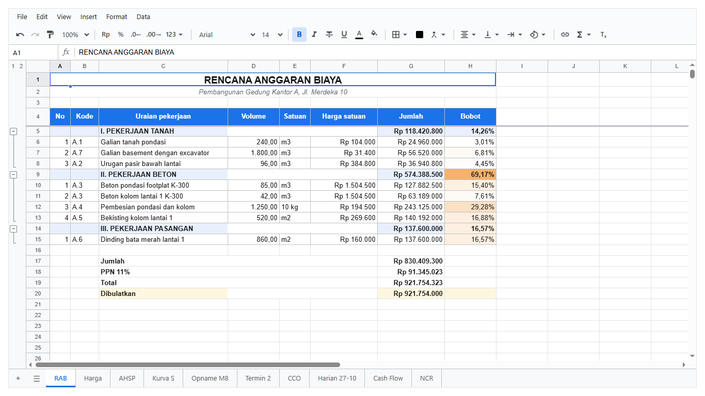

Sheet **RAB** merupakan struktur biaya utama proyek:
- Harga satuan pekerjaan dikalkulasikan secara otomatis dari total komponen AHSP menggunakan agregasi `SUMIFS`, ditambahkan margin overhead/keuntungan 10%, dan dibulatkan ke ratusan terdekat via `=ROUND(..., -2)`.
- Nilai pekerjaan per baris dikalkulasikan dari volume fisik dikalikan harga satuan.
- Subtotal per bab dikelompokkan dengan formula `=SUBTOTAL(9, ...)`, memastikan baris ringkasan grand total tidak mengalami *double-counting*.
- Perhitungan pajak pertambahan nilai (PPN 11%) dan pembulatan akhir ke ribuan terdekat via `ROUNDDOWN`.
- Bobot persentase setiap item pekerjaan dikalkulasikan terhadap named range `TotalRAB` dan divisualisasikan dengan skala warna gradasi (*color scale*).

<!-- contoh: proyek/rab.js -->
```js
// RAB (Rencana Anggaran Biaya). Harga satuan tiap pekerjaan dihitung dari AHSP (jumlah komponennya + 10% overhead dan keuntungan, dibulatkan ke
// ratusan), jumlah per baris = volume x harga satuan, subtotal per bab dengan SUBTOTAL (jadi rekap tidak menghitung bab dua kali), PPN 11%, total
// dibulatkan ke ribuan, dan bobot tiap pekerjaan terhadap total untuk kurva S.

import { ANALISA } from './harga-ahsp.js';

// [bab, [[kode AHSP, uraian di RAB, volume], ...]]
export const PEKERJAAN = [
    ['I. PEKERJAAN TANAH', [['A.1', 'Galian tanah pondasi', 240], ['A.7', 'Galian basement dengan excavator', 1800], ['A.2', 'Urugan pasir bawah lantai', 96]]],
    ['II. PEKERJAAN BETON', [['A.3', 'Beton pondasi footplat K-300', 85], ['A.3', 'Beton kolom lantai 1 K-300', 42], ['A.4', 'Pembesian pondasi dan kolom', 1250], ['A.5', 'Bekisting kolom lantai 1', 520]]],
    ['III. PEKERJAAN PASANGAN', [['A.6', 'Dinding bata merah lantai 1', 860]]]
];

/**
 * Sheet "RAB". Mengembalikan baris tiap pekerjaan (nomor baris layar), supaya sheet lain bisa merujuknya.
 * @returns {{ sh: any, items: { row: number, uraian: string }[], totalRow: number }}
 */
export function buatRab(wb) {
    const sh = wb.sheet(wb.addSheet('RAB'));
    sh.setValues('A1', [['RENCANA ANGGARAN BIAYA'], ['Pembangunan Gedung Kantor A, Jl. Merdeka 10']]);
    sh.mergeCells('A1:H1');
    sh.mergeCells('A2:H2');
    sh.setStyle('A1', { bold: true, fontSize: 14, align: 'center' });
    sh.setStyle('A2', { italic: true, align: 'center', color: '#5f6368' });
    sh.setValues('A4', [['No', 'Kode', 'Uraian pekerjaan', 'Volume', 'Satuan', 'Harga satuan', 'Jumlah', 'Bobot']]);

    let r = 5;
    const items = [], babRows = [];
    for (const [bab, list] of PEKERJAAN) {
        const babRow = r;
        babRows.push(babRow);
        const first = r + 1, last = r + list.length;
        sh.setValues(`A${r}`, [['', '', bab, '', '', '', `=SUBTOTAL(9, G${first}:G${last})`, `=G${r}/TotalRAB`]]);
        r++;
        list.forEach(([kode, uraian, volume], i) => {
            sh.setValues(`A${r}`, [[i + 1, kode, uraian, volume,
                ANALISA.find((a) => a[0] === kode)[2],
                `=ROUND(SUMIFS(AHSP!H:H, AHSP!A:A, B${r}) * 1.1, -2)`,
                `=D${r}*F${r}`,
                `=G${r}/TotalRAB`]]);
            items.push({ row: r, uraian });
            r++;
        });
        // pekerjaan satu bab dikelompokkan di bawah judulnya
        sh.groupRows(`${first}:${last}`);
    }
    const jumlahRow = r + 1;
    sh.setValues(`C${jumlahRow}`, [
        ['Jumlah', '', '', '', `=SUBTOTAL(9, G5:G${r - 1})`],
        ['PPN 11%', '', '', '', `=ROUND(G${jumlahRow}*11%, 0)`],
        ['Total', '', '', '', `=G${jumlahRow}+G${jumlahRow + 1}`],
        ['Dibulatkan', '', '', '', `=ROUNDDOWN(G${jumlahRow + 2}, -3)`]
    ]);
    wb.addName('TotalRAB', 'RAB', `G${jumlahRow}`);

    // tampilan
    sh.setStyle('A4:H4', { bold: true, fill: '#1a73e8', color: '#ffffff', align: 'center', valign: 'middle', wrap: 'wrap' });
    for (const b of babRows) sh.setStyle(`A${b}:H${b}`, { bold: true, fill: '#e8f0fe' });
    sh.setStyle(`C${jumlahRow}:H${jumlahRow + 3}`, { bold: true });
    sh.setStyle(`C${jumlahRow + 3}:H${jumlahRow + 3}`, { fill: '#fef7e0' });
    sh.setStyle(`F5:G${jumlahRow + 3}`, { format: { type: 'money', decimals: 0 } });
    sh.setStyle(`H5:H${r}`, { format: { type: 'percent', decimals: 2 } });
    sh.setStyle(`D5:D${r}`, { format: { type: 'number', decimals: 2 } });
    sh.setStyle(`A4:H${r - 1}`, { borders: { top: LINE, right: LINE, bottom: LINE, left: LINE } });
    sh.setRowProps('4', { height: 34 });
    sh.setColProps('A', { width: 40 });
    sh.setColProps('B', { width: 55 });
    sh.setColProps('C', { width: 250 });
    sh.setColProps('E', { width: 60 });
    sh.setColProps('F:G', { width: 130 });
    sh.setSheetProps({ freezeRows: 4 });

    // volume harus angka >= 0; jumlah yang besar ditandai
    sh.addValidation(`D5:D${r}`, { kind: 'number', op: 'gte', a: 0, help: 'Volume dari gambar kerja' });
    sh.addConditional(`H6:H${r}`, { kind: 'scale', min: { type: 'min', color: '#ffffff' }, max: { type: 'max', color: '#f6b26b' } });
    return { sh, items, totalRow: jumlahRow, lastItemRow: r - 1 };
}

const LINE = { style: 'solid', width: 1, color: '#c0c0c0' };
```
<!-- /contoh -->

---

## 4. Jadwal Pelaksanaan & Kurva S (Time Schedule)

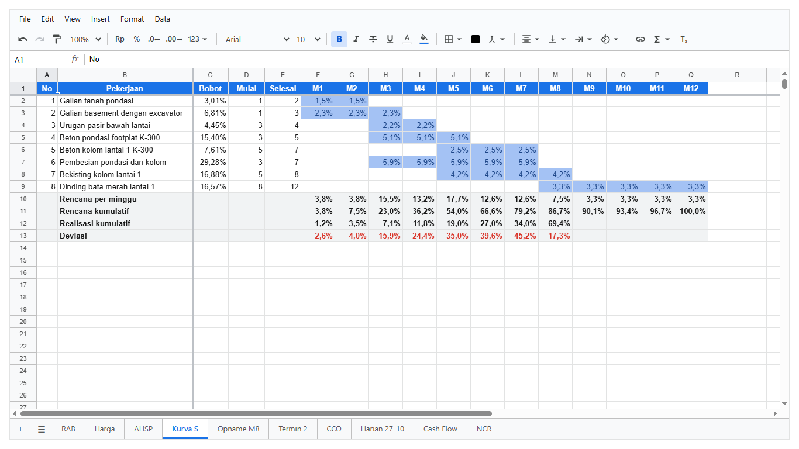

Distribusi linier jadwal pelaksanaan proyek selama 12 minggu durasi kontrak:
- Bobot pekerjaan dibaca langsung dari sheet `RAB` (`=RAB!H...`).
- Alokasi bobot mingguan dihitung merata sepanjang rentang minggu mulai hingga minggu selesai menggunakan formula logika matriks:
  ```excel
  =IF(AND(F$1>=$D2, F$1<=$E2), $C2/($E2-$D2+1), "")
  ```
- **Barchart Gantt otomatis**: Batang jadwal tidak diwarnai secara statis, melainkan digenerate oleh aturan conditional formatting berbasis formula `=AND(F$1>=$D2, F$1<=$E2)`. Ketika minggu pelaksanaan disunting, visualisasi grafik langsung bergeser secara reaktif.
- Garis agregasi kumulatif menghitung rencana mingguan, rencana kumulatif, realisasi aktual (diambil dari sheet Opname via named range `ProgresOpname`), dan deviasi varians jadwal. Sel deviasi negatif (keterlambatan) otomatis diberi aksen teks merah.

Kurva S visual dapat ditampilkan secara langsung di atas grid time schedule menggunakan floating line chart transparan yang dikalibrasi presisi terhadap sumbu koordinat sel:

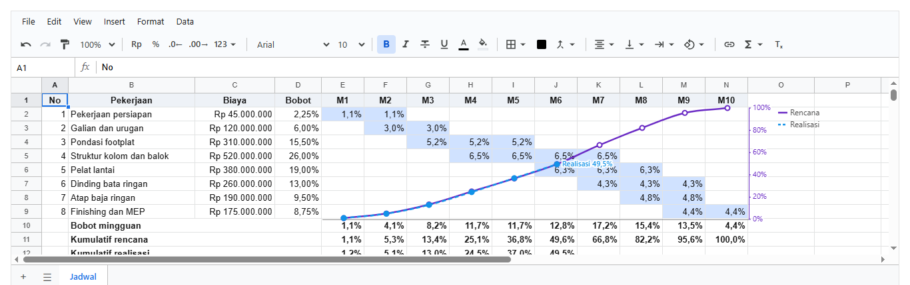

---

## 5. Executive Dashboard Visual Proyek

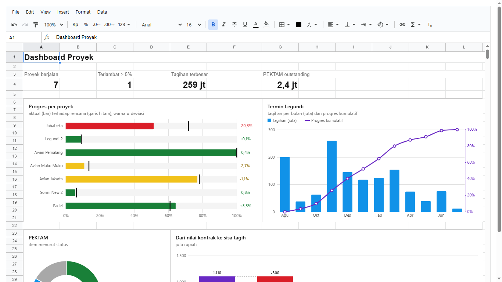

Lembar kerja eksekutif yang didedikasikan murni untuk visualisasi metrik performa (KPI) proyek. Seluruh elemen chart, sparklines, dan KPI card merujuk secara reaktif ke sheet data operasional:
- **KPI Metric Cards**: Menampilkan progres fisik aktual, varians deviasi waktu, sisa anggaran kontrak, dan estimasi waktu penyelesaian.
- **Bullet Chart**: Visualisasi pencapaian progres fisik aktual terhadap target rencana, lengkap dengan indikator toleransi ambang deviasi.
- **Dual-Axis Combo Chart**: Memadukan nilai penagihan termin bulanan (kolom) dengan kurva progres kumulatif (garis pada sumbu sekunder).
- **Donut Chart**: Distribusi proporsi status persetujuan pekerjaan tambah/kurang (CCO).
- **Waterfall Chart**: Rincian alur mutasi dari nilai kontrak awal, variasi CCO, pemotongan retensi & uang muka, hingga total piutang termin berjalan.
- **Tabel Kinerja Analitis**: Dilengkapi in-cell sparkline tren performa mingguan dan micro data-bars.

<!-- contoh: proyek/kurva-s.js -->
```js
// Kurva S (time schedule). Tiap pekerjaan dari RAB: bobotnya, minggu mulai dan selesai. Bobot dibagi rata ke minggu-minggu pelaksanaannya; batang
// gantt digambar oleh conditional formatting (rumus), bukan diwarnai tangan, jadi kalau jadwal digeser batangnya ikut. Di bawahnya: rencana per
// minggu, rencana kumulatif, realisasi kumulatif (minggu terakhir dari sheet Opname), dan deviasi.

export const JADWAL = [[1, 2], [1, 3], [3, 4], [3, 5], [5, 7], [3, 7], [5, 8], [8, 12]];
export const MINGGU = 12;
// realisasi kumulatif minggu 1-7 (dari laporan-laporan sebelumnya); minggu 8 dari sheet Opname
export const REALISASI_LALU = [0.012, 0.035, 0.071, 0.118, 0.19, 0.27, 0.34];

const col = (i) => String.fromCharCode(70 + i); // F, G, H, ... untuk minggu 1, 2, 3, ...

/** Sheet "Kurva S". `items` adalah pekerjaan RAB ({ row }). */
export function buatKurvaS(wb, items) {
    const sh = wb.sheet(wb.addSheet('Kurva S'));
    const last = col(MINGGU - 1);
    const head = ['No', 'Pekerjaan', 'Bobot', 'Mulai', 'Selesai'];
    for (let m = 1; m <= MINGGU; m++) head.push(m);
    sh.setValues('A1', [head]);
    const rows = items.map((it, i) => {
        const r = i + 2;
        const row = [i + 1, `=RAB!C${it.row}`, `=RAB!H${it.row}`, JADWAL[i][0], JADWAL[i][1]];
        for (let m = 0; m < MINGGU; m++) {
            const c = col(m);
            row.push(`=IF(AND(${c}$1>=$D${r}, ${c}$1<=$E${r}), $C${r}/($E${r}-$D${r}+1), "")`);
        }
        return row;
    });
    sh.setValues('A2', rows);
    const end = items.length + 1;
    const sum = end + 1;
    const lines = [['', 'Rencana per minggu'], ['', 'Rencana kumulatif'], ['', 'Realisasi kumulatif'], ['', 'Deviasi']];
    for (let m = 0; m < MINGGU; m++) {
        const c = col(m), prev = m ? col(m - 1) : null;
        lines[0].push(`=SUM(${c}2:${c}${end})`);
        lines[1].push(prev ? `=${prev}${sum + 1}+${c}${sum}` : `=${c}${sum}`);
        lines[2].push(m < REALISASI_LALU.length ? REALISASI_LALU[m] : m === REALISASI_LALU.length ? '=ProgresOpname' : '');
        lines[3].push(`=IF(${c}${sum + 2}="", "", ${c}${sum + 2}-${c}${sum + 1})`);
    }
    for (const line of lines) line.splice(2, 0, '', '', '');
    sh.setValues(`A${sum}`, lines);
    wb.addName('KurvaS', 'Kurva S', `E1:${last}${sum + 2}`);

    // tampilan
    sh.setStyle(`A1:${last}1`, { bold: true, fill: '#1a73e8', color: '#ffffff', align: 'center' });
    sh.setStyle(`F1:${last}1`, { format: { type: 'number', decimals: 0, prefix: 'M' } });
    sh.setStyle(`C2:C${end}`, { format: { type: 'percent', decimals: 2 } });
    sh.setStyle(`F2:${last}${sum + 3}`, { format: { type: 'percent', decimals: 1 } });
    sh.setStyle(`A${sum}:${last}${sum + 3}`, { bold: true, fill: '#f1f3f4' });
    sh.setColProps('A', { width: 36 });
    sh.setColProps('B', { width: 230 });
    sh.setColProps('C:E', { width: 62 });
    sh.setColProps(`F:${last}`, { width: 58 });
    sh.setSheetProps({ freezeRows: 1, freezeCols: 2 });
    // batang gantt: sel di dalam jadwal diwarnai, dari rumus yang sama dengan isinya
    sh.addConditional(`F2:${last}${end}`, { op: 'formula', formula: '=AND(F$1>=$D2, F$1<=$E2)', style: { fill: '#a4c2f4', color: '#1c4587' } });
    // deviasi negatif (terlambat) merah, positif hijau
    sh.addConditional(`F${sum + 3}:${last}${sum + 3}`, { op: 'lt', a: 0, style: { color: '#d93025' } });
    sh.addConditional(`F${sum + 3}:${last}${sum + 3}`, { op: 'gt', a: 0, style: { color: '#188038' } });
    // jadwal: minggu 1 sampai 12, selesai tidak sebelum mulai
    sh.addValidation(`D2:E${end}`, { kind: 'number', op: 'between', a: 1, b: MINGGU, help: 'Minggu ke-1 sampai ke-' + MINGGU });
    return { sh, sumRow: sum };
}
```
<!-- /contoh -->

---

## 6. Opname Kemajuan Fisik Mingguan

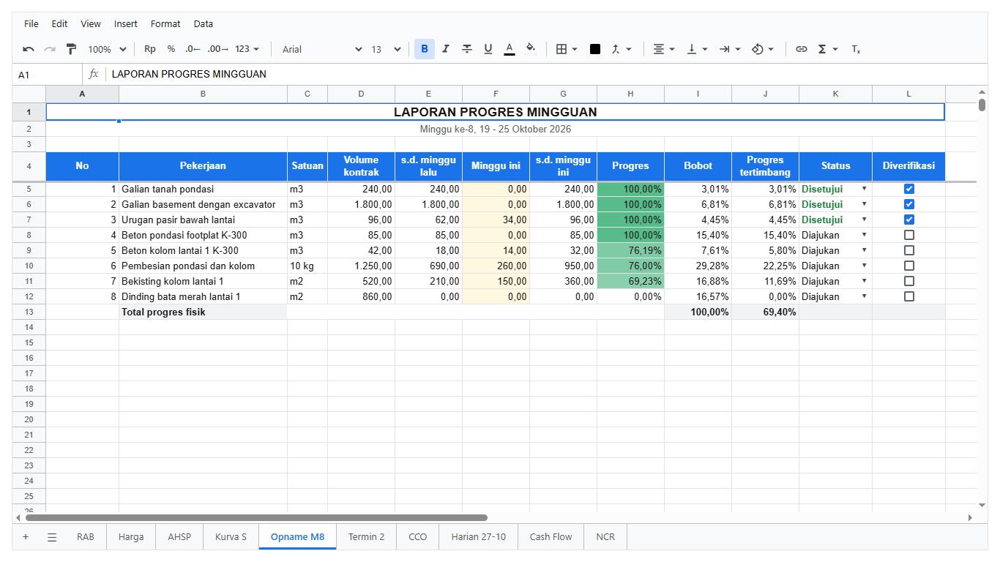

Lembar kerja monitoring progres mingguan (*Weekly Progress Assessment*):
- Kolom volume kontrak, satuan, dan bobot pekerjaan ditautkan langsung ke sheet `RAB`.
- Pengguna lapangan (Site Manager/Inspector) hanya mengisi kolom input volume **Minggu Ini** (ditandai dengan aksen latar kuning pastel).
- Volume kumulatif, persentase capaian pekerjaan, dan progres tertimbang dihitung secara otomatis.
- Total capaian fisik proyek dipublikasikan melalui named range `ProgresOpname`, yang secara bersamaan dikonsumsi oleh Kurva S dan formulir penagihan Termin.
- Validasi data diterapkan pada kolom status persetujuan (`Draft`, `Diajukan`, `Disetujui`, `Ditolak`) dan checkbox verifikasi pengawas.
- Proteksi integritas: jika volume kumulatif melebihi batas volume kontrak, baris tersebut secara otomatis ditandai dengan conditional formatting merah menyala.

<!-- contoh: proyek/opname.js -->
```js
// Opname (laporan progres) minggu ke-8. Volume kontrak, satuan dan bobot diambil dari RAB; site manager mengisi volume minggu ini; sisanya rumus:
// volume s.d. minggu ini, persentase, progres tertimbang, dan total progres fisik (named range ProgresOpname, dipakai Kurva S dan Termin).
// Volume yang melebihi kontrak ditandai merah. Baris yang sudah disetujui PM dikunci lewat aturan (bab 10).

// volume s.d. minggu lalu dan minggu ini, per pekerjaan RAB
export const VOLUME = [[240, 0], [1800, 0], [62, 34], [85, 0], [18, 14], [690, 260], [210, 150], [0, 0]];

/** Sheet "Opname M8". `items` adalah pekerjaan RAB ({ row }). */
export function buatOpname(wb, items) {
    const sh = wb.sheet(wb.addSheet('Opname M8'));
    sh.setValues('A1', [['LAPORAN PROGRES MINGGUAN'], ['Minggu ke-8, 19 - 25 Oktober 2026']]);
    sh.mergeCells('A1:L1');
    sh.mergeCells('A2:L2');
    sh.setStyle('A1', { bold: true, fontSize: 13, align: 'center' });
    sh.setStyle('A2', { align: 'center', color: '#5f6368' });
    sh.setValues('A4', [['No', 'Pekerjaan', 'Satuan', 'Volume kontrak', 's.d. minggu lalu', 'Minggu ini', 's.d. minggu ini', 'Progres', 'Bobot', 'Progres tertimbang', 'Status', 'Diverifikasi']]);
    const rows = items.map((it, i) => {
        const r = i + 5;
        return [i + 1, `=RAB!C${it.row}`, `=RAB!E${it.row}`, `=RAB!D${it.row}`, VOLUME[i][0], VOLUME[i][1],
            `=E${r}+F${r}`, `=IF(D${r}=0, 0, G${r}/D${r})`, `=RAB!H${it.row}`, `=H${r}*I${r}`, i < 3 ? 'Disetujui' : 'Diajukan', i < 3];
    });
    sh.setValues('A5', rows);
    const end = items.length + 4, total = end + 1;
    sh.setValues(`B${total}`, [['Total progres fisik', '', '', '', '', '', '', `=SUM(I5:I${end})`, `=SUM(J5:J${end})`]]);
    wb.addName('ProgresOpname', 'Opname M8', `J${total}`);

    sh.setStyle('A4:L4', { bold: true, fill: '#1a73e8', color: '#ffffff', align: 'center', valign: 'middle', wrap: 'wrap' });
    sh.setStyle(`B${total}:L${total}`, { bold: true, fill: '#f1f3f4' });
    sh.setStyle(`D5:G${end}`, { format: { type: 'number', decimals: 2 } });
    sh.setStyle(`F5:F${end}`, { fill: '#fff8e1' }); // kolom yang diisi site manager
    sh.setStyle(`H5:J${total}`, { format: { type: 'percent', decimals: 2 } });
    sh.setRowProps('4', { height: 40 });
    sh.setColProps('B', { width: 230 });
    sh.setColProps('C', { width: 55 });
    sh.setColProps('D:J', { width: 92 });
    sh.setSheetProps({ freezeRows: 4 });

    sh.addValidation(`F5:F${end}`, { kind: 'number', op: 'gte', a: 0, help: 'Volume yang dikerjakan minggu ini' });
    sh.addValidation(`K5:K${end}`, { kind: 'list', values: ['Draft', 'Diajukan', 'Disetujui', 'Ditolak'] });
    sh.addValidation(`L5:L${end}`, { kind: 'checkbox' });
    // melebihi volume kontrak: merah
    sh.addConditional(`G5:G${end}`, { op: 'formula', formula: '=G5>D5', style: { fill: '#f4c7c3', color: '#a50e0e', bold: true } });
    // progres per pekerjaan sebagai skala warna
    sh.addConditional(`H5:H${end}`, { kind: 'scale', min: { type: 'number', value: 0, color: '#ffffff' }, max: { type: 'number', value: 1, color: '#57bb8a' } });
    sh.addConditional(`K5:K${end}`, { op: 'textIs', a: 'Disetujui', style: { color: '#188038', bold: true } });
    sh.addConditional(`K5:K${end}`, { op: 'textIs', a: 'Ditolak', style: { color: '#d93025', bold: true } });
    return { sh, end, totalRow: total };
}
```
<!-- /contoh -->

---

## 7. Tagihan Termin & Sertifikat Pembayaran

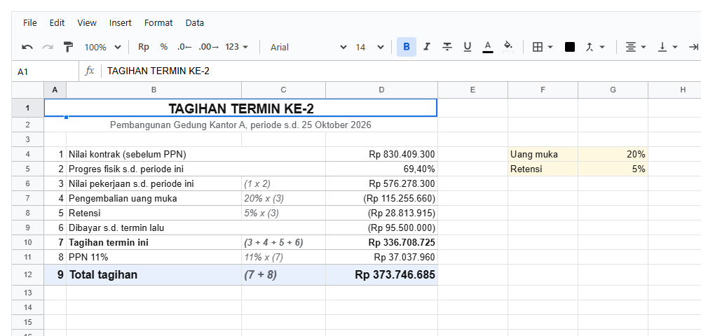

Formulir penagihan sertifikat pembayaran (*Payment Certificate / Interim Payment*):
- Mengadopsi tata letak formulir akuntansi resmi: label uraian di sisi kiri dan nilai moneter di kolom kanan.
- Seluruh angka tagihan dikalkulasikan secara dinamis:
  - Nilai kontrak awal diambil dari named range `=TotalRAB`.
  - Capaian progres fisik diambil dari named range `=ProgresOpname`.
  - Pemotongan pengembalian uang muka (20%) dan retensi jaminan pemeliharaan (5%) dikonfigurasi melalui sel parameter terisolasi bernama `UangMuka` dan `Retensi`.
  - Pengurangan akumulasi termin periode sebelumnya.
  - Perhitungan Pajak Pertambahan Nilai (PPN 11%) atas nilai bersih tagihan termin berjalan.
- Format mata uang akuntansi menampilkan angka negatif di dalam tanda kurung `(Rp ...)`.

<!-- contoh: proyek/termin.js -->
```js
// Termin (tagihan) ke-2. Bentuk formulir, bukan tabel: label di kiri, nilai di kanan, semuanya rumus dari RAB (nilai kontrak) dan Opname (progres).
// Pengembalian uang muka dan retensi dipotong dari nilai pekerjaan, termin yang sudah dibayar dikurangkan, lalu PPN. Rumus di sel uang dibulatkan
// ke rupiah oleh formatnya, jadi tidak ada sen yang tercecer.

/** Sheet "Termin 2". */
export function buatTermin(wb) {
    const sh = wb.sheet(wb.addSheet('Termin 2'));
    sh.setValues('A1', [['TAGIHAN TERMIN KE-2'], ['Pembangunan Gedung Kantor A, periode s.d. 25 Oktober 2026']]);
    sh.mergeCells('A1:D1');
    sh.mergeCells('A2:D2');
    sh.setStyle('A1', { bold: true, fontSize: 14, align: 'center' });
    sh.setStyle('A2', { align: 'center', color: '#5f6368' });
    sh.setValues('A4', [
        ['1', 'Nilai kontrak (sebelum PPN)', '', '=TotalRAB'],
        ['2', 'Progres fisik s.d. periode ini', '', '=ProgresOpname'],
        ['3', 'Nilai pekerjaan s.d. periode ini', '(1 x 2)', '=D4*D5'],
        ['4', 'Pengembalian uang muka', '20% x (3)', '=-D6*UangMuka'],
        ['5', 'Retensi', '5% x (3)', '=-D6*Retensi'],
        ['6', 'Dibayar s.d. termin lalu', '', -95500000],
        ['7', 'Tagihan termin ini', '(3 + 4 + 5 + 6)', '=SUM(D6:D9)'],
        ['8', 'PPN 11%', '11% x (7)', '=D10*11%'],
        ['9', 'Total tagihan', '(7 + 8)', '=D10+D11']
    ]);
    // tarif di sel sendiri, diberi nama: diubah di satu tempat, semua rumus ikut
    sh.setValues('F4', [['Uang muka', 0.2], ['Retensi', 0.05]]);
    wb.addName('UangMuka', 'Termin 2', 'G4');
    wb.addName('Retensi', 'Termin 2', 'G5');
    sh.setStyle('F4:G5', { fill: '#fff8e1' });
    sh.setStyle('G4:G5', { format: { type: 'percent', decimals: 0 } });

    sh.setStyle('D4:D12', { format: { type: 'money', decimals: 0, negative: 'parens' } });
    sh.setStyle('D5', { format: { type: 'percent', decimals: 2 } });
    sh.setStyle('C4:C12', { italic: true, color: '#5f6368' });
    sh.setStyle('A10:D10', { bold: true });
    sh.setStyle('A12:D12', { bold: true, fill: '#e8f0fe', fontSize: 12 });
    const LINE = { style: 'solid', width: 1, color: '#c0c0c0' };
    sh.setStyle('A4:D12', { borders: { bottom: LINE } });
    sh.setColProps('A', { width: 32 });
    sh.setColProps('B', { width: 250 });
    sh.setColProps('C', { width: 120 });
    sh.setColProps('D', { width: 160 });
    sh.setRowProps('12', { height: 30 });
    sh.setStyle('A12:D12', { valign: 'middle' });
    return sh;
}
```
<!-- /contoh -->

---

## 8. Contract Change Order (CCO / Variation Order)

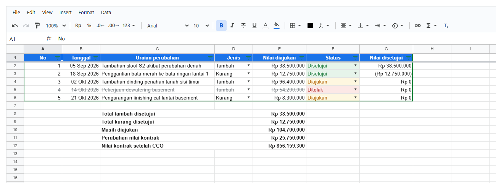

Register administrasi pekerjaan tambah/kurang (*Contract Change Order / Addendum*):
- Mencatat usulan variasi pekerjaan: tanggal pengajuan, deskripsi lingkup, klasifikasi jenis (`Tambah` / `Kurang`), nilai usulan, dan status persetujuan direksi pekerjaan.
- Nilai disetujui dievaluasi menggunakan formula logika bertingkat: bernilai 0 jika status belum disetujui, bernilai negatif jika pekerjaan kurang, dan bernilai positif jika pekerjaan tambah.
- Ringkasan akumulasi variasi dihitung menggunakan `SUMIFS` multi-kriteria untuk mengelompokkan total tambah dan total kurang yang telah disetujui.
- Nilai kontrak akhir proyek hasil addendum dikalkulasikan secara langsung terhadap nilai awal (`=TotalRAB + VariasiCCO`).
- Baris usulan yang berstatus `Ditolak` secara otomatis diformat dengan efek coret teks (*strikethrough*).

<!-- contoh: proyek/lapangan.js -->
```js
// Sheet-sheet lapangan dan administrasi: Laporan Harian (formulir), CCO (register perubahan pekerjaan), Cash Flow, dan NCR (register temuan mutu).

const LINE = { style: 'solid', width: 1, color: '#c0c0c0' };
const kotak = { top: LINE, right: LINE, bottom: LINE, left: LINE };

/** Sheet "Harian 27-10": formulir laporan harian yang diisi mandor. */
export function buatHarian(wb) {
    const sh = wb.sheet(wb.addSheet('Harian 27-10'));
    sh.setValues('A1', [['LAPORAN HARIAN PROYEK'], ['Pembangunan Gedung Kantor A']]);
    sh.mergeCells('A1:F1');
    sh.mergeCells('A2:F2');
    sh.setStyle('A1', { bold: true, fontSize: 14, align: 'center' });
    sh.setStyle('A2', { align: 'center', color: '#5f6368' });
    sh.setValues('A4', [['Tanggal', '27/10/2026', '', 'Hari ke-', '=B4-DATE(2026, 9, 1)+1']]);
    sh.setValues('A5', [['Cuaca pagi', 'Cerah', '', 'Cuaca siang', 'Hujan ringan']]);
    sh.setStyle('B4', { format: { type: 'date', pattern: 'dddd, d MMMM yyyy' } });
    sh.addValidation('B5', { kind: 'list', values: ['Cerah', 'Berawan', 'Hujan ringan', 'Hujan lebat'] });
    sh.addValidation('E5', { kind: 'list', values: ['Cerah', 'Berawan', 'Hujan ringan', 'Hujan lebat'] });

    // tenaga kerja dan alat berdampingan
    sh.setValues('A7', [['Tenaga kerja', 'Orang', '', 'Alat', 'Jam']]);
    sh.setValues('A8', [['Mandor', 2, '', 'Excavator 0,8 m3', 6], ['Tukang besi', 8, '', 'Concrete vibrator', 4], ['Tukang kayu', 6, '', 'Concrete pump', 3], ['Tukang batu', 4], ['Pekerja', 24]]);
    sh.setValues('A13', [['Jumlah', '=SUM(B8:B12)', '', 'Jumlah jam', '=SUM(E8:E12)']]);
    // material masuk
    sh.setValues('A15', [['Material masuk', 'Volume', 'Satuan', 'Pemasok', 'Diterima']]);
    sh.setValues('A16', [['Besi beton D13', 2.4, 'ton', 'PT Baja Prima', true], ['Beton ready mix K-300', 14, 'm3', 'PT Beton Kita', true], ['Bata merah', 6000, 'bh', 'UD Sumber Tanah', false]]);
    sh.addValidation('E16:E18', { kind: 'checkbox' });
    // pekerjaan hari ini dan kendala
    sh.setValues('A20', [['Pekerjaan hari ini'], ['Pengecoran kolom K1-K14 lantai 1 (14 m3), pembesian kolom K15-K28, pemasangan bekisting balok as A-C.'], [''], ['Kendala'], ['Hujan ringan 13.00-14.30, pengecoran ditunda 1,5 jam. Bata merah 6.000 bh ditolak: ukuran tidak seragam.']]);
    sh.mergeCells('A21:F22');
    sh.mergeCells('A24:F25');
    sh.setStyle('A21:F25', { wrap: 'wrap', valign: 'top' });
    // K3
    sh.setValues('A27', [['Pemeriksaan K3', 'OK'], ['APD lengkap', true], ['Rambu terpasang', true], ['Perancah diperiksa', false]]);
    sh.addValidation('B28:B30', { kind: 'checkbox' });

    for (const r of ['A4:A5', 'D4:D5', 'A7:E7', 'A15:E15', 'A20', 'A23', 'A27:B27']) sh.setStyle(r, { bold: true });
    for (const r of ['A7:B13', 'D7:E13', 'A15:E18', 'A27:B30']) sh.setStyle(r, { borders: kotak });
    for (const r of ['A7:E7', 'A15:E15', 'A27:B27']) sh.setStyle(r, { fill: '#e8f0fe' });
    sh.setStyle('A13:E13', { bold: true });
    sh.setColProps('A', { width: 170 });
    sh.setColProps('B', { width: 130 });
    sh.setColProps('C', { width: 50 });
    sh.setColProps('D', { width: 150 });
    sh.setColProps('E', { width: 115 });
    sh.setRowProps('21:22', { height: 26 });
    sh.setRowProps('24:25', { height: 26 });
    // material yang belum diterima kelihatan
    sh.addConditional('A16:E18', { op: 'formula', formula: '=$E16=FALSE', style: { fill: '#fce8e6' } });
    return sh;
}

/** Sheet "CCO": register perubahan pekerjaan (tambah / kurang), dengan nilai yang disetujui. */
export function buatCco(wb) {
    const sh = wb.sheet(wb.addSheet('CCO'));
    sh.setValues('A1', [['No', 'Tanggal', 'Uraian perubahan', 'Jenis', 'Nilai diajukan', 'Status', 'Nilai disetujui']]);
    const data = [
        ['05/09/2026', 'Tambahan sloof S2 akibat perubahan denah', 'Tambah', 38500000, 'Disetujui'],
        ['18/09/2026', 'Penggantian bata merah ke bata ringan lantai 1', 'Kurang', 12750000, 'Disetujui'],
        ['02/10/2026', 'Tambahan dinding penahan tanah sisi timur', 'Tambah', 96400000, 'Diajukan'],
        ['14/10/2026', 'Pekerjaan dewatering basement', 'Tambah', 54200000, 'Ditolak'],
        ['21/10/2026', 'Pengurangan finishing cat lantai basement', 'Kurang', 8300000, 'Diajukan']
    ];
    sh.setValues('A2', data.map((d, i) => [i + 1, ...d, `=IF(F${i + 2}<>"Disetujui", 0, IF(D${i + 2}="Kurang", -E${i + 2}, E${i + 2}))`]));
    const end = data.length + 1;
    sh.setValues(`C${end + 2}`, [
        ['Total tambah disetujui', '', `=SUMIFS(E2:E${end}, D2:D${end}, "Tambah", F2:F${end}, "Disetujui")`],
        ['Total kurang disetujui', '', `=SUMIFS(E2:E${end}, D2:D${end}, "Kurang", F2:F${end}, "Disetujui")`],
        ['Masih diajukan', '', `=SUMIFS(E2:E${end}, F2:F${end}, "Diajukan")`],
        ['Perubahan nilai kontrak', '', `=SUM(G2:G${end})`],
        ['Nilai kontrak setelah CCO', '', '=TotalRAB+E' + (end + 5)]
    ]);
    sh.setStyle('A1:G1', { bold: true, fill: '#1a73e8', color: '#ffffff', align: 'center' });
    sh.setStyle(`B2:B${end}`, { format: { type: 'date', pattern: 'dd MMM yyyy' } });
    sh.setStyle(`E2:G${end + 6}`, { format: { type: 'money', decimals: 0, negative: 'parens' } });
    sh.setStyle(`C${end + 2}:E${end + 6}`, { bold: true });
    sh.setColProps('C', { width: 300 });
    sh.setColProps('E:G', { width: 140 });
    sh.setSheetProps({ freezeRows: 1 });
    sh.addValidation(`D2:D${end}`, { kind: 'list', values: ['Tambah', 'Kurang'] });
    sh.addValidation(`F2:F${end}`, { kind: 'list', values: ['Diajukan', 'Disetujui', 'Ditolak'] });
    sh.addConditional(`F2:F200`, { op: 'textIs', a: 'Disetujui', style: { fill: '#e6f4ea', color: '#137333' } });
    sh.addConditional(`F2:F200`, { op: 'textIs', a: 'Ditolak', style: { fill: '#fce8e6', color: '#a50e0e' } });
    sh.addConditional(`F2:F200`, { op: 'textIs', a: 'Diajukan', style: { fill: '#fef7e0', color: '#b06000' } });
    sh.addConditional(`A2:E200`, { op: 'formula', formula: '=$F2="Ditolak"', style: { strike: true, color: '#80868b' } });
    sh.createFilter(`A1:G${end}`);
    return sh;
}

/** Sheet "Cash Flow": rencana dan realisasi uang masuk dan keluar per bulan, saldo kumulatif. */
export function buatCashFlow(wb) {
    const sh = wb.sheet(wb.addSheet('Cash Flow'));
    const bulan = ['Agu 2026', 'Sep 2026', 'Okt 2026', 'Nov 2026', 'Des 2026', 'Jan 2027'];
    sh.setValues('A1', [['Uraian', ...bulan, 'Total']]);
    const rows = [
        ['Uang muka', 184350800, 0, 0, 0, 0, 0],
        ['Penerimaan termin', 0, 95500000, 0, 210000000, 260000000, 251000000],
        ['Pengeluaran material', -38000000, -152000000, -186000000, -140000000, -98000000, -45000000],
        ['Pengeluaran upah', -21000000, -48000000, -56000000, -52000000, -44000000, -30000000],
        ['Pengeluaran alat', -12000000, -26000000, -18000000, -9000000, -6000000, -3000000],
        ['Overhead lapangan', -9000000, -9000000, -9000000, -9000000, -9000000, -9000000]
    ];
    sh.setValues('A2', rows.map((row, i) => [...row, `=SUM(B${i + 2}:G${i + 2})`]));
    const n = rows.length + 1;
    const arus = ['Arus kas bersih'], saldo = ['Saldo kumulatif'];
    for (let c = 0; c < bulan.length + 1; c++) {
        const L = String.fromCharCode(66 + c);
        arus.push(`=SUM(${L}2:${L}${n})`);
        saldo.push(c === bulan.length ? '' : c ? `=${String.fromCharCode(65 + c)}${n + 2}+${L}${n + 1}` : `=${L}${n + 1}`);
    }
    sh.setValues(`A${n + 1}`, [arus, saldo]);
    sh.setStyle('A1:H1', { bold: true, fill: '#1a73e8', color: '#ffffff', align: 'center' });
    sh.setStyle(`B2:H${n + 2}`, { format: { type: 'money', decimals: 0, negative: 'parens' } });
    sh.setStyle(`A${n + 1}:H${n + 2}`, { bold: true, fill: '#f1f3f4' });
    sh.setStyle(`H1:H${n + 1}`, { bold: true });
    sh.setColProps('A', { width: 170 });
    sh.setColProps('B:H', { width: 125 });
    sh.setSheetProps({ freezeCols: 1, freezeRows: 1 });
    // saldo negatif (perlu dana talangan) merah
    sh.addConditional(`B${n + 1}:G${n + 2}`, { op: 'lt', a: 0, style: { fill: '#fce8e6', color: '#a50e0e' } });
    return sh;
}

/** Sheet "NCR": register ketidaksesuaian mutu, umur temuan yang masih terbuka, tenggat lewat ditandai. */
export function buatNcr(wb) {
    const sh = wb.sheet(wb.addSheet('NCR'));
    sh.setValues('A1', [['No', 'Tanggal', 'Lokasi', 'Temuan', 'PIC', 'Tenggat', 'Status', 'Umur (hari)']]);
    const data = [
        ['02/10/2026', 'Pondasi F12', 'Selimut beton kurang dari 5 cm', 'Andi', '09/10/2026', 'Closed'],
        ['10/10/2026', 'Kolom K7 lt.1', 'Keropos pada sambungan cor', 'Budi', '17/10/2026', 'Open'],
        ['15/10/2026', 'Gudang material', 'Besi D13 berkarat, tidak ditutup terpal', 'Sari', '18/10/2026', 'Open'],
        ['22/10/2026', 'Bekisting balok B3', 'Penyangga tidak tegak lurus', 'Budi', '30/10/2026', 'Open']
    ];
    sh.setValues('A2', data.map((d, i) => [`NCR-${String(i + 1).padStart(3, '0')}`, ...d, `=IF(G${i + 2}="Closed", "", TODAY()-B${i + 2})`]));
    const end = data.length + 1;
    sh.setValues(`D${end + 2}`, [['Masih terbuka', `=COUNTIF(G2:G${end}, "Open")`], ['Lewat tenggat', `=COUNTIFS(G2:G${end}, "Open", F2:F${end}, "<"&TODAY())`]]);
    sh.setStyle('A1:H1', { bold: true, fill: '#1a73e8', color: '#ffffff', align: 'center' });
    sh.setStyle(`B2:B${end}`, { format: { type: 'date', pattern: 'dd/MM/yyyy' } });
    sh.setStyle(`F2:F${end}`, { format: { type: 'date', pattern: 'dd/MM/yyyy' } });
    sh.setStyle(`D${end + 2}:E${end + 3}`, { bold: true });
    sh.setColProps('C', { width: 140 });
    sh.setColProps('D', { width: 280 });
    sh.setSheetProps({ freezeRows: 1 });
    sh.addValidation(`G2:G${end}`, { kind: 'list', values: ['Open', 'Closed'] });
    // tenggat sudah lewat dan masih terbuka: satu baris merah
    sh.addConditional('A2:H200', { op: 'formula', formula: '=AND($G2="Open", $F2<TODAY())', style: { fill: '#fce8e6', color: '#a50e0e' } });
    sh.addConditional('G2:G200', { op: 'textIs', a: 'Closed', style: { color: '#188038' } });
    sh.createFilter(`A1:H${end}`);
    return sh;
}
```
<!-- /contoh -->

---

## 9. Laporan Harian Operasional & Inspeksi K3

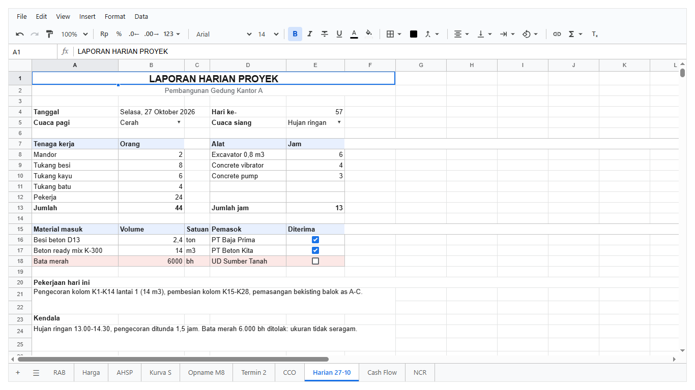

Formulir digital inspeksi harian lapangan yang dirancang untuk pengisian cepat:
- Kalender tanggal dengan format lokal Indonesia lengkap (`dddd, d MMMM yyyy`) serta perhitungan otomatis nomor hari pelaksanaan proyek via formula `=Tanggal - TanggalMulai + 1`.
- Pemantauan kondisi cuaca (pagi dan siang) melalui dropdown selector.
- Pencatatan matriks komposisi tenaga kerja (mandor, tukang batu, tukang besi, tukang kayu, pekerja) berdampingan dengan jam operasi utilisasi alat berat.
- Log penerimaan logistik material dengan checkbox penerimaan. Baris material yang belum diverifikasi diberi warna peringatan otomatis.
- Catatan deskripsi pekerjaan, insiden kendala cuaca/teknis pada sel *merged* dengan opsi text wrapping.
- Checklist kepatuhan standar keselamatan kerja (K3/HSE).

---

## 10. Proyeksi Arus Kas (Cash Flow) Proyek

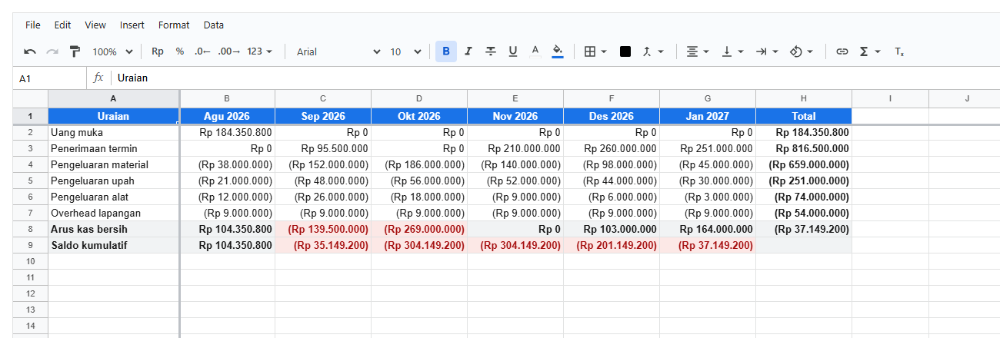

Model finansial arus kas proyek (*Project Cash Flow Projection*):
- Proyeksi bulanan penerimaan kas (termin pembayaran dan uang muka) versus pengeluaran kas (belanja material, upah mingguan tenaga kerja, sewa alat, dan overhead operasional kantor lapangan).
- Perhitungan otomatis arus kas bersih bulanan (*net cash flow*) dan saldo kas kumulatif.
- Baris judul dan kolom deskripsi dikunci menggunakan fitur *freeze panes* ganda.
- Deteksi dini defisit keuangan: sel saldo kumulatif yang bernilai negatif secara otomatis diberi warna merah muda sebagai peringatan kebutuhan dana talangan (*bridging financing*).

---

## 11. Manajemen Ketidaksesuaian Mutu (Register NCR)

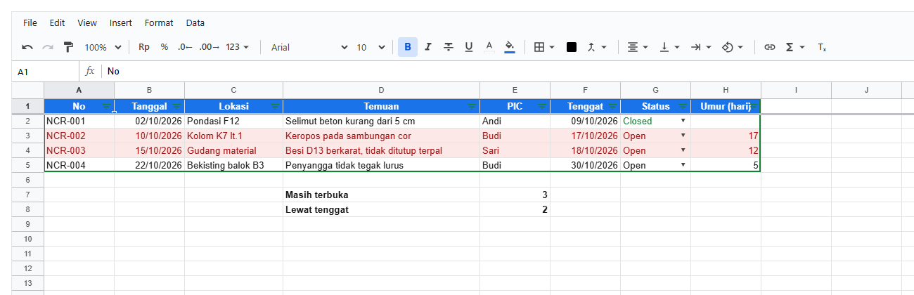

Register pengendalian mutu penanganan ketidaksesuaian (*Non-Conformance Report / Quality Audit*):
- Mencatat temuan inspeksi mutu, lokasi elemen struktur, penanggung jawab lapangan (PIC), dan target tenggat penyelesaian (*due date*).
- Menghitung umur temuan secara reaktif menggunakan formula `=IF(Status="Closed", "", TODAY() - TanggalTemuan)`.
- Rekapitulasi indikator performa mutu via agregasi `COUNTIF` dan `COUNTIFS` (jumlah temuan terbuka serta jumlah temuan yang telah melewati batas tenggat).
- Temuan berstatus terbuka yang telah melampaui tenggat waktu secara otomatis diberi tanda penekanan merah di sepanjang baris data.

---

## 12. Arsitektur Agregasi Server-Side Multi-File (Executive Overview)

Pada sistem produksi skala perusahaan, setiap tim lapangan atau divisi kontraktor mengelola berkas lembar kerja opname terpisah pada penyimpanan cloud. Dasbor overview eksekutif menyajikan konsolidasi kurva S seluruh divisi secara terpusat.

Prinsip arsitektur yang diterapkan:
1. **Named Range sebagai Kontrak Data**: Setiap berkas opname divisi wajib mendefinisikan named range `Progres` dengan skema kolom yang seragam (`Minggu`, `Tim`, `Rencana`, `Realisasi`).
2. **Ekstraksi Headless di Server**: Server membaca seluruh workbook tanpa rendering UI menggunakan `tableOf(wb, null, 'Progres')`.
3. **Agregasi Multi-File Tanpa Dependency File-Locking**: Modul `pivot` menjumlahkan bobot per minggu dan menghitung kurva kumulatif di lingkungan backend Node.js.
4. **Distribusi Tampilan Read-Only Aman**: Hasil kompilasi dikirim ke antarmuka `<Sheet>` pengguna dengan profil ACL ketat (tanpa menu, toolbar, atau formula bar).

<!-- contoh: galeri-overview.js -->
```js
import { createWorkbook, tableOf, pivot } from '@kufayeka/sheet/core';

// ---- storage file proyek (di aplikasi sungguhan: tabel atau file di server). Tiap tim mengisi file opname-nya sendiri tiap minggu, dan tiap file
// punya named range "Progres" berisi kolom Minggu, Tim, Rencana, Realisasi. Named range itu "kontrak" antar file: overview cuma bergantung padanya.
function fileOpname(tim, baris) {
    const wb = createWorkbook();
    wb.setValues('Sheet1', 'A1', [['Catatan internal tim ' + tim], [], ['Minggu', 'Tim', 'Rencana', 'Realisasi'], ...baris.map((b) => [b[0], tim, b[1], b[2]])]);
    wb.addName('Progres', 'Sheet1', 'A3:D' + (baris.length + 3));
    return wb.toJSON();
}
const storage = {
    'opname-sipil.sheet': fileOpname('Sipil', [[1, 0.020, 0.012], [2, 0.025, 0.023], [3, 0.090, 0.036], [4, 0.080, 0.047], [5, 0.110, 0.072], [6, 0.085, 0.080], [7, 0.085, 0.070], [8, 0.050, 0.240]]),
    'opname-mep.sheet': fileOpname('MEP', [[5, 0.005, 0.000], [6, 0.008, 0.004], [7, 0.010, 0.006], [8, 0.012, 0.004]])
};

// ---- di server, tiap kali halaman overview dibuka: baca semua file opname, jumlahkan per minggu, buat kumulatif
export function hitungOverview(files) {
    const records = Object.values(files).flatMap((doc) => tableOf(createWorkbook(doc), null, 'Progres').records);
    const perMinggu = pivot(records, {
        rows: ['Minggu'],
        values: [{ field: 'Rencana', fn: 'SUM', as: 'Rencana' }, { field: 'Realisasi', fn: 'SUM', as: 'Realisasi' }],
        totals: false
    });
    let rencana = 0, realisasi = 0;
    return perMinggu.rows.map((r) => {
        const [minggu, rc, rl] = r.cells;
        rencana += rc;
        realisasi += rl;
        return [minggu, rc, rl, Math.round(rencana * 1e4) / 1e4, Math.round(realisasi * 1e4) / 1e4];
    });
}

// dijalankan langsung (node docs/examples/galeri-overview.js): cetak tabelnya
if (typeof process !== 'undefined' && process.argv[1] && process.argv[1].endsWith('galeri-overview.js')) {
    console.log('Minggu | Rencana | Realisasi | Rencana kum. | Realisasi kum.');
    for (const row of hitungOverview(storage)) console.log(row.map((v, i) => (i ? (v * 100).toFixed(1) + '%' : String(v))).join(' | '));
}
export { storage };
```
<!-- /contoh -->

<!-- hasil: galeri-overview.js -->
```text
Minggu | Rencana | Realisasi | Rencana kum. | Realisasi kum.
1 | 2.0% | 1.2% | 2.0% | 1.2%
2 | 2.5% | 2.3% | 4.5% | 3.5%
3 | 9.0% | 3.6% | 13.5% | 7.1%
4 | 8.0% | 4.7% | 21.5% | 11.8%
5 | 11.5% | 7.2% | 33.0% | 19.0%
6 | 9.3% | 8.4% | 42.3% | 27.4%
7 | 9.5% | 7.6% | 51.8% | 35.0%
8 | 6.2% | 24.4% | 58.0% | 59.4%
```
<!-- /hasil -->

Implementasi komponen dasbor overview read-only pada antarmuka web:

<!-- contoh: galeri-overview.page.js -->
```jsx
import { useState } from 'react';
import { Sheet } from '@kufayeka/sheet';
import { createWorkbook } from '@kufayeka/sheet/core';
import '@kufayeka/sheet/style.css';
import { hitungOverview, storage } from './galeri-overview.js';

// Halaman overview proyek: tabel kurva S hasil hitungan server, dihitung ulang tiap halaman dibuka, tidak bisa diedit.
function bukaOverview() {
    // di aplikasi sungguhan: const rows = await fetch('/api/proyek/1/overview/kurva-s').then((r) => r.json());
    const rows = hitungOverview(storage);
    const wb = createWorkbook();
    wb.setSettings({ locale: 'id-ID' });
    const sh = wb.sheet('Sheet1');
    sh.setSheetProps({ name: 'Kurva S' });
    sh.setValues('A1', [['Minggu', 'Rencana', 'Realisasi', 'Rencana kumulatif', 'Realisasi kumulatif', 'Deviasi'],
        ...rows.map((r, i) => [...r, `=E${i + 2}-D${i + 2}`])]);
    const end = rows.length + 1;
    sh.setStyle('A1:F1', { bold: true, fill: '#1a73e8', color: '#ffffff', align: 'center', wrap: 'wrap' });
    sh.setStyle(`A2:A${end}`, { align: 'center', format: { type: 'number', decimals: 0, prefix: 'M' } });
    sh.setStyle(`B2:F${end}`, { format: { type: 'percent', decimals: 1 } });
    sh.setColProps('B:F', { width: 120 });
    sh.setRowProps('1', { height: 36 });
    sh.addConditional(`F2:F${end}`, { op: 'lt', a: 0, style: { color: '#d93025', bold: true } });
    sh.addConditional(`F2:F${end}`, { op: 'gte', a: 0, style: { color: '#188038', bold: true } });
    sh.addConditional(`E2:E${end}`, { kind: 'scale', min: { type: 'number', value: 0, color: '#ffffff' }, max: { type: 'number', value: 1, color: '#57bb8a' } });
    return wb;
}

// siapa pun yang membuka overview cuma melihat: tanpa menu, toolbar, formula bar, tab; hanya area tabelnya
const HANYA_LIHAT = [
    { who: '*', effect: 'allow', action: 'read', where: 'A1:F9' },
    { who: '*', effect: 'allow', action: 'copy' },
    { who: '*', effect: 'allow', action: 'download' },
    { who: '*', effect: 'allow', action: 'view.area', where: 'A1:F9' },
    { who: '*', effect: 'deny', action: 'ui.menubar' },
    { who: '*', effect: 'deny', action: 'ui.toolbar' },
    { who: '*', effect: 'deny', action: 'ui.formulaBar' },
    { who: '*', effect: 'deny', action: 'ui.tabs' }
];

export default function HalamanOverview() {
    const [wb] = useState(bukaOverview);
    return (
        <div style={{ height: 300 }}>
            <Sheet workbook={wb} access={{ rows: HANYA_LIHAT, who: 'owner' }} />
        </div>
    );
}
```
<!-- /contoh -->

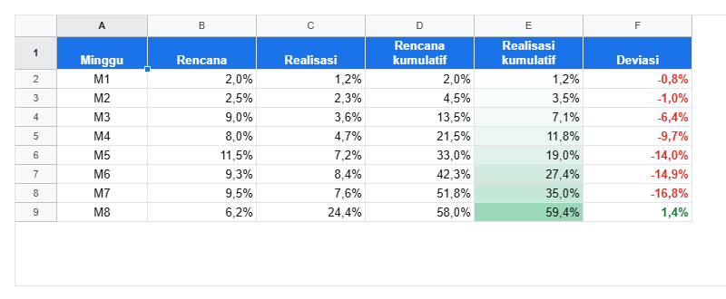

---

## 13. Integrasi Penuh & Kode Sumber Modul

Penyusunan seluruh lembar kerja di atas dirangkum dalam fungsi pabrik (*factory function*) `buatProyek(options)`. Modul ini menginisialisasi workbook, mengatur locale Indonesia (`id-ID`), membangun seluruh 10 lembar kerja secara berurutan, dan mempublikasikan state siap pakai:

<!-- contoh: proyek/index.js -->
```js
// Satu workbook proyek yang saling terhubung, dipakai contoh-contoh di dokumentasi:
//
//   Harga ──► AHSP ──► RAB ──► Kurva S ◄── Opname M8 ──► Termin 2
//                       │                                   ▲
//                       └──────────────► CCO ───────────────┘ (nilai kontrak)
//   Harian 27-10, Cash Flow, NCR
//
// Ubah satu harga di sheet Harga: analisa, RAB, bobot, kurva S, termin dan CCO ikut berubah.
import { createWorkbook } from '@kufayeka/sheet/core';
import { buatHarga, buatAhsp } from './harga-ahsp.js';
import { buatRab } from './rab.js';
import { buatKurvaS } from './kurva-s.js';
import { buatOpname } from './opname.js';
import { buatTermin } from './termin.js';
import { buatHarian, buatCco, buatCashFlow, buatNcr } from './lapangan.js';

/**
 * Workbook "Proyek Gedung A".
 * @param {object} [options]  Diteruskan ke createWorkbook (user, beforeOp, now ...).
 */
export function buatProyek(options) {
    // jam dipatok supaya TODAY() (umur NCR, hari ke-) selalu sama di contoh dan gambarnya
    const wb = createWorkbook(null, { now: () => new Date(2026, 9, 27, 9, 0), ...options });
    wb.setSettings({ locale: 'id-ID', currency: 'IDR' });
    buatHarga(wb);
    buatAhsp(wb);
    const rab = buatRab(wb);
    buatKurvaS(wb, rab.items);
    buatOpname(wb, rab.items);
    buatTermin(wb);
    buatCco(wb);
    buatHarian(wb);
    buatCashFlow(wb);
    buatNcr(wb);
    // sheet kosong bawaan createWorkbook tidak dipakai; RAB di depan
    wb.removeSheet('Sheet1');
    wb.moveSheet('RAB', 0);
    wb.saved(wb.pendingPatch());
    return wb;
}
```
<!-- /contoh -->

Penyematan instansi workbook proyek ke dalam komponen React dilakukan secara deklaratif:

<!-- contoh: proyek.page.js -->
```jsx
import { useRef, useState } from 'react';
import { Sheet } from '@kufayeka/sheet';
import '@kufayeka/sheet/style.css';
import { buatProyek } from './proyek/index.js';

// Workbook proyek di layar: sepuluh sheet yang saling terhubung, bisa diedit langsung di layar.
export default function HalamanProyek() {
    const [wb] = useState(() => buatProyek());
    return (
        <div style={{ height: '100%' }}>
            <Sheet workbook={wb} fileName="Proyek Gedung A" />
        </div>
    );
}
```
<!-- /contoh -->

---

[Daftar Isi](../README.md#daftar-isi)
